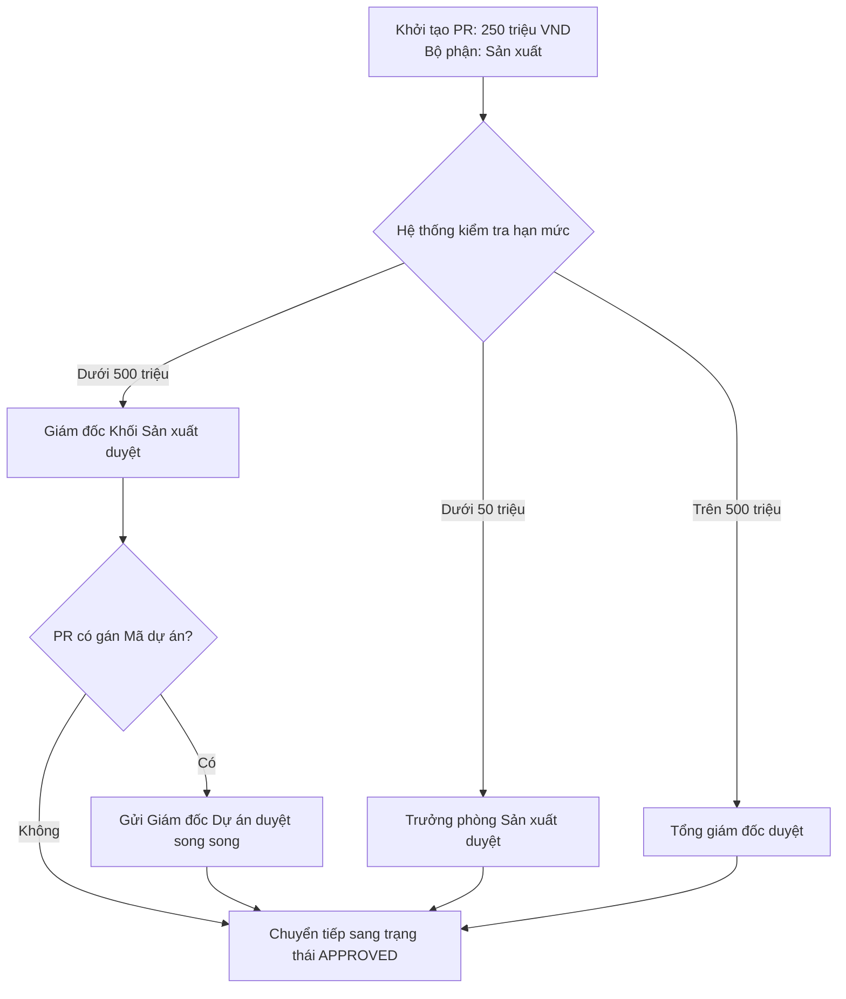

# 3010 Luồng phê duyệt PR theo phòng ban và dự án

Quy trình phê duyệt Yêu cầu mua hàng (PR) là chốt chặn kiểm soát ngân sách và kiểm soát rủi ro chi tiêu ban đầu của doanh nghiệp. Thiết lập luồng phê duyệt PR tự động theo phòng ban (Department), trung tâm chi phí (Cost Center) và dự án (Project) giúp doanh nghiệp vận hành linh hoạt ma trận phê duyệt đa chiều mà không cần xử lý thủ công các chứng từ giấy.

---

## 1. Khái niệm cốt lõi trong PR Approval Workflow

Một luồng phê duyệt PR trong hệ thống ERP được cấu trúc dựa trên ba trục điều kiện chính:

*   **Hạn mức phê duyệt (Approval Limit):** Số tiền tối đa mà một vị trí hoặc chức danh (Position/Title) được phép phê duyệt (ví dụ: Trưởng phòng duyệt tối đa 50 triệu, Giám đốc khối duyệt tối đa 500 triệu, Tổng giám đốc duyệt không giới hạn).
*   **Phân cấp quản lý (Hierarchy):**
    *   *Employee/Supervisor Hierarchy:* Luồng duyệt đi trực tiếp từ nhân viên lên người quản lý trực tiếp dựa trên sơ đồ nhân sự.
    *   *Position Hierarchy:* Luồng duyệt đi theo chức danh công việc, không phụ thuộc vào người cụ thể nắm giữ vị trí đó (giúp hệ thống không bị lỗi khi có sự thay đổi nhân sự).
*   **Duyệt theo điều kiện động (Dynamic Routing):** Hệ thống tự động chuyển tiếp chứng từ đến các bộ phận liên quan dựa trên dữ liệu nhập liệu:
    *   *Duyệt theo Trung tâm chi phí (Cost Center):* Chuyển đến đúng Trưởng bộ phận sở hữu ngân sách của phòng ban đó.
    *   *Duyệt theo Dự án (Project):* Chuyển đến đúng Giám đốc dự án (Project Manager) để ký duyệt chi phí dự án.

---

## 2. Ba phương pháp phân cấp phê duyệt phổ biến trong ERP

Bất kể chạy trên nền tảng Oracle EBS, Epicor, SAP hay Odoo, mọi hệ thống ERP đều xây dựng luồng phê duyệt PR dựa trên một (hoặc kết hợp) ba phương pháp phân cấp sau:

### A. Phân cấp theo Quan hệ Quản lý trực tiếp (Employee/Supervisor Hierarchy)

Luồng duyệt đi theo đúng sơ đồ tổ chức nhân sự thực tế: chứng từ của nhân viên A được chuyển thẳng đến người quản lý trực tiếp của A, dựa trên quan hệ báo cáo (`Reports To`) khai báo tại hồ sơ nhân sự. Hạn mức phê duyệt thường được gán theo **chức vụ công việc (Job/Title)** của người quản lý đó.

*   **Ưu điểm:** Dễ triển khai, phản ánh đúng cơ cấu quản lý thực tế, không cần xây dựng thêm cây tổ chức riêng cho mục đích phê duyệt.
*   **Nhược điểm:** Rủi ro **treo phê duyệt** khi người quản lý nghỉ việc, nghỉ phép dài hạn, hoặc hồ sơ nhân sự chưa kịp cập nhật quan hệ báo cáo mới.

### B. Phân cấp theo Chức danh/Vị trí độc lập (Position Hierarchy)

Luồng duyệt đi theo một **cây chức danh (Position)** được khai báo độc lập, tách rời khỏi con người cụ thể đang giữ chức danh đó. Hạn mức phê duyệt được gán trực tiếp vào Position, không phải vào cá nhân.

*   **Ưu điểm:** Khi thay đổi nhân sự, quản trị viên chỉ cần gán người mới vào đúng Position có sẵn — không cần cấu hình lại ma trận hạn mức.
*   **Nhược điểm:** Đòi hỏi đầu tư thời gian khai báo cây Position ngay từ đầu, phù hợp với tổ chức có cơ cấu chức danh ổn định, ít biến động.

### C. Phân cấp theo Quy tắc động đa điều kiện (Rule-based / Matrix Approval Engine)

Thay vì đi theo một cây tổ chức cố định, hệ thống định tuyến chứng từ dựa trên **tổ hợp nhiều điều kiện cùng lúc**: số tiền, phòng ban, dự án, loại hàng hóa, nhà cung cấp... Mỗi điều kiện ứng với một quy tắc (Rule) độc lập, cho phép duyệt song song (Parallel Approval) hoặc duyệt tuần tự tùy cấu hình.

*   **Ưu điểm:** Linh hoạt nhất, xử lý tốt các ma trận phê duyệt phức tạp (ví dụ: PR thuộc dự án cần cả Trưởng phòng lẫn Giám đốc dự án cùng duyệt).
*   **Nhược điểm:** Cấu hình phức tạp hơn hai phương pháp trên, đòi hỏi đội ngũ IT hiểu rõ cách khai báo điều kiện.

> **Lưu ý:** Ba phương pháp trên **không loại trừ lẫn nhau**. Trong thực tế, đa số hệ thống ERP hiện đại cho phép kết hợp: dùng (A) hoặc (B) làm khung phân cấp nền, sau đó phủ thêm (C) để xử lý các điều kiện đặc thù (ví dụ: dự án, phòng ban đặc biệt) mà khung nền không đáp ứng được.

### Bản đồ triển khai theo từng hệ thống ERP

| Phương pháp | Oracle EBS | Epicor ERP | SAP ERP | Odoo |
| :--- | :--- | :--- | :--- | :--- |
| **(A) Employee/Supervisor** | Gán hạn mức theo `Job` tại bảng `po_job_controls` | Trường `Approval Person` tại màn hình `Buyer` | Không phải cơ chế chuẩn — SAP thiên về Release Strategy độc lập khỏi sơ đồ nhân sự | Không có — chỉ phân theo nhóm quyền (`Purchase Manager`), không theo quan hệ báo cáo |
| **(B) Position Hierarchy** | Gán hạn mức theo `Position` tại bảng `po_position_controls` | Không hỗ trợ native; thường mô phỏng bằng cách gán `PurAgentID` cố định theo vai trò | Khả thi nhưng cần customization, tham chiếu đến HR Org Structure | Không hỗ trợ |
| **(C) Rule-based Engine** | AME – Approval Management Engine | User Purchase Authorization (`Max Amount` theo từng `User ID`) | **Release Strategy** (`CL20N`/`CL24N`) — ghép Characteristic (`CT04`) + Class (`CL02`) + Release Code theo giá trị, nhà máy, tổ chức mua hàng, nhà cung cấp | **Double Validation** — một ngưỡng giá trị duy nhất cấu hình tại General Settings, chỉ 2 cấp (User → Purchase Manager); muốn nhiều cấp/điều kiện hơn phải cài thêm app bên thứ ba |

> **Điểm khác biệt đáng chú ý:** SAP và Oracle EBS đều đủ mạnh để xây ma trận phê duyệt đa chiều phức tạp (nhiều điều kiện, nhiều cấp duyệt song song). Ngược lại, Odoo bản chuẩn (không tùy biến thêm module) chỉ dừng ở mức "có/không cần duyệt thêm một lần" khi vượt một ngưỡng giá trị — đây là giới hạn kiến trúc thực sự của Odoo core, không phải do thiếu cấu hình.

---

## 3. Ma trận phê duyệt động dựa trên hạn mức và phòng ban

Dưới đây là sơ đồ luồng duyệt động của hệ thống khi một PR có giá trị 250 triệu VND được gửi đi từ phòng Sản xuất (Production Department):



---

## 4. Điểm giao thoa & Tham chiếu chéo (Cross-linking) sang các phân hệ khác

Luồng phê duyệt PR kết nối chặt chẽ dữ liệu nhân sự với sơ đồ tổ chức tài chính kế toán:

### A. Liên kết với phân hệ Mua hàng (PO) và Tồn kho (INV)
*   **Nguồn nhu cầu mua hàng:** Mọi PR sau khi hoàn thành luồng duyệt tại bài viết này sẽ chuyển sang trạng thái `Approved` để sẵn sàng cho quy trình gom nhu cầu tại bài [3000 Yêu cầu mua sắm và quy trình gom nhu cầu (PR & Consolidation)]() [1].

### B. Liên kết với phân hệ Tài chính (FIN)
*   **Trung tâm chi phí và tài khoản định khoản:** Hệ thống sẽ đối chiếu tài khoản chi phí mặc định được định nghĩa tại phân hệ **Sổ cái - GL** {/* TODO: link khi có bài fin-so-cai */} để xác định đúng mã phòng ban (Cost Center) đang gánh chi phí, từ đó định tuyến (route) chứng từ đến đúng người duyệt của phòng ban đó [1].

---

## 5. Hướng dẫn luồng thiết lập (Setup Flow) chi tiết trên hệ thống

### A. Trên Oracle EBS R12.2.10 (AME - Approval Management Engine)

Oracle EBS cung cấp công cụ mạnh mẽ **Approval Management Engine (AME)** để quản lý các luồng phê duyệt có điều kiện phức tạp.

1.  **Thiết lập Thuộc tính phê duyệt (AME Attributes):**
    *   *Đường dẫn:* `Approvals Management Business Analyst > Setup > Attributes`
    *   *Nghiệp vụ:* Khai báo các biến đầu vào cho luồng duyệt như: Tổng giá trị PR (`REQUISITION_TOTAL`), Mã phòng ban (`CHARGE_ACCOUNT_COST_CENTER`), hay Mã dự án (`PROJECT_ID`).
2.  **Định nghĩa Điều kiện duyệt (AME Conditions):**
    *   *Đường dẫn:* `Approvals Management Business Analyst > Setup > Conditions`
    *   *Nghiệp vụ:* Tạo các biểu thức điều kiện logic. Ví dụ: `REQUISITION_TOTAL <= 50,000,000` hoặc `CHARGE_ACCOUNT_COST_CENTER_IN ('PROD_DEPT')`.
3.  **Tạo Nhóm người duyệt (AME Approver Groups):**
    *   *Đường dẫn:* `Approvals Management Business Analyst > Setup > Approver Groups`
    *   *Nghiệp vụ:* Khai báo nhóm phê duyệt cụ thể (ví dụ: nhóm `PROD_DIRECTORS` gồm tài khoản của các Giám đốc khối sản xuất).
4.  **Cấu hình Quy tắc phê duyệt (AME Rules):**
    *   *Đường dẫn:* `Approvals Management Business Analyst > Setup > Rules`
    *   *Nghiệp vụ:* Kết hợp các Điều kiện và Nhóm người duyệt thành quy tắc hoàn chỉnh. Ví dụ: *Nếu PR có giá trị từ 50 triệu đến 500 triệu thuộc bộ phận Sản xuất, thì yêu cầu phê duyệt từ nhóm Giám đốc khối Sản xuất.*

### B. Trên Epicor ERP (User Purchase Authorization)

Epicor kiểm soát luồng duyệt thông qua chức năng gán hạn mức trực tiếp cho người dùng tác nghiệp mua sắm.

1.  **Thiết lập hạn mức mua hàng (User Purchase Authorization Setup):**
    *   *Đường dẫn:* `System Setup > Security Maintenance > User Purchase Authorization`
    *   *Nghiệp vụ:* Chọn tài khoản người dùng (`User ID`). Gán mã nhóm người mua tương ứng (`PurAgentID`) và nhập hạn mức mua hàng tối đa cho phép duyệt trực tiếp (`Max Amount`).
2.  **Thiết lập người duyệt thay thế (Approval Person):**
    *   *Đường dẫn:* `Material Management > Purchase Management > Setup > Buyer`
    *   *Nghiệp vụ:* Tại màn hình cấu hình Buyer, khai báo trường `Approval Person` (là cấp trên quản lý của Buyer đó). Khi Buyer tạo PR/PO vượt quá hạn mức `Max Amount` của họ, hệ thống sẽ tự động chuyển tiếp chứng từ vào hàng chờ phê duyệt (Work Queue) của Approval Person được định nghĩa tại đây.

---

## 6. Truy vấn SQL đối soát cấu trúc tổ chức (SQL Database Audit Queries)

### A. Cho Oracle EBS R12.2.10

**Bước 0 — Xác minh loại Hierarchy đang áp dụng (bắt buộc trước khi audit hạn mức):**

Vì hạn mức phê duyệt được lưu ở bảng khác nhau tùy loại Hierarchy đang chạy, cần kiểm tra cờ `use_positions_flag` cho từng Operating Unit trước:

```sql
SELECT 
    hou.name AS operating_unit,
    fsp.org_id,
    fsp.use_positions_flag,
    CASE 
        WHEN fsp.use_positions_flag = 'Y' THEN 'Position Hierarchy (Duyệt theo Chức danh)'
        ELSE 'Employee / Supervisor Hierarchy (Duyệt theo Cấp bậc Quản lý)'
    END AS approval_hierarchy_type
FROM 
    financials_system_params_all fsp
INNER JOIN 
    hr_operating_units hou ON fsp.org_id = hou.organization_id;
```

> **Lưu ý:** Kết quả `use_positions_flag = 'N'` chỉ cho biết Operating Unit đó đang dùng Employee/Supervisor Hierarchy làm cơ chế nền — điều này **không loại trừ** khả năng công ty đồng thời đã bật AME để xử lý các điều kiện duyệt phức tạp hơn. Cần kiểm tra thêm cấu hình AME tại `Purchasing Options > Approval` để xác nhận đầy đủ.

**Query audit hạn mức phê duyệt:**

Query dưới đây truy vấn sơ đồ phân cấp phê duyệt mặc định trong hệ thống, kèm theo địa chỉ email và hạn mức phê duyệt PO/PR được gán cho từng chức danh. Vì trên thực tế một hệ thống có thể trộn lẫn cả hai cơ chế (một số Position có gán rule, một số Job có gán rule), câu lệnh dùng `COALESCE` để ưu tiên lấy theo Position trước, nếu không có thì lấy theo Job:

> **Lưu ý kỹ thuật:** Bảng `po_control_rules` chứa nhiều loại rule khác nhau được phân biệt bằng cột `object_code`, trong đó `DOCUMENT_TOTAL` mới là hạn mức duyệt theo tổng giá trị chứng từ, còn `ACCOUNT_RANGE` chỉ là điều kiện giới hạn phạm vi tài khoản kế toán được phép chọn (không phải hạn mức tiền). Nếu không lọc rõ `object_code = 'DOCUMENT_TOTAL'`, câu lệnh `MAX(amount_limit)` sẽ gộp nhầm giá trị mặc định của cả hai loại rule, làm sai lệch ý nghĩa hạn mức phê duyệt thực tế.

```sql
SELECT 
    parent.employee_number        AS supervisor_num,
    parent.full_name              AS supervisor_name,
    child.employee_number         AS employee_num,
    child.full_name               AS employee_name,
    child.email_address           AS employee_email,
    -- Luồng xử lý COALESCE kiểm tra hạn mức linh hoạt theo cấu hình thực tế
    COALESCE(
        -- 1. Nếu có Position Hierarchy thì bóc tách hạn mức theo Position trước
        (
            SELECT MAX(pcr.amount_limit) 
            FROM apps.po_control_rules pcr
            WHERE pcr.control_group_id IN (
                SELECT ppc.control_group_id 
                FROM apps.po_position_controls_all ppc 
                WHERE ppc.position_id = asg.position_id
            )
            AND pcr.object_code = 'DOCUMENT_TOTAL'
            AND NVL(pcr.inactive_date, TRUNC(SYSDATE) + 1) > TRUNC(SYSDATE)
        ),
        -- 2. Nếu Position trống bóc tách hạn mức theo Job Hierarchy
        (
            SELECT MAX(pcr.amount_limit) 
            FROM apps.po_control_rules pcr
            WHERE pcr.control_group_id IN (
                SELECT ppc.control_group_id 
                FROM apps.po_position_controls_all ppc -- Sử dụng chuẩn bảng gốc cho cả Job và Position
                WHERE ppc.job_id = asg.job_id
            )
            AND pcr.object_code = 'DOCUMENT_TOTAL'
            AND NVL(pcr.inactive_date, TRUNC(SYSDATE) + 1) > TRUNC(SYSDATE)
        )
    )                             AS approval_limit
FROM 
    apps.per_all_people_f child
INNER JOIN 
    apps.per_all_assignments_f asg ON child.person_id = asg.person_id
LEFT JOIN 
    apps.per_all_people_f parent ON asg.supervisor_id = parent.person_id
WHERE 
    TRUNC(SYSDATE) BETWEEN child.effective_start_date AND child.effective_end_date
    AND TRUNC(SYSDATE) BETWEEN asg.effective_start_date AND asg.effective_end_date
    AND (parent.person_id IS NULL OR TRUNC(SYSDATE) BETWEEN parent.effective_start_date AND parent.effective_end_date)
    AND child.current_employee_flag = 'Y'
ORDER BY 
    parent.full_name, child.full_name;
```

### B. Cho Epicor ERP (Truy vấn cơ sở dữ liệu SQL Server)

Query dưới đây kiểm kê danh sách người dùng mua sắm kèm theo hạn mức phê duyệt tối đa và người phê duyệt cấp trên được gán trên hệ thống Epicor:

```sql
SELECT 
    upa.Company,
    upa.UserID                    AS User_ID,
    upa.PurAgentID                AS Buyer_ID,
    pa.Name                       AS Buyer_Name,
    pa.POAmtLimit                 AS PO_Approval_Limit,
    pa.ApprovalPerson             AS Approver_Person_ID,
    pa.Active                     AS Is_Active
FROM 
    Erp.PurAgent upa
INNER JOIN 
    Erp.PurAgent pa ON upa.Company = pa.Company AND upa.PurAgentID = pa.BuyerID
WHERE 
    upa.Company = 'YOUR_COMPANY_CODE'
ORDER BY 
    upa.UserID;
```

---

## 7. Kinh nghiệm thực tế khi thiết lập (Best Practices & Pitfalls)

1.  **Tránh bẫy phê duyệt treo do nhân sự nghỉ việc:**
    *   *Sự cố:* Hệ thống sử dụng luồng duyệt theo Sơ đồ nhân sự cụ thể (Employee Hierarchy). Khi một Trưởng phòng nghỉ việc đột ngột, tài khoản bị khóa, các yêu cầu PR mới tạo sẽ bị treo hoàn toàn trong hàng chờ của người đó mà không thể chuyển tiếp lên cấp cao hơn.
    *   *Giải pháp:* Luôn ưu tiên thiết lập luồng duyệt theo Chức danh công việc (Position Hierarchy). Khi có sự thay đổi nhân sự, quản trị viên chỉ cần gán tài khoản của nhân viên mới vào chức danh tương ứng mà không cần cấu hình lại ma trận phê duyệt của toàn bộ hệ thống.
2.  **Đặt quy tắc phê duyệt song song cho dự án (Parallel Approval):**
    *   *Khuyến nghị:* Đối với các yêu cầu PR thuộc dự án đầu tư đặc thù, cấu hình hệ thống chạy duyệt song song (Parallel Approval): Trưởng phòng ban duyệt về mặt ngân sách chi phí, Giám đốc dự án duyệt về mặt tiến độ và kỹ thuật của dự án. PR chỉ được chuyển sang trạng thái `Approved` khi có đủ chữ ký số từ cả hai bên.
3.  **Xử lý trường hợp duyệt khẩn cấp (Emergency Approval / Delegation):**
    *   Xây dựng tính năng ủy quyền phê duyệt (Approval Delegation). Khi người phê duyệt vắng mặt (nghỉ phép, công tác), hệ thống cho phép họ cấu hình ủy quyền tạm thời cho một nhân sự khác phê duyệt thay thế trong một khoảng thời gian xác định, đảm bảo chuỗi mua sắm không bị tắc nghẽn.
4.  **Nhầm bảng gán hạn mức duyệt theo loại Hierarchy đang chạy (Oracle EBS):**
    *   *Sự cố:* Nhiều lập trình viên khi viết báo cáo audit hạn mức duyệt PO/PR mặc định join thẳng vào `po_position_controls`, giả định doanh nghiệp dùng Position Hierarchy. Nhưng nếu công ty đang chạy Employee/Supervisor Hierarchy (`use_positions_flag = 'N'`), hạn mức lại được gán theo `Job` tại bảng `po_job_controls`, khiến câu query luôn trả về NULL dù không hề báo lỗi cú pháp — dễ khiến người đọc báo cáo tưởng nhầm rằng "toàn bộ nhân viên chưa được gán hạn mức duyệt".
    *   *Giải pháp:* Luôn kiểm tra `use_positions_flag` tại `financials_system_params_all` trước khi viết bất kỳ báo cáo audit hạn mức nào, và cân nhắc dùng `COALESCE` cả hai nguồn (`po_position_controls` và `po_job_controls`) để báo cáo không bỏ sót dữ liệu bất kể công ty đang chạy theo cơ chế nào.