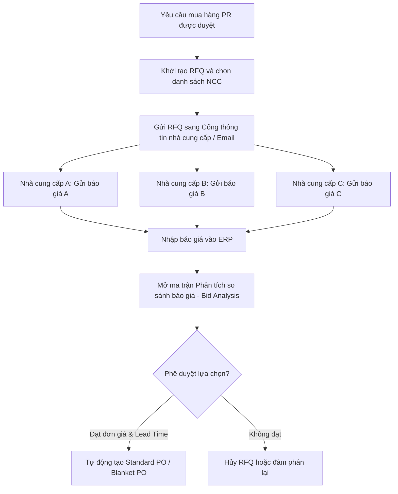

# 3020 Quy trình mời thầu và so sánh báo giá (RFQ & Bid Analysis)

Quy trình mời thầu và yêu cầu báo giá (Request for Quotation - RFQ) là nghiệp vụ cốt lõi trong mua sắm chiến lược (Strategic Sourcing). Nghiệp vụ này giúp doanh nghiệp khảo sát thị trường, so sánh trực quan các phương án chào giá từ nhiều đối tác và chọn ra nhà thầu tối ưu nhất về đơn giá, thời gian giao hàng (Lead Time) và điều khoản thanh toán trước khi chính thức ban hành đơn mua hàng hoặc ký kết hợp đồng dài hạn.

---

## 1. Khái niệm cốt lõi trong Quy trình RFQ & Phân tích báo giá

*   **Yêu cầu báo giá (Request for Quotation - RFQ):** Chứng từ do bộ phận mua hàng phát hành gửi cho danh sách các nhà cung cấp tiềm năng để yêu cầu họ chào giá, cam kết thời gian giao hàng và các điều khoản thương mại cho một danh mục vật tư/dịch vụ cụ thể.
*   **Bảng chào giá của nhà cung cấp (Quotation / Bid):** Chứng từ phản hồi từ nhà cung cấp chứa đơn giá, hạn mức số lượng, thời gian chuẩn bị hàng (Lead Time) và hạn hiệu lực của báo giá.
*   **Phân tích so sánh báo giá (Bid Analysis / Quote Analysis):** Công cụ ma trận so sánh đa chiều giữa các báo giá nhận được để đánh giá và lựa chọn phương án tối ưu nhất. Kết quả phân tích sẽ được phê duyệt và tự động chuyển đổi thành Đơn mua hàng (PO) hoặc Thỏa thuận khung (BPA).

---

## 2. Luồng nghiệp vụ mời thầu và phân tích báo giá đa nhà cung cấp

Dưới đây là sơ đồ luồng dữ liệu biểu diễn quy trình từ lúc phát sinh nhu cầu RFQ, gửi thư mời thầu cho đến khi phân tích lựa chọn nhà thầu và tạo PO/BPA tự động. Sơ đồ này mang tính khái quát nghiệp vụ, không gắn với riêng hệ thống nào:



---

## 3. Kinh nghiệm thực tế khi thiết lập (Best Practices & Pitfalls)

Đây là phần bản chất nghiệp vụ, độc lập với việc bạn đang chạy trên hệ thống ERP lớn nào hay tự xây dựng hệ thống nội bộ. Áp dụng đúng ba nguyên tắc dưới đây sẽ giải quyết phần lớn các sự cố mà đa số triển khai RFQ thực tế hay mắc phải:

1.  **Đồng bộ quy tắc bảo mật thông tin thầu (Sealed Bidding):**
    *   *Sự cố:* Trong các đợt đấu thầu lớn, việc rò rỉ thông tin giá chào thầu của nhà cung cấp A cho nhà cung cấp B trước ngày mở thầu sẽ làm mất tính công bằng và gây thiệt hại kinh tế cho doanh nghiệp.
    *   *Giải pháp:* Cấu hình thuộc tính bảo mật thầu kín (Sealed RFQ) trên hệ thống. Hệ thống ERP sẽ khóa hoàn toàn việc xem hoặc phân tích báo giá của tất cả các nhà cung cấp cho đến khi chạm đúng ngày mở thầu (Close Date) đã được cấu hình trước đó.
2.  **Kiểm soát thời hạn hiệu lực của báo giá (Quotation Expiration):**
    *   *Khuyến nghị:* Nhà cung cấp thường đưa ra mức đơn giá ưu đãi kèm theo điều kiện thời gian hiệu lực ngắn (ví dụ: chỉ áp dụng trong vòng 1 tháng do biến động giá nguyên liệu). Cấu hình hệ thống bắt buộc nhập trường ngày hết hạn của báo giá (`Expiration Date`). Quá thời hạn này, hệ thống phải tự động chuyển trạng thái báo giá sang `Expired` và chặn việc tạo Standard PO tham chiếu đến dòng giá đó.
3.  **Tích hợp cổng thông tin nhà cung cấp (Supplier Portal) để tự phục vụ nhập liệu:**
    *   Đối với doanh nghiệp có lượng giao dịch RFQ lớn, việc nhân viên mua sắm phải gõ thủ công từng bảng báo giá của các nhà cung cấp vào hệ thống ERP rất tốn thời gian và dễ nhầm lẫn. Hãy cấu hình tích hợp phân hệ Supplier Portal để nhà cung cấp tự truy cập vào mã thầu RFQ và tự nhập bảng chào giá của họ lên hệ thống.

---

## 4. Điểm giao thoa & Tham chiếu chéo (Cross-linking) sang các phân hệ khác

Quy trình RFQ kết nối chặt chẽ giữa nhu cầu tác nghiệp ban đầu và danh mục chính sách giá mua:

### A. Liên kết với phân hệ Mua hàng (PO) và Tồn kho (INV)
*   **Nguồn nhu cầu khởi tạo:** RFQ có thể được tạo tham chiếu trực tiếp từ các yêu cầu mua sắm đã phê duyệt tại bài [3000 Yêu cầu mua sắm và quy trình gom nhu cầu (PR & Consolidation)]().
*   **Danh mục vật tư và nhà cung cấp:** RFQ đối chiếu thông tin mã vật tư từ [7000 Item Master (thiết lập mã hàng hoá, đơn vị tính)]() và danh mục nhà cung cấp được quản lý tại [2000 Quản lý hồ sơ nhà cung cấp (Supplier Master)]().
*   **Chuyển đổi sang bảng giá chính thức:** Báo giá sau khi được phê duyệt tại bài viết này sẽ tự động được hệ thống chuyển đổi thành biểu giá chính thức tại [2010 Bảng giá & Thỏa thuận dài hạn (Blanket PO & Contract)]() để áp dụng tự động cho các đơn PO con sau này.

---

## 5. Hướng dẫn luồng thiết lập (Setup Flow) chi tiết trên hệ thống

### A. Trên Oracle EBS R12.2.10 (RFQ & Quotation Analysis)

1.  **Khởi tạo tài liệu RFQ:**
    *   *Đường dẫn:* `Purchasing Super User > RFQs > RFQs`
    *   *Nghiệp vụ:* Tạo mới RFQ, chọn loại RFQ (ví dụ: `Bid` cho đấu thầu, `Standard` cho khảo sát giá thông thường). Nhập danh mục vật tư cần báo giá tại phần `Lines`.
2.  **Mời nhà cung cấp tham gia chào giá (Suppliers Assignment):**
    *   *Nghiệp vụ:* Click chọn nút `Suppliers` trên RFQ Header. Chọn danh sách các nhà cung cấp cần gửi thư mời báo giá.
3.  **Ghi nhận báo giá phản hồi từ nhà cung cấp (Quotation Entry):**
    *   *Đường dẫn:* `Purchasing Super User > Quotations > Quotations`
    *   *Nghiệp vụ:* Nhập thông tin báo giá của từng nhà cung cấp phản hồi. Liên kết báo giá này với số RFQ gốc thông qua trường `RFQ Number` để hệ thống đồng bộ dữ liệu.
4.  **Phân tích so sánh báo giá (Quote Analysis):**
    *   *Đường dẫn:* `Purchasing Super User > RFQs > Quote Analysis`
    *   *Nghiệp vụ:* Hệ thống sẽ hiển thị ma trận so sánh đơn giá của các nhà cung cấp trên cùng một mặt hàng. Người mua chọn dòng báo giá tối ưu nhất và bấm nút `Approve` để phê duyệt dòng giá đó làm cơ sở tạo PO hoặc cập nhật danh mục Approved Supplier List (ASL).

### B. Trên Epicor ERP (RFQ Entry & Decision)

1.  **Tạo mới RFQ Entry:**
    *   *Đường dẫn:* `Material Management > Purchase Management > General Operations > RFQ Entry`
    *   *Nghiệp vụ:* Khai báo số RFQ mới. Tại tab `Lines`, chọn mã vật tư cần khảo sát giá. Tại tab `Suppliers`, thêm danh sách các nhà cung cấp được mời thầu.
2.  **Ghi nhận phản hồi và cập nhật báo giá (Supplier Responses):**
    *   *Nghiệp vụ:* Tại tab `Responses`, chọn nhà cung cấp và nhập đơn giá chào thầu (`Unit Price`) cùng thời gian giao hàng cam kết (`Lead Time`).
3.  **Lựa chọn nhà thầu chiến thắng (Select Bid):**
    *   *Nghiệp vụ:* Người mua rà soát toàn bộ các phản hồi. Tại dòng báo giá được chọn, tích chọn thuộc tính `Selected` để hệ thống đánh dấu đây là nhà cung cấp chiến thắng.
4.  **Chuyển đổi sang PO tự động (Create PO):**
    *   *Nghiệp vụ:* Sử dụng chức năng `Create PO` trực tiếp trên màn hình RFQ để hệ thống tự động sinh đơn mua hàng Standard PO mang toàn bộ thông tin đơn giá và điều khoản từ báo giá đã chọn.

---

## 6. Truy vấn SQL đối soát cấu trúc tổ chức (SQL Database Audit Queries)

> **Lưu ý:** Hai câu query dưới đây đang ở trạng thái tạm (draft), giữ nguyên theo bản gốc để tác giả tự đối chiếu lại trực tiếp trên hệ thống Oracle EBS đang vận hành và trên tài liệu Data Dictionary của Epicor (`Epicor_10.2.400.chm`) trước khi chốt bản chính thức. Tên bảng/field có thể cần điều chỉnh tuỳ theo version cụ thể.

### A. Cho Oracle EBS R12.2.10

Query dưới đây truy vấn danh sách toàn bộ các RFQ đã phát hành và so sánh trực quan các báo giá phản hồi tương ứng từ các nhà cung cấp, giúp đối soát nhanh đơn giá chào thầu thấp nhất:

```sql
SELECT 
    hou.name                      AS operating_unit,
    rfq.segment1                  AS rfq_number,
    rfq.creation_date             AS rfq_date,
    qot.segment1                  AS quotation_number,
    aps.segment1                  AS vendor_number,
    hp.party_name                 AS vendor_name,
    msib.segment1                 AS item_code,
    rql.line_num                  AS rfq_line,
    rql.item_description          AS item_desc,
    qln.unit_price                AS quoted_price,
    qln.lead_time                 AS quoted_lead_time,
    qot.status_lookup_code        AS quotation_status
FROM 
    po_headers_all rfq
INNER JOIN 
    po_lines_all rql ON rfq.po_header_id = rql.po_header_id
INNER JOIN 
    po_headers_all qot ON qot.from_header_id = rfq.po_header_id
INNER JOIN 
    po_lines_all qln ON qot.po_header_id = qln.po_header_id AND rql.line_num = qln.line_num
INNER JOIN 
    ap_suppliers aps ON qot.vendor_id = aps.vendor_id
INNER JOIN 
    hz_parties hp ON aps.party_id = hp.party_id
INNER JOIN 
    hr_operating_units hou ON rfq.org_id = hou.organization_id
LEFT JOIN 
    mtl_system_items_b msib ON rql.item_id = msib.inventory_item_id 
                            AND msib.organization_id = (
                                SELECT fsp.inventory_organization_id 
                                FROM financial_system_params_all fsp 
                                WHERE fsp.org_id = rfq.org_id
                            )
WHERE 
    rfq.document_type_code = 'RFQ'
    AND qot.document_type_code = 'QUOTATION'
ORDER BY 
    rfq.segment1, rql.line_num, qln.unit_price;
```

### B. Cho Epicor ERP (Truy vấn cơ sở dữ liệu SQL Server)

Query dưới đây kết xuất danh sách toàn bộ các yêu cầu RFQ trong Epicor kèm thông tin phản hồi đơn giá chi tiết từ từng nhà cung cấp, lọc ra nhà cung cấp nào đã được Buyer lựa chọn phê duyệt (`Selected = 1`):

```sql
SELECT 
    rh.Company,
    rh.RFQNum                     AS RFQ_Number,
    rd.RFQLine                    AS Line_Num,
    rd.PartNum                    AS Part_Number,
    rd.LineDesc                   AS Description,
    rv.VendorID                   AS Invited_Vendor_ID,
    v.Name                        AS Vendor_Name,
    rv.DocQuoteUnitPrice          AS Quoted_Unit_Price,
    rv.VendorLeadTime             AS Lead_Time_Days,
    rv.ReplyDate                  AS Reply_Date,
    rv.Selected                   AS Is_Winning_Bid
FROM 
    Erp.RFQDetail rd
INNER JOIN 
    Erp.RFQHead rh ON rd.Company = rh.Company AND rd.RFQNum = rh.RFQNum
INNER JOIN 
    Erp.RFQVend rv ON rd.Company = rv.Company AND rd.RFQNum = rv.RFQNum
INNER JOIN 
    Erp.Vendor v ON rv.Company = v.Company AND rv.VendorNum = v.VendorNum
WHERE 
    rh.Company = 'YOUR_COMPANY_CODE'
ORDER BY 
    rh.RFQNum, rd.RFQLine, rv.DocQuoteUnitPrice;
