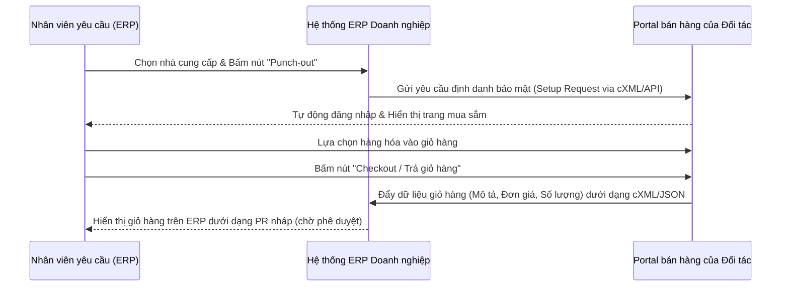

# 3030 Mua sắm tự phục vụ và e-Catalog (Punch-out)

Trong doanh nghiệp, chi tiêu được chia làm hai loại: **Direct Procurement** (mua sắm nguyên vật liệu trực tiếp cho sản xuất) và **Indirect/MRO Procurement** (mua sắm dịch vụ, văn phòng phẩm, vật tư tiêu hao, sửa chữa vận hành). 

Nếu áp dụng quy trình kiểm soát chặt chẽ của hàng sản xuất cho hàng tiêu hao (bắt buộc tạo mã vật tư, duyệt nhiều bước thủ công), doanh nghiệp sẽ gặp tình trạng nghẽn cổ chai hành chính. Hệ thống mua sắm tự phục vụ (Self-service Procurement) kết hợp Danh mục điện tử (e-Catalog) và kết nối Punch-out ra đời nhằm giải quyết triệt để bài toán này.

---

## 1. Bản chất nghiệp vụ & Giải pháp kiến trúc

### Vấn đề cốt lõi:
Nhân viên hành chính cần mua một cái dập ghim, một hộp bút hay một dịch vụ dọn dẹp phòng họp. Nếu hệ thống ERP bắt buộc phải có mã vật tư (Item ID) trong danh mục gốc để tạo đơn mua hàng, doanh nghiệp sẽ phải duy trì hàng trăm ngàn mã vật tư rác. Dữ liệu gốc (Item Master) sẽ phình to mất kiểm soát, làm chậm hệ thống và gây quá tải cho bộ phận quản trị dữ liệu.

### Giải pháp kiến trúc ERP tiêu chuẩn:
1.  **Mua hàng không mã hóa (One-time Items / Non-catalog Request):** Cho phép người dùng nhập mô tả mặt hàng dưới dạng văn bản tự do, nhưng bắt buộc gán với một **Nhóm danh mục mua sắm (Purchasing Category / Commodity Class)**. Hệ thống sẽ dựa vào nhóm này để định khoản kế toán tự động mà không cần mã vật tư cụ thể.
2.  **Punch-out Catalog (Liên kết giỏ hàng ngoại vi):** Người dùng từ giao diện ERP bấm nút "Punch-out" để hệ thống tự động đăng nhập và chuyển hướng sang trang web bán hàng của nhà cung cấp đã liên kết (ví dụ: Amazon Business, các trang văn phòng phẩm lớn). Sau khi chọn đồ vào giỏ hàng trên web của họ, người dùng bấm "Checkout", toàn bộ giỏ hàng sẽ được tự động đồng bộ ngược lại vào hệ thống ERP dưới dạng một yêu cầu PR chờ duyệt.

---

## 2. Bảng so sánh và Ánh xạ giải pháp giữa các hệ thống

Khi chuyển đổi giữa các hệ thống ERP hoặc tự xây dựng hệ thống (In-house), bạn có thể dễ dàng ánh xạ các tính năng tương đương dựa trên bảng sau:

| Nghiệp vụ thiết kế | Oracle EBS R12.2.10 | Epicor ERP | SAP S/4HANA | Odoo | Hệ thống tự xây (In-house) |
| :--- | :--- | :--- | :--- | :--- | :--- |
| **Giao diện tự phục vụ** | Oracle iProcurement | Web Procurement | SAP Ariba / SRM | Odoo Purchase (Portal) | Cổng thông tin mua sắm nội bộ (Internal Shopping Cart) |
| **Hồ sơ mua sắm không mã** | One-time Items (mapped to Expense Category) | Non-part Requisition (mapped to Part Class) | Non-coded material / Free-text item | Product-less PO line (mapped to Expense Account) | Dòng PR tự do gán bắt buộc mã Tài khoản chi phí hoặc mã Nhóm mua hàng |
| **Kết nối Punch-out** | Oracle Punchout Catalog (qua XML Gateway) | PunchOut Integration (REST API) | Ariba PunchOut (cXML) | Odoo Punchout (cần module tùy biến) | Webhook API nhận dữ liệu giỏ hàng chuẩn cXML / JSON từ đối tác |

---

## 3. Quy trình vận hành luồng mua sắm tự phục vụ (Punch-out)

Dưới đây là sơ đồ luồng dữ liệu của giải pháp kết nối giỏ hàng ngoại vi Punch-out:



---

## 4. Điểm giao thoa & Tham chiếu chéo (Cross-linking) sang các phân hệ khác

*   **Không động chạm đến kho (INV):** Chi tiêu Indirect/MRO sau khi nhận hàng sẽ hạch toán thẳng vào chi phí vận hành trong kỳ, hoàn toàn không qua nhập kho lưu trữ hay định giá tồn kho tại [8000 Báo cáo tồn kho theo thời điểm (Stock on Hand)]().
*   **Tham chiếu đơn giá:** Đơn giá của các mặt hàng trong danh mục điện tử nội bộ được kế thừa trực tiếp từ hợp đồng nguyên tắc đã duyệt tại [2010 Bảng giá & Thỏa thuận dài hạn (Blanket PO & Contract)]().
*   **Tự động định khoản kế toán (FIN):** Khi PR được duyệt thành PO và nhận hàng, hệ thống sẽ tự động hạch toán Nợ tài khoản chi phí bộ phận (Expense Account) được cấu hình ánh xạ theo nhóm mua hàng từ [1010 Thiết lập nhóm hạch toán công nợ và tự động hóa định khoản Sổ cái (Posting Groups & GL Accounts Mapping)]().

---

## 5. Hướng dẫn luồng thiết lập (Setup Flow) chi tiết trên hệ thống

### A. Trên Oracle EBS R12.2.10 (iProcurement & Punchout)

1.  **Cấu hình Danh mục mua sắm không mã (Purchasing Category Mapping):**
    *   *Đường dẫn:* `Purchasing Super User > Setup > Items > Categories > Category Codes`
    *   *Nghiệp vụ:* Khai báo nhóm chi phí (ví dụ: `OFFICE_SUPPLIES`). Liên kết nhóm này với tài khoản chi phí mặc định của phòng ban (Expense Account Generator).
2.  **Thiết lập Punchout Catalog Map:**
    *   *Đường dẫn:* `iProcurement Catalog Administration > Portals > Manage Punchout`
    *   *Nghiệp vụ:* Khai báo URL kết nối của nhà cung cấp, thiết lập mật khẩu mã hóa bảo mật (Shared Secret Key) để xác thực người dùng tự động khi punch-out.

### B. Trên Epicor ERP (Non-part Requisition Setup)

1.  **Thiết lập Nhóm mua hàng (Part Class) làm gốc chi phí:**
    *   *Đường dẫn:* `Material Management > Purchase Management > Setup > Part Class`
    *   *Nghiệp vụ:* Tạo nhóm chi phí hành chính (ví dụ: `MRO`). Tại tab `GL Control`, gán tài khoản chi phí bộ phận tương ứng.
2.  **Cấu hình luồng nhập PR không mã:**
    *   *Đường dẫn:* `Material Management > Purchase Management > General Operations > Requisition Entry`
    *   *Nghiệp vụ:* Khi tạo dòng PR, để trống trường `Part Number`, nhập mô tả tự do tại `Description` và chọn đúng `Part Class` là `MRO`. Hệ thống sẽ tự động lấy tài khoản chi phí để chạy luồng phê duyệt ngân sách.

---

## 6. Truy vấn SQL đối soát cấu trúc tổ chức (SQL Database Audit Queries)

### A. Cho Oracle EBS R12.2.10

Query dưới đây giúp đối soát toàn bộ các yêu cầu PR tự phục vụ (iProcurement) được tạo dưới dạng hàng hóa không mã (One-time Items), kiểm tra xem chúng thuộc nhóm chi phí nào và tổng giá trị chi tiêu là bao nhiêu:

```sql
SELECT 
    prha.segment1                 AS requisition_num,
    prla.line_num                 AS line_num,
    prla.item_description         AS item_description,
    mck.concatenated_segments     AS purchasing_category,
    prla.quantity                 AS quantity,
    prla.unit_price               AS unit_price,
    (prla.quantity * prla.unit_price) AS line_amount,
    prla.suggested_vendor_name    AS vendor_name,
    prla.catalog_type             AS source_type -- 'INTERNAL_CATALOG' hoặc 'PUNCHOUT'
FROM 
    po_requisition_headers_all prha
INNER JOIN 
    po_requisition_lines_all prla ON prha.requisition_header_id = prla.requisition_header_id
INNER JOIN 
    mtl_categories_kfv mck ON prla.category_id = mck.category_id
WHERE 
    prla.item_id IS NULL -- Điều kiện lọc: One-time items (Không tồn tại trong Item Master)
    AND prha.authorization_status = 'APPROVED'
ORDER BY 
    prha.segment1, prla.line_num;
```

### B. Cho Epicor ERP (Truy vấn cơ sở dữ liệu SQL Server)

Query dưới đây kết xuất danh sách các yêu cầu PR hành chính không mã vật tư (Non-part) trong Epicor, hiển thị tài khoản chi phí được ánh xạ tự động qua Part Class:

```sql
SELECT 
    rd.Company,
    rd.ReqNum                     AS Requisition_Number,
    rd.ReqLine                    AS Line_Num,
    rd.PartClassDescription       AS Purchasing_Category,
    rd.LineDesc                   AS Item_Description,
    rd.XOrderQty                  AS Request_Qty,
    rd.DocUnitCost                AS Unit_Cost,
    (rd.XOrderQty * rd.DocUnitCost) AS Estimated_Amount,
    v.Name                        AS Vendor_Name
FROM 
    Erp.ReqDetail rd
LEFT OUTER JOIN 
    Erp.Vendor v ON rd.Company = v.Company AND rd.VendorNum = v.VendorNum
WHERE 
    rd.PartNum = '' -- Điều kiện lọc: Không có mã vật tư (One-time item)
    AND rd.Company = 'YOUR_COMPANY_CODE'
ORDER BY 
    rd.ReqNum, rd.ReqLine;
```

---

## 7. Giải pháp khắc phục lỗi phổ biến & Cảnh báo cho Hệ thống tự xây (In-house)

Nếu bạn đang xây dựng hoặc phát triển một hệ thống ERP nội bộ, hãy đặc biệt lưu ý các điểm thiết kế kiến trúc sau để tránh các bẫy kỹ thuật thực tế:

1.  **Bẫy phình to dữ liệu Item Master (Cơ sở dữ liệu rác):**
    *   *Triệu chứng:* Lập trình viên thiết kế bảng `PO_Lines` bắt buộc phải khóa ngoại (Foreign Key) trực tiếp đến bảng `Item_Master`. Kết quả là mỗi lần nhân viên hành chính mua một loại văn phòng phẩm mới, họ lại phải tạo một bản ghi mới trong bảng `Item_Master`.
    *   *Giải pháp khắc phục:* Trong cơ sở dữ liệu, cho phép trường `Item_ID` trên bảng dòng PR/PO được nhận giá trị `NULL`. Đồng thời, bắt buộc trường `Category_ID` (Mã nhóm chi phí) phải có giá trị để hệ thống thực hiện định khoản kế toán tự động dựa trên mã nhóm thay vì mã vật tư.
2.  **Lỗi trượt giá khi đồng bộ giỏ hàng Punch-out:**
    *   *Triệu chứng:* Người dùng punch-out ra web đối tác, chọn hàng với giá ưu đãi tại thời điểm đó. Tuy nhiên, luồng phê duyệt PR trên ERP kéo dài mất 3 ngày. Đến khi PO được duyệt và gửi đi, đơn giá của đối tác trên web đã thay đổi (tăng lên).
    *   *Giải pháp:* Thiết lập quy tắc kiểm tra đơn giá tự động tại thời điểm tạo hóa đơn đối soát. Nếu sai lệch đơn giá vượt quá ngưỡng cho phép (Tolerance Limit) đã định nghĩa trước, hệ thống sẽ tự động khóa thanh toán và gửi cảnh báo về cho Buyer xử lý.
3.  **Bẫy phân quyền phê duyệt theo người dùng thay vì theo ngân sách:**
    *   *Triệu chứng:* Khi thiết kế luồng phê duyệt cho hàng tiêu hao, nếu cấu hình cứng người duyệt theo sơ đồ nhân sự mà không đối chiếu với hạn mức ngân sách của Trung tâm chi phí (Cost Center) của phòng ban đó, doanh nghiệp sẽ không thể kiểm soát được việc chi tiêu vượt ngân sách tháng/quý của các bộ phận.