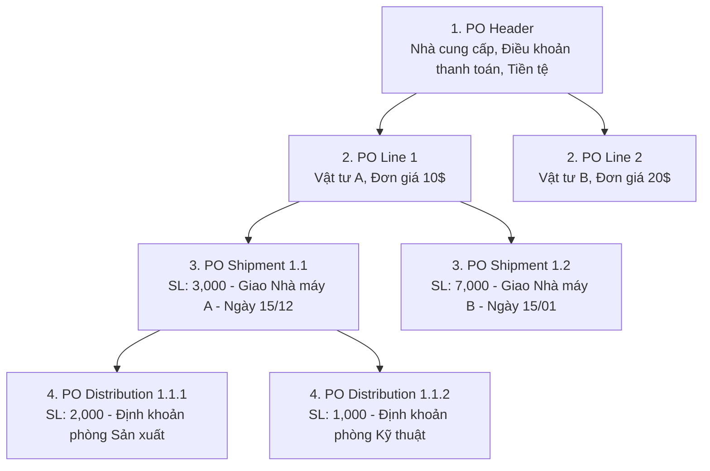

# 4000 Khởi tạo Đơn mua hàng tiêu chuẩn (Standard PO)

Đơn mua hàng tiêu chuẩn (Standard Purchase Order - Standard PO) là chứng từ cam kết pháp lý chính thức gửi đến nhà cung cấp để đặt mua một số lượng hàng hóa/dịch vụ cụ thể. Việc thiết kế và cấu hình dữ liệu Standard PO chính xác là chốt chặn quyết định để tự động hóa toàn bộ các hoạt động tiếp nhận kho (INV), hạch toán giá vốn (COST) và đối soát hóa đơn kế toán (AP) ở các bước sau.

---

## 1. Bản chất nghiệp vụ & Cấu trúc dữ liệu đa tầng

### Vấn đề cốt lõi:
Một Đơn mua hàng trong doanh nghiệp sản xuất không bao giờ đơn giản là một bảng danh sách mặt hàng và giá cả thông thường.
Doanh nghiệp có thể đặt mua **10,000 cái ốc vít** trên một đơn hàng để hưởng đơn giá sỉ ưu đãi (PO Line), nhưng yêu cầu nhà cung cấp:
* Giao **3,000 cái** về Nhà máy A vào ngày 15/12.
* Giao **2,000 cái** về Nhà máy B vào ngày 15/12.
* Giao **5,000 cái** còn lại về Nhà máy A vào ngày 15/01 năm sau.

Đồng thời, chi phí của 10,000 cái ốc vít này có thể phải phân bổ cho nhiều trung tâm chi phí (Cost Center) hoặc mã dự án khác nhau của phòng ban sử dụng.

### Giải pháp kiến trúc dữ liệu chuẩn (4-Tier Architecture):
Để giải quyết bài toán trên, các hệ thống ERP lớn được thiết kế theo cấu trúc dữ liệu 4 tầng chặt chẽ:



---

## 2. Bảng so sánh và Ánh xạ cấu trúc dữ liệu PO giữa các hệ thống

Khi vận hành hoặc chuyển đổi giữa các hệ thống ERP, bạn có thể ánh xạ cấu trúc dữ liệu PO tương đương theo bảng sau. Mỗi ô đều kèm theo **tên bảng/đối tượng vật lý thực tế** (bảng SQL hoặc model) để tiện đối chiếu khi viết truy vấn hoặc tích hợp:

| Hệ thống | Cấp độ 1: Header | Cấp độ 2: Line | Cấp độ 3: Shipment / Release | Cấp độ 4: Distribution |
| :--- | :--- | :--- | :--- | :--- |
| **Oracle EBS** | PO Headers<br/>*(Bảng `PO_HEADERS_ALL`)* | PO Lines<br/>*(Bảng `PO_LINES_ALL`)* | PO Line Locations (Shipments)<br/>*(Bảng `PO_LINE_LOCATIONS_ALL`)* | PO Distributions<br/>*(Bảng `PO_DISTRIBUTIONS_ALL`)* |
| **Epicor ERP** | PO Header<br/>*(Bảng `Erp.POHeader`)* | PO Detail<br/>*(Bảng `Erp.PODetail`)* | PO Release (PORel)<br/>*(Bảng `Erp.PORel`)* | *Tích hợp trực tiếp tại PO Release*<br/>*(trường GL Account nằm ngay trong `Erp.PORel`, không tách bảng riêng)* |
| **SAP S/4HANA** | PO Header<br/>*(Bảng `EKKO`, CDS View `I_PurchaseOrder`)* | PO Item<br/>*(Bảng `EKPO`, CDS View `I_PurchaseOrderItem`)* | Schedule Lines<br/>*(Bảng `EKET`)* | Account Assignment<br/>*(Bảng `EKKN`)* |
| **Odoo** | Purchase Order<br/>*(Model `purchase.order`)* | Purchase Order Line<br/>*(Model `purchase.order.line`)* | *Không hỗ trợ sẵn Shipment tách biệt*<br/>*(xử lý qua `stock.picking` / `stock.move` của phân hệ Kho)* | PO Line (Analytic Accounts)<br/>*(trường `analytic_distribution` trong `purchase.order.line`)* |
| **Hệ thống tự xây** | Bảng đầu mục PO<br/>*(gợi ý đặt tên: `po_headers`)* | Bảng dòng mặt hàng<br/>*(gợi ý đặt tên: `po_lines`)* | **Bắt buộc thiết kế bảng Kế hoạch giao hàng**<br/>*(gợi ý đặt tên: `po_shipments`)* | Bảng phân bổ hạch toán kế toán<br/>*(gợi ý đặt tên: `po_distributions`)* |

> **Lưu ý về SAP S/4HANA:** các bảng cổ điển `EKKO/EKPO/EKET/EKKN` (kế thừa từ ECC) vẫn tồn tại vật lý trong HANA DB để đảm bảo tương thích ngược, nhưng khi phát triển mới (Fiori, API, CDS-based extension) nên đọc qua lớp CDS View tương ứng thay vì query thẳng bảng nền, để tránh vỡ logic khi SAP nâng cấp cấu trúc dữ liệu bên dưới.

> **Lưu ý về Odoo:** vì không có tầng "Shipment" tách biệt ở cấp PO, khi một PO Line cần giao nhiều đợt/nhiều kho, Odoo xử lý việc này ở tầng vận hành kho (`stock.picking`) chứ không tách dữ liệu ngay tại PO — đây là khác biệt kiến trúc quan trọng cần lưu ý khi so sánh với Oracle/Epicor/SAP.

---

## 3. Điểm giao thoa & Tham chiếu chéo (Cross-linking) sang các phân hệ khác

Đơn mua hàng tiêu chuẩn là điểm trung chuyển dữ liệu quan trọng nhất của chuỗi cung ứng đầu vào:

### A. Kế thừa dữ liệu nguồn (Inbound Link)
*   **Danh mục đối tác & Giá:** Kế thừa thông tin từ bài [2000 Quản lý hồ sơ nhà cung cấp (Supplier Master)](./2000-quan-ly-ho-so-nha-cung-cap.md) và tự động áp dụng đơn giá thỏa thuận từ bài [2010 Bảng giá & Thỏa thuận dài hạn (Blanket PO & Contract)](./2010-thiet-lap-bang-gia-nha-cung-cap-va-thoa-thuan-mua-hang.md).
*   **Nhu cầu PR:** Standard PO có thể được tạo tự động bằng cách gom các yêu cầu PR đã duyệt tại bài [3000 Yêu cầu mua sắm và quy trình gom nhu cầu (PR & Consolidation)](./3000-nghiep-vu-yeu-cau-mua-hang-va-quy-trinh-gom-nhu-cau.md).

### B. Chuyển giao dữ liệu đích (Outbound Link)
*   **Đối soát kho:** Dữ liệu PO Shipment là căn cứ duy nhất để thủ kho đối chiếu số lượng khi thực hiện [1000 Nhập kho từ mua hàng (Receipt from PO)](../../1-kho/3000-giao-dich-nhap-xuat-chuyen.md).
*   **Đối soát công nợ:** Dữ liệu PO Distribution là cơ sở để kế toán hạch toán Nợ/Có và đối chiếu khớp lệnh 3 chiều tại bài **3000 Ghi nhận hóa đơn nhà cung cấp từ đơn mua hàng (AP Invoice Match)** — *link tới bài này đang để trống trong bản gốc, cần bổ sung đường dẫn thực tế của bài AP Invoice Match trong repo (ví dụ dạng `../ap-cong-no/3000-...`).*

---

## 4. Hướng dẫn luồng thiết lập (Setup Flow) chi tiết trên hệ thống

### A. Trên Oracle EBS R12.2.10 (Cấu trúc 4 tầng hoàn chỉnh)

1.  **Nhập thông tin Header:**
    *   *Đường dẫn:* `Purchasing Super User > Purchase Orders > Purchase Orders`
    *   *Nghiệp vụ:* Khai báo Nhà cung cấp (`Supplier`), Địa chỉ (`Site`), loại tiền tệ (`Currency`), và Điều khoản thanh toán (`Payment Terms`).
2.  **Nhập thông tin Lines:**
    *   *Nghiệp vụ:* Nhập mã mặt hàng (`Item`), Đơn vị tính (`UOM`), Đơn giá mua (`Price`).
3.  **Nhập thông tin Shipments (Line Locations):**
    *   *Nghiệp vụ:* Click chọn nút `Shipments`. Khai báo số lượng cần nhận (`Quantity`), địa điểm kho nhận (`Ship-To Org` và `Location`), và ngày cam kết giao hàng (`Need-By Date`).
4.  **Nhập thông tin Distributions:**
    *   *Nghiệp vụ:* Click chọn nút `Distributions`. Khai báo Tài khoản hạch toán chi phí (`Charge Account`) hoặc chọn Trung tâm chi phí (Cost Center) để gánh tiền cho dòng PO này.

### B. Trên Epicor ERP (Cấu trúc Header -> Line -> Release)

1.  **Nhập PO Header:**
    *   *Đường dẫn:* `Material Management > Purchase Management > General Operations > Purchase Order Entry`
    *   *Nghiệp vụ:* Nhấp `New PO`. Nhập mã nhà cung cấp (`Vendor`), ngày đặt hàng (`Order Date`), và các thông tin điều khoản chung.
2.  **Nhập PO Line (PO Detail):**
    *   *Nghiệp vụ:* Tạo `New Line`. Nhập mã vật tư (`Part`), mô tả, đơn giá (`Unit Cost`).
3.  **Nhập PO Release (PORel):**
    *   *Nghiệp vụ:* Chuyển sang tab `Release`. Tạo `New Release` để chia nhỏ đợt giao hàng. Khai báo số lượng (`Rel Qty`), ngày nhận hàng mong muốn (`Due Date`), gán mã nhà máy nhận (`Site`) và mã kho (`Warehouse`). Epicor cho phép gán trực tiếp tài khoản chi phí sổ cái (GL Account) tại tab Release này.

---

## 5. Truy vấn SQL đối soát cấu trúc tổ chức (SQL Database Audit Queries)

### A. Cho Oracle EBS R12.2.10

Query dưới đây kết xuất toàn bộ cấu trúc 4 tầng của các Standard PO đang mở trong hệ thống để phục vụ công tác đối soát dữ liệu chéo:

```sql
SELECT 
    hou.name                      AS operating_unit,
    pha.segment1                  AS po_number,
    pha.creation_date             AS po_date,
    aps.segment1                  AS vendor_num,
    hp.party_name                 AS vendor_name,
    pla.line_num                  AS po_line,
    msib.segment1                 AS item_code,
    pla.item_description          AS item_desc,
    plla.shipment_num             AS shipment_num,
    plla.quantity                 AS qty_ordered,
    plla.quantity_received        AS qty_received,
    pla.unit_price                AS unit_price,
    (plla.quantity * pla.unit_price) AS line_amount,
    pda.distribution_num          AS dist_num,
    pda.quantity_ordered          AS dist_qty,
    pda.charge_account_id         AS charge_account_id
FROM 
    po_headers_all pha
INNER JOIN 
    po_lines_all pla ON pha.po_header_id = pla.po_header_id
INNER JOIN 
    po_line_locations_all plla ON pla.po_line_id = plla.po_line_id
INNER JOIN 
    po_distributions_all pda ON plla.line_location_id = pda.line_location_id
INNER JOIN 
    ap_suppliers aps ON pha.vendor_id = aps.vendor_id
INNER JOIN 
    hz_parties hp ON aps.party_id = hp.party_id
INNER JOIN 
    hr_operating_units hou ON pha.org_id = hou.organization_id
LEFT JOIN 
    mtl_system_items_b msib ON pla.item_id = msib.inventory_item_id 
                            AND msib.organization_id = plla.ship_to_organization_id
WHERE 
    pha.document_type_code = 'STANDARD'
ORDER BY 
    pha.segment1, pla.line_num, plla.shipment_num, pda.distribution_num;
```

### B. Cho Epicor ERP (Truy vấn cơ sở dữ liệu SQL Server)

Query dưới đây kết xuất chi tiết cấu trúc 3 tầng (Header -> Detail -> Release) của các Standard PO trong Epicor:

```sql
SELECT 
    ph.Company,
    ph.PONum                      AS PO_Number,
    ph.OrderDate                  AS PO_Date,
    v.VendorID                    AS Vendor_ID,
    v.Name                        AS Vendor_Name,
    pd.POLine                     AS Line_Num,
    pd.PartNum                    AS Part_Number,
    pd.LineDesc                   AS Description,
    pr.PORelNum                   AS Release_Num,
    pr.RelQty                     AS Qty_Ordered,
    pr.ReceivedQty                AS Qty_Received,
    pd.DocUnitCost                AS Unit_Cost,
    (pr.RelQty * pd.DocUnitCost)  AS Release_Amount
FROM 
    Erp.POHeader ph
INNER JOIN 
    Erp.PODetail pd ON ph.Company = pd.Company AND ph.PONum = pd.PONum
INNER JOIN 
    Erp.PORel pr ON pd.Company = pr.Company AND pd.PONum = pr.PONum AND pd.POLine = pr.POLine
INNER JOIN 
    Erp.Vendor v ON ph.Company = v.Company AND ph.VendorNum = v.VendorNum
WHERE 
    ph.POType = 'S' -- Chỉ lấy Standard PO
    AND ph.Company = 'YOUR_COMPANY_CODE'
ORDER BY 
    ph.PONum, pd.POLine, pr.PORelNum;
```

---

## 6. Giải pháp khắc phục lỗi phổ biến & Cảnh báo cho Hệ thống tự xây (In-house)

Nếu đội ngũ của bạn đang tự xây dựng (In-house) phân hệ mua sắm, hãy đặc biệt lưu ý các điểm thiết kế kiến trúc sau để tránh các bẫy kỹ thuật thực tế:

1.  **Bẫy gộp chung dòng PO (Lines) và dòng Giao hàng (Shipments):**
    *   *Triệu chứng:* Lập trình viên thiết kế bảng `PO_Lines` chứa luôn trường ngày giao hàng `Delivery_Date` và mã kho nhận `Warehouse_ID`. Khi phát sinh nhu cầu mua 1 mặt hàng giao làm nhiều đợt về nhiều kho khác nhau, người mua buộc phải nhập thành nhiều dòng PO hoàn toàn độc lập. Việc này làm vỡ đơn giá sỉ thương lượng (do hệ thống hiểu là các dòng mua nhỏ lẻ), gây khó khăn khi đối chiếu và làm báo cáo tổng hợp.
    *   *Giải pháp:* Bắt buộc phải thiết kế tách biệt bảng dòng PO (để chốt đơn giá, tổng số lượng của mặt hàng) và bảng Giao hàng (để theo dõi ngày giao, kho nhận thực tế của từng đợt).
2.  **Lỗi lệch đơn vị tính mua hàng và tồn kho (Purchase UOM vs Base UOM):**
    *   *Triệu chứng:* PO mua theo đơn vị là `Thùng` (1 thùng = 24 lon), nhưng hệ thống INV chỉ quản lý theo đơn vị là `Lon`. Nếu hệ thống không hỗ trợ tự động quy đổi UOM tại thời điểm nhập kho, thủ kho sẽ nhận nhầm 1 thùng thành 1 lon, gây lệch kho nghiêm trọng.
    *   *Giải pháp:* Đảm bảo phân hệ PO kế thừa và áp dụng đúng bảng quy đổi đơn vị tính đã thiết lập tại **7010 Đơn vị tính và quy đổi (UOM Conversion)** — *link tới bài này đang để trống trong bản gốc, cần bổ sung đường dẫn thực tế trong repo*.
3.  **Lỗi âm tiền do làm tròn số học (Rounding Issues on Distributions):**
    *   *Triệu chứng:* Khi phân bổ chi phí của một dòng PO trị giá 100$ cho 3 phòng ban đều nhau (33.333% cho mỗi bên), nếu không xử lý số dư làm tròn ở dòng phân bổ cuối cùng, hệ thống sẽ bị lệch số liệu sổ cái tài chính do tổng 3 dòng phân bổ không bằng giá trị gốc của PO line (33.33$ + 33.33$ + 33.33$ = 99.99$ - lệch 0.01$).
    *   *Giải pháp:* Viết thuật toán tự động bù số dư làm tròn (Rounding Tolerance Adjustment) trực tiếp vào dòng phân bổ cuối cùng khi lưu chứng từ (ví dụ dòng cuối sẽ tự làm tròn thành 33.34$).
4.  **Thiếu kiểm soát ngân sách trước khi tạo cam kết (Budgetary Control):**
    *   *Triệu chứng:* Hệ thống tự xây cho phép tạo và duyệt Standard PO ngay cả khi ngân sách của Cost Center/Project đã hết, dẫn đến vượt ngân sách mà không ai phát hiện cho đến kỳ báo cáo.
    *   *Giải pháp:* Tại thời điểm lưu/duyệt dòng Distribution, hệ thống nên gọi kiểm tra ngân sách còn lại (Funds Check) trước khi cho phép chuyển trạng thái PO sang "Approved", tương tự cơ chế Funds Available Check của Oracle EBS hoặc Budget Check của SAP.

<p align="center" style={{color: 'var(--ifm-color-primary)'}}>
  <strong>Chúc các bạn thành công và vui vẻ!</strong>
</p>