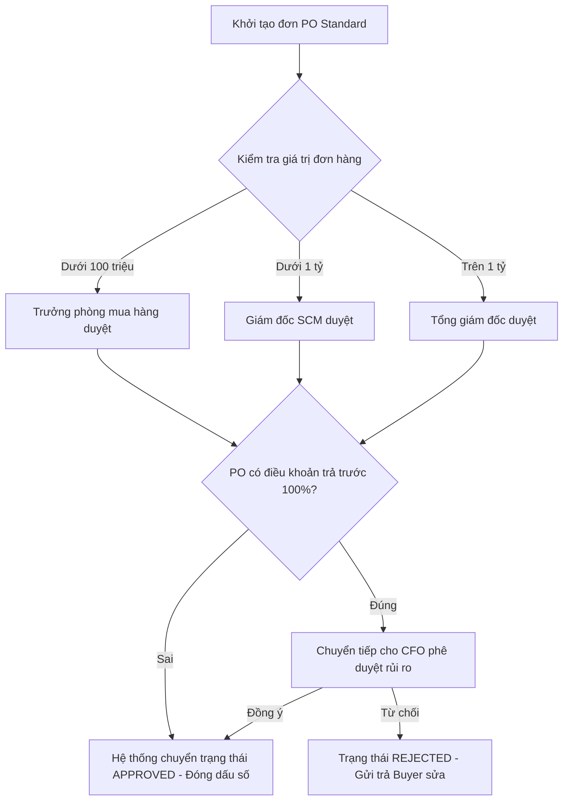

# 4010 Luồng phê duyệt PO theo hạn mức và cấp bậc

Khác với Yêu cầu mua sắm (PR) vốn là chứng từ nội bộ, Đơn mua hàng (PO) là một cam kết tài chính mang tính pháp lý trực tiếp với đối tác bên ngoài. Do đó, luồng phê duyệt PO (PO Approval Workflow / Release Strategy) đòi hỏi tính chặt chẽ pháp lý cao hơn rất nhiều, bắt buộc phải ánh xạ chính xác với Ma trận phân quyền ký duyệt tài chính (Delegation of Authority - DOA) đã được Hội đồng quản trị thông qua.

---

## 1. Bản chất nghiệp vụ & Các tiêu chí định tuyến phê duyệt

### Vấn đề cốt lõi:
Một luồng duyệt PO chuẩn trong doanh nghiệp không chỉ dựa vào tổng số tiền của đơn hàng. Nó là sự kết hợp phức tạp của nhiều biến số giao dịch:
*   **Tổng giá trị PO (PO Amount):** Duyệt phân cấp (ví dụ: Trưởng phòng mua hàng duyệt dưới 100 triệu, Giám đốc SCM duyệt dưới 1 tỷ, Tổng giám đốc duyệt trên 1 tỷ).
*   **Loại mặt hàng đặt mua (Item Category):** Mua nguyên vật liệu sản xuất trực tiếp (Direct) có thể chỉ cần luồng duyệt của khối SCM; nhưng mua sắm tài sản cố định (Fixed Assets) bắt buộc phải qua phê duyệt của Ban dự án hoặc Ban tài chính.
*   **Điều khoản thanh toán đặc thù (Payment Terms):** Nếu PO áp dụng điều khoản thanh toán bất lợi cho doanh nghiệp (ví dụ: trả trước 100% cho nhà cung cấp mới), hệ thống phải tự động định tuyến chuyển tiếp cho Giám đốc Tài chính (CFO) phê duyệt rủi ro dòng tiền.

---

## 2. Bảng so sánh và Ánh xạ giải pháp giữa các hệ thống

Khi chuyển đổi giữa các hệ thống ERP hoặc tự thiết kế hệ thống (In-house), bạn có thể dễ dàng ánh xạ các tính năng tương đương dựa trên bảng sau:

| Nghiệp vụ thiết kế | Oracle EBS R12.2.10 | Epicor ERP | SAP S/4HANA | Odoo | Hệ thống tự xây (In-house) |
| :--- | :--- | :--- | :--- | :--- | :--- |
| **Công cụ chạy luồng** | PO Approval Workflow / AME | Approval Person / Work Queue | Release Strategy / Flexible Workflow | Approval Rules (Studio) | Động cơ kiểm soát trạng thái (State Machine Engine) |
| **Hệ thống phân cấp** | Position Hierarchy hoặc Supervisor Hierarchy | Buyer Approval Hierarchy | Release Codes / Release Group | User / Manager Hierarchy | Bảng phân cấp vai trò (Role-based Hierarchies) |
| **Kiểm soát hạn mức** | PO Control Rules / Approval Limits | PurAgent POAmtLimit | Tolerance Limits / Characteristics | Minimum Amount configuration | Bảng cấu hình ma trận hạn mức gán theo vai trò |

---

## 3. Quy trình định tuyến phê duyệt PO động

Dưới đây là sơ đồ luồng dữ liệu biểu diễn cách hệ thống phân tích đơn hàng PO để định tuyến đến các cấp phê duyệt tương ứng theo đúng chính sách DOA của doanh nghiệp:



---

## 4. Điểm giao thoa & Tham chiếu chéo (Cross-linking) sang các phân hệ khác

*   **Kế thừa từ phân hệ PR:** Nếu một PO được tạo ra tham chiếu trực tiếp đến một PR đã được phê duyệt đầy đủ tại bài [3010 Luồng phê duyệt PR theo phòng ban, trung tâm chi phí và dự án (PR Approval Workflow)](), hệ thống có thể áp dụng chính sách bỏ qua một số bước duyệt trùng lặp (Pre-approved / Auto-approval Release) để tăng tốc độ mua sắm.
*   **Chốt chặn cho kho và kế toán:** PO bắt buộc phải ở trạng thái `Approved` thì thủ kho mới có thể nhìn thấy để làm phiếu [1000 Nhập kho từ mua hàng (Receipt from PO)](), và kế toán mới có cơ sở làm bài [3000 Ghi nhận hóa đơn nhà cung cấp từ đơn mua hàng (AP Invoice Match)]() để thanh toán tiền cho đối tác.

---

## 5. Hướng dẫn luồng thiết lập (Setup Flow) chi tiết trên hệ thống

### A. Trên Oracle EBS R12.2.10 (PO Control Rules)

1.  **Thiết lập Nhóm kiểm soát (PO Control Groups):**
    *   *Đường dẫn:* `Purchasing Super User > Setup > Approvals > Approval Groups`
    *   *Nghiệp vụ:* Tạo nhóm kiểm soát (ví dụ: `SCM_DIR_LIMIT`). Khai báo các quy tắc kiểm soát đơn mua hàng (`Document`) với hạn mức số tiền cụ thể (ví dụ: tối đa 1,000,000,000 VND).
2.  **Thiết lập Quy tắc kiểm soát phê duyệt (Approval Assignments):**
    *   *Đường dẫn:* `Purchasing Super User > Setup > Approvals > Approval Assignments`
    *   *Nghiệp vụ:* Gán Nhóm kiểm soát vừa tạo ở bước 1 cho từng Chức danh công việc (Position) hoặc Tài khoản người dùng cụ thể.
3.  **Cấu hình Sơ đồ phê duyệt (Position Hierarchy):**
    *   *Đường dẫn:* `Purchasing Super User > Setup > Approvals > Approval Hierarchy`
    *   *Nghiệp vụ:* Dựng sơ đồ luồng đi của chứng từ từ cấp dưới lên cấp trên (ví dụ: Buyer -> Trưởng phòng -> Giám đốc SCM).

### B. Trên Epicor ERP (Buyer PO Limit)

1.  **Thiết lập hạn mức mua hàng cho Người mua (PurAgent):**
    *   *Đường dẫn:* `Material Management > Purchase Management > Setup > Buyer`
    *   *Nghiệp vụ:* Chọn mã Buyer cần cấu hình. Tại tab `Detail`, nhập hạn mức phê duyệt PO tối đa cho phép vào trường `PO Limit` (ví dụ: 5,000 USD).
2.  **Định nghĩa Người phê duyệt cấp trên (Approval Person):**
    *   *Nghiệp vụ:* Trong màn hình cấu hình Buyer trên, khai báo trường `Approval Person` bằng mã của Giám đốc bộ phận (người có hạn mức PO Limit cao hơn).
3.  **Vận hành luồng duyệt tự động:**
    *   *Nghiệp vụ:* Khi Buyer tạo PO trị giá 10,000 USD (vượt hạn mức 5,000 USD của mình) và bấm lưu, hệ thống tự động đổi trạng thái PO sang `Pending` và đẩy chứng từ vào hàng chờ phê duyệt `Work Queue` của người được gán tại ô `Approval Person`.

---

## 6. Truy vấn SQL đối soát cấu trúc tổ chức (SQL Database Audit Queries)

> **Lưu ý sửa lỗi:** bản nháp trước của bài này dùng tên bảng `PO_CONTROL_RULES_ALL`, gây lỗi `ORA-00942: table or view does not exist`. Bảng thật sự **không có hậu tố `_ALL`** — tên đúng là `PO_CONTROL_RULES` (khác với `PO_CONTROL_GROUPS_ALL` và `PO_POSITION_CONTROLS_ALL`, hai bảng này là multi-org nên vẫn giữ `_ALL`). Cả hai truy vấn dưới đây đã dùng đúng tên bảng.

### A. Cho Oracle EBS R12.2.10

#### A.1 Truy vấn cơ bản: Danh sách Nhóm kiểm soát và hạn mức phê duyệt

Query dưới đây truy xuất toàn bộ các Nhóm kiểm soát phê duyệt (Approval Groups) và hạn mức tài chính gán kèm đang hoạt động trong hệ thống:

```sql
SELECT 
    hou.name                      AS operating_unit,
    pcg.control_group_name        AS control_group,
    pcr.object_code               AS object_type,    -- 'DOCUMENT_TOTAL' đại diện cho kiểm soát tổng giá trị chứng từ
    pcr.rule_type_code            AS rule_type,      -- Thay thế cho action_code: 'INCLUDE' hoặc 'EXCLUDE'
    pcr.amount_limit              AS approval_limit_amount,
    pcr.creation_date             AS start_date,     -- Ngày tạo bản ghi quy tắc
    pcr.inactive_date             AS end_date        -- Ngày quy tắc hết hiệu lực
FROM 
    po_control_groups_all pcg
INNER JOIN 
    po_control_rules pcr ON pcg.control_group_id = pcr.control_group_id
INNER JOIN 
    hr_operating_units hou ON pcg.org_id = hou.organization_id
WHERE 
    pcr.object_code = 'DOCUMENT_TOTAL'
    AND NVL(pcr.inactive_date, TRUNC(SYSDATE)+1) > TRUNC(SYSDATE)
ORDER BY 
    hou.name, pcg.control_group_name, pcr.amount_limit;
```

#### A.2 Truy vấn nâng cao: Hạn mức phê duyệt hiệu lực theo từng nhân sự (Position/Job Hierarchy Fallback)

Query dưới đây đối chiếu sơ đồ báo cáo trực tiếp (Supervisor Hierarchy) với hạn mức phê duyệt PO hiệu lực của từng nhân sự, ưu tiên hạn mức gán theo Chức danh (Position); nếu Position không có cấu hình thì tự động rơi xuống tra theo Công việc (Job):

```sql
SELECT 
    parent.employee_number        AS supervisor_num,
    parent.first_name || ' ' || parent.last_name AS supervisor_name,
    child.employee_number         AS employee_num,
    child.first_name || ' ' || child.last_name   AS employee_name,
    child.email_address           AS employee_email,
    -- Luồng xử lý COALESCE kiểm tra hạn mức linh hoạt theo cấu hình thực tế
    COALESCE(
        -- 1. Nếu có Position Hierarchy thì bóc tách hạn mức theo Position trước
        (
            SELECT MAX(pcr.amount_limit) 
            FROM po_control_rules pcr
            WHERE pcr.control_group_id IN (
                SELECT ppc.control_group_id 
                FROM po_position_controls_all ppc 
                WHERE ppc.position_id = asg.position_id
            )
            AND pcr.object_code = 'DOCUMENT_TOTAL'
            AND NVL(pcr.inactive_date, TRUNC(SYSDATE) + 1) > TRUNC(SYSDATE)
        ),
        -- 2. Nếu Position trống thì bóc tách hạn mức theo Job Hierarchy
        (
            SELECT MAX(pcr.amount_limit) 
            FROM po_control_rules pcr
            WHERE pcr.control_group_id IN (
                SELECT ppc.control_group_id 
                FROM po_position_controls_all ppc -- Dùng chung bảng gốc cho cả Job lẫn Position
                WHERE ppc.job_id = asg.job_id
            )
            AND pcr.object_code = 'DOCUMENT_TOTAL'
            AND NVL(pcr.inactive_date, TRUNC(SYSDATE) + 1) > TRUNC(SYSDATE)
        )
    )                             AS approval_limit
FROM 
    per_all_people_f child
INNER JOIN 
    per_all_assignments_f asg ON child.person_id = asg.person_id
LEFT JOIN 
    per_all_people_f parent ON asg.supervisor_id = parent.person_id
WHERE 
    TRUNC(SYSDATE) BETWEEN child.effective_start_date AND child.effective_end_date
    AND TRUNC(SYSDATE) BETWEEN asg.effective_start_date AND asg.effective_end_date
    AND (parent.person_id IS NULL OR TRUNC(SYSDATE) BETWEEN parent.effective_start_date AND parent.effective_end_date)
    AND child.current_employee_flag = 'Y'
    AND asg.assignment_type = 'E'
    AND asg.primary_flag = 'Y' -- Chỉ lấy assignment chính, tránh trùng dòng nếu nhân sự có nhiều vị trí kiêm nhiệm
ORDER BY 
    supervisor_name, employee_name;
```

> **2 lỗi đã sửa so với bản gốc bạn gửi:**
> 1. `apps.po_control_rules_all` → `po_control_rules` (bỏ hậu tố `_ALL` không tồn tại, đồng thời bỏ luôn tiền tố schema `apps.` để tránh phụ thuộc vào việc synonym có được cấp quyền SELECT trực tiếp hay không — dùng tên bảng trần sẽ tự động đi qua synonym công khai chuẩn của EBS).
> 2. `parent.full_name` / `child.full_name` → `first_name || ' ' || last_name`, vì `PER_ALL_PEOPLE_F` không có cột `FULL_NAME` vật lý (tên đầy đủ luôn phải tự ghép từ `FIRST_NAME`/`LAST_NAME`), lỗi này nếu không sửa sẽ ra `ORA-00904: invalid identifier` ngay sau khi lỗi bảng ở trên được khắc phục.

### B. Cho Epicor ERP (Truy vấn cơ sở dữ liệu SQL Server)

Query dưới đây kết xuất danh sách toàn bộ các Buyer trong Epicor kèm hạn mức duyệt PO tối đa và người phê duyệt cấp trên (Approver) tương ứng để phục vụ việc kiểm toán nội bộ:

```sql
SELECT 
    pa.Company,
    pa.BuyerID                    AS Buyer_Code,
    pa.Name                       AS Buyer_Name,
    pa.POAmtLimit                 AS PO_Approval_Limit,
    pa.ApprovalPerson             AS Approver_ID,
    approver.Name                 AS Approver_Name,
    pa.Active                     AS Is_Active
FROM 
    Erp.PurAgent pa
LEFT JOIN 
    Erp.PurAgent approver ON pa.Company = approver.Company AND pa.ApprovalPerson = approver.BuyerID
WHERE 
    pa.Company = 'YOUR_COMPANY_CODE'
ORDER BY 
    pa.POAmtLimit DESC;
```

---

## 7. Giải pháp khắc phục lỗi phổ biến & Cảnh báo cho Hệ thống tự xây (In-house)

Nếu đội ngũ của bạn đang tự xây dựng (In-house) động cơ phê duyệt (Approval Engine), hãy đặc biệt lưu ý các điểm thiết kế kiến trúc sau để tránh các bẫy kỹ thuật thực tế:

1.  **Bẫy mã hóa cứng người duyệt trong mã nguồn (Hardcoding Pitfall):**
    *   *Triệu chứng:* Lập trình viên viết trực tiếp câu lệnh điều kiện trong code (ví dụ: `if (po_amount > 500000000) then approver_id = 'CEO_USER_ID'`). Khi Tổng giám đốc thay đổi nhân sự hoặc thay đổi DOA tài chính, lập trình viên bắt buộc phải sửa code và deploy lại hệ thống.
    *   *Giải pháp:* Thiết kế bảng cấu hình ma trận phê duyệt riêng biệt trong cơ sở dữ liệu (Database-driven Workflow). Tuyệt đối không gán cứng ID người dùng, hãy gán theo chức danh hoặc vai trò (Role-based Approval Matrix) và cho phép người dùng cấu hình ma trận này trực tiếp trên giao diện Admin.
2.  **Lỗi tranh chấp trạng thái khi nhiều người duyệt đồng thời (Concurrency / Race Condition):**
    *   *Triệu chứng:* PO trị giá lớn cần chữ ký số của cả 2 Giám đốc. Nếu cả 2 người cùng bấm nút duyệt ở cùng một giây, hệ thống có thể bị lỗi ghi đè dữ liệu, dẫn đến việc PO bị chuyển trạng thái sai hoặc chỉ ghi nhận được 1 chữ ký duyệt.
    *   *Giải pháp:* Sử dụng cơ chế khóa ghi bản ghi (Database Lock / Optimistic Locking) khi cập nhật trạng thái phê duyệt của chứng từ mua hàng. Bắt buộc hệ thống phải xác thực tuần tự từng chữ ký phê duyệt.
3.  **Lỗi bỏ sót bước duyệt khi sửa đổi PO sau phê duyệt:**
    *   *Triệu chứng:* PO trị giá 50 triệu đã được duyệt đầy đủ. Người mua hàng âm thầm sửa đổi số lượng để nâng tổng giá trị PO lên thành 500 triệu. Nếu hệ thống tự xây không tự động đổi trạng thái PO về `Requires Reapproval` khi phát hiện thay đổi giá trị, doanh nghiệp sẽ bị thất thoát ngân sách nghiêm trọng.
    *   *Giải pháp:* Tham khảo giải pháp quản lý thay đổi tự động được trình bày chi tiết tại bài [4020 Quy trình quản lý thay đổi và phiên bản PO sau khi đã phê duyệt]().
4.  **Bẫy trùng dòng khi nhân sự kiêm nhiệm nhiều vị trí (Multiple Assignment Duplication):**
    *   *Triệu chứng:* Một nhân sự vừa giữ vai trò chính thức (Primary Assignment) vừa kiêm nhiệm thêm vị trí phụ (Secondary Assignment). Nếu câu truy vấn hoặc logic kiểm tra hạn mức không lọc riêng assignment chính, hệ thống sẽ trả về nhiều dòng hạn mức khác nhau cho cùng một người, dẫn đến sai lệch khi xác định ai là người có quyền duyệt cuối cùng.
    *   *Giải pháp:* Luôn lọc theo cờ assignment chính (ví dụ `PRIMARY_FLAG = 'Y'` trong Oracle EBS) khi truy vấn hoặc khi động cơ phê duyệt tính toán hạn mức, tương tự cách đã áp dụng ở truy vấn A.2 phía trên.

<p align="center" style={{color: 'var(--ifm-color-primary)'}}>
  <strong>Chúc các bạn thành công và vui vẻ!</strong>
</p>