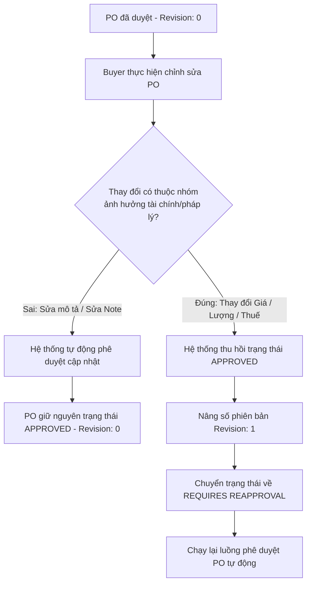

# 4020 Quản lý thay đổi và phiên bản PO (PO Revision)

Đơn mua hàng sau khi đã được ký duyệt chính thức gửi đi cho đối tác được coi là một văn bản pháp lý. Bất kỳ sự thay đổi nào từ phía doanh nghiệp hoặc yêu cầu từ nhà cung cấp (thay đổi giá, số lượng, ngày giao hàng) đều không được phép ghi đè thô bạo lên dữ liệu cũ. Việc quản lý thay đổi và kiểm soát số phiên bản (PO Revision & Change Management) giúp doanh nghiệp lưu vết toàn bộ lịch sử biến động chứng từ (Audit Trail) để phục vụ kiểm toán và đối soát tài chính.

---

## 1. Bản chất nghiệp vụ & Cơ chế kiểm soát thay đổi (Tolerance Rules)

### Vấn đề cốt lõi:
Một đơn PO đang hoạt động bị chỉnh sửa. Làm thế nào hệ thống biết được khi nào cần bắt buộc người dùng gửi phê duyệt lại (Requires Reapproval), và khi nào có thể tự động duyệt các thay đổi nhỏ để tránh tắc nghẽn vận hành?

### Giải pháp kiến trúc ERP tiêu chuẩn:
ERP sử dụng **Quy tắc dung sai thay đổi (PO Change Tolerance Rules)** để phân loại mức độ ảnh hưởng của dữ liệu chỉnh sửa:
*   **Thay đổi không ảnh hưởng (Non-document affecting changes):** Sửa đổi các trường thông tin ghi chú (Note), mô tả văn bản không đổi nghĩa, hoặc thay đổi nhẹ ngày giao hàng trong khoảng dung sai cho phép (ví dụ: giao trễ dưới 2 ngày). Hệ thống tự động phê duyệt phiên bản mới và giữ nguyên hiệu lực PO.
*   **Thay đổi ảnh hưởng nghiêm trọng (Document-affecting changes):** 
    *   Tăng/giảm số lượng đặt hàng (`Quantity`).
    *   Thay đổi đơn giá mua (`Unit Price`).
    *   Thay đổi địa điểm nhận hàng (`Ship-to Location`) dẫn đến thay đổi quy tắc thuế.
    *   Thay đổi điều khoản thanh toán (`Payment Terms`).
    *   *Kết quả:* Hệ thống lập tức thu hồi trạng thái `Approved`, chuyển PO về trạng thái `Requires Reapproval`, nâng số phiên bản (`Revision Number` từ `0` lên `1`) và tự động kích hoạt lại luồng duyệt từ đầu.

---

## 2. Bảng so sánh và Ánh xạ giải pháp giữa các hệ thống

Khi chuyển đổi giữa các hệ thống ERP hoặc tự thiết kế hệ thống (In-house), bạn có thể dễ dàng ánh xạ các tính năng tương đương dựa trên bảng sau:

| Nghiệp vụ thiết kế | Oracle EBS R12.2.10 | Epicor ERP | SAP S/4HANA | Odoo | Hệ thống tự xây (In-house) |
| :--- | :--- | :--- | :--- | :--- | :--- |
| **Bảng lưu lịch sử** | `PO_HEADERS_ARCHIVE_ALL` & `PO_LINES_ARCHIVE_ALL` | Bảng nhật ký thay đổi (`ChgLog` / `Audit Log`) | Change Documents (`CDHDR` & `CDPOS`) | Versioning / Mail Thread Tracking | Bảng sao lưu lịch sử (`PO_Headers_History`) |
| **Kích hoạt duyệt lại** | Trạng thái `Requires Reapproval` | Trạng thái `Pending` khi đổi giá/lượng | Re-trigger Release Strategy | Reset to Draft / Re-approve | Chuyển trạng thái chứng từ về "Chờ duyệt lại" dựa trên điều kiện |
| **Lưu trữ lịch sử** | Archive on Approval (Cấu hình tại cấp độ Document Type) | Auto-track Change Log on fields | Auto-generate Change Documents | Ghi nhận log thay đổi dưới phần Chatter | Trigger tạo bản sao lưu snapshot tại thời điểm Approve |

---

## 3. Quy trình kiểm soát thay đổi PO tự động

Dưới đây là sơ đồ luồng dữ liệu biểu diễn cách hệ thống phân tích dữ liệu chỉnh sửa để quyết định việc nâng số phiên bản và chạy lại luồng duyệt:



---

## 4. Điểm giao thoa & Tham chiếu chéo (Cross-linking) sang các phân hệ khác

*   **Chốt chặn cho nhận hàng (INV):** Thủ kho khi làm phiếu [1000 Nhập kho từ mua hàng (Receipt from PO)](../../1-kho/3000-giao-dich-nhap-xuat-chuyen.md) chỉ nhìn thấy số lượng và đơn giá của phiên bản được phê duyệt mới nhất (Latest Approved Revision). Toàn bộ các phiên bản cũ hoặc phiên bản đang nằm chờ duyệt lại sẽ bị khóa không cho phép nhận hàng.
*   **Đối soát kế toán (AP):** Khi kế toán AP thực hiện đối soát hóa đơn tại bài [3000 Ghi nhận hóa đơn nhà cung cấp từ đơn mua hàng (AP Invoice Match)](), hệ thống sẽ kiểm tra hóa đơn gửi sang có khớp với đơn giá và số lượng của phiên bản PO hoạt động cuối cùng không. Nếu có sai lệch vượt định mức, hóa đơn sẽ bị khóa thanh toán tự động.

---

## 5. Hướng dẫn luồng thiết lập (Setup Flow) chi tiết trên hệ thống

### A. Trên Oracle EBS R12.2.10 (BPA/PO Revision Controls)

1.  **Cấu hình thời điểm Lưu trữ lịch sử (Archive on Approval):**
    *   *Nghiệp vụ:* Được thiết lập sẵn tại cấu hình Document Types tại bài [1010 Phân loại chứng từ mua hàng](./1010-thiet-lap-va-phan-loai-chung-tu-mua-hang.md). Chọn thuộc tính `Archive on Approval` cho Standard PO để hệ thống tự động chụp lại bản sao lịch sử (Snapshot) sang các bảng Archive ngay khi nút `Approve` được nhấn.
2.  **Cấu hình quy tắc dung sai thay đổi (PO Change Tolerance):**
    *   *Đường dẫn:* `Purchasing Super User > Setup > Tolerances > Change Order`
    *   *Nghiệp vụ:* Khai báo phần trăm dung sai thay đổi cho phép. Ví dụ: Nếu tổng giá trị PO thay đổi tăng dưới 2%, hệ thống cho phép tự động duyệt mà không cần chạy lại quy trình ký duyệt của Ban giám đốc.

### B. Trên Epicor ERP (Ready to Calculate & PO Change)

1.  **Kích hoạt chế độ Chỉnh sửa PO (PO Change Mode):**
    *   *Đường dẫn:* `Material Management > Purchase Management > General Operations > Purchase Order Entry`
    *   *Nghiệp vụ:* Đối với đơn PO đã gửi đi, khi cần sửa đổi, Buyer phải tích chọn ô `PO Change` để hệ thống hiểu đây là phiên bản điều chỉnh.
2.  **Theo dõi số phiên bản (RevisionNum):**
    *   *Nghiệp vụ:* Khi Buyer thực hiện thay đổi giá hoặc số lượng trên các dòng `PODetail` hoặc `PORel`, hệ thống Epicor tự động tăng giá trị trường `POHeader.RevisionNum` lên 1 đơn vị và chuyển trạng thái PO về `Unapproved`. Buyer bắt buộc phải bấm nút `Ready to Calculate` để chạy lại luồng kiểm tra hạn mức tài chính.

---

## 6. Truy vấn SQL đối soát cấu trúc tổ chức (SQL Database Audit Queries)

### A. Cho Oracle EBS R12.2.10

Query dưới đây so sánh dữ liệu của dòng PO hiện tại với dữ liệu lịch sử ở phiên bản ngay trước đó để kiểm toán xem ai đã thay đổi đơn giá hoặc số lượng của dòng PO, thay đổi cụ thể là bao nhiêu:

```sql
SELECT 
    hou.name                      AS operating_unit,
    pha.segment1                  AS po_number,
    pha.revision_num              AS current_revision,
    pla.line_num                  AS line_num,
    msib.segment1                 AS item_code,
    -- Dữ liệu hiện tại
    pla.quantity                  AS current_quantity,
    pla.unit_price                AS current_price,
    -- Dữ liệu lịch sử ở phiên bản trước đó
    paa.revision_num              AS archived_revision,
    pla_arch.quantity             AS archived_quantity,
    pla_arch.unit_price           AS archived_price
FROM 
    po_headers_all pha
INNER JOIN 
    po_lines_all pla ON pha.po_header_id = pla.po_header_id
INNER JOIN 
    hr_operating_units hou ON pha.org_id = hou.organization_id
INNER JOIN 
    po_headers_archive_all paa ON pha.po_header_id = paa.po_header_id
INNER JOIN 
    po_lines_archive_all pla_arch ON pla.po_line_id = pla_arch.po_line_id 
                                  AND paa.revision_num = pla_arch.revision_num
LEFT JOIN 
    mtl_system_items_b msib ON pla.item_id = msib.inventory_item_id 
                            AND msib.organization_id = (
                                SELECT fsp.inventory_organization_id 
                                FROM financials_system_params_all fsp 
                                WHERE fsp.org_id = pha.org_id
                            )
WHERE 
    pha.revision_num > 0 -- Chỉ lấy các PO đã từng có chỉnh sửa
    AND paa.revision_num = pha.revision_num - 1 -- So sánh trực tiếp với phiên bản kề trước
    AND (pla.quantity <> pla_arch.quantity OR pla.unit_price <> pla_arch.unit_price) -- Chỉ lọc dòng có biến động giá/lượng
ORDER BY 
    pha.segment1, pla.line_num, paa.revision_num DESC;
```

### B. Cho Epicor ERP (Truy vấn cơ sở dữ liệu SQL Server)

Query dưới đây kiểm kê danh sách các đơn PO có số phiên bản điều chỉnh (`RevisionNum > 0`) để bộ phận kiểm soát nội bộ rà soát tần suất sửa đổi đơn hàng của các Buyer:

```sql
SELECT 
    ph.Company,
    ph.PONum                      AS PO_Number,
    ph.RevisionNum                AS Current_Revision_Num,
    ph.BuyerID                    AS Buyer_Code,
    v.VendorID                    AS Vendor_Code,
    v.Name                        AS Vendor_Name,
    ph.OrderDate                  AS Original_Order_Date,
    ph.ApprovalStatus             AS Current_Status
FROM 
    Erp.POHeader ph
INNER JOIN 
    Erp.Vendor v ON ph.Company = v.Company AND ph.VendorNum = v.VendorNum
WHERE 
    ph.Company = 'YOUR_COMPANY_CODE'
    AND ph.RevisionNum > 0 -- Lọc các đơn PO đã có lịch sử điều chỉnh phiên bản
ORDER BY 
    ph.PONum DESC;
```

---

## 7. Giải pháp khắc phục lỗi phổ biến & Cảnh báo cho Hệ thống tự xây (In-house)

Nếu đội ngũ của bạn đang tự xây dựng (In-house) phân hệ quản lý chứng từ, hãy đặc biệt lưu ý các điểm thiết kế kiến trúc sau để tránh các bẫy kỹ thuật thực tế:

1.  **Bẫy ghi đè dữ liệu trực tiếp (Data Mutation Pitfall - Nghiêm trọng nhất):**
    *   *Triệu chứng:* Khi người dùng sửa số lượng PO từ 100 thành 120 cái, lập trình viên chỉ viết câu lệnh SQL `UPDATE PO_Lines SET Quantity = 120`. Điều này làm biến mất hoàn toàn thông tin gốc (100 cái). Khi kế toán AP nhận hóa đơn ghi 100 cái, họ sẽ không thể hiểu được tại sao có sự sai lệch và không có cách nào truy vết được ai đã sửa đổi dữ liệu.
    *   *Giải pháp khắc phục:* Tuyệt đối không ghi đè dữ liệu gốc của chứng từ đã duyệt. Thiết kế một bảng sao lưu lịch sử riêng biệt (ví dụ: `PO_Lines_History` hoặc `PO_Lines_Archive`). Khi người dùng thực hiện sửa đổi PO đã duyệt, hệ thống phải tự động chụp lại toàn bộ dữ liệu của phiên bản hiện tại lưu vào bảng lịch sử trước khi cho phép cập nhật giá trị mới.
2.  **Lỗi "Nhập kho ảo" khi PO đang sửa đổi nửa chừng:**
    *   *Triệu chứng:* Buyer đang sửa đổi PO (trạng thái PO đang là "Chờ duyệt lại" - Requires Reapproval). Tuy nhiên, thủ kho tại phân hệ INV vẫn thực hiện nhập kho thành công cho đơn PO này dựa trên dữ liệu cũ chưa duyệt lại.
    *   *Giải pháp:* Thiết kế trạng thái khóa chứng từ nghiêm ngặt. Khi số phiên bản PO tăng lên và trạng thái chuyển sang "Requires Reapproval", hệ thống bắt buộc phải khóa tính năng hiển thị PO này trên màn hình nhập kho của phân hệ INV cho đến khi luồng duyệt lại hoàn tất.
3.  **Lỗi không cập nhật lại trạng thái in ấn/gửi nhà cung cấp (Output Trigger):**
    *   *Triệu chứng:* PO được sửa đổi đơn giá từ 10$ lên 12$ và đã được duyệt lại thành công lên Revision 1. Tuy nhiên, hệ thống không tự động đánh dấu để gửi bản in cập nhật cho nhà cung cấp, dẫn đến việc nhà cung cấp vẫn giao hàng và xuất hóa đơn theo đơn giá cũ 10$.
    *   *Giải pháp:* Thiết kế cờ đánh dấu thay đổi (Change Flag / Outbound Trigger). Khi PO có nâng số Revision, hệ thống tự động bật cờ cảnh báo `Ready to Send` để nhắc nhở Buyer xuất bản in PDF mới nhất gửi lại cho đối tác ký xác nhận.
4.  **Bẫy sửa đổi PO sau khi đã nhận hàng một phần (Partial Receipt Conflict):**
    *   *Triệu chứng:* PO đặt mua 100 cái, thủ kho đã nhận trước 60 cái (`Quantity Received = 60`). Buyer sau đó sửa PO giảm tổng số lượng xuống còn 50 cái — thấp hơn cả số đã nhận thực tế. Nếu hệ thống không kiểm tra ràng buộc này trước khi cho lưu, dữ liệu sẽ rơi vào trạng thái phi logic (số đã nhận lớn hơn số đặt mua), gây sai lệch tồn kho và giá vốn không thể truy vết được.
    *   *Giải pháp:* Trước khi cho phép hạ số lượng hoặc hủy dòng PO, hệ thống bắt buộc phải kiểm tra `Quantity Ordered (mới) >= Quantity Received (lũy kế)`. Nếu vi phạm, chặn lưu và yêu cầu Buyer xử lý phần chênh lệch qua nghiệp vụ trả hàng nhà cung cấp trước (tham khảo bài [5020 Xử lý các tình huống giao hàng lỗi, thừa/thiếu số lượng và hoàn trả]()), thay vì cho sửa trực tiếp số lượng đặt hàng xuống dưới mức đã nhận.

<p align="center" style={{color: 'var(--ifm-color-primary)'}}>
  <strong>Chúc các bạn thành công và vui vẻ!</strong>
</p>