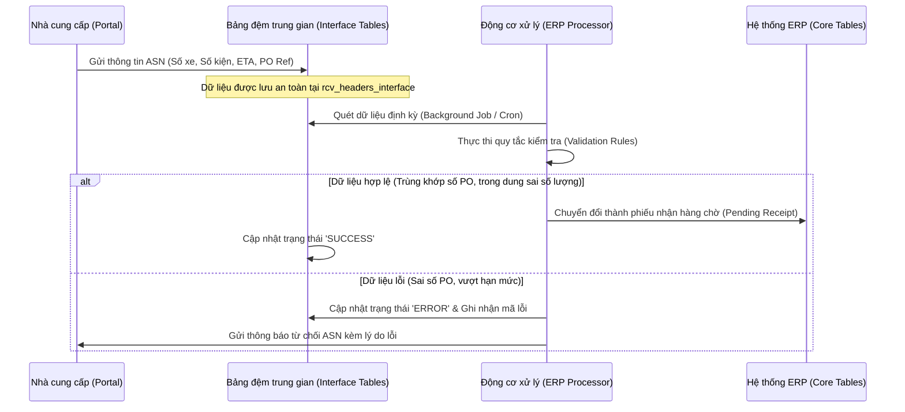

# 5000 Cộng tác nhà cung cấp và ASN (Supplier Portal)

Sau khi đơn mua hàng (PO) được phê duyệt và gửi đi, quy trình mua sắm chuyển sang giai đoạn theo dõi tiến độ (Expediting/Tracking). Thay vì liên lạc thủ công qua email hoặc điện thoại, việc sử dụng Cổng thông tin cộng tác của nhà cung cấp (Supplier Portal) cho phép đối tác chủ động xác nhận đơn hàng (Order Confirmation) và gửi Thông báo giao hàng trước (Advanced Shipping Notice - ASN), giúp doanh nghiệp chủ động sắp xếp nguồn lực kho bãi để tiếp nhận hàng hóa.

---

## 1. Bản chất nghiệp vụ & Giải pháp kiến trúc

### Vấn đề cốt lõi:
Một lỗi thiết kế kinh điển của các hệ thống tự xây (In-house ERP) hoặc hệ thống tùy biến sai cách là **cho phép nhà cung cấp ghi dữ liệu trực tiếp vào bảng giao dịch cốt lõi của ERP**. 
Ví dụ: Khi đối tác muốn thay đổi ngày giao hàng hứa hẹn (Promised Date) hoặc khai báo thông báo giao hàng ASN, lập trình viên cho phép cổng thông tin Supplier Portal chạy lệnh `UPDATE` trực tiếp vào bảng dòng giao hàng `PO_Line_Locations` hoặc bảng nhập kho. Việc này tạo ra lỗ hổng bảo mật nghiêm trọng (phơi nhiễm dữ liệu), làm mất tính kiểm soát phê duyệt của Buyer và dễ gây nghẽn khóa bảng dữ liệu (Database Lock).

### Giải pháp kiến trúc ERP tiêu chuẩn:
ERP sử dụng mô hình **Bảng đệm trung gian (Interface / Staging Tables)** kết hợp cơ chế kiểm soát bất đồng bộ (Asynchronous Integration):
1.  **Xác nhận đơn hàng (Order Acknowledgment):** Nhà cung cấp đăng nhập vào Portal để xác nhận chấp nhận đơn hàng hoặc đề xuất thay đổi (tách dòng giao hàng, sửa ngày hứa hẹn). Các thay đổi này được lưu tạm ở bảng đệm và chỉ chính thức cập nhật vào PO sau khi Buyer bấm nút phê duyệt (Accept Change).
2.  **Thông báo giao hàng trước (Advanced Shipping Notice - ASN):** Trước khi giao hàng, nhà cung cấp khai báo thông tin xe vận chuyển, danh sách kiện hàng (Packing List) và ngày dự kiến tới nơi (ETA). Dữ liệu này được đẩy vào bảng giao dịch nhận hàng đệm (Receiving Interface Tables). Khi hàng tới cổng nhà máy, thủ kho chỉ cần quét mã vạch ASN để thực hiện nhập kho nhanh, bỏ qua bước gõ tay chứng từ.

---

## 2. Bảng so sánh và Ánh xạ giải pháp giữa các hệ thống

Khi chuyển đổi giữa các hệ thống ERP hoặc tự xây dựng hệ thống (In-house), bạn có thể dễ dàng ánh xạ các tính năng tương đương dựa trên bảng sau:

| Nghiệp vụ thiết kế | Oracle EBS R12.2.10 | Epicor ERP | SAP S/4HANA | Odoo | Hệ thống tự xây (In-house) |
| :--- | :--- | :--- | :--- | :--- | :--- |
| **Giao diện cộng tác** | Oracle iSupplier Portal | Epicor Supplier Connect | SAP Ariba / SUS | Odoo Portal (Purchase) | Supplier Portal Web App (React/Vue) |
| **Xác nhận PO** | PO Acknowledgment | Supplier PO Confirmation | PO Confirmation | Vendor Acknowledgment | Bảng đệm `PO_Confirmations_Staging` chờ Buyer duyệt |
| **Khai báo ASN** | iSupplier ASN Entry (đổ vào rcv interface) | Supplier Container/ASN Entry | Ariba ASN (cXML) | Vendor Dispatch (cần tùy biến) | Bảng đệm `ASN_Headers_Staging` & `ASN_Lines_Staging` |

---

## 3. Quy trình tích hợp dữ liệu bất đồng bộ của thông báo ASN

Sơ đồ dưới đây mô tả cách hệ thống ERP tiếp nhận thông báo giao hàng ASN từ Supplier Portal thông qua các bảng đệm trung gian để đảm bảo an toàn dữ liệu:



---

## 4. Điểm giao thoa & Tham chiếu chéo (Cross-linking) sang các phân hệ khác

*   **Đầu vào từ hồ sơ đối tác:** Chỉ những tài khoản nhà cung cấp đã được phê duyệt và kích hoạt quyền truy cập cổng thông tin tại bài [2000 Quản lý hồ sơ nhà cung cấp (Supplier Master)]() mới có thể đăng nhập vào Portal.
*   **Tham chiếu đơn mua hàng:** Luồng xác định tiến độ chỉ áp dụng cho các đơn hàng Standard PO đang ở trạng thái hoạt động đã được ký duyệt tại bài [4000 Khởi tạo Đơn mua hàng tiêu chuẩn (Standard PO)]().
*   **Đầu ra cho thủ kho (INV):** Dữ liệu ASN đã được duyệt thông qua bài viết này sẽ được đẩy trực tiếp sang bài [1000 Nhập kho từ mua hàng (Receipt from PO)]() tại phân hệ Tồn kho để thủ kho thực hiện quét nhận hàng nhanh bằng thiết bị cầm tay Barcode/RFID.

---

## 5. Hướng dẫn luồng thiết lập (Setup Flow) chi tiết trên hệ thống

### A. Trên Oracle EBS R12.2.10 (iSupplier Portal)

1.  **Phân quyền tài khoản đối tác (Supplier User Setup):**
    *   *Đường dẫn:* `System Administrator > Security > User > Define`
    *   *Nghiệp vụ:* Tạo tài khoản cho nhà cung cấp, liên kết tài khoản này với mã nhà cung cấp thực tế và gán trách nhiệm truy cập (`Responsibility`) là `iSupplier Portal Full Access`.
2.  **Khai báo thông báo ASN trên Portal:**
    *   *Nghiệp vụ:* Nhà cung cấp đăng nhập iSupplier Portal, chọn đơn PO cần giao hàng. Click chọn `Shipments` -> `Create Advance Shipment Notice (ASN)`. 
    *   *Khai báo:* Nhập số vận đơn (`Shipment Number`), ngày dự kiến tới (`Expected Receipt Date`), số lượng thực tế giao trên từng dòng. Bấm `Submit` để hệ thống đẩy dữ liệu vào bảng đệm `RCV_HEADERS_INTERFACE`.

### B. Trên Epicor ERP (Supplier Connect & Promised Date)

1.  **Kích hoạt cổng thông tin Supplier Connect:**
    *   *Đường dẫn:* `System Setup > Company/Site Maintenance > Company Maintenance`
    *   *Nghiệp vụ:* Tại tab `Supplier Connect`, kích hoạt tính năng cổng thông tin tự phục vụ cho nhà cung cấp và thiết lập cấu hình bảo mật kết nối.
2.  **Xác nhận tiến độ giao hàng trên PORel (Releases):**
    *   *Đường dẫn:* `Material Management > Purchase Management > General Operations > Purchase Order Entry`
    *   *Nghiệp vụ:* Khi nhà cung cấp phản hồi xác nhận tiến độ qua Portal, Buyer kiểm tra và thực hiện cập nhật ngày hứa hẹn của nhà cung cấp vào ô `Promise Date` tại tab `PORel` (Release) của đơn hàng, tích chọn ô `Confirmed` để khóa dữ liệu tiến độ.

---

## 6. Truy vấn SQL đối soát cấu trúc tổ chức (SQL Database Audit Queries)

> **Lưu ý sửa lỗi:** bản nháp trước dùng 3 tên cột không tồn tại trên các bảng interface của Oracle EBS, dẫn đến lỗi khi thực thi. Đã đối chiếu qua cấu trúc bảng thật (Oracle eTRM) và sửa như sau:
> 1. `rti.po_number` → **`rti.document_num`** — `RCV_TRANSACTIONS_INTERFACE` lưu số chứng từ nguồn (PO/Requisition/Sales Order) tại cột `DOCUMENT_NUM`, không có cột `PO_NUMBER`.
> 2. `rhi.vendor_num` → **`rhi.vendor_id`** — `RCV_HEADERS_INTERFACE` chỉ lưu khóa ngoại số `VENDOR_ID` trỏ tới nhà cung cấp, không có cột `VENDOR_NUM` dạng mã hiển thị; do đó điều kiện join với `ap_suppliers` cũng phải đổi sang so khớp theo `VENDOR_ID` thay vì `SEGMENT1`.
> 3. `rti.item_num` → **join qua `rti.item_id` sang `mtl_system_items_b`** — `RCV_TRANSACTIONS_INTERFACE` chỉ có `ITEM_ID`/`ITEM_DESCRIPTION`/`ITEM_REVISION`, không có cột mã hàng dạng văn bản; phải tra cứu mã hàng (`segment1`) qua bảng Item Master, đúng mẫu đã dùng ở các bài `4000`/`4020`.

### A. Cho Oracle EBS R12.2.10

Query dưới đây kiểm tra các thông báo giao hàng ASN từ nhà cung cấp đang nằm trong bảng đệm trung gian chờ xử lý, đặc biệt hữu ích để rà soát các giao dịch bị lỗi (Status = 'ERROR'):

```sql
SELECT 
    -- Xử lý ORG_ID bị NULL bằng cách lấy thông tin Vendor/Kho hiển thị tạm thời
    rhi.org_id                    AS operating_unit_id,
    rhi.shipment_num              AS asn_number,
    rhi.vendor_num                AS vendor_num,
    aps.vendor_name               AS vendor_name,
    rhi.transaction_type          AS header_transaction_type, -- Sẽ hiển thị 'NEW' giống hệ thống của bạn
    rhi.processing_status_code    AS processing_status,       -- 'PENDING', 'SUCCESS', 'ERROR'
    rhi.processing_request_id     AS request_id,
    
    -- Dữ liệu chi tiết từ dòng (Dùng LEFT JOIN phòng trường hợp bảng Line đã bị xóa hoặc chưa đồng bộ)
    rti.document_num              AS po_number,
    rti.item_num                  AS item_code,
    rti.quantity                  AS quantity,
    rti.unit_of_measure           AS uom,
    rti.transaction_type          AS line_transaction_type   
FROM 
    rcv_headers_interface rhi
LEFT JOIN 
    rcv_transactions_interface rti ON rhi.header_interface_id = rti.header_interface_id
LEFT JOIN 
    ap_suppliers aps ON rhi.vendor_num = aps.segment1
WHERE 
    rhi.transaction_type = 'NEW' 
ORDER BY 
    rhi.creation_date DESC;
```

### B. Cho Epicor ERP (Truy vấn cơ sở dữ liệu SQL Server)

Query dưới đây lọc ra toàn bộ các dòng giao hàng (PO Releases) chưa được nhà cung cấp xác nhận tiến độ giao hàng (`Confirmed = 0`), giúp Buyer nhanh chóng định vị các đơn hàng có nguy cơ trễ hạn để đốc thúc:

```sql
SELECT 
    pr.Company,
    pr.PONum                      AS PO_Number,
    pr.POLine                     AS Line_Num,
    pr.PORelNum                   AS Release_Num,
    pd.PartNum                    AS Part_Number,
    pr.NeedByDate                 AS Original_Need_By_Date,
    pr.PromiseDate                AS Supplier_Promised_Date,
    v.VendorID                    AS Vendor_ID,
    v.Name                        AS Vendor_Name,
    pr.Confirmed                  AS Is_Confirmed,
    pr.ConfirmDate                AS Confirmation_Date
FROM 
    Erp.PORel pr
INNER JOIN 
    Erp.PODetail pd ON pr.Company = pd.Company AND pr.PONum = pd.PONum AND pr.POLine = pd.POLine
INNER JOIN 
    Erp.POHeader ph ON pr.Company = ph.Company AND pr.PONum = ph.PONum
INNER JOIN 
    Erp.Vendor v ON ph.Company = v.Company AND ph.VendorNum = v.VendorNum
WHERE 
    pr.Company = 'YOUR_COMPANY_CODE'
    AND pr.Confirmed = 0 -- Lọc các đơn hàng chưa có xác nhận từ đối tác
ORDER BY 
    pr.NeedByDate;
```

---

## 7. Giải pháp khắc phục lỗi phổ biến & Cảnh báo cho Hệ thống tự xây (In-house)

Nếu đội ngũ của bạn đang tự phát triển cổng thông tin Supplier Portal kết nối với hệ thống ERP nội bộ, hãy đặc biệt chú ý các điểm thiết kế sau:

1.  **Bẫy lỗi bất đồng bộ dữ liệu (Data Desynchronization):**
    *   *Triệu chứng:* Nhà cung cấp gửi thông báo giao hàng ASN trên Portal thành công, nhưng tại giao diện nhận kho của ERP, thủ kho hoàn toàn không tìm thấy thông tin phiếu nhận hàng để quét mã vạch.
    *   *Nguyên nhân:* Tiến trình chạy ngầm (Background Processor / Cron Job) dùng để quét và đồng dịch chuyển dữ liệu từ bảng đệm sang bảng core giao dịch bị dừng hoặc bị treo do lỗi định dạng dữ liệu (ví dụ: lỗi ký tự đặc biệt trong tên tài xế hoặc số xe).
    *   *Giải pháp:* Thiết lập cơ chế kiểm soát lỗi chặt chẽ tại bảng đệm. Nếu một dòng ASN bị lỗi định dạng, chỉ đánh dấu lỗi dòng đó (Status = 'ERROR') và ghi log chi tiết, tuyệt đối không được để lỗi của một dòng làm dừng toàn bộ tiến trình quét dữ liệu của các nhà cung cấp khác.
2.  **Lỗi phơi nhiễm thông tin đơn giá (Security & Price Confidentiality Exposure):**
    *   *Triệu chứng:* Nhà cung cấp đăng nhập vào Portal và có thể xem được báo cáo giá của các đối thủ cạnh tranh khác hoặc xem được các đơn PO không thuộc quyền sở hữu của họ.
    *   *Giải pháp:* Thiết kế cơ chế phân quyền bảo mật dữ liệu cấp dòng (Row-level Security) nghiêm ngặt tại tầng API Gateway. Khi Supplier Portal gọi API lấy dữ liệu PO, bắt buộc hệ thống phải lọc điều kiện theo đúng mã định danh nhà cung cấp (`Vendor ID` / `Supplier Code`) của tài khoản đang đăng nhập, chặn đứng hoàn toàn việc truy cập trái phép.
3.  **Lỗi spam email thông báo thay đổi tiến độ:**
    *   *Triệu chứng:* Mỗi khi nhà cung cấp cập nhật lại ngày hứa hẹn giao hàng (Promise Date) lệch đi 1 tiếng, hệ thống tự động bắn email thông báo cho Buyer. Việc này gây ra tình trạng spam hòm thư, khiến Buyer bỏ qua các cảnh báo trễ hạn thực sự quan trọng.
    *   *Giải pháp:* Chỉ kích hoạt email thông báo hoặc luồng duyệt lại khi sự thay đổi ngày giao hàng vượt quá ngưỡng dung sai cho phép (ví dụ: ngày hứa hẹn mới trễ hơn ngày yêu cầu ban đầu `Need-By Date` quá 2 ngày).
4.  **Bẫy trùng lặp dữ liệu khi nhà cung cấp gửi lại ASN (Duplicate / Idempotent ASN Processing):**
    *   *Triệu chứng:* Do lỗi mạng hoặc timeout, cổng thông tin của nhà cung cấp tự động gửi lại (retry) cùng một thông báo ASN. Nếu hệ thống không có cơ chế nhận diện, tiến trình xử lý nền sẽ tạo ra 2 phiếu nhận hàng chờ (Pending Receipt) trùng nhau cho cùng một lô hàng, khiến thủ kho có nguy cơ nhập kho khống gấp đôi số lượng thực nhận.
    *   *Giải pháp:* Thiết kế khóa duy nhất mang tính nghiệp vụ (Business Unique Key) tại bảng đệm, ví dụ tổ hợp `(Vendor ID, Shipment Number, PO Number)`. Trước khi ghi dòng ASN mới, hệ thống phải kiểm tra tổ hợp này đã tồn tại và đang ở trạng thái `PENDING`/`SUCCESS` hay chưa; nếu có, từ chối bản ghi trùng và trả về thông báo idempotent cho Portal thay vì tạo thêm bản ghi mới.

<p align="center" style={{color: 'var(--ifm-color-primary)'}}>
  <strong>Chúc các bạn thành công và vui vẻ!</strong>
</p>