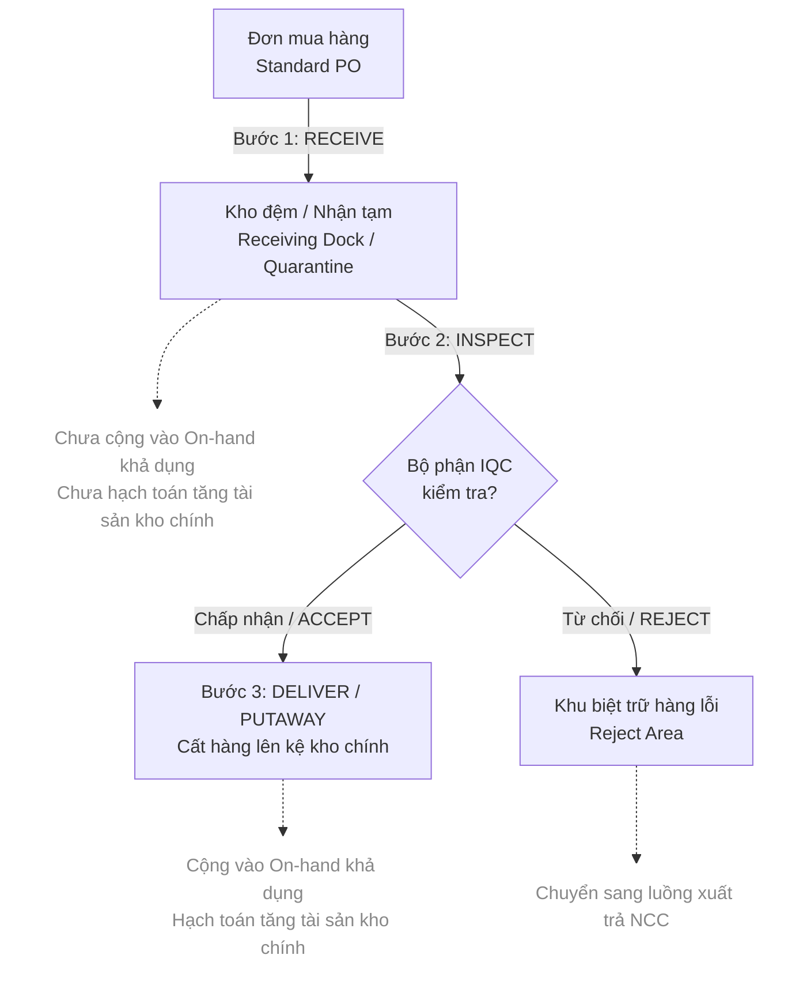

# 5010 Nhận hàng mua và Kiểm tra chất lượng (Receiving & IQC)

Nghiệp vụ nhận hàng mua và kiểm tra chất lượng đầu vào (PO Receiving & Incoming Quality Control - IQC) là điểm giao thoa quan trọng nhất giữa chuỗi cung ứng thương mại (PO) và quản lý kho vật lý (INV). Việc thiết kế quy trình nhận hàng đúng cách giúp doanh nghiệp kiểm soát chặt chẽ chất lượng vật tư đầu vào, chặn đứng hàng lỗi ngay tại cổng nhà máy và ghi nhận chính xác giá trị tài sản tồn kho trong kỳ.

---

## 1. Bản chất nghiệp vụ & Giải pháp nhận hàng 3 bước (3-Step Routing)

### Vấn đề cốt lõi:
Một sai lầm phổ biến trong thiết kế quy trình kho là **"Nhận hàng 1 bước" (Direct Receipt)**: Thủ kho ký nhận hàng từ nhà cung cấp và hệ thống lập tức cộng dồn số lượng vào kho khả dụng (On-hand Stock) để đưa vào sản xuất.
Nếu sau đó bộ phận kiểm tra chất lượng (QC) phát hiện lô hàng bị lỗi 20%:
* Sản xuất đã vô tình lấy nhầm hàng lỗi để chạy máy, gây hỏng hóc sản phẩm và dừng chuyền.
* Việc thực hiện trừ kho, xuất trả hàng lỗi (RTV) trên hệ thống cực kỳ phức tạp và dễ gây sai lệch kế toán.

### Giải pháp kiến trúc nhận hàng 3 bước (3-Step Receiving Routing):
Để đảm bảo an toàn hệ thống, quy trình nhận hàng bắt buộc phải được chia làm 3 bước độc lập về mặt logic:



1.  **Bước 1 - RECEIVE (Nhận tạm):** Hàng hóa được ký nhận vật lý tại cổng bảo vệ/kho đệm. Hệ thống tạo phiếu nhận tạm (GRN). Số lượng này được lưu ở trạng thái "Cách ly/Chờ kiểm" (Quarantine/Receiving), hoàn toàn chưa được phép xuất dùng và chưa tăng tồn kho khả dụng của nhà máy.
2.  **Bước 2 - INSPECT (Kiểm tra chất lượng):** Nhân viên QC tiến hành kiểm tra theo định mức. Hệ thống ghi nhận kết quả kiểm tra: Đạt (`Accept`) hoặc Lỗi (`Reject`).
3.  **Bước 3 - DELIVER / PUTAWAY (Cất hàng lên kệ):** Thủ kho thực hiện chuyển số lượng hàng đạt (`Accept`) từ kho đệm về các ô kệ chính xác trong kho chính thức. Chỉ tại bước này, tồn kho khả dụng mới tăng lên và hệ thống tài chính mới hạch toán tăng tài sản kho.

---

## 2. Bảng so sánh và Ánh xạ giải pháp giữa các hệ thống

Khi chuyển đổi giữa các hệ thống ERP hoặc tự xây dựng hệ thống (In-house), bạn có thể dễ dàng ánh xạ các tính năng tương đương dựa trên bảng sau:

| Nghiệp vụ thiết kế | Oracle EBS R12.2.10 | Epicor ERP | SAP S/4HANA | Odoo | Hệ thống tự xây (In-house) |
| :--- | :--- | :--- | :--- | :--- | :--- |
| **Quy trình nhận hàng** | Receiving Routing (Inspection Required) | PO Receipt Entry -> Inspection Pending | Movement Type 103 (Blocked Stock) -> 105 | 3-Step Receipt (Input -> Quality -> Stock) | Luồng trạng thái dòng nhận hàng (Staging Status) |
| **Kho đệm tạm thời** | Receiving Subinventory / Receiving Dock | Inspection Warehouse / Quarantine | Blocked Stock (Non-valuated) | Input / Quality Location | Cấu hình kho ảo `RECEIVING_ZONE` không tính khả dụng |
| **Hành động kiểm QC** | Enter Inspections | Inspection Processing | Quality Usage Decision (UD) | Quality Control Points / Checks | Form nhập kết quả kiểm `IQC_Entry` |

---

## 3. Điểm giao thoa & Tham chiếu chéo (Cross-linking) sang các phân hệ khác

*   **Kiểm tra điều kiện đơn hàng:** Giao dịch nhận hàng bắt buộc phải đối chiếu trực tiếp với thông tin số lượng, ngày cam kết giao tại [4000 Khởi tạo Đơn mua hàng tiêu chuẩn (Standard PO)]().
*   **Tăng tồn kho khả dụng:** Sau khi hoàn thành bước 3 (Deliver), số lượng đạt sẽ được đẩy thẳng vào bài [1000 Nhập kho từ mua hàng (Receipt from PO)]() tại phân hệ Tồn kho.
*   **Hạch toán giá vốn kế toán:** Bút toán tự động hạch toán tăng tài sản kho và ghi nhận nợ phải trả trung gian (Tài khoản GR/IR - Nhận hàng chưa có hóa đơn) được chuyển giao sang phân hệ kế toán công nợ tại bài [3000 Ghi nhận hóa đơn nhà cung cấp từ đơn mua hàng (AP Invoice Match)]() để chuẩn bị cho khớp lệnh 3 chiều.
*   **Xử lý sai lệch số lượng và hàng lỗi:** Các trường hợp giao hàng thừa/thiếu hoặc bị QC từ chối tại bước INSPECT sẽ được xử lý chi tiết tại bài [5020 Xử lý các tình huống giao hàng lỗi, thừa/thiếu số lượng và hoàn trả (Shortage, Over-delivery & Return to Vendor)]().

---

## 4. Hướng dẫn luồng thiết lập (Setup Flow) chi tiết trên hệ thống

### A. Trên Oracle EBS R12.2.10 (3-Step Receiving)

1.  **Cấu hình Quy tắc nhận hàng trên Item (Receiving Routing):**
    *   *Đường dẫn:* `Inventory > Items > Master Items > tab Receiving`
    *   *Nghiệp vụ:* Tại thuộc tính `Receiving Routing`, gán giá trị mặc định là `Inspection Required` để hệ thống bắt buộc chạy quy trình nhận hàng 3 bước đối với mặt hàng này.
2.  **Thực hiện bước 1 (Receive):**
    *   *Đường dẫn:* `Purchasing Super User > Receiving > Receipts`
    *   *Nghiệp vụ:* Chọn số PO, nhập số lượng thực tế nhà cung cấp giao. Hệ thống tự động đẩy hàng vào vị trí nhận đệm (`Receiving Dock`).
3.  **Thực hiện bước 2 (Inspect):**
    *   *Đường dẫn:* `Purchasing Super User > Receiving > Inspections`
    *   *Nghiệp vụ:* Chọn phiếu nhận hàng đệm, nhập số lượng đạt (`Accept`) và số lượng lỗi (`Reject`).
4.  **Thực hiện bước 3 (Deliver):**
    *   *Đường dẫn:* `Purchasing Super User > Receiving > Receiving Transactions`
    *   *Nghiệp vụ:* Chọn các dòng đã `Accept` ở bước 2, chỉ định chính xác kho con (`Subinventory`) và ô kệ (`Locator`) để cất hàng lên kệ kho chính thức.

### B. Trên Epicor ERP (Inspection Processing)

1.  **Cấu hình yêu cầu kiểm chất lượng đầu vào:**
    *   *Nghiệp vụ:* Tại màn hình `Part Maintenance` hoặc `Vendor Maintenance`, tích chọn thuộc tính `Inspection Required` để bắt buộc chạy luồng kiểm tra chất lượng khi nhận hàng.
2.  **Nhận hàng tạm thời (PO Receipt Entry):**
    *   *Đường dẫn:* `Material Management > Purchase Management > General Operations > Purchase Order Receipt Entry`
    *   *Nghiệp vụ:* Tạo phiếu nhận hàng `PackSlip`. Nếu mặt hàng yêu cầu kiểm QC, Epicor sẽ tự động đánh dấu thuộc tính `Inspection Pending = 1` và chặn không cho phép nhập trực tiếp vào kho chính.
3.  **Xử lý kết quả kiểm chất lượng (Inspection Processing):**
    *   *Đường dẫn:* `Material Management > Purchase Management > General Operations > Inspection Processing`
    *   *Nghiệp vụ:* Nhân viên QC mở màn hình này, chọn phiếu nhận hàng đang chờ kiểm. Nhập số lượng đạt (`Pass`) và số lượng hỏng (`Fail`). Phần hàng đạt sẽ tự động được hệ thống làm giao dịch cất vào đúng Kho/Bin chính thức đã khai báo.

---

## 5. Truy vấn SQL đối soát cấu trúc tổ chức (SQL Database Audit Queries)

### A. Cho Oracle EBS R12.2.10

Query dưới đây truy xuất toàn bộ các phiếu nhận hàng đang bị kẹt ở bước đệm (`RECEIVE` hoặc `ACCEPT`) nhưng chưa hoàn thành bước cất hàng lên kệ (`DELIVER`) để phục vụ việc rà soát backlog của kho. Lưu ý: mã mặt hàng (`item_id`) không có sẵn trên `rcv_transactions`, phải lấy qua bảng dòng nhận hàng `rcv_shipment_lines`:

```sql
SELECT 
    hou.name                      AS operating_unit,
    rsh.receipt_num               AS receipt_number,
    rt.transaction_id             AS trx_id,
    rt.transaction_type           AS current_step,      -- 'RECEIVE' hoặc 'ACCEPT'
    pha.segment1                  AS po_number,
    msib.segment1                 AS item_code,         -- Mã mặt hàng lấy chuẩn từ danh mục
    rt.quantity                   AS pending_qty,
    rt.uom_code                   AS uom,
    rt.transaction_date           AS received_date,
    pa.full_name                  AS receiver_name
FROM 
    rcv_transactions rt
INNER JOIN 
    rcv_shipment_headers rsh ON rt.shipment_header_id = rsh.shipment_header_id
-- BẮT BUỘC THÊM BẢNG NÀY ĐỂ LẤY THÔNG TIN MẶT HÀNG (ITEM_ID)
INNER JOIN 
    rcv_shipment_lines rsl ON rt.shipment_line_id = rsl.shipment_line_id
INNER JOIN 
    po_headers_all pha ON rt.po_header_id = pha.po_header_id
INNER JOIN 
    hr_operating_units hou ON pha.org_id = hou.organization_id
INNER JOIN 
    per_all_people_f pa ON rt.employee_id = pa.person_id 
                        AND TRUNC(SYSDATE) BETWEEN pa.effective_start_date AND pa.effective_end_date
LEFT JOIN 
    mtl_system_items_b msib ON rsl.item_id = msib.inventory_item_id -- Lấy item_id từ dòng nhận hàng, không phải từ rt
                            AND msib.organization_id = rt.organization_id
WHERE 
    -- Lọc các giao dịch mới chỉ ở bước nhận đệm RECEIVE hoặc mới có kết quả ACCEPT của QC
    rt.transaction_type IN ('RECEIVE', 'ACCEPT')
    -- Điều kiện: Chưa tồn tại giao dịch con 'DELIVER' tham chiếu tới giao dịch này
    AND NOT EXISTS (
        SELECT 1 
        FROM rcv_transactions rt2 
        WHERE rt2.parent_transaction_id = rt.transaction_id 
          AND rt2.transaction_type = 'DELIVER'
    )
ORDER BY 
    rt.transaction_date DESC;
```

### B. Cho Epicor ERP (Truy vấn cơ sở dữ liệu SQL Server)

Query dưới đây kết xuất danh sách toàn bộ các dòng nhận hàng mua đang nằm chờ kiểm tra chất lượng (Awaiting IQC) tại phân hệ QC của Epicor:

```sql
SELECT 
    rh.Company,
    rh.PackSlip                    AS Receipt_Packing_Slip,
    rd.PackLine                    AS Line_Num,
    rh.PONum                       AS PO_Number,
    rd.PartNum                     AS Part_Number,
    rd.LineDesc                    AS Item_Description,
    rd.VendorQty                   AS Received_Qty,
    rd.InspectionPending           AS Is_Awaiting_IQC,
    rh.ReceiptDate                 AS Receipt_Date
FROM 
    Erp.RcvDtl rd
INNER JOIN 
    Erp.RcvHead rh ON rd.Company = rh.Company AND rd.ReceiverNum = rh.ReceiverNum
WHERE 
    rd.Company = 'YOUR_COMPANY_CODE'
    AND rd.InspectionPending = 1 -- Điều kiện lọc: Đang chờ QC kiểm tra chất lượng đầu vào
ORDER BY 
    rh.ReceiptDate DESC;
```

---

## 6. Giải pháp khắc phục lỗi phổ biến & Cảnh báo cho Hệ thống tự xây (In-house)

Nếu đội ngũ của bạn đang tự phát triển mô-đun Kho và kiểm tra chất lượng, hãy đặc biệt chú ý các điểm thiết kế sau:

1.  **Bẫy lỗi cộng dồn tồn kho khả dụng quá sớm:**
    *   *Triệu chứng:* Lập trình viên viết câu lệnh SQL cộng dồn số lượng vào bảng `On-Hand_Stock` ngay khi người dùng nhấn nút "Ký nhận hàng" tại gate nhận hàng. Việc này khiến sản xuất lấy nhầm vật tư lỗi để dùng, gây hỏng hóc dây chuyền sản xuất.
    *   *Giải pháp khắc phục:* Thiết kế thuộc tính trạng thái kho (Subinventory/Location Status) có thuộc tính **"Không khả dụng cho sản xuất/bán hàng" (Non-nettable / Non-reservable)** gán cho vị trí nhận đệm. Toàn bộ hàng hóa nằm ở vị trí này sẽ bị hệ thống ẩn đi khi chạy luồng xuất kho sản xuất hoặc bán hàng, chỉ khi hoàn thành bước Deliver sang kho chính thức (Nettable Subinventory) thì mới được phép xuất dùng.
2.  **Lỗi lệch giá trị hạch toán kho do nhận hàng dở dang cuối kỳ:**
    *   *Triệu chứng:* Cuối tháng, nhà cung cấp giao hàng đến và đã làm phiếu Receive (Nhận tạm). Tuy nhiên, QC chưa kiểm tra kịp nên hàng vẫn nằm ở Receiving Dock. Nếu kế toán chạy báo cáo định giá tồn kho cuối kỳ mà hệ thống không ghi nhận giá trị của số hàng nhận tạm này (vì chưa Deliver), báo cáo tài chính sẽ bị lệch nghiêm trọng so với thực tế vật lý trong kho.
    *   *Giải pháp:* Thiết kế tài khoản hạch toán tạm tính cho hàng đang đi đường / hàng nhận tạm (Receiving Accrual Account). Cuối kỳ, kế toán chạy chương trình trích trước chi phí hàng nhận tạm để ghi nhận đúng giá trị tài sản đang nằm chờ kiểm tại Quarantine Area.
3.  **Lỗi không kiểm soát được số lô/serial (Lot/Serial) ngay từ bước nhận đệm:**
    *   *Triệu chứng:* Hàng quản lý theo số lô (Lot) hoặc số serial. Nếu hệ thống cho phép bước Receive (Nhận tạm) bỏ qua việc khai báo Lot/Serial và đợi đến bước Deliver mới bắt nhập, hệ thống sẽ bị mất dấu vết nguồn gốc từ nhà cung cấp nếu có xảy ra tranh chấp hoặc hàng bị lỗi ngay tại bước kiểm tra chất lượng.
    *   *Giải pháp:* Bắt buộc khai báo thông tin Lot/Serial ngay tại bước RECEIVE (Bước 1) đối với các vật tư được gán cấu hình quản lý theo Lot/Serial.
4.  **Thiếu cơ chế cảnh báo tồn đọng hàng chờ kiểm (Aging Alert):**
    *   *Triệu chứng:* Hàng nằm ở Quarantine quá lâu (nhiều ngày) mà không ai xử lý kiểm tra, gây tồn đọng vốn và có nguy cơ hết hạn sử dụng đối với vật tư có hạn dùng, nhưng hệ thống không có cơ chế cảnh báo nên không ai phát hiện kịp thời.
    *   *Giải pháp:* Thiết kế job định kỳ (chạy hàng ngày) quét các dòng đang ở trạng thái `RECEIVE` quá X ngày chưa có kết quả `INSPECT`, tự động gửi cảnh báo cho trưởng bộ phận QC và thủ kho liên quan.

<p align="center" style={{color: 'var(--ifm-color-primary)'}}>
  <strong>Chúc các bạn thành công và vui vẻ!</strong>
</p>