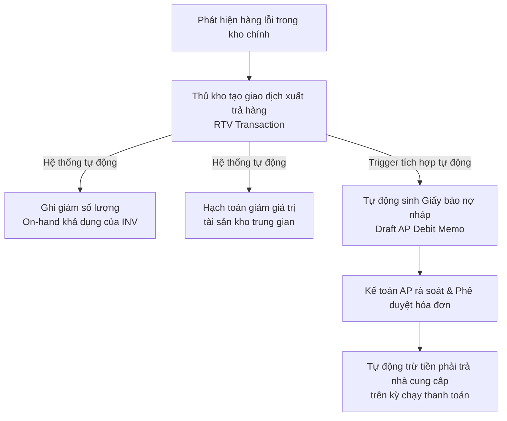

# 5020 Xử lý giao hàng sai lệch và Hoàn trả (Shortage & RTV)

Trong thực tế vận hành chuỗi cung ứng đầu vào, rất ít khi nhà cung cấp giao hàng chính xác 100% về mặt số lượng và chất lượng so với cam kết trên đơn mua hàng (PO). Các tình huống giao thiếu hàng (Shortage), giao thừa hàng (Over-delivery) hay hàng bị lỗi chất lượng phát sinh sau khi nhập kho đòi hỏi hệ thống ERP phải có các cơ chế xử lý sai lệch linh hoạt, đồng thời tự động đồng bộ tài chính để ngăn ngừa rủi ro thất thoát ngân sách.

---

## 1. Bản chất nghiệp vụ & Các kịch bản xử lý sai lệch

Hệ thống ERP tiêu chuẩn quản lý các tình huống sai lệch giao nhận thông qua 3 kịch bản kiểm soát nghiêm ngặt sau:

### Kịch bản 1: Giao thiếu hàng (Shortage / Under-delivery)
*   *Nghiệp vụ:* Nhà cung cấp giao ít hơn số lượng cam kết trên PO.
*   *Phương án xử lý:*
    *   **Nhận hàng từng phần (Partial Receipt):** Thủ kho nhận đúng số thực tế giao, giữ trạng thái dòng PO là `Open` để chờ nhà cung cấp giao tiếp đợt sau.
    *   **Đóng ngắn hạn mức (Close Short):** Doanh nghiệp không muốn nhận tiếp phần còn thiếu. Hệ thống cho phép thực hiện thao tác đóng dòng PO ngắn hạn (Close Short / Cancel Remainder) để giải phóng cam kết ngân sách dở dang.

### Kịch bản 2: Giao thừa hàng (Over-delivery / Over-receipt)
*   *Nghiệp vụ:* Nhà cung cấp giao nhiều hơn số lượng đặt mua trên PO.
*   *Phương án xử lý:* Kiểm soát bằng thuộc tính **Dung sai nhận thừa (Over-Receipt Tolerance)** gán cho từng mặt hàng (ví dụ: gán dung sai 5% cho PO mua 1,000 cái).
    *   *Trong khoảng dung sai (nhận 1,020 cái):* Thủ kho được phép nhận hàng, ERP tự động cập nhật số lượng nhập kho thực tế để kế toán thanh toán.
    *   *Vượt quá dung sai (nhận 1,100 cái):* Hệ thống hiển thị cảnh báo (Warning) hoặc khóa không cho phép nhận hàng (Reject), bắt buộc thủ kho phải trả lại phần thừa hoặc Buyer phải làm thủ tục duyệt lại PO (PO Amendment) để chấp nhận số lượng mới.

### Kịch bản 3: Xuất trả hàng nhà cung cấp (Return to Vendor - RTV)
*   *Nghiệp vụ:* Trả lại hàng lỗi cho nhà cung cấp.
    *   *Trả tại kho đệm:* Phát hiện hàng lỗi ngay tại bước kiểm QC của bài [5010 Nhận hàng mua và Kiểm tra chất lượng (Receiving & IQC)]().
    *   *Trả tại kho chính:* Phát hiện hàng lỗi sau khi đã nhập kho lưu trữ hoặc đang trong quá trình sản xuất.

---

## 2. Bảng so sánh và Ánh xạ giải pháp giữa các hệ thống

Khi chuyển đổi giữa các hệ thống ERP hoặc tự thiết kế hệ thống (In-house), bạn có thể dễ dàng ánh xạ các tính năng tương đương dựa trên bảng sau:

| Nghiệp vụ thiết kế | Oracle EBS R12.2.10 | Epicor ERP | SAP S/4HANA | Odoo | Hệ thống tự xây (In-house) |
| :--- | :--- | :--- | :--- | :--- | :--- |
| **Giao dịch xuất trả** | Return to Vendor (RTV Transaction) | Return to Vendor (RTV) Entry | Movement Type 122 (Return to Vendor) / 124 | Return Transfer | Giao dịch xuất trả kho loại `RETURN_TO_VENDOR` |
| **Báo nợ tài chính** | Auto-create AP Debit Memo | Create Debit Memo Suggestion | Return Invoice / Credit Memo | Create Draft Credit Note | Tự sinh bản ghi báo nợ gán trạng thái chờ khớp hóa đơn |
| **Kiểm soát giao thừa** | Over-Receipt Tolerance & Action (Reject/Warn/None) | Over-Receipt Tolerance % / Receiving Rules | Overdelivery Tolerance / Message | Over-receiving Warning (cần customize) | Trường cấu hình `% Dung sai tối đa` và logic khóa chặn khi nhận |

---

## 3. Luồng tích hợp tự động giữa Xuất trả kho (RTV) và Báo nợ tài chính (AP)

Nếu quy trình vật lý (trả hàng) và quy trình kế toán (đối trừ tiền thanh toán) bị tách rời, doanh nghiệp rất dễ thanh toán nhầm tiền cho nhà cung cấp đối với phần hàng lỗi đã trả. Sơ đồ dưới đây mô tả giải pháp tích hợp tự động hóa luồng dữ liệu này:



---

## 4. Điểm giao thoa & Tham chiếu chéo (Cross-linking) sang các phân hệ khác

*   **Đối chiếu đơn hàng gốc:** Mọi giao dịch xuất trả RTV hoặc đóng ngắn hạn mức bắt buộc phải tham chiếu đến thông tin PO gốc đã tạo tại [4000 Khởi tạo Đơn mua hàng tiêu chuẩn (Standard PO)]().
*   **Nguồn gốc số lượng bị lỗi:** Số lượng `Reject` phát hiện tại bước kiểm tra chất lượng được xử lý ngay tại kho đệm theo bài [5010 Nhận hàng mua và Kiểm tra chất lượng (Receiving & IQC)]().
*   **Ghi giảm tồn kho chính xác:** Giao dịch RTV thực hiện ghi giảm trực tiếp số lượng tồn kho vật lý tại phân hệ Tồn kho, theo logic được mô tả tại bài [1000 Nhập kho từ mua hàng (Receipt from PO)]().
*   **Trừ công nợ tự động:** Dữ liệu Debit Memo sinh ra từ giao dịch RTV chỉ dừng ở trạng thái nháp (Draft) tại phân hệ Kho. Việc rà soát, phê duyệt, khớp hóa đơn và hạch toán giảm trừ công nợ chính thức được xử lý chi tiết tại bài [6020 Nghiệp vụ xử lý hóa đơn điều chỉnh tăng/giảm và hóa đơn trả lại (Debit/Credit Memo Posting & Matching)]() thuộc phân hệ Công nợ phải trả (AP).

---

## 5. Hướng dẫn luồng thiết lập (Setup Flow) chi tiết trên hệ thống

### A. Trên Oracle EBS R12.2.10 (RTV & Over-Receipt Tolerance)

1.  **Cấu hình dung sai nhận hàng thừa:**
    *   *Đường dẫn:* `Purchasing Super User > Setup > Organizations > Receiving Options`
    *   *Nghiệp vụ:* Khai báo thuộc tính `Overreceipt Tolerance` (ví dụ: `5%`) và chọn hành động `Action` là `Reject` để hệ thống tự động khóa không cho thủ kho nhập hàng nếu số lượng vượt quá 5% so với PO.
2.  **Cấu hình tự động sinh Debit Memo khi làm RTV:**
    *   *Đường dẫn:* `Purchasing Super User > Setup > Organizations > Receiving Options`
    *   *Nghiệp vụ:* Tích chọn thuộc tính `Create Debit Memo from RTS Transaction` là `Y`.
3.  **Thực hiện xuất trả hàng (Return to Vendor):**
    *   *Đường dẫn:* `Purchasing Super User > Receiving > Returns`
    *   *Nghiệp vụ:* Chọn số nhận hàng `Receipt Number`, nhập số lượng cần trả lại cho nhà cung cấp, chọn loại giao dịch là `Return to Vendor`. Hệ thống sẽ tự động trừ kho và tự tạo một hóa đơn dạng `DEBIT MEMO` bên phân hệ AP.

### B. Trên Epicor ERP (RTV Entry & Debit Memo Suggestion)

1.  **Thiết lập quy tắc nhận thừa hàng (Over-Receipt):**
    *   *Đường dẫn:* `Material Management > Purchase Management > Setup > Receiving Rules`
    *   *Nghiệp vụ:* Định nghĩa phần trăm dung sai cho phép đối với từng nhà cung cấp hoặc từng nhóm vật tư.
2.  **Khởi tạo yêu cầu trả hàng (Return to Vendor Entry):**
    *   *Đường dẫn:* `Material Management > Purchase Management > General Operations > Return to Vendor Entry`
    *   *Nghiệp vụ:* Tạo mới chứng từ `Return Head`. Chọn mã nhà cung cấp cần trả, chọn số PO và số nhận hàng `Receipt` trước đó. Nhập số lượng hàng cần xuất trả thực tế (`Return Qty`).
3.  **Tạo đề xuất báo nợ tài chính:**
    *   *Nghiệp vụ:* Tại tab `Detail`, tích chọn thuộc tính `Debit Memo` là `True`. Epicor sẽ tự động tạo một đề xuất giảm nợ (Debit Memo Suggestion) đẩy sang phân hệ AP Invoice Entry để kế toán AP phê duyệt khấu trừ tiền.

---

## 6. Truy vấn SQL đối soát cấu trúc tổ chức (SQL Database Audit Queries)

### A. Cho Oracle EBS R12.2.10

Query dưới đây truy vấn toàn bộ các giao dịch xuất trả hàng nhà cung cấp (RTV) đã thực hiện trong kỳ, đồng thời đối chiếu xem hệ thống đã tự động tạo Giấy báo nợ (Debit Memo) tương ứng bên phân hệ AP chưa. Lưu ý: mã mặt hàng phải lấy qua bảng dòng nhận hàng `rcv_shipment_lines` (không lấy trực tiếp từ `rcv_transactions`), và điều kiện đối chiếu `ap_invoices_all` cần khóa thêm theo `org_id` để tránh khớp nhầm hóa đơn giữa các đơn vị vận hành (Operating Unit) khác nhau:

```sql
SELECT 
    hou.name                      AS operating_unit,
    rt.transaction_id             AS rtv_transaction_id,
    rt.transaction_date           AS return_date,
    rsh.receipt_num               AS receipt_number,
    pha.segment1                  AS po_number,
    msib.segment1                 AS item_code,
    rt.quantity                   AS returned_qty,
    rt.uom_code                   AS uom,
    aps.segment1                  AS vendor_num,
    aps.vendor_name               AS vendor_name,
    -- Đối chiếu thông tin Debit Memo tự sinh bên AP
    ap_inv.invoice_num            AS linked_ap_debit_memo,
    ap_inv.invoice_amount         AS debit_memo_amount,
    ap_inv.approval_ready_flag    AS approval_status
FROM 
    rcv_transactions rt
INNER JOIN 
    rcv_shipment_headers rsh ON rt.shipment_header_id = rsh.shipment_header_id
INNER JOIN 
    rcv_shipment_lines rsl ON rt.shipment_line_id = rsl.shipment_line_id -- Join để lấy thông tin dòng receipt
INNER JOIN 
    po_headers_all pha ON rt.po_header_id = pha.po_header_id
INNER JOIN 
    ap_suppliers aps ON rt.vendor_id = aps.vendor_id
INNER JOIN 
    hr_operating_units hou ON pha.org_id = hou.organization_id
LEFT JOIN 
    mtl_system_items_b msib ON rsl.item_id = msib.inventory_item_id 
                            AND msib.organization_id = rt.organization_id
LEFT JOIN 
    ap_invoices_all ap_inv ON ap_inv.source = 'RCV' 
                           AND ap_inv.po_header_id = rt.po_header_id 
                           AND ap_inv.invoice_type_lookup_code = 'DEBIT'
                           AND ap_inv.org_id = pha.org_id -- Khóa thêm theo Operating Unit để tránh khớp nhầm hóa đơn
WHERE 
    rt.transaction_type = 'RETURN TO VENDOR'
ORDER BY 
    rt.transaction_date DESC;
```

### B. Cho Epicor ERP (Truy vấn cơ sở dữ liệu SQL Server)

Query dưới đây kết xuất danh sách toàn bộ các phiếu xuất trả hàng nhà cung cấp trong Epicor, hiển thị trạng thái đã tạo giấy báo nợ kế toán tương ứng:

```sql
SELECT 
    rd.Company,
    rd.ReturnNum                  AS RTV_Number,
    rd.ReturnDate                 AS Return_Date,
    v.VendorID                    AS Vendor_Code,
    v.Name                        AS Vendor_Name,
    rd.PartNum                    AS Part_Number,
    rd.ReturnQty                  AS Returned_Qty,
    rd.IUM                        AS UOM,
    rd.PONum                      AS PO_Number,
    rd.DebitMemo                  AS Is_Debit_Memo_Generated, -- 1 = Đã tạo, 0 = Chưa tạo
    rd.DebitMemoInvoiceNum        AS Linked_Debit_Memo_Invoice
FROM 
    Erp.RVDtl rd
INNER JOIN 
    Erp.Vendor v ON rd.Company = v.Company AND rd.VendorNum = v.VendorNum
WHERE 
    rd.Company = 'YOUR_COMPANY_CODE'
ORDER BY 
    rd.ReturnDate DESC;
```

---

## 7. Giải pháp khắc phục lỗi phổ biến & Cảnh báo cho Hệ thống tự xây (In-house)

Nếu đội ngũ của bạn đang tự phát triển mô-đun Kho và Mua hàng, hãy đặc biệt chú ý các điểm thiết kế sau:

1.  **Bẫy rò rỉ công nợ do thiếu liên kết tự động (Data Silo Pitfall):**
    *   *Triệu chứng:* Thủ kho làm phiếu xuất trả 10 cái máy bơm bị lỗi thực tế ngoài kho và cập nhật số lượng tồn kho giảm đi 10 cái. Tuy nhiên, hệ thống không tự động đẩy thông tin này sang phân hệ kế toán AP. Đến kỳ thanh toán, kế toán AP vẫn thanh toán đủ tiền 100 cái máy bơm dựa trên hóa đơn giấy của nhà cung cấp gửi sang, gây thiệt hại nghiêm trọng cho doanh nghiệp.
    *   *Giải pháp khắc phục:* Thiết kế sự kiện kích hoạt (Event-driven Trigger) tại cơ sở dữ liệu. Ngay khi một dòng giao dịch RTV được ghi nhận thành công, hệ thống bắt buộc phải tự động viết một bản ghi mới ở trạng thái "Chờ phê duyệt" (Draft) vào bảng hóa đơn nhà cung cấp `AP_Invoices` với loại hóa đơn là `DEBIT` để kế toán AP bắt buộc phải đối chiếu trừ tiền khi chạy thanh toán.
2.  **Lỗi "âm kho" khi xuất trả hàng đã đưa vào sử dụng sản xuất:**
    *   *Triệu chứng:* Hàng hóa đã được Deliver (nhập kho chính) từ tuần trước và đã được bộ phận sản xuất lấy ra sử dụng. Sau đó sản xuất phát hiện lỗi và yêu cầu thủ kho làm phiếu RTV trả lại cho nhà cung cấp. Nếu thủ kho chọn trực tiếp giao dịch RTV từ số nhận hàng cũ mà không kiểm tra lượng tồn kho thực tế hiện tại, hệ thống sẽ cho phép xuất vượt quá lượng đang có, dẫn đến hiện tượng âm kho trên hệ thống.
    *   *Giải pháp:* Hệ thống bắt buộc phải kiểm tra lượng tồn khả dụng hiện tại (On-hand Stock) tại ô kệ trước khi cho phép xác nhận giao dịch RTV. Nếu lượng tồn thực tế nhỏ hơn số lượng muốn trả, bắt buộc hệ thống phải khóa giao dịch và yêu cầu làm thủ tục thu hồi hàng lỗi từ sản xuất về kho trước.
3.  **Lỗi sai lệch đơn giá khi làm Debit Memo:**
    *   *Triệu chứng:* PO đặt mua với giá 100$ nhưng nhà cung cấp có chiết khấu thương mại trên hóa đơn thực tế còn 95$. Khi làm phiếu RTV xuất trả hàng lỗi, nếu hệ thống tự xây tự động lấy đơn giá PO gốc (100$) để làm Debit Memo thay vì lấy đơn giá hóa đơn thực tế (95$), hệ thống sẽ bị sai lệch số liệu đối chiếu công nợ cuối kỳ với đối tác.
    *   *Giải pháp:* Thiết kế liên kết thông tin 3 chiều chéo. Đơn giá trên Giấy báo nợ Debit Memo khi tự sinh từ RTS/RTV phải kế thừa logic ưu tiên: ưu tiên lấy đơn giá đã khớp trên hóa đơn AP thực tế (nếu đã nhập hóa đơn), nếu chưa có hóa đơn thì mới lấy đơn giá thỏa thuận trên PO gốc.
4.  **Rủi ro trùng Operating Unit khi đối soát Debit Memo (đa đơn vị vận hành):**
    *   *Triệu chứng:* Với hệ thống tự xây vận hành nhiều pháp nhân/đơn vị kinh doanh (Multi-Org) dùng chung một mã nhà cung cấp, nếu truy vấn đối soát RTV với hóa đơn AP chỉ khớp theo `po_header_id` mà không khóa thêm theo đơn vị vận hành, báo cáo có thể hiển thị nhầm một Debit Memo của đơn vị A là đã xử lý cho giao dịch RTV của đơn vị B, gây sai lệch số liệu đối soát công nợ giữa các pháp nhân.
    *   *Giải pháp:* Mọi truy vấn hoặc logic đối soát tự động giữa giao dịch kho (RTV) và hóa đơn tài chính (Debit Memo) bắt buộc phải khóa thêm điều kiện theo đơn vị vận hành (`Operating Unit` / `Company Code`), không chỉ dựa vào số PO hay mã nhà cung cấp.

<p align="center" style={{color: 'var(--ifm-color-primary)'}}>
  <strong>Chúc các bạn thành công và vui vẻ!</strong>
</p>