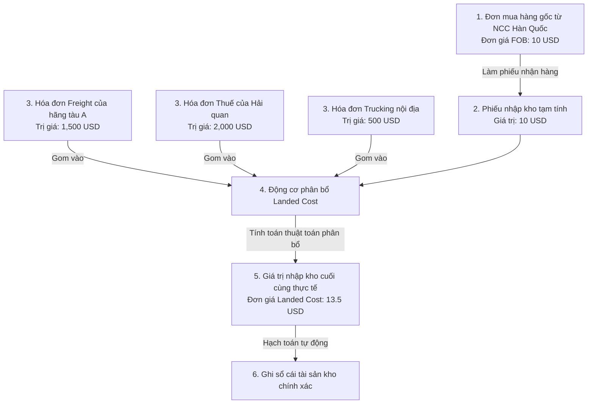
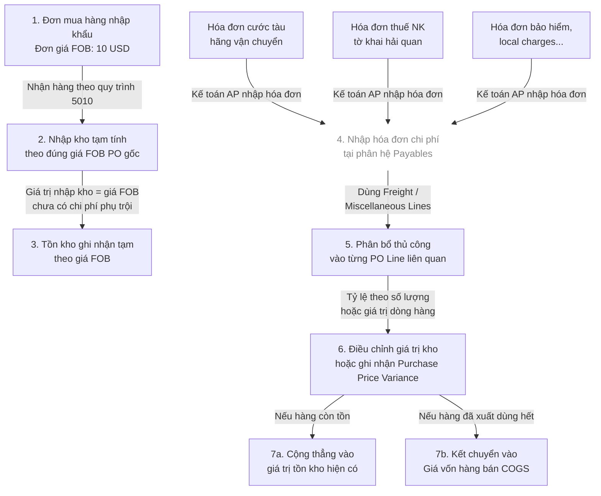

# 5030 Thủ tục nhập khẩu và Điều kiện quốc tế (Incoterms)

Mua hàng nhập khẩu (Import Procurement) là một nghiệp vụ phức tạp đòi hỏi sự phối hợp chặt chẽ giữa chuỗi cung ứng thương mại, vận tải quốc tế (Logistics) và kế toán giá thành. Việc cấu hình đúng các điều kiện thương mại quốc tế (Incoterms), ghi nhận tờ khai hải quan và phân bổ chính xác các chi phí trên đường phát sinh (Landed Cost) là điều kiện bắt buộc để hệ thống ERP tính toán đúng nguyên giá tài sản kho và biên lợi nhuận gộp của doanh nghiệp.

---

## 1. Bản chất nghiệp vụ & Các cấu phần Landed Cost

### Vấn đề cốt lõi:
Một lô hàng hạt nhựa nhập khẩu từ Hàn Quốc có giá FOB tại cảng đi là **10 USD/kg**. Khi hàng về tới kho của doanh nghiệp tại Việt Nam, doanh nghiệp phải trả thêm các khoản chi phí thực tế:
*   Cước vận chuyển biển quốc tế (Ocean Freight).
*   Thuế nhập khẩu và thuế GTGT hàng nhập khẩu (khai báo trên tờ khai hải quan).
*   Bảo hiểm hàng hải (Insurance).
*   Chi phí thông quan, bốc dỡ tại cảng (Local Charges - THC, DO...).
*   Cước vận chuyển nội địa từ cảng về nhà máy (Inland Trucking).

Tổng các chi phí phụ trội phát sinh này là **3.5 USD/kg**. Nếu hệ thống ERP chỉ ghi nhận giá vốn tồn kho của hạt nhựa theo đơn giá PO gốc (10 USD/kg), giá trị tồn kho của doanh nghiệp sẽ bị đánh giá thấp hơn thực tế, dẫn đến việc tính toán sai lệch hoàn toàn giá thành sản phẩm tại phân hệ sản xuất và bóp méo biên lợi nhuận gộp của doanh nghiệp.

### Hai hướng giải quyết trên thực tế:
Có hai cách để đưa khoản 3.5 USD/kg này vào giá trị tồn kho:
1.  **Tự động hóa qua phân hệ chuyên biệt (Landed Cost Management - LCM):** Hệ thống chạy thuật toán phân bổ tự động.
2.  **Xử lý thủ công khi không có/không triển khai phân hệ LCM:** Kế toán và bộ phận giá thành tự phân bổ bằng nghiệp vụ trên các phân hệ sẵn có (AP, Costing).

Mục 3 dưới đây sẽ hướng dẫn cách nhận diện doanh nghiệp đang thuộc nhóm nào trước khi thiết kế báo cáo hay tích hợp hệ thống. Nhưng trước hết, cần xác định rõ **loại chi phí nào cần phân bổ**, vì điều này phụ thuộc trực tiếp vào điều kiện Incoterms đã thỏa thuận với nhà cung cấp.

---

## 2. Incoterms và cách xác định cấu phần chi phí cần phân bổ

Trước khi xác định các khoản chi phí nào cần cộng thêm vào giá vốn tồn kho, hệ thống ERP cần biết đơn hàng nhập khẩu đang áp dụng điều kiện giao hàng quốc tế (Incoterms) nào, vì đây là yếu tố quyết định **bên nào chịu trách nhiệm trả khoản chi phí nào** trong chuỗi vận chuyển.

### Bảng ánh xạ Incoterms phổ biến và trách nhiệm chi phí:

| Điều kiện Incoterms | Cước vận chuyển quốc tế | Bảo hiểm hàng hải | Thuế nhập khẩu & thông quan | Vận chuyển nội địa (đến kho) |
| :--- | :--- | :--- | :--- | :--- |
| **EXW** (Ex Works) | Bên mua chịu toàn bộ | Bên mua chịu | Bên mua chịu | Bên mua chịu |
| **FOB** (Free On Board) | Bên mua chịu (từ cảng đi) | Bên mua chịu (nếu muốn) | Bên mua chịu | Bên mua chịu |
| **CIF** (Cost, Insurance & Freight) | Đã gồm trong giá NCC | Đã gồm trong giá NCC | Bên mua chịu | Bên mua chịu |
| **DAP** (Delivered At Place) | Đã gồm trong giá NCC | Đã gồm trong giá NCC | Bên mua chịu | Đã gồm trong giá NCC |
| **DDP** (Delivered Duty Paid) | Đã gồm trong giá NCC | Đã gồm trong giá NCC | Đã gồm trong giá NCC | Đã gồm trong giá NCC |

### Ý nghĩa thiết kế hệ thống:
Trường `Incoterms` khai báo trên PO Header (hoặc PO Line) không chỉ mang tính pháp lý, mà còn là **điều kiện kích hoạt logic phân bổ chi phí**:
*   Nếu PO khai báo **FOB**, hệ thống (hoặc kế toán nếu xử lý thủ công) cần chủ động tìm và phân bổ đủ 4 khoản: cước tàu, bảo hiểm, thuế NK, vận chuyển nội địa — vì giá trên PO (giá FOB) hoàn toàn chưa bao gồm các khoản này.
*   Nếu PO khai báo **CIF**, chỉ cần bổ sung thêm thuế nhập khẩu và cước nội địa, vì cước tàu và bảo hiểm nhà cung cấp đã tính sẵn trong đơn giá.
*   Nếu PO khai báo **DDP**, về lý thuyết không cần phân bổ thêm gì (giá NCC đã là giá "tận kho"), tuy nhiên hệ thống vẫn nên kiểm tra chéo với hóa đơn hải quan thực tế để tránh trường hợp NCC khai thiếu.

Việc gán sai Incoterms trên PO là nguyên nhân phổ biến khiến hệ thống Landed Cost (dù tự động hay thủ công) phân bổ thiếu hoặc phân bổ thừa chi phí — ví dụ nhân viên mua hàng nhập nhầm điều kiện DDP trong khi thực tế nhà cung cấp giao theo FOB, khiến hệ thống bỏ sót hoàn toàn 4 khoản chi phí cần cộng thêm.

---

## 3. Nhận diện thực trạng: Doanh nghiệp có đang triển khai phân hệ LCM hay không?

### Vì sao cần kiểm tra trước khi thiết kế:
LCM (Landed Cost Management) trên Oracle EBS, hay các module tương đương trên các ERP khác, là **phân hệ tùy chọn (optional module)** — không phải doanh nghiệp nào cài Oracle EBS/ERP cũng đã bật, cấu hình và vận hành phân hệ này. Rất nhiều doanh nghiệp quy mô vừa vẫn nhập khẩu hàng hóa bình thường nhưng xử lý chi phí trên đường hoàn toàn thủ công qua phân hệ AP/Costing, không hề dùng đến LCM. Nếu đội ngũ triển khai hoặc BA mặc định hệ thống nào cũng có LCM để thiết kế báo cáo hay tích hợp, sản phẩm cuối cùng sẽ không chạy được trên các hệ thống thực tế không dùng module này.

### Cách nhận diện nhanh (trên Oracle EBS):
*   **Bước 1 - Kiểm tra dữ liệu:** Chạy `SELECT COUNT(*) FROM inl_ship_headers_all;`. Nếu trả về 0 dòng dù đã dùng tài khoản có đầy đủ quyền truy vấn, đây là **dấu hiệu mạnh** cho thấy chưa từng có lô hàng LCM nào được tạo trên hệ thống.
*   **Bước 2 - Xác minh chéo qua cấu hình:** Không nên chỉ dựa vào một câu query để kết luận tuyệt đối. Cần đối chiếu thêm tại `Landed Cost Management > Setup > Cost Components` xem đã có cấu phần chi phí nào được khai báo chưa, và hỏi trực tiếp bộ phận kế toán/logistics xem quy trình vận hành thực tế của họ khi nhận hóa đơn cước tàu, thuế nhập khẩu là gì.
*   **Bước 3 - Kết luận:** Nếu cả dữ liệu lẫn cấu hình đều trống, và bộ phận nghiệp vụ xác nhận họ xử lý chi phí trên đường bằng cách khác, có thể kết luận doanh nghiệp không vận hành LCM và cần thiết kế theo quy trình thay thế ở mục 7.C và truy vấn thay thế ở mục 8.A.2 - A.3.

### Quy trình thay thế phổ biến khi không dùng LCM:
1.  **Phân bổ trực tiếp trên hóa đơn AP (Freight/Miscellaneous Lines):** Khi nhận hóa đơn chi phí (cước tàu, bảo hiểm...) từ nhà cung cấp dịch vụ logistics, kế toán AP nhập hóa đơn và dùng chức năng dòng chi phí phụ (`Freight`/`Miscellaneous Charges`) trên chính hóa đơn PO gốc hoặc hóa đơn riêng, phân bổ thủ công số tiền này theo tỷ lệ số lượng/giá trị các dòng hàng liên quan.
2.  **Sử dụng chi phí định mức tiêu chuẩn (Standard Costing / Material Burden):** Bộ phận giá thành không chờ hóa đơn thực tế về mới tính, mà cấu hình sẵn một tỷ lệ % chi phí phụ trội cố định (Overhead/Material Burden Rate) cộng vào đơn giá tiêu chuẩn của vật tư nhập khẩu ngay từ đầu kỳ, cuối kỳ mới đối chiếu chênh lệch thực tế - định mức (Purchase Price Variance).

---

## 4. Bảng so sánh và Ánh xạ giải pháp giữa các hệ thống

Khi chuyển đổi giữa các hệ thống ERP hoặc tự thiết kế hệ thống (In-house), bạn có thể dễ dàng ánh xạ các tính năng tương đương dựa trên bảng sau:

| Nghiệp vụ thiết kế | Oracle EBS R12.2.10 (có LCM) | Oracle EBS (không dùng LCM) | Epicor ERP | SAP S/4HANA | Odoo | Hệ thống tự xây (In-house) |
| :--- | :--- | :--- | :--- | :--- | :--- | :--- |
| **Module kiểm soát** | Landed Cost Management (LCM) | Không có — xử lý tại AP/Costing | Landed Cost Container Entry | Material Ledger (ML) / Actual Costing | Landed Costs Module | Mô-đun phân bổ chi phí Landed Cost (tùy chọn) |
| **Ghi nhận chi phí phụ trội** | Customs Declaration / Tax Info tại LCM Shipment | Freight/Miscellaneous Lines trên AP Invoice | Landed Cost / Duty Entry | Customs Invoice / Tax Code | Landed Cost Valuation Adjustment | Bảng ghi nhận thông số tờ khai và phân bổ thuế |
| **Công cụ gom chi phí** | LCM Shipment | Thủ công theo từng hóa đơn AP + PO Line | Landed Cost Container | Cost Center Allocation / ML | Landed Cost Lines | Bảng đệm gom hóa đơn dịch vụ vận chuyển |

---

## 5. Sơ đồ dòng chảy tích lũy và phân bổ chi phí Landed Cost

### A. Trường hợp có sử dụng phân hệ LCM tự động

Sơ đồ dưới đây mô tả cách hệ thống ERP thu thập đơn giá PO gốc và phân bổ các hóa đơn chi phí dịch vụ vận chuyển phát sinh từ các đối tác 3PL khác nhau vào giá trị hàng nhập kho:



### B. Trường hợp KHÔNG sử dụng phân hệ LCM (quy trình thủ công thay thế)

Sơ đồ dưới đây mô tả luồng xử lý tương đương khi doanh nghiệp không triển khai LCM: hàng vẫn nhận theo giá FOB gốc, các hóa đơn chi phí được kế toán AP nhập và phân bổ tay vào từng dòng PO, và có 2 hướng xử lý khác nhau tùy tình trạng tồn kho tại thời điểm hóa đơn về:



---

## 6. Điểm giao thoa & Tham chiếu chéo (Cross-linking) sang các phân hệ khác

*   **Tham chiếu đơn hàng:** Quy trình nhập khẩu bắt buộc phải liên kết trực tiếp với đơn PO nhập khẩu đã khởi tạo tại **[PO 4000 - Khởi tạo và cấu hình Đơn mua hàng tiêu chuẩn (Standard PO)](./4000-khoi-tao-va-cau-hinh-don-mua-hang-tieu-chuan.md)**.
*   **Đối soát kho vật lý:** Số lượng thực nhận sau thông quan là căn cứ để thủ kho thực hiện giao dịch tại bài **[INV 1000 - Nhập kho từ mua hàng (Receipt from PO)](../inv-ton-kho/1000-nhap-kho-tu-mua-hang-po.md)** tại phân hệ Tồn kho.
*   **Xử lý hóa đơn chi phí (trường hợp không dùng LCM):** Hóa đơn cước vận chuyển, thuế nhập khẩu do bên thứ ba xuất được ghi nhận và phân bổ thủ công tại phân hệ Công nợ phải trả, tham khảo thêm bài AP/AR 3000 - Ghi nhận hóa đơn nhà cung cấp từ đơn mua hàng (AP Invoice Match).
*   **Chuyển giao cho kế toán giá thành:** Dữ liệu chênh lệch giữa giá PO gốc và giá Landed Cost thực tế sau phân bổ (dù qua LCM tự động hay qua Standard Costing thủ công) được chuyển giao trực tiếp sang phân hệ kế toán giá thành tại bài COST 5000 - Phân bổ chi phí vận chuyển, thuế nhập khẩu và bảo hiểm vào giá vốn nguyên vật liệu nhập khẩu (Landed Cost Allocation) để tính giá thành sản phẩm chính xác.

---

## 7. Hướng dẫn luồng thiết lập (Setup Flow) chi tiết trên hệ thống

### A. Trên Oracle EBS R12.2.10 — Trường hợp có triển khai LCM

Oracle EBS cung cấp phân hệ chuyên biệt **Landed Cost Management (LCM)** hoạt động dưới hai mô hình: *Pre-Receipt* (phân bổ ước tính trước khi nhận kho) và *Post-Receipt* (nhận kho trước rồi phân bổ hóa đơn thực tế sau).

1.  **Thiết lập các cấu phần chi phí (Cost Components):**
    *   *Đường dẫn:* `Landed Cost Management > Setup > Cost Components`
    *   *Nghiệp vụ:* Khai báo các loại chi phí phụ trội như `FREIGHT` (Cước vận chuyển), `DUTY` (Thuế nhập khẩu), `INSURANCE` (Bảo hiểm).
2.  **Khởi tạo lô hàng nhập khẩu LCM (LCM Shipment):**
    *   *Đường dẫn:* `Landed Cost Management > Shipments > Workbench`
    *   *Nghiệp vụ:* Tạo mới một LCM Shipment. Thực hiện tham chiếu dòng PO nhập khẩu vào lô hàng này.
3.  **Nhập các chi phí ước tính / thực tế:**
    *   *Nghiệp vụ:* Nhập các giá trị chi phí vận chuyển hoặc tiền thuế phát sinh. Chọn phương thức phân bổ là `By Value` (theo trị giá tiền) hoặc `By Weight` (theo trọng lượng hạt nhựa).
4.  **Chạy thuật toán phân bổ và Đóng lô hàng (Submit LCM):**
    *   *Nghiệp vụ:* Bấm nút `Submit` để hệ thống tự chạy thuật toán phân bổ chi phí cộng dồn vào đơn giá của từng mặt hàng, tự động cập nhật đơn giá nhập kho thực tế (Landed Unit Cost) sang phân hệ Inventory.

### B. Trên Epicor ERP (Landed Cost Container Entry)

1.  **Thiết lập Mã chi phí (Landed Cost Code Setup):**
    *   *Đường dẫn:* `Financial Management > Multi-Site/Multi-Company > Setup > Landed Cost Code`
    *   *Nghiệp vụ:* Định nghĩa mã chi phí (ví dụ: `FRT_SEA` cho cước biển, `IMPORT_DUTY` cho thuế nhập khẩu) và chọn phương thức phân bổ mặc định (`Apportion Method`).
2.  **Tạo Container vận chuyển nhập khẩu (Container Entry):**
    *   *Đường dẫn:* `Material Management > Purchase Management > General Operations > Container Landed Cost Entry`
    *   *Nghiệp vụ:* Khởi tạo mã Container đại diện cho chuyến hàng nhập khẩu. Thêm các dòng PO dòng hàng vào Container.
3.  **Nhập và phân bổ chi phí thực tế:**
    *   *Nghiệp vụ:* Tại tab `Landed Cost`, nhập số tiền trên các hóa đơn dịch vụ vận chuyển của hãng tàu gửi sang. Bấm nút `Disburse` để Epicor tự động chia đều tiền chi phí vào đơn giá của từng mã vật tư (`Part`) trong Container dựa trên tỷ lệ trọng lượng hoặc trị giá đã chọn.

### C. Trên Oracle EBS R12.2.10 — Trường hợp KHÔNG triển khai LCM (quy trình thay thế)

1.  **Nhận hàng và ghi nhận theo giá PO gốc:**
    *   *Đường dẫn:* `Purchasing Super User > Receiving > Receipts`
    *   *Nghiệp vụ:* Thủ kho nhận hàng bình thường theo quy trình chuẩn tại bài **[PO 5010 Nghiệp vụ nhận hàng mua, kiểm tra chất lượng và nhập kho (PO Receiving, Quality Inspection & Putaway](./5010-nghiep-vu-nhan-hang-mua-kiem-tra-chat-luong-va-nhap-kho.md)**. Giá trị nhập kho tạm thời ghi nhận đúng bằng đơn giá FOB trên PO, chưa bao gồm chi phí phụ trội.
2.  **Ghi nhận hóa đơn chi phí và phân bổ thủ công (Freight/Miscellaneous Lines):**
    *   *Đường dẫn:* `Payables > Invoices > Entry > Invoices` (hoặc trực tiếp tại `Purchasing > Invoice Matching` nếu phân bổ ngay trên PO)
    *   *Nghiệp vụ:* Kế toán AP nhập hóa đơn của hãng tàu/đơn vị khai hải quan, sử dụng chức năng `Freight` hoặc `Miscellaneous Charges` để gán và phân bổ số tiền này vào các dòng PO liên quan theo tỷ lệ số lượng hoặc giá trị.
3.  **Đối chiếu chênh lệch giá cuối kỳ (nếu dùng Standard Costing):**
    *   *Đường dẫn:* `Cost Management > Cost Accounting Setup` (nếu tổ chức áp dụng phương pháp giá tiêu chuẩn)
    *   *Nghiệp vụ:* Bộ phận giá thành thiết lập sẵn tỷ lệ Overhead/Material Burden ước tính, và cuối kỳ chạy báo cáo Purchase Price Variance để đối chiếu giữa chi phí thực tế và chi phí định mức đã cộng vào giá vốn.

---

## 8. Truy vấn SQL đối soát cấu trúc tổ chức (SQL Database Audit Queries)

### A. Cho Oracle EBS R12.2.10

#### A.1 — Trường hợp có LCM: Đối chiếu giá FOB gốc và giá Landed Cost thực tế sau phân bổ

Query dưới đây truy xuất toàn bộ các lô hàng LCM nhập khẩu đã hoàn thành phân bổ, hiển thị đơn giá PO gốc (FOB) so với đơn giá Landed Cost thực tế sau khi đã cộng dồn toàn bộ chi phí phụ trội:

```sql
SELECT 
    hou.name                      AS operating_unit,
    ish.ship_num                  AS lcm_shipment_number,
    pha.segment1                  AS po_number,
    msib.segment1                 AS item_code,
    isl.qty                       AS received_qty,
    isl.unit_price                AS po_fob_price,
    isl.unit_landed_cost          AS calculated_landed_cost,
    -- Tính toán phần chi phí cộng thêm trên mỗi đơn vị sản phẩm
    (isl.unit_landed_cost - isl.unit_price) AS added_landed_cost_per_unit,
    ish.ship_status_code          AS shipment_status
FROM 
    inl_ship_headers_all ish
INNER JOIN 
    inl_ship_lines_all isl ON ish.ship_header_id = isl.ship_header_id
INNER JOIN 
    po_headers_all pha ON isl.ship_line_source_id = pha.po_header_id
INNER JOIN 
    hr_operating_units hou ON ish.org_id = hou.organization_id
LEFT JOIN 
    mtl_system_items_b msib ON isl.inventory_item_id = msib.inventory_item_id 
                            AND msib.organization_id = (
                                SELECT fsp.inventory_organization_id 
                                FROM financial_system_params_all fsp 
                                WHERE fsp.org_id = ish.org_id
                            )
WHERE 
    ish.ship_status_code = 'COMPLETED' -- Chỉ quét các lô hàng đã hoàn tất phân bổ
ORDER BY 
    ish.ship_num DESC;
```

> **Lưu ý:** Nếu chạy query trên trả về 0 dòng dù đã dùng tài khoản có đầy đủ quyền truy vấn dữ liệu, hãy quay lại mục 3 để xác minh xem doanh nghiệp có thực sự triển khai LCM hay không trước khi kết luận đây là lỗi truy vấn.

#### A.2 — Trường hợp không dùng LCM: Đối chiếu giá FOB và giá quy đổi theo tỷ giá tại thời điểm nhận hàng

Khi doanh nghiệp không triển khai LCM, báo cáo thay thế cần tập trung vào đơn giá gốc trên PO Line và giá trị quy đổi theo tỷ giá của PO, làm căn cứ để đối chiếu thủ công với hóa đơn chi phí bên AP:

```sql
SELECT 
    hou.name                      AS operating_unit,
    rsh.receipt_num               AS receipt_number,
    pha.segment1                  AS po_number,
    msib.segment1                 AS item_code,
    rt.quantity                   AS received_qty,
    rt.uom_code                   AS uom,
    pla.unit_price                AS po_fob_price,
    -- Đơn giá quy đổi = Đơn giá PO * Tỷ giá (nếu ngoại tệ), nếu VND tỷ giá mặc định = 1
    (pla.unit_price * NVL(pha.rate, 1)) AS converted_unit_price,
    -- Tổng giá trị dòng nhận hàng quy đổi ra nội tệ
    (rt.quantity * pla.unit_price * NVL(pha.rate, 1)) AS total_received_amount,
    pha.currency_code             AS po_currency,
    NVL(pha.rate, 1)              AS exchange_rate,
    rt.transaction_date           AS receipt_date
FROM 
    rcv_transactions rt
INNER JOIN 
    rcv_shipment_headers rsh ON rt.shipment_header_id = rsh.shipment_header_id
INNER JOIN 
    rcv_shipment_lines rsl ON rt.shipment_line_id = rsl.shipment_line_id
INNER JOIN 
    po_headers_all pha ON rt.po_header_id = pha.po_header_id
INNER JOIN 
    po_lines_all pla ON rsl.po_line_id = pla.po_line_id
INNER JOIN 
    hr_operating_units hou ON pha.org_id = hou.organization_id
LEFT JOIN 
    mtl_system_items_b msib ON rsl.item_id = msib.inventory_item_id 
                            AND msib.organization_id = rt.organization_id
WHERE 
    rt.transaction_type = 'RECEIVE' -- Chỉ lấy các giao dịch nhận hàng thành công vào kho
ORDER BY 
    rt.transaction_date DESC;
```

#### A.3 — Trường hợp không dùng LCM: Đối chiếu chi phí thực tế đã ghi nhận bên AP cho từng PO nhập khẩu

Query dưới đây phục vụ mục đích đối soát từ góc độ Mua hàng/Kho: kiểm tra xem một PO nhập khẩu đã có hóa đơn chi phí (Freight/Miscellaneous) được kế toán AP ghi nhận và phân bổ hay chưa, để phát hiện sớm các PO còn "treo" chưa được cộng đủ chi phí vào giá vốn. Việc khớp nối được thực hiện qua bảng phân bổ dòng PO (`po_distributions_all`) — đây là điểm liên kết chuẩn xác giữa PO Line và dòng hóa đơn AP, đồng thời cũng là nơi lấy đúng tổ chức nhận hàng (`destination_organization_id`) để tra cứu mã vật tư. Đây là truy vấn đối chiếu chỉ đọc (read-only), không thực hiện bất kỳ thao tác ghi nhận hay hạch toán nào thuộc phân hệ AP:

```sql
SELECT 
    hou.name                      AS operating_unit,
    pha.segment1                  AS po_number,
    pha.currency_code             AS po_currency,
    msib.segment1                 AS item_code,
    pla.quantity                  AS po_qty,
    pla.unit_price                AS po_fob_price,
    -- Thông tin hóa đơn chi phí liên quan đã ghi nhận bên AP (nếu có)
    aida.invoice_id               AS ap_invoice_id,
    aia.invoice_num                AS ap_invoice_number,
    aida.line_type_lookup_code    AS cost_line_type,      -- 'FREIGHT' hoặc 'MISCELLANEOUS'
    aida.amount                    AS allocated_cost_amount,
    aia.invoice_date               AS ap_invoice_date
FROM 
    po_lines_all pla
INNER JOIN 
    po_headers_all pha ON pla.po_header_id = pha.po_header_id
INNER JOIN 
    po_distributions_all pda ON pla.po_line_id = pda.po_line_id
INNER JOIN 
    hr_operating_units hou ON pha.org_id = hou.organization_id
LEFT JOIN 
    mtl_system_items_b msib ON pla.item_id = msib.inventory_item_id 
                            AND msib.organization_id = pda.destination_organization_id
-- Join sang các dòng hóa đơn AP có tham chiếu ngược lại PO này với loại chi phí Freight/Miscellaneous
LEFT JOIN 
    ap_invoice_distributions_all aida ON aida.po_distribution_id = pda.po_distribution_id 
                                       --AND aida.line_type_lookup_code IN ('FREIGHT', 'MISCELLANEOUS')
LEFT JOIN 
    ap_invoices_all aia ON aida.invoice_id = aia.invoice_id
WHERE     1=1 
ORDER BY 
    pha.segment1, aia.invoice_date;
```

> **Lưu ý ranh giới nghiệp vụ:** Query này chỉ phục vụ mục đích đối chiếu từ phía Kho/Mua hàng — giúp phát hiện các PO nhập khẩu chưa có chi phí Freight/Thuế nào được phân bổ, để chủ động nhắc bộ phận kế toán AP xử lý. Toàn bộ việc **nhập, phê duyệt, và hạch toán chính thức** các hóa đơn chi phí này vẫn thuộc trách nhiệm và quy trình của phân hệ Công nợ phải trả (AP), không được xử lý hay ghi đè tại đây. Trên thực tế triển khai, nên bổ sung thêm điều kiện lọc theo Operating Unit hoặc theo nhóm PO nhập khẩu (tùy cách doanh nghiệp đánh dấu) vào mệnh đề `WHERE` để tránh quét toàn bộ dữ liệu PO của hệ thống.

### B. Cho Epicor ERP (Truy vấn cơ sở dữ liệu SQL Server)

Query dưới đây kết xuất danh mục các Container hàng nhập khẩu trong Epicor, so sánh trực quan giữa đơn giá PO gốc (`FOBUnitCost`) và đơn giá thực nhập kho sau phân bổ (`LandedUnitCost`):

```sql
SELECT 
    ch.Company,
    ch.ContainerID                AS Container_ID,
    ch.ShipmentNum                AS Shipment_Ref,
    cd.PONum                      AS PO_Number,
    cd.PartNum                    AS Part_Number,
    cd.Qty                        AS Shipped_Qty,
    cd.FOBUnitCost                AS PO_Fob_Cost,
    cd.LandedUnitCost             AS Total_Landed_Unit_Cost,
    -- Phần chi phí phụ trội được phân bổ cộng dồn trên mỗi sản phẩm
    (cd.LandedUnitCost - cd.FOBUnitCost) AS Landed_Expense_Per_Unit
FROM 
    Erp.ContainerDetail cd
INNER JOIN 
    Erp.ContainerHeader ch ON cd.Company = ch.Company AND cd.ContainerID = ch.ContainerID
WHERE 
    ch.Company = 'YOUR_COMPANY_CODE'
ORDER BY 
    ch.ContainerID DESC;
```

---

## 9. Giải pháp khắc phục lỗi phổ biến & Cảnh báo cho Hệ thống tự xây (In-house)

Nếu đội ngũ của bạn đang tự xây dựng (In-house) giải pháp giá thành mua hàng nhập khẩu, hãy đặc biệt chú ý các điểm thiết kế kiến trúc sau:

1.  **Bẫy mặc định mọi hệ thống đều có module Landed Cost:**
    *   *Triệu chứng:* Đội thiết kế báo cáo/tích hợp giả định doanh nghiệp nào cũng vận hành một phân hệ Landed Cost tự động, nên xây thẳng luồng đọc dữ liệu từ bảng phân bổ chi phí. Khi triển khai thực tế tại các doanh nghiệp không dùng module này (chi phí vẫn xử lý thủ công qua AP), toàn bộ báo cáo trả về rỗng và không phản ánh đúng giá trị hàng nhập khẩu thực tế.
    *   *Giải pháp khắc phục:* Trước khi thiết kế, luôn có bước khảo sát/kiểm tra xác nhận doanh nghiệp thuộc nhóm "có LCM" hay "không LCM" (xem mục 3). Hệ thống tự xây nên thiết kế mô-đun Landed Cost ở dạng **tùy chọn bật/tắt (optional feature flag)**, không bắt buộc, và có luồng thay thế dựa trên phân bổ thủ công qua hóa đơn AP khi tính năng này chưa bật.
2.  **Bẫy gán sai Incoterms dẫn đến phân bổ thiếu/thừa chi phí:**
    *   *Triệu chứng:* Nhân viên mua hàng chọn nhầm điều kiện Incoterms trên PO (ví dụ chọn DDP trong khi thực tế thỏa thuận với nhà cung cấp là FOB). Do hệ thống dựa vào trường Incoterms để xác định có cần tìm hóa đơn cước tàu/bảo hiểm/thuế để phân bổ hay không, việc gán sai khiến toàn bộ 4 khoản chi phí phụ trội (xem mục 2) bị bỏ sót hoàn toàn khỏi giá vốn tồn kho.
    *   *Giải pháp:* Trường `Incoterms` trên PO nên được validate bắt buộc chọn từ danh mục chuẩn (không cho nhập tự do), và có cơ chế đối chiếu định kỳ giữa Incoterms khai báo trên PO với điều khoản thực tế trên hợp đồng/thỏa thuận khung với nhà cung cấp.
3.  **Bẫy thiết kế thiếu tài khoản trung gian phân bổ (Accrual Account):**
    *   *Triệu chứng:* Lập trình viên viết logic phân bổ bằng cách cộng trực tiếp tiền hóa đơn vận chuyển vào giá trị tồn kho của vật tư. Đến cuối tháng, khi hóa đơn vận chuyển thực tế chưa về kịp, kế toán không có cách nào tạm tính chi phí (Landed Cost Accrual), dẫn đến việc bỏ sót chi phí mua hàng trong kỳ.
    *   *Giải pháp khắc phục:* Thiết kế hệ thống tài khoản trung gian gọi là **Tài khoản phân bổ chi phí Landed Cost (Landed Cost Clearing Account)**. Khi nhận hàng, hệ thống sẽ sử dụng đơn giá Landed Cost ước tính (Estimated Landed Cost) để hạch toán tăng tài sản kho và ghi Có tài khoản Clearing này. Khi hóa đơn thực tế của hãng tàu về, kế toán hạch toán hóa đơn vào tài khoản Clearing để đối trừ triệt tiêu số dư chênh lệch, đảm bảo tính liên tục và khớp số liệu kế toán.
4.  **Lỗi "trôi giá" khi hàng đã xuất kho trước khi có hóa đơn chi phí thực tế:**
    *   *Triệu chứng:* Lô nguyên vật liệu nhập khẩu về kho ngày 01/12 với giá FOB là 10 USD. Ngày 05/12, bộ phận sản xuất đã lấy toàn bộ lô hàng này ra sử dụng để làm ra thành phẩm bán đi. Đến ngày 20/12, hóa đơn cước vận chuyển thực tế (phân bổ thêm 2 USD/kg) mới gửi về đến phòng kế toán. Lúc này, do hàng trong kho đã xuất dùng hết (On-hand = 0), hệ thống tự xây không thể phân bổ 2 USD này vào tài sản kho được nữa, gây lỗi tính toán sai giá thành sản phẩm.
    *   *Giải pháp:* Thiết kế logic tự động chuyển tiếp chênh lệch giá thành (Variance Forwarding Logic). Nếu số lượng hàng tồn kho thực tế nhỏ hơn số lượng cần phân bổ chi phí phụ trội, hệ thống bắt buộc phải tự động kết chuyển phần chi phí chênh lệch này trực tiếp vào Giá vốn hàng bán (COGS Account) của kỳ hiện tại thay vì cố đè vào giá trị kho chính. Đây là một dạng cụ thể của bài toán kết chuyển chênh lệch giá thành cuối kỳ, xem thêm COST 5000 (Landed Cost Allocation) và COST 4010 (Variance Settlement & Posting).
5.  **Lỗi không đồng bộ tỷ giá ngoại tệ tại thời điểm thông quan Hải quan:**
    *   *Triệu chứng:* Đơn PO nhập khẩu đặt bằng đồng USD. Ngày khai hải quan áp dụng tỷ giá của Ngân hàng Nhà nước tại ngày thông quan, trong khi ngày nhận hàng kho lại áp dụng tỷ giá tại ngày nhập kho thực tế. Sự sai lệch tỷ giá này nếu không được xử lý tự động sẽ gây lệch số dư công nợ AP và giá trị tài sản kho.
    *   *Giải pháp:* Hệ thống bắt buộc phải hỗ trợ quản lý đa tiền tệ (Multi-Currency) và tự động tính toán chênh lệch tỷ giá phát sinh (Exchange Rate Variance - ERV) tại từng thời điểm ghi nhận chứng từ để hạch toán vào tài khoản chênh lệch tỷ giá mặc định — nguyên lý đánh giá lại số dư ngoại tệ nói chung xem thêm GL 4000 (GL Foreign Exchange Revaluation).
6.  **Lỗi phân bổ trùng hoặc bỏ sót khi xử lý thủ công qua AP (đặc thù nhóm không dùng LCM):**
    *   *Triệu chứng:* Do không có công cụ tự động, kế toán AP phân bổ chi phí Freight bằng tay cho nhiều dòng PO khác nhau trong cùng một lô hàng nhập khẩu. Nếu không có bảng theo dõi tập trung, rất dễ xảy ra tình trạng phân bổ trùng cho cùng một dòng PO hai lần, hoặc bỏ sót một số dòng không được phân bổ chi phí nào.
    *   *Giải pháp:* Ngay cả khi không có phân hệ LCM tự động, hệ thống nên thiết kế tối thiểu một bảng theo dõi trung gian (ví dụ `manual_landed_cost_allocation_log`) ghi nhận: hóa đơn chi phí gốc, danh sách các PO Line đã được phân bổ, số tiền phân bổ cho từng dòng và tổng số tiền đã phân bổ lũy kế, kèm ràng buộc kiểm tra tổng số tiền phân bổ không vượt quá giá trị hóa đơn gốc.

---

## Xem thêm

- **[PO 4000 - Khởi tạo và cấu hình Đơn mua hàng tiêu chuẩn (Standard Purchase Order Entry)](./4000-khoi-tao-va-cau-hinh-don-mua-hang-tieu-chuan.md)**
- **[PO 5010 - Nhận hàng mua và Kiểm tra chất lượng (Receiving & IQC)](./5010-nghiep-vu-nhan-hang-mua-kiem-tra-chat-luong-va-nhap-kho.md)**
- **[INV 1000 - Nhập kho từ mua hàng (Receipt from PO)](../inv-ton-kho/1000-nhap-kho-tu-mua-hang-po.md)**
- **AP/AR 3000 - Ghi nhận hóa đơn nhà cung cấp từ đơn mua hàng (AP Invoice Match - PO & Non-PO)**
- **COST 5000 - Phân bổ chi phí vận chuyển, thuế nhập khẩu và bảo hiểm vào giá vốn nguyên vật liệu nhập khẩu (Landed Cost Allocation)**
- **COST 4010 - Nghiệp vụ kết chuyển chênh lệch giá thành vào giá vốn hàng bán và tồn kho cuối kỳ (Variance Settlement & Posting)**
- **GL 4000 - Quản lý tỷ giá đa tiền tệ và nghiệp vụ đánh giá lại số dư tài khoản ngoại tệ (GL Foreign Exchange Revaluation)**

<div align="center" style={{color: 'var(--ifm-color-primary)'}}>
  <strong>Chúc các bạn thành công và vui vẻ!</strong>
</div>