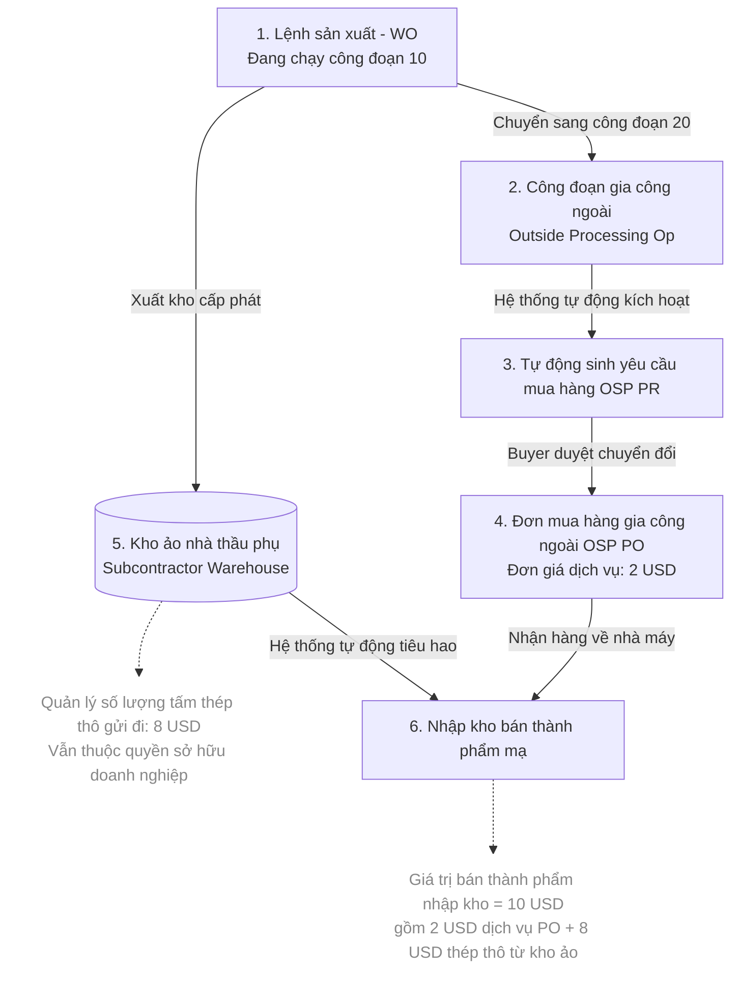
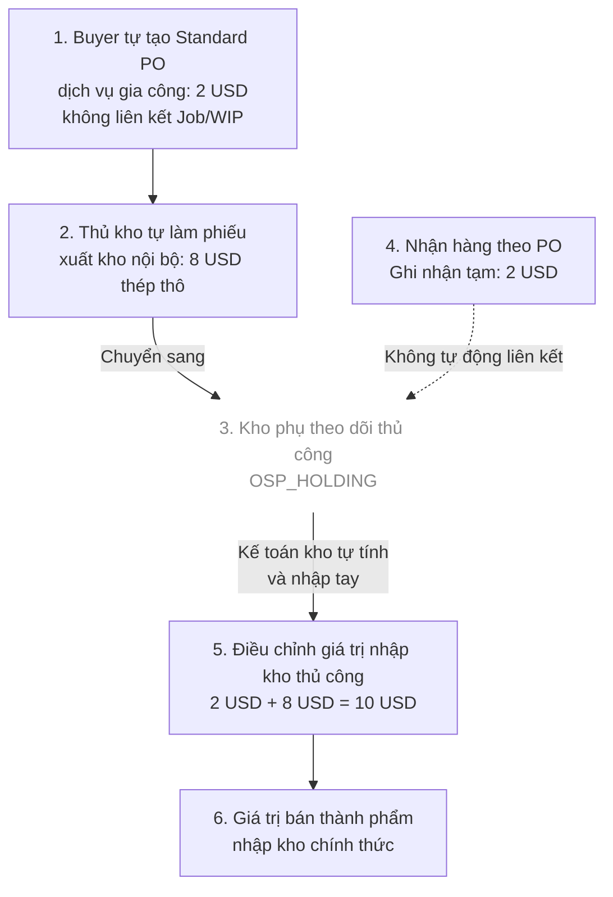

# 6000 Mua hàng gia công ngoài (Subcontracting PO)

Gia công ngoài (Subcontracting / Outside Processing - OSP) là mô hình nghiệp vụ đặc thù trong các doanh nghiệp sản xuất. Thay vì tự thực hiện tất cả các công đoạn, doanh nghiệp chuyển giao một phần công đoạn sản xuất (ví dụ: sơn, mạ, nhiệt luyện, đóng gói) cho một nhà thầu phụ bên ngoài xử lý. Trên hệ thống ERP, đây là nghiệp vụ lai (hybrid) đòi hỏi sự tích hợp thời gian thực giữa phân hệ mua sắm (PO), quản lý kho (INV) và thực thi sản xuất (MFG-WIP).

---

## 1. Bản chất nghiệp vụ & Mô hình vận hành gia công ngoài

### Vấn đề cốt lõi:
Một sai lầm phổ biến khi thiết kế hệ thống tự xây (In-house) là **xem gia công ngoài là một giao dịch mua hàng Standard PO thông thường**.
Ví dụ: Doanh nghiệp gửi 2 tấm thép (trị giá 8 USD) cho đối tác để họ mạ kẽm với giá dịch vụ là 2 USD.
*   Nếu hệ thống chỉ tạo đơn PO dịch vụ mạ trị giá 2 USD và khi nhận hàng về chỉ ghi nhận giá trị tấm thép mạ là 2 USD, hệ thống sẽ làm biến mất hoàn toàn giá trị 8 USD của tấm thép thô gốc.
*   Giá trị tồn kho thành phẩm bị đánh giá thấp nghiêm trọng (2 USD thay vì đúng thực tế là 10 USD), và giá trị 8 USD vật tư gửi đi bị thất thoát trên sổ sách mà không rõ nguyên nhân.

### Hai hướng triển khai trên thực tế:
1.  **Tích hợp tự động qua phân hệ Sản xuất (MFG-WIP):** Lệnh sản xuất tự động sinh yêu cầu mua hàng khi chạy đến công đoạn OSP, hệ thống tự tính giá thành tổng hợp.
2.  **Xử lý thủ công khi không có/không triển khai phân hệ MFG-WIP đầy đủ:** Doanh nghiệp chỉ dùng module Mua hàng, phải tự tạo PO gia công và điều chỉnh giá trị nhập kho bằng tay.

Mục 2 dưới đây hướng dẫn cách nhận diện doanh nghiệp thuộc nhóm nào trước khi thiết kế tích hợp hoặc báo cáo.

---

## 2. Nhận diện thực trạng: Doanh nghiệp có tích hợp phân hệ MFG-WIP tự động hay không?

### Vì sao cần kiểm tra trước khi thiết kế:
Nghiệp vụ OSP mô tả ở mục 1 dựa trên giả định doanh nghiệp đã triển khai đầy đủ phân hệ Sản xuất (WIP/MRP) với Lệnh sản xuất (Work Order/Job) và Routing/BOM có khai báo công đoạn gia công ngoài. Trên thực tế, không ít doanh nghiệp vừa và nhỏ — kể cả khi dùng Oracle EBS hay Epicor — chỉ mua và vận hành module Mua hàng (Purchasing), không triển khai module Sản xuất (WIP) vì quy mô chưa cần thiết hoặc chi phí license cao. Với nhóm này, gia công ngoài vẫn phát sinh thường xuyên nhưng phải xử lý hoàn toàn thủ công.

### Cách nhận diện nhanh (trên Oracle EBS):
*   **Bước 1 - Kiểm tra dữ liệu:** Chạy `SELECT COUNT(*) FROM wip_discrete_jobs;`. Nếu trả về 0 dòng hoặc rất ít so với quy mô sản xuất thực tế, đây là dấu hiệu doanh nghiệp không vận hành phân hệ WIP đầy đủ.
*   **Bước 2 - Xác minh chéo:** Kiểm tra tại `Bills of Material > Routings` xem công đoạn Outside Processing có được khai báo hay không, đồng thời hỏi trực tiếp bộ phận sản xuất/mua hàng xem họ tạo PO gia công theo cách nào trong thực tế.
*   **Bước 3 - Kết luận:** Nếu không có dữ liệu WIP và bộ phận nghiệp vụ xác nhận họ tự tạo PO gia công thủ công, cần thiết kế theo quy trình thay thế ở mục 4.C.

### Quy trình thay thế phổ biến khi không có MFG-WIP:
1.  **Tạo Standard PO dịch vụ gia công thông thường:** Buyer tự tạo PO cho dịch vụ mạ/sơn/gia công như một PO mua dịch vụ bình thường, không có liên kết hệ thống với Lệnh sản xuất.
2.  **Theo dõi vật tư gửi gia công bằng sổ sách/Excel hoặc kho ảo thủ công:** Thủ kho tự làm phiếu xuất kho nội bộ (Issue for Subcontracting) ghi nhận số lượng và giá trị vật tư gửi đi, theo dõi song song ngoài hệ thống hoặc trên một kho phụ tự cấu hình.
3.  **Cộng dồn giá trị thủ công khi nhập kho:** Khi nhận hàng gia công về, kế toán kho phải tự tính và nhập tay giá trị nhập kho = giá dịch vụ trên PO + giá trị vật tư gốc đã xuất, thay vì để hệ thống tự động cộng dồn.

---

## 3. Bảng so sánh và Ánh xạ giải pháp giữa các hệ thống

Khi chuyển đổi giữa các hệ thống ERP hoặc tự thiết kế hệ thống (In-house), bạn có thể dễ dàng ánh xạ các tính năng tương đương dựa trên bảng sau:

| Nghiệp vụ thiết kế | Oracle EBS R12.2.10 (có WIP) | Oracle EBS (không có WIP) | Epicor ERP | SAP S/4HANA | Odoo | Hệ thống tự xây (In-house) |
| :--- | :--- | :--- | :--- | :--- | :--- | :--- |
| **Bản chất OSP** | Outside Processing (OSP) Item linked to WIP | Standard PO dịch vụ, không liên kết Job | Subcontract Operation on Job | Subcontracting PO (Item Category 'L') | Subcontracting BOM | Lệnh sản xuất liên kết dòng dịch vụ PO (tùy chọn) |
| **Trigger tạo PO** | Tự động sinh Requisition khi đạt bước nhảy công đoạn WO | Buyer tự tạo PO thủ công | Tự động tạo Subcontract Suggestion từ Job | Chạy MRP tự động sinh PO thầu phụ | Kích hoạt mua hàng khi chạy sản xuất | Trigger tự động (nếu có module MFG) hoặc thủ công |
| **Cấp phát nguyên liệu** | Ship OSP Components / WIP Issue | Phiếu xuất kho nội bộ thủ công | Subcontractor Shipment Entry | Transfer to Special Stock 'O' (Vendor) | Delivery to Subcontractor Location | Chuyển kho nội bộ sang kho ảo nhà thầu |

---

## 4. Hướng dẫn luồng thiết lập (Setup Flow) chi tiết trên hệ thống

### A. Trên Oracle EBS R12.2.10 — Trường hợp có tích hợp WIP tự động (Outside Processing - OSP)

1.  **Thiết lập OSP Item và Standard Operation:**
    *   *Nghiệp vụ:* Tạo mã vật tư dịch vụ gia công, gán thuộc tính `Outside Processing Item` là `Y`. Khai báo công đoạn chuẩn (Standard Operation) gán thuộc tính `Outside Processing` và chọn mã OSP Item vừa tạo.
2.  **Cấu hình Routing sản xuất:**
    *   *Nghiệp vụ:* Tại Routing của sản phẩm chính, gán công đoạn mạ kẽm sử dụng Standard Operation OSP ở bước 1.
3.  **Vận hành Lệnh sản xuất:**
    *   *Nghiệp vụ:* Khi Lệnh sản xuất (Discrete Job) chạy đến công đoạn OSP, hệ thống tự động chạy chương trình ngầm để sinh ra một PR ở phân hệ PO. Buyer thực hiện duyệt PR này thành OSP PO gửi nhà cung cấp.
4.  **Nhận hàng gia công:**
    *   *Nghiệp vụ:* Khi nhận hàng tại màn hình `Receipts`, thủ kho nhập số PO gia công ngoài. Hệ thống tự động chuyển trạng thái công đoạn sản xuất trên lệnh sản xuất sang bước tiếp theo và kết chuyển trực tiếp chi phí dịch vụ PO vào chi phí dở dang WIP của Job.

### B. Trên Epicor ERP (Job Subcontract Operation)

1.  **Khai báo Công đoạn gia công ngoài (Subcontract Operation):**
    *   *Đường dẫn:* `Material Management > Purchase Management > Setup > Op Code`
    *   *Nghiệp vụ:* Tạo mã công đoạn mạ kẽm, tích chọn thuộc tính `Subcontract` là `True`.
2.  **Cấu hình trên Job Entry (Lệnh sản xuất):**
    *   *Đường dẫn:* `Production Management > Job Management > General Operations > Job Entry`
    *   *Nghiệp vụ:* Tại tab `Operations`, thêm công đoạn OSP vừa tạo ở Bước 1. Hệ thống Epicor sẽ tự động tạo một đề xuất mua hàng gia công (`Subcontract PO Suggestion`).
3.  **Xuất hàng gửi nhà thầu phụ (Subcontractor Shipment):**
    *   *Đường dẫn:* `Material Management > Purchase Management > General Operations > Subcontractor Shipment Entry`
    *   *Nghiệp vụ:* Làm phiếu xuất kho chuyển nguyên vật liệu thô từ nhà máy của mình sang địa chỉ của nhà thầu phụ để gia công.
4.  **Nhận hàng gia công ngoài (PO Receipt Entry):**
    *   *Nghiệp vụ:* Khi nhà thầu phụ hoàn thành giao lại hàng, thủ kho làm phiếu nhận hàng mua (`PO Receipt Entry`) tham chiếu đến số PO Subcontract. Epicor sẽ tự động giải phóng lượng nguyên liệu dở dang trên Job và tính toán giá trị WIP tương ứng.

### C. Trên Oracle EBS R12.2.10 — Trường hợp KHÔNG có tích hợp WIP (quy trình thủ công thay thế)

1.  **Tạo Standard PO dịch vụ gia công:**
    *   *Đường dẫn:* `Purchasing Super User > Purchase Orders > Purchase Orders`
    *   *Nghiệp vụ:* Buyer tự tạo PO dịch vụ gia công (loại `Standard`), không liên kết đến bất kỳ Job/WIP nào, chỉ khai báo đơn giá dịch vụ (ví dụ 2 USD).
2.  **Xuất kho nội bộ ghi nhận vật tư gửi gia công:**
    *   *Đường dẫn:* `Inventory > Transactions > Miscellaneous Issue` (hoặc `Subinventory Transfer` nếu có cấu hình kho ảo phụ)
    *   *Nghiệp vụ:* Thủ kho làm phiếu xuất kho ghi nhận số lượng và giá trị vật tư thô gửi đi (8 USD), chuyển sang một kho phụ tự đặt tên (ví dụ `OSP_HOLDING`) để dễ theo dõi, tránh xuất thẳng vào tài khoản chi phí làm mất dấu vết giá trị.
3.  **Nhận hàng và điều chỉnh giá trị thủ công:**
    *   *Đường dẫn:* `Purchasing Super User > Receiving > Receipts`, sau đó `Inventory > Transactions > Miscellaneous Receipt` hoặc `Cost > Item Cost Adjustment`
    *   *Nghiệp vụ:* Sau khi nhận hàng theo giá dịch vụ PO (2 USD), kế toán kho phải tự tính và nhập bổ sung giá trị vật tư gốc (8 USD) đã xuất ở bước 2 vào giá trị lô hàng vừa nhập, để tổng giá trị nhập kho đúng bằng 10 USD.

---

## 5. Sơ đồ dòng chảy vật chất và trị giá kế toán trong gia công ngoài

### A. Trường hợp có tích hợp WIP tự động

Sơ đồ dưới đây mô tả luồng tích hợp tự động giữa Lệnh sản xuất và Đơn mua hàng gia công ngoài (Subcontracting PO):



### B. Trường hợp KHÔNG có tích hợp WIP (quy trình thủ công)

Sơ đồ dưới đây mô tả luồng tương đương khi không có phân hệ Sản xuất tích hợp: PO dịch vụ và việc cấp phát vật tư diễn ra độc lập, không có liên kết hệ thống, và giá trị nhập kho cuối cùng phải được kế toán kho tự cộng dồn bằng tay:



---

## 6. Điểm giao thoa & Tham chiếu chéo (Cross-linking) sang các phân hệ khác

*   **Định nghĩa trong công thức sản xuất:** Công đoạn gia công ngoài và định mức nguyên vật liệu cấp phát phải được cấu hình sẵn tại [mfg-ky-thuat (BOM/Routing)]() — áp dụng cho nhóm doanh nghiệp có tích hợp WIP.
*   **Quản lý kho cấp phát:** Việc chuyển nguyên vật liệu sang nhà thầu phụ được thực hiện tại bài [3000 Chuyển kho nội bộ (Inter-warehouse Transfer)]() để chuyển dịch vị trí tồn kho sang kho ảo của đối tác.
*   **Kiểm kê định kỳ kho ảo đối tác:** Vì hàng gửi gia công vẫn thuộc tài sản doanh nghiệp nhưng nằm ngoài nhà máy, cần đối chiếu định kỳ với đối tác — tham khảo quy trình kiểm kê tại bài [kiem-ke-kho (Cycle Count / Physical Inventory)]().
*   **Hạch toán chi phí giá thành:** Giá trị dịch vụ OSP từ PO cộng với giá trị nguyên liệu tiêu hao từ kho ảo sẽ được tích lũy tự động (hoặc thủ công, nếu không có WIP) vào chi phí dở dang của Lệnh sản xuất tại phân hệ [Tài chính kế toán (Kế toán Giá thành - COST)]().
*   **Ghi nhận hóa đơn dịch vụ gia công:** Hóa đơn dịch vụ do nhà thầu phụ xuất (bao gồm thuế GTGT dịch vụ gia công) được xử lý tại phân hệ Công nợ phải trả, tham khảo bài [3000 Ghi nhận hóa đơn nhà cung cấp từ đơn mua hàng (AP Invoice Match)]().

---

## 7. Truy vấn SQL đối soát cấu trúc tổ chức (SQL Database Audit Queries)

### A. Cho Oracle EBS R12.2.10

Query dưới đây đối soát toàn bộ các đơn mua hàng gia công ngoài (OSP PO) đang liên kết trực tiếp với các lệnh sản xuất dở dang (WIP Jobs) và các công đoạn sản xuất tương ứng — chỉ áp dụng cho nhóm doanh nghiệp có triển khai phân hệ WIP:

```sql
SELECT 
    hou.name                      AS operating_unit,
    pha.segment1                  AS po_number,
    pla.line_num                  AS po_line,
    msib.segment1                 AS osp_item_code,
    we.wip_entity_name            AS work_order_number,
    wo.operation_seq_num          AS osp_operation_seq,
    bso.operation_code            AS operation_name,
    pda.quantity_ordered          AS qty_ordered,
    pda.quantity_delivered        AS qty_received
FROM 
    po_headers_all pha
INNER JOIN 
    po_lines_all pla ON pha.po_header_id = pla.po_header_id
INNER JOIN 
    po_distributions_all pda ON pla.po_line_id = pda.po_line_id
INNER JOIN 
    wip_entities we ON pda.wip_entity_id = we.wip_entity_id
INNER JOIN 
    wip_discrete_jobs wdj ON pda.wip_entity_id = wdj.wip_entity_id
INNER JOIN 
    wip_operations wo ON pda.wip_entity_id = wo.wip_entity_id 
                     AND pda.wip_operation_seq_num = wo.operation_seq_num
LEFT JOIN 
    bom_standard_operations bso ON wo.standard_operation_id = bso.standard_operation_id
                               AND bso.organization_id = pda.destination_organization_id
INNER JOIN 
    hr_operating_units hou ON pha.org_id = hou.organization_id
LEFT JOIN 
    mtl_system_items_b msib ON pla.item_id = msib.inventory_item_id 
                            AND msib.organization_id = pda.destination_organization_id
WHERE 
    pha.type_lookup_code = 'STANDARD'
    AND pda.wip_entity_id IS NOT NULL -- Điều kiện: Đơn PO liên kết trực tiếp với lệnh sản xuất OSP
ORDER BY 
    pha.segment1, pla.line_num;
```

> **Lưu ý:** Nếu query trên trả về 0 dòng dù công ty có mua hàng gia công ngoài trên thực tế, hãy quay lại mục 2 để xác minh xem doanh nghiệp có thực sự vận hành phân hệ WIP hay đang xử lý gia công bằng Standard PO thủ công không liên kết Job.

### B. Cho Epicor ERP (Truy vấn cơ sở dữ liệu SQL Server)

Query dưới đây truy xuất toàn bộ các công đoạn gia công ngoài của các Lệnh sản xuất (Jobs) trong Epicor và các dòng PO liên kết tương ứng:

```sql
SELECT 
    jo.Company,
    jo.JobNum                     AS Job_Number,
    jo.OprSeq                     AS Operation_Seq,
    jo.OpCode                     AS Operation_Code,
    jo.SubContract                AS Is_Subcontract_Op,
    pd.PONum                      AS Linked_PO_Number,
    pd.POLine                     AS Linked_PO_Line,
    pd.PartNum                    AS OSP_Part,
    pd.DocUnitCost                AS Subcontract_Unit_Cost,
    pd.ReceivedQty                AS Rec_Qty_From_Subcontractor
FROM 
    Erp.JobOper jo
INNER JOIN 
    Erp.PODetail pd ON jo.Company = pd.Company AND jo.JobNum = pd.JobNum AND jo.OprSeq = pd.JobSeq
WHERE 
    jo.Company = 'YOUR_COMPANY_CODE'
    AND jo.SubContract = 1 -- Chỉ lọc các công đoạn gia công ngoài
ORDER BY 
    jo.JobNum, jo.OprSeq;
```

---

## 8. Giải pháp khắc phục lỗi phổ biến & Cảnh báo cho Hệ thống tự xây (In-house)

Nếu đội ngũ của bạn đang tự xây dựng (In-house) mô-đun Gia công ngoài, hãy đặc biệt chú ý các điểm thiết kế sau:

1.  **Bẫy mặc định mọi hệ thống đều có tích hợp WIP tự động:**
    *   *Triệu chứng:* Đội thiết kế mặc định doanh nghiệp nào cũng có Lệnh sản xuất và Routing đầy đủ để tự động sinh OSP PO. Khi triển khai tại doanh nghiệp chỉ dùng module Mua hàng thuần túy (không có WIP), toàn bộ luồng tích hợp tự động không chạy được vì không có Job để liên kết.
    *   *Giải pháp khắc phục:* Thiết kế hệ thống hỗ trợ cả hai chế độ — có liên kết Job (tự động) và không liên kết Job (thủ công, xem mục 4.C) — với cùng một cơ chế tính giá thành tổng hợp cuối cùng.
2.  **Bẫy thất thoát nguyên vật liệu cấp phát (Inventory Leakage Pitfall):**
    *   *Triệu chứng:* Khi chuyển 2 tấm thép thô cho nhà thầu phụ, lập trình viên viết logic làm giảm luôn số lượng tồn kho của nhà máy mình mà không ghi nhận số lượng này đang nằm tại kho của đối tác. Khi xảy ra hư hỏng, hao hụt tại xưởng của đối tác, doanh nghiệp hoàn toàn không có cơ sở đối chiếu và yêu cầu đền bù.
    *   *Giải pháp khắc phục:* Thiết kế hệ thống kho ảo gọi là **Kho nhà thầu phụ (Subcontractor/Vendor Warehouse)**. Khi xuất hàng đi gia công, bắt buộc phải dùng giao dịch chuyển kho liên vị trí để chuyển tồn kho từ kho chính sang kho ảo của nhà thầu phụ. Số lượng này vẫn thuộc quyền sở hữu của doanh nghiệp trên báo cáo tài sản nhưng được định vị vật lý tại xưởng đối tác để dễ dàng kiểm kê, đối soát định kỳ.
3.  **Lỗi bỏ sót hao hụt nguyên liệu trong định mức gia công (Yield & Scrap handling):**
    *   *Triệu chứng:* Để gia công ra 100 sản phẩm mạ đạt chuẩn, định mức kỹ thuật cho phép hao hụt 5% nguyên vật liệu thô (cần cấp phát tương đương 105 sản phẩm thô). Nếu hệ thống tự xây tự động cấu hình tiêu hao cứng 1-1 (nhận 100 thì chỉ trừ kho ảo 100), hệ thống sẽ bị treo lượng tồn kho ảo dư thừa (5 sản phẩm thô bị hỏng) vĩnh viễn trên hệ thống.
    *   *Giải pháp:* Thiết kế Form khai báo phế phẩm thu hồi và hao hụt gia công thực tế (Subcontracting Scrap Declaration) tại thời điểm làm phiếu nhận hàng để thủ kho thực hiện trừ kho ảo đối tác đúng với số lượng thực tế đã hao phí ngoài thực tế.
4.  **Lỗi tính sai giá thành bán thành phẩm gia công:**
    *   *Triệu chứng:* Giá dịch vụ gia công trên PO là 2 USD. Giá trị vật tư thô gửi đi là 8 USD. Lập trình viên viết logic tính giá thành thành phẩm nhập kho chỉ bằng đúng đơn giá trên dòng PO gia công (2 USD).
    *   *Giải pháp:* Đảm bảo thuật toán tính giá thành thành phẩm nhập kho (Landed Cost/Actual Cost of Subcontracting) phải bằng **Đơn giá dịch vụ mua trên PO + Giá trị của tất cả các nguyên vật liệu thô tiêu hao tương ứng** rút ra từ kho ảo đối tác.
5.  **Lỗi nhầm lẫn giá trị tính thuế GTGT dịch vụ gia công với giá trị nhập kho:**
    *   *Triệu chứng:* Hóa đơn nhà thầu phụ xuất cho dịch vụ gia công (2 USD) có thuế suất GTGT riêng theo quy định về hàng gia công. Nếu hệ thống tự xây nhầm lẫn cộng luôn phần thuế GTGT đầu vào của dịch vụ này vào giá trị nhập kho thành phẩm, giá vốn hàng tồn kho sẽ bị thổi phồng sai so với chuẩn mực kế toán (thuế GTGT đầu vào được khấu trừ, không phải một cấu phần của giá vốn).
    *   *Giải pháp:* Thiết kế rõ ràng hai luồng dữ liệu tách biệt khi nhận hóa đơn dịch vụ gia công: phần giá trị trước thuế (Net Amount) được cộng vào giá thành nhập kho, còn phần thuế GTGT đầu vào được hạch toán riêng vào tài khoản thuế GTGT được khấu trừ, không đi vào giá vốn tồn kho.
6.  **Lỗi mất dấu vết quyền sở hữu khi xử lý thủ công (đặc thù nhóm không có WIP):**
    *   *Triệu chứng:* Khi không có kho ảo hệ thống, thủ kho theo dõi vật tư gửi gia công bằng Excel song song ngoài hệ thống. Theo thời gian, file Excel và số liệu hệ thống lệch nhau, không ai biết chính xác đang có bao nhiêu vật tư nằm tại xưởng đối tác nào.
    *   *Giải pháp:* Ngay cả khi không có phân hệ WIP đầy đủ, hệ thống tối thiểu nên cấu hình một kho phụ (Subinventory/Location) riêng đại diện cho từng nhà thầu phụ để giao dịch xuất/nhập vẫn nằm trong hệ thống chính thức, tránh phụ thuộc hoàn toàn vào công cụ theo dõi ngoài hệ thống.

<p align="center" style={{color: 'var(--ifm-color-primary)'}}>
  <strong>Chúc các bạn thành công và vui vẻ!</strong>
</p>