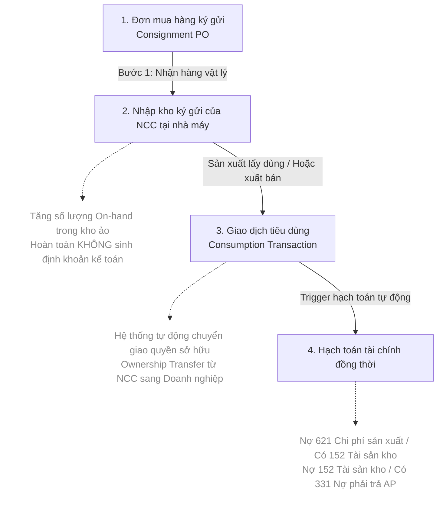

# 6010 Mua hàng ký gửi và quản lý tồn kho VMI

Mua hàng ký gửi (Consignment Procurement) và Tồn kho do nhà cung cấp quản lý (Vendor Managed Inventory - VMI) là các phương thức cộng tác chuỗi cung ứng hiện đại giúp doanh nghiệp tối ưu hóa chi phí sử dụng vốn. Trong mô hình này, nhà cung cấp chuyển hàng đến lưu trữ trực tiếp tại kho của doanh nghiệp, nhưng quyền sở hữu tài sản (Ownership) vẫn thuộc về họ. Doanh nghiệp chỉ chính thức hạch toán tăng tài sản và ghi nhận nợ phải trả kế toán tại thời điểm lấy hàng ra tiêu dùng thực tế.

---

## 1. Bản chất nghiệp vụ & Thách thức thiết kế trên hệ thống

### Vấn đề cốt lõi:
Một lỗi thiết kế nghiêm trọng thường gặp ở các hệ thống tự xây (In-house) là **xem việc nhận hàng ký gửi giống như nhận hàng mua tiêu chuẩn**.
*   Nếu hệ thống lập tức hạch toán tăng tài sản kho (Nợ 152/156) và tăng công nợ phải trả nhà cung cấp (Có 331 / GR-IR) ngay khi thủ kho ký nhận hàng, doanh nghiệp sẽ vi phạm nghiêm trọng luật kiểm toán tài chính (vì ghi nhận tài sản và nợ phải trả cho những hàng hóa chưa thuộc quyền sở hữu của mình).
*   Ngược lại, nếu chỉ theo dõi hàng ký gửi bằng sổ tay ngoài kho mà không đưa lên ERP, doanh nghiệp sẽ không thể kiểm soát được số lượng hàng thực tế đang lưu trữ, không thể lập kế hoạch sản xuất chính xác và dễ dẫn đến thất thoát hàng hóa.

### Hai hướng triển khai trên thực tế:
1.  **Tích hợp qua module Consignment/VMI chuyên biệt:** Hệ thống tự động gán cờ chủ sở hữu (Owning Party) ngay tại giao dịch nhận hàng và tự động sinh bút toán khi tiêu dùng.
2.  **Xử lý thủ công khi không có module chuyên biệt:** Doanh nghiệp tự tạo một kho phụ tách biệt để theo dõi hàng ký gửi, đối chiếu định kỳ bằng bảng kê thủ công.

Mục 2 dưới đây hướng dẫn cách nhận diện doanh nghiệp thuộc nhóm nào trước khi thiết kế báo cáo hay tích hợp.

### Giải pháp kiến trúc quản lý quyền sở hữu (Ownership Tracking):
Hệ thống ERP tiêu chuẩn giải quyết bài toán này bằng cách phân tách rõ rệt giữa **Dòng chảy vật lý (Physical Flow)** và **Dòng chảy tài chính (Financial Flow)** thông qua hai bước giao dịch độc lập:

1.  **Giao dịch Nhận hàng ký gửi (Consignment Receipt):** Hàng hóa được nhập kho chính thức về mặt số lượng (Physical On-hand) nhưng được gán nhãn thuộc quyền sở hữu của Nhà cung cấp (Vendor-Owned Stock). Giao dịch này không phát sinh bất kỳ bút toán hạch toán kế toán nào.
2.  **Giao dịch Tiêu dùng (Consumption / Ownership Transfer):** Khi nguyên liệu được xuất cho sản xuất hoặc xuất bán, hệ thống tự động ghi nhận giao dịch chuyển giao quyền sở hữu (Transfer of Ownership). Tại giây này, ERP mới đồng thời hạch toán tăng tài sản, ghi nhận giá vốn và kích hoạt luồng công nợ tự động với nhà cung cấp.

---

## 2. Nhận diện thực trạng: Doanh nghiệp có module Consignment/VMI chuyên biệt hay không?

### Vì sao cần kiểm tra trước khi thiết kế:
Cơ chế gán cờ chủ sở hữu (`owning_tp_type`) trên Oracle EBS, hay module VMI Warehouse trên Epicor, đều là tính năng phải được bật và cấu hình riêng — không mặc định có sẵn cho mọi doanh nghiệp. Nhiều doanh nghiệp có thỏa thuận ký gửi với nhà cung cấp trên hợp đồng thương mại, nhưng hệ thống ERP đang dùng lại không có sẵn cờ sở hữu này, nên buộc phải mô phỏng bằng một kho phụ (Subinventory/Warehouse) riêng, tách biệt hoàn toàn khỏi kho chính.

### Cách nhận diện nhanh (trên Oracle EBS):
*   **Bước 1 - Kiểm tra dữ liệu:** Chạy `SELECT COUNT(*) FROM mtl_onhand_quantities_detail WHERE owning_tp_type <> 1;` (tức khác giá trị mặc định "sở hữu bởi doanh nghiệp"). Nếu trả về 0 dòng dù doanh nghiệp có thỏa thuận ký gửi trên thực tế, đây là dấu hiệu hệ thống chưa từng dùng cờ sở hữu đối tác.
*   **Bước 2 - Xác minh chéo:** Kiểm tra tại `Purchase Orders > Header` xem có Blanket Agreement nào từng gán thuộc tính `Consignment Agreement = Y` chưa, đồng thời hỏi bộ phận mua hàng/kho xem hàng ký gửi hiện đang được theo dõi ở đâu trong thực tế.
*   **Bước 3 - Kết luận:** Nếu không có dữ liệu và xác nhận từ nghiệp vụ, cần thiết kế theo quy trình thay thế ở mục 4.C.

### Quy trình thay thế phổ biến khi không có module chuyên biệt:
1.  **Tạo kho phụ riêng biệt cho từng nhà cung cấp ký gửi:** Ví dụ `KHO_KY_GUI_NCC_A`, tách hoàn toàn khỏi kho chính để tránh gộp lẫn số lượng sở hữu.
2.  **Nhận hàng vào kho phụ bằng giao dịch không ảnh hưởng giá trị:** Dùng giao dịch nhập kho nội bộ (Miscellaneous Receipt) không có tài khoản định giá, chỉ ghi nhận số lượng.
3.  **Đối chiếu tiêu dùng định kỳ bằng bảng kê thủ công:** Cuối kỳ (tuần/tháng), thủ kho và kế toán tự lập bảng kê số lượng đã chuyển từ kho phụ sang kho chính (coi như "tiêu dùng"), làm căn cứ để kế toán AP tự tạo hóa đơn hoặc Standard PO ghi nhận công nợ thủ công.

---

## 3. Bảng so sánh và Ánh xạ giải pháp giữa các hệ thống

Khi chuyển đổi giữa các hệ thống ERP hoặc tự thiết kế hệ thống (In-house), bạn có thể dễ dàng ánh xạ các tính năng tương đương dựa trên bảng sau:

| Nghiệp vụ thiết kế | Oracle EBS R12.2.10 (có module) | Oracle EBS (không có module) | Epicor ERP | SAP S/4HANA | Odoo | Hệ thống tự xây (In-house) |
| :--- | :--- | :--- | :--- | :--- | :--- | :--- |
| **Ký nhận hàng** | Consignment Receipt (không tạo AP accrual) | Nhập kho phụ qua Miscellaneous Receipt | Receipt to VMI Warehouse | Consignment PO (Item Category 'K') | Consignment Receipt (gán trường Owner) | Phiếu nhập kho gán mã chủ sở hữu `Owner_ID` |
| **Bản ghi tồn kho** | On-hand với thuộc tính `owning_tp_type` | Kho phụ riêng, không phân biệt bằng cờ hệ thống | PartBin gán mã kho Vendor Owned | Special Stock 'K' (Consignment) | Stock.quant gán trường `Owner` | Bảng cân đối kho thêm cột mã chủ sở hữu đối tác |
| **Giao dịch tiêu dùng** | Create Consumption Advice | Bảng kê thủ công cuối kỳ + Standard PO tay | VMI Stock Consumption / PO suggestion | Consignment Issue (Withdrawal) | Transfer Ownership / Bill Control | Phiếu chuyển quyền sở hữu `OWNERSHIP_TRANSFER` |

---

## 4. Sơ đồ dòng chảy vật lý và dòng chảy tài chính trong nghiệp vụ ký gửi

Sơ đồ dưới đây mô tả quy trình nhận hàng ký gửi vật lý (không sinh công nợ) và quy trình ghi nhận tài chính tự động tại thời điểm tiêu dùng thực tế:



---

## 5. Điểm giao thoa & Tham chiếu chéo (Cross-linking) sang các phân hệ khác

*   **Tham chiếu đơn hàng khung:** Đơn giá tiêu dùng hàng ký gửi được hệ thống tự động đối chiếu từ hợp đồng nguyên tắc đã duyệt tại [2010 Bảng giá & Thỏa thuận dài hạn (Blanket PO & Contract)]().
*   **Quản lý Lot/Serial:** Hàng ký gửi bắt buộc phải được theo dõi số lô để quản lý tuổi hàng của nhà cung cấp, thiết lập tại [6000 Quản lý theo lô (Lot Control)]() tại phân hệ Tồn kho.
*   **Thanh toán công nợ:** Dữ liệu tiêu dùng (Consumption Advice) là căn cứ duy nhất để kế toán thực hiện đối soát và chạy thanh toán tại bài [3020 Nghiệp vụ chi tiền thanh toán và đối trừ hóa đơn nhà cung cấp (Vendor Payment Run)]() bên phân hệ AP.

---

## 6. Hướng dẫn luồng thiết lập (Setup Flow) chi tiết trên hệ thống

### A. Trên Oracle EBS R12.2.10 — Trường hợp có module Consignment Inventory

1.  **Thiết lập Thỏa thuận ký gửi (Consignment Agreement):**
    *   *Đường dẫn:* `Purchasing Super User > Purchase Orders > Purchase Orders`
    *   *Nghiệp vụ:* Tạo Blanket Purchase Agreement (BPA), tại phần Header gán thuộc tính `Consignment Agreement` là `Y`. Khai báo rõ thời gian hiệu lực và đơn giá chốt với nhà cung cấp.
2.  **Nhận hàng ký gửi vào kho (Consignment Receipt):**
    *   *Nghiệp vụ:* Thủ kho làm phiếu nhận hàng mua (`Receipts`) tham chiếu đến BPA ký gửi trên. Hệ thống tự động ghi tăng số lượng vật lý trong kho đệm nhưng hoàn toàn không sinh bút toán kế toán.
3.  **Thực hiện giao dịch Tiêu dùng (Consumption):**
    *   *Đường dẫn:* `Inventory > Transactions > Material Transactions`
    *   *Nghiệp vụ:* Khi xuất kho sản xuất, hệ thống tự động chuyển giao quyền sở hữu. Cuối kỳ, người dùng chạy chương trình `Create Consumption Advice` để hệ thống tự tạo ra một đơn Standard PO ảo ghi nhận công nợ AP phải trả cho nhà cung cấp đối với lượng hàng thực tế đã dùng.

### B. Trên Epicor ERP (VMI Warehouse)

1.  **Khởi tạo Kho ký gửi / VMI (VMI Warehouse Setup):**
    *   *Đường dẫn:* `Material Management > Inventory Management > Setup > Warehouse`
    *   *Nghiệp vụ:* Tạo kho mới (ví dụ: `VMI_KHO`). Tích chọn thuộc tính `Vendor Managed Inventory (VMI)` và gán mã nhà cung cấp sở hữu hàng hóa (`VendorNum`).
2.  **Nhận hàng vào kho VMI:**
    *   *Nghiệp vụ:* Khi nhà cung cấp chuyển hàng đến, làm phiếu nhận hàng `PO Receipt Entry` chọn kho nhận là `VMI_KHO`. Epicor ghi tăng số lượng tồn kho PartBin của kho ảo này và bỏ qua bước hạch toán giá trị tài sản.
3.  **Xuất tiêu hao kho VMI:**
    *   *Nghiệp vụ:* Bộ phận sản xuất khi lấy hàng dùng sẽ làm phiếu xuất kho sản xuất (`Issue Material`) chọn nguồn từ `VMI_KHO`. Hệ thống tự động ghi nhận lượng tiêu hao và tự kích hoạt luồng đề xuất thanh toán AP cho nhà cung cấp.

### C. Trên Oracle EBS R12.2.10 — Trường hợp KHÔNG có module Consignment (quy trình thủ công thay thế)

1.  **Tạo kho phụ riêng cho từng nhà cung cấp ký gửi:**
    *   *Đường dẫn:* `Inventory > Setup > Organizations > Subinventories`
    *   *Nghiệp vụ:* Tạo Subinventory riêng biệt (ví dụ `CONS_NCC_A`), đánh dấu là **Non-Asset Subinventory** (không định giá tài sản) để tránh hệ thống tự động hạch toán giá trị khi nhận hàng vào đây.
2.  **Nhận hàng vào kho phụ:**
    *   *Đường dẫn:* `Inventory > Transactions > Miscellaneous Receipt`
    *   *Nghiệp vụ:* Thủ kho ghi nhận số lượng hàng ký gửi nhận về vào Subinventory phụ này, không tham chiếu PO chính thức, chỉ ghi nhận số lượng để theo dõi.
3.  **Đối chiếu tiêu dùng và tạo công nợ cuối kỳ:**
    *   *Đường dẫn:* `Inventory > Transactions > Subinventory Transfer`, sau đó `Purchasing > Invoices`
    *   *Nghiệp vụ:* Định kỳ, thủ kho chuyển số lượng đã dùng từ kho phụ sang kho chính (Subinventory Transfer), lập bảng kê gửi kế toán AP. Kế toán AP dựa vào bảng kê này để tự tạo hóa đơn hoặc PO ghi nhận công nợ thủ công với nhà cung cấp.

---

## 7. Truy vấn SQL đối soát cấu trúc tổ chức (SQL Database Audit Queries)

### A. Cho Oracle EBS R12.2.10

Query dưới đây truy xuất toàn bộ lượng hàng tồn kho ký gửi hiện tại trong nhà máy, lọc ra các mặt hàng có thuộc tính sở hữu bởi Nhà cung cấp (`owning_tp_type = 1`) kèm thông tin mã nhà cung cấp sở hữu tương ứng. Lưu ý: `organization_id` không map trực tiếp sang `hr_operating_units`, phải join qua bảng `org_organization_definitions` để lấy đúng đơn vị vận hành (Operating Unit):

```sql
SELECT 
    hou.name                      AS operating_unit,
    msib.segment1                 AS item_code,
    moqd.subinventory_code        AS subinventory,
    moqd.lot_number               AS lot_number,
    moqd.transaction_quantity     AS onhand_qty,
    aps.segment1                  AS vendor_num,
    hp.party_name                 AS vendor_name,
    moqd.owning_tp_type           AS ownership_type
FROM 
    mtl_onhand_quantities_detail moqd
INNER JOIN 
    mtl_system_items_b msib ON moqd.inventory_item_id = msib.inventory_item_id 
                            AND moqd.organization_id = msib.organization_id
INNER JOIN 
    org_organization_definitions ood ON moqd.organization_id = ood.organization_id
INNER JOIN 
    hr_operating_units hou ON ood.operating_unit = hou.organization_id
INNER JOIN 
    ap_suppliers aps ON moqd.owning_organization_id = aps.vendor_id
INNER JOIN 
    hz_parties hp ON aps.party_id = hp.party_id
WHERE 
    moqd.owning_tp_type = 1 -- Mã lookup numeric đại diện cho hàng thuộc sở hữu đối tác (Supplier-Owned Stock)
ORDER BY 
    msib.segment1, moqd.subinventory_code;
```

> **Lưu ý:** Nếu query trên trả về 0 dòng dù doanh nghiệp thực tế có thỏa thuận ký gửi với nhà cung cấp, hãy quay lại mục 2 để xác minh xem hệ thống có thực sự dùng cơ chế `owning_tp_type` hay đang theo dõi bằng kho phụ thủ công (xem mục 6.C).

### B. Cho Epicor ERP (Truy vấn cơ sở dữ liệu SQL Server)

Query dưới đây kết xuất danh sách lượng hàng tồn kho đang nằm tại các kho ký gửi/VMI của Epicor (được nhận diện qua việc gán mã nhà cung cấp sở hữu `VendorNum <> 0` tại bảng thiết lập kho):

```sql
SELECT 
    wh.Company,
    wh.WarehouseCode              AS Warehouse_ID,
    wh.Description                AS Warehouse_Name,
    v.VendorID                    AS Owner_Vendor_ID,
    v.Name                        AS Owner_Vendor_Name,
    bin.BinNum                    AS Bin_ID,
    qty.PartNum                   AS Part_Number,
    qty.OnhandQty                 AS Onhand_Qty
FROM 
    Erp.Warehouse wh
INNER JOIN 
    Erp.WhseBin bin ON wh.Company = bin.Company AND wh.WarehouseCode = bin.WarehouseCode
INNER JOIN 
    Erp.PartBin qty ON bin.Company = qty.Company AND bin.WarehouseCode = qty.WarehouseCode AND bin.BinNum = qty.BinNum
INNER JOIN 
    Erp.Vendor v ON wh.Company = v.Company AND wh.VendorNum = v.VendorNum
WHERE 
    wh.Company = 'YOUR_COMPANY_CODE'
    AND wh.VendorNum <> 0 -- Lọc các kho đã được liên kết với một nhà cung cấp cụ thể (Kho ký gửi)
ORDER BY 
    wh.WarehouseCode, qty.PartNum;
```

---

## 8. Giải pháp khắc phục lỗi phổ biến & Cảnh báo cho Hệ thống tự xây (In-house)

Nếu đội ngũ của bạn đang tự phát triển mô-đun Kho và Ký gửi, hãy đặc biệt chú ý các điểm thiết kế sau:

1.  **Bẫy mặc định mọi hệ thống đều có cơ chế gán chủ sở hữu tự động:**
    *   *Triệu chứng:* Đội thiết kế báo cáo/tích hợp mặc định luôn có sẵn trường `owning_tp_type` hoặc tương đương để phân biệt hàng ký gửi. Khi triển khai tại doanh nghiệp chưa từng bật tính năng này (theo dõi ký gửi bằng kho phụ thủ công), báo cáo trả về rỗng dù thực tế có hàng ký gửi tồn kho.
    *   *Giải pháp khắc phục:* Trước khi thiết kế, xác minh theo mục 2 xem doanh nghiệp thuộc nhóm nào. Hệ thống tự xây nên hỗ trợ song song cả hai: cờ sở hữu gắn trực tiếp trên dòng tồn kho (chuẩn) và kho phụ tách biệt theo nhà cung cấp (thay thế).
2.  **Bẫy thiết kế thiếu cột chủ sở hữu trong bảng tồn kho (Data Model Pitfall):**
    *   *Triệu chứng:* Bảng tồn kho `Inventory_Balances` chỉ quản lý trường mã vật tư `Item_ID`, số lượng `Qty` và vị trí `Location_ID`. Khi nhận 100 cái hạt nhựa ký gửi của nhà cung cấp A và 50 cái hạt nhựa tự mua của doanh nghiệp vào cùng một ô kệ, hệ thống sẽ gộp chung thành 150 cái. Khi làm phiếu xuất sản xuất, hệ thống không thể phân biệt được lượng tiêu hao này lấy từ nguồn ký gửi hay nguồn tự mua để hạch toán tài chính đúng.
    *   *Giải pháp khắc phục:* Bắt buộc phải thiết kế thêm trường **Chủ sở hữu (Owner_ID)** làm khóa chính (Primary Key) trong bảng tồn kho chi tiết `Inventory_Balances`. Khi truy vấn, hệ thống phải phân tách rõ ràng lượng tồn kho thuộc sở hữu của doanh nghiệp (`Owner_ID = 'OUR_COMPANY_ID'`) và lượng tồn kho thuộc sở hữu của đối tác (`Owner_ID = 'SUPPLIER_A_ID'`).
3.  **Lỗi "kiểm kê khống" tài sản của doanh nghiệp:**
    *   *Triệu chứng:* Khi chạy chương trình kiểm kê cuối năm, nhân viên kho quét qua kệ và ghi nhận 1,000 cái mô-tơ ký gửi đang nằm ngoài kho thực tế. Hệ thống tự xây tự động hạch toán phần chênh lệch kiểm kê (Adjustment) tăng thẳng vào giá trị tài sản ròng của doanh nghiệp.
    *   *Giải pháp:* Đối với các giao dịch điều chỉnh kiểm kê phát sinh tại vị trí kho được đánh dấu là Kho ký gửi (Vendor-Owned), hệ thống bắt buộc phải khóa tính năng tự động ghi sổ tài chính, mọi chênh lệch thừa/thiếu chỉ được ghi nhận số lượng vật lý và gửi thư đối chiếu xác nhận cho nhà cung cấp.
4.  **Lỗi trôi ngày hết hạn và tuổi hàng (Lot Expiration Issues):**
    *   *Triệu chứng:* Hàng ký gửi có hạn sử dụng (ví dụ: hóa chất). Nhà cung cấp tự ý luân chuyển các lô hàng cũ sắp hết hạn đến kho ký gửi của doanh nghiệp để giải phóng kho của họ. Nếu hệ thống tự xây không hỗ trợ quản lý cảnh báo tuổi hàng ký gửi, doanh nghiệp sẽ phải gánh chịu toàn bộ chi phí xử lý tiêu hủy hóa chất hết hạn.
    *   *Giải pháp:* Cấu hình thuộc tính kiểm soát ngày hết hạn nghiêm ngặt tại thời điểm Nhập kho ký gửi. Hệ thống phải tự động chặn nhận hàng nếu ngày hết hạn của lô hàng nhỏ hơn ngưỡng an toàn quy định trong chính sách mua sắm.
5.  **Lỗi thất lạc đối chiếu khi xử lý thủ công bằng kho phụ (đặc thù nhóm không có module):**
    *   *Triệu chứng:* Với cách làm kho phụ thủ công, nếu không có quy trình đối chiếu định kỳ chặt chẽ, số lượng ghi nhận trên bảng kê nội bộ dễ lệch với số liệu nhà cung cấp tự theo dõi bên họ, dẫn đến tranh chấp công nợ cuối kỳ vì không bên nào có bằng chứng xác nhận song phương.
    *   *Giải pháp:* Ngay cả khi xử lý thủ công, nên thiết kế biểu mẫu đối chiếu định kỳ (Consignment Reconciliation Statement) có xác nhận chữ ký/email hai chiều giữa thủ kho doanh nghiệp và đại diện nhà cung cấp, lưu trữ lại làm bằng chứng đối soát mỗi kỳ thay vì chỉ dựa vào số liệu nội bộ một phía.

<p align="center" style={{color: 'var(--ifm-color-primary)'}}>
  <strong>Chúc các bạn thành công và vui vẻ!</strong>
</p>