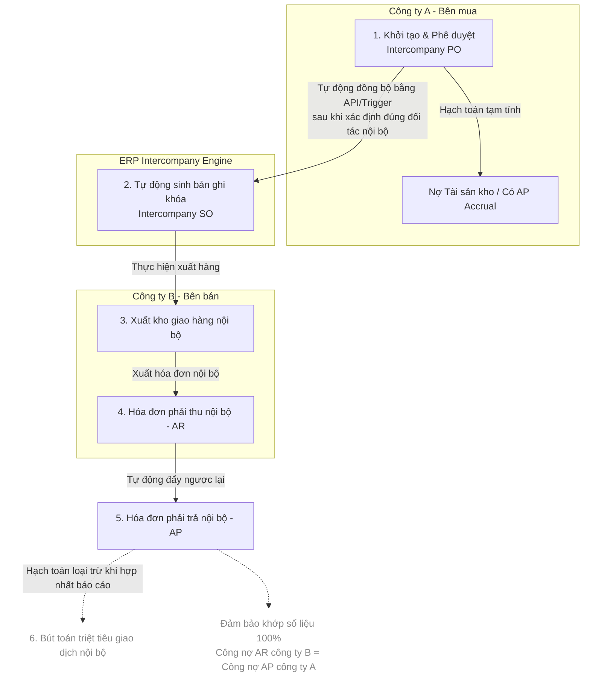

# 6020 Mua hàng nội bộ giữa các pháp nhân (Intercompany PO)

Trong các tập đoàn đa quốc gia hoặc tổng công ty đa pháp nhân, nghiệp vụ mua bán nội bộ (Intercompany Transactions) diễn ra với tần suất rất lớn. Doanh nghiệp mua hàng (Công ty A) sẽ phát hành một Đơn mua hàng nội bộ (Intercompany PO) gửi cho doanh nghiệp bán (Công ty B, thuộc cùng tập đoàn). Quy trình này đòi hỏi sự đồng bộ dữ liệu thời gian thực giữa hai thực thể pháp lý độc lập để đảm bảo tuyệt đối cân bằng công nợ nội bộ khi thực hiện báo cáo tài chính hợp nhất.

Bài viết này tập trung vào **phía chứng từ mua hàng** (khởi tạo, đồng bộ, nhận diện đối tác nội bộ). Chứng từ bán hàng đối ứng (Intercompany SO) thuộc phân hệ OM; việc hạch toán loại trừ giao dịch nội bộ khi hợp nhất báo cáo tài chính tập đoàn thuộc phân hệ Sổ cái (GL) — xem link ở mục 5 và cuối bài.

---

## 1. Bản chất nghiệp vụ & Cơ chế đồng bộ PO-SO tự động

### Vấn đề cốt lõi:
Một lỗi thiết kế nghiêm trọng trong các hệ thống tự xây (In-house) hoặc quy trình vận hành thủ công là **nhập liệu hai lần độc lập** (Double-entry):
*   Nhân viên Công ty A gõ tay một đơn Intercompany PO trị giá 10,000 USD gửi đi.
*   Nhân viên Công ty B mở phân hệ OM và gõ tay một đơn Intercompany SO tương ứng.
*   *Hậu quả:* Quy trình này cực kỳ dễ sai lệch dữ liệu. Chỉ cần một bên gõ nhầm số lượng (100 cái thành 120 cái) hoặc áp sai đơn giá chuyển giao (Transfer Price), hệ thống kế toán cuối tháng sẽ bị lệch công nợ nội bộ. Khi chạy báo cáo hợp nhất tài chính (Consolidated Financial Statements), bút toán triệt tiêu giao dịch nội bộ (Intercompany Elimination) sẽ bị lệch và không thể cân bằng về không.

### Giải pháp kiến trúc đồng bộ tự động (Intercompany Mapping Engine):
ERP thiết lập một **Động cơ đồng bộ liên công ty (Multi-Company Direct / Intercompany Engine)**: PO tại công ty mua tự động sinh SO tương ứng tại công ty bán qua API/Trigger nội bộ, sau đó hóa đơn AR bên bán tự động đẩy ngược thành hóa đơn AP nháp bên mua, đảm bảo khớp số liệu 100% mà không cần nhập tay lại lần thứ hai.

Điều kiện tiên quyết để động cơ này hoạt động đúng là hệ thống phải **nhận diện chính xác đâu là đối tác nội bộ** trong hàng trăm/hàng nghìn nhà cung cấp và khách hàng đang quản lý — đây là chủ đề của mục 2 dưới đây.

---

## 2. Cách nhận diện Đối tác nội bộ (Intercompany Partner) trên các hệ thống ERP

### Vì sao đây là bước dễ bị hiểu sai nhất:
Nhiều tài liệu thiết kế mặc định rằng Oracle EBS có sẵn một trường chuẩn (`customer_num` trên `ap_suppliers`) để đánh dấu nhà cung cấp nội bộ, nhưng **trên thực tế, phần lớn doanh nghiệp không cấu hình trường này**. Thay vào đó, mỗi doanh nghiệp tự định nghĩa cách nhận diện riêng theo thói quen kế toán và cách tổ chức danh mục của họ. Nếu chỉ dựa vào đúng một cách nhận diện "theo sách giáo khoa", báo cáo/tích hợp rất dễ trả về sai hoặc rỗng khi triển khai thực tế.

### Các cách nhận diện phổ biến trên Oracle EBS (xếp theo mức độ hay gặp):

1.  **Trường `customer_num` trên `ap_suppliers`:** Cách "chuẩn sách vở" của Oracle, dùng khi doanh nghiệp có bật đầy đủ **AGIS (Advanced Global Intercompany System)**. Trên thực tế ít doanh nghiệp Việt Nam cấu hình đủ bước này.
2.  **`vendor_type_lookup_code`:** Cách phổ biến nhất trong thực tế. Tuy nhiên giá trị lưu trong trường này là do từng doanh nghiệp **tự đặt tên tùy ý** khi khai báo danh mục `PO_VENDOR_TYPE` (ví dụ: `COMPANY`, `INTERCOMPANY`, `MA'T-OSP`, hay bất kỳ mã nội bộ nào khác) — không có giá trị chuẩn cố định. Bắt buộc phải chạy `SELECT DISTINCT vendor_type_lookup_code FROM ap_suppliers;` để xác định đúng mã đang dùng tại từng doanh nghiệp trước khi viết logic lọc.
3.  **`vendor_group_lookup_code`:** Một số doanh nghiệp dùng trường nhóm nhà cung cấp riêng cho mục đích báo cáo hợp nhất, tách biệt với `vendor_type_lookup_code`.
4.  **Bảng cấu hình AGIS (`fun_intercompany_orgs`):** Chỉ tồn tại dữ liệu nếu doanh nghiệp thực sự bật phân hệ AGIS nâng cao — đây là nguồn đáng tin cậy nhất nếu có, vì nó phản ánh đúng cấu hình hệ thống thay vì suy luận từ tên gọi.
5.  **Descriptive Flexfield (DFF) tùy biến:** Không ít doanh nghiệp mở rộng thêm cột tùy biến (DFF) ngay trên `ap_suppliers` hoặc `hz_parties` để đánh dấu cờ nội bộ riêng, nằm ngoài các trường chuẩn kể trên — cần hỏi trực tiếp đội kỹ thuật/kế toán để xác nhận.

### Cách nhận diện trên các hệ thống ERP khác:

| Hệ thống | Cơ chế nhận diện đối tác nội bộ |
| :--- | :--- |
| **SAP S/4HANA** | Trường **Trading Partner** (`VBUND`) khai báo tại Company Code Data của Vendor/Customer Master — đây là cách chuẩn và phổ biến nhất của SAP, dùng trực tiếp cho bút toán triệt tiêu hợp nhất |
| **Epicor ERP** | Trường liên kết `LinkedCompany`/`LinkedOrderNum` trên `PODetail` (chỉ có giá trị nếu đã cấu hình Multi-Company Direct), hoặc cờ tùy biến trên `Vendor.TypeCode` |
| **Odoo** | Trường `company_id` ẩn trên bản ghi `res.partner` khi đối tác chính là một Company khác trong cùng hệ thống, kết hợp module **Inter-Company Transactions** tự nhận diện |
| **Hệ thống tự xây (In-house)** | Nên thiết kế một cột cờ tường minh (ví dụ `is_intercompany_partner BOOLEAN`) ngay trên bảng đối tác, tránh suy luận gián tiếp qua tên hoặc mã phân loại dùng cho mục đích khác |

### Khuyến nghị thiết kế:
Không nên hard-code cứng một danh sách mã lookup code cụ thể (như `'INTERCOMPANY'`, `'INTERNAL'`) vào logic hệ thống hay báo cáo dùng chung, vì giá trị này khác nhau ở mỗi doanh nghiệp. Thay vào đó, nên có bước **khảo sát xác nhận thực tế** (chạy `SELECT DISTINCT` hoặc phỏng vấn kế toán) trước khi đưa vào production, và tham số hóa danh sách mã này thành một bảng cấu hình có thể chỉnh sửa được thay vì viết chết trong câu lệnh.

---

## 3. Bảng so sánh và Ánh xạ giải pháp giữa các hệ thống

Khi chuyển đổi giữa các hệ thống ERP hoặc tự thiết kế hệ thống (In-house), bạn có thể dễ dàng ánh xạ các tính năng tương đương dựa trên bảng sau:

| Nghiệp vụ thiết kế | Oracle EBS R12.2.10 | Epicor ERP | SAP S/4HANA | Odoo | Hệ thống tự xây (In-house) |
| :--- | :--- | :--- | :--- | :--- | :--- |
| **Đồng bộ PO-SO** | Advanced Global Intercompany System (AGIS) | Multi-Company Direct (MCD) | Stock Transport Order (STO) / Cross-Company | Intercompany Rules (PO/SO) | API/Trigger tự động ghi nhận PO sang SO giữa các schema db |
| **Giá chuyển giao** | Intercompany Price List / Advanced Pricing | Multi-Company Price List | Transfer Pricing Configuration | Pricelist (assigned to Company Partner) | Bảng giá chuyển giao nội bộ tập trung `Intercompany_Prices` |
| **Hóa đơn đối chiếu** | Intercompany AP/AR Invoicing | Multi-Company AP/AR Invoice | Intercompany Billing (IV/IG Invoices) | Intercompany Vendor Bill Creation | Tự động đồng bộ hóa đơn AR sang hóa đơn AP nháp |
| **Nhận diện đối tác nội bộ** | `vendor_type_lookup_code` / `customer_num` / AGIS Orgs (tùy doanh nghiệp) | `LinkedCompany` field | Trading Partner (`VBUND`) | `company_id` trên `res.partner` | Cột cờ tường minh `is_intercompany_partner` |

---

## 4. Sơ đồ luồng đồng bộ tự động giữa PO và SO liên công ty

Sơ đồ dưới đây mô tả luồng tích hợp tự động (MCD / Intercompany Mapping) giữa PO của Công ty mua và SO của Công ty bán để đảm bảo cân bằng công nợ nội bộ khi hợp nhất tài chính:



---

## 5. Điểm giao thoa & Tham chiếu chéo (Cross-linking) sang các phân hệ khác

*   **Quản lý mã hàng chung:** Mặt hàng giao dịch giữa hai công ty bắt buộc phải được chuẩn hóa mã và đơn vị tính tại **[INV 7000 - Item Master (thiết lập mã hàng hoá, đơn vị tính)](../inv-ton-kho/7000-thiet-lap-danh-muc-item-master.md)**.
*   **Xuất nhập kho liên công ty:** Luồng giao nhận hàng vật lý được định nghĩa kho nhận và xử lý tại bài **[INV 3000 - Chuyển kho nội bộ (Inter-warehouse Transfer)](../inv-ton-kho/3000-chuyen-kho-noi-bo-transfer.md)** của phân hệ Tồn kho.
*   **Bù trừ công nợ nội bộ:** Các hóa đơn AP và AR phát sinh từ giao dịch này sẽ được đẩy trực tiếp về bài AP/AR 2020 - Quy trình xử lý bù trừ công nợ giữa cùng một đối tượng vừa mua vừa bán (AP/AR Netting) thuộc phân hệ Công nợ phải thu/phải trả để triệt tiêu dòng tiền thanh toán cuối kỳ.
*   **Hạch toán loại trừ khi hợp nhất báo cáo tài chính:** Việc ghi nhận và đối soát giao dịch nội bộ ở quy mô toàn tập đoàn, cũng như bút toán loại trừ khi lập báo cáo hợp nhất, thuộc bài GL 5000 - Quy trình ghi nhận và đối soát giao dịch nội bộ giữa các công ty thành viên (Intercompany Transactions) và GL 5010 - Nghiệp vụ hợp nhất báo cáo tài chính tập đoàn và loại trừ giao dịch nội bộ (Financial Consolidation & Elimination) thuộc phân hệ Sổ cái (GL).

---

## 6. Hướng dẫn luồng thiết lập (Setup Flow) chi tiết trên hệ thống

### A. Trên Oracle EBS R12.2.10 (AGIS & Intercompany Invoicing)

1.  **Thiết lập mối quan hệ liên công ty (Intercompany Relations):**
    *   *Đường dẫn:* `Purchasing Super User > Setup > Organizations > Intercompany Relations`
    *   *Nghiệp vụ:* Khai báo mối quan hệ giữa Operating Unit mua (OU A) và Operating Unit bán (OU B). Xác định mã khách hàng nội bộ (Internal Customer) đại diện cho OU A và mã nhà cung cấp nội bộ (Internal Supplier) đại diện cho OU B.
2.  **Khởi tạo Intercompany PO:**
    *   *Nghiệp vụ:* Tạo Standard PO thông thường tại OU A, chọn mã nhà cung cấp là Internal Supplier đại diện cho OU B.
3.  **Chạy tiến trình tự động tạo SO (Create Intercompany SO):**
    *   *Nghiệp vụ:* Chạy chương trình concurrent `Create Intercompany AR Invoices` và `Create Intercompany AP Invoices` để hệ thống tự động quét đơn PO tại OU A, tự động tạo một SO tương ứng bên OU B và đồng bộ hóa đơn công nợ hai đầu sau khi xuất kho.

### B. Trên Epicor ERP (Multi-Company Direct - MCD)

1.  **Cấu hình Tiến trình liên công ty (Multi-Company Process):**
    *   *Đường dẫn:* `System Setup > Multi-Company > Multi-Company Direct Setup`
    *   *Nghiệp vụ:* Kích hoạt luồng kết nối trực tiếp giữa hai Company trong cùng một database Server. Khai báo quy tắc đồng bộ PO-SO.
2.  **Tạo đơn mua hàng liên công ty (Intercompany PO Entry):**
    *   *Đường dẫn:* `Material Management > Purchase Management > General Operations > Purchase Order Entry`
    *   *Nghiệp vụ:* Tại Công ty mua, tạo PO mới, chọn mã Vendor nội bộ (được cấu hình liên kết sang Công ty bán). Khi duyệt đơn PO này, hệ thống Epicor Multi-Company Agent chạy ngầm sẽ tự động khởi tạo một đơn Sales Order tương ứng bên Công ty bán.
3.  **Đồng bộ hóa đơn AP/AR (Multi-Company Invoice):**
    *   *Nghiệp vụ:* Khi Công ty bán thực hiện giao hàng và xuất hóa đơn AR Invoice, hệ thống tự động đẩy một bản ghi hóa đơn AP Invoice dạng nháp (Draft) sang Công ty mua để kế toán đối chiếu, đảm bảo khớp số liệu 100% không cần nhập tay lại.

---

## 7. Truy vấn SQL đối soát cấu trúc tổ chức (SQL Database Audit Queries)

### A. Cho Oracle EBS R12.2.10

Query dưới đây đối soát chéo toàn bộ dữ liệu đơn mua hàng nội bộ (Intercompany PO) của Operating Unit mua với đơn bán hàng nội bộ (Intercompany SO) của Operating Unit bán nhằm phát hiện sai lệch số lượng hoặc đơn giá chuyển giao trước khi khóa sổ cuối kỳ.

**Lưu ý quan trọng trước khi chạy:** Query này liên kết PO sang SO thông qua bảng `oe_drop_ship_sources` (nguồn gốc dropship, cách liên kết chuẩn khi Oracle tạo SO tương ứng từ PO nội bộ), và lọc nhà cung cấp nội bộ theo `vendor_type_lookup_code`. Vì giá trị mã này **do từng doanh nghiệp tự định nghĩa** (xem mục 2), bắt buộc phải chạy trước lệnh sau để xác định đúng danh sách mã cần lọc tại hệ thống của bạn:

```sql
-- Bước 1: Xác định các mã phân loại nhà cung cấp thực tế đang dùng
SELECT DISTINCT vendor_type_lookup_code FROM ap_suppliers;

-- Bước 2: Xác nhận nhóm mã nào đại diện cho nội bộ bằng cách xem tên nhà cung cấp
SELECT segment1, vendor_name, vendor_type_lookup_code 
FROM ap_suppliers 
WHERE vendor_type_lookup_code = 'MÃ_BẠN_NGHI_NGỜ'; -- thay bằng mã cụ thể để xem tên NCC có phải đơn vị thành viên không
```

Sau khi xác nhận đúng danh sách mã (ví dụ doanh nghiệp bạn dùng `COMPANY`, `MA'T-OSP`, `MA'T-MOLD OSP`), áp dụng vào query tổng thể:

```sql
SELECT 
    hou_po.name                   AS buying_operating_unit,
    pha.segment1                  AS intercompany_po_number,
    pla.line_num                  AS po_line_num,
    msib_po.segment1              AS item_code,
    pla.quantity                  AS po_ordered_qty,
    pla.unit_price                AS po_transfer_price,
    (pla.quantity * pla.unit_price) AS po_line_amount,
    -- Đối chiếu sang đơn hàng bán nội bộ (Intercompany SO)
    hou_so.name                   AS selling_operating_unit,
    ooh.order_number              AS intercompany_so_number,
    ool.line_number                AS so_line_num,
    ool.ordered_quantity          AS so_ordered_qty,
    ool.unit_list_price           AS so_transfer_price,
    (ool.ordered_quantity * ool.unit_list_price) AS so_line_amount
FROM 
    po_headers_all pha
INNER JOIN 
    po_lines_all pla ON pha.po_header_id = pla.po_header_id
INNER JOIN 
    hr_operating_units hou_po ON pha.org_id = hou_po.organization_id
INNER JOIN 
    mtl_system_items_b msib_po ON pla.item_id = msib_po.inventory_item_id 
                               AND msib_po.organization_id = (
                                   SELECT fsp.inventory_organization_id 
                                   FROM financials_system_params_all fsp 
                                   WHERE fsp.org_id = pha.org_id
                               )
-- Liên kết sang phân hệ Order Management (OM) qua bảng nguồn gốc dropship
INNER JOIN 
    oe_drop_ship_sources odss ON pha.po_header_id = odss.po_header_id 
                              AND pla.po_line_id = odss.po_line_id
INNER JOIN 
    oe_order_lines_all ool ON odss.line_id = ool.line_id
INNER JOIN 
    oe_order_headers_all ooh ON ool.header_id = ooh.header_id
INNER JOIN 
    hr_operating_units hou_so ON ooh.org_id = hou_so.organization_id
WHERE 
    pha.type_lookup_code = 'STANDARD'
    -- Lọc theo đúng các mã phân loại nội bộ thực tế đã xác nhận ở Bước 1-2 phía trên
    -- Đây CHỈ LÀ VÍ DỤ, phải thay bằng mã thực tế của từng doanh nghiệp
    AND pha.vendor_id IN (
        SELECT vendor_id 
        FROM ap_suppliers 
        WHERE vendor_type_lookup_code IN ('COMPANY', 'MA''T-OSP', 'MA''T-MOLD OSP') -- Lưu ý dùng 2 dấu nháy đơn '' cho ký tự có dấu nháy trong chuỗi
    )
ORDER BY 
    pha.segment1, pla.line_num;
```

> **Lưu ý ràng buộc nghiệp vụ:** Danh sách mã lookup code trong mệnh đề `WHERE` ở trên tuyệt đối không nên copy nguyên bản vào hệ thống khác — đây là ví dụ minh họa dựa trên một trường hợp khảo sát thực tế cụ thể. Mỗi doanh nghiệp cần tự chạy lại Bước 1-2 để xác định đúng bộ mã của mình trước khi đưa vào báo cáo chính thức hoặc production.

### B. Cho Epicor ERP (Truy vấn cơ sở dữ liệu SQL Server)

Query dưới đây truy xuất toàn bộ các dòng PO liên kết trực tiếp sang SO liên công ty thông qua cơ chế Multi-Company Direct (MCD) của Epicor để kiểm kê tính đồng bộ:

```sql
SELECT 
    pd.Company                    AS Buying_Company,
    pd.PONum                      AS Intercompany_PO_Num,
    pd.POLine                     AS PO_Line_Num,
    pd.PartNum                    AS Part_Number,
    pd.XOrderQty                  AS PO_Ordered_Qty,
    pd.DocUnitCost                AS PO_Transfer_Cost,
    -- Đối chiếu sang thông tin SO liên kết của công ty bán
    pd.LinkedCompany              AS Selling_Company,
    pd.LinkedOrderNum             AS Intercompany_SO_Num,
    pd.LinkedOrderLine            AS SO_Line_Num,
    (
        SELECT oh.DocOrderAmt 
        FROM Erp.OrderHed oh 
        WHERE oh.Company = pd.LinkedCompany 
          AND oh.OrderNum = pd.LinkedOrderNum
    )                             AS SO_Total_Amount
FROM 
    Erp.PODetail pd
WHERE 
    pd.LinkedOrderNum <> 0 -- Lọc các dòng PO được liên kết trực tiếp sang SO liên công ty
ORDER BY 
    pd.Company, pd.PONum, pd.POLine;
```

---

## 8. Giải pháp khắc phục lỗi phổ biến & Cảnh báo cho Hệ thống tự xây (In-house)

Nếu đội ngũ của bạn đang tự xây dựng (In-house) giải pháp mua bán liên công ty, hãy đặc biệt chú ý các điểm thiết kế sau để tránh các lỗi hệ thống nghiêm trọng:

1.  **Bẫy hard-code sai mã nhận diện đối tác nội bộ (Hard-coded Lookup Trap):**
    *   *Triệu chứng:* Đội phát triển tham khảo tài liệu chuẩn hoặc một dự án cũ, viết chết cứng điều kiện lọc `vendor_type_lookup_code IN ('INTERCOMPANY', 'INTERNAL')` vào báo cáo hoặc logic tích hợp. Khi triển khai tại doanh nghiệp khác — nơi tự đặt tên mã phân loại khác hoàn toàn (ví dụ `COMPANY`, `MA'T-OSP`) — toàn bộ điều kiện lọc trả về rỗng dù có giao dịch nội bộ thật trong hệ thống.
    *   *Giải pháp khắc phục:* Không lọc theo giá trị lookup code viết chết trong code/query. Nên xây một **bảng cấu hình trung gian** (ví dụ `intercompany_partner_config`) lưu danh sách vendor_id/mã phân loại nào được xác nhận là nội bộ tại từng doanh nghiệp cụ thể, được cập nhật qua giao diện quản trị thay vì sửa trực tiếp mã nguồn mỗi khi triển khai dự án mới.
2.  **Bẫy thiết kế lệch pha sửa đổi chứng từ (Data Desync Pitfall):**
    *   *Triệu chứng:* Đơn PO liên công ty trị giá 10,000 USD đã tự động đồng bộ sang SO là 10,000 USD. Sau đó, Công ty mua tự ý sửa số lượng trên PO khiến giá trị PO tăng lên thành 12,000 USD. Nếu hệ thống tự xây không tự động cập nhật hoặc khóa không cho phép sửa đổi trực tiếp khi SO đã ở trạng thái xử lý, dữ liệu hai đầu sẽ bị lệch hoàn toàn.
    *   *Giải pháp khắc phục:* Khi PO liên kết sang SO đã được duyệt hoạt động, bắt buộc hệ thống phải khóa tính năng sửa đổi thủ công trực tiếp từ giao diện. Mọi yêu cầu thay đổi giá trị hoặc số lượng phải được thực hiện thông qua quy trình kiểm soát thay đổi chuẩn tại bài **[PO 4020 - Quy trình quản lý thay đổi và phiên bản PO sau khi đã phê duyệt (PO Revision & Change Management)](./4020-quy-trinh-quan-ly-thay-doi-va-phien-ban-po.md)**, hệ thống tự động đẩy yêu cầu sửa đổi sang SO đối ứng để duyệt đồng bộ.
3.  **Lỗi lệch tài khoản phải thu/phải trả nội bộ (Unbalanced Intercompany Accounts):**
    *   *Triệu chứng:* Khi chạy báo cáo tài chính hợp nhất, số dư tài khoản Phải trả nội bộ (Tài khoản 336 tại Việt Nam) của Công ty A không bằng số dư tài khoản Phải thu nội bộ (Tài khoản 136) của Công ty B do lệch múi giờ ghi nhận hóa đơn hoặc lệch tỷ giá quy đổi ngoại tệ.
    *   *Giải pháp:* Thiết kế một thực thể đối soát tập trung gọi là **Bảng đệm đối chiếu liên công ty (Intercompany Reconciliation Hub)**. Toàn bộ các hóa đơn AP và AR nội bộ phát sinh phải được hệ thống tự động đối chiếu chéo hàng ngày dựa trên mã cặp giao dịch độc nhất (`Intercompany Transaction ID`). Hệ thống tự động gửi cảnh báo lệch số dư cho kế toán hai đầu xử lý trước khi bước vào kỳ khóa sổ tháng. Đây là bài toán ở quy mô toàn tập đoàn thuộc GL 5000 (Intercompany Transactions) và AP/AR 2020 (AP/AR Netting).
4.  **Lỗi vi phạm quy tắc định giá chuyển giao (Transfer Pricing Audit Failure):**
    *   *Triệu chứng:* Lập trình viên cho phép nhân viên mua hàng tự gõ đơn giá giao dịch liên công ty một cách tự do trên PO. Điều này vi phạm nghiêm trọng quy định chống chuyển giá của cơ quan thuế (luật thuế yêu cầu giá giao dịch nội bộ phải tuân theo nguyên tắc giá thị trường tự do hoặc phương pháp giá vốn cộng lãi - Cost Plus).
    *   *Giải pháp:* Khóa hoàn toàn tính năng gõ đơn giá thủ công trên các đơn hàng mua bán nội bộ. Đơn giá chuyển giao bắt buộc phải được hệ thống lấy tự động và gán cứng từ bảng giá chuyển giao tập trung (`Intercompany Price List`) đã được ban giám đốc tài chính phê duyệt theo đúng quy định pháp lý của cơ quan thuế — hồ sơ tuân thủ chi tiết xem TAX 5030 (Quản lý hồ sơ Giá chuyển nhượng - Nghị định 132).

---

## Xem thêm

- **[PO 4020 - Quy trình quản lý thay đổi và phiên bản PO sau khi đã phê duyệt](./4020-quy-trinh-quan-ly-thay-doi-va-phien-ban-po.md)**
- **[INV 7000 - Item Master (thiết lập mã hàng hoá, đơn vị tính)](../inv-ton-kho/7000-thiet-lap-danh-muc-item-master.md)**
- **[INV 3000 - Chuyển kho nội bộ (Inter-warehouse Transfer)](../inv-ton-kho/3000-chuyen-kho-noi-bo-transfer.md)**
- **AP/AR 2020 - Quy trình xử lý bù trừ công nợ giữa cùng một đối tượng vừa mua vừa bán (AP/AR Netting)**
- **GL 5000 - Quy trình ghi nhận và đối soát giao dịch nội bộ giữa các công ty thành viên (Intercompany Transactions)**
- **GL 5010 - Nghiệp vụ hợp nhất báo cáo tài chính tập đoàn và loại trừ giao dịch nội bộ (Financial Consolidation & Elimination)**
- **TAX 5030 - Quản lý hồ sơ Giá chuyển nhượng và tác động đến chi phí được trừ khi tính CIT (Transfer Pricing Documentation - Nghị định 132)**

<div align="center" style={{color: 'var(--ifm-color-primary)'}}>
  <strong>Chúc các bạn thành công và vui vẻ!</strong>
</div>