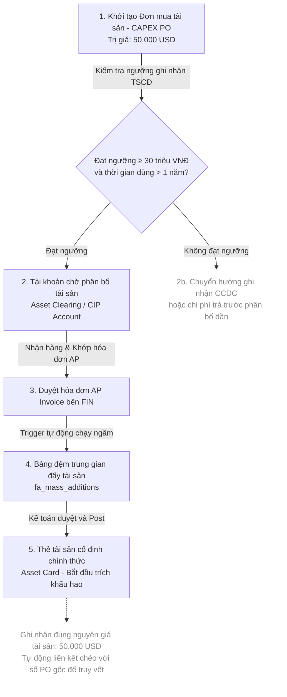

# 6030 Mua sắm dịch vụ và tài sản cố định (Service & FA)

Bên cạnh việc mua sắm nguyên vật liệu cho sản xuất, doanh nghiệp liên tục phát sinh nhu cầu mua sắm phi vật chất (như dịch vụ tư vấn, dịch vụ bảo trì phần mềm, quảng cáo) và mua sắm tài sản cố định phục vụ đầu tư phát triển (CAPEX - như máy móc, thiết bị văn phòng, xe tải). Trên hệ thống ERP, các loại mua sắm này không đi qua quy trình nhập kho thông thường mà yêu cầu cơ chế kiểm soát tiến độ hoàn thành (Milestone Tracking) và cơ chế tự động chuyển giao dữ liệu sang phân hệ Quản lý tài sản cố định (FIN-FA).

Bài viết tập trung vào **phía tạo đơn mua và bàn giao dữ liệu sang FA** — cách tài sản cố định được vốn hóa và trích khấu hao sau khi nhận dữ liệu từ PO thuộc phân hệ Tài sản cố định (FA), xem link ở mục 5 và cuối bài.

---

## 1. Bản chất nghiệp vụ & Thách thức thiết kế trên hệ thống

### Vấn đề cốt lõi:
1.  **Đối với Mua sắm Dịch vụ (Service PO):** Dịch vụ là phi vật chất, không thể nhận hàng vật lý tại bến nhận (No physical receiving). Nếu hệ thống bắt buộc thủ kho phải làm phiếu nhập kho để kế toán AP có cơ sở thanh toán, thủ kho sẽ phải làm các giao dịch giả lập (ví dụ: nhập kho số lượng `1` cái cho dịch vụ tư vấn 3 tháng). Việc này không phản ánh đúng tiến độ hoàn thành thực tế và làm sai lệch dữ liệu quản trị kho.
2.  **Đối với Mua sắm Tài sản cố định (CAPEX PO):** Một thiết bị máy phát điện trị giá **50,000 USD** được mua về. Nếu hệ thống tự xây hạch toán thẳng số tiền này vào tài khoản chi phí tiêu hao trong kỳ (Expense Account), doanh nghiệp sẽ vi phạm nghiêm trọng luật thuế và chuẩn mực kế toán (vì tài sản lớn bắt buộc phải được ghi nhận tăng tài sản và trích khấu hao dần qua nhiều năm).

### Giải pháp kiến trúc ERP tiêu chuẩn:
*   **Với Dịch vụ:** ERP sử dụng **Dòng mua sắm dịch vụ (Service Lines)** kết hợp phiếu **Xác nhận hoàn thành dịch vụ (Service Entry Sheet - SES)** hoặc cơ chế đối soát 2 chiều (2-Way Match: PO khớp trực tiếp với AP Invoice mà không cần qua Receipt).
*   **Với Tài sản cố định:** Hệ thống cấu hình dòng mua sắm gắn với nhóm mua tài sản cố định, tự động trỏ tài khoản định khoản về **Tài khoản chờ phân bổ tài sản (Asset Clearing / CIP Account)**. Khi hóa đơn AP được duyệt, hệ thống tự động chạy chương trình đẩy dữ liệu (Mass Additions Interface) sang phân hệ Quản lý tài sản để kế toán tài sản duyệt tạo thẻ tài sản cố định tự động, không cần nhập tay lại.

---

## 2. Ngưỡng ghi nhận tài sản cố định (Capitalization Threshold)

### Vì sao không phải mọi thiết bị mua về đều là CAPEX:
Không phải cứ mua sắm máy móc, thiết bị là tự động ghi nhận Tài sản cố định. Theo quy định kế toán hiện hành tại Việt Nam (Thông tư 45/2013/TT-BTC và các văn bản sửa đổi), một tài sản chỉ được ghi nhận là Tài sản cố định (TSCĐ) khi thỏa **đồng thời** các điều kiện:
*   Chắc chắn thu được lợi ích kinh tế trong tương lai từ việc sử dụng tài sản đó.
*   Thời gian sử dụng ước tính trên 1 năm.
*   Nguyên giá tài sản phải được xác định một cách đáng tin cậy và **có giá trị từ 30 triệu VNĐ trở lên**.

Nếu thiết bị không đạt đủ 3 điều kiện trên (ví dụ một máy tính văn phòng giá 15 triệu VNĐ, thời gian dùng trên 1 năm nhưng không đạt ngưỡng giá trị), khoản mua sắm này **không được đẩy vào phân hệ FA**, mà phải xử lý theo một trong hai hướng:
*   Ghi nhận thẳng vào chi phí trong kỳ (nếu giá trị nhỏ, dùng ngay).
*   Ghi nhận là **Công cụ dụng cụ (CCDC)** và phân bổ dần chi phí qua nhiều kỳ (Prepaid Expense / Deferred Expense Allocation) — cơ chế phân bổ chi phí trả trước theo định kỳ nói chung được xử lý bằng bút toán phân bổ tự động (Recurring & Allocation Journals) thuộc phân hệ Sổ cái, không đi qua phân hệ FA.

### Ý nghĩa thiết kế hệ thống:
Nhóm mua sắm (`Category`) gán trên dòng PO không chỉ quyết định tài khoản hạch toán, mà còn nên **liên động với ngưỡng giá trị** để tự động gợi ý đúng luồng xử lý:
*   PO có `Category = FIXED_ASSETS` và giá trị dòng **≥ 30 triệu VNĐ** → tự động trỏ tài khoản Asset Clearing, chuẩn bị đẩy sang FA.
*   PO có `Category = FIXED_ASSETS` nhưng giá trị dòng **< 30 triệu VNĐ** → hệ thống nên cảnh báo và gợi ý chuyển sang nhóm CCDC/chi phí trả trước thay vì cho qua luồng FA mặc định.

Việc thiếu kiểm tra ngưỡng này là nguyên nhân phổ biến khiến kế toán tài sản phải tự tay rà soát và loại bỏ hàng loạt "tài sản" không đủ điều kiện ra khỏi phân hệ FA cuối mỗi kỳ. Việc thiết lập nhóm tài sản, sổ khấu hao và tài khoản định khoản tương ứng thuộc FA 1000 (Cấu hình nhóm tài sản cố định, sổ khấu hao và tài khoản định khoản).

---

## 3. Quy trình tự động khởi tạo Thẻ tài sản cố định từ Đơn mua hàng PO

Sơ đồ dưới đây mô tả luồng luân chuyển dữ liệu tự động giữa SCM và FIN để đảm bảo kiểm soát chặt chẽ tài sản cố định, tránh ghi nhận sai lệch chi phí trong kỳ:



---

## 4. Bảng so sánh và Ánh xạ giải pháp giữa các hệ thống

Khi chuyển đổi giữa các hệ thống ERP hoặc tự thiết kế hệ thống (In-house), bạn có thể dễ dàng ánh xạ các tính năng tương đương dựa trên bảng sau:

| Nghiệp vụ thiết kế | Oracle EBS R12.2.10 | Epicor ERP | SAP S/4HANA | Odoo | Hệ thống tự xây (In-house) |
| :--- | :--- | :--- | :--- | :--- | :--- |
| **Bản chất dòng dịch vụ** | Service Line Type (Rate / Amount-based) | Misc Line Type (Charge direct to GL) | Service Item Type / Service Sheet | Service Product (No Inventory) | Dòng PO gán flag `Service_Line = True` |
| **Xác nhận hoàn thành** | 2-Way Match hoặc Expense Receipt | Misc PO Receipt (Không qua kho) | Service Entry Sheet (ML81N) | Milestone billing control | Form xác nhận nghiệm thu `Service_Acceptance` |
| **Tích hợp tài sản** | FA Mass Additions Interface (`FA_MASS_ADDITIONS`) | Asset Addition Checkbox on PO Line | Account Assignment 'A' (Asset PO) | Auto-create Asset (gán Expense category) | API tự động tạo bản ghi thẻ tài sản nháp |
| **Kiểm tra ngưỡng ghi nhận** | Không có sẵn — cần custom validation hoặc thủ công | Không có sẵn — cần custom BPM | Asset Class Threshold Configuration | Không có sẵn — xử lý qua kế toán | Rule Engine kiểm tra ngưỡng theo `Category + Amount` |

---

## 5. Điểm giao thoa & Tham chiếu chéo (Cross-linking) sang các phân hệ khác

*   **Tham chiếu đơn hàng:** Đơn mua dịch vụ và tài sản cố định được kế thừa toàn bộ thông tin phê duyệt hạn mức từ bài **[PO 4010 - Thiết lập luồng phê duyệt PO theo hạn mức tài chính và cấp bậc (PO Approval Workflow)](./4010-thiet-lap-luong-phe-duyet-po.md)**.
*   **Đối soát công nợ:** Hóa đơn AP phát sinh từ các đơn hàng này được thực hiện khớp lệnh tại bài AP/AR 3000 - Ghi nhận hóa đơn nhà cung cấp từ đơn mua hàng (AP Invoice Match) thuộc phân hệ Công nợ.
*   **Xử lý khi không đạt ngưỡng TSCĐ:** Các khoản mua sắm không đạt ngưỡng ghi nhận cần được phân bổ dần qua nhiều kỳ. Roadmap hiện chưa có bài riêng cho chủ đề Công cụ dụng cụ (CCDC); cơ chế gần nhất đã có kế hoạch là GL 2020 - Nghiệp vụ hạch toán bút toán phân bổ tự động và bút toán định kỳ cuối tháng (Recurring & Allocation Journals) thuộc phân hệ Sổ cái.
*   **Khởi tạo thẻ tài sản cố định:** Dữ liệu sau khi thông quan hoặc nghiệm thu bàn giao thiết bị được đẩy trực tiếp về bài FA 2000 - Quy trình mua sắm và vốn hóa tài sản cố định từ đơn mua hàng (Asset Acquisition from PO/AP) để bắt đầu chu kỳ theo dõi khấu hao trong suốt vòng đời tài sản.

---

## 6. Hướng dẫn luồng thiết lập (Setup Flow) chi tiết trên hệ thống

### A. Trên Oracle EBS R12.2.10 (FA Mass Additions)

1.  **Cấu hình Line Type dạng Dịch vụ:**
    *   *Đường dẫn:* `Purchasing Super User > Setup > Document > Line Types`
    *   *Nghiệp vụ:* Khai báo Line Type mới (ví dụ: `Fixed Price Services`), cấu hình thuộc tính `Value Basis = Amount` và `Receiving Routing = 2-Way` (đối chiếu trực tiếp PO-Invoice không cần làm phiếu nhập kho).
2.  **Khởi tạo PO mua tài sản cố định:**
    *   *Nghiệp vụ:* Tạo Standard PO thông thường tại bài **[PO 4000 - Khởi tạo và cấu hình Đơn mua hàng tiêu chuẩn (Standard PO)](./4000-khoi-tao-va-cau-hinh-don-mua-hang-tieu-chuan.md)**. Tại dòng PO, để trống mã Item, nhập mô tả thiết bị tại `Description` và chọn nhóm mua tài sản tại `Category`.
3.  **Gán tài khoản Asset Clearing:**
    *   *Nghiệp vụ:* Tại tab `Distributions`, chọn tài khoản hạch toán chi phí đầu vào là tài khoản Xây dựng dở dang / Chờ phân bổ tài sản (ví dụ: `2411` hoặc `242`). Trước khi gán, người mua hàng nên đối chiếu giá trị dòng PO với ngưỡng ghi nhận TSCĐ (xem mục 2) để chọn đúng nhóm tài khoản.
4.  **Chạy chương trình đẩy tài sản sang phân hệ FA:**
    *   *Nghiệp vụ:* Sau khi kế toán duyệt hóa đơn AP, chạy chương trình concurrent `Create Mass Additions` để hệ thống tự quét các dòng PO hạch toán vào tài khoản Clearing và đẩy thông tin sang bảng đệm `FA_MASS_ADDITIONS` chờ kế toán tài sản duyệt tạo thẻ.

### B. Trên Epicor ERP (Misc Line & Asset Addition)

1.  **Tạo dòng PO mua dịch vụ (Misc Line):**
    *   *Đường dẫn:* `Material Management > Purchase Management > General Operations > Purchase Order Entry`
    *   *Nghiệp vụ:* Tạo mới PO Line. Tại phần chọn loại dòng, chọn thuộc tính `Misc` (thay vì chọn Part). Hệ thống sẽ tự động tắt tính năng nhập kho lưu trữ và yêu cầu nhập trực tiếp tài khoản chi phí bộ phận gánh tiền (`ExpGLAcct`).
2.  **Tạo dòng PO mua tài sản cố định:**
    *   *Nghiệp vụ:* Nhập thông tin thiết bị mua sắm trên PO Line.
    *   *Liên kết tài sản:* Chuyển sang tab `Asset`, tích chọn thuộc tính `Asset Addition` và nhập mã tài sản cố định tương ứng (`AssetNum`) để hệ thống Epicor tự động liên kết dòng chi phí này sang phân hệ Asset Management ngay khi hóa đơn AP được hạch toán.

---

## 7. Truy vấn SQL đối soát cấu trúc tổ chức (SQL Database Audit Queries)

### A. Cho Oracle EBS R12.2.10

Query dưới đây truy xuất toàn bộ các dòng PO đang gán tài khoản Chờ phân bổ tài sản cố định (Asset Clearing), đồng thời đối chiếu chéo sang phân hệ Fixed Assets để kiểm tra xem hệ thống đã tự động đẩy bản ghi sang bảng đệm tạo thẻ tài sản (`fa_mass_additions`) chưa. Lưu ý: bảng `fa_mass_additions` không lưu trực tiếp `po_header_id`/`po_line_id`, mà liên kết ngược qua số PO (`po_number`) và tài khoản hạch toán bên Payables (`payables_code_combination_id`):

```sql
SELECT 
    hou.name                      AS operating_unit,
    pha.segment1                  AS po_number,
    pla.line_num                  AS po_line,
    pla.item_description          AS asset_description,
    pda.quantity_ordered          AS qty,
    (pda.quantity_ordered * pla.unit_price) AS asset_cost,
    gcc.segment1 || '.' || gcc.segment2 || '.' || gcc.segment3 AS asset_clearing_account,
    fma.posting_status            AS fa_mass_addition_status, -- 'NEW', 'POSTED', 'ON HOLD'
    fma.asset_number              AS created_asset_number
FROM 
    po_headers_all pha
INNER JOIN 
    po_lines_all pla ON pha.po_header_id = pla.po_header_id
INNER JOIN 
    po_distributions_all pda ON pla.po_line_id = pda.po_line_id
INNER JOIN 
    gl_code_combinations gcc ON pda.code_combination_id = gcc.code_combination_id
INNER JOIN 
    hr_operating_units hou ON pha.org_id = hou.organization_id
-- Liên kết sang bảng đệm đẩy tài sản tự động của phân hệ Fixed Assets qua số PO và tài khoản hạch toán
LEFT JOIN 
    fa_mass_additions fma ON fma.po_number = pha.segment1 
                          AND fma.payables_code_combination_id = pda.code_combination_id
WHERE 
    -- Lọc các dòng PO hạch toán vào tài khoản đầu tư xây dựng dở dang / tài khoản chờ phân bổ TSCĐ
    gcc.segment2 IN ('1411', '2411', '242') 
    OR fma.po_number IS NOT NULL
ORDER BY 
    pha.segment1, pla.line_num;
```

### B. Cho Epicor ERP (Truy vấn cơ sở dữ liệu SQL Server)

Query dưới đây kết xuất danh mục các dòng PO không mã hóa vật tư (mua dịch vụ chi phí hoặc mua tài sản cố định) trong Epicor, hiển thị tài khoản hạch toán chi phí mặc định và mã liên kết tài sản:

```sql
SELECT 
    pd.Company,
    pd.PONum                      AS PO_Number,
    pd.POLine                     AS Line_Num,
    pd.LineDesc                   AS Description,
    pd.DocUnitCost                AS Cost,
    pd.AssetNum                   AS Linked_Asset_ID, -- Hiển thị mã tài sản cố định liên kết
    pd.ExpGLAcct                  AS Target_GL_Account,
    -- Kiểm tra xem dòng PO này thuộc loại mua tài sản cố định hay dịch vụ chi phí
    CASE 
        WHEN pd.PartNum = '' AND pd.AssetNum <> '' THEN 'Fixed Asset Purchase'
        WHEN pd.PartNum = '' AND pd.AssetNum = '' THEN 'Service/Expense Purchase'
        ELSE 'Standard Part'
    END                           AS Purchase_Type
FROM 
    Erp.PODetail pd
WHERE 
    pd.Company = 'YOUR_COMPANY_CODE'
    AND pd.PartNum = '' -- Lọc các dòng mua dịch vụ hoặc tài sản cố định không có mã vật tư kho
ORDER BY 
    pd.PONum, pd.POLine;
```

---

## 8. Giải pháp khắc phục lỗi phổ biến & Cảnh báo cho Hệ thống tự xây (In-house)

Nếu đội ngũ của bạn đang tự phát triển mô-đun Mua sắm, hãy đặc biệt chú ý các điểm thiết kế kiến trúc sau:

1.  **Bẫy lỗi hạch toán nhầm chi phí CAPEX thành OPEX (Tài chính phơi nhiễm):**
    *   *Triệu chứng:* Nhân viên mua hàng tạo PO đặt mua thiết bị máy móc trị giá lớn và tự ý chọn tài khoản chi phí tiêu hao văn phòng phẩm (Tài khoản 642) làm tài khoản hạch toán. Do hệ thống tự xây không có quy tắc kiểm duyệt chéo, hóa đơn AP được duyệt thanh toán và hạch toán toàn bộ số tiền lớn này thành chi phí trong tháng, làm sụt giảm nghiêm trọng lợi nhuận ròng của doanh nghiệp trên báo cáo tài chính và vi phạm nghiêm trọng luật thuế.
    *   *Giải pháp khắc phục:* Thiết kế quy tắc kiểm soát nhóm tài khoản nghiêm ngặt (Account Validation Rules). Khi người dùng chọn mua hàng có nhóm danh mục mua sắm là Tài sản cố định (`Category = FIXED_ASSETS`), hệ thống bắt buộc phải khóa toàn bộ các tài khoản chi phí thông thường, chỉ cho phép chọn các tài khoản nằm trong nhóm tài khoản chờ phân bổ tài sản (Tài khoản đầu tư dở dang `241` hoặc tài khoản chờ phân bổ `242`).
2.  **Bẫy bỏ qua kiểm tra ngưỡng ghi nhận tài sản cố định:**
    *   *Triệu chứng:* Hệ thống tự xây cho phép bất kỳ dòng PO nào gán `Category = FIXED_ASSETS` đều tự động đẩy sang phân hệ FA mà không kiểm tra giá trị có đạt ngưỡng tối thiểu theo quy định (30 triệu VNĐ) hay không. Kết quả là hàng loạt khoản mua sắm nhỏ (như bàn phím, chuột máy tính mua theo lô cho văn phòng) bị đẩy nhầm thành tài sản cố định riêng lẻ, gây phình to số lượng thẻ tài sản không cần thiết và sai bản chất kế toán.
    *   *Giải pháp:* Thiết kế bước kiểm tra ngưỡng ngay tại thời điểm tạo dòng PO hoặc trước khi chạy chương trình đẩy sang FA: nếu giá trị dòng nhỏ hơn ngưỡng quy định, hệ thống tự động cảnh báo và gợi ý chuyển hướng sang luồng ghi nhận Công cụ dụng cụ/chi phí trả trước thay vì tài sản cố định.
3.  **Lỗi treo chi phí dở dang khi nghiệm thu bàn giao dịch vụ nhiều đợt:**
    *   *Triệu chứng:* Doanh nghiệp ký hợp đồng dịch vụ IT trị giá 30,000 USD trong vòng 3 tháng, thanh toán theo 3 đợt nghiệm thu (mỗi đợt 10,000 USD). Nếu hệ thống tự xây không hỗ trợ việc chia nhỏ kế hoạch nghiệm thu ngay trên dòng PO (Milestone Billing Plan), kế toán sẽ không có cơ sở đối chiếu khớp lệnh từng đợt, dễ dẫn đến hiện tượng thanh toán vượt hạn mức hợp đồng.
    *   *Giải pháp:* Thiết kế cấu trúc dòng PO hỗ trợ chia nhỏ kế hoạch nghiệm thu dịch vụ (Billing/Milestone Schedule). Mỗi đợt hoàn thành thực tế sẽ được xác nhận thông qua form Nghiệm thu dịch vụ nháp (`Service Acceptance Entry`), hệ thống khóa và trừ dần vào giá trị cam kết tổng của dòng PO.
4.  **Lỗi mất dấu vết nguồn gốc tài sản (Loss of Traceability):**
    *   *Triệu chứng:* Kế toán tài sản mở phân hệ FA và tự tay gõ thông tin Thẻ tài sản cố định mới mua về. Tuy nhiên, thẻ tài sản này hoàn toàn không có liên kết dữ liệu với số PO mua hàng và số hóa đơn AP ban đầu. Khi cơ quan kiểm toán yêu cầu truy xuất nguồn gốc chứng từ mua sắm của tài sản đó, kế toán phải lật tìm hàng ngàn hồ sơ giấy rất tốn thời gian.
    *   *Giải pháp:* Thiết kế khóa ngoại liên kết trực tiếp. Bảng thẻ tài sản `FA_Assets` bắt buộc phải lưu trữ thông tin trường `PO_Header_ID` và `Invoice_ID` của giao dịch mua sắm gốc để hỗ trợ tính năng truy vết ngược (Drill-down / Audit Trail) chỉ bằng một cú click chuột trên màn hình. Quy trình vốn hóa và cấu trúc thẻ tài sản chi tiết thuộc FA 2000 (Asset Acquisition from PO/AP) và FA 7010 (Fixed Asset Register & Depreciation Schedule).

---

## Xem thêm

- **[PO 4000 - Khởi tạo và cấu hình Đơn mua hàng tiêu chuẩn (Standard Purchase Order Entry)](./4000-khoi-tao-va-cau-hinh-don-mua-hang-tieu-chuan.md)**
- **[PO 4010 - Thiết lập luồng phê duyệt PO theo hạn mức tài chính và cấp bậc (PO Approval Workflow)](./4010-thiet-lap-luong-phe-duyet-po.md)**
- **AP/AR 3000 - Ghi nhận hóa đơn nhà cung cấp từ đơn mua hàng (AP Invoice Match)**
- **FA 1000 - Cấu hình nhóm tài sản cố định, sổ khấu hao và tài khoản định khoản (Asset Classes, Books & GL Accounts)**
- **FA 2000 - Quy trình mua sắm và vốn hóa tài sản cố định từ đơn mua hàng (Asset Acquisition from PO/AP)**
- **FA 7010 - Thiết lập sổ chi tiết tài sản cố định và bảng tính khấu hao (Fixed Asset Register & Depreciation Schedule)**
- **GL 2020 - Nghiệp vụ hạch toán bút toán phân bổ tự động và bút toán định kỳ cuối tháng (Recurring & Allocation Journals)**

<div align="center" style={{color: 'var(--ifm-color-primary)'}}>
  <strong>Chúc các bạn thành công và vui vẻ!</strong>
</div>