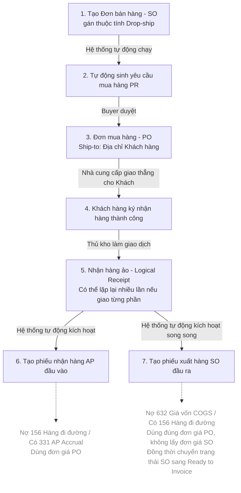

# 6040 Mua hàng giao thẳng không qua kho (Drop-ship PO)

Nghiệp vụ mua hàng giao thẳng (Drop-shipment / Third-Party Procurement) là giải pháp chuỗi cung ứng tối ưu giúp doanh nghiệp giảm thiểu chi phí lưu kho và vận chuyển. Khi phát sinh đơn đặt hàng từ khách hàng (Sales Order - SO), thay vì nhập hàng về kho của mình rồi mới giao đi, doanh nghiệp phát hành Đơn mua hàng (PO) yêu cầu nhà cung cấp giao thẳng trực tiếp đến địa chỉ của khách hàng. Trên hệ thống ERP, đây là nghiệp vụ tích hợp trực tiếp giữa quy trình Bán hàng (OM/SO) và Mua hàng (PO).

Bài viết này tập trung vào **phía đặt hàng nhà cung cấp giao thẳng (PO)**. Chứng từ bán hàng đối ứng và luồng xác nhận giao hàng cho khách thuộc phân hệ Bán hàng (OM) — xem link ở mục 5 và cuối bài.

---

## 1. Bản chất nghiệp vụ & Cơ chế nhận hàng ảo (Logical Receipt)

### Vấn đề cốt lõi:
Trong nghiệp vụ Drop-ship, hàng hóa đi trực tiếp từ kho của nhà cung cấp đến tay khách hàng. Doanh nghiệp hoàn toàn không thực hiện bất kỳ hoạt động bốc dỡ hay lưu trữ vật lý nào tại kho của mình.
Nếu lập trình viên hệ thống tự xây (In-house) ép buộc thủ kho phải làm phiếu nhập kho vật lý để hệ thống ghi nhận nhập hàng, rồi sau đó lại làm phiếu xuất kho vật lý giao đi:
*   Hệ thống sẽ ghi nhận số liệu tồn kho ảo (Phantom Stock) trong khoảng thời gian giữa nhập và xuất, làm sai lệch báo cáo kiểm kê kho thực tế tại **[INV 8000 - Báo cáo tồn kho theo thời điểm (Stock on Hand)](../../1-kho/6000-dinh-gia-va-bao-cao-kho.md)**.
*   Làm khống các chỉ số hiệu suất vận hành kho (KPIs nhận/xuất hàng của thủ kho).

### Giải pháp kiến trúc nhận xuất ảo (Logical / Virtual Transaction):
Để xử lý chuẩn xác, hệ thống ERP thiết lập luồng **Nhận hàng ảo (Logical / Virtual Receipt)** tự động đồng bộ hai đầu:

1.  Đơn bán hàng (SO) gán thuộc tính Drop-ship tự động sinh yêu cầu mua hàng (PR).
2.  Buyer duyệt PR thành PO, địa chỉ giao hàng (Ship-to) trên PO trỏ thẳng đến địa chỉ khách hàng thay vì kho nội bộ.
3.  Khi khách hàng xác nhận nhận hàng thành công từ nhà cung cấp, thủ kho làm một giao dịch nhận hàng ảo (Logical Receipt) duy nhất.
4.  Giao dịch này kích hoạt đồng thời hai luồng: tạo phiếu nhận hàng đầu vào (AP Accrual) và tạo phiếu xuất hàng đầu ra (SO Ship Confirm) — mà không hề chạm vào bảng tồn kho vật lý chính của doanh nghiệp.

---

## 2. Các kịch bản đặc biệt cần kiểm soát thêm

### A. Giao hàng từng phần (Partial Drop-ship Delivery)
Trên thực tế, nhà cung cấp không phải lúc nào cũng giao đủ số lượng trong một lần. Ví dụ khách đặt 100 sản phẩm, nhưng nhà cung cấp chỉ giao được 60 sản phẩm đợt đầu, 40 sản phẩm đợt sau. Hệ thống bắt buộc phải:
*   Cho phép làm nhiều giao dịch nhận hàng ảo (Logical Receipt) độc lập trên cùng một dòng PO, mỗi lần tương ứng với một lượng giao thực tế.
*   Đồng bộ đúng số lượng lũy kế: mỗi lần nhận ảo chỉ kích hoạt xuất SO đúng bằng số lượng đã nhận trong đợt đó, không xuất một lần toàn bộ 100 sản phẩm khi mới chỉ nhận 60.
*   Giữ trạng thái SO ở mức `Partially Shipped` cho đến khi tổng số lượng nhận ảo bằng đúng số lượng đặt trên PO.

### B. Hóa đơn tam giác (Triangulation Invoice)
Một số nhà cung cấp — đặc biệt trong giao dịch xuyên biên giới hoặc theo thỏa thuận thương mại đặc thù — xuất hóa đơn GTGT **trực tiếp cho khách hàng cuối** thay vì xuất cho doanh nghiệp trung gian (Drop-ship 3 bên/Triangulation). Trường hợp này khác biệt hoàn toàn với luồng AP/AR chuẩn mô tả ở mục 1:
*   Doanh nghiệp trung gian **không ghi nhận doanh thu bán hàng đầy đủ và giá vốn hàng bán** theo cách thông thường, mà chỉ ghi nhận phần chênh lệch hoa hồng/phí trung gian (nếu có) hoặc theo thỏa thuận hợp đồng ba bên cụ thể.
*   Hệ thống cần hỗ trợ cấu hình loại đơn hàng Drop-ship đặc biệt này tách biệt với Drop-ship chuẩn, vì luồng hạch toán AP Accrual/COGS ở mục 1 sẽ **không áp dụng đúng** cho trường hợp tam giác.
*   Cần tham vấn bộ phận kế toán thuế trước khi thiết kế logic hạch toán, vì quy định về hóa đơn tam giác có yêu cầu pháp lý riêng theo từng thời điểm và loại hình giao dịch. Roadmap hiện chưa có bài riêng cho chủ đề này; các quy tắc thuế liên quan đến giao dịch xuyên biên giới gần nhất thuộc nhóm TAX 4010 (Import/Export Duty & Customs Integration) — cần tham vấn trực tiếp kế toán thuế thay vì suy diễn từ tài liệu.

---

## 3. Sơ đồ luồng nhận hàng ảo và đồng bộ tài chính hai đầu

Sơ đồ dưới đây mô tả quy trình xử lý giao dịch nhận hàng ảo (Logical/Virtual Receipt) để tự động đồng bộ hóa đơn mua AP và hóa đơn bán AR mà không làm ảo số tồn kho vật lý — áp dụng cho luồng Drop-ship chuẩn (không phải trường hợp hóa đơn tam giác ở mục 2.B):



---

## 4. Bảng so sánh và Ánh xạ giải pháp giữa các hệ thống

Khi chuyển đổi giữa các hệ thống ERP hoặc tự thiết kế hệ thống (In-house), bạn có thể dễ dàng ánh xạ các tính năng tương đương dựa trên bảng sau:

| Nghiệp vụ thiết kế | Oracle EBS R12.2.10 | Epicor ERP | SAP S/4HANA | Odoo | Hệ thống tự xây (In-house) |
| :--- | :--- | :--- | :--- | :--- | :--- |
| **Bản chất đơn hàng** | Sales Order Source = 'EXTERNAL' | Drop Ship checkbox on SO Line | Third-Party Order (Item Category 'S') | Drop Ship Route on Product | Cột gán nhãn `Is_Drop_Ship` liên kết bảng PO - SO |
| **Kích hoạt PR/PO** | Requisition Import tự động quét nhu cầu SO | Purchase Suggestions trong hàng chờ Drop Ship | Tự động sinh PR dạng TAS từ SO | Tự động tạo RFQ nháp khi SO được xác nhận | API tự động tạo PR/PO kế thừa thông tin địa chỉ khách hàng |
| **Giao dịch nhận ảo** | Drop Ship Receiving (tự chạy Process Order) | Drop Ship Action / Receipt Entry | Goods Receipt of Third-Party PO | Logical Inventory Transfer (Drop Ship) | Giao dịch nhận ảo tự động kích hoạt luồng xuất SO |
| **Giao hàng từng phần** | Nhiều Receipt Transactions trên cùng PO Shipment | Nhiều lần Drop Ship Action theo RelQty | Multiple Goods Receipts theo Schedule Line | Backorder + Partial Delivery | Cột `cumulative_received_qty` đối chiếu với `po_qty` |

---

## 5. Điểm giao thoa & Tham chiếu chéo (Cross-linking) sang các phân hệ khác

*   **Đầu vào từ đơn bán hàng:** Toàn bộ thông tin tên mặt hàng, số lượng và địa chỉ giao hàng được thừa hưởng trực tiếp từ đơn SO tại phân hệ Bán hàng, tham khảo bài OM 6000 - Quy trình bán hàng Drop-shipment từ nhà cung cấp (Drop-ship Order Flow) *(mã số riêng, không trùng dải 6000 của phân hệ Mua hàng)*.
*   **Tham chiếu đơn mua hàng:** Đơn mua hàng Drop-ship PO được quản lý phê duyệt hạn mức chuẩn theo bài **[PO 4010 - Thiết lập luồng phê duyệt PO theo hạn mức tài chính và cấp bậc (PO Approval Workflow)](./4010-thiet-lap-luong-phe-duyet-po.md)**.
*   **Hạch toán Giá vốn & Doanh thu:** Giao dịch nhận hàng ảo (Logical Receipt) đồng thời kích hoạt luồng hạch toán giá vốn (COGS). Đây là bút toán giao dịch thương mại thuần túy (không đi qua tính giá thành sản xuất), nên phối hợp với kế toán để xác định đúng tài khoản; luồng xuất hóa đơn bán hàng tương ứng thuộc AP/AR 2000 - Nghiệp vụ ghi nhận hóa đơn bán hàng và hạch toán doanh thu công nợ (AR Invoice Entry & Posting).
*   **Xử lý hóa đơn tam giác:** Trường hợp nhà cung cấp xuất hóa đơn trực tiếp cho khách hàng cuối (mục 2.B) hiện chưa có bài chuyên trách trong roadmap — cần phối hợp trực tiếp với bộ phận kế toán thuế theo từng thương vụ cụ thể.

---

## 6. Hướng dẫn luồng thiết lập (Setup Flow) chi tiết trên hệ thống

### A. Trên Oracle EBS R12.2.10 (Drop-ship Flow)

1.  **Tạo đơn SO Drop-ship:**
    *   *Đường dẫn:* `Order Management > Orders, Returns > Sales Orders`
    *   *Nghiệp vụ:* Tạo SO mới. Tại tab `Shipping` của dòng hàng, chọn thuộc tính `Source = External` và `Receiving Org` là kho ảo chứa hàng giao thẳng.
2.  **Đồng bộ nhu cầu sang mua hàng (Requisition Import):**
    *   *Nghiệp vụ:* Khi SO được duyệt, chạy chương trình concurrent `Requisition Import` để hệ thống tự quét đơn SO và tự khởi tạo một yêu cầu PR liên kết. Buyer thực hiện duyệt PR thành Standard PO gửi nhà cung cấp.
3.  **Làm giao dịch nhận ảo (Drop Ship Receiving):**
    *   *Đường dẫn:* `Purchasing Super User > Receiving > Receipts`
    *   *Nghiệp vụ:* Chọn số PO Drop-ship, thực hiện nhận hàng (`Receive`). Nếu nhà cung cấp giao từng phần, thực hiện nhận nhiều lần, mỗi lần đúng số lượng thực nhận. Hệ thống Oracle Purchasing sẽ tự động kích hoạt tiến trình chạy ngầm `Process Order` để tự thực hiện giao dịch xuất kho ảo (Ship Confirm) tương ứng cho đơn SO đối ứng bên phân hệ OM.

### B. Trên Epicor ERP (Multi-Company / Multi-Site)

1.  **Cấu hình Drop-ship trên SO Detail:**
    *   *Đường dẫn:* `Sales Management > Order Management > General Operations > Order Entry`
    *   *Nghiệp vụ:* Tạo SO dòng hàng mới. Tại tab `Line > Sheet`, tích chọn ô `Drop Ship`.
2.  **Xử lý đề xuất mua hàng Drop-ship:**
    *   *Đường dẫn:* `Material Management > Purchase Management > General Operations > New PO Suggestions`
    *   *Nghiệp vụ:* Mở màn hình đề xuất, hệ thống tự động gán đề xuất này vào hàng chờ `Drop Ship Suggestions`. Buyer chọn đề xuất và bấm `Generate PO`.
3.  **Làm phiếu nhận hàng Drop-ship (Drop Ship Entry):**
    *   *Đường dẫn:* `Material Management > Purchase Management > General Operations > Drop Ship Action`
    *   *Nghiệp vụ:* Khi khách hàng xác nhận nhận hàng, mở màn hình Drop Ship Action, chọn số PO và số SO liên kết. Nhập số lượng thực nhận (có thể lặp lại nhiều lần nếu giao từng đợt) để Epicor tự động cập nhật giảm số lượng dở dang trên SO và ghi nhận giá vốn.

---

## 7. Truy vấn SQL đối soát cấu trúc tổ chức (SQL Database Audit Queries)

### A. Cho Oracle EBS R12.2.10

Query dưới đây đối soát chéo toàn bộ danh sách các đơn mua hàng Drop-ship PO đang liên kết trực tiếp với các đơn bán hàng SO tương ứng, hiển thị chi tiết tên khách hàng và địa chỉ giao thẳng để phục vụ công tác kiểm tra dữ liệu. Lưu ý: việc liên kết PO-SO phải đi qua bảng quan hệ Drop Ship chuẩn `oe_drop_ship_sources` (không suy luận qua `source_shipment_id`), và việc lấy tên khách hàng/địa chỉ giao hàng phải đi qua đúng chuỗi bảng TCA (Trading Community Architecture) của Oracle:

```sql
SELECT 
    hou.name                      AS operating_unit,
    pha.segment1                  AS po_number,
    pla.line_num                  AS po_line_num,
    msib.segment1                 AS item_code,
    pla.quantity                  AS po_ordered_qty,
    ooh.order_number              AS linked_so_number,
    ool.line_number                AS so_line_num,
    hp.party_name                 AS customer_name,
    h_loc.address1                AS customer_ship_to_address
FROM 
    po_headers_all pha
INNER JOIN 
    po_lines_all pla ON pha.po_header_id = pla.po_header_id
INNER JOIN 
    po_line_locations_all plla ON pla.po_line_id = plla.po_line_id
INNER JOIN 
    hr_operating_units hou ON pha.org_id = hou.organization_id
-- Liên kết sang phân hệ Order Management (OM) thông qua bảng quan hệ Drop Ship chuẩn
INNER JOIN 
    oe_drop_ship_sources odss ON plla.po_header_id = odss.po_header_id 
                              AND plla.po_line_id = odss.po_line_id 
                              AND plla.line_location_id = odss.line_location_id
INNER JOIN 
    oe_order_lines_all ool ON odss.line_id = ool.line_id
INNER JOIN 
    oe_order_headers_all ooh ON ool.header_id = ooh.header_id
-- Kết nối lấy Tên khách hàng thông qua bảng Tài khoản Khách hàng (TCA)
INNER JOIN 
    hz_cust_accounts hca ON ooh.sold_to_org_id = hca.cust_account_id
INNER JOIN 
    hz_parties hp ON hca.party_id = hp.party_id
-- Kết nối bắc cầu qua các tầng bảng để lấy chuẩn xác Địa chỉ giao hàng (Ship-to Address)
INNER JOIN 
    hz_cust_site_uses_all hcsu ON ool.ship_to_org_id = hcsu.site_use_id
INNER JOIN 
    hz_cust_acct_sites_all hcsub ON hcsu.cust_acct_site_id = hcsub.cust_acct_site_id
INNER JOIN 
    hz_party_sites hps ON hcsub.party_site_id = hps.party_site_id
INNER JOIN 
    hz_locations h_loc ON hps.location_id = h_loc.location_id
LEFT JOIN 
    mtl_system_items_b msib ON pla.item_id = msib.inventory_item_id 
                            AND msib.organization_id = plla.ship_to_organization_id
WHERE 
    pha.type_lookup_code = 'STANDARD'
ORDER BY 
    pha.segment1, pla.line_num;
```

### B. Cho Epicor ERP (Truy vấn cơ sở dữ liệu SQL Server)

Query dưới đây truy xuất toàn bộ các dòng giao hàng (PO Releases) được cấu hình gán nhãn Drop-ship trong Epicor và thông tin Sales Order liên kết tương ứng:

```sql
SELECT 
    pr.Company,
    pr.PONum                      AS PO_Number,
    pr.POLine                     AS PO_Line_Num,
    pr.PORelNum                   AS Release_Num,
    pd.PartNum                    AS Part_Number,
    pr.RelQty                     AS Ordered_Qty,
    -- Đối chiếu sang thông tin đơn Sales Order đối ứng
    pr.OrderNum                   AS Linked_SO_Num,
    pr.OrderLine                  AS SO_Line_Num,
    pr.OrderRelNum                AS SO_Release_Num,
    pr.DropShip                   AS Is_Drop_Ship
FROM 
    Erp.PORel pr
INNER JOIN 
    Erp.PODetail pd ON pr.Company = pd.Company AND pr.PONum = pd.PONum AND pr.POLine = pd.POLine
WHERE 
    pr.Company = 'YOUR_COMPANY_CODE'
    AND pr.DropShip = 1 -- Chỉ lọc các dòng giao hàng mua thẳng không qua kho
ORDER BY 
    pr.PONum, pr.POLine, pr.PORelNum;
```

---

## 8. Giải pháp khắc phục lỗi phổ biến & Cảnh báo cho Hệ thống tự xây (In-house)

Nếu đội ngũ của bạn đang tự phát triển mô-đun Bán hàng và Mua hàng tích hợp, hãy đặc biệt chú ý các điểm thiết kế kiến trúc sau để tránh các bẫy lỗi thực tế:

1.  **Bẫy ghi nhận tồn kho vật lý sai thực tế (Phantom Inventory Pitfall):**
    *   *Triệu chứng:* Khi lập trình viên viết logic nhận hàng cho Drop-ship PO bằng cách gọi trực tiếp hàm nhập kho chính của phân hệ INV. Hệ thống sẽ ghi nhận lượng tồn kho tăng lên đột biến trong vài phút hoặc vài giờ trước khi làm phiếu xuất kho cho khách. Trong khoảng thời gian này, hệ thống sẽ hiển thị số lượng tồn kho ảo, khiến bộ phận lập kế hoạch sản xuất (MRP) hoặc nhân viên bán hàng khác bị đánh lừa là có sẵn hàng trong kho để sử dụng.
    *   *Giải pháp khắc phục:* Thiết kế giao dịch nhận hàng ảo (Logical/Virtual Receipt). Dữ liệu nhận hàng của PO và xuất hàng của SO phải được thực hiện đồng thời trong một giao dịch cơ sở dữ liệu duy nhất (Single Database Transaction / Atomic Transaction) và hoàn toàn bỏ qua việc cập nhật bảng tồn kho vật lý chính `PartBin` / `Inventory_Balances` (hoặc định tuyến qua một kho ảo không nettable).
2.  **Lỗi lệch pha trạng thái chứng từ (Status Desync Error):**
    *   *Triệu chứng:* Thủ kho làm phiếu nhận PO Drop-ship thành công, nhưng dòng SO đối ứng bên phân hệ bán hàng vẫn nằm ở trạng thái "Chờ giao hàng" (Awaiting Shipping) thay vì tự động chuyển sang "Chờ xuất hóa đơn" (Ready to Invoice). Kế toán AR không thể xuất hóa đơn bán hàng cho khách, gây đọng vốn.
    *   *Giải pháp:* Thiết kế cơ chế trigger liên kết trạng thái chứng từ (State Machine Linkage). Khi giao dịch nhận ảo trên PO được lưu thành công, hệ thống bắt buộc phải tự động gọi một hàm cập nhật (API Call hoặc Stored Procedure) để chuyển trạng thái dòng SO đối ứng sang `Shipped` và kích hoạt luồng xuất hóa đơn bán hàng ngay lập tức.
3.  **Lỗi lệch đơn giá mua và bán khi hạch toán giá vốn:**
    *   *Triệu chứng:* Đơn giá mua hàng từ nhà cung cấp trên PO là 80 USD, đơn giá bán cho khách trên SO là 100 USD. Khi làm giao dịch nhận ảo, hệ thống tự xây tự động lấy đơn giá SO (100 USD) làm căn cứ hạch toán giá vốn hàng bán (COGS), dẫn đến việc tính toán biên lợi nhuận gộp bị sai lệch.
    *   *Giải pháp:* Hệ thống bắt buộc phải phân định rõ ràng hai đầu hạch toán tài chính độc lập:
        *   *Đầu mua (AP Accrual):* Sử dụng đơn giá trên dòng PO (80 USD) để ghi nhận Nợ 156 (Hàng đi đường) / Có 331 (AP Accrual).
        *   *Đầu bán (COGS):* Sử dụng đúng đơn giá PO (80 USD) để hạch toán giá vốn hàng bán: Nợ 632 (Giá vốn COGS) / Có 156 (Hàng đi đường). Tuyệt đối không được lấy đơn giá bán trên SO (100 USD) để làm giá vốn.
4.  **Lỗi cộng dồn sai khi xuất SO nhiều lần từ giao hàng từng phần:**
    *   *Triệu chứng:* Nhà cung cấp giao 2 đợt (60 rồi 40 sản phẩm). Nếu hệ thống tự xây không lưu vết số lượng đã nhận ảo lũy kế trên từng dòng PO, giao dịch nhận ảo lần 2 có thể vô tình kích hoạt xuất SO toàn bộ 100 sản phẩm thay vì chỉ 40 sản phẩm còn lại, gây xuất kho ảo vượt số lượng khách hàng thực nhận.
    *   *Giải pháp:* Thiết kế trường `cumulative_received_qty` trên dòng PO, mỗi lần nhận ảo phải kiểm tra và chỉ kích hoạt xuất SO đúng bằng phần chênh lệch giữa lần nhận hiện tại và lũy kế trước đó, đồng thời chặn không cho tổng số lượng nhận vượt quá số lượng đặt trên PO Line.
5.  **Bẫy áp dụng sai luồng hạch toán cho trường hợp hóa đơn tam giác:**
    *   *Triệu chứng:* Đội phát triển áp dụng đồng loạt logic AP Accrual/COGS chuẩn (mục 3) cho mọi đơn hàng Drop-ship, kể cả trường hợp nhà cung cấp xuất hóa đơn trực tiếp cho khách hàng cuối (mục 2.B). Điều này dẫn đến doanh nghiệp ghi nhận doanh thu và giá vốn không đúng bản chất giao dịch, có thể vi phạm quy định về hóa đơn chứng từ.
    *   *Giải pháp:* Thiết kế cờ phân loại rõ ràng ngay từ khi tạo SO (`Drop_Ship_Type = 'STANDARD'` hoặc `'TRIANGULATION'`), để hệ thống áp dụng đúng luồng hạch toán tương ứng, và bắt buộc có bước xác nhận từ kế toán thuế trước khi đơn hàng dạng tam giác được xử lý tự động.

---

## Xem thêm

- **[PO 4010 - Thiết lập luồng phê duyệt PO theo hạn mức tài chính và cấp bậc (PO Approval Workflow)](./4010-thiet-lap-luong-phe-duyet-po.md)**
- **[INV 8000 - Báo cáo tồn kho theo thời điểm (Stock on Hand)](../../1-kho/6000-dinh-gia-va-bao-cao-kho.md)**
- **OM 6000 - Quy trình bán hàng Drop-shipment từ nhà cung cấp (Drop-ship Order Flow)**
- **AP/AR 2000 - Nghiệp vụ ghi nhận hóa đơn bán hàng và hạch toán doanh thu công nợ (AR Invoice Entry & Posting)**
- **TAX 4010 - Tích hợp thuế Xuất nhập khẩu với phân hệ Logistics/Hải quan (Import/Export Duty & Customs Integration)**

<div align="center" style={{color: 'var(--ifm-color-primary)'}}>
  <strong>Chúc các bạn thành công và vui vẻ!</strong>
</div>