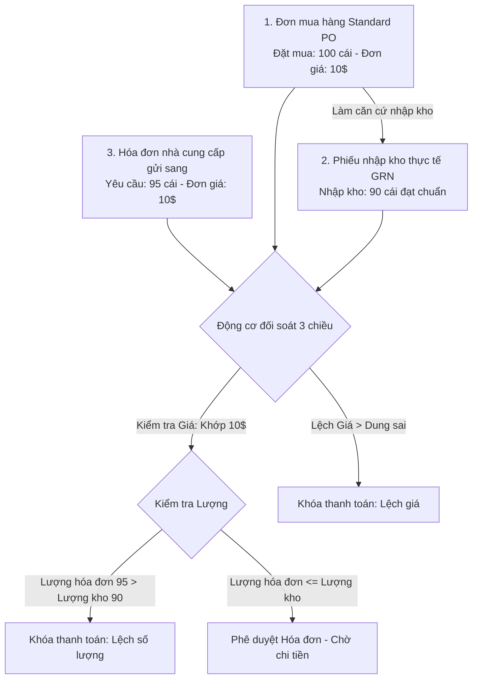

# 7000 Đối soát khớp lệnh 3 chiều và 2 chiều (PO Matching)

Quy trình đối soát hóa đơn mua hàng đầu vào (Invoice Verification / Matching) là bước kiểm soát cuối cùng của chu trình Mua hàng đến Thanh toán (Procure-to-Pay). Việc áp dụng nghiêm ngặt các nguyên lý đối soát khớp lệnh 2 chiều, 3 chiều hoặc 4 chiều trên hệ thống ERP là chốt chặn quan trọng nhất để bảo vệ dòng tiền của doanh nghiệp, đảm bảo bộ phận kế toán phải trả (AP) chỉ thực hiện thanh toán đúng với những gì doanh nghiệp thực tế đặt mua và thực tế đã nhập kho đạt chất lượng.

Bài viết này là bài gốc trình bày **nguyên lý và kỹ thuật đối soát**. Bước ghi nhận hóa đơn chính thức vào sổ công nợ sau khi khớp lệnh thành công thuộc AP/AR 3000 (AP Invoice Match - PO & Non-PO); các hệ quả kế toán chuyên sâu hơn (đối chiếu tài khoản trung gian, chênh lệch giá mua, chênh lệch tỷ giá, thuế GTGT, hóa đơn điều chỉnh) được link tới bài chuyên trách ngay tại từng mục bên dưới.

---

## 1. Bản chất nghiệp vụ & Các cơ chế đối soát (PO Matching Rules)

Tùy thuộc vào loại mặt hàng mua sắm (hàng lưu kho, dịch vụ phi vật chất hay thiết bị yêu cầu kiểm định), hệ thống ERP sẽ áp dụng một trong các quy tắc đối soát sau:

### A. Khớp lệnh 2 chiều (2-Way Matching)
* **Các bên so khớp:** Đơn mua hàng (PO) $\leftrightarrow$ Hóa đơn nhà cung cấp (Invoice).
* **Điều kiện khớp:** Số lượng trên hóa đơn $\le$ Số lượng trên PO; Đơn giá trên hóa đơn $\le$ Đơn giá trên PO (nằm trong dung sai cho phép).
* **Phạm vi áp dụng:** Mua sắm dịch vụ, văn phòng phẩm, chi tiêu hành chính (MRO/Indirect) không qua nhập kho vật lý.

### B. Khớp lệnh 3 chiều (3-Way Matching)
* **Các bên so khớp:** Đơn mua hàng (PO) $\leftrightarrow$ Phiếu nhập kho (Receipt/GRN) $\leftrightarrow$ Hóa đơn nhà cung cấp (Invoice).
* **Điều kiện khớp:**
    1. Đơn giá hóa đơn $\le$ Đơn giá trên PO.
    2. Số lượng hóa đơn $\le$ Số lượng thực tế thủ kho đã nhập kho đạt chuẩn trên phiếu GRN.
* **Phạm vi áp dụng:** Nguyên vật liệu sản xuất trực tiếp, hàng hóa lưu kho bắt buộc kiểm soát số lượng nhập.

### C. Khớp lệnh 4 chiều (4-Way Matching)
* **Các bên so khớp:** PO $\leftrightarrow$ Phiếu nhập kho $\leftrightarrow$ Kết quả kiểm QC (Inspection/Accept) $\leftrightarrow$ Hóa đơn.
* **Điều kiện khớp:** Số lượng hóa đơn $\le$ Số lượng thực tế bộ phận QC đã phê duyệt đạt chất lượng tại bước kiểm IQC.
* **Phạm vi áp dụng:** Hóa chất, linh kiện điện tử, vật tư yêu cầu kiểm định chất lượng nghiêm ngặt.

### D. Đối soát theo Blanket PO / Contract PO

Với hợp đồng khung (Blanket Purchase Agreement), doanh nghiệp không đặt số lượng cố định ngay từ đầu mà chỉ ký thỏa thuận giá và hạn mức tổng. Việc nhập kho và xuất hóa đơn diễn ra qua nhiều lần **Release** (giải phóng đơn hàng con) trong suốt thời hạn hợp đồng. Logic đối soát 2/3/4 chiều vẫn áp dụng tương tự, nhưng đơn vị so khớp là **từng dòng Release**, không phải toàn bộ PO Header — mỗi Release được theo dõi số lượng đã nhận và đã khớp hóa đơn độc lập với các Release khác.

### E. Cấp độ đối soát: Header-level và Line-level

Đối soát có thể thực hiện ở hai cấp:
* **Header-level:** hệ thống chỉ so khớp tổng giá trị hóa đơn với tổng giá trị PO/GRN liên quan, không kiểm tra chi tiết từng dòng.
* **Line-level:** hệ thống so khớp từng dòng hóa đơn với từng dòng PO/GRN tương ứng — đây là cấp độ kiểm soát chặt và phổ biến hơn trong thực tế, vì cho phép khóa (hold) chính xác dòng hàng có sai lệch mà không chặn toàn bộ hóa đơn.

---

## 2. Luồng vận hành đối soát 3 chiều tiêu chuẩn trên ERP

Sơ đồ dưới đây mô tả cách hệ thống ERP kiểm tra chéo các chứng từ trước khi cho phép kế toán AP phê duyệt hóa đơn chuyển sang kỳ chạy thanh toán:



> **Ghi chú:** Nếu áp dụng khớp lệnh 4 chiều, hệ thống sẽ chèn thêm một nút kiểm tra `QC[Kết quả kiểm IQC]` nằm giữa `GRN` và `MATCH` ở trên — số lượng đưa vào đối soát khi đó không phải là số lượng nhập kho thô mà là số lượng đã được QC phê duyệt đạt chất lượng.

### Các loại dung sai (Tolerance) cần cấu hình

Hệ thống không nên yêu cầu khớp tuyệt đối 100% vì luôn tồn tại sai số làm tròn hoặc phụ phí nhỏ. Bốn loại dung sai phổ biến nhất cần thiết lập:

| Loại dung sai | Ý nghĩa |
|---|---|
| Qty Ordered Tolerance | % số lượng hóa đơn được phép vượt số lượng đặt trên PO |
| Qty Received Tolerance | % số lượng hóa đơn được phép vượt số lượng đã nhận trên GRN |
| Price Tolerance | % đơn giá hóa đơn được phép vượt đơn giá trên PO |
| Amount Tolerance | Giá trị tuyệt đối (số tiền) chênh lệch tối đa được chấp nhận, không xét theo % |

Ngoài ra cần phân biệt **dung sai dương** (hóa đơn cao hơn PO/GRN — rủi ro thất thoát, cần kiểm soát chặt) và **dung sai âm** (hóa đơn thấp hơn PO/GRN — thường được hệ thống tự động cho qua vì có lợi cho doanh nghiệp).

---

## 3. Kiến trúc hạch toán tài chính trung gian khi nhận hàng chưa có hóa đơn

Nếu hệ thống kế toán ghi nhận ngay công nợ AP phải trả tại thời điểm thủ kho nhập kho, hệ thống sẽ bị sai lệch nghiêm trọng nếu hóa đơn thực tế sau đó có sự chênh lệch đơn giá. Về nguyên lý quốc tế (IFRS/US GAAP), nghiệp vụ này dùng tài khoản **GR/IR Clearing** (Goods Receipt / Invoice Receipt). Chế độ kế toán Việt Nam theo Thông tư 200 **không có sẵn tài khoản chuẩn cho mục đích này**, nên hệ thống tự xây cần tự thiết kế một tài khoản trung gian tùy biến — phổ biến nhất là mở chi tiết dưới **TK 338 (Phải trả, phải nộp khác — tiểu khoản 3388)** hoặc mở TK 331 theo dõi chi tiết riêng theo từng PO/GRN chưa có hóa đơn. Dưới đây minh họa logic hạch toán dùng tiểu khoản `3388 - Nhận hàng chưa có hóa đơn`:

1. **Khi Nhập kho (Receipt):**
    * Hạch toán tăng tài sản kho và ghi nhận công nợ tạm tính:
    * `Nợ TK 152 (Tồn kho) / Có TK 3388 (Nhận hàng chưa có hóa đơn - tùy biến)`
2. **Khi Nhận hóa đơn (AP Invoice Match):**
    * Đối trừ tài khoản trung gian và ghi nhận công nợ phải trả chính thức:
    * `Nợ TK 3388 (Nhận hàng chưa có hóa đơn) / Có TK 331 (Phải trả người bán AP)`
    * *Kết quả:* Số dư tài khoản trung gian `3388` tự động triệt tiêu về không nếu hóa đơn và phiếu nhập kho khớp nhau hoàn toàn.

> **Lưu ý quan trọng:** Đây là giải pháp thiết kế tùy biến để giải quyết bài toán kỹ thuật (chưa có hóa đơn nhưng đã có hàng), không phải là quy định bắt buộc trong chế độ kế toán Việt Nam. Doanh nghiệp cần thống nhất với kiểm toán và cơ quan thuế về việc sử dụng tiểu khoản này trước khi triển khai trên hệ thống chính thức. Việc đối chiếu định kỳ số dư tài khoản trung gian này để phát hiện các khoản treo lâu ngày (hàng đã nhận nhưng mãi chưa có hóa đơn, hoặc ngược lại) là một nghiệp vụ riêng, xem AP/AR 4030 (Đối chiếu và xử lý tài khoản trung gian Nhận hàng chưa có hóa đơn - GR/IR Clearing Account Reconciliation).

### Chênh lệch tỷ giá (Exchange Rate Variance) khi PO bằng ngoại tệ

Với các PO đặt bằng ngoại tệ (USD, EUR...), tỷ giá áp dụng tại thời điểm nhập kho (GRN) thường khác với tỷ giá tại thời điểm ghi nhận hóa đơn AP, do biến động tỷ giá liên ngân hàng theo ngày. Hệ thống cần tách riêng phần chênh lệch này ra tài khoản doanh thu/chi phí tài chính (TK 515 nếu lãi tỷ giá, TK 635 nếu lỗ tỷ giá), không được gộp chung vào chênh lệch giá mua hàng hóa (IPV) ở mục 7 bên dưới, vì bản chất hai loại chênh lệch này khác nhau hoàn toàn. Nguyên lý đánh giá lại số dư ngoại tệ nói chung xem GL 4000 (GL Foreign Exchange Revaluation).

### Thuế GTGT đầu vào

Đối soát 3 chiều/2 chiều/4 chiều luôn thực hiện trên **giá trị trước thuế (net amount)**. Thuế GTGT đầu vào được tách riêng và hạch toán vào TK 1331, không đưa vào phép so khớp số lượng/đơn giá giữa PO – GRN – Invoice, để tránh sai lệch điều kiện khớp lệnh do thuế suất khác nhau giữa các dòng hàng. Nghiệp vụ kiểm soát, đối chiếu và khấu trừ thuế GTGT đầu vào đầy đủ xem TAX 2000.

### Xử lý Credit Memo (hóa đơn điều chỉnh giảm)

Khi nhà cung cấp phát hành hóa đơn điều chỉnh giảm (credit note) do trả hàng hoặc điều chỉnh giá sau khi hóa đơn gốc đã được khớp lệnh và thanh toán, hệ thống cần cho phép đối soát credit memo ngược lại với hóa đơn gốc (tham chiếu theo PO/GRN đã dùng), đồng thời giảm trừ số lượng/giá trị đã ghi nhận là "đã khớp" trên GRN gốc để không làm sai lệch số liệu kiểm soát về sau. Quy trình xuất và đối soát Debit/Credit Memo đầy đủ xem AP/AR 6020 (Debit/Credit Memo Posting & Matching).

---

## 4. Điểm giao thoa & Tham chiếu chéo (Cross-linking) sang các phân hệ khác

* **Tham chiếu đơn hàng:** Đối soát hóa đơn kế toán bắt buộc phải đối chiếu trực tiếp với thông tin đơn hàng đã ký duyệt tại **[PO 4000 - Khởi tạo và cấu hình Đơn mua hàng tiêu chuẩn (Standard PO)](./4000-khoi-tao-va-cau-hinh-don-mua-hang-tieu-chuan.md)**.
* **Đối chiếu phiếu nhập kho:** Số lượng hóa đơn đầu vào bắt buộc phải so khớp với số lượng thực nhận trên phiếu nhập kho tại bài **[INV 1000 - Nhập kho từ mua hàng (Receipt from PO)](../inv-ton-kho/1000-nhap-kho-tu-mua-hang-po.md)** thuộc phân hệ Tồn kho.
* **Ghi nhận hóa đơn chính thức:** Sau khi khớp lệnh thành công theo nguyên lý trong bài này, hóa đơn được ghi sổ chính thức tại bài AP/AR 3000 - Ghi nhận hóa đơn nhà cung cấp từ đơn mua hàng (AP Invoice Match - PO & Non-PO).
* **Chuyển giao cho thanh toán:** Hóa đơn sau khi được đối soát thành công thông qua bài viết này sẽ được đẩy trực tiếp về bài AP/AR 3020 - Nghiệp vụ chi tiền thanh toán và đối trừ hóa đơn nhà cung cấp (Vendor Payment Run) thuộc phân hệ AP bên FIN để thực hiện chi tiền.

---

## 5. Hướng dẫn luồng thiết lập (Setup Flow) chi tiết trên hệ thống

### A. Trên Oracle EBS R12.2.10 (AP Invoice Matching)

1. **Cấu hình quy tắc khớp lệnh trên Supplier Site:**
    * *Đường dẫn:* `Purchasing Super User > Supply Base > Suppliers > tab Invoice Management`
    * *Nghiệp vụ:* Tại thuộc tính `Invoice Match Option`, chọn gán mặc định là `Receipt` (Khớp 3 chiều theo Phiếu nhập kho) hoặc `Purchase Order` (Khớp 2 chiều theo PO).
2. **Thiết lập dung sai cho phép (Tolerance Limits):**
    * *Đường dẫn:* `Payables Super User > Setup > Invoice > Tolerances`
    * *Nghiệp vụ:* Định nghĩa riêng biệt các loại dung sai đã nêu ở Mục 2 (Qty Ordered, Qty Received, Price, Amount), phân theo dung sai dương và dung sai âm.
3. **Thực hiện đối soát hóa đơn (Match to Receipt):**
    * *Đường dẫn:* `Payables Super User > Invoices > Entry > Invoices`
    * *Nghiệp vụ:* Tạo hóa đơn AP mới, chọn mã nhà cung cấp và số PO. Click nút `Match`. Hệ thống hiển thị danh sách các phiếu nhập kho GRN đang chờ khớp. Kế toán tích chọn các phiếu GRN thực tế, nhập số lượng hóa đơn để hệ thống tự chạy động cơ đối soát chéo.

### B. Trên Epicor ERP (AP Invoice Entry - Match to Receipt)

1. **Cấu hình nghĩa vụ đối soát trên Vendor:**
    * *Nghiệp vụ:* Tại màn hình `Vendor Maintenance`, gán điều kiện kiểm soát dung sai hóa đơn tại tab tài chính.
2. **Tạo nhóm hóa đơn đối chiếu (Invoice Group Entry):**
    * *Đường dẫn:* `Financial Management > Accounts Payable > General Operations > AP Invoice Entry`
    * *Nghiệp vụ:* Tạo một `AP Invoice Group` mới. Nhấn `New Header` để nhập thông tin hóa đơn của nhà cung cấp.
3. **Thực hiện khớp lệnh hóa đơn:**
    * *Nghiệp vụ:* Tạo dòng hóa đơn mới (`New Line`), chọn loại dòng là `Receipt Lines`. Epicor hiển thị danh sách toàn bộ các phiếu nhận hàng mua (`PackSlip`) chưa thanh toán của nhà cung cấp này. Kế toán chọn `PackSlip` và dòng hàng tương ứng để hệ thống tự động đối chiếu số lượng và đơn giá giữa 3 đầu chứng từ.

---

## 6. Truy vấn SQL đối soát cấu trúc tổ chức (SQL Database Audit Queries)

### A. Cho Oracle EBS R12.2.10

Query dưới đây truy xuất toàn bộ các dòng hóa đơn AP đang được đối soát (Matched) trực tiếp với dòng PO và phiếu nhập kho GRN đầu vào, giúp bộ phận kiểm toán đối chiếu tính chính xác của dữ liệu:

```sql
SELECT 
    hou.name                      AS operating_unit,
    aia.invoice_num               AS ap_invoice_number,
    aia.invoice_date              AS invoice_date,
    aps.segment1                  AS vendor_num,
    hp.party_name                 AS vendor_name,
    pha.segment1                  AS po_number,
    pla.line_num                  AS po_line,
    ail.line_number               AS invoice_line,
    ail.amount                    AS matched_amount,
    ail.quantity_invoiced         AS qty_invoiced,
    ail.unit_price                AS matched_unit_price,
    rsh.receipt_num               AS receipt_number,
    ail.rcv_transaction_id        AS linked_grn_trx_id,
    aia.source                    AS invoice_source
FROM 
    ap_invoices_all aia
INNER JOIN 
    ap_invoice_lines_all ail ON aia.invoice_id = ail.invoice_id
INNER JOIN 
    ap_suppliers aps ON aia.vendor_id = aps.vendor_id
INNER JOIN 
    hz_parties hp ON aps.party_id = hp.party_id
INNER JOIN 
    hr_operating_units hou ON aia.org_id = hou.organization_id
LEFT JOIN 
    po_lines_all pla ON ail.po_line_id = pla.po_line_id
LEFT JOIN 
    po_headers_all pha ON pla.po_header_id = pha.po_header_id
LEFT JOIN 
    rcv_transactions rt ON ail.rcv_transaction_id = rt.transaction_id
LEFT JOIN 
    rcv_shipment_headers rsh ON rt.shipment_header_id = rsh.shipment_header_id
WHERE 
    -- Chỉ lấy các hóa đơn đã được đối soát (Matched)
    (ail.po_line_id IS NOT NULL OR ail.rcv_transaction_id IS NOT NULL)
    --AND aia.invoice_date >= TRUNC(SYSDATE) - 90  -- Tùy chỉnh khoảng thời gian
    AND aia.cancelled_date IS NULL               -- Loại bỏ hóa đơn đã hủy
ORDER BY 
    aia.invoice_date DESC, 
    aia.invoice_num
--FETCH FIRST 10000 ROWS ONLY;  -- Giới hạn để tránh tràn bộ nhớ
```

### B. Cho Epicor ERP (Truy vấn cơ sở dữ liệu SQL Server)

Query dưới đây kết xuất danh sách toàn bộ các dòng hóa đơn AP trong Epicor đang liên kết đối chiếu với các phiếu nhận hàng mua (`PackSlip`) ngoài kho:

```sql
SELECT 
    ad.Company,
    ad.InvoiceNum                 AS AP_Invoice_Number,
    ah.InvoiceDate                AS Invoice_Date,
    v.VendorID                    AS Vendor_Code,
    v.Name                        AS Vendor_Name,
    ad.PONum                      AS PO_Number,
    ad.POLine                     AS PO_Line_Number,
    ad.PackSlip                   AS Matched_Packing_Slip,
    ad.PackLine                   AS Matched_Packing_Line,
    ad.OurInvoiceQty              AS Invoiced_Qty,
    ad.DocScrUnitCost             AS Invoiced_Unit_Cost,
    (ad.OurInvoiceQty * ad.DocScrUnitCost) AS Matched_Amount
FROM 
    Erp.APInvDtl ad
INNER JOIN 
    Erp.APInvHed ah ON ad.Company = ah.Company AND ad.VendorNum = ah.VendorNum AND ad.InvoiceNum = ah.InvoiceNum
INNER JOIN 
    Erp.Vendor v ON ad.Company = v.Company AND ad.VendorNum = v.VendorNum
WHERE 
    ad.Company = 'YOUR_COMPANY_CODE'
    AND ad.PONum <> 0 -- Chỉ lọc các hóa đơn có đối chiếu với đơn đặt hàng PO
ORDER BY 
    ah.InvoiceDate DESC, ad.InvoiceNum;
```

---

## 7. Giải pháp khắc phục lỗi phổ biến & Cảnh báo cho Hệ thống tự xây (In-house)

Nếu đội ngũ của bạn đang tự phát triển mô-đun hóa đơn và đối soát mua hàng, hãy đặc biệt chú ý các điểm thiết kế sau:

1. **Bẫy lỗi thanh toán khống do trùng lặp hóa đơn (Double-Matching Pitfall):**
    * *Triệu chứng:* Một dòng PO nhập kho 100 cái. Kế toán AP nhận được hóa đơn giấy đợt 1 (yêu cầu thanh toán 100 cái) và thực hiện khớp lệnh thành công. Tuần sau, nhà cung cấp sơ ý gửi tiếp hóa đơn giấy đợt 2 (yêu cầu thanh toán tiếp 100 cái). Nếu hệ thống tự xây không khóa chốt số lượng đã khớp (`Qty_Invoiced`), hệ thống sẽ cho phép khớp tiếp hóa đơn thứ hai, dẫn đến việc doanh nghiệp thanh toán khống hai lần tiền cho cùng một lô hàng.
    * *Giải pháp khắc phục:* Trong cơ sở dữ liệu, bảng chi tiết dòng nhận hàng PO (`PO_Shipments`) hoặc phiếu nhập kho (`Receipt_Lines`) bắt buộc phải thiết kế cột **Số lượng đã khớp hóa đơn (Qty_Invoiced / Qty_Matched)**. Khi kế toán thực hiện khớp hóa đơn mới, hệ thống bắt buộc phải kiểm tra điều kiện nghiêm ngặt: `Số lượng hóa đơn mới + Qty_Invoiced hiện tại <= Số lượng thực tế đã nhập kho (Qty_Received)`. Nếu vượt quá, hệ thống lập tức khóa giao dịch và hiển thị lỗi.

2. **Lỗi "treo" tài khoản trung gian do lệch đơn giá:**
    * *Triệu chứng:* Thủ kho nhập kho 100 cái với giá tạm tính trên PO là 10$/cái (Ghi Có tài khoản trung gian là 1.000$). Khi hóa đơn nhà cung cấp về, đơn giá thực tế tăng lên thành 11$/cái (Kế toán AP hạch toán ghi Nợ tài khoản trung gian là 1.100$ và ghi Có tài khoản công nợ `331` là 1.100$). Việc này khiến tài khoản trung gian bị lệch dư Nợ 100$ vĩnh viễn trên sổ cái tài chính.
    * *Giải pháp:* Thiết kế cơ chế tự động ghi nhận chênh lệch giá mua (Invoice Price Variance - IPV). Hệ thống tự xây phải tự động phát hiện lệch đơn giá, tự động tất toán số dư 1.000$ của tài khoản trung gian để triệt tiêu về không, và tự động hạch toán phần chênh lệch 100$ vào tài khoản chênh lệch IPV đã cấu hình trước — tách biệt hoàn toàn với chênh lệch tỷ giá đã nêu ở Mục 3. Phân tích và kết chuyển chênh lệch giá thành thực tế so với định mức ở quy mô toàn doanh nghiệp xem COST 4000 (Phân tích chênh lệch giá thành thực tế so với định mức).

3. **Lỗi khóa chết dòng PO đang đối soát (Database Lock / Race Condition):**
    * *Triệu chứng:* Hai kế toán AP cùng mở hai màn hình khác nhau để khớp hai hóa đơn khác nhau của cùng một nhà cung cấp vào cùng một số đơn hàng PO. Khi cả hai cùng bấm lưu ở cùng một giây, hệ thống có thể bị lỗi xung đột hoặc ghi nhận sai lệch số lượng `Qty_Invoiced` do không có cơ chế khóa tuần tự.
    * *Giải pháp:* Sử dụng cơ chế khóa dòng (Row-level Locking) tại cơ sở dữ liệu khi bắt đầu thực hiện giao dịch đối soát để đảm bảo dữ liệu số lượng được cập nhật tuần tự và nhất quán tuyệt đối.

4. **Lỗi hóa đơn về trước khi hàng nhập kho (Invoice-before-Receipt):**
    * *Triệu chứng:* Trong thực tế, chứng từ hóa đơn giấy từ nhà cung cấp thường về đến bộ phận AP nhanh hơn tốc độ thủ kho hoàn tất nhập kho hệ thống — đặc biệt với hàng nhập khẩu có thời gian thông quan kéo dài. Nếu hệ thống tự xây xử lý cứng nhắc theo kiểu "không có GRN thì từ chối hẳn hóa đơn", kế toán AP sẽ không thể nhập liệu trước, dẫn đến dồn ứ công việc vào cuối kỳ.
    * *Giải pháp:* Thiết kế trạng thái trung gian **"Chờ khớp lệnh" (Parked / Pending Match)** cho phép kế toán AP nhập trước thông tin hóa đơn vào hệ thống, hóa đơn ở trạng thái này chưa được tính vào công nợ chính thức và chưa thể chuyển sang kỳ thanh toán. Khi GRN tương ứng phát sinh, hệ thống tự động dò tìm và gợi ý ghép nối hóa đơn đang chờ với phiếu nhập kho mới về.

---

## Xem thêm

- **[PO 4000 - Khởi tạo và cấu hình Đơn mua hàng tiêu chuẩn (Standard Purchase Order Entry)](./4000-khoi-tao-va-cau-hinh-don-mua-hang-tieu-chuan.md)**
- **[INV 1000 - Nhập kho từ mua hàng (Receipt from PO)](../inv-ton-kho/1000-nhap-kho-tu-mua-hang-po.md)**
- **AP/AR 3000 - Ghi nhận hóa đơn nhà cung cấp từ đơn mua hàng (AP Invoice Match - PO & Non-PO)**
- **AP/AR 3020 - Nghiệp vụ chi tiền thanh toán và đối trừ hóa đơn nhà cung cấp (Vendor Payment Run)**
- **AP/AR 4030 - Đối chiếu và xử lý tài khoản trung gian Nhận hàng chưa có hóa đơn (GR/IR Clearing Account Reconciliation)**
- **AP/AR 6020 - Nghiệp vụ xử lý hóa đơn điều chỉnh tăng/giảm và hóa đơn trả lại (Debit/Credit Memo Posting & Matching)**
- **COST 4000 - Phân tích chi tiết các loại chênh lệch giá thành thực tế so với định mức (Material/Labor/Overhead Variance Analysis)**
- **GL 4000 - Quản lý tỷ giá đa tiền tệ và nghiệp vụ đánh giá lại số dư tài khoản ngoại tệ (GL Foreign Exchange Revaluation)**
- **TAX 2000 - Nghiệp vụ kiểm soát, đối chiếu và khấu trừ thuế GTGT đầu vào (Input VAT Reconciliation & Verification)**

<div align="center" style={{color: 'var(--ifm-color-primary)'}}>
  <strong>Chúc các bạn thành công và vui vẻ!</strong>
</div>