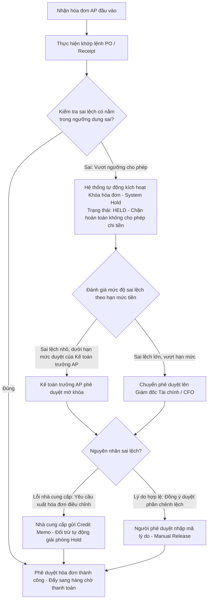

# 7010 Xử lý chênh lệch hóa đơn và Mở khóa thanh toán

Trong quy trình đối soát hóa đơn mua hàng đầu vào, việc phát sinh sai lệch đơn giá hoặc số lượng giữa hóa đơn và đơn đặt hàng PO/phiếu nhận kho là điều không thể tránh khỏi. Hệ thống ERP yêu cầu thiết lập cơ chế kiểm soát sai lệch tự động (Tolerance Limits) để tự động khóa hóa đơn (System Hold) khi vượt ngưỡng cho phép, đồng thời vận hành quy trình phê duyệt mở khóa thanh toán (Invoice Release Workflow) nhằm bảo vệ dòng tiền tối đa và đảm bảo tính minh bạch cho hoạt động kiểm toán.

---

## 1. Bản chất nghiệp vụ & Ba loại sai lệch hóa đơn chính

Khi đối soát hóa đơn, hệ thống ERP sẽ tự động tính toán 3 loại sai lệch cốt lõi sau để quyết định việc khóa/mở khóa chứng từ:

### A. Sai lệch đơn giá (Invoice Price Variance - IPV)
* **Công thức tính:** $IPV = (Đơn\ giá\ hóa\ đơn - Đơn\ giá\ PO) \times Số\ lượng\ hóa\ đơn$.
* **Ý nghĩa:** Phát sinh khi nhà cung cấp xuất hóa đơn với đơn giá cao hơn giá đã chốt trên PO gốc.

### B. Sai lệch số lượng (Quantity Variance - QV)
* **Công thức tính:** $QV = (Số\ lượng\ hóa\ đơn - Số\ lượng\ thực\ nhận\ kho) \times Đơn\ giá\ PO$.
* **Ý nghĩa:** Phát sinh khi nhà cung cấp yêu cầu thanh toán nhiều hơn số lượng thực tế thủ kho đã ký nhận vật lý ngoài kho đệm.

### C. Sai lệch tỷ giá (Exchange Rate Variance - ERV)
* **Ý nghĩa:** Phát sinh đối với các giao dịch mua sắm ngoại tệ (ví dụ: mua bằng USD). Tỷ giá tại ngày làm phiếu nhận kho (Receipt Date) lệch so với tỷ giá tại ngày nhận hóa đơn (AP Invoice Date). Loại sai lệch này thường **không** kích hoạt khóa hóa đơn như IPV/QV, vì bản chất là biến động khách quan ngoài tầm kiểm soát của nhà cung cấp — hệ thống chỉ cần tự động hạch toán phần chênh lệch vào tài khoản lãi/lỗ tỷ giá mà không cần dừng quy trình thanh toán để chờ phê duyệt.

### Nguyên tắc kết hợp nhiều điều kiện dung sai

Khi một hóa đơn đồng thời có nhiều loại sai lệch, hệ thống cần áp dụng nguyên tắc: **chỉ cần một trong các loại sai lệch (giá hoặc lượng) vượt ngưỡng dung sai riêng của nó là đủ để kích hoạt khóa hóa đơn** — không phải chờ tất cả các điều kiện cùng vượt ngưỡng mới khóa. Đây là nguyên tắc "OR", không phải "AND", vì mục tiêu là kiểm soát rủi ro chặt chẽ nhất theo từng loại sai lệch độc lập.

---

## 2. Quy trình kiểm soát khóa (Hold) và phê duyệt mở khóa (Release) hóa đơn

Dưới đây là sơ đồ luồng dữ liệu của cơ chế tự động khóa hóa đơn khi phát hiện sai lệch vượt định mức và luồng phê duyệt xử lý mở khóa:



> **Lưu ý về phân quyền:** Người thực hiện thao tác mở khóa (Release) bắt buộc phải khác với người đã tạo PO gốc hoặc người đã nhập hóa đơn vào hệ thống (nguyên tắc phân tách nhiệm vụ — Segregation of Duties). Nếu hệ thống tự xây cho phép cùng một tài khoản người dùng vừa tạo PO, vừa nhập hóa đơn, vừa tự phê duyệt mở khóa chính hóa đơn đó, đây là lỗ hổng kiểm soát nội bộ nghiêm trọng, tạo điều kiện cho gian lận thông đồng với nhà cung cấp.

### Phân cấp hạn mức phê duyệt mở khóa theo giá trị sai lệch

Hệ thống không nên chỉ có một cấp phê duyệt duy nhất cho mọi mức sai lệch. Cách làm phổ biến trong thực tế là phân theo bậc giá trị, ví dụ:

| Mức chênh lệch | Cấp phê duyệt mở khóa |
|---|---|
| Dưới 5.000.000 VND | Kế toán trưởng AP |
| Từ 5.000.000 đến 50.000.000 VND | Trưởng phòng Mua hàng + Kế toán trưởng AP (đồng phê duyệt) |
| Trên 50.000.000 VND | Giám đốc Tài chính (CFO) |

Việc phân cấp này cần được cấu hình linh hoạt qua bảng tham số, không nên viết cứng (hard-code) trong mã nguồn, vì hạn mức phê duyệt thường xuyên thay đổi theo chính sách tài chính từng thời kỳ của doanh nghiệp.

---

## 3. Điểm giao thoa & Tham chiếu chéo (Cross-linking) sang các phân hệ khác

* **So khớp thông tin gốc:** Toàn bộ thông tin đối chiếu đơn giá và số lượng được tham chiếu trực tiếp từ bài [7000 Đối soát khớp lệnh 3 chiều và 2 chiều (PO Matching)](./7000-nguyen-ly-doi-soat-khop-lenh-3-chieu-va-2-chieu.md).
* **Giải phóng hàng chờ thanh toán:** Hóa đơn sau khi được mở khóa (Release) thành công tại bài viết này mới chính thức được đẩy sang hàng chờ giải ngân tại bài [3020 Nghiệp vụ chi tiền thanh toán và đối trừ hóa đơn nhà cung cấp (Vendor Payment Run)]() bên phân hệ AP.
* **Hạch toán giá vốn:** Phần chênh lệch giá mua (IPV) sau khi được duyệt sẽ được hạch toán và chuyển giao sang phân hệ [Tài chính kế toán (Kế toán Giá thành - COST)]() để điều chỉnh lại giá vốn hàng bán trong kỳ.
* **Phân quyền người dùng:** Cấu hình hạn mức phê duyệt và nguyên tắc phân tách nhiệm vụ nêu tại Mục 2 cần đồng bộ với bài [Thiết lập phân quyền và ma trận phê duyệt (Approval Matrix & User Role Setup)]() thuộc phân hệ Quản trị hệ thống.

---

## 4. Bảng so sánh và Ánh xạ giải pháp giữa các hệ thống

Khi chuyển đổi giữa các hệ thống ERP hoặc tự thiết kế hệ thống (In-house), bạn có thể dễ dàng ánh xạ các tính năng tương đương dựa trên bảng sau:

| Nghiệp vụ thiết kế | Oracle EBS R12.2.10 | Epicor ERP | SAP S/4HANA | Odoo | Hệ thống tự xây (In-house) |
| :--- | :--- | :--- | :--- | :--- | :--- |
| **Cơ chế tự động khóa** | System Hold (Hold codes: `QTY REC`, `PRICE`) | Invoice Tolerance Hold | Blocked for Payment (via Tolerance Keys) | Invoice Lock / Hold state | Trường trạng thái `Hold_Status = True` |
| **Mở khóa phê duyệt** | Enter Manual Release (gán Release code) | Approve Held Invoice in AP Entry | Release Blocked Invoices (MRBR / MR01) | Unlock / Force Approve | Bản ghi ghi nhận người phê duyệt mở khóa |
| **Hạch toán chênh lệch IPV** | IPV Account (cấu hình tại SLA / Purchasing Options) | Invoice Price Variance Account | Price Difference Account (PRD) | Price Difference Account | Hạch toán chênh lệch vào tài khoản chi phí IPV mặc định |
| **Phân cấp hạn mức phê duyệt** | Approval Groups theo AME (Approval Management Engine) | Approval limits theo Role Security | Release Strategy (đa cấp theo giá trị) | Multi-level Approval Rules | Bảng tham số hạn mức phê duyệt theo giá trị và vai trò |

---

## 5. Hướng dẫn luồng thiết lập (Setup Flow) chi tiết trên hệ thống

### A. Trên Oracle EBS R12.2.10 (Holds & Releases)

1. **Thiết lập Ma trận khóa hóa đơn tự động (System Holds):**
    * *Đường dẫn:* `Payables Super User > Setup > Invoice > Hold Codes`
    * *Nghiệp vụ:* Khai báo hoặc kích hoạt các mã khóa mặc định của hệ thống (ví dụ: mã `PRICE` cho sai lệch giá, `QTY REC` cho sai lệch số lượng vượt quá phiếu nhận).
2. **Thiết lập quy tắc dung sai cho phép (Tolerances):**
    * *Nghiệp vụ:* Tại bài [7000 Đối soát khớp lệnh 3 chiều và 2 chiều (PO Matching)](./7000-nguyen-ly-doi-soat-khop-lenh-3-chieu-va-2-chieu.md), gán hạn mức dung sai cho phép. Nếu giá trị vượt quá hạn mức này, hệ thống sẽ tự động gán mã khóa tương ứng ở Bước 1.
3. **Thiết lập phân cấp phê duyệt theo giá trị (AME - Approval Management Engine):**
    * *Đường dẫn:* `Approvals Management Business Analyst > Setup Approval Groups & Rules`
    * *Nghiệp vụ:* Khai báo các nhóm phê duyệt theo hạn mức tiền, đảm bảo hóa đơn sai lệch lớn được tự động định tuyến đến cấp phê duyệt cao hơn.
4. **Vận hành mở khóa thủ công (Manual Release):**
    * *Đường dẫn:* `Payables Super User > Invoices > Entry > Invoices`
    * *Nghiệp vụ:* Kế toán AP mở hóa đơn đang bị khóa (trạng thái `Validation Status = Needs Re-validation`). Click chọn tab `Holds`. Rà soát lý do bị khóa.
    * *Mở khóa:* Nếu được phê duyệt bằng văn bản của cấp quản lý, chọn dòng khóa, nhập mã mở khóa (`Release Code`) và nhập lý do mở khóa tại `Release Reason` để giải phóng chứng từ. Hệ thống tự động chặn không cho người vừa nhập hóa đơn tự thực hiện thao tác này nếu cấu hình phân quyền được thiết lập đúng.

### B. Trên Epicor ERP (AP Invoice Tolerances)

1. **Thiết lập Dung sai hóa đơn phải trả:**
    * *Đường dẫn:* `Financial Management > Accounts Payable > Setup > AP Configuration`
    * *Nghiệp vụ:* Tại tab `Tolerances`, thiết lập phần trăm dung sai lệch giá cho phép (ví dụ: `Price Tolerance % = 2%`).
2. **Khóa hóa đơn tự động khi vượt dung sai:**
    * *Nghiệp vụ:* Trong quá trình làm phiếu khớp hóa đơn (`AP Invoice Entry`), nếu đơn giá nhà cung cấp nhập lớn hơn 2% so với giá PO gốc, Epicor sẽ tự động bật cờ `InvoiceOnHold = True` và gán mã lý do khóa (`HoldReasonCode`).
3. **Cấu hình phân quyền phê duyệt theo Role Security:**
    * *Nghiệp vụ:* Gán quyền `InvoiceOnHold Release` chỉ cho nhóm vai trò Kế toán trưởng/CFO, tách biệt hoàn toàn với nhóm vai trò `AP Invoice Entry Clerk` để đảm bảo người nhập liệu không thể tự mở khóa hóa đơn của chính mình.
4. **Mở khóa thanh toán:**
    * *Nghiệp vụ:* Kế toán AP chuyển hóa đơn sang hàng chờ phê duyệt của Giám đốc tài chính. Người có thẩm quyền đăng nhập hệ thống, bỏ tích chọn ô `InvoiceOnHold` tại màn hình `AP Invoice Entry` để cho phép ghi sổ (Post) hóa đơn vào Sổ cái.

---

## 6. Truy vấn SQL đối soát cấu trúc tổ chức (SQL Database Audit Queries)

### A. Cho Oracle EBS R12.2.10

Query dưới đây truy xuất toàn bộ các hóa đơn AP đầu vào đang bị hệ thống khóa thanh toán (System Hold) do sai lệch giá hoặc số lượng, hiển thị rõ ngày bị khóa và lý do cụ thể để kiểm toán rà soát:

```sql
SELECT 
    hou.name                      AS operating_unit,
    aia.invoice_num               AS invoice_number,
    aia.invoice_date              AS invoice_date,
    aps.segment1                  AS vendor_num,
    aps.vendor_name               AS vendor_name,
    pha.segment1                  AS po_number,
    ah.hold_lookup_code           AS hold_reason_code,
    alc.description               AS hold_description,
    ah.hold_date                  AS hold_date,
    aia.invoice_amount            AS total_invoice_amount
FROM 
    ap_invoices_all aia
INNER JOIN 
    ap_holds_all ah ON aia.invoice_id = ah.invoice_id
INNER JOIN 
    ap_suppliers aps ON aia.vendor_id = aps.vendor_id
INNER JOIN 
    hr_operating_units hou ON aia.org_id = hou.organization_id
LEFT JOIN 
    po_headers_all pha ON aia.po_header_id = pha.po_header_id
LEFT JOIN 
    ap_hold_codes alc ON ah.hold_lookup_code = alc.hold_lookup_code
WHERE 
    ah.release_lookup_code IS NULL -- Chỉ lấy các hóa đơn thực tế đang bị KHÓA (chưa được mở khóa)
ORDER BY 
    ah.hold_date DESC;
```

### B. Cho Epicor ERP (Truy vấn cơ sở dữ liệu SQL Server)

Query dưới đây kết xuất danh sách toàn bộ các hóa đơn AP đang bị khóa thanh toán (`InvoiceOnHold = 1`) trong Epicor kèm mã lý do khóa chi tiết:

```sql
SELECT 
    ah.Company,
    ah.InvoiceNum                 AS AP_Invoice_Number,
    ah.InvoiceDate                AS Invoice_Date,
    v.VendorID                    AS Vendor_Code,
    v.Name                        AS Vendor_Name,
    ah.DocInvoiceAmt              AS Invoice_Amount,
    ah.InvoiceOnHold              AS Is_Held_For_Payment,
    ah.HoldReasonCode             AS Hold_Reason_Code,
    hr.Description                AS Hold_Reason_Description
FROM 
    Erp.APInvHed ah
INNER JOIN 
    Erp.Vendor v ON ah.Company = v.Company AND ah.VendorNum = v.VendorNum
LEFT JOIN 
    Erp.HoldReason hr ON ah.Company = hr.Company AND ah.HoldReasonCode = hr.HoldReasonCode
WHERE 
    ah.Company = 'YOUR_COMPANY_CODE'
    AND ah.InvoiceOnHold = 1 -- Chỉ lọc các hóa đơn đang bị khóa thanh toán
ORDER BY 
    ah.InvoiceDate DESC;
```

---

## 7. Giải pháp khắc phục lỗi phổ biến & Cảnh báo cho Hệ thống tự xây (In-house)

Nếu đội ngũ của bạn đang tự phát triển mô-đun Đối soát hóa đơn, hãy đặc biệt chú ý các điểm thiết kế sau:

1. **Bẫy thiết kế bỏ qua lưu vết nhật ký mở khóa (Audit Trail Failure):**
    * *Triệu chứng:* Khi phát hiện hóa đơn bị lệch giá lớn, lập trình viên cho phép kế toán AP click vào nút "Mở khóa nhanh" (Bypass Hold) và hệ thống chuyển trạng thái hóa đơn sang được duyệt thanh toán ngay lập tức mà không yêu cầu nhập lý do hay lưu lại thông tin ai đã thực hiện hành động này. Đây là kẽ hở lớn cho gian lận tài chính đầu vào.
    * *Giải pháp khắc phục:* Thiết kế bảng lưu vết lịch sử khóa/mở khóa nghiêm ngặt (ví dụ: `Invoice_Holds_Log`). Khi thực hiện mở khóa thủ công, hệ thống bắt buộc phải yêu cầu nhập mã lý do (`Release_Code`) và ghi chú bắt buộc (`Release_Reason`), đồng thời tự động ghi nhận User ID và Timestamp của người thực hiện hành động mở khóa để phục vụ kiểm toán sau này.

2. **Lỗi bỏ qua nguyên tắc phân tách nhiệm vụ (Segregation of Duties Failure):**
    * *Triệu chứng:* Hệ thống tự xây cho phép cùng một tài khoản người dùng thực hiện toàn bộ chuỗi thao tác: tạo PO, nhập hóa đơn, và tự phê duyệt mở khóa hóa đơn của chính mình khi bị Hold. Đây là điều kiện lý tưởng để một nhân viên thông đồng với nhà cung cấp tự tạo PO khống, tự nhập hóa đơn khống rồi tự phê duyệt thanh toán mà không ai kiểm soát chéo.
    * *Giải pháp:* Thiết kế ma trận phân quyền tách biệt rõ ràng ba vai trò: người tạo PO (Buyer), người nhập hóa đơn (AP Clerk), và người phê duyệt mở khóa (Approver) — không cho phép trùng lặp tài khoản giữa ba vai trò trên cùng một chứng từ. Kết hợp với phân cấp hạn mức phê duyệt theo giá trị đã nêu ở Mục 2.

3. **Lỗi "treo" chi phí chênh lệch giá mua ngoài Sổ cái:**
    * *Triệu chứng:* Hóa đơn bị lệch giá 500 USD so với PO và đã được duyệt mở khóa cho thanh toán. Tuy nhiên, hệ thống tự xây không biết xử lý khoản 500 USD này như thế nào nên không hạch toán, dẫn đến việc tổng số tiền thanh toán cho nhà cung cấp bị lệch so với tổng giá trị hạch toán kho đầu vào.
    * *Giải pháp:* Thiết kế tài khoản hạch toán chênh lệch giá mua mặc định (Invoice Price Variance - IPV Account). Toàn bộ phần chênh lệch giá vượt mức sau khi được phê duyệt mở khóa phải được hệ thống tự động hạch toán ghi nhận trực tiếp vào tài khoản IPV (Tài khoản giá vốn hàng bán hoặc chi phí tài chính thích hợp) tại thời điểm duyệt hóa đơn để đảm bảo cân bằng sổ cái tài chính.

4. **Lỗi bỏ sót hóa đơn điều chỉnh từ nhà cung cấp (Credit Memo / Debit Memo):**
    * *Triệu chứng:* Hóa đơn bị khóa do nhà cung cấp xuất sai đơn giá cao hơn. Nhà cung cấp đồng ý xuất lại một hóa đơn giảm tương ứng để bù trừ. Nếu hệ thống tự xây không có tính năng liên kết khớp hóa đơn điều chỉnh này trực tiếp với hóa đơn gốc đang bị khóa, hệ thống sẽ tiếp tục giữ trạng thái khóa hóa đơn gốc vô thời hạn.
    * *Giải pháp:* Thiết kế cơ chế đối chiếu bù trừ hóa đơn AP (Invoice Allocation), phân biệt rõ hai loại chứng từ điều chỉnh: **Credit Memo** do nhà cung cấp phát hành để giảm số tiền phải thu (thường dùng khi nhà cung cấp thừa nhận lỗi giá/lượng), và **Debit Memo** do chính doanh nghiệp mua hàng tự lập để ghi giảm công nợ phải trả đơn phương khi nhà cung cấp chậm phản hồi hoặc không đồng ý xuất Credit Memo. Cả hai loại đều cần được gán trực tiếp vào hóa đơn đang bị khóa để tự động triệt tiêu số tiền chênh lệch sai lệch và tự động giải phóng cờ khóa (Auto-release Hold).

<p align="center" style={{color: 'var(--ifm-color-primary)'}}>
  <strong>Chúc các bạn thành công và vui vẻ!</strong>
</p>