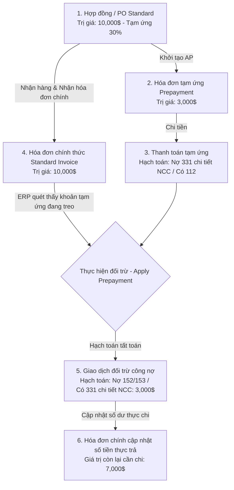

# 7020 Nghiệp vụ thanh toán tạm ứng và đối trừ AP

Trong các giao dịch mua sắm thương mại, đặc biệt là mua sắm tài sản, thiết bị có giá trị lớn hoặc mua từ nhà cung cấp mới, doanh nghiệp thường phải thực hiện thanh toán tạm ứng một phần tiền (ví dụ: tạm ứng 30% giá trị hợp đồng khi ký kết). Trên hệ thống ERP, việc theo dõi các khoản tạm ứng (Prepayment / Down Payment) và tất toán đối trừ công nợ (Clearing / Application) khi hóa đơn chính thức về là nghiệp vụ quan trọng để ngăn ngừa rủi ro thanh toán trùng và đảm bảo ghi nhận chính xác dòng tiền.

---

## 1. Bản chất nghiệp vụ & Thách thức thiết kế hệ thống

### Vấn đề cốt lõi:
Doanh nghiệp ký hợp đồng mua thiết bị trị giá **10,000 USD**.
* **Đợt 1:** Tạm ứng trước **3,000 USD** cho nhà cung cấp (Doanh nghiệp chi tiền mặt/chuyển khoản).
* **Đợt 2:** Nhà cung cấp bàn giao máy và xuất hóa đơn chính thức trị giá **10,000 USD**.

Nếu hệ thống tự xây (In-house) chỉ quản lý hóa đơn độc lập, khi kế toán AP nhận được hóa đơn 10,000 USD, họ sẽ nhập vào hệ thống và ERP sẽ tự động đưa 10,000 USD này vào danh sách hàng chờ thanh toán. Đến kỳ chi tiền, hệ thống tiếp tục chi đủ 10,000 USD.
* *Hậu quả:* Nhà cung cấp nhận tổng cộng **13,000 USD** (Thừa 3,000 USD của doanh nghiệp). Việc đòi lại tiền thừa từ nhà cung cấp ngoài thực tế cực kỳ mất thời gian và rủi ro.

### Giải pháp kiến trúc quản lý Tạm ứng:
Hệ thống ERP tiêu chuẩn giải quyết bài toán này thông qua loại hóa đơn đặc thù gọi là **Hóa đơn tạm ứng (Prepayment Invoice)** kết hợp công cụ **Đối trừ tạm ứng (Prepayment Application)**:

1. **Hạch toán phân tách theo dõi công nợ:** Khi chi tiền tạm ứng, về bản chất kế toán Việt Nam (Thông tư 200), khoản này vẫn hạch toán trên **TK 331 (Phải trả người bán)** — vì TK 331 là tài khoản lưỡng tính, được theo dõi chi tiết theo từng đối tượng nhà cung cấp. Khi doanh nghiệp ứng trước tiền mà chưa nhận hàng/dịch vụ, chi tiết công nợ của nhà cung cấp đó trên TK 331 sẽ có **số dư bên Nợ** (thể hiện khoản đã ứng trước, về bản chất là một khoản phải thu). Hệ thống tự xây cần thiết kế cơ chế theo dõi số dư chi tiết theo từng nhà cung cấp (Subledger by Vendor), không nên mở một tài khoản tổng hợp riêng biệt (kiểu "3312") tách khỏi TK 331, để tránh sai lệch với cách trình bày Bảng cân đối kế toán theo quy định (khoản ứng trước cho người bán được trình bày ở phần Tài sản, lấy từ số dư Nợ chi tiết của TK 331, không phải một tài khoản độc lập).
2. **Chốt chặn đối trừ tự động (Clearing Control):** Khi kế toán AP thực hiện đối soát hóa đơn mua hàng chính thức trị giá 10,000 USD, hệ thống *bắt buộc* phải quét dữ liệu để kiểm tra xem nhà cung cấp này (hoặc số PO này) có khoản tạm ứng nào đang treo chưa tất toán hay không. Nếu có, hệ thống hiển thị cảnh báo nổi bật và bắt buộc kế toán thực hiện thao tác đối trừ (Apply Prepayment) trước khi cho phép giải phóng hóa đơn chính sang hàng chờ chi tiền. Số tiền thực chi cuối cùng sẽ tự động trừ đi phần đã tạm ứng: $10,000 - 3,000 = 7,000\ USD$.

---

## 2. Luồng vận hành đối trừ tạm ứng AP tiêu chuẩn

Sơ đồ dưới đây mô tả chu kỳ từ khi duyệt PO, chi tiền tạm ứng cho đến khi đối trừ tất toán công nợ khi nhận hóa đơn chính thức:



---

## 3. Bảng so sánh và Ánh xạ giải pháp giữa các hệ thống

Khi chuyển đổi giữa các hệ thống ERP hoặc tự thiết kế hệ thống (In-house), bạn có thể dễ dàng ánh xạ các tính năng tương đương dựa trên bảng sau:

| Nghiệp vụ thiết kế | Oracle EBS R12.2.10 | Epicor ERP | SAP S/4HANA | Odoo | Hệ thống tự xây (In-house) |
| :--- | :--- | :--- | :--- | :--- | :--- |
| **Loại hóa đơn tạm ứng** | Prepayment Invoice Type | Prepayment Invoice (PrePayNo = 1) | Down Payment Request (F-47) / Down Payment (F-48) | Register Down Payment / Deposit | Bản ghi hóa đơn gán loại chứng từ `PREPAYMENT` |
| **Thao tác đối trừ** | Apply Prepayment (giảm Amount Remaining) | Apply Prepayment Entry | Clearing Down Payment (F-54) | Add outstanding debits | Giao dịch đối trừ `AP_RECONCILIATION` |
| **Tài khoản hạch toán** | Prepayment Account (trỏ về TK công nợ 331 chi tiết) | Advance/Prepayment GL Account | Down Payment GL Indicator (Special GL) | Advance/Asset Account | Theo dõi số dư Nợ chi tiết theo Vendor trên TK 331 |

---

## 4. Điểm giao thoa & Tham chiếu chéo (Cross-linking) sang các phân hệ khác

* **Tham chiếu đơn hàng gốc:** Hóa đơn tạm ứng và hóa đơn chính thức đều phải liên kết chặt chẽ với đơn PO đã phê duyệt tại [4000 Khởi tạo Đơn mua hàng tiêu chuẩn (Standard PO)]() để kiểm soát tổng giá trị hợp đồng.
* **Đối soát khớp lệnh:** Thao tác đối trừ tạm ứng chỉ được thực hiện sau khi hóa đơn chính thức đã hoàn thành đối soát khớp lệnh 3 chiều thành công tại bài [7000 Đối soát khớp lệnh 3 chiều và 2 chiều (PO Matching)]().
* **Theo dõi chi tiền:** Giao dịch thanh toán tạm ứng đợt 1 và thanh toán phần còn lại đợt 2 được thực hiện chi tiết tại bài [3020 Nghiệp vụ chi tiền thanh toán và đối trừ hóa đơn nhà cung cấp (Vendor Payment Run)]() thuộc phân hệ AP.

---

## 5. Hướng dẫn luồng thiết lập (Setup Flow) chi tiết trên hệ thống

### A. Trên Oracle EBS R12.2.10 (AP Prepayment)

1. **Tạo hóa đơn tạm ứng (Prepayment Invoice):**
    * *Đường dẫn:* `Payables Super User > Invoices > Entry > Invoices`
    * *Nghiệp vụ:* Tạo hóa đơn mới, tại trường `Type` bắt buộc chọn là `Prepayment`. Nhập số tiền tạm ứng (ví dụ: `3,000 USD`) và gán mã PO liên quan. Hệ thống tự động trỏ tài khoản hạch toán về tài khoản công nợ phải trả (chi tiết theo Vendor).
2. **Thanh toán hóa đơn tạm ứng (Pay Prepayment):**
    * *Nghiệp vụ:* Thực hiện thanh toán cho hóa đơn Prepayment này để chuyển trạng thái chứng từ sang `Fully Paid` (Chỉ những khoản tạm ứng đã chi tiền thực tế mới được phép dùng để đối trừ).
3. **Tất toán đối trừ tạm ứng (Apply Prepayment):**
    * *Nghiệp vụ:* Khi nhận hóa đơn chính thức (Standard Invoice) trị giá 10,000 USD, mở hóa đơn chính thức này. Click chọn nút `Actions` -> tích chọn `Apply/Unapply Prepayment`.
    * *Đối trừ:* Hệ thống hiển thị danh sách các khoản tạm ứng đang treo của nhà cung cấp này. Chọn khoản tạm ứng 3,000 USD và nhấn `Apply`. Hệ thống tự động sinh ra một dòng hóa đơn loại `PREPAY` trên hóa đơn chính, tham chiếu ngược lại `invoice_id` của hóa đơn Prepayment gốc. Giá trị còn lại của hóa đơn chính tự động giảm về 7,000 USD.

### B. Trên Epicor ERP (AP Prepayment Billing)

1. **Nhập hóa đơn tạm ứng:**
    * *Đường dẫn:* `Financial Management > Accounts Payable > General Operations > AP Invoice Entry`
    * *Nghiệp vụ:* Tạo nhóm hóa đơn, chọn `New Header`. Tích chọn ô `PrePayNo` để đánh dấu đây là hóa đơn tạm ứng. Nhập số tiền tạm ứng và gán mã tài khoản tạm ứng tại phần GL Account.
2. **Thực hiện đối trừ trên hóa đơn chính thức:**
    * *Nghiệp vụ:* Khi nhập hóa đơn Standard Invoice chính thức, chọn `New Line` -> `Prepayment`. Epicor hiển thị danh sách các hóa đơn tạm ứng chưa đối trừ hết số dư (`DocInvoiceBal > 0`) của Vendor này.
    * *Tất toán:* Nhập số tiền muốn đối trừ và lưu lại. Hệ thống tự động ghi giảm số nợ phải trả của hóa đơn chính và hạch toán bút toán chuyển sổ cái.

---

## 6. Truy vấn SQL đối soát cấu trúc tổ chức (SQL Database Audit Queries)

### A. Cho Oracle EBS R12.2.10

Trong Oracle EBS R12, khi một hóa đơn Prepayment được đối trừ vào hóa đơn Standard, hệ thống sẽ sinh ra một dòng (Line) loại `PREPAY` ngay trên hóa đơn Standard đó, và dòng này lưu lại `invoice_id` của hóa đơn Prepayment gốc tại cột `prepay_invoice_id` trong bảng `ap_invoice_lines_all` (không phải bảng `ap_invoice_relationships` như bản nháp trước — bảng này không tồn tại trong cấu trúc chuẩn của R12).

**Cách 1 — Dùng `ap_invoice_lines_all` (khuyến nghị cho R12):**

```sql
SELECT 
    hou.name                      AS operating_unit,
    prepay.invoice_num            AS prepayment_invoice_num,
    prepay.invoice_amount         AS prepayment_amount,
    -- Tính toán số tiền tạm ứng còn lại chưa tất toán (Unapplied Prepayment Balance)
    (prepay.invoice_amount - NVL(
        (SELECT SUM(ail.amount) 
         FROM ap_invoice_lines_all ail 
         WHERE ail.prepay_invoice_id = prepay.invoice_id
           AND ail.line_type_lookup_code = 'PREPAY'), 0)
    )                             AS unapplied_prepayment_balance,
    prepay.invoice_date           AS prepayment_date,
    aps.segment1                  AS vendor_num,
    aps.vendor_name               AS vendor_name,
    prepay.payment_status_flag    AS paid_status -- 'Y' đại diện cho việc doanh nghiệp đã chi tiền tạm ứng thực tế
FROM 
    ap_invoices_all prepay
INNER JOIN 
    ap_suppliers aps ON prepay.vendor_id = aps.vendor_id
INNER JOIN 
    hr_operating_units hou ON prepay.org_id = hou.organization_id
WHERE 
    prepay.invoice_type_lookup_code = 'PREPAYMENT'
    AND prepay.payment_status_flag = 'Y' -- Chỉ quét các khoản tạm ứng đã hoàn thành thanh toán chi tiền
    AND (prepay.invoice_amount - NVL(
        (SELECT SUM(ail.amount) 
         FROM ap_invoice_lines_all ail 
         WHERE ail.prepay_invoice_id = prepay.invoice_id
           AND ail.line_type_lookup_code = 'PREPAY'), 0)
    ) > 0
ORDER BY 
    prepay.invoice_date DESC;
```

**Cách 2 — Dùng hàm chuẩn `AP_INVOICES_UTILITY_PKG` (gọn và tối ưu hơn):**

Oracle cung cấp sẵn hàm `get_prepay_amount_remaining` trong package chuẩn `AP_INVOICES_UTILITY_PKG` để tính trực tiếp số dư tạm ứng còn lại, không cần tự viết Subquery tính tổng, giúp câu lệnh chạy nhanh hơn:

```sql
SELECT 
    hou.name                      AS operating_unit,
    prepay.invoice_num            AS prepayment_invoice_num,
    prepay.invoice_amount         AS prepayment_amount,
    AP_INVOICES_UTILITY_PKG.get_prepay_amount_remaining(prepay.invoice_id) AS unapplied_prepayment_balance,
    prepay.invoice_date           AS prepayment_date,
    aps.segment1                  AS vendor_num,
    aps.vendor_name               AS vendor_name,
    prepay.payment_status_flag    AS paid_status
FROM 
    ap_invoices_all prepay
INNER JOIN 
    ap_suppliers aps ON prepay.vendor_id = aps.vendor_id
INNER JOIN 
    hr_operating_units hou ON prepay.org_id = hou.organization_id
WHERE 
    prepay.invoice_type_lookup_code = 'PREPAYMENT'
    AND prepay.payment_status_flag = 'Y'
    AND AP_INVOICES_UTILITY_PKG.get_prepay_amount_remaining(prepay.invoice_id) > 0
ORDER BY 
    prepay.invoice_date DESC;
```

> **Lưu ý:** Nếu cần bổ sung chi tiết số tiền đã đối trừ thực tế và thông tin hóa đơn Standard được đối trừ tương ứng, có thể mở rộng truy vấn với bảng lịch sử `ap_prepay_history_all`.

### B. Cho Epicor ERP (Truy vấn cơ sở dữ liệu SQL Server)

Query dưới đây kết xuất danh mục các hóa đơn tạm ứng đang hoạt động trong Epicor và số dư tạm ứng còn lại chưa được đối trừ hết đối với từng nhà cung cấp:

```sql
SELECT 
    ah.Company,
    ah.InvoiceNum                 AS Prepayment_Invoice_Num,
    ah.InvoiceDate                AS Prepayment_Date,
    v.VendorID                    AS Vendor_Code,
    v.Name                        AS Vendor_Name,
    ah.DocInvoiceAmt              AS Prepayment_Amount,
    ah.DocInvoiceBal              AS Unapplied_Prepayment_Balance, -- Số dư tạm ứng còn lại chưa đối trừ
    ah.PrePayNo                   AS Is_Prepayment
FROM 
    Erp.APInvHed ah
INNER JOIN 
    Erp.Vendor v ON ah.Company = v.Company AND ah.VendorNum = v.VendorNum
WHERE 
    ah.Company = 'YOUR_COMPANY_CODE'
    AND ah.PrePayNo = 1 -- Chỉ lọc hóa đơn loại tạm ứng
    AND ah.DocInvoiceBal > 0 -- Lọc các khoản chưa được đối trừ hết số dư
ORDER BY 
    ah.InvoiceDate DESC;
```

---

## 7. Giải pháp khắc phục lỗi phổ biến & Cảnh báo cho Hệ thống tự xây (In-house)

Nếu đội ngũ của bạn đang tự phát triển mô-đun Hóa đơn và Thanh toán phải trả, hãy đặc biệt chú ý các điểm thiết kế sau:

1. **Bẫy lỗi bỏ quên đối trừ tạm ứng dẫn đến chi thừa tiền (Double-Payment Pitfall):**
    * *Triệu chứng:* Do hệ thống tự xây không có cơ chế cảnh báo tự động, khi kế toán AP nhận hóa đơn chính 10,000 USD, họ lập tức phê duyệt và chuyển sang hàng chờ thanh toán. Hệ thống tự động chi đủ 10,000 USD mà không trừ đi 3,000 USD đã tạm ứng từ trước.
    * *Giải pháp khắc phục:* Khi kế toán AP mở một hóa đơn Standard Invoice mới, hệ thống bắt buộc phải chạy một hàm kiểm tra tự động (Validation Check) để quét trong bảng hóa đơn xem đối tác này có khoản hóa đơn loại `PREPAYMENT` nào có số dư chưa đối trừ lớn hơn 0 hay không. Nếu có, hệ thống bắt buộc phải hiển thị cảnh báo nổi bật màu đỏ trên giao diện và chặn không cho phép phê duyệt hóa đơn chính sang hàng chờ chi tiền cho đến khi kế toán thực hiện thao tác đối trừ hoặc xác nhận bỏ qua bằng văn bản phê duyệt của Giám đốc tài chính.
2. **Lỗi cho phép tất toán các khoản tạm ứng "ảo" chưa chi tiền:**
    * *Triệu chứng:* Kế toán AP làm hóa đơn tạm ứng 3,000 USD nhưng thủ quỹ chưa thực hiện chi tiền thực tế (hóa đơn Prepayment vẫn ở trạng thái chưa thanh toán). Tuy nhiên, hệ thống vẫn cho phép lấy khoản 3,000 USD này đi đối trừ với hóa đơn chính thức 10,000 USD và hạch toán giảm nợ phải trả. Điều này gây lỗi sai lệch nghiêm trọng số dư sổ cái và dòng tiền của doanh nghiệp.
    * *Giải pháp:* Khóa cứng logic đối trừ. Chỉ cho phép thực hiện thao tác đối trừ đối với các hóa đơn tạm ứng đã có trạng thái thanh toán hoàn thành thực tế (`Payment_Status = 'Fully Paid'`).
3. **Lỗi không tách bạch được khoản ứng trước với công nợ phải trả thông thường trên báo cáo:**
    * *Triệu chứng:* Khoản tạm ứng 3,000 USD được hạch toán chung một chiều với công nợ phải trả thông thường mà không có cơ chế theo dõi số dư chi tiết theo từng chứng từ/Vendor. Cuối kỳ, báo cáo tài chính không thể tách bạch được số tiền thực tế đang nợ nhà cung cấp (số dư Có 331) với số tiền doanh nghiệp đang ứng trước cho các đối tác trên hợp đồng (số dư Nợ 331).
    * *Giải pháp:* Thiết kế cơ chế theo dõi số dư công nợ chi tiết theo từng nhà cung cấp và từng chứng từ (Subledger Detail by Vendor/Document), cho phép hệ thống tự động phân loại số dư Nợ (khoản ứng trước, trình bày bên Tài sản) và số dư Có (khoản phải trả, trình bày bên Nguồn vốn) khi lên Bảng cân đối kế toán, thay vì gộp chung một tài khoản duy nhất không phân tách.

<p align="center" style={{color: 'var(--ifm-color-primary)'}}>
  <strong>Chúc các bạn thành công và vui vẻ!</strong>
</p>