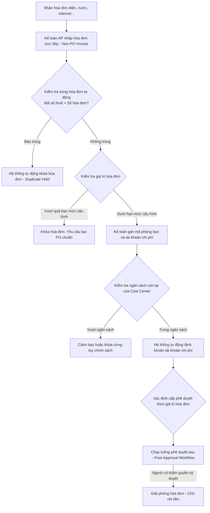

# 7040 Hóa đơn không qua đơn đặt hàng (Non-PO Invoice)

Trong hoạt động vận hành của doanh nghiệp, có một nhóm chi phí gián tiếp (Indirect Spending) hoặc chi phí hành chính, dịch vụ cố định (như tiền điện, tiền nước, cước internet, tiền thuê văn phòng, phí kiểm toán) thường được nhà cung cấp gửi hóa đơn trực tiếp mà không cần đi qua quy trình tạo đơn đặt hàng PO trước đó. Nghiệp vụ xử lý hóa đơn không qua PO (Non-PO Invoice / Miscellaneous Invoice Processing) giúp phòng kế toán AP định khoản trực tiếp chi phí lên Sổ cái (GL) một cách nhanh chóng, đồng thời vẫn đảm bảo các chốt chặn phê duyệt và kiểm soát ngân sách nghiêm ngặt.

---

## 1. Bản chất nghiệp vụ & Thách thức thiết kế hệ thống

### Vấn đề cốt lõi:
Do quy trình Non-PO Invoice không có đơn PO và phiếu nhận kho (Receipt) để đối soát tự động ở phía trước, bộ phận mua hàng hoàn toàn bị bỏ qua. Điều này mở ra ba rủi ro kiểm soát nội bộ nghiêm trọng:
1. **Lách luật mua sắm (Procurement Bypass):** Các phòng ban tự ý mua sắm thiết bị, tài sản có giá trị lớn bằng cách yêu cầu nhà cung cấp xuất hóa đơn thẳng để né tránh luồng phê duyệt và kiểm soát ngân sách mua sắm tập trung của SCM.
2. **Rủi ro hạch toán nhầm tài khoản chi phí:** Nhân viên AP phải tự tay chọn tài khoản kế toán Sổ cái (GL Account) và Trung tâm chi phí (Cost Center) để gánh chi phí. Việc chọn thủ công này cực kỳ dễ xảy ra sai sót, làm méo mó báo cáo kết quả hoạt động kinh doanh (P&L) của các phòng ban.
3. **Rủi ro vượt ngân sách phòng ban không kiểm soát được:** Vì không đi qua PR/PO (nơi ngân sách thường được kiểm tra và giữ chỗ — Encumbrance — ngay từ lúc lập đề nghị mua hàng), hóa đơn Non-PO có thể được hạch toán thẳng vào chi phí của một phòng ban đã tiêu hết ngân sách quý mà không ai phát hiện cho đến khi lên báo cáo cuối kỳ.

### Giải pháp kiến trúc ERP tiêu chuẩn:
Để giải quyết các rủi ro trên, hệ thống ERP thiết lập các chốt chặn kỹ thuật:
* **Trần hạn mức (Ceiling Limit) — cấu hình được, không hard-code:** Giới hạn giá trị tối đa của một hóa đơn Non-PO (ví dụ: tối đa 500 USD). Mọi giao dịch mua sắm có giá trị lớn hơn trần này bắt buộc hệ thống phải khóa lại, yêu cầu quay lại tạo PR/PO tiêu chuẩn. Hạn mức này cần lưu trong bảng tham số cấu hình theo công ty/loại chi phí, không viết cứng trong mã nguồn, vì chính sách tài chính thường thay đổi theo từng thời kỳ.
* **Kiểm tra ngân sách phòng ban (Budgetary Control Check):** Trước khi cho phép hạch toán, hệ thống nên đối chiếu số tiền hóa đơn với ngân sách còn lại của Trung tâm chi phí và tài khoản chi phí tương ứng trong kỳ ngân sách hiện hành. Nếu vượt ngân sách đã duyệt, hệ thống cảnh báo (Soft Warning) hoặc khóa cứng (Hard Stop) tùy theo chính sách kiểm soát ngân sách của doanh nghiệp.
* **Luồng phê duyệt sau phân cấp theo giá trị (Post-Facto Approval theo hạn mức):** Hóa đơn Non-PO sau khi nhập liệu bắt buộc phải tự động chuyển tiếp chạy luồng phê duyệt của Trưởng bộ phận sở hữu Trung tâm chi phí (Cost Center) được gán trên dòng hóa đơn. Tương tự nguyên tắc phân cấp phê duyệt theo giá trị sai lệch đã trình bày, hóa đơn giá trị càng lớn thì càng cần cấp phê duyệt cao hơn (Trưởng phòng → Giám đốc khối → CFO).

---

## 2. Quy trình kiểm soát hóa đơn không qua PO tự động

Sơ đồ dưới đây mô tả cách hệ thống ERP tiếp nhận hóa đơn Non-PO, thực hiện kiểm tra trùng lặp tự động, kiểm tra ngân sách và định tuyến phê duyệt dựa trên mã phòng ban gánh chi phí:



---

## 3. Điểm giao thoa & Tham chiếu chéo (Cross-linking) sang các phân hệ khác

* **Không đi qua kho bãi:** Hóa đơn Non-PO hạch toán thẳng vào tài khoản chi phí vận hành trong kỳ, hoàn toàn không tạo bất kỳ giao dịch nhận hàng hay tăng số lượng tồn kho nào tại phân hệ [Tồn kho - INV]().
* **Tham chiếu danh mục nhà cung cấp:** Hóa đơn Non-PO vẫn bắt buộc phải liên kết trực tiếp với mã nhà cung cấp đã được phê duyệt tại [2000 Quản lý hồ sơ nhà cung cấp (Supplier Master)]() để đảm bảo tính pháp lý.
* **Tham chiếu danh mục mua sắm tự phục vụ:** Đối với các chi tiêu văn phòng phẩm lẻ tẻ, khuyến khích chuyển đổi sang luồng [3030 Mua sắm tự phục vụ và e-Catalog (Punch-out)]() để hệ thống tự động hóa khâu tạo PO mà không cần dùng hóa đơn trực tiếp Non-PO.
* **Kiểm soát ngân sách:** Cơ chế kiểm tra ngân sách còn lại theo Cost Center nêu tại Mục 1 cần đồng bộ với bài [Thiết lập và kiểm soát ngân sách chi phí theo phòng ban (Budgetary Control Setup)]() thuộc phân hệ Tài chính - Kế hoạch.
* **Phân cấp phê duyệt:** Ma trận hạn mức phê duyệt theo giá trị nêu tại Mục 1 cần đồng bộ với bài [Thiết lập phân quyền và ma trận phê duyệt (Approval Matrix & User Role Setup)]() thuộc phân hệ Quản trị hệ thống.

---

## 4. Bảng so sánh và Ánh xạ giải pháp giữa các hệ thống

Khi chuyển đổi giữa các hệ thống ERP hoặc tự thiết kế hệ thống (In-house), bạn có thể dễ dàng ánh xạ các tính năng tương đương dựa trên bảng sau:

| Nghiệp vụ thiết kế | Oracle EBS R12.2.10 | Epicor ERP | SAP S/4HANA | Odoo | Hệ thống tự xây (In-house) |
| :--- | :--- | :--- | :--- | :--- | :--- |
| **Bản chất hạch toán** | AP Standard Invoice (no PO linked) | Miscellaneous AP Invoice | FI Direct Invoice (FB60 / FB01) | Vendor Bill (direct account lines) | Phiếu nhập hóa đơn gán loại `NON_PO` |
| **Kiểm tra ngân sách** | Budgetary Control (Encumbrance Accounting) | Budget Check tại GL Account | Availability Control (BCS) | Analytic Budget Check | Bảng ngân sách theo Cost Center + kỳ đối chiếu trước khi Post |
| **Phê duyệt sau** | Invoice Approval Workflow / AME | AP Invoice Approval Group | FI Invoice Workflow Approval | Vendor Bill Approval Workflow | Luồng duyệt động phân cấp theo giá trị và mã tài khoản chi phí |
| **Kiểm tra trùng** | Chặn trùng lặp tại cấp độ Supplier + Invoice Num | Invoice Duplicate Check | Double Invoice Verification (Check Box) | Duplicate Vendor Bill Reference Check | Unique Constraint (Vendor_ID, Invoice_Num, Tax_ID) |
| **Hóa đơn định kỳ** | Recurring Invoice Template | Recurring AP Invoice Template | FI Recurring Entry Document | Recurring Vendor Bill | Bảng mẫu hóa đơn định kỳ tự sinh chứng từ theo chu kỳ |

---

## 5. Hướng dẫn luồng thiết lập (Setup Flow) chi tiết trên hệ thống

### A. Trên Oracle EBS R12.2.10 (Non-PO Standard Invoice)

1. **Nhập liệu đầu mục hóa đơn (Invoice Header):**
    * *Đường dẫn:* `Payables Super User > Invoices > Entry > Invoices`
    * *Nghiệp vụ:* Tạo hóa đơn mới. Tại ô `Type`, chọn `Standard`. Nhập số tiền tổng, nhập số hóa đơn của nhà cung cấp (`Invoice Num`). Để trống hoàn toàn ô `PO Number`.
2. **Định khoản trực tiếp lên dòng hóa đơn (Distributions):**
    * *Nghiệp vụ:* Chuyển sang phần `Lines` hoặc click nút `Distributions`. Nhập số tiền chi tiết cho từng dòng.
    * *Định khoản:* Tại ô `GL Account`, kế toán AP tự chọn tài khoản chi phí Sổ cái mặc định và nhập đúng mã phân đoạn Trung tâm chi phí (Cost Center) gánh chi phí (ví dụ: Phòng nhân sự `642.101`).
3. **Kiểm tra ngân sách trước khi duyệt (Budgetary Control):**
    * *Nghiệp vụ:* Nếu tổ chức có bật `Budgetary Control` tại `Financials Options`, hệ thống tự động chạy kiểm tra `Funds Check` khi kế toán lưu hóa đơn. Nếu vượt ngân sách đã cấu hình, hệ thống trả về cảnh báo `Funds Check Failure` và có thể khóa hóa đơn tùy theo mức `Absolute`/`Advisory` đã thiết lập.
4. **Kích hoạt luồng phê duyệt sau (Invoice Approval):**
    * *Nghiệp vụ:* Click chọn nút `Actions` -> tích chọn `Approval`. Hệ thống tự động kích hoạt công cụ AME để gửi yêu cầu duyệt đến Trưởng bộ phận sở hữu Cost Center vừa gán ở Bước 2, định tuyến cấp phê duyệt cao hơn nếu giá trị hóa đơn vượt hạn mức đã cấu hình trong nhóm phê duyệt.

### B. Trên Epicor ERP (Miscellaneous AP Invoice)

1. **Khởi tạo Miscellaneous Invoice:**
    * *Đường dẫn:* `Financial Management > Accounts Payable > General Operations > AP Invoice Entry`
    * *Nghiệp vụ:* Tạo nhóm hóa đơn, chọn `New Miscellaneous Invoice` (đây là loại hóa đơn mua chi phí trực tiếp, không qua PO).
2. **Nhập thông tin dòng hóa đơn và gán tài khoản GL:**
    * *Nghiệp vụ:* Chọn `New Line`. Nhập mô tả dịch vụ chi tiết tại `Line Desc`.
    * *Định khoản:* Nhập số tiền và gán mã tài khoản chi phí Sổ cái trực tiếp tại ô `ExpGLAcct`.
3. **Thiết lập hóa đơn định kỳ (Recurring Invoice) cho chi phí cố định:**
    * *Nghiệp vụ:* Với các chi phí lặp lại đều đặn hàng tháng (tiền thuê văn phòng, phí bảo trì phần mềm), thiết lập `Recurring AP Invoice Template` tại `AP Invoice Entry > Recurring` để hệ thống tự động sinh hóa đơn nháp theo chu kỳ đã cấu hình, giảm thao tác nhập tay lặp lại và giảm rủi ro bỏ sót hoặc nhập trùng.
4. **Ghi sổ hóa đơn (Post Group):**
    * *Nghiệp vụ:* Sau khi hoàn thành luồng kiểm duyệt nội bộ, kế toán thực hiện thao tác `Post` để Epicor kết chuyển thẳng giá trị hóa đơn này ghi nhận Nợ tài khoản chi phí / Có tài khoản phải trả nhà cung cấp trên Sổ cái.

---

## 6. Truy vấn SQL đối soát cấu trúc tổ chức (SQL Database Audit Queries)

### A. Cho Oracle EBS R12.2.10

Query dưới đây truy xuất toàn bộ các hóa đơn AP đầu vào không qua PO (Non-PO Invoices) đã hạch toán trong kỳ, hiển thị chi tiết tài khoản chi phí và Trung tâm chi phí gán kèm để phục vụ công tác kiểm toán nội bộ:

```sql
SELECT 
    hou.name                      AS operating_unit,
    aia.invoice_num               AS invoice_number,
    aia.invoice_date              AS invoice_date,
    aps.segment1                  AS vendor_num,
    aps.vendor_name               AS vendor_name,
    aia.invoice_amount            AS total_invoice_amount,
    ail.line_number               AS invoice_line_num,
    ail.amount                    AS line_amount,
    ail.item_description          AS expense_description,
    -- Kết xuất chuỗi tài khoản định khoản chi phí Sổ cái
    gcc.segment1 || '.' || gcc.segment2 || '.' || gcc.segment3 AS distributed_gl_account
FROM 
    ap_invoices_all aia
INNER JOIN 
    ap_invoice_lines_all ail ON aia.invoice_id = ail.invoice_id
INNER JOIN 
    ap_suppliers aps ON aia.vendor_id = aps.vendor_id
INNER JOIN 
    hr_operating_units hou ON aia.org_id = hou.organization_id
INNER JOIN 
    gl_code_combinations gcc ON ail.default_dist_ccid = gcc.code_combination_id
WHERE 
    aia.po_header_id IS NULL -- Điều kiện lọc: Hoàn toàn không có liên kết PO (Non-PO Invoice)
    AND ail.line_type_lookup_code = 'ITEM'
ORDER BY 
    aia.invoice_date DESC, aia.invoice_num;
```

### B. Cho Epicor ERP (Truy vấn cơ sở dữ liệu SQL Server)

Query dưới đây kết xuất danh sách toàn bộ các hóa đơn AP loại chi phí trực tiếp (Miscellaneous Invoices) trong Epicor kèm tài khoản GL hạch toán tương ứng để đối soát chéo:

```sql
SELECT 
    ad.Company,
    ad.InvoiceNum                 AS AP_Invoice_Number,
    ah.InvoiceDate                AS Invoice_Date,
    v.VendorID                    AS Vendor_Code,
    v.Name                        AS Vendor_Name,
    ad.InvoiceLine                AS Line_Num,
    ad.LineDesc                   AS Expense_Description,
    ad.DocScrUnitCost             AS Line_Amount,
    ad.ExpGLAcct                  AS Target_GL_Account
FROM 
    Erp.APInvDtl ad
INNER JOIN 
    Erp.APInvHed ah ON ad.Company = ah.Company AND ad.VendorNum = ah.VendorNum AND ad.InvoiceNum = ah.InvoiceNum
INNER JOIN 
    Erp.Vendor v ON ad.Company = v.Company AND ad.VendorNum = v.VendorNum
WHERE 
    ad.Company = 'YOUR_COMPANY_CODE'
    AND ad.PONum = 0 -- Điều kiện lọc: Không có số PO liên kết (Miscellaneous Invoice)
ORDER BY 
    ah.InvoiceDate DESC, ad.InvoiceNum;
```

---

## 7. Giải pháp khắc phục lỗi phổ biến & Cảnh báo cho Hệ thống tự xây (In-house)

Nếu đội ngũ của bạn đang tự phát triển mô-đun Hóa đơn phải trả, hãy đặc biệt chú ý các điểm thiết kế sau:

1. **Bẫy lỗi thanh toán trùng do thiếu ràng buộc duy nhất (Duplicate Payment Pitfall):**
    * *Triệu chứng:* Do không có PO làm chốt chặn, kế toán AP có thể vô tình nhập một hóa đơn tiền điện của tháng 12 làm hai lần trên hệ thống (một lần vào tuần thứ nhất, một lần vào tuần thứ tư). Nếu hệ thống tự xây không có cơ chế chặn trùng lặp, doanh nghiệp sẽ bị thanh toán trùng hai lần tiền cho cùng một dịch vụ.
    * *Giải pháp khắc phục:* Thiết lập ràng buộc duy nhất kết hợp (Unique Constraint) trong cơ sở dữ liệu trên bảng đầu mục hóa đơn `AP_Invoices` đối với bộ ba trường: **Mã nhà cung cấp (Vendor_ID) + Số hóa đơn nhà cung cấp (Invoice_Num) + Mã số thuế (Tax_ID)**. Khi kế toán nhập hóa đơn mới, nếu phát hiện bộ ba thông tin này đã tồn tại, hệ thống bắt buộc phải khóa giao dịch và cảnh báo lỗi trùng lặp lập tức.

2. **Lỗi trốn tránh quy trình phê duyệt mua sắm của SCM:**
    * *Triệu chứng:* Trưởng phòng ban tự ý ký hợp đồng mua một thiết bị máy tính trị giá 5,000 USD ngoài luồng mà không thông báo cho bộ phận mua sắm SCM. Khi máy tính được giao đến kèm hóa đơn, họ yêu cầu kế toán nhập dưới dạng hóa đơn Non-PO để lách qua luồng duyệt mua hàng chuẩn.
    * *Giải pháp:* Thiết lập trần hạn mức tự động khóa tại cơ sở dữ liệu, cấu hình được theo tham số (không hard-code). Mọi hóa đơn loại `NON_PO` khi nhập liệu có tổng giá trị vượt quá hạn mức quy định, hệ thống bắt buộc phải tự động khóa thanh toán (System Hold), yêu cầu người dùng phải làm tờ trình giải trình hoặc chuyển đổi chứng từ sang luồng PO chuẩn trước khi cho phép giải ngân tiền.

3. **Lỗi gán sai mã tài khoản Sổ cái chi phí (GL Account Mistake):**
    * *Triệu chứng:* Nhân viên AP nhập hóa đơn tiền nước văn phòng nhưng gán nhầm sang tài khoản chi phí tiếp khách (Tài khoản 6428) hoặc tài khoản nguyên vật liệu trực tiếp (Tài khoản 621), làm méo mó nghiêm trọng báo cáo tài chính của doanh nghiệp.
    * *Giải pháp:* Hạn chế tối đa việc nhân viên AP tự gõ tài khoản bằng tay một cách tự do. Thiết kế bảng ánh xạ danh mục dịch vụ chi phí mặc định (Expense Mapping Templates). Ví dụ: Khi chọn loại dịch vụ là "Tiền điện nước", hệ thống tự động gán tài khoản mặc định và chỉ cho phép nhân viên AP thay đổi mã phân đoạn phòng ban (Cost Center) gánh chi phí.

4. **Lỗi bỏ qua kiểm soát ngân sách phòng ban (Budget Bypass Pitfall):**
    * *Triệu chứng:* Phòng Marketing đã tiêu hết 100% ngân sách chi phí quảng cáo của quý nhưng vẫn tiếp tục nhận và hạch toán thêm các hóa đơn dịch vụ mới thông qua luồng Non-PO, vì hệ thống không có bước kiểm tra ngân sách trước khi hạch toán. Đến cuối quý, phòng kế toán mới phát hiện tổng chi phí đã vượt xa ngân sách được duyệt.
    * *Giải pháp:* Tích hợp bước kiểm tra ngân sách còn lại (Available Budget = Ngân sách đã duyệt − Đã hạch toán − Đã cam kết PO khác) ngay tại thời điểm nhập hoặc phê duyệt hóa đơn Non-PO, không chờ đến báo cáo cuối kỳ mới phát hiện. Doanh nghiệp có thể chọn chế độ cảnh báo mềm (cho phép vượt nhưng cảnh báo) hoặc khóa cứng (không cho hạch toán nếu vượt ngân sách) tùy theo mức độ kiểm soát mong muốn.

5. **Lỗi phân tách nhiệm vụ khi người nhập hóa đơn đồng thời là người phê duyệt:**
    * *Triệu chứng:* Nhân viên phòng ban tự nhập hóa đơn Non-PO của chính phòng mình vào hệ thống, sau đó dùng luôn tài khoản có quyền Trưởng phòng để tự phê duyệt hóa đơn đó, bỏ qua hoàn toàn sự kiểm soát chéo.
    * *Giải pháp:* Áp dụng nguyên tắc phân tách nhiệm vụ (Segregation of Duties) tương tự đã trình bày ở nghiệp vụ xử lý chênh lệch hóa đơn: người nhập liệu hóa đơn và người phê duyệt hóa đơn (dựa trên Cost Center Owner) không được phép là cùng một tài khoản người dùng trên cùng một chứng từ.

<p align="center" style={{color: 'var(--ifm-color-primary)'}}>
  <strong>Chúc các bạn thành công và vui vẻ!</strong>
</p>