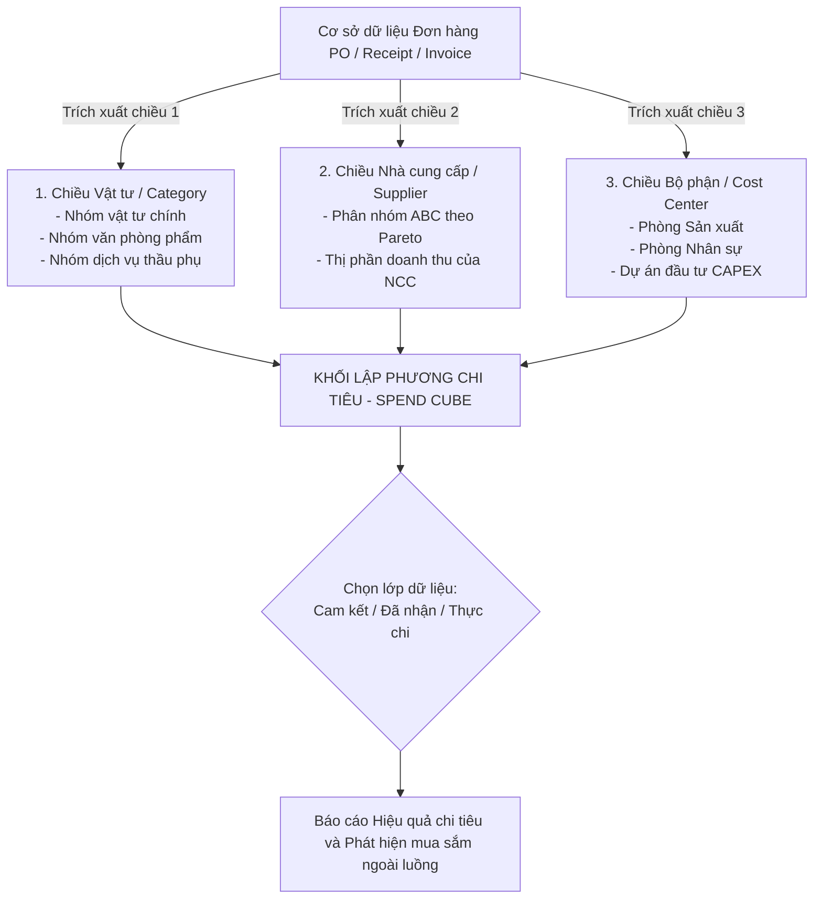

# 8000 Phân tích chi phí mua hàng (Spend Analysis)

Phân tích chi phí mua sắm và hiệu quả chi tiêu (Procurement Spend Analysis) là công cụ báo cáo quản trị tối cao của bộ phận mua sắm chiến lược. Việc xây dựng một mô hình Spend Analysis bài bản giúp doanh nghiệp định vị chính xác dòng tiền chi ra đang chảy đi đâu, nhóm hàng nào chiếm tỷ trọng lớn nhất, nhà cung cấp nào đang nắm giữ thị phần doanh thu cao, và phát hiện các khoản mua sắm ngoài luồng (Maverick Spend) gây lãng phí ngân sách.

---

## 1. Bản chất nghiệp vụ & Mô hình Khối lập phương chi phí (Spend Cube)

### Vấn đề cốt lõi:
Để xây dựng một báo cáo phân tích chi phí hiệu quả, hệ thống ERP không thể chỉ tổng hợp số liệu thô. Doanh nghiệp cần phải phân tích dữ liệu mua sắm theo mô hình **Khối lập phương chi phí (Spend Cube)** — tức là mổ xẻ dữ liệu đồng thời qua 3 chiều (dimensions) độc lập:
1. **Mua cái gì? (What - Category/Item):** Chi phí phân bổ cho các nhóm vật tư nào (Nguyên liệu chính, bao bì, dịch vụ, thiết bị)?
2. **Mua từ ai? (Who - Supplier):** Nhà cung cấp nào đang chiếm thị phần doanh thu lớn nhất? Doanh nghiệp có thể gom cầu để đàm phán giảm giá không?
3. **Mua cho ai? (Where - Department/Cost Center):** Phòng ban hoặc nhà máy nào phát sinh chi phí này để đối chiếu với hạn mức ngân sách được duyệt?

### Phân biệt Chi tiêu Cam kết (Committed Spend) và Chi tiêu Thực chi (Realized Spend):

Một sai lầm phổ biến khi xây dựng Spend Cube là chỉ dựa vào giá trị PO đã duyệt để coi đó là "chi phí thực tế". Về bản chất, có ba mức độ chi tiêu khác nhau cần phân biệt rõ trong báo cáo:

* **Chi tiêu cam kết (Committed/Encumbered Spend):** Giá trị các PO đã phê duyệt nhưng chưa nhận hàng/nhận dịch vụ — đây là khoản doanh nghiệp *sẽ* phải chi, dùng để kiểm soát ngân sách còn lại (Available Budget), không phải chi phí đã phát sinh.
* **Chi tiêu đã nhận (Received/Accrued Spend):** Giá trị hàng đã nhận kho (GRN) nhưng hóa đơn có thể chưa về — phản ánh chi phí đã phát sinh trên phương diện kế toán dồn tích (accrual).
* **Chi tiêu thực chi (Realized/Invoiced Spend):** Giá trị hóa đơn đã đối soát và chấp nhận thanh toán — đây mới là con số chuẩn xác nhất để đánh giá hiệu quả đàm phán giá và so sánh với ngân sách đã dùng thực tế.

Báo cáo Spend Cube nên cho phép người dùng chuyển đổi qua lại giữa ba lớp dữ liệu này (thường gọi là "Spend Type Toggle"), thay vì chỉ hiển thị duy nhất một con số dựa trên PO như nhiều hệ thống tự xây thường mắc phải.

### Phân nhóm nhà cung cấp theo nguyên tắc Pareto (ABC Vendor Classification):

Chiều "Mua từ ai" trong Spend Cube nên áp dụng nguyên tắc phân loại 80/20:
* **Nhóm A:** Nhóm nhỏ nhà cung cấp (thường 10-20% tổng số NCC) chiếm khoảng 70-80% tổng giá trị chi tiêu — đây là nhóm cần quản lý quan hệ chiến lược (Strategic Sourcing), đàm phán hợp đồng khung dài hạn.
* **Nhóm B:** Nhóm chiếm khoảng 15-25% giá trị chi tiêu còn lại — quản lý theo hợp đồng thông thường.
* **Nhóm C:** Số lượng lớn nhà cung cấp còn lại chỉ chiếm 5-10% giá trị chi tiêu — thường là các giao dịch lẻ, chi phí hành chính, phù hợp để gộp nhóm hoặc chuyển sang catalog mua sắm tự động hóa (Punch-out) nhằm giảm tải công sức xử lý hành chính không tương xứng với giá trị giao dịch.

---

## 2. Sơ đồ cấu trúc Khối lập phương chi phí (Spend Cube Dimensions)

Dưới đây là sơ đồ trực quan hóa mô hình Spend Cube kết hợp 3 chiều dữ liệu để tạo ra các báo cáo phân tích chi tiêu đa góc nhìn cho doanh nghiệp:



---

## 3. Điểm giao thoa & Tham chiếu chéo (Cross-linking) sang các phân hệ khác

* **Chuẩn hóa nhóm mua sắm:** Toàn bộ dữ liệu phân tích chi phí theo nhóm mặt hàng được lấy trực tiếp từ thuộc tính phân loại tại [7020 Nhóm hàng hoá / danh mục vật tư (Item Category)](../inv-ton-kho/7020-nhom-hang-hoa-danh-muc-vat-tu-item-category.md) thuộc phân hệ Tồn kho.
* **Phân tích dựa trên đơn hàng thực tế:** Nguồn dữ liệu đầu vào của lớp chi tiêu cam kết được quét trực tiếp từ các đơn mua hàng Standard PO đã được phê duyệt thành công tại bài [4000 Khởi tạo Đơn mua hàng tiêu chuẩn (Standard PO)](./4000-khoi-tao-va-cau-hinh-don-mua-hang-tieu-chuan.md).
* **Nguồn dữ liệu chi tiêu thực chi:** Lớp chi tiêu thực chi (Realized Spend) được lấy từ dữ liệu hóa đơn đã đối soát khớp lệnh thành công tại bài [7000 Đối soát khớp lệnh 3 chiều và 2 chiều (PO Matching)](./7000-nguyen-ly-doi-soat-khop-lenh-3-chieu-va-2-chieu.md).
* **Đối chiếu ngân sách tài chính:** Báo cáo chi tiêu theo bộ phận được đối chiếu trực tiếp với hạn mức ngân sách phòng ban đã thiết lập tại phân hệ [Sổ cái - GL]().

---

## 4. Bảng so sánh và Ánh xạ giải pháp giữa các hệ thống

Khi chuyển đổi giữa các hệ thống ERP hoặc tự thiết kế hệ thống (In-house), bạn có thể dễ dàng ánh xạ các tính năng tương đương dựa trên bảng sau:

| Nghiệp vụ thiết kế | Oracle EBS R12.2.10 | Epicor ERP | SAP S/4HANA | Odoo | Hệ thống tự xây (In-house) |
| :--- | :--- | :--- | :--- | :--- | :--- |
| **Công cụ báo cáo** | Oracle Procurement Command Center (ECC) / Purchasing Intelligence | Executive Dashboard / BAQ Queries | Spend Performance Management | Purchase Dashboard (BI) | Hệ thống BI Dashboard kết nối kho dữ liệu (Data Warehouse) |
| **Quy đổi đa tiền tệ** | GL Daily Rates (`GL_DAILY_RATES`) | Currency Exchange Rate Maintenance | Exchange Rate Table (`TCURR`) | Currency Rates (res.currency) | Bảng tỷ giá hàng ngày tập trung `Exchange_Rates` |
| **Phân tích theo nhóm** | Purchasing Categories (mtl_categories) | Part Class / Product Group | Material Group (MARA-MATKL) | Product Category | Nhóm danh mục mua sắm bắt buộc trên PO Line |
| **Phân loại ABC nhà cung cấp** | Supplier tiering (thủ công/AMS) | Vendor Rating Class | Vendor Evaluation (ME6x) | Không có module chuẩn — cần custom | Bảng tính Pareto tự động cập nhật định kỳ theo % lũy kế |

---

## 5. Hướng dẫn luồng thiết lập (Setup Flow) chi tiết trên hệ thống

### A. Trên Oracle EBS R12.2.10 (Purchasing Intelligence & Exchange Rates)

Để báo cáo Spend Analysis chính xác đối với các tập đoàn đa quốc gia có giao dịch bằng nhiều loại tiền tệ khác nhau, hệ thống bắt buộc phải thiết lập quy tắc tự động quy đổi ngoại tệ về một đồng tiền tệ chức năng (Functional Currency) duy nhất của tập đoàn.

1. **Cấu hình bảng tỷ giá hàng ngày (GL Daily Rates):**
    * *Đường dẫn:* `General Ledger Super User > Setup > Currencies > Rates > Daily`
    * *Nghiệp vụ:* Khai báo tỷ giá quy đổi hàng ngày từ các ngoại tệ giao dịch (ví dụ: USD, EUR, JPY) về đồng tiền hạch toán chính (ví dụ: VND). Cần thống nhất trước loại tỷ giá sử dụng (`Conversion Type`) — phổ biến là `Corporate` (tỷ giá nội bộ do doanh nghiệp công bố định kỳ) hoặc `Spot` (tỷ giá giao ngay của ngân hàng), vì hai loại này cho kết quả quy đổi khác nhau.
2. **Vận hành báo cáo Procurement Command Center (ECC):**
    * *Đường dẫn:* `Purchasing Super User > Procurement Command Center`
    * *Nghiệp vụ:* Mở Dashboard phân tích chi tiêu. Hệ thống sẽ sử dụng thuật toán quét toàn bộ các PO Lines đã duyệt, lấy tỷ giá tại ngày tạo PO (`Rate Date`) trong bảng `GL_DAILY_RATES` để quy đổi toàn bộ giá trị đơn hàng về tiền tệ chức năng và hiển thị biểu đồ phân tích.

### B. Trên Epicor ERP (BAQ Spend Dashboard)

1. **Cấu hình tỷ giá tiền tệ (Currency Rate Maintenance):**
    * *Đường dẫn:* `Financial Management > Currency Management > Setup > Currency Rate Maintenance`
    * *Nghiệp vụ:* Thiết lập tỷ giá hàng ngày giữa tiền tệ giao dịch và tiền tệ cơ sở của công ty (Base Currency).
2. **Thiết lập báo cáo qua BAQ (Business Activity Query):**
    * *Đường dẫn:* `Executive Analysis > Business Activity Query`
    * *Nghiệp vụ:* Thiết kế một câu truy vấn BAQ kết hợp thông tin từ bảng `POHeader`, `PODetail` và bảng danh mục `PartClass` để tạo ra khối dữ liệu Spend Cube động, phục vụ việc hiển thị Dashboard cho Ban giám đốc.

---

## 6. Truy vấn SQL đối soát cấu trúc tổ chức (SQL Database Audit Queries)

### A. Cho Oracle EBS R12.2.10

Query dưới đây là **thuật toán xây dựng khối lập phương chi phí (Spend Cube)** tiêu chuẩn. Nó tự động gom dữ liệu mua sắm theo Operating Unit, Nhà cung cấp, Nhóm mua sắm, năm/tháng, đồng thời tự động quy đổi toàn bộ các đơn hàng ngoại tệ về đồng tiền tệ chức năng của Sổ cái bằng cách quét bảng tỷ giá lịch sử. Bản dưới đây đã hiệu chỉnh đúng theo phiên bản bạn đã kiểm tra chạy không lỗi cú pháp — cột chuẩn để lọc loại chứng từ PO trong R12 là `type_lookup_code` (giá trị `'STANDARD'`), không phải `document_type_code` (cột này không tồn tại trên `po_headers_all`):

```sql
SELECT 
    hou.name                      AS operating_unit,
    pha.segment1                  AS po_number,
    pha.creation_date             AS po_date,
    TO_CHAR(pha.creation_date, 'YYYY') AS po_year,
    TO_CHAR(pha.creation_date, 'MM')   AS po_month,
    aps.segment1                  AS vendor_num,
    hp.party_name                 AS vendor_name,
    mck.concatenated_segments     AS purchasing_category,
    pla.item_description          AS item_desc,
    pha.currency_code             AS po_currency,
    -- Số tiền gốc bằng ngoại tệ của PO
    (pla.quantity * pla.unit_price) AS original_po_amount,
    -- Số tiền quy đổi sang tiền tệ chức năng Sổ cái (Ledger Currency - ví dụ: VND)
    CASE 
        WHEN pha.currency_code = gl.currency_code THEN (pla.quantity * pla.unit_price)
        ELSE (pla.quantity * pla.unit_price) * NVL(pha.rate, (
            SELECT gdr.conversion_rate 
            FROM gl_daily_rates gdr 
            WHERE gdr.from_currency = pha.currency_code 
              AND gdr.to_currency = gl.currency_code 
              AND gdr.conversion_date = TRUNC(pha.creation_date)
              AND gdr.conversion_type = 'Corporate'
        ))
    END                           AS converted_functional_amount,
    gl.currency_code              AS functional_currency
FROM 
    po_headers_all pha
INNER JOIN 
    po_lines_all pla ON pha.po_header_id = pla.po_header_id
INNER JOIN 
    ap_suppliers aps ON pha.vendor_id = aps.vendor_id
INNER JOIN 
    hz_parties hp ON aps.party_id = hp.party_id
INNER JOIN 
    hr_operating_units hou ON pha.org_id = hou.organization_id
INNER JOIN 
    gl_ledgers gl ON hou.set_of_books_id = gl.ledger_id
LEFT JOIN 
    mtl_categories_kfv mck ON pla.category_id = mck.category_id
WHERE 
    pha.approved_flag = 'Y' -- Chỉ phân tích các PO thực tế đã phê duyệt
    AND pha.type_lookup_code = 'STANDARD' -- Chỉ lọc PO loại Standard
ORDER BY 
    pha.creation_date DESC;
```

> **Lưu ý về cột `hou.set_of_books_id`:** Đây là cột tương thích ngược (backward-compatibility) được giữ lại từ kiến trúc 11i; trên một số bản cài R12 nâng cấp từ 11i cột này vẫn có dữ liệu hợp lệ, nhưng với các bản cài R12 mới hoàn toàn, nên kiểm tra thêm qua bảng `financial_system_params_all` (liên kết theo `org_id`) để lấy đúng `set_of_books_id`/`ledger_id` tương ứng, tránh trường hợp `NULL` gây mất dòng dữ liệu khi `INNER JOIN`.

### B. Cho Epicor ERP (Truy vấn cơ sở dữ liệu SQL Server)

Query dưới đây kết xuất dữ liệu Spend Cube từ cơ sở dữ liệu Epicor, tự động quy đổi giá trị ngoại tệ giao dịch (`Original_PO_Amount`) sang tiền tệ cơ sở của công ty (`Converted_Base_Amount`) dựa trên tỷ lệ quy đổi lưu trên PO:

```sql
SELECT 
    ph.Company,
    ph.PONum                      AS PO_Number,
    ph.OrderDate                  AS PO_Date,
    YEAR(ph.OrderDate)            AS PO_Year,
    MONTH(ph.OrderDate)           AS PO_Month,
    v.VendorID                    AS Vendor_Code,
    v.Name                        AS Vendor_Name,
    pd.PartClassDescription       AS Part_Class_Category,
    pd.LineDesc                   AS Item_Description,
    ph.CurrencyCode               AS PO_Currency,
    -- Số tiền gốc theo tiền tệ giao dịch
    (pd.XOrderQty * pd.DocUnitCost) AS Original_PO_Amount,
    -- Số tiền quy đổi sang tiền tệ cơ sở của công ty (Base Company Currency)
    (pd.XOrderQty * pd.UnitCost)    AS Converted_Base_Amount,
    c.CurrencyCode                AS Base_Currency
FROM 
    Erp.POHeader ph
INNER JOIN 
    Erp.PODetail pd ON ph.Company = pd.Company AND ph.PONum = pd.PONum
INNER JOIN 
    Erp.Vendor v ON ph.Company = v.Company AND ph.VendorNum = v.VendorNum
INNER JOIN 
    Erp.Company c ON ph.Company = c.Company
WHERE 
    ph.Approve = 1 -- Chỉ lấy đơn hàng đã được phê duyệt
    AND ph.POType = 'S' -- Chỉ lấy Standard PO
    AND ph.Company = 'YOUR_COMPANY_CODE'
ORDER BY 
    ph.OrderDate DESC;
```

---

## 7. Giải pháp khắc phục lỗi phổ biến & Cảnh báo cho Hệ thống tự xây (In-house)

Nếu đội ngũ của bạn đang tự phát triển mô-đun Báo cáo mua sắm (Spend Analysis), hãy đặc biệt chú ý các điểm thiết kế sau:

1. **Bẫy lỗi bỏ sót việc chuẩn hóa danh mục mua sắm không mã (One-time Items):**
    * *Triệu chứng:* Khi người dùng mua hàng không mã (văn phòng phẩm, dịch vụ hành chính) gõ mô tả tự do bằng chữ, hệ thống tự xây cho phép để trống trường mã nhóm danh mục (`Category_ID = NULL`). Khi chạy báo cáo Spend Cube, hệ thống hoàn toàn không thể phân loại và gom nhóm được khoản chi tiêu này vào nhóm "Hành chính" hay "Dịch vụ", khiến báo cáo bị mất một mảng dữ liệu lớn.
    * *Giải pháp khắc phục:* Bắt buộc mọi dòng PR/PO dù không có mã vật tư kho vẫn bắt buộc phải chọn mã Nhóm danh mục mua sắm (`Category_ID`) để hệ thống làm căn cứ gom nhóm dữ liệu báo cáo.

2. **Lỗi cộng dồn các ngoại tệ khác nhau trực tiếp (Currency Mismatch Error):**
    * *Triệu chứng:* Hệ thống tự xây viết lệnh SQL Sum trực tiếp cột đơn giá nhân số lượng: `SUM(Quantity * Unit_Price)`. Do doanh nghiệp mua hàng bằng nhiều loại tiền tệ (PO mua bằng USD, PO mua bằng JPY, PO mua bằng VND), việc cộng dồn trực tiếp các con số khác đơn vị này tạo ra giá trị tổng vô nghĩa và sai lệch hoàn toàn.
    * *Giải pháp:* Thiết kế bảng tỷ giá lịch sử hàng ngày (`Exchange_Rates`). Trong câu lệnh truy vấn dữ liệu báo cáo, bắt buộc hệ thống phải nhân số tiền ngoại tệ của PO với tỷ giá quy đổi tại ngày tạo PO để chuyển đổi toàn bộ giá trị về một loại tiền tệ chức năng duy nhất trước khi thực hiện hàm cộng dồn `SUM`.

3. **Lỗi bỏ sót việc triệt tiêu giao dịch mua bán nội bộ khi phân tích chi phí tập đoàn:**
    * *Triệu chứng:* Khi phân tích chi phí mua hàng của toàn tập đoàn, hệ thống cộng dồn cả các đơn mua hàng liên công ty. Việc này làm phình to ảo chi phí mua sắm thực tế của tập đoàn ra bên ngoài (vì thực chất đây chỉ là giao dịch chuyển dịch tài sản nội bộ).
    * *Giải pháp:* Trong bộ lọc của báo cáo Spend Cube, bắt buộc phải thiết kế thêm thuộc tính loại trừ đối tác nội bộ (`Exclude Intercompany Vendors`) để lọc bỏ toàn bộ các đơn PO có nhà cung cấp được đánh dấu là đơn vị nội bộ trước khi chạy phân tích hiệu quả chi tiêu thực tế ra bên ngoài.

4. **Lỗi nhầm lẫn giữa chi tiêu cam kết và chi tiêu thực chi khi báo cáo cho Ban giám đốc:**
    * *Triệu chứng:* Báo cáo Spend Cube chỉ dựa trên giá trị PO đã duyệt (Committed Spend) và trình bày như thể đây là "chi phí đã bỏ ra". Trên thực tế nhiều PO bị hủy một phần, hàng trả lại, hoặc giá trị hóa đơn cuối cùng thấp hơn giá trị PO ban đầu do chiết khấu — dẫn đến số liệu báo cáo bị thổi phồng so với dòng tiền thực tế đã chi.
    * *Giải pháp:* Thiết kế báo cáo với ít nhất ba cột giá trị tách biệt: PO Committed Amount, GRN Received Amount, và Invoiced/Realized Amount — cho phép người xem báo cáo tự đối chiếu độ lệch giữa cam kết và thực chi, thay vì gộp chung thành một con số duy nhất gây hiểu nhầm.

<p align="center" style={{color: 'var(--ifm-color-primary)'}}>
  <strong>Chúc các bạn thành công và vui vẻ!</strong>
</p>