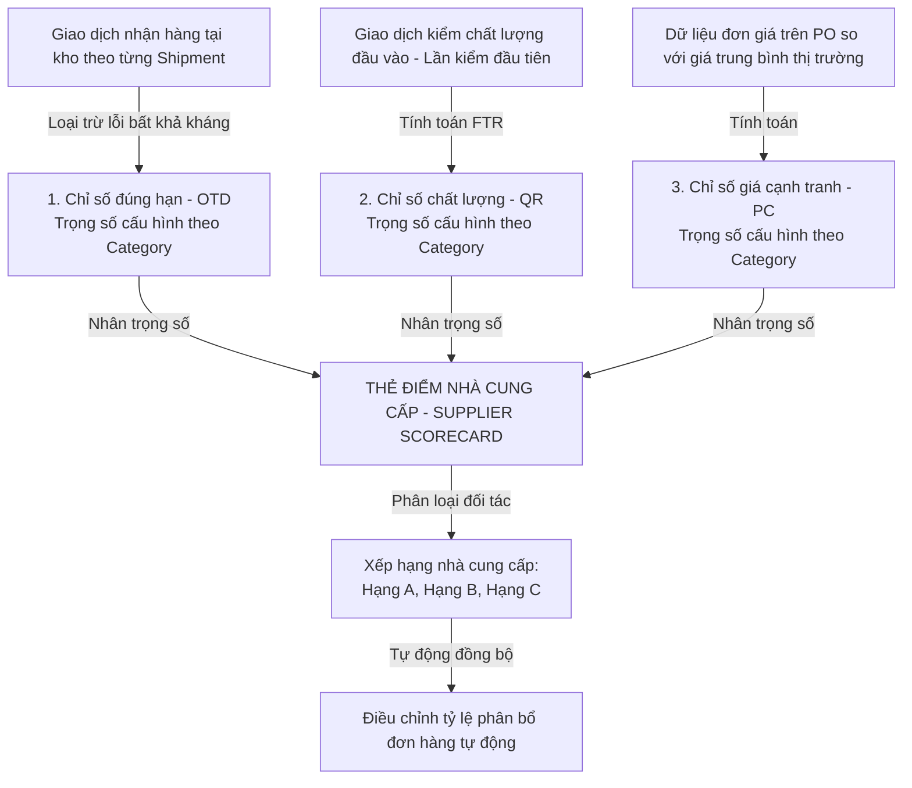

# 8010 Đánh giá hiệu suất nhà cung cấp (Supplier Scorecard)

Quản lý hiệu suất nhà cung cấp thông qua Thẻ điểm (Supplier Scorecard) là nghiệp vụ then chốt để doanh nghiệp chuẩn hóa danh mục đối tác và tối ưu hóa rủi ro chuỗi cung ứng đầu vào. Thay vì đánh giá cảm tính dựa trên nhận định chủ quan của nhân viên mua hàng, một hệ thống ERP tiêu chuẩn phải tự động thu thập toàn bộ dữ liệu giao dịch vật lý tại kho và dữ liệu kiểm tra chất lượng để tính toán chính xác các chỉ số hiệu suất KPI của đối tác, từ đó làm căn cứ để phân bổ tỷ lệ mua sắm hoặc gia hạn hợp đồng dài hạn.

---

## 1. Bản chất nghiệp vụ & Ba chỉ số KPI cốt lõi của Scorecard

Thẻ điểm nhà cung cấp (Supplier Scorecard) được cấu thành bởi 3 nhóm chỉ số hiệu suất cốt lõi có trọng số (Weighted Score):

### A. Tỷ lệ giao hàng đúng hạn (On-Time Delivery - OTD)
* **Ý nghĩa:** Đo lường độ tin cậy về mặt thời gian giao hàng của đối tác.
* **Công thức tính:** $OTD\% = \frac{Số\ lượng\ lô\ hàng\ giao\ đúng\ hạn}{Tổng\ số\ lô\ hàng\ giao} \times 100\%$.
* *Định nghĩa "Đúng hạn" trên ERP:* Ngày nhận hàng thực tế phải nằm trong khung dung sai cho phép so với ngày hứa hẹn trên PO (ví dụ: giao sớm tối đa 3 ngày và trễ 0 ngày). Giao quá sớm hoặc giao trễ đều bị hệ thống tính là "Không đúng hạn".

### B. Tỷ lệ đạt chất lượng đầu vào (Quality Acceptance Rate - QR)
* **Ý nghĩa:** Đo lường độ tin cậy về mặt chất lượng sản phẩm của đối tác.
* **Công thức tính:** $QR\% = \frac{Số\ lượng\ sản\ phẩm\ đạt\ chất\ lượng\ ở\ lần\ kiểm\ đầu\ tiên}{Tổng\ số\ lượng\ sản\ phẩm\ thực\ nhận} \times 100\%$.
* *Nguồn dữ liệu:* Lấy trực tiếp từ kết quả kiểm IQC tại phân hệ QC, tính theo nguyên tắc "đạt ngay lần đầu" (First-time Right — xem chi tiết lý do tại Mục 7).

### C. Chỉ số cạnh tranh đơn giá (Price Competitiveness Index - PC)
* **Ý nghĩa:** Đo lường mức độ ổn định và ưu đãi về đơn giá của đối tác so với giá thị trường hoặc so với các đối thủ cạnh tranh trong cùng danh mục mua sắm, thường tính bằng cách so sánh đơn giá trúng thầu/PO của nhà cung cấp với đơn giá trung bình của các nhà cung cấp khác cùng cung cấp một mã vật tư hoặc nhóm vật tư tương đương trong cùng kỳ đánh giá.

### Công thức tính điểm tổng hợp có trọng số

Ba chỉ số trên không nên tổng hợp bằng cách cộng dồn phần trăm trực tiếp, vì mỗi chỉ số có ý nghĩa và thang đo khác nhau. Điểm tổng hợp cuối cùng của nhà cung cấp được tính theo công thức trọng số:

$$Score_{tổng\ hợp} = (OTD\% \times W_{OTD}) + (QR\% \times W_{QR}) + (PC\% \times W_{PC})$$

Trong đó $W_{OTD} + W_{QR} + W_{PC} = 100\%$. Trọng số này cần cấu hình được theo từng nhóm vật tư (Category) — ví dụ nhóm nguyên vật liệu sản xuất trực tiếp nên đặt trọng số Quality cao hơn (do ảnh hưởng trực tiếp đến dây chuyền), trong khi nhóm văn phòng phẩm có thể đặt trọng số Price cao hơn — không nên dùng một bộ trọng số cứng áp dụng chung cho mọi loại hàng hóa.

---

## 2. Mô hình tính toán trọng số điểm tổng hợp của nhà cung cấp

Dưới đây là sơ đồ mô tả cách hệ thống ERP thu thập dữ liệu tự động từ các phân hệ để tính toán điểm hiệu suất tổng hợp (Supplier Score) dựa trên trọng số đã thiết lập trước:



---

## 3. Điểm giao thoa & Tham chiếu chéo (Cross-linking) sang các phân hệ khác

* **Thông tin nhà cung cấp:** Kết quả xếp hạng cuối kỳ sẽ tự động cập nhật ngược lại vào trường xếp hạng tại [2000 Quản lý hồ sơ nhà cung cấp (Supplier Master)]().
* **Căn cứ tính đúng hạn:** Ngày hứa hẹn giao hàng làm căn cứ tính OTD được đối chiếu trực tiếp từ thuộc tính ngày cam kết trên đơn Standard PO tại [4000 Khởi tạo Đơn mua hàng tiêu chuẩn (Standard PO)]().
* **Căn cứ tính chất lượng:** Số lượng đạt chất lượng (QC Passed) được lấy trực tiếp từ bài viết [Nhận hàng mua và Kiểm tra chất lượng (Receiving & IQC)]() thuộc cùng nhóm PO Mua hàng.
* **Tự động hóa chuỗi cung ứng:** Điểm xếp hạng của nhà cung cấp là căn cứ để hệ thống tự động gán tỷ lệ mua sắm hoặc thứ tự ưu tiên tại bài [Quy tắc xác định nguồn cung và phân bổ tỷ lệ (Sourcing Rules & Allocation)]().

> **Lưu ý về số hiệu cross-link:** Một số bài tham chiếu ở trên (ví dụ bài Receiving & IQC, bài Sourcing Rules) cần bạn xác nhận lại đúng số hiệu thực tế trong hệ thống 12 mục của bạn trước khi điền vào — vì số hiệu có thể trùng giữa các phân hệ khác nhau (như đã lưu ý ở bài 8010), việc chỉ nhìn số không đủ để xác định đúng bài, cần đối chiếu thêm tên bài và tên phân hệ đi kèm.

---

## 4. Bảng so sánh và Ánh xạ giải pháp giữa các hệ thống

Khi chuyển đổi giữa các hệ thống ERP hoặc tự thiết kế hệ thống (In-house), bạn có thể dễ dàng ánh xạ các tính năng tương đương dựa trên bảng sau:

| Nghiệp vụ thiết kế | Oracle EBS R12.2.10 | Epicor ERP | SAP S/4HANA | Odoo | Hệ thống tự xây (In-house) |
| :--- | :--- | :--- | :--- | :--- | :--- |
| **Báo cáo Scorecard** | Supplier Performance Analytics | Supplier Performance Dashboard | Vendor Evaluation | Vendor Rating App | Dashboard phân tích hiệu suất nhà cung cấp tự xây |
| **Logic tính OTD** | So khớp Transaction Date với Promised/Need-by Date ở cấp Shipment | So khớp ReceiptDate với PromiseDate trên PORel | Delivery Reliability Calculation | Delivery Lead Time vs Promised Date | SQL so khớp ngày nhận hàng thực tế và ngày hứa hẹn theo từng Shipment |
| **Logic tính Quality** | So khớp rcv transaction `ACCEPT` với `RECEIVE`, tính theo lần kiểm đầu | PassedQty / VendorQty | Quality Score via Inspection Lot (First Pass Yield) | Received Qty vs Billed Qty | SQL lấy tỷ lệ đạt chất lượng từ lần kiểm đầu tiên (FTR) |
| **Trọng số theo Category** | Không có sẵn — cần custom AMS/Score Formula | Không có sẵn — cần custom qua BAQ | Vendor Evaluation Criteria per Material Group | Không có module chuẩn | Bảng tham số trọng số theo Category, không hard-code |

---

## 5. Hướng dẫn luồng thiết lập (Setup Flow) chi tiết trên hệ thống

### A. Trên Oracle EBS R12.2.10 (Supplier Scorecard Setup)

1. **Thiết lập khung thời gian giao nhận an toàn (Receiving Close Tolerances):**
    * *Đường dẫn:* `Purchasing Super User > Setup > Organizations > Receiving Options`
    * *Nghiệp vụ:* Khai báo ngày dung sai giao hàng sớm (`Days Early Tolerance` - ví dụ: 3 ngày) và giao hàng trễ (`Days Late Tolerance` - ví dụ: 0 ngày) để làm cơ sở cho hệ thống tự động xác định giao dịch giao hàng đúng hạn.
2. **Khai báo mã lý do trễ hạn khách quan (Late Reason Codes):**
    * *Đường dẫn:* `Purchasing Super User > Setup > Lookups > Purchasing Lookups`
    * *Nghiệp vụ:* Tạo danh mục lý do trễ hạn (ví dụ: `BUYER_FAULT`, `FORCE_MAJEURE`, `LOGISTICS_DELAY`), cho phép Buyer gán khi cập nhật giao dịch nhận hàng bị trễ, làm căn cứ loại trừ khỏi phép tính OTD.
3. **Vận hành màn hình phân tích hiệu suất nhà cung cấp (Supplier Scorecard):**
    * *Nghiệp vụ:* Hệ thống sẽ tự động tổng hợp dữ liệu từ các phân hệ Purchasing, Inventory và Quality. Người mua khai báo trọng số cho từng chỉ số theo từng nhóm danh mục mua sắm (ví dụ: gán OTD chiếm 40%, Quality chiếm 40%, Price chiếm 20% cho nhóm nguyên vật liệu chính) để hệ thống chạy chương trình tự động tính điểm tổng hợp cho nhà cung cấp cuối kỳ.

### B. Trên Epicor ERP (Supplier Performance Dashboard)

1. **Cấu hình Ngày dung sai giao hàng đúng hạn (Grace Days Setup):**
    * *Đường dẫn:* `Material Management > Purchase Management > Setup > Supplier Purchase Points`
    * *Nghiệp vụ:* Thiết lập số ngày giao hàng sớm tối đa (`Early Grace Days`) và trễ tối đa (`Late Grace Days`) cho phép đối với từng nhà cung cấp cụ thể.
2. **Xem báo cáo hiệu suất (Supplier Performance):**
    * *Đường dẫn:* `Material Management > Purchase Management > Reports > Supplier Performance`
    * *Nghiệp vụ:* Khai báo ngày chạy đối soát. Hệ thống tự động quét qua bảng `RcvDtl` (nhận kho) và `PORel` (ngày hứa hẹn đơn hàng) để xuất ra bảng điểm Scorecard chi tiết cho nhà cung cấp.

---

## 6. Truy vấn SQL đối soát cấu trúc tổ chức (SQL Database Audit Queries)

### A. Cho Oracle EBS R12.2.10

Query dưới đây là **thuật toán lõi để tính toán thẻ điểm nhà cung cấp (Supplier Scorecard)**, đã hiệu chỉnh đúng theo bản bạn kiểm tra chạy không lỗi: bổ sung `INNER JOIN po_headers_all pha` để lấy đúng `org_id` hợp lệ (vì bảng `rcv_transactions` không có sẵn cột này ở mọi cấu hình), đồng thời dùng `DECODE(..., 0, 1, ...)` để tránh lỗi chia cho 0 khi một nhà cung cấp chưa có giao dịch nào trong kỳ đánh giá:

```sql
WITH po_receiving_data AS (
    SELECT 
        pha.org_id,                   -- Lấy org_id từ po_headers_all thay vì rt (rcv_transactions không đảm bảo có cột này)
        rt.po_header_id,
        rt.vendor_id,
        rt.quantity                   AS received_qty,
        rt.transaction_date           AS actual_receipt_date,
        plla.need_by_date             AS target_delivery_date,
        -- Thuật toán xác định giao hàng đúng hạn (Sớm <= 3 ngày và Trễ 0 ngày)
        CASE 
            WHEN TRUNC(rt.transaction_date) <= plla.need_by_date 
                 AND TRUNC(rt.transaction_date) >= (plla.need_by_date - 3) THEN 1
            ELSE 0
        END                           AS is_on_time,
        -- Lấy số lượng thực tế bộ phận QC đã ACCEPT (đạt chất lượng ở lần kiểm đầu tiên)
        NVL((
            SELECT SUM(rt2.quantity) 
            FROM rcv_transactions rt2 
            WHERE rt2.parent_transaction_id = rt.transaction_id 
              AND rt2.transaction_type = 'ACCEPT'
        ), 0)                         AS accepted_qty
    FROM 
        rcv_transactions rt
    INNER JOIN 
        po_line_locations_all plla ON rt.po_line_location_id = plla.line_location_id
    INNER JOIN 
        po_headers_all pha ON rt.po_header_id = pha.po_header_id -- Bổ sung join để lấy org_id hợp lệ
    WHERE 
        rt.transaction_type = 'RECEIVE'
)
SELECT 
    hou.name                      AS operating_unit,
    aps.segment1                  AS vendor_number,
    hp.party_name                 AS vendor_name,
    COUNT(prd.po_header_id)       AS total_shipments_received,
    -- Tính tỷ lệ giao hàng đúng hạn (OTD %), tránh chia cho 0
    ROUND((SUM(prd.is_on_time) * 100.0) / DECODE(COUNT(prd.po_header_id), 0, 1, COUNT(prd.po_header_id)), 2) AS otd_percentage,
    -- Tính tỷ lệ chất lượng đạt chuẩn (Quality Rate %), tránh chia cho 0
    ROUND((SUM(prd.accepted_qty) * 100.0) / DECODE(SUM(prd.received_qty), 0, 1, SUM(prd.received_qty)), 2) AS quality_acceptance_rate
FROM 
    po_receiving_data prd
INNER JOIN 
    ap_suppliers aps ON prd.vendor_id = aps.vendor_id
INNER JOIN 
    hz_parties hp ON aps.party_id = hp.party_id
INNER JOIN 
    hr_operating_units hou ON prd.org_id = hou.organization_id
GROUP BY 
    hou.name, aps.segment1, hp.party_name
ORDER BY 
    otd_percentage DESC, quality_acceptance_rate DESC;
```

### B. Cho Epicor ERP (Truy vấn cơ sở dữ liệu SQL Server)

Query dưới đây tính toán thẻ điểm nhà cung cấp trong Epicor, tự động so khớp ngày nhận hàng thực tế trên `RcvHead` với ngày hứa hẹn trên `PORel` để tính OTD%, và so khớp lượng PassedQty để tính tỷ lệ chất lượng đạt chuẩn. Đã bổ sung `NULLIF` để tránh lỗi chia cho 0 tương tự bản Oracle:

```sql
SELECT 
    rd.Company,
    v.VendorID                    AS Vendor_Code,
    v.Name                        AS Vendor_Name,
    COUNT(rd.PackLine)            AS Total_Receipt_Lines,
    -- Tính tỷ lệ giao hàng đúng hạn (sớm tối đa 3 ngày, trễ 0 ngày so với PromiseDate)
    ROUND(
        (SUM(CASE WHEN rh.ReceiptDate <= pr.PromiseDate AND DATEDIFF(day, rh.ReceiptDate, pr.PromiseDate) <= 3 THEN 1 ELSE 0 END) * 100.0) 
        / NULLIF(COUNT(rd.PackLine), 0), 2
    )                             AS OTD_Percentage,
    -- Tính tỷ lệ chất lượng đạt chuẩn (số lượng PassedQty / tổng số lượng VendorQty đã nhận)
    ROUND((SUM(rd.PassedQty) * 100.0) / NULLIF(SUM(rd.VendorQty), 0), 2) AS Quality_Acceptance_Rate
FROM 
    Erp.RcvDtl rd
INNER JOIN 
    Erp.RcvHead rh ON rd.Company = rh.Company AND rd.ReceiverNum = rh.ReceiverNum
INNER JOIN 
    Erp.PORel pr ON rd.Company = pr.Company AND rd.PONum = pr.PONum AND rd.POLine = pr.POLine AND rd.PORelNum = pr.PORelNum
INNER JOIN 
    Erp.Vendor v ON rd.Company = v.Company AND rd.VendorNum = v.VendorNum
WHERE 
    rd.Company = 'YOUR_COMPANY_CODE'
GROUP BY 
    rd.Company, v.VendorID, v.Name
ORDER BY 
    OTD_Percentage DESC;
```

---

## 7. Giải pháp khắc phục lỗi phổ biến & Cảnh báo cho Hệ thống tự xây (In-house)

Nếu đội ngũ của bạn đang tự phát triển mô-đun Đánh giá nhà cung cấp (Supplier Scorecard), hãy đặc biệt chú ý các điểm thiết kế sau:

1. **Bẫy lỗi tính sai OTD do chia nhỏ đợt giao nhận (Split Shipment Issue):**
    * *Triệu chứng:* Đơn PO đặt 1,000 cái. Nhà cung cấp giao làm 3 đợt lẻ (đợt 1 giao đúng hạn 500 cái, đợt 2 trễ hạn 300 cái, đợt 3 trễ hạn 200 cái). Nếu hệ thống tự xây chỉ lưu duy nhất một ngày nhận hàng thực tế trên đầu mục đơn PO, hệ thống sẽ bị lỗi không biết tính chỉ số OTD cho PO này là đúng hay trễ.
    * *Giải pháp khắc phục:* Thuật toán tính chỉ số OTD bắt buộc phải được thiết kế và tính toán ở cấp độ chi tiết dòng giao hàng **PO Shipment / PO Release (PORel)** chứ không được tính ở cấp độ đầu mục (Header) hay dòng mặt hàng (Lines). Mỗi đợt giao hàng nhỏ lẻ là một giao dịch so khớp độc lập.

2. **Lỗi không loại trừ các yếu tố bất khả kháng (Force Majeure / Buyer Override):**
    * *Triệu chứng:* Nhà cung cấp giao trễ hẹn do lỗi từ phía doanh nghiệp (ví dụ: doanh nghiệp chậm bàn giao khuôn đúc mẫu). Tuy nhiên, hệ thống tự động quét dữ liệu và vẫn phạt trừ điểm OTD của nhà cung cấp, gây ra sự không công bằng và tranh chấp thương mại.
    * *Giải pháp:* Thiết kế thuộc tính **Ghi nhận lý do trễ và cho phép ghi đè (Late Reason Code & Buyer Override)**. Khi làm phiếu nhận hàng bị trễ, cho phép Buyer gán mã lý do khách quan (ví dụ: `BUYER_FAULT` - lỗi bên mua). Hệ thống tự xây phải tự động lọc bỏ các lô hàng có gắn mã lý do này ra ngoài phạm vi phạt điểm OTD của đối tác.

3. **Lỗi tính khống tỷ lệ chất lượng đạt do bỏ qua bước kiểm tra lại (Re-inspection):**
    * *Triệu chứng:* Lô hàng bị QC từ chối ở đợt kiểm đầu tiên. Sau khi nhà cung cấp thực hiện sửa lỗi, QC tiến hành kiểm tra lại và duyệt đạt. Nếu hệ thống tự xây cộng dồn cả số lượng đạt của đợt kiểm thứ hai mà không ghi giảm điểm phạt của đợt kiểm lỗi thứ nhất, hệ thống sẽ phản ánh sai lệch năng lực chất lượng thực tế của đối tác.
    * *Giải pháp:* Thiết kế liên kết trạng thái kiểm tra (Inspection Log). Hệ thống bắt buộc phải tính tỷ lệ chất lượng đạt dựa trên **Giao dịch kiểm tra chất lượng lần đầu tiên (First-time Right Rate - FTR)** để phản ánh trung thực nhất năng lực kiểm soát chất lượng của nhà cung cấp.

4. **Lỗi chia cho 0 khi nhà cung cấp chưa có giao dịch nào trong kỳ đánh giá:**
    * *Triệu chứng:* Khi chạy báo cáo Scorecard định kỳ (ví dụ hàng quý), nếu một nhà cung cấp trong danh sách không có bất kỳ giao dịch nhận hàng nào trong kỳ đó (mẫu số bằng 0), câu lệnh tính phần trăm trực tiếp `SUM(...) / COUNT(...)` sẽ ném lỗi chia cho 0 và làm gãy toàn bộ báo cáo thay vì bỏ qua nhà cung cấp đó.
    * *Giải pháp:* Luôn bọc mẫu số bằng hàm xử lý an toàn khi chia (`DECODE(mẫu_số, 0, 1, mẫu_số)` trên Oracle hoặc `NULLIF(mẫu_số, 0)` trên SQL Server) để tránh gãy toàn bộ tiến trình chạy báo cáo hàng loạt. Nhà cung cấp không có giao dịch nên được hiển thị là "Không có dữ liệu trong kỳ" thay vì bị lỗi hệ thống.

5. **Lỗi dùng một bộ trọng số cứng cho mọi nhóm hàng hóa:**
    * *Triệu chứng:* Hệ thống áp dụng cùng một công thức trọng số 40-40-20 (OTD-Quality-Price) cho cả nhóm nguyên vật liệu sản xuất trực tiếp lẫn nhóm văn phòng phẩm mua lẻ tẻ, khiến việc xếp hạng nhà cung cấp văn phòng phẩm bị đánh giá sai trọng tâm (yếu tố giá nên quan trọng hơn chất lượng đối với nhóm này).
    * *Giải pháp:* Thiết kế bảng tham số trọng số cấu hình theo từng nhóm danh mục mua sắm (Category), cho phép Ban quản lý mua sắm điều chỉnh linh hoạt tỷ trọng OTD/Quality/Price phù hợp với đặc thù rủi ro của từng nhóm hàng, không viết cố định một công thức duy nhất trong mã nguồn.

<p align="center" style={{color: 'var(--ifm-color-primary)'}}>
  <strong>Chúc các bạn thành công và vui vẻ!</strong>
</p>