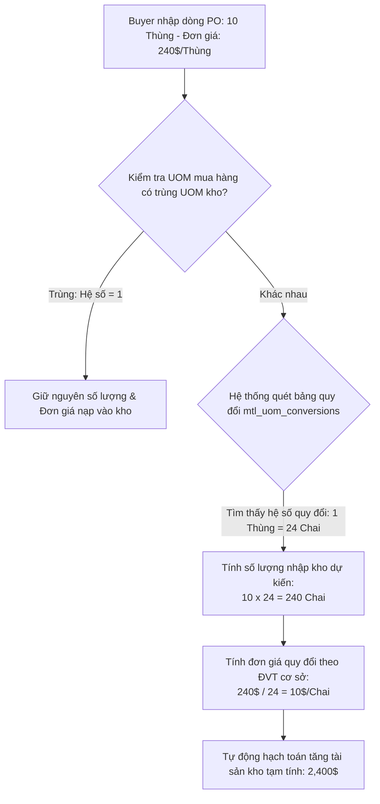

# 9000 Khắc phục lệch đơn vị tính UOM mua hàng và lưu kho

Trong khi bài viết bên phân hệ kho tập trung vào **lỗi logic khi viết báo cáo đối soát** (so sánh số lượng thô không quy đổi giữa các bảng), bài viết này sẽ giải quyết khía cạnh **cấu hình nghiệp vụ tác nghiệp trên chứng từ PO**. Chúng ta sẽ phân tích cách hệ thống ERP xử lý các quy tắc quy đổi đơn vị tính mua hàng (Purchase UOM) khác với đơn vị lưu kho cơ sở (Base UOM), đặc biệt là quy đổi khác nhóm vật lý (Inter-class Conversion) và cách hệ thống tự động tính toán đơn giá mua hàng tương ứng.

---

## 1. Quy đổi cùng nhóm (Intra-class) vs. Quy đổi khác nhóm (Inter-class) trên đơn PO

Khi nhân viên mua hàng (Buyer) khởi tạo dòng trên đơn PO, hệ thống ERP hỗ trợ hai cấp độ quy đổi đơn vị tính để tự động tính toán số lượng nhận kho dự kiến:

*   **Quy đổi cùng nhóm (Intra-class Conversion):** Áp dụng cho các đơn vị đo lường có quan hệ vật lý cố định (ví dụ: mua theo `Thùng` 24 chai, lưu kho theo `Chai`). Hệ số quy đổi này là hằng số dùng chung trên toàn hệ thống cho mọi mặt hàng.
*   **Quy đổi khác nhóm (Inter-class Conversion):** Áp dụng cho các đơn vị không có quan hệ vật lý trực tiếp (ví dụ: mua hóa chất theo thể tích là `Lít` để dễ vận chuyển, nhưng lưu kho theo trọng lượng là `Kilogam` để phục vụ công thức sản xuất BOM). Hệ số quy đổi này bắt buộc phải cấu hình riêng biệt cho từng mã vật tư cụ thể vì mỗi loại hóa chất có tỷ trọng riêng khác nhau.

---

## 2. Điểm giao thoa & Tham chiếu chéo (Cross-linking) sang các phân hệ khác

*   **Tham chiếu danh mục gốc:** Hệ số quy đổi mặc định và danh mục UOM Class được kế thừa từ cấu hình tại bài [7010 Đơn vị tính và quy đổi (UOM Conversion)]() thuộc phân hệ Tồn kho.
*   **Tác động khi viết báo cáo:** Sự cố lệch UOM khi viết báo cáo đối chiếu số lượng đặt và nhận được phân tích chi tiết tại bài [9010 Lỗi quy đổi đơn vị tính (UOM)]() bên phân hệ kho.
*   **Quy đổi khi nhập kho:** Khi thủ kho thực hiện nhận hàng mua tại bài [5010 Nhận hàng mua và Kiểm tra chất lượng (Receiving & IQC)](), hệ thống tự động gọi động cơ quy đổi để nhân số lượng thực tế nạp vào kho chính theo ĐVT lưu kho cơ sở.
*   **Quy đổi khi đối soát AP:** Kế toán AP thực hiện đối soát hóa đơn tại bài [7000 Đối soát khớp lệnh 3 chiều và 2 chiều (PO Matching)](), hệ thống tự động quy đổi số lượng hóa đơn về ĐVT mua hàng để khớp lệnh chính xác.

---

## 3. Quy trình tính toán số lượng và đơn giá quy đổi tự động trên PO

Sơ đồ dưới đây mô tả cách hệ thống ERP kiểm tra và thực thi phép nhân hệ số quy đổi để xác định chính xác số lượng nhập kho cơ sở và đơn giá tương ứng khi tạo dòng PO:



---

## 4. Hướng dẫn luồng thiết lập (Setup Flow) chi tiết trên hệ thống

### A. Trên Oracle EBS R12.2.10 (Inter-class UOM Conversion)

1.  **Thiết lập quy đổi khác nhóm cho vật tư (Inter-class):**
    *   *Đường dẫn:* `Inventory > Setup > Unit of Measure > Conversions`
    *   *Nghiệp vụ:* Chọn tab `Inter-class`.
    *   *Cấu hình:* Chọn mã vật tư cụ thể, chọn UOM nguồn (ví dụ: `Lít` thuộc nhóm thể tích), chọn UOM đích (ví dụ: `KG` thuộc nhóm khối lượng) và nhập hệ số quy đổi tương ứng với tỷ trọng riêng của hóa chất đó.
2.  **Khởi tạo đơn PO sử dụng ĐVT mua hàng:**
    *   *Đường dẫn:* `Purchasing Super User > Purchase Orders > Purchase Orders`
    *   *Nghiệp vụ:* Tạo PO, tại dòng PO nhập mã vật tư. Tại trường `UOM`, hệ thống cho phép chọn `Lít` (mặc dù ĐVT cơ sở của vật tư này trong kho là `KG`). Hệ thống sẽ tự động hiển thị đơn giá mua theo Lít dựa trên bảng giá đã cấu hình.

### B. Trên Epicor ERP (Part Specific UOM Conversion)

1.  **Thiết lập quy đổi đặc thù trên Part Maintenance:**
    *   *Đường dẫn:* `Material Management > Inventory Management > Setup > Part`
    *   *Nghiệp vụ:* Mở mã vật tư cần cấu hình. Tại tab `UOM`, chọn nhóm UOM Class tương ứng. 
    *   *Hệ số:* Tại phần `Part Specific UOMs`, khai báo mã UOM mua hàng khác nhóm (ví dụ: `Box`) và nhập hệ số nhân quy đổi cụ thể sang Base UOM (ví dụ: `1 Box = 12 Pcs`).
2.  **Tạo đơn mua hàng sử dụng ĐVT mua hàng:**
    *   *Đường dẫn:* `Material Management > Purchase Management > General Operations > Purchase Order Entry`
    *   *Nghiệp vụ:* Khi tạo PO Line (`PODetail`), tại trường `PUM` (Purchasing UOM) chọn mã `Box` (ĐVT cơ sở `IUM` là `Pcs`). Epicor sẽ tự động tính toán quy đổi số lượng và hiển thị trường `XOrderQty` (số lượng đã quy đổi về đơn vị tồn kho cơ sở) để đồng bộ thông tin sang kho.

---

## 5. Truy vấn SQL đối soát cấu trúc tổ chức (SQL Database Audit Queries)

### A. Cho Oracle EBS R12.2.10

Query dưới đây truy xuất toàn bộ các quy tắc quy đổi đơn vị tính đặc thù được cấu hình cho từng mặt hàng trong hệ thống, giúp đối soát nhanh hệ số nhân quy đổi (`conversion_rate`) giữa ĐVT mua hàng và ĐVT tồn kho cơ sở:

```sql
SELECT 
    msib.segment1                 AS item_code,
    msib.description              AS item_description,
    msib.primary_uom_code         AS base_uom,
    muc.uom_code                  AS purchase_uom,
    muc.uom_class                 AS uom_class,
    muc.conversion_rate           AS conversion_multiplier, -- Hệ số nhân quy đổi sang Base UOM
    muc.disable_date              AS inactive_date
FROM 
    mtl_uom_conversions muc
INNER JOIN 
    mtl_system_items_b msib ON muc.inventory_item_id = msib.inventory_item_id
WHERE 
    msib.organization_id = (
        SELECT fsp.inventory_organization_id 
        FROM financials_system_params_all fsp 
        WHERE ROWNUM = 1
    )
    AND NVL(muc.disable_date, TRUNC(SYSDATE)+1) > TRUNC(SYSDATE)
ORDER BY 
    msib.segment1, muc.uom_code;
```

### B. Cho Epicor ERP (Truy vấn cơ sở dữ liệu SQL Server)

Epicor phân tách hệ số quy đổi UOM thành hai tầng dữ liệu riêng biệt, cần hai câu query khác nhau để đối soát đầy đủ:

**B1. Quy đổi chuẩn dùng chung toàn hệ thống (Standard Conversion — không theo mã hàng):**

Query dưới đây kết xuất danh mục nhóm UOM và hệ số nhân quy đổi chuẩn (không phụ thuộc vào mã vật tư cụ thể):

```sql
SELECT 
    uc.Company,
    uc.UOMClassID                                AS UOM_Class_ID,
    uc.Description                               AS Class_Description,
    uc.BaseUOMCode                                AS Base_UOM,
    ucon.UOMCode                                  AS Alternate_UOM,
    ucon.ConvOperator                             AS Conv_Operator,      -- '*' hoặc '/'
    ucon.ConvFactor                               AS Conv_Factor_Raw,
    CASE 
        WHEN ucon.ConvOperator = '*' THEN ucon.ConvFactor
        WHEN ucon.ConvOperator = '/' THEN 1 / ucon.ConvFactor
    END                                            AS Multiplier_To_Base, -- Hệ số thực để quy đổi 1 Alternate_UOM -> Base_UOM
    ucon.PartSpecific                              AS Is_Part_Specific,
    ucon.Active                                    AS Is_Active
FROM 
    Erp.UOMClass uc
INNER JOIN 
    Erp.UOMConv ucon 
        ON uc.Company = ucon.Company 
       AND uc.UOMClassID = ucon.UOMClassID
WHERE 
    uc.Company = 'YOUR_COMPANY_CODE'
    AND ucon.Active = 1
    AND ucon.PartSpecific = 0   -- Chỉ lấy quy đổi dùng chung, loại trừ các class dùng riêng theo mã hàng
ORDER BY 
    uc.UOMClassID, ucon.UOMCode;
```

**B2. Quy đổi đặc thù theo mã vật tư (Part-Specific Conversion):**

Áp dụng cho trường hợp `UOMClass.ClassType = 'Other'` và cờ `PartSpecific = True`, khi hệ số quy đổi không cố định (ví dụ: lưu Sheet, mua theo Lbs, tiêu hao theo Sqft — mỗi mã hàng có tỷ lệ khác nhau). Vì bảng `Erp.PartUOM` không lưu trực tiếp `UOMClassID`, câu query bắt buộc phải join qua bảng `Erp.Part` để xác định UOM Class rồi mới lấy `BaseUOMCode` tương ứng:

```sql
SELECT 
    pu.Company,
    pu.PartNum,
    p.UOMClassID                                   AS UOM_Class_ID,
    uc.BaseUOMCode                                  AS Base_UOM,
    pu.UOMCode                                      AS Alternate_UOM,
    pu.ConvOperator                                 AS Conv_Operator,      -- '*' hoặc '/'
    pu.ConvFactor                                   AS Conv_Factor_Raw,
    CASE 
        WHEN pu.ConvOperator = '*' THEN pu.ConvFactor
        WHEN pu.ConvOperator = '/' THEN 1 / pu.ConvFactor
    END                                              AS Multiplier_To_Base, -- Hệ số thực để quy đổi 1 Alternate_UOM -> Base_UOM
    pu.Active                                       AS Is_Active,
    pu.HasBeenUsed                                  AS Has_Been_Used
FROM 
    Erp.PartUOM pu
INNER JOIN 
    Erp.Part p 
        ON pu.Company = p.Company 
       AND pu.PartNum = p.PartNum
INNER JOIN 
    Erp.UOMClass uc 
        ON p.Company = uc.Company 
       AND p.UOMClassID = uc.UOMClassID
WHERE 
    pu.Company = 'YOUR_COMPANY_CODE'
    AND pu.Active = 1
ORDER BY 
    pu.PartNum, pu.UOMCode;
```

> **Lưu ý cho lập trình viên:** Cột `ConvFactor` trong cả hai bảng không tự động ngụ ý phép nhân — phải luôn đọc kèm cột `ConvOperator` (`*` hoặc `/`) để xác định đúng chiều quy đổi. Bỏ qua `ConvOperator` là nguyên nhân phổ biến nhất gây sai lệch hệ số quy đổi ngược chiều trong các hệ thống tự xây tích hợp với Epicor.

---

## 6. Giải pháp khắc phục lỗi phổ biến & Cảnh báo cho Hệ thống tự xây (In-house)

Nếu đội ngũ của bạn đang tự phát triển mô-đun Kho và Mua sắm, hãy đặc biệt chú ý các điểm thiết kế sau:

1.  **Bẫy cho phép sửa đổi ĐVT cơ sở (Base UOM) khi đã phát sinh giao dịch:**
    *   *Triệu chứng:* Mã vật tư có ĐVT cơ sở ban đầu là `Chai` và đã phát sinh 100 phiếu nhập/xuất kho lịch sử. Người dùng sau đó tự ý sửa ĐVT cơ sở thành `Thùng` trên màn hình Item Master. Hệ thống tự xây cho phép lưu thay đổi. 
    *   *Hậu quả:* Toàn bộ số liệu lịch sử 100 giao dịch cũ bị hiểu sai nghĩa hoàn toàn (ví dụ: nhập 10 Chai lịch sử giờ bị hiểu thành nhập 10 Thùng), làm sụp đổ toàn bộ báo cáo kế toán tồn kho cuối kỳ.
    *   *Giải pháp khắc phục:* Thiết kế ràng buộc khóa cứng dữ liệu (Hard Validation). Ngay khi một mã vật tư đã phát sinh bất kỳ một bản ghi giao dịch nào trong bảng lịch sử kho (`Inventory_Transactions`) hoặc bảng dòng đơn hàng (`PO_Lines`), hệ thống bắt buộc phải khóa hoàn toàn tính năng thay đổi trường `Base_UOM` trên màn hình Item Master.
2.  **Lỗi thiết kế hệ số quy đổi dạng chia (Division) gây sai số học:**
    *   *Triệu chứng:* Lập trình viên thiết kế hệ số quy đổi lưu dưới dạng phép chia (ví dụ: lưu hệ số quy đổi từ Thùng sang Chai là `1 / 24 = 0.041667`). Khi nhân số lượng lớn để quy đổi ngược lại, sai số làm tròn (Rounding Error) sẽ tích lũy dần, gây ra tình trạng lệch kho và lệch tiền lẻ vĩnh viễn trên sổ cái.
    *   *Giải pháp:* Luôn lưu trữ hệ số quy đổi dưới dạng **Hệ số nhân (Multiplier Factor) quy đổi từ ĐVT lớn sang ĐVT nhỏ nhất (Base UOM)**. Ví dụ: Luôn cấu hình `1 Thùng = 24 Chai` (Lưu số 24). Khi cần chuyển đổi từ nhỏ sang lớn, hệ thống mới thực hiện phép chia sau.
3.  **Lỗi không đồng bộ UOM tại luồng đối soát hóa đơn AP:**
    *   *Triệu chứng:* Hệ thống tự xây cho phép kế toán AP nhập hóa đơn với bất kỳ ĐVT tự do nào mà không kiểm tra quy đổi. Việc này làm vỡ động cơ khớp lệnh tự động, bắt buộc kế toán phải làm các thao tác tính toán thủ công ngoài Excel cực kỳ rủi ro.
    *   *Giải pháp:* Trường `UOM` trên dòng hóa đơn AP bắt buộc phải kế thừa và giới hạn hiển thị trong danh mục các UOM đã được cấu hình quy đổi hợp lệ với Base UOM của vật tư đó.

<p align="center" style={{color: 'var(--ifm-color-primary)'}}>
  <strong>Chúc các bạn thành công và vui vẻ!</strong>
</p>