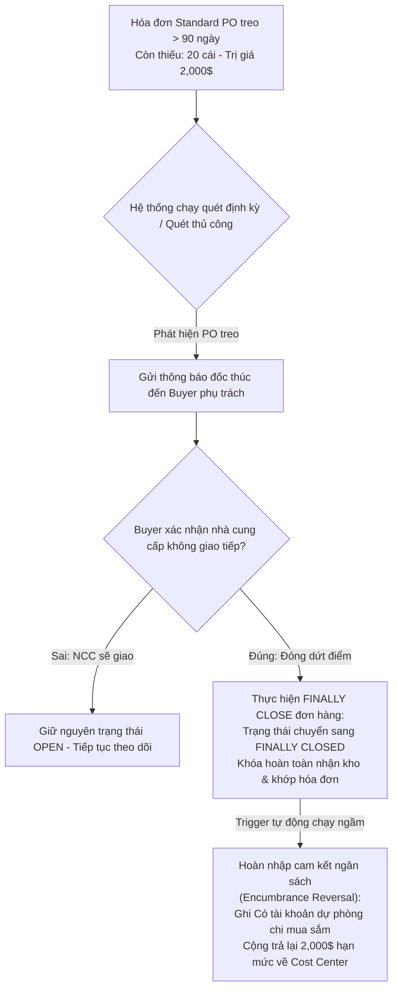

# 9010 Kỹ thuật dọn dẹp và đóng các PR/PO treo lâu ngày

Trong quá trình vận hành doanh nghiệp, luôn tồn tại một lượng lớn các yêu cầu mua sắm PR hoặc đơn mua hàng PO được tạo và phê duyệt thành công nhưng không bao giờ được hoàn thành triệt để. Việc để các chứng từ này ở trạng thái "Mở ảo" lâu ngày sẽ tạo ra các khoản cam kết tài chính khống trên ngân sách bộ phận (Encumbrance), khóa giữ ảo dung lượng kho của các nhà máy và làm tắc nghẽn hoàn toàn quy trình đóng kỳ kế toán tháng/năm của doanh nghiệp.

---

## 1. Bản chất nghiệp vụ & Ba trạng thái đóng chứng từ (Closing Statuses)

Hệ thống ERP tiêu chuẩn phân biệt rõ 3 cơ chế đóng chứng từ để giải quyết các mảng nhu cầu dọn dẹp khác nhau:

### A. Đóng tự động bởi hệ thống (System Closed)
*   **Điều kiện:** Đạt trạng thái cân bằng tuyệt đối: $Số\ lượng\ đặt\ mua\ (Ordered) = Số\ lượng\ đã\ nhận\ (Received) = Số\ lượng\ đã\ khớp\ hóa\ đơn\ (Invoiced)$.
*   **Hành động:** ERP tự động chuyển đổi trạng thái của dòng hàng hóa sang `CLOSED`.

### B. Đóng ngắn hạn mức thủ công (Close Short / Manual Close)
*   **Điều kiện:** Nhà cung cấp giao thiếu hàng và không thể giao tiếp (ví dụ: đặt mua 100 cái, họ chỉ giao 80 cái đạt chuẩn và báo hết hàng).
*   **Hành động:** Khác với System Closed diễn ra hoàn toàn tự động, thao tác này **bắt buộc do con người quyết định**: Người mua (Buyer) hoặc thủ kho, sau khi xác nhận với nhà cung cấp rằng phần hàng còn thiếu sẽ không được giao nữa, chủ động thực hiện đóng ngắn hạn mức (Close Short). Hệ thống khi đó mới tự động triệt tiêu 20 cái dở dang còn lại, đưa trạng thái PO về `CLOSED` để giải phóng ngân sách.

### C. Đóng vĩnh viễn (Finally Close)
*   **Điều kiện:** Trạng thái kiểm soát cao nhất do quản trị viên hoặc kế toán trưởng thực hiện.
*   **Hành động:** Chuyển trạng thái PO sang `FINALLY CLOSED`. Trạng thái này khóa hoàn toàn chứng từ, ngăn chặn tuyệt đối mọi hoạt động nhận kho (Receipt) hoặc đối soát hóa đơn (AP Match) phát sinh sau đó, đồng thời hoàn nhập toàn bộ ngân sách cam kết dở dang (Encumbrance Reversal).

---

## 2. Quy trình giải phóng ngân sách cam kết và dọn dẹp PR/PO treo

Sơ đồ dưới đây mô tả cách hệ thống ERP xử lý dọn dẹp các chứng từ mua sắm treo lâu ngày để thu hồi và hoàn trả hạn mức ngân sách dở dang về cho các phòng ban sở hữu:



---

## 3. Điểm giao thoa & Tham chiếu chéo (Cross-linking) sang các phân hệ khác

*   **Dọn dẹp nguồn nhu cầu:** Kỹ thuật dọn dẹp này áp dụng trực tiếp cho các yêu cầu PR chưa chuyển đổi thành PO tại [3000 Yêu cầu mua sắm và quy trình gom nhu cầu (PR & Consolidation)]().
*   **Giải phóng cam kết đơn hàng:** Áp dụng cho các đơn Standard PO dở dang cấu hình tại [4000 Khởi tạo Đơn mua hàng tiêu chuẩn (Standard PO)]().
*   **Điều kiện khóa sổ kho:** Việc dọn dẹp các dòng nhận hàng lửng lơ là điều kiện bắt buộc để thực hiện đóng kỳ kho thành công tại phân hệ [Tồn kho - INV]().
*   **Điều kiện khóa sổ kế toán:** Tất toán các dòng PO chưa hóa đơn là điều kiện để kế toán chạy đối chiếu tài khoản trung gian tại phân hệ [Công nợ phải trả - AP]().

---

## 4. Bảng so sánh và Ánh xạ giải pháp giữa các hệ thống

Khi chuyển đổi giữa các hệ thống ERP hoặc tự thiết kế hệ thống (In-house), bạn có thể dễ dàng ánh xạ các tính năng tương đương dựa trên bảng sau:

| Nghiệp vụ thiết kế | Oracle EBS R12.2.10 | Epicor ERP | SAP S/4HANA | Odoo | Hệ thống tự xây (In-house) |
| :--- | :--- | :--- | :--- | :--- | :--- |
| **Đóng dòng dở dang** | Close / Finally Close (BWC) | Close Line / Close Release | Delivery Completed (ELIKZ) / Invoice Completed | Lock / Cancel PO | Chuyển trạng thái dòng sang `CLOSED_SHORT` |
| **Hoàn nhập ngân sách** | Encumbrance Reversal (PO Liquidation) | Budget Release Process | Commitment Reversal | Budgetary Control Release | Thuật toán cộng trả số dư về bảng hạn mức phòng ban |
| **Kế toán đối chiếu** | Purge Purchase Documents program | Purge PO / Quote Process | Document Archiving (SARA) | Archiving / Purging | Lưu chuyển bản ghi PO sang bảng lưu trữ lịch sử |

---

## 5. Hướng dẫn luồng thiết lập (Setup Flow) chi tiết trên hệ thống

### A. Trên Oracle EBS R12.2.10 (Finally Close & Purge)

1.  **Thao tác Đóng vĩnh viễn (Finally Close) trên giao diện:**
    *   *Đường dẫn:* `Purchasing Super User > Buyer Work Center > Orders`
    *   *Nghiệp vụ:* Tìm kiếm số PO bị treo lâu ngày. Chọn dòng PO, tại danh mục `Actions` chọn hành động `Finally Close`.
    *   *Kết quả:* Hệ thống tự động khóa PO, ghi nhận ngày đóng vĩnh viễn và tự động hoàn nhập toàn bộ quỹ ngân sách cam kết dở dang của PO line này trả về cho Cost Center.
2.  **Dọn dẹp lưu trữ dữ liệu cũ (Purge Purchase Documents):**
    *   *Nghiệp vụ:* Đối với các đơn PO đã đóng hoàn toàn từ hơn 5 năm trước, chạy chương trình concurrent `Purge Purchase Documents` để hệ thống tự động bốc toàn bộ dữ liệu từ các bảng core sang các bảng lưu trữ lịch sử (Archive/History Tables), giúp giải phóng dung lượng và tăng tốc độ truy vấn cho database chính.

### B. Trên Epicor ERP (Close Line & Purge PO)

1.  **Đóng ngắn hạn mức dòng PO (Close Line):**
    *   *Đường dẫn:* `Material Management > Purchase Management > General Operations > Purchase Order Entry`
    *   *Nghiệp vụ:* Mở đơn PO bị giao thiếu. Tại tab `Lines > Detail`, chọn dòng vật tư bị giao thiếu, tích chọn thuộc tính `Closed` để hệ thống khóa dòng và triệt tiêu số lượng dở dang.
2.  **Chạy chương trình dọn dẹp (Purge PO):**
    *   *Đường dẫn:* `System Setup > System Maintenance > Purge PO / Quote Process`
    *   *Nghiệp vụ:* Cấu hình ngày giới hạn dọn dẹp (ví dụ: dọn dẹp các PO đã đóng trước ngày 31/12/2020). Chạy tiến trình để Epicor tự động xóa sạch hoặc đóng băng dữ liệu cũ trong cơ sở dữ liệu.

---

## 6. Truy vấn SQL đối soát cấu trúc tổ chức (SQL Database Audit Queries)

### A. Cho Oracle EBS R12.2.10

Query dưới đây quét qua toàn bộ cơ sở dữ liệu để lọc ra các đơn Standard PO đã phê duyệt từ hơn 90 ngày trước nhưng **vẫn đang ở trạng thái mở và có số lượng hàng bị treo dở dang chưa nhận kho**, hiển thị chi tiết số tiền cam kết khống đang bị khóa giữ:

```sql
SELECT 
    hou.name                      AS operating_unit,
    pha.segment1                  AS po_number,
    pha.creation_date             AS po_date,
    aps.segment1                  AS vendor_num,
    aps.vendor_name               AS vendor_name,
    pla.line_num                  AS line_num,
    msib.segment1                 AS item_code,
    pla.item_description          AS item_desc,
    plla.quantity                 AS qty_ordered,
    plla.quantity_received        AS qty_received,
    plla.quantity_billed          AS qty_invoiced,
    -- Số lượng còn lửng lơ chưa nhận kho
    (plla.quantity - plla.quantity_received) AS pending_receiving_qty,
    -- Giá trị tài chính cam kết bị khóa giữ khống (Commitment Value)
    ((plla.quantity - plla.quantity_received) * pla.unit_price) AS pending_commitment_amount,
    plla.closed_code              AS line_status
FROM 
    po_headers_all pha
INNER JOIN 
    po_lines_all pla ON pha.po_header_id = pla.po_header_id
INNER JOIN 
    po_line_locations_all plla ON pla.po_line_id = plla.po_line_id
INNER JOIN 
    ap_suppliers aps ON pha.vendor_id = aps.vendor_id
INNER JOIN 
    hr_operating_units hou ON pha.org_id = hou.organization_id
LEFT JOIN 
    mtl_system_items_b msib ON pla.item_id = msib.inventory_item_id 
                            AND msib.organization_id = plla.ship_to_organization_id
WHERE 
    pha.type_lookup_code = 'STANDARD'
    AND pha.approved_flag = 'Y'
    AND plla.closed_code = 'OPEN' -- Điều kiện lọc: Dòng hàng vẫn đang mở
    -- Điều kiện lọc: Đơn PO được tạo cách đây hơn 90 ngày và vẫn chưa nhận hết hàng
    AND pha.creation_date < TRUNC(SYSDATE) - 90
    AND (plla.quantity - plla.quantity_received) > 0
ORDER BY 
    pending_commitment_amount DESC;
```

### B. Cho Epicor ERP (Truy vấn cơ sở dữ liệu SQL Server)

Query dưới đây lọc ra toàn bộ các dòng giao hàng (PO Releases) đã quá hạn giao hơn 90 ngày nhưng vẫn chưa được nhận hết và vẫn đang ở trạng thái mở trong Epicor:

```sql
SELECT 
    pr.Company,
    pr.PONum                      AS PO_Number,
    pr.POLine                     AS PO_Line,
    pr.PORelNum                   AS Release_Num,
    pd.PartNum                    AS Part_Number,
    pd.LineDesc                   AS Description,
    pr.RelQty                     AS Qty_Ordered,
    pr.ReceivedQty                AS Qty_Received,
    -- Số lượng còn treo dở dang
    (pr.RelQty - pr.ReceivedQty)  AS Pending_Qty,
    -- Giá trị tài chính còn treo dở dang
    ((pr.RelQty - pr.ReceivedQty) * pd.DocUnitCost) AS Pending_Amount,
    pr.NeedByDate                 AS Need_By_Date,
    pr.OpenRelease                AS Is_Release_Open -- 1 = Vẫn đang mở
FROM 
    Erp.PORel pr
INNER JOIN 
    Erp.PODetail pd ON pr.Company = pd.Company AND pr.PONum = pd.PONum AND pr.POLine = pd.POLine
INNER JOIN 
    Erp.POHeader ph ON pr.Company = ph.Company AND pr.PONum = ph.PONum
WHERE 
    pr.Company = 'YOUR_COMPANY_CODE'
    AND pr.OpenRelease = 1 -- Chỉ lấy các release đang mở
    AND ph.Approve = 1 -- PO đã phê duyệt
    -- Điều kiện lọc: Ngày yêu cầu giao hàng đã quá hạn hơn 90 ngày trước
    AND pr.NeedByDate < DATEADD(day, -90, GETDATE())
    AND (pr.RelQty - pr.ReceivedQty) > 0
ORDER BY 
    Pending_Amount DESC;
```

---

## 7. Giải pháp khắc phục lỗi phổ biến & Cảnh báo cho Hệ thống tự xây (In-house)

Nếu đội ngũ của bạn đang tự phát triển mô-đun Mua sắm và Kho, hãy đặc biệt chú ý các điểm thiết kế sau:

1.  **Bẫy lỗi xóa cứng bản ghi cũ (Hard Delete Pitfall - Nghiêm trọng nhất):**
    *   *Triệu chứng:* Khi cơ sở dữ liệu bị phình to và chạy chậm, lập trình viên viết câu lệnh SQL `DELETE` trực tiếp các đơn PO cũ từ 5 năm trước ra khỏi bảng core `PO_Headers` và `PO_Lines`. 
    *   *Hậu quả:* Việc này phá vỡ hoàn toàn tính toàn vẹn tham chiếu (Referential Integrity) của cơ sở dữ liệu, gây lỗi hệ thống nghiêm trọng tại phân hệ AP (khi truy vấn hóa đơn AP cũ liên kết với số PO đã bị xóa) và làm biến mất hoàn toàn dữ liệu lịch sử phục vụ cho báo cáo phân tích chi tiêu [8000 Phân tích chi phí mua hàng (Spend Analysis)]() của ban giám đốc.
    *   *Giải pháp khắc phục:* Tuyệt đối không xóa cứng dữ liệu giao dịch. Quy trình dọn dẹp bắt buộc phải thiết kế theo cơ chế **Chuyển dịch dữ liệu (Soft Purging / Archiving)**: Chạy một Procedure quét các PO cũ đã đóng hoàn toàn, thực hiện bốc bản ghi từ bảng core sang một bảng lưu trữ lịch sử độc lập (ví dụ: `PO_Headers_History`), sau đó mới xóa bản ghi tại bảng core để tối ưu hóa hiệu suất database.
2.  **Lỗi "treo" hạn mức ngân sách phòng ban (Budget Leakage):**
    *   *Triệu chứng:* Khi phòng Nhân sự tạo PR mua thiết bị trị giá 2,000 USD, hệ thống tự động khóa giữ (Encumber) 2,000 USD từ quỹ ngân sách của họ. Sau đó dự án bị hủy, PR bị treo lửng lơ không chuyển thành PO và bị bỏ quên. Đến cuối năm, phòng Nhân sự bị thiếu mất 2,000 USD hạn mức chi tiêu mà không rõ nguyên nhân.
    *   *Giải pháp:* Thiết kế cơ chế tự động hoàn nhập khi hủy/đóng chứng từ (Encumbrance Reversal Trigger). Khi người dùng thực hiện thao tác Hủy hoặc Đóng vĩnh viễn (Finally Close) một PR/PO dở dang, hệ thống bắt buộc phải tự động kích hoạt một hàm giải phóng số tiền dở dang còn lại, cộng trả trực tiếp về quỹ ngân sách Cost Center tương ứng.
3.  **Lỗi "mở lại ảo" các PO đã đóng khi có hóa đơn phụ phụ trội về muộn:**
    *   *Triệu chứng:* PO đã hoàn thành nhận hàng và khớp hóa đơn, hệ thống tự động chuyển trạng thái PO sang `CLOSED`. Một tháng sau, hóa đơn cước vận tải phụ trội gửi về muộn, kế toán AP thực hiện khớp hóa đơn này vào PO cũ. Nếu hệ thống tự xây tự động mở lại trạng thái dòng PO sang `OPEN` để khớp hóa đơn mà không kiểm soát giới hạn, hệ thống sẽ làm sai lệch toàn bộ trạng thái đóng kỳ kho đã khóa trước đó.
    *   *Giải pháp:* Đối với các PO đã đạt trạng thái `CLOSED` hoặc `FINALLY CLOSED`, hệ thống bắt buộc phải khóa chặn tính năng khớp hóa đơn trực tiếp, mọi chi phí phát sinh muộn phải được hạch toán thông qua hóa đơn chi phí trực tiếp không qua PO tại bài [3060 Hóa đơn không qua đơn hàng PO (Non-PO Invoice Processing)]().

<p align="center" style={{color: 'var(--ifm-color-primary)'}}>
  <strong>Chúc các bạn thành công và vui vẻ!</strong>
</p>