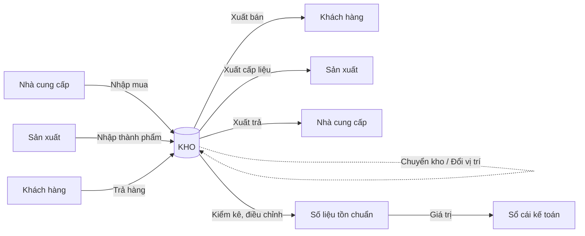

# Tổng quan Kho (Inventory)

Kho là nơi mọi dòng vật tư của doanh nghiệp đi qua: nguyên vật liệu mua về, hàng gửi đi bán, phụ tùng xuất cho sản xuất, hàng khách trả lại. Giá trị của các dòng này cuối cùng đi vào sổ cái tài chính.

Vì vậy kho không phải là "phân hệ phụ" của mua hàng hay bán hàng. Kho là **sổ cái vật chất** — đối xứng với sổ cái tài chính. Mua hàng, bán hàng, sản xuất chỉ là những sự kiện *yêu cầu* kho ghi nhận; kho mới là nơi xác lập con số cuối cùng về số lượng và giá trị hàng tồn.

## Ba nhóm tài liệu

### 🟢 Nhóm 1: Dữ liệu gốc & Thiết lập nền tảng (Master Data & Setup)

*Mục đích: Thiết lập hệ thống trước khi có thể thực hiện bất kỳ giao dịch kho nào.*

- **[1000 Cấu trúc kho & vị trí](./1000-cau-truc-kho-va-vi-tri.md)** — Site, Warehouse, Location/Bin: kho được mô hình hóa thành các tầng nào.
- **[1010 Item Master & thuộc tính kho](./1010-item-master-va-thuoc-tinh-kho.md)** — Mã hàng, UOM, Lot/Serial, điều kiện bảo quản.

### 🟡 Nhóm 2: Vận hành & Điều phối kho (Operations & Fulfillment)

*Mục đích: Các luồng chuyển động thực tế của hàng hóa và đáp ứng đơn hàng.*

- **[2000 Giao dịch nhập, xuất & chuyển](./2000-giao-dich-nhap-xuat-chuyen.md)** — Inbound, Outbound, Internal Transfer: năm loại giao dịch và lý do không bao giờ "sửa số tồn".
- **[2010 Giữ hàng, phân bổ & ATP](./2010-giu-hang-phan-bo-va-atp.md)** — Reservation, Allocation, Available to Promise phục vụ Bán hàng và Sản xuất.

### 🔴 Nhóm 3: Kiểm soát, Định giá & Báo cáo (Control & Valuation)

*Mục đích: Đối soát thực tế với sổ sách, tính giá trị tồn kho và tích hợp Kế toán.*

- **[3000 Kiểm kê & điều chỉnh](./3000-kiem-ke-va-dieu-chinh.md)** — Cycle Count, Physical Inventory, Variance Adjustment.
- **[3010 Định giá & báo cáo kho](./3010-dinh-gia-va-bao-cao-kho.md)** — Phương pháp FIFO/Bình quân, báo cáo tồn kho/tuổi hàng, tích hợp GL.

## Luồng hàng đi qua kho

Hàng vào, hàng ra, hàng đổi chỗ — mỗi lần như vậy là một **giao dịch kho**. Mọi nghiệp vụ đều quy về năm loại: nhập, xuất, chuyển, điều chỉnh và đảo (xem [Giao dịch nhập, xuất & chuyển](./2000-giao-dich-nhap-xuat-chuyen.md)). Không có chuyện "sửa lại con số tồn": muốn sửa thì phải ghi thêm một giao dịch điều chỉnh. Nguyên tắc này giữ cho mọi thay đổi đều có người chịu trách nhiệm và có dấu vết để kiểm toán.

## Kho liên quan gì tới các phần khác

- **Mua hàng** đặt hàng và theo dõi việc nhận, nhưng con số tồn do kho xác lập: [Nhận hàng & kiểm tra chất lượng](../2-mua-hang/2010-nhan-hang-va-kiem-qc.md)
- **Chất lượng (QC)** quyết định trạng thái hàng (đạt, không đạt, đặc cách); hàng chờ kiểm và hàng bị loại nằm ở khu riêng và không tính vào tồn khả dụng: [Nhận hàng & kiểm tra chất lượng](../2-mua-hang/2010-nhan-hang-va-kiem-qc.md)
- **Bán hàng** chốt đơn, nhưng việc trừ tồn và giữ hàng do kho thực hiện: [Giao hàng & xuất kho](../4-ban-hang/2010-giao-hang-va-xuat-kho.md)
- **Sản xuất** tiêu thụ nguyên vật liệu và tạo ra thành phẩm đều thông qua kho: [Lệnh sản xuất & WIP](../3-san-xuat/2000-lenh-san-xuat-va-wip.md)
- **Kế toán** nhận giá trị hàng tồn từ kho để ghi giá vốn và tài sản: [Giá vốn & định giá tồn kho](../5-ke-toan/ke-toan-tong-hop/1010-gia-von-va-dinh-gia-ton-kho.md)

## Bắt đầu đọc từ đâu

Nếu mới làm quen với module kho, đọc nhóm 1 trước (Cấu trúc kho & vị trí → Item Master) rồi sang nhóm 2, bắt đầu từ **Giao dịch nhập, xuất & chuyển** — bài quan trọng nhất, nơi mọi thứ khác đều dẫn về.

Nếu đang gặp sự cố thực tế (tồn kho lệch, hàng bị giữ ảo, báo cáo không khớp), đi thẳng tới nhóm 3.

  <strong>Chúc các bạn thành công và vui vẻ!</strong>

