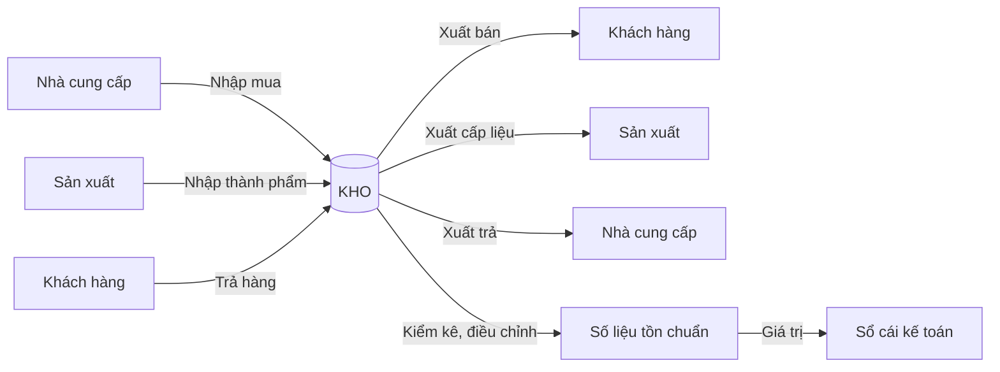

# Tổng quan Kho (Inventory)

Kho là nơi mọi dòng vật tư của doanh nghiệp đi qua: nguyên vật liệu mua về, hàng gửi đi bán, phụ tùng xuất cho sản xuất, hàng khách trả lại. Mọi con số này cuối cùng đều thành một dòng bút toán trong sổ cái tài chính.

Vì vậy kho không phải là "phân hệ phụ" của mua hàng hay bán hàng. Kho là **sổ cái vật chất** — đối xứng với sổ cái tài chính. Mua hàng, bán hàng, sản xuất chỉ là những sự kiện *yêu cầu* kho ghi nhận; kho mới là nơi xác lập con số cuối cùng về số lượng và giá trị hàng tồn.

## Kho giải quyết bốn câu hỏi

| Câu hỏi | Trả lời ở đâu |
|---|---|
| Hàng đang nằm ở đâu, trong kho nào, ô kệ nào? | [Cấu trúc kho & vị trí](./1000-cau-truc-kho-va-vi-tri.md) |
| Mặt hàng này có đặc điểm gì, quản lý theo lô hay serial? | [Item Master & thuộc tính kho](./2000-item-master-va-thuoc-tinh-kho.md) |
| Số lượng tồn thay đổi như thế nào và do sự kiện gì? | [Giao dịch nhập, xuất & chuyển](./3000-giao-dich-nhap-xuat-chuyen.md) |
| Bao nhiêu hàng đã bị giữ cho đơn hàng, còn bao nhiêu thực sự bán được? | [Giữ hàng, phân bổ & ATP](./4000-giu-hang-phan-bo-va-atp.md) |
| Sổ sách khớp thực tế không, và hàng tồn đáng giá bao nhiêu? | [Kiểm kê & điều chỉnh](./5000-kiem-ke-va-dieu-chinh.md), [Định giá & báo cáo kho](./6000-dinh-gia-va-bao-cao-kho.md) |

## Luồng hàng đi qua kho

Hàng vào, hàng ra, hàng đổi chỗ — mỗi lần như vậy là một **giao dịch kho**. Không có chuyện "sửa lại con số tồn": muốn sửa thì phải ghi thêm một giao dịch điều chỉnh. Nguyên tắc này giữ cho mọi thay đổi đều có người chịu trách nhiệm và có dấu vết để kiểm toán.

## Kho liên quan gì tới các phần khác

- **Mua hàng** đặt và nhận hàng, nhưng con số tồn do kho xác lập: [Nhận hàng & kiểm tra chất lượng](../2-mua-hang/4000-nhan-hang-va-kiem-qc.md)
- **Bán hàng** bán hàng, nhưng việc trừ tồn và giữ hàng do kho thực hiện: [Giao hàng & xuất kho](../4-ban-hang/3000-giao-hang-va-xuat-kho.md)
- **Sản xuất** tiêu thụ nguyên vật liệu và tạo ra thành phẩm đều thông qua kho: [Lệnh sản xuất & WIP](../3-san-xuat/thuc-thi/6000-lenh-san-xuat-va-wip.md)
- **Kế toán** nhận giá trị hàng tồn từ kho để ghi giá vốn và tài sản: [Giá vốn & định giá tồn kho](../6-ke-toan-chung/2000-gia-von-va-dinh-gia-ton-kho.md)

## Bắt đầu đọc từ đâu

Nếu bạn mới làm quen với module kho, đọc **Cấu trúc kho & vị trí** trước để hiểu kho được mô hình hóa thế nào, rồi sang **Giao dịch nhập, xuất & chuyển** — bài quan trọng nhất, nơi mọi thứ khác đều dẫn về.

Nếu bạn đang gặp sự cố thực tế (tồn kho lệch, hàng bị giữ ảo, báo cáo không khớp), đi thẳng tới bài tương ứng trong bảng bốn câu hỏi ở trên.

  <strong>Chúc các bạn thành công và vui vẻ!</strong>

