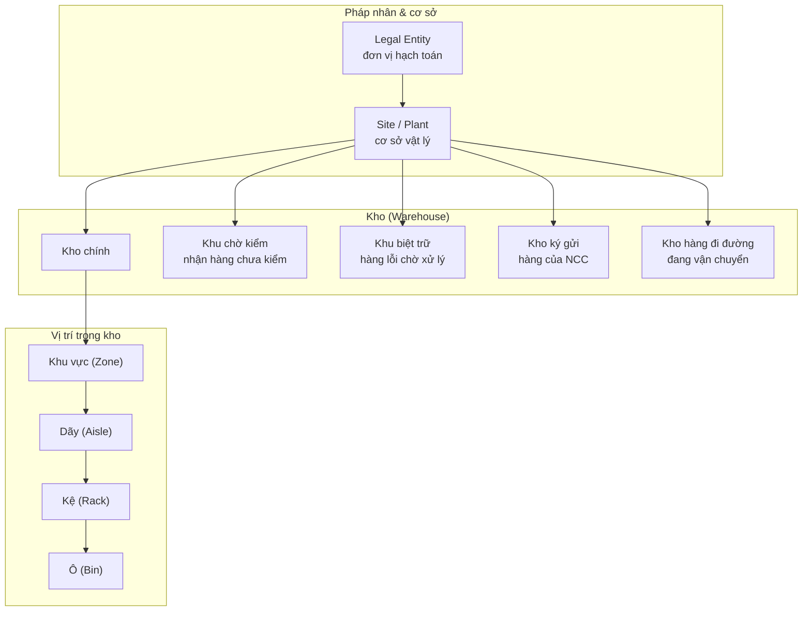

# Cấu trúc kho & vị trí

Trước khi ghi được giao dịch kho đầu tiên, hệ thống phải trả lời được một câu: **hàng này nằm ở đâu**. Câu trả lời không phải "trong kho" — mà phải chính xác tới mức một người khác có thể đi tới và lấy đúng món hàng đó.

Bài này nói về cách mô hình hóa không gian kho trong hệ thống ERP, khi nào cần chi tiết tới ô kệ và khi nào chỉ cần dừng ở mức kho, và những loại "kho" không phải kho bán hàng thông thường nhưng bắt buộc phải có.

---

## Nguyên lý (áp dụng mọi ERP)

1. **Kho là một cây phân cấp, không phải một danh sách.** Cấp trên bao cấp dưới, và mỗi tầng trả lời một loại câu hỏi khác nhau: pháp nhân nào sở hữu, hàng ở cơ sở nào, ở kho nào, ở khu nào, ở ô nào.
2. **Độ chi tiết của vị trí phải khớp với cách doanh nghiệp thực sự lấy hàng.** Kho nhỏ lấy hàng bằng mắt thì dừng ở mức kho. Kho có hàng nghìn ô kệ thì phải xuống mức ô — nếu không, người lấy hàng sẽ ghi ô sai và tồn kho mất tin cậy ngay từ giao dịch đầu tiên.
3. **Cấp chi tiết hơn không luôn tốt hơn.** Mỗi tầng thêm vào là một trường bắt buộc trên mọi giao dịch, một chỗ có thể nhập sai. Nếu doanh nghiệp không cần, đừng bật.
4. **Không phải mọi "kho" đều chứa hàng bán được.** Khu chờ kiểm, khu biệt trữ hàng lỗi, kho ký gửi, hàng đang đi đường — đều là vị trí hợp lệ để ghi nhận, nhưng mỗi loại có quy tắc riêng: khu chờ kiểm và khu biệt trữ không tính vào tồn khả dụng; kho ký gửi dùng được nhưng không phải tài sản của mình; hàng đang đi đường chưa nằm trong kho nào. Hệ thống phải phân biệt được bằng thuộc tính, không bằng tên kho đặt tùy hứng.
5. **Vị trí có thuộc tính vận hành, không chỉ có mã.** Cùng một ô kệ có thể bị khóa, đang kiểm kê, chỉ chứa hàng nguy hiểm, hoặc có giới hạn tải trọng. Bỏ qua các thuộc tính này dẫn đến hệ thống cho phép cất hàng nơi không thể cất.
6. **Chuyển vị trí không phải chuyển quyền sở hữu.** Chuyển giữa các bin, hoặc giữa các kho trong cùng pháp nhân và cùng tài khoản tồn kho, chỉ đổi vị trí: không sinh bút toán, không đổi giá trị tồn. Bút toán chỉ phát sinh khi chuyển khác pháp nhân (thành giao dịch bán/mua nội bộ), khác tài khoản tồn kho, hoặc có hàng đang đi đường. Chi tiết xem [Giao dịch nhập, xuất & chuyển](./2000-giao-dich-nhap-xuat-chuyen.md).

## 1. Luồng vận hành



Năm loại kho trong sơ đồ đều dùng chung một cơ chế ghi giao dịch, chỉ khác **thuộc tính**:

| Loại kho | Chứa hàng thật? | Tính vào tồn khả dụng? | Sinh bút toán tài sản? |
|---|---|---|---|
| Kho chính | Có | Có | Có |
| Khu chờ kiểm | Có | Không | Tùy cấu hình ghi nhận: có nếu ghi nhận khi nhận hàng, không nếu ghi nhận khi nhập kho (xem [Nhận hàng & kiểm tra chất lượng](../2-mua-hang/2010-nhan-hang-va-kiem-qc.md)) |
| Khu biệt trữ (hàng lỗi) | Có | Không | Tùy cấu hình ghi nhận như khu chờ kiểm; hàng lỗi không được coi là tài sản dùng được |
| Kho ký gửi (hàng của NCC) | Có | Có, dùng được cho sản xuất và bán | Không — chưa phải tài sản của mình |
| Kho hàng đi đường | Có, đang trên đường | Không — chưa tới kho | Hàng mua từ NCC: tùy điều kiện giao hàng (xem mục 3). Hàng chuyển giữa hai kho của mình: Có |

**Kho đặc biệt khác với vị trí ảo.** Các loại kho ở bảng trên đều ghi hàng có thật (kể cả hàng đang trên đường) và nằm trong cây kho. Ngoài ra hệ thống còn có các *vị trí ảo* như `SUPPLIER`, `CUSTOMER`, `WIP`, `ADJUSTMENT`, `SCRAP`: chúng đại diện cho thế giới bên ngoài kho, không chứa hàng và không nằm trong cây kho. Chi tiết xem [Giao dịch nhập, xuất & chuyển](./2000-giao-dich-nhap-xuat-chuyen.md).

## 2. Ai làm gì ở module nào

| Công việc | Kho (INV) | Mua hàng (PO) | Sản xuất (MFG) | Bán hàng (OM) | Kế toán |
|---|---|---|---|---|---|
| Định nghĩa cây kho và mã vị trí | ✅ sở hữu | — | — | — | Đồng ý mapping sang tài khoản kho |
| Gán thuộc tính kho (khả dụng, khóa, ký gửi) | ✅ sở hữu | Đề xuất khu chờ kiểm cho hàng nhận | — | — | — |
| Chỉ định vị trí khi nhập hàng | ✅ thủ kho quyết định ô kệ | Chỉ định kho đích trên PO | Chỉ định kho đích cho thành phẩm | — | — |
| Chỉ định vị trí khi xuất hàng | ✅ cấp phát bin cụ thể | — | Cấp phát bin cho cấp liệu | Đề xuất kho theo đơn | — |
| Khóa ô kệ khi kiểm kê | ✅ sở hữu | — | — | — | — |
| Mapping kho sang tài khoản kế toán | Cung cấp danh mục kho | — | — | — | ✅ gán tài khoản theo kho/nhóm hàng |
| Điều chuyển giữa các kho | ✅ thực hiện | — | — | — | Nhận bút toán khi khác pháp nhân, khác tài khoản tồn kho hoặc có hàng đang đi đường (xem [Giao dịch nhập, xuất & chuyển, mục 3](./2000-giao-dich-nhap-xuat-chuyen.md)) |

**Quy tắc phân quyền:** cây kho là **danh mục nền** — thay đổi nó ảnh hưởng tới mọi giao dịch đã và sẽ phát sinh. Chỉ một nhóm người được tạo/sửa mã kho, và mọi thay đổi phải có hiệu lực theo ngày, không ghi đè lịch sử.

## 3. Hạch toán

Cấu trúc kho tự nó không sinh bút toán. Nhưng nó quyết định **tài khoản nào được dùng** khi giao dịch phát sinh:

- **Kho chính** của một nhà máy thường map sang tài khoản tồn kho theo nhóm vật tư.
- **Khu chờ kiểm và khu biệt trữ:** tài khoản phụ thuộc cấu hình ghi nhận. Nếu ghi nhận khi nhận hàng, giá trị nằm ở tài khoản hàng chờ kiểm và chỉ chuyển sang tài khoản tồn kho ở bước nhập kho. Nếu ghi nhận khi nhập kho, chưa có bút toán nào. Xem [Nhận hàng & kiểm tra chất lượng](../2-mua-hang/2010-nhan-hang-va-kiem-qc.md).
- **Kho ký gửi** **không** map sang tài khoản tài sản — đó là hàng của nhà cung cấp, chỉ ghi nhận số lượng và theo dõi công nợ khi tiêu dùng.
- **Kho hàng đi đường:** với hàng mua từ nhà cung cấp, chỉ ghi vào tài khoản hàng mua đang đi đường khi điều kiện giao hàng đã chuyển rủi ro và quyền kiểm soát hàng cho mình trước lúc hàng tới kho (thường gặp ở điều kiện giao tại điểm đi, như FOB hay CIF theo Incoterms). Nếu điều kiện giao là giao tại kho người mua (như DAP) thì chưa ghi nhận cho tới khi hàng tới. Với hàng chuyển giữa hai kho của mình, hàng luôn là tài sản của mình nên ghi qua tài khoản hàng đang đi đường cho tới khi bên nhận xác nhận (xem [Giao dịch nhập, xuất & chuyển, mục 3](./2000-giao-dich-nhap-xuat-chuyen.md)). Điều kiện cụ thể do kế toán xác nhận theo hợp đồng.

Bản đồ tài khoản và nguyên tắc tất toán nằm duy nhất tại [Hạch toán & tài khoản trung gian](../5-ke-toan/ke-toan-tong-hop/1000-hach-toan-va-tai-khoan-trung-gian.md).

## 4. Điểm chạm & rủi ro

- **Ghi giao dịch vào vị trí**: [Giao dịch nhập, xuất & chuyển](./2000-giao-dich-nhap-xuat-chuyen.md)
- **Khu chờ kiểm trong quy trình nhận hàng**: [Nhận hàng & kiểm tra chất lượng](../2-mua-hang/2010-nhan-hang-va-kiem-qc.md)
- **Cấp phát bin khi giao hàng**: [Giữ hàng, phân bổ & ATP](./2010-giu-hang-phan-bo-va-atp.md)
- **Khóa ô kệ khi kiểm kê**: [Kiểm kê & điều chỉnh](./3000-kiem-ke-va-dieu-chinh.md)
- **Mã hàng và quản lý lô/serial theo vị trí**: [Item Master & thuộc tính kho](./1010-item-master-va-thuoc-tinh-kho.md)

**Rủi ro chính:**

- **Tạo kho tràn lan** — mỗi bộ phận tự tạo kho riêng, báo cáo tồn kho vỡ thành hàng chục nguồn không so sánh được.
- **Đặt tên kho mô tả mục đích** ("khu biệt trữ") nhưng không gắn thuộc tính — hệ thống vẫn tính vào tồn khả dụng.
- **Đổi mã kho đã phát sinh giao dịch** — lịch sử trỏ tới mã không còn tồn tại.
- **Xuống mức ô kệ khi không cần** — thủ kho phải chọn bin mỗi lần nhập, nhập sai, tồn kho theo bin vô nghĩa.

## 5. Triển khai tham chiếu ERP

### A. Ánh xạ cấp phân cấp

> **Lưu ý:** tên màn hình, đường dẫn menu và mã thay đổi theo phiên bản và cấu hình. Ô đánh dấu `*` là chỗ cần xác nhận trên hệ thống thật trước khi đưa vào thiết kế.

| Cấp | Oracle EBS R12 | Epicor ERP | SAP S/4HANA | Odoo |
|---|---|---|---|---|
| Pháp nhân | Operating Unit / Legal Entity | Company | Company Code | Company |
| Cơ sở | Organization (Inventory Org) | Site | Plant | Warehouse (`stock.warehouse`) |
| Kho | Subinventory | Warehouse | Storage Location (SLoc) | Location (internal) |
| Khu vực | Subinventory + Locator nhóm | `WhseBin` theo prefix | SLoc + Storage Section | Location con |
| Ô kệ | Locator (Inventory Location) | Bin (`PartBin`) | Storage Bin (WM) | Location chi tiết |
| Khu chờ kiểm | Receiving Inspection (khu nhận, ngoài subinventory thường) `*` | Kho/bin kiểm tra riêng `*` | Cơ chế 1: GR blocked stock. Cơ chế 2: stock in quality inspection (xem [Nhận hàng & kiểm tra chất lượng](../2-mua-hang/2010-nhan-hang-va-kiem-qc.md)) | Vị trí Input / Quality |
| Kho ký gửi | Consigned Subinventory `*` | Consignment Warehouse `*` | SLoc đặc biệt + `Special Stock` | Hàng tồn (quant) có `owner_id` khác `*` |

### B. Hệ thống tự xây — thiết kế tối thiểu

> **Lưu ý:** đoạn mã dưới đây là **gợi ý thiết kế** cho hệ thống tự xây, viết theo cú pháp SQL Server. Cần điều chỉnh kiểu dữ liệu và tên bảng theo hệ quản trị đang dùng.

```sql
CREATE TABLE Inv_Location (
    Location_ID     VARCHAR(50)  PRIMARY KEY,
    Location_Type   VARCHAR(10)  NOT NULL,   -- PHYSICAL | VIRTUAL
    Level_Type      VARCHAR(20)  NULL,       -- WAREHOUSE | ZONE | AISLE | RACK | BIN (NULL với vị trí ảo)
    Parent_ID       VARCHAR(50)  NULL REFERENCES Inv_Location(Location_ID),  -- cây phân cấp
    Legal_Entity_ID VARCHAR(20)  NULL,       -- NULL với vị trí ảo dùng chung
    Site_ID         VARCHAR(50)  NULL,       -- NULL với vị trí ảo
    Warehouse_ID    VARCHAR(50)  NULL,       -- kho chứa vị trí này; NULL với vị trí ảo
    Leaf_Level      VARCHAR(20)  NULL,       -- đặt ở dòng kho: mức thấp nhất được ghi giao dịch
    Is_Available    BIT NOT NULL DEFAULT 1,  -- có tính vào tồn khả dụng
    Is_Blocked      BIT NOT NULL DEFAULT 0,  -- đang khóa (kiểm kê, sự cố)
    Ownership       VARCHAR(20)  NOT NULL DEFAULT 'OWN', -- OWN | VENDOR | CUSTOMER
    Cost_Account    VARCHAR(20)  NULL,       -- map sang tài khoản kế toán
    Description     NVARCHAR(200)
);
-- Vị trí ảo: SUPPLIER, CUSTOMER, WIP, ADJUSTMENT, SCRAP
-- (Location_Type = 'VIRTUAL', Is_Available = 0), xem bài Giao dịch nhập, xuất & chuyển
```

Năm quy tắc bắt buộc:

1. **`Leaf_Level` xác định vị trí nào được ghi giao dịch.** Ghi vào khu vực thay vì ô kệ làm báo cáo bin vô nghĩa.
2. **`Is_Available = 0`** cho khu chờ kiểm, khu biệt trữ và các vị trí ảo — đây là cách chặn hàng chưa đủ điều kiện bán mà không cần sửa báo cáo.
3. **`Ownership`** phân biệt hàng của mình với hàng ký gửi. Báo cáo tài sản lọc theo đây, không lọc theo tên kho.
4. **Không xóa vị trí đã phát sinh giao dịch** — chỉ đặt `Is_Blocked = 1`.
5. **Vị trí ảo** (`Location_Type = 'VIRTUAL'`) do hệ thống tạo sẵn, không có `Site_ID`, không nằm trong cây kho. Mọi truy vấn về tồn vật lý phải lọc `Location_Type = 'PHYSICAL'`.

### C. Truy vấn kiểm soát

**Hệ thống tự xây — truy vấn gợi ý** (dựa trên bảng `Inv_Location` ở mục B và bảng `Inventory_Transaction` mô tả trong bài [Giao dịch nhập, xuất & chuyển](./2000-giao-dich-nhap-xuat-chuyen.md); tên bảng và cột mang tính minh họa).

**Vị trí vừa khả dụng vừa bị khóa — hàng không bán được mà không ai biết lý do:**

```sql
SELECT Location_ID, Level_Type, Is_Available, Is_Blocked, Ownership
FROM Inv_Location
WHERE Location_Type = 'PHYSICAL' AND Is_Available = 1 AND Is_Blocked = 1;
```

**Hàng đang nằm ở vị trí không khả dụng — kiểm tra có bị bỏ quên:**

```sql
WITH Moves AS (
    SELECT To_Location_ID   AS Location_ID, Item_ID,  Qty_Base AS Qty
    FROM Inventory_Transaction WHERE Is_Logical = 0
    UNION ALL
    SELECT From_Location_ID AS Location_ID, Item_ID, -Qty_Base AS Qty
    FROM Inventory_Transaction WHERE Is_Logical = 0
)
SELECT l.Location_ID, l.Level_Type, m.Item_ID, SUM(m.Qty) AS Qty_Stuck
FROM Moves m
JOIN Inv_Location l ON l.Location_ID = m.Location_ID
WHERE l.Location_Type = 'PHYSICAL' AND l.Is_Available = 0
GROUP BY l.Location_ID, l.Level_Type, m.Item_ID
HAVING SUM(m.Qty) > 0
ORDER BY Qty_Stuck DESC;
```

**Epicor — tồn kho theo bin (đối chiếu với báo cáo chuẩn của hệ thống):**

```sql
SELECT pb.Company, pb.WarehouseCode, pb.BinNum, pb.PartNum, pb.OnhandQty
FROM Erp.PartBin pb
WHERE pb.Company = 'YOUR_COMPANY_CODE'
  AND pb.OnhandQty > 0
ORDER BY pb.WarehouseCode, pb.BinNum, pb.PartNum;
```

:::note Lưu ý khi chạy trên Epicor
Tên cột có thể khác tùy phiên bản. Dùng `DESC` (hoặc xem metadata trong BAQ) để kiểm tra trước khi chạy.
:::

## 6. Bẫy thực chiến & Checklist

| # | Bẫy | Triệu chứng | Cách phòng tránh |
|---|---|---|---|
| 1 | Khu chờ kiểm không gắn thuộc tính "không khả dụng" | Hàng chưa kiểm QC vẫn bán được, giao hàng lỗi cho khách | Dùng thuộc tính `Is_Available = 0`, không dựa vào tên kho |
| 2 | Mỗi bộ phận tự tạo kho | Báo cáo tồn kho có 40 kho, không cái nào khớp thực tế | Cây kho do một nhóm quản lý, thay đổi có quy trình duyệt |
| 3 | Đổi mã kho đã có giao dịch | Báo cáo lịch sử hiện mã kho không tồn tại, dữ liệu mồ côi | Chỉ đặt `Is_Blocked = 1`, tạo mã mới nếu cần |
| 4 | Xuống mức ô kệ khi kho nhỏ | Thủ kho chọn bin ngẫu nhiên, chênh lệch kiểm kê tăng | Bắt đầu ở mức kho; nâng cấp khi số bin vượt ngưỡng vận hành |
| 5 | Kho ký gửi tính vào tài sản | Báo cáo tài sản phồng lên bằng hàng của nhà cung cấp | `Ownership = VENDOR`, báo cáo tài sản lọc theo ownership |
| 6 | Chuyển kho khác pháp nhân, khác tài khoản tồn kho hoặc có hàng đi đường mà không sinh bút toán | Hai công ty trong tập đoàn cùng có một lô hàng trong sổ, hoặc giá trị tồn nằm sai tài khoản | Áp quy tắc ở [Giao dịch nhập, xuất & chuyển, mục 3](./2000-giao-dich-nhap-xuat-chuyen.md); chuyển khác pháp nhân phải là bán/mua nội bộ |
| 7 | Không đánh dấu ô kệ đang kiểm kê | Thủ kho nhập/xuất vào ô đang đếm, chênh lệch giả | Khóa theo bin trong suốt thời gian đếm |

**Checklist trước go-live:**

- [ ] Đã vẽ cây kho trên giấy theo sơ đồ nhà kho thực tế, đối chiếu với từng bộ phận.
- [ ] Đã xác định mức chi tiết thấp nhất cần dùng (kho hay bin).
- [ ] Mọi khu chờ kiểm / khu biệt trữ / kho ký gửi đã có thuộc tính rõ ràng.
- [ ] Kho ký gửi không bị tính vào báo cáo tài sản.
- [ ] Mapping kho → tài khoản kế toán đã cấu hình.
- [ ] Không cho xóa vị trí đã có giao dịch (đã test).
- [ ] Đã thống nhất quy trình thêm kho mới: ai duyệt, ai tạo, thay đổi ghi nhận thế nào.

## Xem thêm

- [Tổng quan Kho](./0000-tong-quan-kho.md)
- [Item Master & thuộc tính kho](./1010-item-master-va-thuoc-tinh-kho.md)
- [Giao dịch nhập, xuất & chuyển](./2000-giao-dich-nhap-xuat-chuyen.md)
- [Kiểm kê & điều chỉnh](./3000-kiem-ke-va-dieu-chinh.md)
- [Hạch toán & tài khoản trung gian](../5-ke-toan/ke-toan-tong-hop/1000-hach-toan-va-tai-khoan-trung-gian.md)

<div align="center" style={{color: 'var(--ifm-color-primary)'}}>
  <strong>Chúc các bạn thành công và vui vẻ!</strong>
</div>