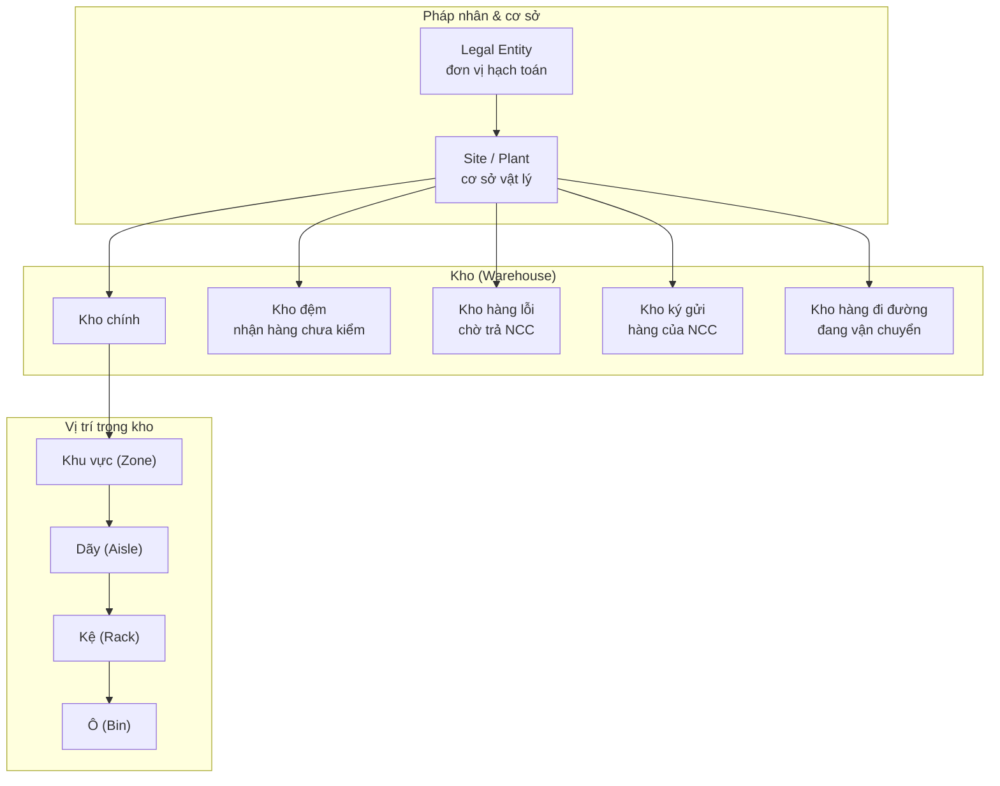

# 1000 Cấu trúc kho & vị trí

Trước khi ghi được giao dịch kho đầu tiên, hệ thống phải trả lời được một câu: **hàng này nằm ở đâu**. Câu trả lời không phải "trong kho" — mà phải chính xác tới mức một người khác có thể đi tới và lấy đúng món hàng đó.

Bài này nói về cách mô hình hóa không gian kho trong hệ thống ERP, khi nào cần chi tiết tới ô kệ và khi nào chỉ cần dừng ở mức kho, và những loại "kho" không chứa hàng thật nhưng bắt buộc phải có.

---

## 0. Nguyên lý (áp dụng mọi ERP)

1. **Kho là một cây phân cấp, không phải một danh sách.** Cấp trên bao cấp dưới, và mỗi tầng trả lời một loại câu hỏi khác nhau: pháp nhân nào sở hữu, hàng ở cơ sở nào, ở kho nào, ở khu nào, ở ô nào.
2. **Độ chi tiết của vị trí phải khớp với cách doanh nghiệp thực sự lấy hàng.** Kho nhỏ lấy hàng bằng mắt thì dừng ở mức kho. Kho có hàng nghìn ô kệ thì phải xuống mức ô — nếu không, người lấy hàng sẽ ghi ô sai và tồn kho mất tin cậy ngay từ giao dịch đầu tiên.
3. **Cấp chi tiết hơn không luôn tốt hơn.** Mỗi tầng thêm vào là một trường bắt buộc trên mọi giao dịch, một chỗ có thể nhập sai. Nếu doanh nghiệp không cần, đừng bật.
4. **Không phải mọi "kho" đều chứa hàng bán được.** Kho đệm, kho chờ kiểm, kho hàng lỗi, kho ký gửi, hàng đang đi đường — đều là vị trí hợp lệ để ghi nhận, nhưng không phải là hàng khả dụng. Hệ thống phải phân biệt được bằng thuộc tính, không bằng tên kho đặt tùy hứng.
5. **Vị trí có thuộc tính vận hành, không chỉ có mã.** Cùng một ô kệ có thể bị khóa, đang kiểm kê, chỉ chứa hàng nguy hiểm, hoặc có giới hạn tải trọng. Bỏ qua các thuộc tính này dẫn đến hệ thống cho phép cất hàng nơi không thể cất.
6. **Chuyển vị trí không phải chuyển quyền sở hữu.** Chuyển trong cùng một pháp nhân không sinh bút toán, không ảnh hưởng giá trị tồn. Chỉ khi vượt pháp nhân mới thành giao dịch bán/mua nội bộ.

## 1. Luồng vận hành



Năm loại kho đặc biệt trong sơ đồ đều dùng chung một cơ chế ghi giao dịch, chỉ khác **thuộc tính**:

| Loại kho | Chứa hàng thật? | Tính vào tồn khả dụng? | Sinh bút toán tài sản? |
|---|---|---|---|
| Kho chính | Có | Có | Có |
| Kho đệm / chờ kiểm | Có | Không | Không |
| Kho hàng lỗi | Có | Không | Không |
| Kho ký gửi (hàng của NCC) | Có | Không — không phải tài sản của mình | Không |
| Kho hàng đi đường | Không | Tùy điều kiện giao hàng | Tùy điều kiện giao hàng |

## 2. Ai làm gì ở module nào

| Công việc | Kho (INV) | Mua hàng (PO) | Sản xuất (MFG) | Bán hàng (OM) | Kế toán |
|---|---|---|---|---|---|
| Định nghĩa cây kho và mã vị trí | ✅ sở hữu | — | — | — | Đồng ý mapping sang tài khoản kho |
| Gán thuộc tính kho (khả dụng, khóa, ký gửi) | ✅ sở hữu | Đề xuất kho đệm cho hàng nhận | — | — | — |
| Chỉ định vị trí khi nhập hàng | ✅ thủ kho quyết định ô kệ | Chỉ định kho đích trên PO | Chỉ định kho đích cho thành phẩm | — | — |
| Chỉ định vị trí khi xuất hàng | ✅ cấp phát bin cụ thể | — | Cấp phát bin cho cấp liệu | Đề xuất kho theo đơn | — |
| Khóa ô kệ khi kiểm kê | ✅ sở hữu | — | — | — | — |
| Mapping kho sang tài khoản kế toán | Cung cấp danh mục kho | — | — | — | ✅ gán tài khoản theo kho/nhóm hàng |
| Điều chuyển giữa các kho | ✅ thực hiện | — | — | — | Nhận bút toán chỉ khi vượt pháp nhân |

**Quy tắc phân quyền:** cây kho là **danh mục nền** — thay đổi nó ảnh hưởng tới mọi giao dịch đã và sẽ phát sinh. Chỉ một nhóm người được tạo/sửa mã kho, và mọi thay đổi phải có hiệu lực theo ngày, không ghi đè lịch sử.

## 3. Hạch toán

Cấu trúc kho tự nó không sinh bút toán. Nhưng nó quyết định **tài khoản nào được dùng** khi giao dịch phát sinh:

- Kho chính của một nhà máy thường map sang tài khoản tồn kho theo nhóm vật tư.
- Kho đệm và kho chờ kiểm thường map sang cùng tài khoản tồn kho hoặc tài khoản hàng đang về, tùy chính sách.
- Kho ký gửi **không** map sang tài khoản tài sản — đó là hàng của nhà cung cấp, chỉ ghi nhận số lượng và theo dõi công nợ khi tiêu dùng.
- Kho hàng đi đường map sang tài khoản hàng mua đang đi đường nếu điều kiện giao hàng chuyển quyền sở hữu tại kho người mua.

Bản đồ tài khoản và nguyên tắc tất toán nằm duy nhất tại [Hạch toán & tài khoản trung gian](../6-ke-toan-chung/1000-hach-toan-va-tai-khoan-trung-gian.md).

## 4. Điểm chạm & rủi ro

- **Ghi giao dịch vào vị trí**: [Giao dịch nhập, xuất & chuyển](./3000-giao-dich-nhap-xuat-chuyen.md)
- **Kho đệm trong quy trình nhận hàng**: [Nhận hàng & kiểm tra chất lượng](../2-mua-hang/4000-nhan-hang-va-kiem-qc.md)
- **Cấp phát bin khi giao hàng**: [Giữ hàng, phân bổ & ATP](./4000-giu-hang-phan-bo-va-atp.md)
- **Khóa ô kệ khi kiểm kê**: [Kiểm kê & điều chỉnh](./5000-kiem-ke-va-dieu-chinh.md)
- **Mã hàng và quản lý lô/serial theo vị trí**: [Item Master & thuộc tính kho](./2000-item-master-va-thuoc-tinh-kho.md)

**Rủi ro chính:**

- **Tạo kho tràn lan** — mỗi bộ phận tự tạo kho riêng, báo cáo tồn kho vỡ thành hàng chục nguồn không so sánh được.
- **Đặt tên kho mô tả mục đích** ("kho hàng lỗi") nhưng không gắn thuộc tính — hệ thống vẫn tính vào tồn khả dụng.
- **Đổi mã kho đã phát sinh giao dịch** — lịch sử trỏ tới mã không còn tồn tại.
- **Xuống mức ô kệ khi không cần** — thủ kho phải chọn bin mỗi lần nhập, nhập sai, tồn kho theo bin vô nghĩa.

## 5. Triển khai tham chiếu ERP

### A. Ánh xạ cấp phân cấp

| Cấp | Oracle EBS R12 | Epicor ERP | SAP S/4HANA | Odoo |
|---|---|---|---|---|
| Pháp nhân | Operating Unit / Legal Entity | Company | Company Code | Company |
| Cơ sở | Organization (Inventory Org) | Site | Plant | Warehouse group |
| Kho | Subinventory | Warehouse | Storage Location (SLoc) | Location (internal) |
| Khu vực | Subinventory + Locator nhóm | `WhseBin` theo prefix | SLoc + Storage Section | Location con |
| Ô kệ | Locator (Inventory Location) | Bin (`PartBin`) | Storage Bin (WM) | Location chi tiết |
| Kho đệm / chờ kiểm | Receiving Subinventory | Inspection Warehouse | Blocked Stock / SLoc riêng | Location loại `Quality` |
| Kho ký gửi | Consigned Subinventory | Consignment Warehouse | SLoc đặc biệt + `Special Stock` | Location với `owner_id` khác |

### B. Hệ thống tự xây — thiết kế tối thiểu

```sql
CREATE TABLE Inventory_Location (
    Location_ID     VARCHAR(50)  PRIMARY KEY,
    Location_Type   VARCHAR(20)  NOT NULL,  -- WAREHOUSE | ZONE | AISLE | RACK | BIN
    Parent_ID       VARCHAR(50)  NULL,      -- cây phân cấp
    Site_ID         VARCHAR(50)  NOT NULL,
    Leaf_Level      VARCHAR(20)  NOT NULL,  -- mức dùng để ghi giao dịch
    Is_Available    BIT NOT NULL DEFAULT 1, -- có tính vào tồn khả dụng
    Is_Blocked      BIT NOT NULL DEFAULT 0, -- đang khóa (kiểm kê, sự cố)
    Ownership       VARCHAR(20)  NOT NULL DEFAULT 'OWN', -- OWN | VENDOR | CUSTOMER
    Cost_Account    VARCHAR(20)  NULL       -- map sang tài khoản kế toán
);
```

Bốn quy tắc bắt buộc:

1. **`Leaf_Level` xác định vị trí nào được ghi giao dịch.** Ghi vào khu vực thay vì ô kệ làm báo cáo bin vô nghĩa.
2. **`Is_Available = 0`** cho kho đệm, kho lỗi, kho chờ kiểm — đây là cách chặn hàng chưa đủ điều kiện bán mà không cần sửa báo cáo.
3. **`Ownership`** phân biệt hàng của mình với hàng ký gửi. Báo cáo tài sản lọc theo đây, không lọc theo tên kho.
4. **Không xóa vị trí đã phát sinh giao dịch** — chỉ đặt `Is_Blocked = 1`.

### C. Truy vấn kiểm soát

**Kho có thuộc tính khả dụng nhưng đang bị khóa — không ai bán được mà không biết lý do:**

```sql
SELECT Location_ID, Location_Type, Is_Available, Is_Blocked, Ownership
FROM Inventory_Location
WHERE Is_Available = 1 AND Is_Blocked = 1;
```

**Hàng đang nằm ở kho không khả dụng — kiểm tra có bị bỏ quên:**

```sql
SELECT t.To_Location AS Location_ID, l.Location_Type, SUM(t.Qty) AS Qty_Stuck
FROM Inventory_Transaction t
JOIN Inventory_Location l ON l.Location_ID = t.To_Location
WHERE l.Is_Available = 0
GROUP BY t.To_Location, l.Location_Type
HAVING SUM(t.Qty) > 0
ORDER BY Qty_Stuck DESC;
```

**Epicor — phân bố tồn kho theo bin, phát hiện bin có tồn nhưng không ai dùng:**

```sql
SELECT pb.Company, pb.WarehouseCode, pb.BinNum, pb.PartNum, pb.OnhandQty
FROM Erp.PartBin pb
WHERE pb.Company = 'YOUR_COMPANY_CODE'
  AND pb.OnhandQty > 0
ORDER BY pb.WarehouseCode, pb.BinNum, pb.PartNum;
```

## 6. Bẫy thực chiến & Checklist

| # | Bẫy | Triệu chứng | Cách phòng tránh |
|---|---|---|---|
| 1 | Kho đệm không gắn thuộc tính "không khả dụng" | Hàng chưa kiểm QC vẫn bán được, giao hàng lỗi cho khách | Dùng thuộc tính `Is_Available = 0`, không dựa vào tên kho |
| 2 | Mỗi bộ phận tự tạo kho | Báo cáo tồn kho có 40 kho, không cái nào khớp thực tế | Cây kho do một nhóm quản lý, thay đổi có quy trình duyệt |
| 3 | Đổi mã kho đã có giao dịch | Báo cáo lịch sử hiện mã kho không tồn tại, dữ liệu mồ côi | Chỉ đặt `Is_Blocked = 1`, tạo mã mới nếu cần |
| 4 | Xuống mức ô kệ khi kho nhỏ | Thủ kho chọn bin ngẫu nhiên, chênh lệch kiểm kê tăng | Bắt đầu ở mức kho; nâng cấp khi số bin vượt ngưỡng vận hành |
| 5 | Kho ký gửi tính vào tài sản | Báo cáo tài sản phồng lên bằng hàng của nhà cung cấp | `Ownership = VENDOR`, báo cáo tài sản lọc theo ownership |
| 6 | Chuyển kho vượt pháp nhân không sinh bút toán | Hai công ty trong tập đoàn có cùng một lô hàng trong sổ | Chặn theo pháp nhân, chuyển kho vượt pháp nhân phải là bán/mua nội bộ |
| 7 | Không đánh dấu ô kệ đang kiểm kê | Thủ kho nhập/xuất vào ô đang đếm, chênh lệch giả | Khóa theo bin trong suốt thời gian đếm |

**Checklist trước go-live:**

- [ ] Đã vẽ cây kho trên giấy theo sơ đồ nhà kho thực tế, đối chiếu với từng bộ phận.
- [ ] Đã xác định mức chi tiết thấp nhất cần dùng (kho hay bin).
- [ ] Mọi kho đệm / chờ kiểm / hàng lỗi / ký gửi đã có thuộc tính rõ ràng.
- [ ] Kho ký gửi không bị tính vào báo cáo tài sản.
- [ ] Mapping kho → tài khoản kế toán đã cấu hình.
- [ ] Không cho xóa vị trí đã có giao dịch (đã test).
- [ ] Đã thống nhất quy trình thêm kho mới: ai duyệt, ai tạo, thay đổi ghi nhận thế nào.

## Xem thêm

- [Tổng quan Kho](./0000-tong-quan-kho.md)
- [Item Master & thuộc tính kho](./2000-item-master-va-thuoc-tinh-kho.md)
- [Giao dịch nhập, xuất & chuyển](./3000-giao-dich-nhap-xuat-chuyen.md)
- [Kiểm kê & điều chỉnh](./5000-kiem-ke-va-dieu-chinh.md)
- [Hạch toán & tài khoản trung gian](../6-ke-toan-chung/1000-hach-toan-va-tai-khoan-trung-gian.md)

<div align="center" style={{color: 'var(--ifm-color-primary)'}}>
  <strong>Chúc các bạn thành công và vui vẻ!</strong>
</div>
