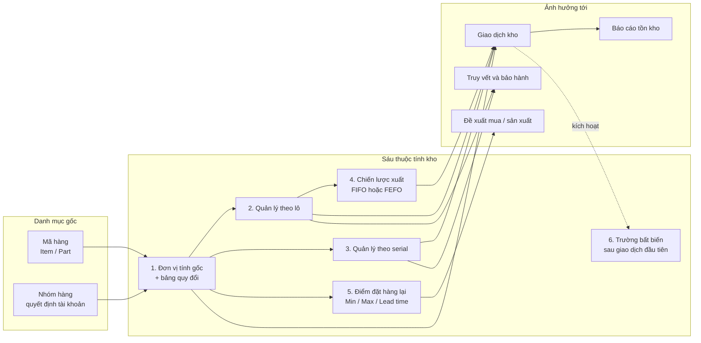

# 1010 Item Master & thuộc tính kho

Một mã hàng không chỉ là "tên và đơn vị tính". Để hệ thống kho vận hành đúng, mỗi mã hàng phải trả lời được sáu câu hỏi: **đơn vị nào là gốc**, **có cần theo lô không**, **có cần theo serial không**, **khi xuất thì lấy lô nào trước**, **khi nào phải đặt thêm**, và **trường nào không được đổi nữa**.

Sáu câu trả lời đó chính là sáu thuộc tính dưới đây. Sai một cái là chuỗi dữ liệu phía sau lệch, và thường phải sửa ở tầng dữ liệu chứ không sửa được bằng báo cáo.

---

## 0. Nguyên lý (áp dụng mọi ERP)

1. **Mọi số lượng trong hệ thống phải quy về một đơn vị gốc duy nhất.** Mua theo thùng, bán theo hộp, sản xuất theo cái — nhưng tồn kho chỉ có một con số và nó ở đơn vị nhỏ nhất không chia được. Không có đơn vị gốc thì mọi báo cáo sẽ so sánh những thứ khác đơn vị với nhau.

   **Ngoại lệ:** hàng có trọng lượng tự nhiên dao động (cá, thịt, thép cuộn) không có tỷ lệ quy đổi cố định — 10 con có thể nặng 520 kg lần này và 480 kg lần khác. Những mặt hàng này cần cơ chế đơn vị tính kép (catch weight), theo dõi song song hai số lượng độc lập; cơ chế đó nằm ngoài thiết kế tối thiểu của bài này.
2. **Quy đổi có hai tầng: chuẩn và đặc thù.** Quy đổi chuẩn dùng chung cho cả nhóm đơn vị (1 tấn = 1000 kg). Quy đổi đặc thù phải khai riêng cho từng mã, vì mỗi mã có tỷ lệ riêng (1 cây thép φ10 dài 12 m, φ16 chỉ dài 11,7 m).
3. **Quy đổi chéo nhóm là nơi dễ sai nhất.** Mua theo lít, tồn theo kg — tỷ lệ phụ thuộc tỷ trọng riêng của từng chất. Không thể dùng hệ số chung, và không thể để mặc định.
4. **Lô và serial là hai trục độc lập, không thay thế nhau.** Lô theo dõi một nhóm sản phẩm cùng đặc tính sản xuất; serial theo dõi từng cá thể duy nhất. Một mã hàng có thể chỉ quản lý lô (hóa chất, thực phẩm), chỉ quản lý serial (laptop, máy móc), quản lý cả hai (pin xe điện, linh kiện hàng không) hoặc không quản lý cái nào. Mã hàng cần cấp nào là do yêu cầu chất lượng/pháp lý quyết định, không do thói quen.
5. **Hàng có hạn dùng thì FIFO là chưa đủ, phải FEFO.** Lô nhập sau có thể hết hạn trước. Xuất theo ngày nhập sẽ đẩy hàng cận hạn nằm sâu trong kho đến ngày phải hủy.
6. **Thuộc tính danh mục trở thành bất biến ngay khi phát sinh giao dịch.** Đổi đơn vị gốc của một mã đã có 100 giao dịch không phải là "sửa danh mục" — đó là làm cho 100 giao dịch cũ mang nghĩa khác. Không có báo cáo nào sửa được điều này.

## 1. Luồng vận hành



Điểm cần chú ý: **`LOCK` không phải thuộc tính người dùng khai, mà là hệ quả của giao dịch đầu tiên.** Nó bật lên sau khi có giao dịch và không tắt lại được.

## 2. Ai làm gì ở module nào

| Thuộc tính | Kho (INV) | Mua hàng (PO) | Sản xuất (MFG) | Bán hàng (OM) | Kế toán |
|---|---|---|---|---|---|
| Đơn vị tính gốc | ✅ sở hữu, khóa sau giao dịch đầu | Đề xuất đơn vị mua | Đề xuất đơn vị tiêu hao | Đề xuất đơn vị bán | Đọc để quy đổi giá vốn |
| Bảng quy đổi đặc thù | ✅ sở hữu | Cung cấp tỷ lệ nhà cung cấp công bố | Cung cấp định mức theo đơn vị sản xuất | — | — |
| Quản lý theo lô | ✅ bật/tắt theo mã | Đọc để nhập lô mới | Đọc để ghi nhận lô thành phẩm | Đọc để chọn lô khi giao | Nhận giá trị theo lô |
| Quản lý theo serial | ✅ sở hữu trạng thái | Đọc để nhập serial | Đọc để gán serial khi hoàn thành | Đọc để bán đúng serial | Nhận giá trị tài sản |
| Chiến lược xuất FEFO | ✅ sở hữu | — | Đọc khi cấp liệu | Đọc khi giao hàng | — |
| Điểm đặt hàng lại | ✅ khai theo site | Đọc để sinh đề xuất mua | Đọc để sinh đề xuất sản xuất | — | — |
| Nhóm hàng → tài khoản | Cung cấp nhóm hàng | — | — | — | ✅ gán tài khoản theo nhóm |

**Nguyên tắc phân quyền:** danh mục vật tư là dữ liệu nền dùng chung cho toàn hệ thống. Chỉ một nhóm được sửa, mọi thay đổi phải có ngày hiệu lực, và các trường trong nhóm "bất biến" phải bị khóa ở tầng ứng dụng **và** tầng dữ liệu.

## 3. Hạch toán

Thuộc tính vật tư không sinh bút toán, nhưng chúng quyết định bút toán trông như thế nào:

- **Nhóm hàng** quyết định tài khoản tồn kho được dùng khi nhập xuất.
- **Đơn vị tính gốc** quyết định đơn giá lưu trên sổ kho — nếu tồn theo cái mà giá lưu theo thùng, giá trị tồn sai gấp hệ số quy đổi.
- **Quản lý theo lô** cho phép truy được giá trị theo từng lô, và nếu chính sách định giá chọn tính theo lô thì giá vốn cũng tách theo lô. Nếu không, giá vốn vẫn theo phương pháp định giá của mã hàng (xem [Định giá & báo cáo kho](./3010-dinh-gia-va-bao-cao-kho.md)).
- **Quản lý theo serial** quyết định tài sản có định danh riêng hay không — ảnh hưởng tới quản lý tài sản cố định và bảo hành.

Bản đồ tài khoản và nguyên tắc tất toán nằm duy nhất tại [Hạch toán & tài khoản trung gian](../5-ke-toan/ke-toan-tong-hop/1000-hach-toan-va-tai-khoan-trung-gian.md); phần định giá chi tiết ở [Định giá & báo cáo kho](./3010-dinh-gia-va-bao-cao-kho.md).

## 4. Điểm chạm & rủi ro

- **Nguyên lý quy đổi đơn vị tính** — bài gốc, định nghĩa hai tầng quy đổi và lỗi làm tròn: [Nguyên lý quy đổi UOM](../0-nen-tang/3020-nguyen-ly-quy-doi-uom.md)
- **Ghi giao dịch theo đơn vị gốc**: [Giao dịch nhập, xuất & chuyển](./2000-giao-dich-nhap-xuat-chuyen.md)
- **Vị trí/kho gắn với thuộc tính khả dụng**: [Cấu trúc kho & vị trí](./1000-cau-truc-kho-va-vi-tri.md)
- **Đếm và điều chỉnh khi lô/serial lệch**: [Kiểm kê & điều chỉnh](./3000-kiem-ke-va-dieu-chinh.md)
- **Chọn lô khi giao hàng**: [Giữ hàng, phân bổ & ATP](./2010-giu-hang-phan-bo-va-atp.md)
- **Truy xuất nguồn gốc từ serial/lô** thuộc MES-TRC (phả hệ sản phẩm), không thuộc bài này.

**Rủi ro chính:**

- **Đổi đơn vị gốc sau khi đã có giao dịch** — toàn bộ lịch sử mang nghĩa khác, tồn kho và giá vốn sai không cứu được.
- **Thiếu bảng quy đổi đặc thù** — hệ thống áp hệ số chung, chênh lệch tích lũy thành hàng chục tấn không giải trình được.
- **Lô hết hạn vẫn xuất được** — hàng vào sản xuất làm hỏng cả lô thành phẩm, hoặc giao khách dẫn tới thu hồi.
- **Xuất kho không gán lô** — đứt chuỗi truy vết, không truy được lô nguyên liệu khi có sự cố chất lượng.
- **Tồn tổng lệch số serial thực tế** — hệ thống báo 10 cái nhưng chỉ quét được 9 serial, đơn hàng treo.
- **Thông số Min/Max bỏ trống** — hệ thống chạy hằng đêm nhưng không bao giờ đề xuất mua, tới khi dây chuyền dừng.

## 5. Triển khai tham chiếu ERP

### A. Ánh xạ sáu thuộc tính

> **Lưu ý:** tên bảng, tên trường và đường dẫn menu thay đổi theo phiên bản và cấu hình. Ô đánh dấu `*` là chỗ cần xác nhận trên hệ thống thật trước khi đưa vào thiết kế.

| Thuộc tính | Oracle EBS R12 | Epicor ERP | SAP S/4HANA | Odoo |
|---|---|---|---|---|
| Đơn vị tính gốc | `MTL_SYSTEM_ITEMS_B.primary_uom_code` | `Part.IUM` | `MARA.MEINS` | `product.template.uom_id` |
| Bảng quy đổi | `MTL_UOM_CONVERSIONS`, `MTL_UOM_CLASS_CONVERSIONS` | `UOMConv`, `PartUOM` | `MARM` | `uom.uom` (factor theo nhóm) |
| Quản lý lô | `Lot Control` trên Item + `MTL_LOT_NUMBERS` | `Part.TrackLots` + `PartLot` | `MARA.XCHPF` + `MCHA` | `tracking = lot` |
| Quản lý serial | `Serial Control` + `MTL_SERIAL_NUMBERS` | `Part.TrackSerialNum` + `SerialNo` | `MARA.SERNP` + `OBJK` | `tracking = serial` |
| Chiến lược FEFO | `Pick Rule` / `Lot Selection` `*` | `FEFO` trên Warehouse/Part `*` | `Batch Determination` / `FEFO` trong LE-WM | `removal_strategy = fefo` |
| Điểm đặt hàng lại | `MTL_SYSTEM_ITEMS_B.min_minmax_quantity`, `max_minmax_quantity`, `full_lead_time` | `PartPlant.MinimumQty`, `MaximumQty`, `LeadTime` | `MARC.MINBE`, `MARC.MABX` | `product.reorder.min_qty`, `max_qty` |

**Lưu ý quan trọng:** các thông số Min/Max/Lead time phải lưu ở **cấp site/plant**, không lưu ở danh mục tổng — vì cùng một mã hàng ở hai nhà máy có thời gian giao và mức tiêu thụ khác nhau.

### B. Hệ thống tự xây — thiết kế tối thiểu

```sql
CREATE TABLE Item_Inventory_Attribute (
    Item_ID            VARCHAR(50)  PRIMARY KEY,
    Base_UOM           VARCHAR(10)  NOT NULL,
    Item_Class         VARCHAR(20)  NOT NULL,   -- quyết định tài khoản tồn kho
    Track_Lot          BIT          NOT NULL DEFAULT 0,
    Track_Serial       BIT          NOT NULL DEFAULT 0,   -- độc lập với Track_Lot
    Pick_Strategy      VARCHAR(10)  NOT NULL DEFAULT 'FIFO', -- FIFO | FEFO
    Shelf_Life_Days    INT          NULL,       -- bắt buộc > 0 nếu Pick_Strategy = FEFO
    Is_Locked          BIT          NOT NULL DEFAULT 0,      -- 1 = đã có giao dịch
    Locked_Reason      VARCHAR(50)  NULL
);

CREATE TABLE Item_Plant_Planning (
    Item_ID          VARCHAR(50) NOT NULL,
    Site_ID          VARCHAR(50) NOT NULL,
    Min_Qty          DECIMAL(18,4) NOT NULL,
    Max_Qty          DECIMAL(18,4) NOT NULL,
    Safety_Stock     DECIMAL(18,4) NOT NULL DEFAULT 0,
    Lead_Time_Days   INT            NOT NULL,
    Planning_Method  VARCHAR(20)  NOT NULL, -- MIN_MAX | MRP | NONE
    PRIMARY KEY (Item_ID, Site_ID)
);
```

Bốn ràng buộc bắt buộc:

1. **`Base_UOM` khóa vĩnh viễn** khi `Is_Locked = 1`. Đây là ràng buộc quan trọng nhất trong toàn bộ danh mục.
2. **`Pick_Strategy = 'FEFO'` thì `Track_Lot = 1`** — ngày hết hạn gắn với lô, không có lô thì không có chỗ lưu hạn dùng để xếp thứ tự xuất.
3. **`Pick_Strategy = 'FEFO'` bắt buộc `Shelf_Life_Days > 0`** — không có hạn dùng thì không thể FEFO.
4. **`Lead_Time_Days` và `Min_Qty` không được bằng 0** khi `Planning_Method = MIN_MAX` — đây chính là lỗi làm hệ thống "im lặng" mãi mãi.

### C. Truy vấn kiểm soát

**Mã hàng FEFO nhưng thiếu hạn dùng — FEFO sẽ không hoạt động:**

```sql
SELECT Item_ID, Base_UOM, Pick_Strategy, Shelf_Life_Days
FROM Item_Inventory_Attribute
WHERE Pick_Strategy = 'FEFO'
  AND (Shelf_Life_Days IS NULL OR Shelf_Life_Days = 0);
```

**Mã hàng bật Min-Max nhưng thiếu thông số — không bao giờ sinh đề xuất:**

```sql
SELECT p.Item_ID, p.Site_ID, p.Min_Qty, p.Max_Qty, p.Lead_Time_Days
FROM Item_Plant_Planning p
WHERE p.Planning_Method = 'MIN_MAX'
  AND (p.Min_Qty = 0 OR p.Lead_Time_Days = 0 OR p.Max_Qty < p.Min_Qty);
```

**Số dư tồn kho siêu nhỏ do lỗi làm tròn quy đổi (hàng "ma" không xóa được):**

```sql
WITH Moves AS (
    SELECT To_Location_ID   AS Location_ID, Item_ID, Lot_No, Serial_No,  Qty_Base AS Qty
    FROM Inventory_Transaction WHERE Is_Logical = 0
    UNION ALL
    SELECT From_Location_ID AS Location_ID, Item_ID, Lot_No, Serial_No, -Qty_Base AS Qty
    FROM Inventory_Transaction WHERE Is_Logical = 0
)
SELECT m.Item_ID, m.Location_ID, m.Lot_No, m.Serial_No, SUM(m.Qty) AS Ghost_Qty
FROM Moves m
JOIN Inv_Location l ON l.Location_ID = m.Location_ID AND l.Location_Type = 'PHYSICAL'
GROUP BY m.Item_ID, m.Location_ID, m.Lot_No, m.Serial_No
HAVING SUM(m.Qty) > 0 AND SUM(m.Qty) < 0.01;
```

**Epicor — mã hàng giao dịch chéo nhóm đơn vị nhưng thiếu bảng quy đổi đặc thù:**

```sql
SELECT DISTINCT pt.PartNum, p.IUM AS Base_UOM,
       u1.UOMClassID AS Base_Class, pt.UM AS Trx_UOM, u2.UOMClassID AS Trx_Class
FROM Erp.PartTran pt
JOIN Erp.Part p     ON pt.Company = p.Company AND pt.PartNum = p.PartNum
JOIN Erp.UOM u1     ON p.Company = u1.Company AND p.IUM = u1.UOMCode
JOIN Erp.UOM u2     ON pt.Company = u2.Company AND pt.UM = u2.UOMCode
WHERE pt.Company = 'YOUR_COMPANY_CODE'
  AND u1.UOMClassID <> u2.UOMClassID
  AND NOT EXISTS (
      SELECT 1 FROM Erp.PartUOM pu
      WHERE pu.Company = pt.Company AND pu.PartNum = pt.PartNum
        AND pu.UOMCode = pt.UM AND pu.Active = 1);
```

**Epicor — tồn kho tổng lệch số serial thực tế đang trong kho:**

```sql
SELECT pb.PartNum, pb.WarehouseCode, pb.BinNum,
       pb.OnhandQty AS Qty_OnHand,
       (SELECT COUNT(*) FROM Erp.SerialNo sn
        WHERE sn.Company = pb.Company AND sn.PartNum = pb.PartNum
          AND sn.WarehouseCode = pb.WarehouseCode AND sn.BinNum = pb.BinNum
          AND sn.SerialStatus = 'IN STOCK') AS Qty_Serial
FROM Erp.PartBin pb
JOIN Erp.Part p ON pb.Company = p.Company AND pb.PartNum = p.PartNum
WHERE pb.Company = 'YOUR_COMPANY_CODE'
  AND p.TrackSerialNum = 1
  AND pb.OnhandQty <> (SELECT COUNT(*) FROM Erp.SerialNo sn
        WHERE sn.Company = pb.Company AND sn.PartNum = pb.PartNum
          AND sn.WarehouseCode = pb.WarehouseCode AND sn.BinNum = pb.BinNum
          AND sn.SerialStatus = 'IN STOCK');
```

## 6. Bẫy thực chiến & Checklist

| # | Bẫy | Triệu chứng | Cách phòng tránh |
|---|---|---|---|
| 1 | Cho sửa đơn vị gốc khi đã có giao dịch | Nhập 10 chai lịch sử giờ bị hiểu là 10 thùng, toàn bộ báo cáo sụp | Khóa `Base_UOM` vĩnh viễn sau giao dịch đầu tiên, cả ở app lẫn DB |
| 2 | Lưu hệ số quy đổi dạng chia | Sai số làm tròn tích lũy, dư 0.00000001 không xóa được | Luôn lưu hệ số **nhân** từ đơn vị nhỏ → đơn vị lớn |
| 3 | Thiếu quy đổi chéo nhóm đặc thù | Xuất 100 m tôn = 1 tấn trên máy, thực tế 0.8 tấn | Bắt buộc khai bảng quy đổi đặc thù cho mọi mã khác nhóm |
| 4 | Bật lô nhưng không chặn xuất thiếu lô | Chuỗi truy vết đứt, không truy được lô nguyên liệu | Bắt buộc nhập lot ở mọi giao dịch xuất với mã có `Track_Lot = 1` |
| 5 | Không chặn xuất lô đã hết hạn | Hàng hết hạn vào sản xuất hoặc giao khách | Validation cứng: `ExpirationDate >= TransactionDate` |
| 6 | Thủ kho ghi đè đề xuất FEFO | Lô cận hạn nằm sâu, tới hạn thì hủy hàng loạt | Khóa override, hoặc bắt buộc giám sát kho xác nhận |
| 7 | Cập nhật tồn kho mà không cập nhật serial | Tồn báo 10, quét serial chỉ được 9, đơn hàng treo | Cập nhật tồn và serial trong **cùng một transaction** |
| 8 | Cho phép trùng số serial, hoặc chỉ chặn trùng khi đang trong kho | Serial đã bán bị nhập lại như hàng mới, lịch sử bảo hành lẫn lộn | Mỗi serial chỉ có **một bản ghi suốt đời**, duy nhất theo `(Item_ID, Serial_No)`. Khi bán, khách trả, bảo hành thì đổi cột trạng thái của bản ghi đó, không tạo bản ghi mới |
| 9 | Min/Max bỏ trống hoặc bằng 0 | Hệ thống chạy hằng đêm nhưng không bao giờ đề xuất mua | Bắt buộc `Lead_Time_Days > 0`, `Min_Qty > 0` với phương pháp MIN_MAX |
| 10 | Hàng `On-Order` ảo từ PO quá hạn chưa đóng | `Tồn + On-Order` luôn trên Min, hệ thống tê liệt đề xuất | Job tự đóng dòng PO quá hạn; báo cáo PO treo định kỳ |
| 11 | Lưu Min/Max ở danh mục tổng thay vì theo site | Hai nhà máy dùng chung một ngưỡng, một bên luôn thiếu hàng | Lưu ở cấp item-site |

**Checklist trước go-live:**

- [ ] Mọi mã hàng có đơn vị gốc là đơn vị nhỏ nhất không chia được.
- [ ] Đã rà bảng quy đổi đặc thù cho 100% mã có đơn vị mua hoặc bán khác đơn vị gốc.
- [ ] Mã hàng quản lý lô: đã bật chặn xuất thiếu lot (đã test).
- [ ] Mã hàng quản lý serial: unique constraint theo `(Item_ID, Serial_No)` đã có, đã test nhập trùng, kể cả serial đã bán.
- [ ] Mã hàng FEFO: 100% có ngày hết hạn và đã khóa quyền ghi đè của thủ kho.
- [ ] Mã hàng Min-Max: 100% có `Lead_Time_Days > 0` và `Min_Qty > 0`.
- [ ] Đã có job định kỳ quét PO/dòng đơn quá hạn chưa đóng.
- [ ] Đã có 4 truy vấn kiểm soát ở mục §5.C chạy tự động và gửi cảnh báo.
- [ ] Đã xác định danh sách trường bất biến và khóa ở cả ứng dụng lẫn cơ sở dữ liệu.
- [ ] Đã đối chiếu: tổng tồn kho theo bảng tồn = tổng theo giao dịch = tổng theo serial (với mã serial).

## Xem thêm

- [Tổng quan Kho](./0000-tong-quan-kho.md)
- [Cấu trúc kho & vị trí](./1000-cau-truc-kho-va-vi-tri.md)
- [Giao dịch nhập, xuất & chuyển](./2000-giao-dich-nhap-xuat-chuyen.md)
- [Kiểm kê & điều chỉnh](./3000-kiem-ke-va-dieu-chinh.md)
- [Định giá & báo cáo kho](./3010-dinh-gia-va-bao-cao-kho.md)
- [Nguyên lý quy đổi đơn vị tính](../0-nen-tang/3020-nguyen-ly-quy-doi-uom.md)

<div align="center" style={{color: 'var(--ifm-color-primary)'}}>
  <strong>Chúc các bạn thành công và vui vẻ!</strong>
</div>