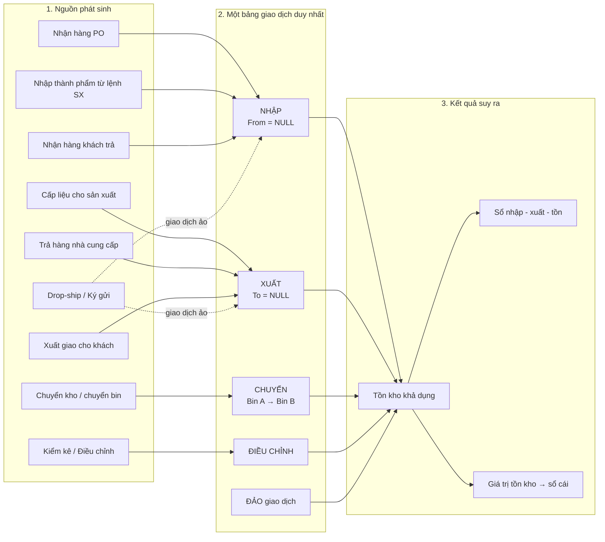

# 3000 Giao dịch nhập, xuất & chuyển kho

Đây là **bài gốc** về giao dịch kho. Mọi bài khác — [Nhận hàng](../2-mua-hang/4000-nhan-hang-va-kiem-qc.md), [Giao hàng](../4-ban-hang/3000-giao-hang-va-xuat-kho.md), [Lệnh sản xuất](../3-san-xuat/thuc-thi/6000-lenh-san-xuat-va-wip.md), [Kiểm kê](./5000-kiem-ke-va-dieu-chinh.md) — chỉ được mô tả **sự kiện nghiệp vụ dẫn tới** giao dịch, còn cơ chế ghi sổ định nghĩa duy nhất ở đây.

---

## 0. Nguyên lý (áp dụng mọi ERP)

1. **Tồn kho không phải một con số, mà là kết quả cộng dồn của các giao dịch.** Hệ thống chuẩn không cho phép "sửa số tồn"; nó chỉ cho phép **ghi thêm giao dịch**. Muốn sửa sai, phải ghi giao dịch đảo. Đây là nền tảng của mọi audit trail trong kho.
2. **Chỉ có 5 loại chuyển động (movement type).** Mọi nghiệp vụ kho — dù mua, bán, sản xuất, trả hàng, chuyển kho, kiểm kê — đều quy về một trong năm loại: **Nhập (Receipt)**, **Xuất (Issue)**, **Chuyển (Transfer)**, **Điều chỉnh (Adjustment)**, và **Đảo (Reversal)**. Hệ thống nào có nhiều hơn năm loại thường là do đặt tên chứ không phải do bản chất khác.
3. **Mỗi giao dịch là một cặp (vị trí nguồn → vị trí đích).** Nhập = từ `NULL/Supplier` → bin; Xuất = từ bin → `NULL/Customer/Production`; Chuyển = bin A → bin B; Điều chỉnh = từ `NULL` → bin (tăng) hoặc bin → `NULL` (giảm). Thiết kế bảng theo cặp này giúp mọi báo cáo nhập-xuất-tồn đều suy ra được từ **một** bảng duy nhất.
4. **Giá trị đi kèm số lượng.** Mỗi giao dịch phải mang cả `Qty` và `Unit Cost` (hoặc `Transaction Value`), vì kho là sổ cái vật chất nhưng đồng thời là nguồn dữ liệu giá vốn. Giao dịch kho không có giá trị là lỗ hổng lớn nhất khiến kho và sổ cái lệch nhau.
5. **Giao dịch ảo (logical/virtual) không đụng tồn kho vật lý.** Với drop-ship, consignment, hàng ký gửi, hệ thống vẫn phải ghi nhận chuyển động để có dòng chứng từ đối soát, nhưng đánh dấu để **loại khỏi** báo cáo On-hand. Không có cơ chế này thì hoặc mất dấu đối soát, hoặc sinh tồn kho ảo.
6. **Giao dịch kho không được sửa sau khi đã ghi sổ kỳ.** Chỉ được đảo trong kỳ hiện tại, hoặc đảo bút toán tại kỳ mở. Đây là ranh giới giữa "sửa lỗi nghiệp vụ" và "làm giả sổ".

## 1. Luồng vận hành



## 2. Ai làm gì ở module nào

| Loại giao dịch | Kho (INV) | Mua hàng (PO) | Sản xuất (MFG) | Bán hàng (OM) | Kế toán (GL) |
|---|---|---|---|---|---|
| **Nhập từ PO** | ✅ ghi giao dịch (sau khi Deliver) | ✅ xác nhận PO, duyệt sai lệch | — | — | Nhận bút toán tồn kho + trung gian |
| **Nhập từ sản xuất** | ✅ ghi giao dịch nhập thành phẩm | — | ✅ hoàn thành lệnh SX | — | Nhận bút toán WIP → Thành phẩm |
| **Nhập từ RMA** | ✅ ghi giao dịch nhập hàng trả | — | — | ✅ duyệt RMA | Nhận bút toán đảo giá vốn |
| **Xuất cho bán** | ✅ ghi giao dịch xuất | — | — | ✅ xác nhận giao hàng | Nhận bút toán COGS |
| **Xuất cho sản xuất** | ✅ ghi giao dịch cấp liệu | — | ✅ yêu cầu cấp vật tư theo BOM | — | Nhận bút toán NVL vào WIP |
| **Xuất trả NCC** | ✅ ghi giao dịch xuất | ✅ duyệt trả hàng | — | — | Nhận bút toán giảm trung gian |
| **Chuyển kho/bin** | ✅ ghi giao dịch chuyển | — | — | — | Không sinh bút toán (chỉ đổi vị trí) |
| **Điều chỉnh / kiểm kê** | ✅ ghi giao dịch điều chỉnh | — | — | — | ✅ duyệt và nhận bút toán chênh lệch |

**Nguyên tắc phân quyền cốt lõi:** chỉ **Kho** được tạo giao dịch; các module khác chỉ **yêu cầu** (tạo chứng từ nguồn) và **đọc** kết quả. Nếu mua hàng hay bán hàng được phép ghi thẳng vào bảng giao dịch kho, dòng chứng từ sẽ mất tính truy vết.

## 3. Hạch toán

Bài này **không định nghĩa lại tài khoản**. Bản đồ tài khoản trung gian, tài khoản kho, chênh lệch giá và nguyên tắc tất toán nằm duy nhất tại [1000 Hạch toán & tài khoản trung gian](../6-ke-toan-chung/1000-hach-toan-va-tai-khoan-trung-gian.md).

Ba điều kho cần nhớ:

1. **Không phải mọi giao dịch đều sinh bút toán.** Chuyển kho, chuyển bin, và giao dịch ảo drop-ship **không** phát sinh bút toán GL (chỉ có bút toán tại thời điểm xác nhận doanh thu/giá vốn theo luồng nghiệp vụ).
2. **Điều chỉểm kê luôn phải qua duyệt** rồi mới đẩy sang GL; không cho phép ghi thẳng từ màn hình kiểm kê.
3. **Giao dịch ảo phải gắn cờ** để loại khỏi báo cáo On-hand nhưng vẫn xuất hiện trong sổ nhập-xuất-tồn.

## 4. Điểm chạm & rủi ro

- **Nhận hàng từ PO** → [4000 Nhận hàng & kiểm tra chất lượng](../2-mua-hang/4000-nhan-hang-va-kiem-qc.md)
- **Khớp hóa đơn AP** → [5000 Đối soát hóa đơn & 3-Way Match](../2-mua-hang/5000-doi-soat-hoa-don-va-3-way-match.md)
- **Cấp liệu và nhập thành phẩm** → [SX 6000 Lệnh sản xuất & WIP](../3-san-xuat/thuc-thi/6000-lenh-san-xuat-va-wip.md)
- **Xuất cho bán và POD** → [BH 3000 Giao hàng & xuất kho](../4-ban-hang/3000-giao-hang-va-xuat-kho.md)
- **Kiểm kê và âm kho** → [5000 Kiểm kê & điều chỉnh](./5000-kiem-ke-va-dieu-chinh.md)
- **Truyền thông tin giá trị sang sổ cái** → [6000 Định giá & báo cáo kho](./6000-dinh-gia-va-bao-cao-kho.md)
- **Drop-ship:** [PO 6000 Mô hình mua đặc thù](../2-mua-hang/6000-mo-hinh-mua-dac-thu.md) và [BH 5000 Mô hình bán đặc thù](../4-ban-hang/5000-mo-hinh-ban-dac-thu.md)

**Rủi ro chính:** (1) cho sửa số tồn trực tiếp → mất audit trail; (2) giao dịch thiếu giá trị → kho và GL lệch; (3) giao dịch ảo không cờ → On-hand bị thổi phồng; (4) chuyển kho sinh bút toán → sai bản chất chi phí.

## 5. Triển khai tham chiếu ERP

### A. Ánh xạ loại chuyển động giữa các hệ thống

| Nghiệp vụ | Oracle EBS | Epicor ERP | SAP S/4HANA | Odoo |
|---|---|---|---|---|
| Nhập từ PO | `RCV_TRANSACTIONS` type `DELIVER` / `MTL_MATERIAL_TRANSACTIONS` `PUR-STK` | `Erp.PartTran` `PUR-STK` | Movement Type `101` (từ PO) | `stock.move` từ Receipt |
| Nhập từ sản xuất | `RCV` type `RECEIVE` / `MTL` `WIP-COMP` | `PartTran` `MFG-STK` | `101` / `131` | `stock.move` từ Manufacturing |
| Nhập hàng khách trả | `MTL` `RMA-STK` | `PartTran` `RMA-STK` | `651` (return delivery) | `stock.move` từ Return |
| Xuất bán | `MTL` `SHIP` / `STK-CUS` | `PartTran` `STK-CUS` | `601` (PGI) | `stock.move` Delivery |
| Xuất cho sản xuất | `MTL` `WIP-ISSUE` | `PartTran` `STK-MTL` | `261` | `stock.move` từ Manufacturing |
| Xuất trả NCC | `MTL` `RTV` | `PartTran` `STK-VEND` | `122` (return PO) | `stock.move` Return to Vendor |
| Chuyển kho | `MTL` `TRANSFER` | `PartTran` `STK-STK` | `301` / `311` | `stock.move` Internal |
| Chuyển bin | `MTL` `TRANSFER` cùng Subinventory | `PartTran` `STK-STK` cùng Warehouse | `311` cùng SLoc | `stock.move` Internal cùng Location |
| Điều chỉnh | `MTL` `ADJ-UP` / `ADJ-DN` | `PartTran` `ADJ-CST` / `ADJ-QTY` | `701` (+), `702` (−) | `stock.move` Inventory Adjust |
| Đảo giao dịch | `RCV_TRANSACTIONS` type `RETURN` | `PartTran` `REV` (Reverse) | Reversal document | `stock.move` Return |

### B. Mô hình dữ liệu gợi ý cho hệ thống tự xây

Nếu bạn tự xây module kho, tối thiểu cần **một** bảng giao dịch phẳng (append-only):

```sql
CREATE TABLE Inventory_Transaction (
    Trx_ID          BIGINT IDENTITY PRIMARY KEY,
    Trx_Type        VARCHAR(20),
    From_Location   VARCHAR(50),
    To_Location     VARCHAR(50),
    Item_ID         VARCHAR(50),
    Lot_Serial      VARCHAR(50),
    Qty             DECIMAL(18,4),
    UOM             VARCHAR(10),
    Unit_Cost       DECIMAL(18,6),
    Trx_Date        DATETIME,
    Trx_Source      VARCHAR(20),
    Source_Doc_No   VARCHAR(50),
    Is_Logical      BIT DEFAULT 0,
    Reversed_Trx_ID BIGINT NULL,
    Created_By      VARCHAR(50),
    Created_At      DATETIME DEFAULT GETDATE()
);
CREATE INDEX IX_InvTrx_Item_Loc
    ON Inventory_Transaction (Item_ID, To_Location, From_Location);
```

**Ý nghĩa từng cột:**

| Cột | Ý nghĩa |
|---|---|
| `Trx_Type` | `RECEIPT` · `ISSUE` · `TRANSFER` · `ADJUSTMENT` · `REVERSAL` |
| `From_Location` | `NULL` khi nhập từ ngoài (nhà cung cấp / sản xuất / khách trả) |
| `To_Location` | `NULL` khi xuất ra ngoài (khách / sản xuất / trả NCC) |
| `Qty` | Luôn dương; chiều xác định bằng From/To |
| `UOM` | UOM của giao dịch; quy về UOM gốc khi báo cáo |
| `Unit_Cost` | Bắt buộc với giao dịch nhập; giao dịch xuất kế thừa giá |
| `Trx_Source` | `PO` · `WO` · `SO` · `RMA` · `COUNT` · `MANUAL` |
| `Source_Doc_No` | Số chứng từ nguồn (PO / Phiếu nhận / Lệnh SX / Đơn bán) |
| `Is_Logical` | `1` = giao dịch ảo (drop-ship, ký gửi) — loại khỏi On-hand |
| `Reversed_Trx_ID` | Trỏ về giao dịch bị đảo |

**Bốn ràng buộc bắt buộc:**

1. `From_Location` và `To_Location` **không được cùng NULL** (giao dịch không xác định vị trí).
2. Không `UPDATE` / `DELETE`; chỉ `INSERT`. Sửa sai = ghi `REVERSAL` với `Reversed_Trx_ID`.
3. `Qty > 0`; chiều biểu diễn bằng `From/To`, không dùng số âm.
4. Mọi giao dịch phải có `Source_Doc_No` — giao dịch "không có chứng từ nguồn" chỉ được phép cho `ADJUSTMENT` có phê duyệt.

### C. Truy vấn kiểm soát

**Epicor — đối soát tồn kho suy ra từ giao dịch với bảng tồn thực tế:**

```sql
/* Tồn suy ra từ PartTran so với PartBin — chênh lệch phải bằng 0 */
SELECT pt.Company, pt.PartNum, pt.WarehouseCode, pt.BinNum,
       SUM(CASE WHEN pt.TranType LIKE '%-STK' THEN pt.TranQty ELSE -pt.TranQty END) AS Qty_From_Tran,
       ISNULL(pb.OnhandQty, 0) AS Qty_From_Bin,
       SUM(CASE WHEN pt.TranType LIKE '%-STK' THEN pt.TranQty ELSE -pt.TranQty END) - ISNULL(pb.OnhandQty, 0) AS Diff
FROM Erp.PartTran pt
LEFT JOIN Erp.PartBin pb
       ON pb.Company = pt.Company AND pb.PartNum = pt.PartNum
      AND pb.WarehouseCode = pt.WarehouseCode AND pb.BinNum = pt.BinNum
WHERE pt.Company = 'YOUR_COMPANY_CODE'
GROUP BY pt.Company, pt.PartNum, pt.WarehouseCode, pt.BinNum, pb.OnhandQty
HAVING ABS(SUM(CASE WHEN pt.TranType LIKE '%-STK' THEN pt.TranQty ELSE -pt.TranQty END) - ISNULL(pb.OnhandQty, 0)) > 0.0001;
```

**Oracle EBS — phát hiện giao dịch trong kỳ đã khóa sổ:**

```sql
SELECT hou.name AS operating_unit, mmt.transaction_id, mmt.transaction_type_id,
       mmt.inventory_item_id, mmt.organization_id, mmt.transaction_quantity,
       mmt.transaction_date, mp.period_name, mp.closing_status
FROM mtl_material_transactions mmt
JOIN org_acct_periods oap ON mmt.organization_id = oap.organization_id
JOIN mtl_parameters mp     ON mmt.organization_id = mp.organization_id
JOIN hr_operating_units hou ON mp.organization_id = hou.organization_id
WHERE mmt.transaction_date < oap.period_start_date
  AND mp.closing_status = 'C';   -- tìm giao dịch hạch toán vào kỳ đã đóng
```

**Hệ thống tự xây — giao dịch thiếu giá trị hoặc thiếu chứng từ nguồn:**

```sql
SELECT Trx_ID, Trx_Type, Item_ID, Qty, Unit_Cost, Source_Doc_No, Created_At
FROM Inventory_Transaction
WHERE Unit_Cost IS NULL OR Unit_Cost = 0
   OR (Source_Doc_No IS NULL AND Trx_Type <> 'ADJUSTMENT')
ORDER BY Created_At DESC;
```

## 6. Bẫy thực chiến & Checklist

| # | Bẫy | Triệu chứng | Cách phòng tránh |
|---|---|---|---|
| 1 | Cho phép sửa/xóa giao dịch kho sau khi lưu | Báo cáo nhập-xuất-tồn thay đổi "sau lưng" kế toán, không truy vết được | Bảng append-only + giao dịch đảo có `Reversed_Trx_ID` |
| 2 | Giao dịch thiếu giá vốn | Kho đúng số lượng nhưng lệch tiền so với GL | Bắt buộc `Unit_Cost` (với giao dịch nhập); giao dịch xuất kế thừa giá theo phương pháp |
| 3 | Chuyển kho lại sinh bút toán GL | Chi phí bị "dịch chuyển" giữa hai kho cùng pháp nhân, cân đối GL bị nhiễu | Chỉ sinh bút toán khi vượt pháp nhân; chuyển nội bộ là giao dịch kho thuần |
| 4 | Giao dịch ảo không có cờ | Drop-ship làm On-hand tăng vô ích, MRP đề xuất mua sai | Cờ `Is_Logical` + loại khỏi báo cáo On-hand |
| 5 | Điều chỉnh không có chứng từ nguồn | Không giải trình được với kiểm toán | Chỉ cho `ADJUSTMENT` khi gắn số phiếu kiểm kê/phiếu điều chỉnh có duyệt |
| 6 | Không phân biệt giao dịch trong kỳ đã khóa | Hoạch toán vào kỳ đã đóng làm sổ phụ và GL lệch | Chặn theo lịch kỳ; muốn ghi thì mở kỳ hoặc tạo bút toán điều chỉnh kỳ sau |
| 7 | UOM hỗn hợp trong báo cáo | Tồn kho đúng nhưng báo cáo sai khi có UOM mua/bán khác UOM kho | Quy mọi báo cáo về UOM gốc — xem [5000 Nguyên lý UOM](../0-nen-tang/5000-nguyen-ly-quy-doi-uom.md) |
| 8 | Gộp nhiều dòng PO vào một giao dịch | Không xác định được dòng PO nào đã nhận đủ cho khớp lệnh 3 chiều | Một giao dịch = một dòng chứng từ nguồn |

**Checklist trước go-live:**

- [ ] Bảng giao dịch chỉ `INSERT`, không `UPDATE`/`DELETE`.
- [ ] Có cột `Is_Logical` (hoặc tương đương) và báo cáo On-hand loại trừ nó.
- [ ] Mọi giao dịch nhập có `Unit_Cost`; giao dịch xuất kế thừa được giá.
- [ ] Chặn giao dịch vào kỳ đã khóa (kiểm tra theo lịch kỳ, không theo ngày chứng từ).
- [ ] Báo cáo đối soát "tồn suy ra từ giao dịch vs bảng tồn" chạy hằng ngày và phải = 0.
- [ ] Điều chỉnh kho bắt buộc có chứng từ nguồn + phê duyệt.
- [ ] Đã test: nhận 100 → xuất 90 → chuyển bin 10 → kiểm kê phát hiện lệch 2 → đảo giao dịch → tồn cuối đúng.

## Xem thêm

- [0000 Tổng quan Kho](./0000-tong-quan-kho.md)
- [1000 Cấu trúc kho & vị trí](./1000-cau-truc-kho-va-vi-tri.md)
- [2000 Item Master & thuộc tính kho](./2000-item-master-va-thuoc-tinh-kho.md)
- [4000 Giữ hàng, phân bổ & ATP](./4000-giu-hang-phan-bo-va-atp.md)
- [5000 Kiểm kê & điều chỉnh](./5000-kiem-ke-va-dieu-chinh.md)
- [6000 Định giá & báo cáo kho](./6000-dinh-gia-va-bao-cao-kho.md)

<div align="center" style={{color: 'var(--ifm-color-primary)'}}>
  <strong>Chúc các bạn thành công và vui vẻ!</strong>
</div>
