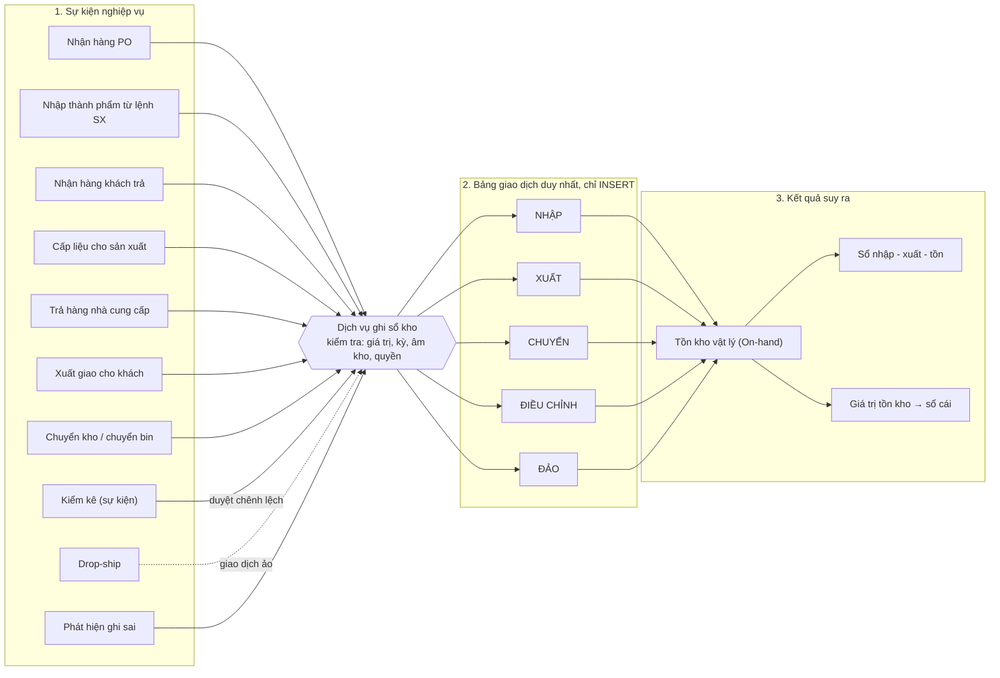

# 3000 Giao dịch nhập, xuất & chuyển kho

Đây là **bài gốc** về giao dịch kho. Mọi bài khác — [Nhận hàng](../2-mua-hang/4000-nhan-hang-va-kiem-qc.md), [Giao hàng](../4-ban-hang/3000-giao-hang-va-xuat-kho.md), [Lệnh sản xuất](../3-san-xuat/thuc-thi/6000-lenh-san-xuat-va-wip.md), [Kiểm kê](./5000-kiem-ke-va-dieu-chinh.md) — chỉ mô tả **sự kiện nghiệp vụ dẫn tới** giao dịch. Cơ chế ghi sổ được định nghĩa duy nhất ở đây.

---

## 0. Nguyên lý (áp dụng mọi ERP)

1. **Tồn kho không phải một con số, mà là kết quả cộng dồn của các giao dịch.** Hệ thống chuẩn không cho phép "sửa số tồn"; nó chỉ cho phép **ghi thêm giao dịch**. Muốn sửa sai, ghi giao dịch đảo. Đây là nền tảng của mọi audit trail trong kho.
2. **Chỉ có 5 loại chuyển động gốc:** **Nhập (Receipt)**, **Xuất (Issue)**, **Chuyển (Transfer)**, **Điều chỉnh (Adjustment)** và **Đảo (Reversal)**. Mọi nghiệp vụ — mua, bán, sản xuất, trả hàng, chuyển kho — đều quy về một trong năm loại này. Kiểm kê **không phải** loại giao dịch; nó là *sự kiện* dẫn tới giao dịch Điều chỉnh. Các hệ thống lớn như SAP có hàng trăm movement type, nhưng đó đều là biến thể của năm loại gốc: khác nhau ở **quy tắc hạch toán** và **chứng từ nguồn**, không khác ở bản chất chuyển động.
3. **Mỗi giao dịch là một cặp (vị trí nguồn → vị trí đích), và cả hai đầu đều là vị trí có tên.** Thế giới bên ngoài kho cũng được mô hình hóa thành *vị trí ảo*: `SUPPLIER`, `CUSTOMER`, `WIP`, `ADJUSTMENT`, `SCRAP`. Khi đó:
   - Nhập = `SUPPLIER` (hoặc `WIP`, `CUSTOMER` khi khách trả) → khu chờ kiểm hoặc bin
   - Xuất = bin → `CUSTOMER` / `WIP` / `SUPPLIER` (trả NCC) / `SCRAP` (huỷ)
   - Chuyển = bin A → bin B (gồm cả chuyển từ khu chờ kiểm sang bin chính)
   - Điều chỉnh tăng = `ADJUSTMENT` → bin; giảm = bin → `ADJUSTMENT`

   Cách làm này (giống Odoo) có một lợi ích lớn: **tổng tồn của mọi vị trí, kể cả vị trí ảo, luôn bằng 0**. Nếu không bằng 0 thì có giao dịch bị ghi sai. Dùng `NULL` cho "bên ngoài" thì mất khả năng tự kiểm tra này.
4. **Giá trị đi kèm số lượng.** Mỗi giao dịch mang cả `Qty` và `Unit_Cost`, vì kho là sổ cái vật chất đồng thời là nguồn dữ liệu giá vốn. Giao dịch kho không có giá trị là lỗ hổng lớn nhất khiến kho và sổ cái lệch nhau.
5. **Giao dịch ảo (logical) không đụng tồn kho vật lý.** Với drop-ship (hàng đi thẳng từ nhà cung cấp tới khách, không qua kho), hệ thống vẫn ghi chuyển động để có dòng chứng từ đối soát, nhưng gắn cờ để **loại khỏi** báo cáo On-hand. Không có cơ chế này thì hoặc mất dấu đối soát, hoặc sinh tồn kho ảo. Hàng ký gửi của nhà cung cấp nằm trong kho mình thì khác: đó là hàng thật, ghi vào vị trí vật lý có `Ownership = VENDOR` (xem [1000 Cấu trúc kho & vị trí](./1000-cau-truc-kho-va-vi-tri.md)) và vẫn nằm trong On-hand.

   **On-hand** trong bộ tài liệu này là **tồn vật lý**: gồm mọi hàng đang nằm trong kho, kể cả hàng ở khu chờ kiểm và khu biệt trữ. Phần hàng thực sự được bán hoặc cấp cho sản xuất gọi là **tồn khả dụng**, xem [4000 Giữ hàng, phân bổ & ATP](./4000-giu-hang-phan-bo-va-atp.md).
6. **Một dịch vụ ghi sổ kho duy nhất.** Các module khác (mua, bán, sản xuất) không ghi trực tiếp vào bảng giao dịch; chúng **kích hoạt** dịch vụ ghi sổ kho thông qua chứng từ nguồn. Nhờ vậy mọi kiểm tra (đủ giá trị, đúng kỳ, không âm kho, đúng quyền) nằm ở một chỗ.
7. **Không sửa giao dịch đã ghi.** Sửa sai bằng giao dịch đảo, ghi vào **kỳ đang mở** với ngày hạch toán hiện tại. Giao dịch của kỳ đã khóa không bao giờ bị động tới. Đây là ranh giới giữa "sửa lỗi nghiệp vụ" và "làm giả sổ".

## 1. Luồng vận hành



## 2. Ai làm gì ở module nào

Quy tắc: module nguồn **tạo sự kiện / chứng từ nguồn**; dịch vụ ghi sổ kho **tạo giao dịch**; kế toán **nhận và kiểm soát hệ quả tài chính**.

| Loại giao dịch | Sự kiện kích hoạt (module nguồn) | Kho ghi giao dịch | Kế toán (GL) |
|---|---|---|---|
| **Nhập từ PO** | Mua hàng: xác nhận PO, duyệt sai lệch. Kho: nhận hàng thực tế | ✅ Nhập `SUPPLIER` → khu chờ kiểm (mặt hàng cần kiểm) hoặc → bin (mặt hàng không cần kiểm) | Tùy cấu hình ghi nhận, xem mục 3 |
| **Cất hàng sau kiểm** | QC: quyết định đạt. Kho: cất hàng | ✅ Chuyển khu chờ kiểm → bin chính | Tùy cấu hình ghi nhận, xem mục 3 |
| **Nhập từ sản xuất** | Sản xuất: hoàn thành lệnh SX | ✅ Nhập `WIP` → bin | Bút toán WIP → Thành phẩm |
| **Nhập từ RMA** | Bán hàng: duyệt RMA; kho nhận hàng trả | ✅ Nhập `CUSTOMER` → bin | Đảo giá vốn |
| **Xuất cho bán** | Bán hàng: xác nhận giao hàng | ✅ Xuất bin → `CUSTOMER` | Ghi nhận giá vốn (COGS) |
| **Xuất cho sản xuất** | Sản xuất: yêu cầu cấp vật tư theo BOM | ✅ Xuất bin → `WIP` | NVL vào WIP |
| **Xuất trả NCC** | Mua hàng: duyệt trả hàng | ✅ Xuất bin → `SUPPLIER` | Giảm tài khoản trung gian / công nợ |
| **Chuyển kho / bin** | Kho | ✅ Chuyển bin A → bin B | Chỉ sinh bút toán khi đổi pháp nhân, đổi tài khoản tồn kho hoặc có hàng đang vận chuyển (xem mục 3) |
| **Điều chỉnh** | Kho: kiểm kê hoặc phiếu điều chỉnh, **đã được duyệt** | ✅ Điều chỉnh qua `ADJUSTMENT` | Duyệt và nhận bút toán chênh lệch |
| **Đảo** | Người có quyền, kèm lý do | ✅ Giao dịch đối ứng, trỏ về giao dịch gốc | Đảo bút toán tương ứng trong kỳ mở |
| **Huỷ / phế** | Kho: lập phiếu huỷ đã được duyệt (hàng lỗi không trả được, hết hạn) | ✅ Xuất bin hoặc khu biệt trữ → `SCRAP` | Ghi chi phí hàng huỷ |

**Phân quyền cốt lõi:** không module nào ngoài dịch vụ ghi sổ kho được `INSERT` vào bảng giao dịch. Nếu mua hàng hay bán hàng ghi thẳng, các kiểm tra (kỳ, âm kho, giá trị) bị bỏ qua và dòng chứng từ mất truy vết. Nguyên tắc tách nhiệm vụ chi tiết xem [4000 Kiểm soát nội bộ & phân tách nhiệm vụ](../0-nen-tang/4000-kiem-soat-noi-bo-va-phan-tach-nhiem-vu.md).

## 3. Hạch toán

Bài này **không định nghĩa lại tài khoản**. Bản đồ tài khoản trung gian, tài khoản kho, chênh lệch giá và nguyên tắc tất toán nằm duy nhất tại [1000 Hạch toán & tài khoản trung gian](../6-ke-toan-chung/1000-hach-toan-va-tai-khoan-trung-gian.md). Phần dưới chỉ trả lời câu hỏi của người làm kho: **giao dịch nào sinh bút toán, giao dịch nào không.**

| Giao dịch | Sinh bút toán? | Ghi chú |
|---|---|---|
| Nhập / Xuất với bên ngoài (NCC, khách, sản xuất) | Có | Theo quy tắc của luồng nghiệp vụ tương ứng; riêng nhập từ PO xem dòng bên dưới |
| Điều chỉnh | Có, **sau khi duyệt** | Không đẩy thẳng từ màn hình kiểm kê sang GL |
| Đảo | Có | Bút toán đảo của giao dịch gốc, trong kỳ mở |
| Chuyển bin trong cùng kho | Không | Chỉ đổi vị trí |
| Chuyển kho, **cùng pháp nhân và cùng tài khoản tồn kho** | Không | Chỉ đổi vị trí |
| Chuyển kho **khác pháp nhân** | Có | Phát sinh nội bộ giữa hai pháp nhân |
| Chuyển kho **khác tài khoản tồn kho** (ví dụ kho NVL sang kho thành phẩm tách tài khoản) | Có | Chuyển giá trị giữa hai tài khoản |
| Chuyển kho có **hàng đang vận chuyển (in-transit)** | Có | Ghi qua tài khoản hàng đang đi đường cho tới khi nhận |
| Giao dịch ảo (drop-ship) | **Không sinh bút toán tồn kho** | Bút toán tài khoản trung gian và giá vốn vẫn phát sinh theo luồng nghiệp vụ của mua/bán |
| Nhập từ PO (bước Nhận) | **Tùy cấu hình** | Có bút toán nếu ghi nhận khi nhận; không có nếu ghi nhận khi nhập kho. Xem [Nhận hàng & kiểm tra chất lượng](../2-mua-hang/4000-nhan-hang-va-kiem-qc.md) |
| Chuyển từ khu chờ kiểm sang bin chính | **Tùy cấu hình** | Có bút toán chuyển từ tài khoản hàng chờ kiểm sang tồn kho, hoặc bút toán đầy đủ, tùy cấu hình ghi nhận |
| Huỷ / phế | Có, **sau khi duyệt** | Ghi chi phí hàng huỷ, không đẩy thẳng sang sổ cái |

Ba điều kho cần nhớ:

1. **"Không sinh bút toán" nghĩa là không sinh bút toán *tồn kho*,** không có nghĩa là luồng tài chính biến mất. Với drop-ship, hàng không qua kho nhưng công nợ và giá vốn vẫn phải ghi nhận.
2. **Điều chỉnh luôn qua duyệt** rồi mới sang GL.
3. **Giao dịch ảo phải gắn cờ** để loại khỏi On-hand nhưng vẫn xuất hiện trong sổ nhập-xuất-tồn.

## 4. Điểm chạm & rủi ro

- **Nhận hàng từ PO** → [4000 Nhận hàng & kiểm tra chất lượng](../2-mua-hang/4000-nhan-hang-va-kiem-qc.md)
- **Khớp hóa đơn AP** → [5000 Đối soát hóa đơn & 3-Way Match](../2-mua-hang/5000-doi-soat-hoa-don-va-3-way-match.md)
- **Cấp liệu và nhập thành phẩm** → [SX 6000 Lệnh sản xuất & WIP](../3-san-xuat/thuc-thi/6000-lenh-san-xuat-va-wip.md)
- **Xuất cho bán và POD** → [BH 3000 Giao hàng & xuất kho](../4-ban-hang/3000-giao-hang-va-xuat-kho.md)
- **Kiểm kê và âm kho** → [5000 Kiểm kê & điều chỉnh](./5000-kiem-ke-va-dieu-chinh.md)
- **Chuyển giá trị sang sổ cái** → [6000 Định giá & báo cáo kho](./6000-dinh-gia-va-bao-cao-kho.md)
- **Drop-ship:** [PO 6000 Mô hình mua đặc thù](../2-mua-hang/6000-mo-hinh-mua-dac-thu.md) và [BH 5000 Mô hình bán đặc thù](../4-ban-hang/5000-mo-hinh-ban-dac-thu.md)
- **Quy đổi UOM:** [0-nền tảng 5000 Nguyên lý quy đổi UOM](../0-nen-tang/5000-nguyen-ly-quy-doi-uom.md)

**Rủi ro chính:** (1) cho sửa hoặc xóa giao dịch → mất audit trail; (2) giao dịch nhập thiếu giá trị → kho và GL lệch; (3) giao dịch ảo không cờ → On-hand bị thổi phồng, MRP đề xuất mua sai; (4) chuyển kho sinh hoặc không sinh bút toán sai quy tắc → sai bản chất chi phí; (5) module khác ghi thẳng vào bảng giao dịch → bỏ qua kiểm soát.

## 5. Triển khai tham chiếu ERP

### A. Ánh xạ loại chuyển động giữa các hệ thống

> **Lưu ý:** tên và mã dưới đây là tham chiếu để định hướng. Mỗi phiên bản và mỗi cấu hình có thể khác, hãy đối chiếu với danh mục loại giao dịch thật của hệ thống trước khi dùng trong thiết kế hoặc báo cáo. Ô đánh dấu `*` là chỗ cần kiểm tra kỹ nhất.

| Nghiệp vụ | Oracle EBS (`transaction_type_name`) | Epicor (`PartTran.TranType`) | SAP S/4HANA (Movement Type) | Odoo |
|---|---|---|---|---|
| Nhập từ PO | PO Receipt | `PUR-STK` | `101` | `stock.move` Supplier → Stock |
| Nhập từ sản xuất | WIP Completion | `MFG-STK` | `101` (với lệnh sản xuất) | `stock.move` Production → Stock |
| Nhập hàng khách trả | RMA Receipt | `*` kiểm tra | `651` | `stock.move` Customer → Stock (Return) |
| Xuất bán | Sales Order Issue | `STK-CUS` | `601` | `stock.move` Stock → Customer |
| Xuất cho sản xuất | WIP Issue | `STK-MTL` | `261` | `stock.move` Stock → Production |
| Xuất trả NCC | Return to Vendor `*` | `*` kiểm tra | `122` | `stock.move` Stock → Supplier (Return) |
| Chuyển kho | Direct Org Transfer / Inter-org Transfer | `STK-STK` (khác kho) | `301` | `stock.move` Internal |
| Chuyển bin | Subinventory Transfer (và chuyển locator) | `STK-STK` (cùng kho) | `311` | `stock.move` Internal |
| Điều chỉnh | Miscellaneous Receipt / Issue, Cycle Count Adjustment, Physical Inventory Adjustment | `ADJ-QTY`, `ADJ-CST` | `701` (+), `702` (−) | `stock.move` Inventory Adjustment |
| Đảo giao dịch | Giao dịch đối ứng; riêng nhận hàng dùng "Correct" / "Return" `*` | `*` kiểm tra | Mã đảo (thường là mã gốc +1, ví dụ `102`, `262`, `602`) | Return / điều chỉnh đối ứng |

**Cách lấy danh mục chuẩn:**
- Oracle EBS: bảng `MTL_TRANSACTION_TYPES` (`transaction_type_id`, `transaction_type_name`).
- SAP: bảng cấu hình Movement Type (`T156`) và lịch sử chứng từ vật tư (`MKPF`/`MSEG`, hoặc `MATDOC` trên S/4HANA).
- Epicor: danh mục `TranType` trong `Erp.PartTran` của chính môi trường bạn.

### B. Mô hình dữ liệu gợi ý cho hệ thống tự xây

Bảng danh mục vị trí `Inv_Location` (gồm cả vị trí ảo) được định nghĩa đầy đủ ở [1000 Cấu trúc kho & vị trí](./1000-cau-truc-kho-va-vi-tri.md). Bài này chỉ dùng các cột `Location_ID`, `Location_Type` (`PHYSICAL` hoặc `VIRTUAL`) và `Legal_Entity_ID`. Vị trí ảo mặc định: `SUPPLIER`, `CUSTOMER`, `WIP`, `ADJUSTMENT`, `SCRAP`.

Tối thiểu cần **ba** bảng: danh mục vị trí, **một** bảng giao dịch phẳng chỉ `INSERT`, và bảng số dư theo vị trí (suy ra từ giao dịch, dùng để đọc nhanh và để kiểm tra âm kho).

```sql
CREATE TABLE Inventory_Transaction (
    Trx_ID           BIGINT IDENTITY PRIMARY KEY,
    Trx_Type         VARCHAR(20)  NOT NULL,   -- RECEIPT | ISSUE | TRANSFER | ADJUSTMENT | REVERSAL
    From_Location_ID VARCHAR(50)  NOT NULL REFERENCES Inv_Location(Location_ID),
    To_Location_ID   VARCHAR(50)  NOT NULL REFERENCES Inv_Location(Location_ID),
    Legal_Entity_ID  VARCHAR(20)  NOT NULL,
    Item_ID          VARCHAR(50)  NOT NULL,
    Lot_No           VARCHAR(50)  NULL,       -- theo mã hàng quản lý lô
    Serial_No        VARCHAR(50)  NULL,       -- theo mã hàng quản lý serial
    Qty              DECIMAL(18,4) NOT NULL,  -- theo UOM giao dịch, luôn dương
    UOM              VARCHAR(10)  NOT NULL,
    Qty_Base         DECIMAL(18,4) NOT NULL,  -- đã quy về UOM gốc
    Unit_Cost        DECIMAL(18,6) NULL,      -- theo UOM gốc
    Trx_Date         DATETIME     NOT NULL,   -- ngày xảy ra thực tế
    Posting_Date     DATE         NOT NULL,   -- ngày hạch toán
    Period_ID        VARCHAR(10)  NOT NULL,   -- kỳ kế toán của Posting_Date
    Reason_Code      VARCHAR(20)  NULL,
    Trx_Source       VARCHAR(20)  NOT NULL,   -- PO | WO | SO | RMA | COUNT | MANUAL
    Source_Doc_No    VARCHAR(50)  NULL,
    Source_Line_No   INT          NULL,
    Is_Logical       BIT          NOT NULL DEFAULT 0,
    Reversed_Trx_ID  BIGINT       NULL REFERENCES Inventory_Transaction(Trx_ID),
    Created_By       VARCHAR(50)  NOT NULL,
    Created_At       DATETIME     NOT NULL DEFAULT GETDATE(),
    CONSTRAINT CK_Trx_Qty_Pos   CHECK (Qty > 0 AND Qty_Base > 0),
    CONSTRAINT CK_Trx_Diff_Loc  CHECK (From_Location_ID <> To_Location_ID)
);

-- Mỗi giao dịch chỉ bị đảo tối đa một lần
CREATE UNIQUE INDEX UX_InvTrx_Reversed
    ON Inventory_Transaction (Reversed_Trx_ID)
    WHERE Reversed_Trx_ID IS NOT NULL;

-- Hai chiều truy vấn tồn: theo đích và theo nguồn
CREATE INDEX IX_InvTrx_Item_To   ON Inventory_Transaction (Item_ID, To_Location_ID)   INCLUDE (Qty_Base, Is_Logical);
CREATE INDEX IX_InvTrx_Item_From ON Inventory_Transaction (Item_ID, From_Location_ID) INCLUDE (Qty_Base, Is_Logical);
CREATE INDEX IX_InvTrx_Source    ON Inventory_Transaction (Source_Doc_No, Source_Line_No);
```
```sql
-- Số dư theo vị trí: bản suy ra từ Inventory_Transaction, cập nhật trong CÙNG transaction với mỗi giao dịch
CREATE TABLE Inventory_Balance (
    Item_ID         VARCHAR(50)   NOT NULL,
    Location_ID     VARCHAR(50)   NOT NULL REFERENCES Inv_Location(Location_ID),
    Lot_No          VARCHAR(50)   NULL,
    Serial_No       VARCHAR(50)   NULL,
    Qty_Onhand      DECIMAL(18,4) NOT NULL DEFAULT 0,   -- UOM gốc
    Negative_Since  DATETIME      NULL,                 -- thời điểm số dư chuyển sang âm; NULL nếu không âm
    Updated_At      DATETIME      NOT NULL DEFAULT GETDATE(),
    CONSTRAINT CK_Balance_Negative CHECK (Negative_Since IS NULL OR Qty_Onhand < 0)
);
CREATE UNIQUE INDEX UX_Balance ON Inventory_Balance (Item_ID, Location_ID, Lot_No, Serial_No);
```

Quy tắc cho `Negative_Since`: dịch vụ ghi sổ kho đặt cột này bằng giờ hiện tại khi số dư chuyển từ không âm sang âm, giữ nguyên khi số dư vẫn âm, và xóa về `NULL` khi số dư trở lại không âm. Cả ba thao tác nằm trong cùng transaction với giao dịch gây ra thay đổi. Cột này dùng để tính tuổi của số âm theo chính sách ở [5000 Kiểm kê & điều chỉnh](./5000-kiem-ke-va-dieu-chinh.md).

Bảng số dư chỉ là bản suy ra; nguồn sự thật vẫn là `Inventory_Transaction`. Truy vấn kiểm soát số 1 ở mục C đối soát hai bên.

**Ý nghĩa các cột chính:**

| Cột | Ý nghĩa |
|---|---|
| `Trx_Type` | Một trong năm loại gốc. Biến thể theo nghiệp vụ (nhập PO, nhập RMA, ...) phân biệt bằng `Trx_Source` và `Reason_Code` |
| `From/To_Location_ID` | Luôn có giá trị. "Bên ngoài" là vị trí ảo có tên, không dùng `NULL` |
| `Lot_No` / `Serial_No` | Hai trục độc lập: một mã hàng có thể có lô, có serial, cả hai hoặc không có. Khi có `Serial_No` thì `Qty_Base` của dòng đó luôn bằng 1. Xem [2000 Item Master & thuộc tính kho](./2000-item-master-va-thuoc-tinh-kho.md) |
| `Qty` / `Qty_Base` | `Qty` theo UOM giao dịch; `Qty_Base` đã quy đổi, mọi báo cáo dùng cột này. Quy tắc quy đổi xem [0-nền tảng 5000](../0-nen-tang/5000-nguyen-ly-quy-doi-uom.md) |
| `Unit_Cost` | Bắt buộc với giao dịch nhập (trừ trường hợp hợp lệ có `Reason_Code`, ví dụ hàng mẫu tặng); giao dịch xuất kế thừa giá theo phương pháp tính giá. Với phương pháp bình quân cả kỳ, đơn giá thật của giao dịch xuất chỉ có sau khi chạy tính giá cuối kỳ: trong kỳ cột này để giá tạm tính hoặc `NULL`, còn giá chính thức ghi ở bảng giá trị riêng của dịch vụ tính giá, không `UPDATE` vào giao dịch. Xem [6000 Định giá & báo cáo kho](./6000-dinh-gia-va-bao-cao-kho.md) |
| `Trx_Date` vs `Posting_Date` | Ngày xảy ra khác ngày hạch toán. Kiểm tra kỳ luôn dựa vào `Posting_Date` / `Period_ID` |
| `Is_Logical` | `1` = giao dịch ảo, loại khỏi On-hand |
| `Reversed_Trx_ID` | Trỏ về giao dịch bị đảo; có ràng buộc duy nhất để chặn đảo hai lần |

**Sáu ràng buộc bắt buộc:**

1. Cả hai đầu `From` và `To` đều phải có giá trị và khác nhau.
2. Không `UPDATE` / `DELETE` (thu hồi quyền hoặc chặn bằng trigger); chỉ `INSERT`. Sửa sai = ghi giao dịch `REVERSAL` kèm `Reversed_Trx_ID`.
3. `Qty > 0`; chiều biểu diễn bằng From/To, không dùng số âm.
4. Mọi giao dịch phải có `Source_Doc_No`. Ngoại lệ duy nhất là `ADJUSTMENT` có phiếu duyệt.
5. Giao dịch đảo ghi vào kỳ **đang mở**, `Posting_Date` là ngày hiện tại; không ghi vào kỳ đã khóa.
6. Xuất khỏi vị trí vật lý chỉ được ghi nếu tồn tại vị trí đó đủ, trừ khi loại hàng hoặc vị trí đó được bật ngoại lệ âm kho (xem phần dưới).

**Chặn âm kho ngay lúc ghi sổ.** Mặc định, việc kiểm tra "đủ tồn" và việc ghi giao dịch xuất phải nằm trong **cùng một transaction** và khóa dòng tồn của (item, lot, vị trí) đang xuất. Nếu kiểm tra xong rồi mới ghi mà không khóa, hai người xuất cùng lúc có thể cùng thấy "còn đủ" và làm tồn âm.

Một số doanh nghiệp (sản xuất liên tục, bán lẻ) bật ngoại lệ "cho phép âm kho tạm thời" theo chính sách đã được duyệt, vì hàng đã rời kho trước khi chứng từ nhập kịp vào hệ thống. Khi đó vẫn phải khóa dòng tồn như trên, số âm phải hiện trên báo cáo cảnh báo, và được bù bằng chứng từ nhập đến muộn. Chính sách cho phép hay không theo từng loại hàng nằm ở [5000 Kiểm kê & điều chỉnh](./5000-kiem-ke-va-dieu-chinh.md).

### C. Truy vấn kiểm soát

**1. Đối soát tồn suy ra từ giao dịch với bảng số dư (hệ thống tự xây).** Kết quả phải rỗng.

```sql
/* Dùng bảng Inventory_Balance định nghĩa ở mục 5B.
   Chỉ so sánh vị trí vật lý và giao dịch không ảo. */
WITH Moves AS (
    SELECT Item_ID, To_Location_ID   AS Location_ID, Lot_No, Serial_No,  Qty_Base AS Qty
    FROM Inventory_Transaction WHERE Is_Logical = 0
    UNION ALL
    SELECT Item_ID, From_Location_ID AS Location_ID, Lot_No, Serial_No, -Qty_Base AS Qty
    FROM Inventory_Transaction WHERE Is_Logical = 0
),
Calc AS (
    SELECT m.Item_ID, m.Location_ID, m.Lot_No, m.Serial_No, SUM(m.Qty) AS Qty_Calc
    FROM Moves m
    JOIN Inv_Location l ON l.Location_ID = m.Location_ID AND l.Location_Type = 'PHYSICAL'
    GROUP BY m.Item_ID, m.Location_ID, m.Lot_No, m.Serial_No
),
Bal AS (
    SELECT b.Item_ID, b.Location_ID, b.Lot_No, b.Serial_No, b.Qty_Onhand
    FROM Inventory_Balance b
    JOIN Inv_Location l ON l.Location_ID = b.Location_ID AND l.Location_Type = 'PHYSICAL'
)
SELECT COALESCE(c.Item_ID, b.Item_ID)         AS Item_ID,
       COALESCE(c.Location_ID, b.Location_ID) AS Location_ID,
       COALESCE(c.Lot_No, b.Lot_No)           AS Lot_No,
       COALESCE(c.Serial_No, b.Serial_No)     AS Serial_No,
       ISNULL(c.Qty_Calc, 0)    AS Qty_From_Trx,
       ISNULL(b.Qty_Onhand, 0)  AS Qty_From_Balance,
       ISNULL(c.Qty_Calc, 0) - ISNULL(b.Qty_Onhand, 0) AS Diff
FROM Calc c
FULL JOIN Bal b
       ON b.Item_ID = c.Item_ID AND b.Location_ID = c.Location_ID
      AND ISNULL(b.Lot_No, '')    = ISNULL(c.Lot_No, '')
      AND ISNULL(b.Serial_No, '') = ISNULL(c.Serial_No, '')
WHERE ABS(ISNULL(c.Qty_Calc, 0) - ISNULL(b.Qty_Onhand, 0)) > 0.0001;
```

**2. Giao dịch nhập thiếu giá trị, hoặc thiếu chứng từ nguồn.**

```sql
SELECT Trx_ID, Trx_Type, Item_ID, Qty_Base, Unit_Cost, Reason_Code, Source_Doc_No, Created_At
FROM Inventory_Transaction
WHERE (Trx_Type = 'RECEIPT' AND Unit_Cost IS NULL)
   OR (Trx_Type = 'RECEIPT' AND Unit_Cost = 0 AND Reason_Code IS NULL)   -- 0 chỉ hợp lệ khi có lý do (hàng mẫu, tặng)
   OR (Source_Doc_No IS NULL AND Trx_Type <> 'ADJUSTMENT')
ORDER BY Created_At DESC;
```

**3. Giao dịch ghi vào kỳ đã khóa (hệ thống tự xây).** Giả định có bảng `Acct_Period(Period_ID, Status)`.

```sql
SELECT t.Trx_ID, t.Trx_Type, t.Item_ID, t.Posting_Date, t.Period_ID, p.Status, t.Created_At
FROM Inventory_Transaction t
JOIN Acct_Period p ON p.Period_ID = t.Period_ID
WHERE p.Status = 'CLOSED'
  AND t.Created_At > p.Closed_At;   -- ghi sau thời điểm khóa kỳ
```

**4. Oracle EBS: ý tưởng tương đương cho truy vấn số 3 (minh họa, cần test trên môi trường thật).** Hướng làm: nối giao dịch vật tư với kỳ kế toán qua `acct_period_id`, rồi tìm giao dịch được tạo sau ngày đóng kỳ.

```sql
SELECT mmt.transaction_id, mmt.organization_id, mmt.inventory_item_id,
       mmt.transaction_date, mmt.creation_date,
       oap.period_name, oap.period_close_date
FROM mtl_material_transactions mmt
JOIN org_acct_periods oap
  ON oap.organization_id = mmt.organization_id
 AND oap.acct_period_id  = mmt.acct_period_id
WHERE oap.open_flag = 'N'
  AND mmt.creation_date > oap.period_close_date;
```

Với Epicor và SAP, nên ưu tiên báo cáo chuẩn của hệ thống (Part Transaction Tracker, báo cáo chứng từ vật tư và đối soát tồn kho theo kỳ) thay vì tự viết SQL trên bảng lõi, vì cấu trúc bảng thay đổi theo phiên bản và một câu truy vấn sai dễ cho kết quả "đẹp" nhưng không đúng.

**5. Cân bằng kép trên bảng số dư (gồm cả vị trí ảo).** Kết quả phải rỗng. Chạy trên bảng giao dịch thì vô nghĩa, vì mỗi dòng giao dịch luôn có đủ hai đầu.

```sql
SELECT Item_ID, SUM(Qty_Onhand) AS Imbalance
FROM Inventory_Balance
GROUP BY Item_ID
HAVING ABS(SUM(Qty_Onhand)) > 0.0001;
```

Truy vấn này yêu cầu `Inventory_Balance` lưu cả vị trí ảo (số dư âm ở `SUPPLIER`, `CUSTOMER`...). Nếu hệ thống chỉ lưu số dư vật lý thì bỏ truy vấn này.

## 6. Bẫy thực chiến & Checklist

| # | Bẫy | Triệu chứng | Cách phòng tránh |
|---|---|---|---|
| 1 | Cho phép sửa/xóa giao dịch kho sau khi lưu | Báo cáo nhập-xuất-tồn thay đổi "sau lưng" kế toán, không truy vết được | Bảng chỉ `INSERT`; sửa sai bằng giao dịch đảo có `Reversed_Trx_ID` |
| 2 | Giao dịch nhập thiếu giá trị | Kho đúng số lượng nhưng lệch tiền so với GL | Bắt buộc `Unit_Cost` cho giao dịch nhập; chỉ cho phép giá 0 khi có `Reason_Code` |
| 3 | Chuyển kho sinh bút toán sai quy tắc | Chi phí bị "dịch chuyển" vô lý giữa hai kho cùng pháp nhân, hoặc ngược lại: chuyển khác pháp nhân / có in-transit mà không có bút toán | Áp quy tắc ở mục 3: cùng pháp nhân và cùng tài khoản thì không sinh; còn lại thì sinh |
| 4 | Giao dịch ảo không có cờ | Drop-ship làm On-hand tăng vô ích, MRP đề xuất mua sai | Cờ `Is_Logical` + loại khỏi báo cáo On-hand |
| 5 | Điều chỉnh không có chứng từ nguồn | Không giải trình được với kiểm toán | Chỉ cho `ADJUSTMENT` khi gắn phiếu kiểm kê / phiếu điều chỉnh đã duyệt |
| 6 | Kiểm tra kỳ theo ngày chứng từ thay vì ngày hạch toán | Giao dịch lọt vào kỳ đã đóng, sổ phụ và GL lệch | Kiểm tra `Posting_Date` / `Period_ID` theo lịch kỳ; muốn ghi thì mở kỳ hoặc tạo bút toán điều chỉnh ở kỳ đang mở |
| 7 | UOM hỗn hợp trong báo cáo | Tồn kho đúng nhưng báo cáo sai khi UOM mua/bán khác UOM kho | Mọi báo cáo dùng `Qty_Base` (UOM gốc) |
| 8 | Gộp nhiều dòng PO vào một giao dịch | Không xác định được dòng PO nào đã nhận đủ để khớp lệnh 3 chiều | Một giao dịch = một dòng chứng từ nguồn (`Source_Doc_No` + `Source_Line_No`) |
| 9 | Module khác ghi thẳng vào bảng giao dịch | Bỏ qua kiểm tra kỳ, âm kho, quyền; khó truy vết | Một dịch vụ ghi sổ duy nhất; các module chỉ gửi yêu cầu |
| 10 | Kiểm tra đủ tồn rồi mới ghi, không khóa | Hai người xuất cùng lúc làm tồn âm | Kiểm tra và ghi trong cùng transaction, khóa dòng tồn |
| 11 | Đảo một giao dịch hai lần | Tồn bị lệch hai lần so với số đáng ra | Ràng buộc duy nhất trên `Reversed_Trx_ID` |
| 12 | Tổng các vị trí ảo khác 0 | Có giao dịch ghi sai hoặc thiếu một đầu | Chạy kiểm tra tổng bằng 0 định kỳ (xem checklist) |

**Checklist trước go-live:**

- [ ] Bảng giao dịch chỉ `INSERT`, không `UPDATE`/`DELETE`.
- [ ] Vị trí ảo (`SUPPLIER`, `CUSTOMER`, `WIP`, `ADJUSTMENT`, `SCRAP`) đã khai báo; không còn giao dịch nào để trống nguồn hoặc đích.
- [ ] Có `Is_Logical` (hoặc tương đương) và báo cáo On-hand loại trừ nó.
- [ ] Mọi giao dịch nhập có `Unit_Cost` (hoặc `Reason_Code` cho trường hợp giá 0); giao dịch xuất kế thừa được giá.
- [ ] Chặn giao dịch vào kỳ đã khóa, kiểm tra theo ngày hạch toán so với lịch kỳ.
- [ ] Báo cáo đối soát "tồn suy ra từ giao dịch vs bảng số dư" chạy hằng ngày và phải rỗng.
- [ ] Tổng tồn của tất cả vị trí (kể cả vị trí ảo) bằng 0.
- [ ] Điều chỉnh kho bắt buộc có chứng từ nguồn và phê duyệt.
- [ ] Kiểm tra đủ tồn và ghi xuất nằm trong cùng transaction, có khóa dòng tồn.
- [ ] Bảng số dư có `Negative_Since` được cập nhật cùng transaction với giao dịch kho; số âm có tuổi để cảnh báo.
- [ ] **Kịch bản kiểm thử chuẩn:**

  | Bước | Thao tác | Tồn bin A | Tồn bin B | Tổng tồn |
  |---|---|---|---|---|
  | 1 | Nhận 100 vào bin A | 100 | 0 | 100 |
  | 2 | Xuất bán 90 từ bin A | 10 | 0 | 10 |
  | 3 | Chuyển 10 từ bin A sang bin B | 0 | 10 | 10 |
  | 4 | Kiểm kê bin B đếm được 8, ghi điều chỉnh −2 (đã duyệt) | 0 | 8 | 8 |
  | 5 | Đảo giao dịch điều chỉnh ở bước 4 | 0 | 10 | 10 |

  Kết quả đúng: tồn cuối bin B = 10, tổng = 10, bảng có đúng 5 dòng giao dịch (không dòng nào bị sửa), đối soát trả về rỗng, và đảo lần hai bước 5 bị hệ thống từ chối.

## Xem thêm

- [0000 Tổng quan Kho](./0000-tong-quan-kho.md)
- [1000 Cấu trúc kho & vị trí](./1000-cau-truc-kho-va-vi-tri.md)
- [2000 Item Master & thuộc tính kho](./2000-item-master-va-thuoc-tinh-kho.md)
- [Mua hàng 4000 - Nhận hàng & kiểm tra chất lượng](../2-mua-hang/4000-nhan-hang-va-kiem-qc.md)
- [4000 Giữ hàng, phân bổ & ATP](./4000-giu-hang-phan-bo-va-atp.md)
- [5000 Kiểm kê & điều chỉnh](./5000-kiem-ke-va-dieu-chinh.md)
- [6000 Định giá & báo cáo kho](./6000-dinh-gia-va-bao-cao-kho.md)

<div align="center" style={{color: 'var(--ifm-color-primary)'}}>
  <strong>Chúc các bạn thành công và vui vẻ!</strong>
</div>