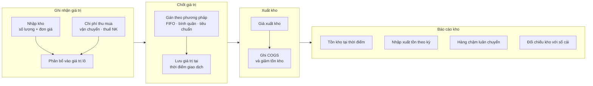

# Định giá & báo cáo kho

Kho lưu hai loại dữ liệu song song: **số lượng** và **giá trị**. Sai số lượng thì thấy ngay khi kiểm kê; sai giá trị thì im lặng, chỉ lộ ra khi đối chiếu sổ cái hoặc khi kiểm toán hỏi. Bài này nói về cách giá trị được gắn vào hàng tồn, cách ba báo cáo kho cốt lõi được dựng từ giao dịch, và chỗ nào hay làm lệch giữa kho và kế toán.

---

## Nguyên lý (áp dụng mọi ERP)

1. **Số lượng và giá trị là hai bài toán, không thể sửa bằng một chỗ.** Báo cáo tồn kho đúng số lượng vẫn có thể sai giá trị, và ngược lại. Khi lệch, phải xác định lệch ở đâu trước khi sửa.
2. **Mỗi giao dịch mang giá trị tại thời điểm phát sinh, và không bị tính lại theo giá hiện tại.** Nếu giá chính thức chưa có lúc ghi (ví dụ bình quân cả kỳ) thì giao dịch mang giá tạm tính, còn giá chính thức được **ghi bổ sung** bằng một dòng điều chỉnh giá trị riêng, không sửa giao dịch gốc (xem mục 5B). Nhờ vậy báo cáo lịch sử không thay đổi mỗi lần giá nhập thay đổi.
3. **Phương pháp tính giá là một lựa chọn, không phải đúng/sai.** FIFO, bình quân, giá tiêu chuẩn — mỗi cách có hệ quả khác nhau lên giá vốn và lợi nhuận. Điều quan trọng không phải chọn cách "đúng nhất" mà là chọn **một** cách và áp dụng nhất quán, có đối chiếu.
4. **Tổng giá trị hàng tồn của kho phải khớp số dư các tài khoản tồn kho trên sổ cái.** Kho là sổ phụ, GL là sổ cái, hai bên khớp (trong ngưỡng làm tròn đã thống nhất) vào cuối kỳ. Lưu ý không phải mọi hàng vật lý đều nằm trong tài khoản tồn kho: hàng ký gửi của nhà cung cấp không phải tài sản của mình, còn hàng chờ kiểm và hàng đang đi đường có thể nằm ở tài khoản riêng tùy cấu hình ghi nhận.
5. **Báo cáo tồn kho không thể dựng bằng cách cộng trừ số dư hiện tại.** Phải dựng từ giao dịch, theo khoảng thời gian, để có thể đối chiếu ngược và tái hiện số liệu bất kỳ thời điểm nào. Báo cáo vận hành của kho dựng theo ngày xảy ra (`Trx_Date`); báo cáo **đối chiếu với sổ cái bắt buộc dựng theo ngày hạch toán** (`Posting_Date`), vì hàng nhận ngày 31/12 nhưng ghi sổ ngày 03/01 chưa có trong sổ cái của kỳ cũ.
6. **Tồn kho chậm luân chuyển là tiền bị chôn, không phải tài sản trung tính.** Báo cáo này quan trọng ngang báo cáo tồn kho — nó là đầu vào cho quyết định mua tiếp hay xả hàng.

## 1. Luồng vận hành



Điểm quan trọng: **giá trị được chốt tại bước ghi nhận và không tính lại**. Báo cáo chỉ đọc lại dữ liệu đã chốt, không tự suy diễn bằng giá hiện hành.

## 2. Ai làm gì ở module nào

| Công việc | Kho (INV) | Mua hàng (PO) | Sản xuất (MFG) | Bán hàng (OM) | Kế toán |
|---|---|---|---|---|---|
| Chọn phương pháp tính giá | ✅ áp dụng theo nhóm hàng | — | Đề xuất khi giá thành sản xuất thay đổi | — | ✅ quyết định và chịu trách nhiệm |
| Ghi nhận đơn giá nhập hàng | ✅ lưu giá trị giao dịch | ✅ cung cấp đơn giá PO | Cung cấp giá thành TP | — | — |
| Phân bổ chi phí thu mua vào giá trị | ✅ thực hiện phân bổ | Cung cấp chi phí vận chuyển, thuế nhập khẩu | — | — | Duyệt phương pháp phân bổ |
| Tính giá xuất kho | ✅ chạy theo phương pháp | — | Ghi nhận giá thành WIP | — | Nhận COGS |
| Báo cáo tồn kho & nhập xuất tồn | ✅ sở hữu | — | — | — | Đối chiếu tháng |
| Báo cáo hàng chậm luân chuyển | ✅ sở hữu | Đọc để quyết định ngừng mua | — | Đọc để xúc tiến bán | Đánh giá rủi ro dự phòng |
| Đối chiếu kho với sổ cái | Cung cấp số dư nội bộ | — | — | — | ✅ đối chiếu và xử lý lệch |

**Ranh giới cốt lõi:** kho **giữ** phương pháp và chạy tính giá; kế toán **quyết định** phương pháp và **đối chiếu**. Đây là chỗ hay xảy ra mâu thuẫn — kho muốn đổi phương pháp vì "chạy cho nhanh", kế toán không đồng ý vì ảnh hưởng lợi nhuận.

## 3. Hạch toán

Giá trị hàng tồn của kho là **nguồn** cho tài khoản tồn kho trên sổ cái. Toàn bộ bút toán và nguyên tắc đối chiếu được định nghĩa tại:

- [Giá vốn & định giá tồn kho](../5-ke-toan/ke-toan-tong-hop/1010-gia-von-va-dinh-gia-ton-kho.md) — cách tính COGS, xử lý chênh lệch giá, dự phòng giảm giá hàng tồn
- [Hạch toán & tài khoản trung gian](../5-ke-toan/ke-toan-tong-hop/1000-hach-toan-va-tai-khoan-trung-gian.md) — tài khoản tài sản, chênh lệch giá mua
- [Đóng kỳ & đối soát sổ phụ](../5-ke-toan/ke-toan-tong-hop/2010-dong-ky-va-doi-soat-so-phu.md) — quy trình đối chiếu kho và sổ cái cuối kỳ

Bốn điểm cần nhớ ở tầng kho:

1. **Giá trị giao dịch là bất biến.** Đã ghi thì không sửa; muốn sửa thì ghi giao dịch đảo hoặc điều chỉnh.
2. **Chi phí thu mua phải phân bổ vào giá trị lô**, không ghi nhận riêng như chi phí kỳ. Nếu không, hàng tồn bị định giá thấp và giá vốn bị đẩy cao.
3. **Đối chiếu kho-sổ cái phải làm theo từng nhóm hàng**, không gộp tổng — gộp tổng sẽ che giấu lệch bù trừ giữa các nhóm.
4. **Giá chính thức đến muộn được ghi bổ sung, không sửa giao dịch.** Với bình quân cả kỳ, giá xuất chỉ có sau khi chạy tính giá cuối kỳ; chi phí thu mua cũng thường về sau lúc nhập kho. Cả hai được ghi thành các dòng điều chỉnh giá trị gắn với giao dịch gốc, mang ngày hạch toán của kỳ chạy tính giá (xem mục 5B).

## 4. Điểm chạm & rủi ro

- **Ghi giá trị giao dịch**: [Giao dịch nhập, xuất & chuyển](./2000-giao-dich-nhap-xuat-chuyen.md)
- **Điều chỉnh kiểm kê ảnh hưởng giá trị tồn**: [Kiểm kê & điều chỉnh](./3000-kiem-ke-va-dieu-chinh.md)
- **Giá nhập mua và chi phí thu mua**: [Đơn mua hàng](../2-mua-hang/2000-don-mua-hang.md)
- **Giá thành sản xuất nhập kho thành phẩm**: [Giá thành sản xuất](../3-san-xuat/2020-gia-thanh-san-xuat.md)
- **Giá vốn hàng bán khi xuất kho**: [Giao hàng & xuất kho](../4-ban-hang/2010-giao-hang-va-xuat-kho.md)
- **Giá trị nhập hàng chưa có hóa đơn**: [Hạch toán & tài khoản trung gian](../5-ke-toan/ke-toan-tong-hop/1000-hach-toan-va-tai-khoan-trung-gian.md)

**Rủi ro chính:**

- **Tính lại giá trị theo giá hiện tại** — báo cáo lịch sử tự thay đổi mỗi lần giá thay đổi.
- **Không phân bổ chi phí thu mua** — hàng tồn định giá thấp, giá vốn cao, lợi nhuận sai.
- **Dựng báo cáo tồn kho bằng tổng số dư** — không tái hiện được số liệu tại một thời điểm trong quá khứ.
- **Đối chiếu kho-sổ cái gộp tổng** — lệch bù trừ giữa các nhóm hàng làm sổ "trông khớp" mà thực tế sai.

## 5. Triển khai tham chiếu ERP

### A. Ánh xạ khái niệm

> **Lưu ý:** tên bảng, tên cột và tên báo cáo thay đổi theo phiên bản và cấu hình. Ô đánh dấu `*` là chỗ cần xác nhận trên hệ thống thật trước khi đưa vào thiết kế.

| Khái niệm | Oracle EBS R12 | Epicor ERP | SAP S/4HANA | Odoo |
|---|---|---|---|---|
| Phương pháp tính giá | `Costing Method` trên Item (FIFO/Standard/Average) | `CostMethod` trên Part: `A` bình quân, `L` giá cuối, `S` tiêu chuẩn, `T` bình quân theo lô; FIFO đặt theo từng Part và `CostID` `*` | `Price Control` (S = Standard, V = Moving Average) + Actual Costing | `Costing Method` trên Product Category |
| Giá trị giao dịch | `MTL_TRANSACTION_ACCOUNTS` | `Erp.PartTran` (cột `MtlUnitCost`, `ExtCost`) `*` | `MSEG` + `MLCD` (Material Ledger) | Lớp giá trị tồn kho của `stock.move` `*` |
| Đơn giá theo phương pháp | `CST_ITEM_COSTS` theo `cost_type_id` | `Erp.PartCost`, khóa `(Company, PartNum, CostID)`: bộ giá `Std*`, `Avg*`, `Last*`, `FIFOAvg*`, mỗi bộ gồm Material, Labor, Burden, SubCont, MtlBur | `MBEW` (giá tiêu chuẩn, giá bình quân động) | Trường giá vốn trên sản phẩm |
| Phân bổ chi phí thu mua | Landed Cost Management | Landed Cost | Condition Type (FRB/FRC) | `landed_costs` module |
| Báo cáo tồn kho tại thời điểm | `Stock On-Hand` report | `Stock Status Report` | `Stock Overview` + Material Ledger | `Inventory Report` |
| Báo cáo nhập xuất tồn | `Inventory Movement` | `Inventory Movement Report` | `MB5B` | `Stock Moves Analysis` |
| Hàng chậm luân chuyển | `Slow Moving Inventory` (custom) | `Stock Aged Report` | `Slow/Fast Moving` (theo động học) | `Stock Aging` |
| Đối chiếu kho-GL | `Inventory to GL Reconciliation` | `Inventory to CM/GL Reconciliation` | Material Ledger balance vs FI | Custom report |

### B. Cách dựng báo cáo và nơi ghi giá chính thức

**Phân loại chuyển động theo loại vị trí hai đầu** (bài [3000](./2000-giao-dich-nhap-xuat-chuyen.md) không dùng `NULL`, "bên ngoài" là vị trí ảo có tên):

```text
Nhập vào kho    : From = vị trí ảo,    To = vị trí vật lý
Xuất khỏi kho   : From = vị trí vật lý, To = vị trí ảo
Chuyển nội bộ   : cả hai đều vật lý (không đổi tổng tồn của toàn doanh nghiệp)
```

Khi lập báo cáo theo từng pháp nhân, chuyển kho giữa hai pháp nhân được tính là xuất của bên đi và nhập của bên đến.

**Tồn kho tại thời điểm T** — tổng hợp từ giao dịch, không đọc số dư hiện tại:

```text
Tồn(T) = Σ Qty_Base nhập vào vị trí vật lý − Σ Qty_Base rời khỏi vị trí vật lý
         với mọi giao dịch không ảo có ngày <= T
```

**Nhập xuất tồn trong kỳ** — tách cột theo loại chuyển động:

```text
Nhập      = Σ chênh lệch dương trên vị trí vật lý, loại ADJUSTMENT và REVERSAL
Xuất      = Σ chênh lệch âm trên vị trí vật lý,    loại ADJUSTMENT và REVERSAL
Điều chỉnh / đảo = Σ chênh lệch của ADJUSTMENT và REVERSAL (tách cột riêng để thấy nguyên nhân)
Chuyển nội bộ    = chênh lệch bằng 0, không vào các cột trên
Tồn cuối  = Tồn đầu + Nhập − Xuất ± Điều chỉnh / đảo
```

**Hàng chậm luân chuyển** — số ngày kể từ ngày mốc:

```text
Ngày mốc = ngày xuất gần nhất cho khách hoặc sản xuất (ISSUE tới CUSTOMER hoặc WIP);
           nếu chưa từng xuất thì lấy ngày nhập đầu tiên
Số ngày không xuất = Hôm nay − Ngày mốc
Phân loại: <= 90 ngày · 91–180 · 181–365 · > 365
```

Xuất huỷ (`SCRAP`), xuất điều chỉnh (`ADJUSTMENT`) và trả nhà cung cấp không tính là "đã xuất", vì hàng không được bán hay dùng. Hàng ký gửi cũng loại khỏi báo cáo này vì không phải tiền của mình bị chôn.

**Giá trị của một giao dịch:**

```text
Giá trị giao dịch = Qty_Base × Unit_Cost + Σ Value_Delta
```

`Unit_Cost` là giá lúc ghi (có thể tạm tính hoặc `NULL` khi bình quân cả kỳ). `Value_Delta` là các dòng điều chỉnh giá trị ghi bổ sung ở bảng dưới, gồm giá xuất chính thức sau khi chạy tính giá cuối kỳ và chi phí thu mua phân bổ vào lô đã nhập.

```sql
CREATE TABLE Inventory_Cost_Adjustment (
    Cost_Adj_ID   BIGINT IDENTITY PRIMARY KEY,
    Trx_ID        BIGINT        NOT NULL REFERENCES Inventory_Transaction(Trx_ID),
    Adj_Type      VARCHAR(20)   NOT NULL,   -- PERIOD_COST | LANDED_COST | REVALUATION
    Value_Delta   DECIMAL(18,2) NOT NULL,   -- cộng vào giá trị của giao dịch; có thể âm
    Cost_Run_ID   VARCHAR(30)   NULL,       -- lần chạy tính giá tạo ra dòng này
    Posting_Date  DATE          NOT NULL,   -- ngày hạch toán của kỳ chạy tính giá
    Period_ID     VARCHAR(10)   NOT NULL,
    Created_By    VARCHAR(50)   NOT NULL,
    Created_At    DATETIME      NOT NULL DEFAULT GETDATE(),
    CONSTRAINT CK_CostAdj_Type CHECK (Adj_Type IN ('PERIOD_COST','LANDED_COST','REVALUATION'))
);
CREATE INDEX IX_CostAdj_Trx ON Inventory_Cost_Adjustment (Trx_ID);
```

Ba quy tắc:

1. **Chỉ `INSERT`**, cùng nguyên tắc với `Inventory_Transaction`. Sửa sai bằng một dòng điều chỉnh khác.
2. **`Value_Delta` mang ngày hạch toán của chính nó**, không mang ngày của giao dịch gốc. Giao dịch xuất ngày 15 có giá chính thức tính cuối tháng thì phần chênh lệch hạch toán vào kỳ chạy tính giá.
3. Phần chi phí thu mua của hàng đã xuất hết trước khi chi phí về thuộc giá vốn, do kế toán xử lý theo [Giá vốn & định giá tồn kho](../5-ke-toan/ke-toan-tong-hop/1010-gia-von-va-dinh-gia-ton-kho.md).

### C. Truy vấn kiểm soát

**1. Tồn kho vật lý tại một thời điểm bất kỳ** (báo cáo vận hành, theo ngày xảy ra):

```sql
WITH Moves AS (
    SELECT t.Item_ID, t.Qty_Base AS Qty
    FROM Inventory_Transaction t
    JOIN Inv_Location l ON l.Location_ID = t.To_Location_ID
    WHERE t.Is_Logical = 0 AND l.Location_Type = 'PHYSICAL'
      AND t.Trx_Date < DATEADD(DAY, 1, @AsOfDate)
    UNION ALL
    SELECT t.Item_ID, -t.Qty_Base
    FROM Inventory_Transaction t
    JOIN Inv_Location l ON l.Location_ID = t.From_Location_ID
    WHERE t.Is_Logical = 0 AND l.Location_Type = 'PHYSICAL'
      AND t.Trx_Date < DATEADD(DAY, 1, @AsOfDate)
)
SELECT Item_ID, SUM(Qty) AS Qty_At_Date
FROM Moves
GROUP BY Item_ID
HAVING SUM(Qty) <> 0;
```

**2. Nhập xuất tồn trong kỳ** (một dòng mỗi mã hàng, đã tách cột điều chỉnh):

```sql
WITH Delta AS (
    SELECT t.Item_ID, t.Trx_Type, t.Trx_Date,
           CASE WHEN lt.Location_Type = 'PHYSICAL' THEN t.Qty_Base ELSE 0 END
         - CASE WHEN lf.Location_Type = 'PHYSICAL' THEN t.Qty_Base ELSE 0 END AS Qty_Delta
    FROM Inventory_Transaction t
    JOIN Inv_Location lf ON lf.Location_ID = t.From_Location_ID
    JOIN Inv_Location lt ON lt.Location_ID = t.To_Location_ID
    WHERE t.Is_Logical = 0
      AND t.Trx_Date < DATEADD(DAY, 1, @To_Date)
)
SELECT Item_ID,
       SUM(CASE WHEN Trx_Date < @From_Date THEN Qty_Delta ELSE 0 END) AS Ton_Dau,
       SUM(CASE WHEN Trx_Date >= @From_Date AND Qty_Delta > 0
                 AND Trx_Type NOT IN ('ADJUSTMENT','REVERSAL') THEN Qty_Delta ELSE 0 END) AS Nhap,
       -SUM(CASE WHEN Trx_Date >= @From_Date AND Qty_Delta < 0
                  AND Trx_Type NOT IN ('ADJUSTMENT','REVERSAL') THEN Qty_Delta ELSE 0 END) AS Xuat,
       SUM(CASE WHEN Trx_Date >= @From_Date
                 AND Trx_Type IN ('ADJUSTMENT','REVERSAL') THEN Qty_Delta ELSE 0 END) AS Dieu_Chinh_Dao,
       SUM(Qty_Delta) AS Ton_Cuoi
FROM Delta
GROUP BY Item_ID
HAVING SUM(Qty_Delta) <> 0
    OR SUM(CASE WHEN Trx_Date >= @From_Date THEN ABS(Qty_Delta) ELSE 0 END) <> 0;
```

Chuyển nội bộ có chênh lệch bằng 0 nên không rơi vào cột nhập hay xuất.

**3. Hàng chậm luân chuyển** (chỉ hàng của mình, chỉ tính xuất cho khách hoặc sản xuất):

```sql
WITH Moves AS (
    SELECT t.Item_ID, t.Qty_Base AS Qty
    FROM Inventory_Transaction t
    JOIN Inv_Location l ON l.Location_ID = t.To_Location_ID
    WHERE t.Is_Logical = 0 AND l.Location_Type = 'PHYSICAL' AND l.Ownership = 'OWN'
    UNION ALL
    SELECT t.Item_ID, -t.Qty_Base
    FROM Inventory_Transaction t
    JOIN Inv_Location l ON l.Location_ID = t.From_Location_ID
    WHERE t.Is_Logical = 0 AND l.Location_Type = 'PHYSICAL' AND l.Ownership = 'OWN'
),
OnHand AS (
    SELECT Item_ID, SUM(Qty) AS Qty_OnHand
    FROM Moves GROUP BY Item_ID HAVING SUM(Qty) > 0
),
LastIssue AS (
    SELECT Item_ID, MAX(Trx_Date) AS Last_Issue_Date
    FROM Inventory_Transaction
    WHERE Is_Logical = 0 AND Trx_Type = 'ISSUE'
      AND To_Location_ID IN ('CUSTOMER', 'WIP')
    GROUP BY Item_ID
),
FirstReceipt AS (
    SELECT Item_ID, MIN(Trx_Date) AS First_Receipt_Date
    FROM Inventory_Transaction
    WHERE Is_Logical = 0 AND Trx_Type = 'RECEIPT'
    GROUP BY Item_ID
)
SELECT o.Item_ID, o.Qty_OnHand,
       ISNULL(li.Last_Issue_Date, fr.First_Receipt_Date) AS Ngay_Moc,
       DATEDIFF(DAY, ISNULL(li.Last_Issue_Date, fr.First_Receipt_Date), GETDATE()) AS Days_Since
FROM OnHand o
LEFT JOIN LastIssue    li ON li.Item_ID = o.Item_ID
LEFT JOIN FirstReceipt fr ON fr.Item_ID = o.Item_ID
WHERE DATEDIFF(DAY, ISNULL(li.Last_Issue_Date, fr.First_Receipt_Date), GETDATE()) > 180
ORDER BY o.Qty_OnHand DESC;
```

Mã chưa từng xuất lấy ngày nhập đầu tiên làm mốc, để hàng vừa nhập hôm qua không bị báo là chậm luân chuyển.

**4. Đối chiếu giá trị kho với sổ cái theo từng tài khoản** (theo ngày hạch toán, kết quả phải rỗng):

```sql
/* Giả định có hai bảng cấu hình/sổ cái của doanh nghiệp:
   Inventory_Account_Map(Item_Class, Location_Cost_Account, GL_Account_Code)
   GL_Account_Balance(Legal_Entity_ID, Account_Code, Period_ID, Balance)
   @AsOfDate là ngày cuối kỳ, @Period_ID là kỳ tương ứng. */
WITH Value_Lines AS (
    SELECT t.Item_ID, t.From_Location_ID, t.To_Location_ID,
           ISNULL(t.Qty_Base * t.Unit_Cost, 0) AS Val, t.Posting_Date
    FROM Inventory_Transaction t
    WHERE t.Is_Logical = 0 AND t.Legal_Entity_ID = @Legal_Entity_ID
    UNION ALL
    SELECT t.Item_ID, t.From_Location_ID, t.To_Location_ID,
           a.Value_Delta, a.Posting_Date
    FROM Inventory_Cost_Adjustment a
    JOIN Inventory_Transaction t ON t.Trx_ID = a.Trx_ID
    WHERE t.Is_Logical = 0 AND t.Legal_Entity_ID = @Legal_Entity_ID
),
Moves AS (
    SELECT v.Item_ID, l.Cost_Account, v.Val AS Val
    FROM Value_Lines v
    JOIN Inv_Location l ON l.Location_ID = v.To_Location_ID
    WHERE l.Location_Type = 'PHYSICAL' AND l.Ownership = 'OWN'
      AND v.Posting_Date <= @AsOfDate
    UNION ALL
    SELECT v.Item_ID, l.Cost_Account, -v.Val
    FROM Value_Lines v
    JOIN Inv_Location l ON l.Location_ID = v.From_Location_ID
    WHERE l.Location_Type = 'PHYSICAL' AND l.Ownership = 'OWN'
      AND v.Posting_Date <= @AsOfDate
),
Kho AS (
    SELECT mp.GL_Account_Code, SUM(m.Val) AS Value_Kho
    FROM Moves m
    JOIN Item_Inventory_Attribute i ON i.Item_ID = m.Item_ID
    JOIN Inventory_Account_Map mp
      ON mp.Item_Class = i.Item_Class AND mp.Location_Cost_Account = m.Cost_Account
    GROUP BY mp.GL_Account_Code
)
SELECT k.GL_Account_Code, k.Value_Kho, g.Balance AS Value_GL,
       k.Value_Kho - g.Balance AS Diff
FROM Kho k
JOIN GL_Account_Balance g
  ON g.Account_Code = k.GL_Account_Code
 AND g.Legal_Entity_ID = @Legal_Entity_ID
 AND g.Period_ID = @Period_ID
WHERE ABS(k.Value_Kho - g.Balance) > 0.01;
```

Hàng ký gửi (`Ownership = 'VENDOR'`) bị loại, vì không phải tài sản của mình. Mỗi vị trí đóng góp giá trị theo `Cost_Account` của chính nó, nên khu chờ kiểm (cấu hình ghi nhận khi nhận) và hàng đi đường tự rơi vào đúng tài khoản. Đối chiếu theo từng tài khoản, không gộp tổng.

**Epicor ERP 10.2 — giá trị tồn kho theo Part Class, cho Part dùng giá tiêu chuẩn, bình quân hoặc giá cuối `*`:**

```sql
-- Đơn giá mỗi Part nằm ở Erp.PartCost, khóa (Company, PartNum, CostID); CostID cho phép giá khác nhau theo site.
-- Mỗi bộ giá gồm 5 thành phần: Material + Labor + Burden + SubCont + MtlBur.
-- Part dùng bình quân theo lô (T) hoặc FIFO lưu giá ở nơi khác nên loại khỏi truy vấn này.
-- Cột CostMethod trên Erp.Part và cột ClassID cần đối chiếu Epicor_10.2.400.chm `*`.
SELECT p.ClassID,
       SUM(pb.OnhandQty *
           CASE p.CostMethod
               WHEN 'S' THEN c.StdMaterialCost + c.StdLaborCost + c.StdBurdenCost
                           + c.StdSubContCost + c.StdMtlBurCost
               WHEN 'A' THEN c.AvgMaterialCost + c.AvgLaborCost + c.AvgBurdenCost
                           + c.AvgSubContCost + c.AvgMtlBurCost
               WHEN 'L' THEN c.LastMaterialCost + c.LastLaborCost + c.LastBurdenCost
                           + c.LastSubContCost + c.LastMtlBurCost
           END) AS Inventory_Value_From_Kho
FROM Erp.PartBin pb
JOIN Erp.Part p     ON p.Company = pb.Company AND p.PartNum = pb.PartNum
JOIN Erp.PartCost c ON c.Company = pb.Company AND c.PartNum = pb.PartNum
                   AND c.CostID  = '1'      -- thay CostID của site cần đối chiếu
WHERE pb.Company = 'YOUR_COMPANY_CODE'      -- thay mã công ty
  AND pb.OnhandQty > 0
  AND p.CostMethod IN ('S', 'A', 'L')
GROUP BY p.ClassID
ORDER BY Inventory_Value_From_Kho DESC;
```

Số lượng `OnhandQty` theo đơn vị tính của Part, nên đơn giá phải cùng đơn vị đó khi đối chiếu. Truy vấn này lấy bình quân và giá cuối của **hiện tại**, nên chỉ dùng để ước tính giá trị tồn hôm nay, không dùng dựng lại giá trị tại một ngày trong quá khứ.

**Oracle EBS R12: truy vấn tham khảo `*`** (tên bảng và mã theo cấu trúc chuẩn, cần đối chiếu với môi trường thật; `:org_id` là tổ chức tồn kho):

Giá trị tồn kho theo subinventory (`cost_type_id` lấy theo phương pháp tính giá của tổ chức, thường 1 là Frozen, 2 là Average):

```sql
SELECT oqd.subinventory_code,
       oqd.inventory_item_id,
       SUM(oqd.primary_transaction_quantity)                   AS onhand_qty,
       cic.item_cost,
       SUM(oqd.primary_transaction_quantity) * cic.item_cost   AS onhand_value
FROM   mtl_onhand_quantities_detail oqd
JOIN   cst_item_costs cic
  ON   cic.organization_id   = oqd.organization_id
 AND   cic.inventory_item_id = oqd.inventory_item_id
 AND   cic.cost_type_id      = :cost_type_id
WHERE  oqd.organization_id = :org_id
GROUP BY oqd.subinventory_code, oqd.inventory_item_id, cic.item_cost
HAVING SUM(oqd.primary_transaction_quantity) <> 0
ORDER BY onhand_value DESC;
```

Ngày xuất gần nhất cho đơn bán hoặc lệnh sản xuất (dùng cho hàng chậm luân chuyển):

```sql
SELECT mmt.inventory_item_id,
       MAX(mmt.transaction_date)                       AS last_issue_date,
       TRUNC(SYSDATE) - TRUNC(MAX(mmt.transaction_date)) AS days_since_issue
FROM   mtl_material_transactions mmt
WHERE  mmt.organization_id = :org_id
  AND  mmt.transaction_source_type_id IN (2, 5)   -- * giả định 2 = đơn bán, 5 = lệnh sản xuất
  AND  mmt.primary_quantity < 0
GROUP BY mmt.inventory_item_id
HAVING TRUNC(SYSDATE) - TRUNC(MAX(mmt.transaction_date)) > 180
ORDER BY days_since_issue DESC;
```

## 6. Bẫy thực chiến & Checklist

| # | Bẫy | Triệu chứng | Cách phòng tránh |
|---|---|---|---|
| 1 | Dựng báo cáo tồn kho bằng số dư hiện tại | Không tái hiện được số liệu tháng trước, kiểm toán không chấp nhận | Báo cáo phải dựng từ giao dịch, có điều kiện `ngày <= AsOfDate` |
| 2 | Tính lại giá trị theo giá hiện hành, hoặc sửa giao dịch cũ khi có giá chính thức | Báo cáo lịch sử tự thay đổi mỗi lần giá thay đổi | Lưu `Unit_Cost` tại thời điểm giao dịch; giá chính thức và chi phí thu mua ghi thành dòng điều chỉnh ở `Inventory_Cost_Adjustment`, không `UPDATE` giao dịch |
| 3 | Không phân bổ chi phí thu mua | Hàng tồn thấp hơn thực, giá vốn cao hơn thực | Phân bổ vào giá trị lô ngay khi nhập |
| 4 | Đối chiếu kho-sổ cái gộp tổng | Lệch bù trừ giữa các nhóm che giấu sai số thực | Đối chiếu theo từng nhóm hàng / theo kho |
| 5 | Đổi phương pháp tính giá giữa kỳ | Giá vốn hai nửa kỳ không so sánh được | Đổi chỉ vào đầu niên độ, có phê duyệt và công bố |
| 6 | Báo cáo nhập xuất tồn cộng cả giao dịch chuyển | Nhập và xuất phình lên không có thật | Phân loại theo loại vị trí hai đầu: chỉ vật lý → vật lý là chuyển nội bộ, không vào cột nhập hay xuất |
| 7 | Không loại trừ giao dịch ảo | Drop-ship làm giá trị tồn kho phình lên | Lọc `Is_Logical = 0` |
| 8 | Bỏ qua dự phòng giảm giá hàng tồn | Báo cáo tồn kho đẹp nhưng giá trị thực thấp hơn nhiều | Ngưỡng dự phòng theo báo cáo chậm luân chuyển |
| 9 | Đối chiếu kho với sổ cái theo ngày xảy ra thay vì ngày hạch toán | Báo lệch giả: hàng nhận 31/12, ghi sổ 03/01 | Báo cáo đối chiếu dựng theo `Posting_Date`; báo cáo vận hành mới dùng `Trx_Date` |
| 10 | Tính hàng ký gửi vào giá trị tồn kho | Giá trị tồn kho phồng lên bằng hàng của nhà cung cấp, lệch GL | Lọc `Ownership = 'OWN'` khi tính giá trị; số lượng vẫn đếm đủ ở báo cáo tồn vật lý |
| 11 | Hàng chậm luân chuyển tính cả xuất huỷ và xuất điều chỉnh | Hàng đã huỷ hoặc bị điều chỉnh giảm bị coi như vừa bán, mã chậm bị che | Chỉ tính xuất tới `CUSTOMER` hoặc `WIP`; mã chưa từng xuất lấy ngày nhập đầu tiên làm mốc |
| 12 | Đối chiếu bằng cách nhân `Qty × Unit_Cost` khi giá xuất còn tạm tính | Kho lệch GL đúng bằng phần giá chính thức chưa cập nhật | Cộng thêm `Value_Delta` ở `Inventory_Cost_Adjustment`, theo ngày hạch toán của dòng điều chỉnh |
| 13 | Epicor: chỉ cộng ba thành phần giá, hoặc quên lọc `CostID` | Giá trị tồn thiếu phần gia công ngoài và burden vật tư; Part bị nhân dòng khi có nhiều site | Cộng đủ năm thành phần của bộ giá theo `CostMethod`; lọc `CostID` của site cần đối chiếu |

**Checklist trước go-live:**

- [ ] Phương pháp tính giá đã chốt và ghi thành văn bản, có kế toán trưởng ký.
- [ ] Mọi giao dịch nhập có `Unit_Cost`; giá xuất chính thức và chi phí thu mua được ghi bổ sung ở `Inventory_Cost_Adjustment`, không sửa giao dịch đã ghi.
- [ ] Chi phí thu mua có quy trình phân bổ vào giá trị lô.
- [ ] Ba báo cáo cốt lõi (tồn kho tại thời điểm, nhập xuất tồn, chậm luân chuyển) đều dựng từ giao dịch.
- [ ] Báo cáo nhập xuất tồn loại trừ giao dịch chuyển kho khỏi cột nhập/xuất.
- [ ] Báo cáo đối chiếu kho-sổ cái chạy theo từng nhóm hàng, định kỳ hàng tháng.
- [ ] Đối chiếu kho với sổ cái dựng theo ngày hạch toán, theo từng tài khoản, loại hàng ký gửi và gồm các tài khoản hàng chờ kiểm, hàng đi đường nếu có.
- [ ] Đã test: dựng lại tồn kho tại một ngày bất kỳ trong quá khứ và khớp với số đã chốt.
- [ ] Đã test: chạy tính giá cuối kỳ rồi đối chiếu, kho và GL khớp sau khi có dòng điều chỉnh giá trị.
- [ ] Đã xác định ngưỡng phân loại hàng chậm luân chuyển và cách xử lý dự phòng.

## Xem thêm

- [Tổng quan Kho](./0000-tong-quan-kho.md)
- [Giao dịch nhập, xuất & chuyển](./2000-giao-dich-nhap-xuat-chuyen.md)
- [Kiểm kê & điều chỉnh](./3000-kiem-ke-va-dieu-chinh.md)
- [Giá vốn & định giá tồn kho](../5-ke-toan/ke-toan-tong-hop/1010-gia-von-va-dinh-gia-ton-kho.md)
- [Đóng kỳ & đối soát sổ phụ](../5-ke-toan/ke-toan-tong-hop/2010-dong-ky-va-doi-soat-so-phu.md)

<div align="center" style={{color: 'var(--ifm-color-primary)'}}>
  <strong>Chúc các bạn thành công và vui vẻ!</strong>
</div>