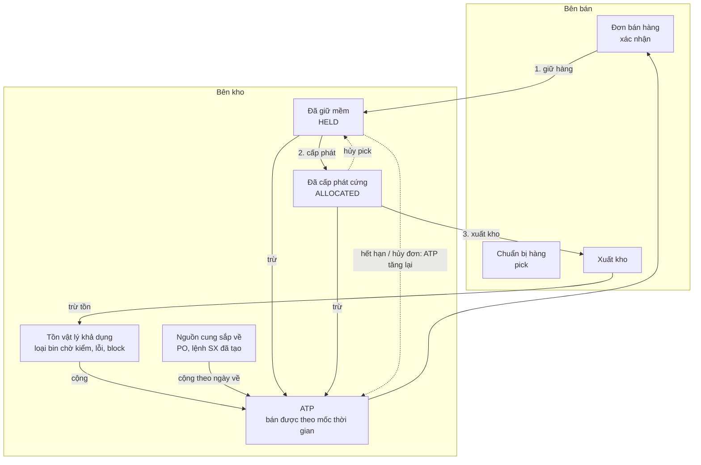

# 4000 Giữ hàng, phân bổ & ATP

Có hàng trong kho chưa có nghĩa là bán được hàng đó. Một SKU có 100 cái nhưng 60 cái đã bị đơn hàng khác giữ, 20 cái đang chờ xuất cho sản xuất, 10 cái hỏng chờ trả nhà cung cấp — thứ thực sự bán được chỉ còn 10. Bài này nói về cơ chế mà mọi hệ thống ERP dùng để phân biệt "còn hàng" với "bán được hàng", và những chỗ cơ chế đó sụp đổ trong thực tế.

> **Phiên bản tham chiếu:** phần Epicor trong bài này áp dụng cho **Epicor ERP 10.2 (E10.2)**, đối chiếu với schema bản **10.2.400.6**. Các phiên bản Epicor Kinetic (2021 trở đi) có thể khác tên bảng, cột và màn hình. Mọi ô đánh dấu `*` là **chưa xác minh trên hệ thống thật**, phải kiểm tra bằng Data Dictionary Viewer / Schema của chính môi trường trước khi dùng.

---

## 0. Nguyên lý (áp dụng mọi ERP)

1. **Tồn kho là một con số, nhưng bán được hàng là một con số khác.** Hệ thống nào không tách được hai con số này sẽ bán quá số hàng đang có, hoặc ngược lại, từ chối những đơn lẽ ra vẫn đáp ứng được.
2. **Giữ hàng (reservation) là một cam kết, không phải một giao dịch kho.** Giữ hàng không làm giảm tồn kho vật lý, không sinh bút toán, không tạo giao dịch. Nó chỉ là một "dấu" nói rằng phần tồn này đã có chủ. Hiểu sai điều này là nguồn gốc của gần như mọi lỗi trong bài.
3. **Giữ hàng phải có hạn và có người chịu trách nhiệm.** Một reservation không bao giờ tự giải phóng sẽ biến thành "giữ hàng ma": hàng còn đó nhưng không ai bán được, và báo cáo tồn kho khả dụng thấp hơn thực tế vô thời hạn.
4. **ATP trả lời câu hỏi "giao được khi nào", không phải "có bao nhiêu".** ATP phải tính cả hàng đang về, hàng đã đặt mua, hàng đang sản xuất — theo mốc thời gian (công thức ở mục 1). Trả lời "còn 10 cái" khi khách cần giao trong 3 ngày mà 10 cái đó nằm trong lô nhập tháng sau là trả lời sai.
   **ATP khác CTP:** ATP chỉ dựa trên tồn và nguồn cung **đã có kế hoạch** (PO, lệnh sản xuất đã tạo). CTP (Capable to Promise) đi sâu hơn vào năng lực sản xuất (máy, nhân công, nguyên vật liệu) để trả lời "nếu khởi động sản xuất ngay thì sớm nhất giao ngày nào". CTP thuộc hoạch định năng lực (APS/MRP), **nằm ngoài phạm vi bài này**; xem [Lệnh sản xuất & WIP](../3-san-xuat/thuc-thi/6000-lenh-san-xuat-va-wip.md).
5. **Giữ hàng và cấp phát khác nhau ở mức cam kết.**
   - **Giữ hàng (reservation, thường gọi là *soft allocation*):** giữ trên tổng lượng tồn của kho hoặc chi nhánh, chưa gán vào lô, pallet hay ô kệ cụ thể. Nói "dành cho đơn này".
   - **Cấp phát (allocation, thường gọi là *hard allocation*):** khóa chính xác vào số lô, số serial, ô kệ (bin/locator) để in lệnh lấy hàng (pick list). Nói "đã chỉ định chính xác hàng nào".
   - Tên gọi thay đổi theo hệ thống; trong bài này dùng "giữ hàng" và "cấp phát". Cấp phát mới là bước thực sự khóa hàng, và chỉ nên làm khi chuẩn bị xuất.
   - **Ràng buộc khi cấp phát:** với hàng có hạn dùng, cấp phát phải theo **FEFO** (hết hạn trước, xuất trước) và thỏa **hạn dùng còn lại tối thiểu** (shelf-life) mà từng khách hàng yêu cầu. Giữ mềm có thể báo "đủ hàng" nhưng không còn lô nào đủ hạn dùng khi cấp phát cứng; vì vậy với hàng có hạn dùng, ATP cho khách có yêu cầu shelf-life phải tính trên các lô đủ điều kiện.
6. **Tranh chấp là bài toán đồng thời, không phải bài toán số học.** Hai người bấm đặt hàng cùng lúc trên cùng một SKU còn 1 cái — hệ thống không được bán cho cả hai. Điều này cần khóa dữ liệu, không thể xử lý bằng kiểm tra "nếu còn hàng thì trừ". Khóa phải đặt trên **một điểm tuần tự hóa nhỏ** (một dòng số dư của SKU tại kho), không quét tổng bảng giao dịch lớn khi đang giữ khóa.
7. **Tồn an toàn (safety stock) là chính sách, không mặc định.** Nhiều doanh nghiệp quy định không được bán chạm mức tồn an toàn. Khi đó ATP phải trừ thêm khoản này. Việc trừ hay không trừ do chính sách quyết định, phải ghi vào thiết kế, và nếu cho phép ngoại lệ thì cần quyền và phê duyệt rõ ràng.

## 1. Luồng vận hành



Hai điều đáng chú ý trong sơ đồ:

- Mũi tên **thẳng** là nghiệp vụ thực sự tiến triển; mũi tên **nét đứt** là đường quay lui — giải phóng giữ hàng hoặc hủy cấp phát. Hệ thống không có đường quay lui sẽ tích rác vĩnh viễn.
- Chỉ **bước 3** là giao dịch kho thật. Bước 1 và 2 không đụng tới tồn vật lý. Đã giữ và đã cấp phát là **hai trạng thái nối tiếp của cùng một khoản cam kết**, không phải hai khoản độc lập; khi tính ATP chỉ trừ **một lần** (tổng cam kết = HELD + ALLOCATED, không cộng lại phần đã chuyển từ HELD sang ALLOCATED).

### Công thức ATP theo mốc thời gian

```
ATP(t) = Tồn khả dụng hiện tại
       + Nguồn cung đến hạn trong khoảng (hôm nay .. t]      (PO, lệnh SX đã tạo)
       − Tổng cam kết hiện có                                 (HELD + ALLOCATED)
       − Nhu cầu chưa giữ đến hạn trong khoảng (hôm nay .. t]
       − Tồn an toàn                                          (chỉ khi chính sách yêu cầu)
```

Lượng hứa được cho khách vào ngày **t** là `min(ATP(s))` với mọi `s ≥ t` trong tầm nhìn hoạch định, vì xuất hàng ngày t làm giảm ATP của mọi mốc sau đó; nếu chỉ nhìn ATP(t) thì có thể hứa lượng làm vỡ nhu cầu đã có ở ngày sau.

**Ví dụ số:** tồn khả dụng 100 (đã loại bin chờ kiểm, lỗi, block); cam kết hiện có 60 (HELD 40 + ALLOCATED 20); tồn an toàn 20 (chính sách trừ); PO 50 cái về ngày 10; nhu cầu chưa giữ 10 cái đến hạn ngày 8.

| Mốc | Tính | ATP(t) |
|---|---|---|
| Hôm nay | 100 − 60 − 20 | 20 |
| Ngày 8 | 20 − 10 | 10 |
| Ngày 10 | 10 + 50 | 60 |

Lượng hứa được cho ngày 10 là `min(ATP(10)) = 60`. Lượng hứa được giao ngay hôm nay là `min(20, 10, 60) = 10`, không phải 20, vì giao 20 hôm nay làm ngày 8 âm 10.

## 2. Ai làm gì ở module nào

| Bước | Kho (INV) | Bán hàng (OM) | Sản xuất (MFG) | Mua hàng (PO) | Kế toán |
|---|---|---|---|---|---|
| Xác định lượng bán được | ✅ tính ATP từ tồn + đã giữ | Đọc ATP để báo khách | Đọc ATP để kiểm tra cấp liệu | — | — |
| Giữ hàng khi xác nhận đơn | Sở hữu bảng giữ hàng | ✅ yêu cầu giữ hàng | ✅ yêu cầu giữ NVL cho lệnh SX | — | — |
| Cấp phát khi chuẩn bị xuất | ✅ chỉ định bin/lô theo FEFO và shelf-life | ✅ phát lệnh pick; cung cấp shelf-life tối thiểu theo khách | ✅ phát lệnh cấp liệu | — | — |
| Xuất kho | ✅ ghi giao dịch trừ tồn | Xác nhận giao hàng | Ghi nhận tiêu thụ | — | Nhận bút toán giá vốn |
| Giải phóng giữ hàng | ✅ thực thi giải phóng | Hủy đơn / hết hạn | Hủy lệnh SX | Hủy đơn mua | — |
| Cấu hình ưu tiên giữ hàng | ✅ sở hữu | Đề xuất theo chính sách KH | Đề xuất theo ưu tiên SX | — | — |
| Tồn an toàn và ngoại lệ xâm phạm | Thực thi trong ATP | Xin phê duyệt ngoại lệ | — | Cung cấp tham số hoạch định | — |
| Hàng đang về | Đọc thông tin PO/SX | Dùng tính ATP tương lai | Dùng tính ATP tương lai | ✅ cung cấp ngày giao dự kiến | — |

**Điểm dễ sai nhất:** bộ phận bán hàng thường muốn tự "giữ hàng" trong hệ thống của họ mà không thông qua kho. Khi đó hai nơi cùng giữ một lượng hàng, và ATP bị trừ hai lần — hoặc tệ hơn, không trừ lần nào.

## 3. Hạch toán

Giữ hàng và phân bổ **không phát sinh bút toán**. Chỉ khi hàng thực sự rời kho (bước xuất kho) mới sinh bút toán giá vốn và giảm tài sản.

Điều này có hệ quả quan trọng cho báo cáo: nếu kế toán chỉ nhìn sổ cái, họ thấy hàng tồn đầy đủ, trong khi thực tế phần lớn đã bị cam kết cho đơn hàng — hàng tồn trên sổ không còn tự do. Báo cáo tồn kho tự do (available inventory) phải lấy từ hệ thống kho, không thể suy ra từ sổ cái.

Toàn bộ bút toán liên quan tới tồn kho và giá vốn được định nghĩa tại [Hạch toán & tài khoản trung gian](../6-ke-toan-chung/1000-hach-toan-va-tai-khoan-trung-gian.md) và [Giá vốn & định giá tồn kho](../6-ke-toan-chung/2000-gia-von-va-dinh-gia-ton-kho.md).

## 4. Điểm chạm & rủi ro

- **Bán hàng xác nhận đơn** → [Tiếp nhận đơn & ATP](../4-ban-hang/2000-tiep-nhan-don-va-atp.md)
- **Chuẩn bị hàng và xuất kho** → [Giao hàng & xuất kho](../4-ban-hang/3000-giao-hang-va-xuat-kho.md)
- **Cấp liệu cho lệnh sản xuất** → [Lệnh sản xuất & WIP](../3-san-xuat/thuc-thi/6000-lenh-san-xuat-va-wip.md)
- **Cơ chế ghi giao dịch kho** → [Giao dịch nhập, xuất & chuyển](./3000-giao-dich-nhap-xuat-chuyen.md)
- **Kiểm kê khi phát hiện tồn thực ít hơn tồn hệ thống** → [Kiểm kê & điều chỉnh](./5000-kiem-ke-va-dieu-chinh.md)

**Rủi ro chính:**

- **Bán quá tồn (oversell):** hai đơn cùng giữ một lượng hàng vì hệ thống kiểm tra ATP mà không khóa dòng dữ liệu.
- **Giữ hàng ma:** giữ hàng không hết hạn, hàng tồn thực tế còn nhưng báo cáo luôn về 0 → mua thêm hàng không cần thiết.
- **ATP trả lời sai thời điểm:** hứa giao 3 ngày khi hàng chỉ về sau 3 tuần.
- **Cấp phát không giải phóng:** đơn hủy nhưng cấp phát còn treo, ô kệ bị khóa mà hàng không ai lấy.
- **Cấp phát sai lô:** không theo FEFO hoặc không đủ shelf-life theo cam kết với khách, bị từ chối nhận hàng tại cửa kho.
- **Nghẽn khóa:** tính tổng trên bảng giao dịch lớn khi đang khóa, hoặc khóa nhiều SKU không theo thứ tự cố định, gây chờ dài và deadlock.

## 5. Triển khai tham chiếu ERP

### A. Ánh xạ khái niệm

> **Epicor trong bài này là Epicor ERP 10.2 (E10.2).** Phần Epicor dưới đây dựa trên schema bản 10.2.400.6. Tên bảng, cột có dấu `*` chưa được xác minh; các ERP khác cũng đánh `*` vì phiên bản thay đổi.

| Khái niệm | Oracle EBS R12 `*` | Epicor ERP 10.2 (E10.2) | SAP S/4HANA `*` | Odoo `*` |
|---|---|---|---|---|
| Giữ hàng | `MTL_RESERVATIONS` (nguồn nhu cầu: Sales Order) | Nhu cầu và nguồn cung được duy trì ở `Erp.PartDtl` (nhu cầu từ đơn bán `SourceFile = 'OR'`, từ lệnh SX `JM/JH...`). Lượng giữ nằm ở `Erp.PartAlloc.ReservedQty` (giữ qua chương trình Order Allocations) | Reservation (bảng `RESB`) `*` | `stock.move` ở trạng thái `assigned` / `stock.quant.reserved_quantity` |
| Cấp phát chỉ định bin/lô | Pick Release → gán Lot/Serial/Locator | `Erp.PartAlloc.AllocatedQty` (schema ghi rõ là Hard Allocation, thực hiện qua Fulfillment Workbench), kèm `PickingQty`, `PickedQty` (hard allocation đang pick / đã pick); chỉ định kho, bin, lô bằng `WarehouseCode`, `BinNum`, `LotNum`; serial ở `Erp.PartAllocSerial` `*` | Reservation + gán bin ở WM/EWM `*` | `stock.move.line` gán `location_id` cụ thể |
| Tồn tự do | `On-hand − Reserved` | Tính từ `Erp.PartWhse` / `Erp.PartBin`; mô tả cột của `PartAlloc` nhắc tới `PartWhse.SalesReservedQty`, `PartWhse.SalesPickingQty` và `JobHead.ReservedQty`. Lượng Picking/Picked bị loại khỏi tính toán lượng khả dụng `*` | Unrestricted − Reserved | `quantity − reserved_quantity` |
| ATP | `INV > Supply to Demand` / APS | Time Phase Inquiry (dựng từ `Erp.PartDtl`) và Part Tracker `*` | Kiểm tra ATP / aATP `*` | Số lượng dự báo (`virtual_available`) |
| Hết hạn giữ hàng | Không có mặc định — phải viết job dọn | Không có mặc định `*` | Có thể cấu hình theo loại reservation `*` | Tự giải phóng khi hủy đơn |

**Điều đã thấy trực tiếp trong schema E10.2 (`E10_Demo.Erp.PartDtl`):** bảng này là **bảng cung - cầu theo mốc ngày**, không phải bảng cấp phát. Các cột đã xác nhận qua schema:

- `DueDate` (ngày cần hoặc ngày hàng về) và `Quantity` (lượng còn mở của nguồn cung hoặc nhu cầu).
- `SourceFile` cho biết bản ghi sinh ra từ đâu: `JH` JobHead, `JA` JobAsmbl, `JM` JobMtl, `JO` JobOper, `PO` PoRels, `OR` OrderRels, `FC` ForCast, `PC` PlanningContract, `FS` Epicor FSA.
- `OrderNum`, `OrderLine`, `OrderRelNum` (chỉ có nghĩa khi là nhu cầu từ đơn bán), `JobNum`, `PONum`, `POLine`, `PORelNum`, `TargetWarehouseCode` (chỉ có nghĩa với nguồn cung), `StockTrans` (bản ghi có ảnh hưởng tồn hay không), `Plant`.
- `RequirementFlag` chỉ để sắp xếp nguồn cung trước nhu cầu và "không hiển thị cho người dùng"; cột boolean thực sự phân biệt nhu cầu với nguồn cung là **`Requirement`** (xuất hiện trong mô tả của các cột khác). Cột này không nằm trong đoạn schema đã chụp, cần xác nhận `*`.
- `Company` và `PartNum` thường có trong bảng nhưng không nằm trong đoạn đã chụp `*`.
- Ảnh chụp **không** cho thấy cột `AllocatedQty` trên `PartDtl`. Truy vấn Epicor trong bản bài trước dùng cột này là sai, đã được thay ở mục C.

**Điều đã thấy trực tiếp trong schema E10.2 (`E10_Demo.Erp.PartAlloc`):** đây mới là bảng giữ chỗ và phân bổ. Các cột đã xác nhận qua schema:

- **Khóa hàng:** `Company`, `PartNum`, `WarehouseCode`, `BinNum`, `LotNum`, `DimCode` (từ bản 9.0 trở đi chứa mã đơn vị tính, không còn là kích thước).
- **Nhu cầu được giữ hoặc phân bổ:** `OrderNum`, `OrderLine`, `OrderRelNum` (đơn bán); `JobNum`, `AssemblySeq`, `MtlSeq` (vật tư lệnh SX); `TFOrdNum`, `TFOrdLine` (chuyển kho); phân loại bằng `DemandType` (`Order`, `Job` hoặc `Transfer`). `SupplyJobNum` là lệnh SX đang cấp hàng.
- **Bốn loại số lượng:** `ReservedQty` (giữ, tạo qua Order Allocations), `AllocatedQty` (**Hard Allocation**, tạo qua Fulfillment Workbench của từng loại nhu cầu), `PickingQty` (đang trong quy trình pick) và `PickedQty` (đã pick). Schema ghi rõ `PickingQty` và `PickedQty` là các loại hard allocation **bị loại khỏi tính toán lượng khả dụng**.
- **Thông tin xuất kho:** `DistributionType` (`PICKPACK` hoặc `HANDHELD`), `WaveNum`, `WaveDestBinNum`, `WavePickTicketPrinted`, `ZoneID`, `CreateDate`, `CreateTime`, và `SearchSort` (`FIFO`, `LIFO`, `BINASC`, `BINDESC`, `QTYASC`, `QTYDESC`).

Bốn điều rút ra cho thiết kế:

1. Epicor E10.2 tự chia cam kết theo mức, khớp với nguyên lý 5 (giữ rồi mới cấp phát cứng).
2. Danh sách `SearchSort` **không có lựa chọn theo hạn dùng**, tức không thấy FEFO ở đây. Với hàng có hạn dùng, ràng buộc FEFO và shelf-life phải xử lý ở chỗ khác (thuộc tính lô, tùy chỉnh) `*`; không giả định Epicor đã làm sẵn.
3. Vì có thêm Picking/Picked, ATP trên Epicor phải trừ cả bốn loại số lượng; thiết kế tự xây nếu có bước pick riêng cần thêm trạng thái tương ứng.
4. Trong đoạn đã chụp **không thấy cột hạn giữ** (chỉ có `CreateDate`, `CreateTime`), nên job dọn giữ hàng cũ phải dựa vào tuổi bản ghi. Ảnh chụp chưa cuộn hết bảng, có thể còn cột khác `*`.

### B. Hệ thống tự xây — thiết kế tối thiểu

Gồm bốn thành phần: **bảng số dư tức thời** (điểm khóa), **bảng giữ hàng**, **bảng sự kiện** (nhật ký append-only) và **thủ tục giữ hàng** có khóa.

```sql
-- 1. Số dư tức thời theo kho + SKU: điểm tuần tự hóa, mỗi cặp một dòng
CREATE TABLE Inventory_Balance (
    Warehouse_ID        VARCHAR(20)   NOT NULL,
    Item_ID             VARCHAR(50)   NOT NULL,
    Qty_Onhand_Usable   DECIMAL(18,4) NOT NULL DEFAULT 0,  -- đã loại bin chờ kiểm, lỗi, block
    Safety_Stock_Qty    DECIMAL(18,4) NOT NULL DEFAULT 0,  -- 0 nếu chính sách không trừ khỏi ATP
    CONSTRAINT PK_Balance PRIMARY KEY (Warehouse_ID, Item_ID)
);
-- KHÔNG đặt cột Reserved_Qty ở đây: nguồn sự thật cho lượng giữ là Inventory_Reservation.
-- Dòng này phải được cập nhật trong CÙNG transaction với mỗi giao dịch kho.

-- 2. Giữ hàng: trạng thái hiện tại của từng khoản cam kết
CREATE TABLE Inventory_Reservation (
    Reservation_ID   BIGINT IDENTITY PRIMARY KEY,
    Warehouse_ID     VARCHAR(20)   NOT NULL,
    Item_ID          VARCHAR(50)   NOT NULL,
    Location_ID      VARCHAR(50)   NULL,     -- NULL = giữ mềm (mức kho); có giá trị = cấp phát cứng
    Lot_Serial       VARCHAR(50)   NULL,
    Lot_Expiry_Date  DATE          NULL,     -- hạn dùng của lô đã cấp phát (hàng có hạn dùng)
    Min_Shelf_Life_Days INT        NULL,     -- hạn dùng còn lại tối thiểu khách yêu cầu, sao chép từ đơn
    Qty_Reserved     DECIMAL(18,4) NOT NULL,
    Qty_Fulfilled    DECIMAL(18,4) NOT NULL DEFAULT 0,
    Status           VARCHAR(20)   NOT NULL, -- HELD | ALLOCATED | CONSUMED | RELEASED
    Demand_Source    VARCHAR(20)   NOT NULL, -- SO | WO | MANUAL
    Demand_Doc_No    VARCHAR(50)   NOT NULL,
    Demand_Line      INT           NOT NULL,
    Priority         INT           NOT NULL DEFAULT 5,
    Hold_Until       DATETIME      NULL,
    Created_At       DATETIME      NOT NULL DEFAULT GETDATE(),
    CONSTRAINT CK_Res_Status  CHECK (Status IN ('HELD','ALLOCATED','CONSUMED','RELEASED')),
    CONSTRAINT CK_Res_Hold    CHECK (Status <> 'HELD' OR Hold_Until IS NOT NULL),
    CONSTRAINT CK_Res_Qty     CHECK (Qty_Reserved > 0 AND Qty_Fulfilled >= 0 AND Qty_Fulfilled <= Qty_Reserved),
    CONSTRAINT CK_Res_Alloc   CHECK (Status <> 'ALLOCATED' OR Location_ID IS NOT NULL)
);
CREATE INDEX IX_Res_Item ON Inventory_Reservation (Warehouse_ID, Item_ID, Status)
    INCLUDE (Qty_Reserved, Qty_Fulfilled);

-- 3. Nhật ký sự kiện: chỉ INSERT, không UPDATE/DELETE
CREATE TABLE Reservation_Event (
    Event_ID       BIGINT IDENTITY PRIMARY KEY,
    Reservation_ID BIGINT        NOT NULL,
    Event_Type     VARCHAR(20)   NOT NULL,  -- CREATED | ALLOCATED | QTY_REDUCED | CONSUMED | RELEASED | EXPIRED
    Qty_Delta      DECIMAL(18,4) NOT NULL DEFAULT 0,
    Reason         VARCHAR(200)  NULL,
    Actor          VARCHAR(50)   NOT NULL,
    Event_At       DATETIME      NOT NULL DEFAULT GETDATE()
);
```

Năm quy tắc thiết kế:

1. **Tách khỏi bảng tồn.** Cột `Reserved_Qty` trên bảng tồn sẽ bị cộng dồn sai mỗi lần sửa, và không truy vết được khoản giữ nào của đơn nào.
2. **Luôn có `Hold_Until` với trạng thái HELD**, được ép bằng `CHECK`, không chỉ bằng quy ước. ALLOCATED có thể để NULL.
3. **Mọi thay đổi trạng thái hoặc số lượng đều đi qua một thủ tục duy nhất** và ghi một dòng vào `Reservation_Event`. Bảng `Inventory_Reservation` giữ **trạng thái hiện tại**, bảng sự kiện giữ **lịch sử không sửa được**. Không `UPDATE` số lượng trực tiếp ngoài thủ tục này.
4. **Khóa một dòng số dư, không khóa bảng giao dịch.** Không dùng `SUM` trên bảng giao dịch tích lũy nhiều năm khi đang giữ khóa: nó quét diện rộng, giữ khóa lâu và dễ chặn hoặc deadlock các giao dịch kho khác. Mỗi cặp (kho, SKU) phải có sẵn dòng trong `Inventory_Balance` (không có dòng thì không có gì để khóa).
5. **Đơn nhiều dòng phải khóa theo thứ tự cố định** (ví dụ `Warehouse_ID`, `Item_ID` tăng dần) để hai đơn giữ cùng một tập SKU không khóa chéo nhau.

```sql
-- Giữ hàng an toàn cho MỘT dòng đơn, chạy trong transaction
-- (đơn nhiều dòng: gọi lần lượt theo thứ tự Item_ID tăng dần, cùng một transaction)
DECLARE @Wh VARCHAR(20) = 'WH01', @Item VARCHAR(50) = 'SKU001', @Requested DECIMAL(18,4) = 5;
DECLARE @Onhand DECIMAL(18,4), @Safety DECIMAL(18,4), @Committed DECIMAL(18,4);

BEGIN TRANSACTION;

-- Khóa đúng 1 dòng số dư: điểm tuần tự hóa duy nhất của SKU này tại kho
SELECT @Onhand = Qty_Onhand_Usable, @Safety = Safety_Stock_Qty
FROM Inventory_Balance WITH (UPDLOCK, ROWLOCK)
WHERE Warehouse_ID = @Wh AND Item_ID = @Item;

IF @@ROWCOUNT = 0
    THROW 50002, 'Chưa có dòng số dư cho SKU/kho này', 1;

-- Chỉ quét tập cam kết còn hiệu lực (nhỏ, có index), không quét giao dịch lịch sử
SELECT @Committed = ISNULL(SUM(Qty_Reserved - Qty_Fulfilled), 0)
FROM Inventory_Reservation
WHERE Warehouse_ID = @Wh AND Item_ID = @Item AND Status IN ('HELD', 'ALLOCATED');

IF @Onhand - @Committed - @Safety >= @Requested   -- @Safety = 0 nếu chính sách không trừ
BEGIN
    INSERT INTO Inventory_Reservation
        (Warehouse_ID, Item_ID, Qty_Reserved, Status, Demand_Source, Demand_Doc_No, Demand_Line, Hold_Until)
    VALUES (@Wh, @Item, @Requested, 'HELD', 'SO', 'SO-0001', 1, DATEADD(DAY, 3, GETDATE()));

    INSERT INTO Reservation_Event (Reservation_ID, Event_Type, Qty_Delta, Actor)
    VALUES (SCOPE_IDENTITY(), 'CREATED', @Requested, SUSER_SNAME());
END
ELSE
    THROW 50001, 'Không đủ hàng khả dụng', 1;

COMMIT;
```

> Cú pháp trên là **T-SQL** (SQL Server). Với PostgreSQL dùng `SELECT ... FOR UPDATE` thay cho hint `UPDLOCK`, `RAISE EXCEPTION` thay cho `THROW`, `now()` thay cho `GETDATE()`. Ghi chú: hint khóa phải nằm ngay sau tên bảng ở mệnh đề `FROM`, không đặt sau `WHERE`.

**Cấp phát cứng (HELD → ALLOCATED):** thủ tục cấp phát chọn lô theo **FEFO**, loại các lô không thỏa `Min_Shelf_Life_Days` của khách (`Lot_Expiry_Date >= hôm nay + Min_Shelf_Life_Days`), ghi `Location_ID`, `Lot_Serial`, `Lot_Expiry_Date` vào bản ghi và sinh sự kiện `ALLOCATED`. Nếu không còn lô nào đủ điều kiện thì **trả lỗi để xử lý thủ công**, không tự cấp phát lô sai hạn. Nếu quy trình pick tách bước riêng (như Picking/Picked của Epicor E10.2), thêm trạng thái `PICKING`, `PICKED` vào `CK_Res_Status`; khi tính ATP vẫn gộp chung vào tổng cam kết, trừ một lần.

### C. Truy vấn kiểm soát

**Giữ hàng đã quá hạn nhưng chưa giải phóng:**

```sql
SELECT Reservation_ID, Warehouse_ID, Item_ID, Qty_Reserved, Demand_Doc_No,
       Hold_Until, DATEDIFF(DAY, Hold_Until, GETDATE()) AS Days_Overdue
FROM Inventory_Reservation
WHERE Status = 'HELD'
  AND Hold_Until < GETDATE()
ORDER BY Days_Overdue DESC;
```

**Phát hiện cam kết vượt tồn khả dụng (so với số dư, không so với tổng giao dịch):**

```sql
SELECT b.Warehouse_ID, b.Item_ID, b.Qty_Onhand_Usable, c.Total_Committed
FROM Inventory_Balance b
JOIN (SELECT Warehouse_ID, Item_ID,
             SUM(Qty_Reserved - Qty_Fulfilled) AS Total_Committed
      FROM Inventory_Reservation
      WHERE Status IN ('HELD', 'ALLOCATED')
      GROUP BY Warehouse_ID, Item_ID) c
  ON c.Warehouse_ID = b.Warehouse_ID AND c.Item_ID = b.Item_ID
WHERE c.Total_Committed > b.Qty_Onhand_Usable;
```

Bài này mặc định **chỉ giữ hàng trên tồn khả dụng hiện có**; nguồn cung sắp về dùng để hứa ngày (ATP), chưa dùng để giữ. Nếu doanh nghiệp cho giữ trên nguồn cung chưa về thì phải thêm cờ nguồn giữ và sửa truy vấn trên, nếu không sẽ báo sai.

**Số dư tức thời so với giao dịch (phát hiện lệch giữa bảng số dư và nhật ký giao dịch):**

```sql
/* Giả định: Inventory_Transaction(Warehouse_ID, Item_ID, Qty, Is_Usable_Bin) */
SELECT b.Warehouse_ID, b.Item_ID, b.Qty_Onhand_Usable,
       ISNULL(t.Qty_From_Txn, 0) AS Qty_From_Txn
FROM Inventory_Balance b
LEFT JOIN (SELECT Warehouse_ID, Item_ID, SUM(Qty) AS Qty_From_Txn
           FROM Inventory_Transaction
           WHERE Is_Usable_Bin = 1
           GROUP BY Warehouse_ID, Item_ID) t
  ON t.Warehouse_ID = b.Warehouse_ID AND t.Item_ID = b.Item_ID
WHERE b.Qty_Onhand_Usable <> ISNULL(t.Qty_From_Txn, 0);
```

Truy vấn này nặng, chỉ chạy ngoài giờ hoặc theo lô; không chạy trong đường giữ hàng.

**Epicor ERP 10.2 (E10.2) — nhu cầu đơn bán còn mở đã quá hạn (dựa trên `Erp.PartDtl`):**

```sql
-- Chỉ dùng cột đã xác nhận trong schema E10.2, trừ các cột đánh dấu *
SELECT pd.PartNum,            -- *
       pd.OrderNum, pd.OrderLine, pd.OrderRelNum,
       pd.DueDate, pd.Quantity,
       DATEDIFF(DAY, pd.DueDate, GETDATE()) AS Days_Late
FROM Erp.PartDtl pd
WHERE pd.Company     = 'YOUR_COMPANY_CODE'   -- *
  AND pd.Requirement = 1                      -- * nhu cầu (không phải nguồn cung)
  AND pd.SourceFile  = 'OR'                   -- nhu cầu sinh từ OrderRel
  AND pd.StockTrans  = 1                      -- ảnh hưởng tồn kho
  AND pd.Quantity    > 0
  AND pd.DueDate     < GETDATE()
ORDER BY Days_Late DESC;
```

**Epicor E10.2 — dòng cung - cầu theo ngày của một part (nền của Time Phase Inquiry), có lũy kế:**

```sql
-- Chưa gồm tồn hiện tại (PartWhse/PartBin *) và chưa tách kho; chỉ tách theo Plant
SELECT pd.DueDate,
       SUM(CASE WHEN pd.Requirement = 1 THEN -pd.Quantity ELSE pd.Quantity END) AS Net_Qty,
       SUM(SUM(CASE WHEN pd.Requirement = 1 THEN -pd.Quantity ELSE pd.Quantity END))
           OVER (ORDER BY pd.DueDate) AS Running_Net_Qty
FROM Erp.PartDtl pd
WHERE pd.Company = 'YOUR_COMPANY_CODE'   -- *
  AND pd.PartNum = @PartNum              -- *
  AND pd.Plant   = @Plant
  AND pd.StockTrans = 1
GROUP BY pd.DueDate
ORDER BY pd.DueDate;
```

**Epicor E10.2 — đơn bán còn mở đã quá hạn nhưng chưa giữ, chưa cấp phát, chưa pick (nhu cầu từ `Erp.PartDtl`, phân bổ từ `Erp.PartAlloc`):**

```sql
SELECT pd.PartNum,                              -- *
       pd.OrderNum, pd.OrderLine, pd.OrderRelNum,
       pd.DueDate, pd.Quantity AS Open_Demand_Qty,
       DATEDIFF(DAY, pd.DueDate, GETDATE()) AS Days_Late
FROM Erp.PartDtl pd
LEFT JOIN (SELECT Company, PartNum, OrderNum, OrderLine, OrderRelNum,
                  SUM(ReservedQty)  AS Reserved_Qty,
                  SUM(AllocatedQty) AS Allocated_Qty,
                  SUM(PickingQty)   AS Picking_Qty,
                  SUM(PickedQty)    AS Picked_Qty
           FROM Erp.PartAlloc
           WHERE DemandType = 'Order'
           GROUP BY Company, PartNum, OrderNum, OrderLine, OrderRelNum) a
       ON a.Company = pd.Company AND a.PartNum = pd.PartNum
      AND a.OrderNum = pd.OrderNum AND a.OrderLine = pd.OrderLine AND a.OrderRelNum = pd.OrderRelNum
WHERE pd.Company     = 'YOUR_COMPANY_CODE'      -- *
  AND pd.Requirement = 1                         -- *
  AND pd.SourceFile  = 'OR'
  AND pd.StockTrans  = 1
  AND pd.Quantity    > 0
  AND pd.DueDate     < GETDATE()
  AND ISNULL(a.Reserved_Qty, 0) + ISNULL(a.Allocated_Qty, 0)
    + ISNULL(a.Picking_Qty, 0)  + ISNULL(a.Picked_Qty, 0) = 0
ORDER BY Days_Late DESC;
```

**Epicor E10.2 — phân bổ đang pick hoặc đã giữ quá lâu chưa xuất (thay cho job dọn giữ hàng hết hạn, vì không có cột hạn giữ):**

```sql
SELECT pa.PartNum, pa.WarehouseCode, pa.BinNum, pa.LotNum,
       pa.DemandType, pa.OrderNum, pa.OrderLine, pa.OrderRelNum, pa.JobNum,
       pa.ReservedQty, pa.AllocatedQty, pa.PickingQty, pa.PickedQty,
       pa.CreateDate, DATEDIFF(DAY, pa.CreateDate, GETDATE()) AS Age_Days
FROM Erp.PartAlloc pa
WHERE pa.Company = 'YOUR_COMPANY_CODE'           -- *
  AND pa.ReservedQty + pa.AllocatedQty + pa.PickingQty + pa.PickedQty > 0
  AND pa.CreateDate < DATEADD(DAY, -7, GETDATE())  -- ngưỡng 7 ngày: do doanh nghiệp quy định
ORDER BY Age_Days DESC;
```

> Các cột của `Erp.PartAlloc` dùng ở trên đã được xác nhận qua schema E10.2 (`Company`, `PartNum`, `WarehouseCode`, `BinNum`, `LotNum`, `DemandType`, `OrderNum`, `OrderLine`, `OrderRelNum`, `JobNum`, `ReservedQty`, `AllocatedQty`, `PickingQty`, `PickedQty`, `CreateDate`). Riêng `PartDtl.PartNum`, `PartDtl.Company`, `PartDtl.Requirement` và giá trị chuỗi của `DemandType` (`'Order'`) cần xác nhận `*`. Hai truy vấn này, cùng truy vấn đơn bán quá hạn và dòng cung - cầu ở trên, **thay thế** truy vấn "chưa cấp phát" của bản trước (dùng `PartDtl.AllocatedQty` và `PartDtl.OrderLine`, không đúng với schema E10.2). Mọi cột và tên bảng Epicor vẫn phải được kiểm tra bằng Data Dictionary Viewer của đúng môi trường E10.2 trước khi đưa vào báo cáo.

## 6. Bẫy thực chiến & Checklist

| # | Bẫy | Triệu chứng | Cách phòng tránh |
|---|---|---|---|
| 1 | Kiểm tra ATP rồi mới trừ, không khóa dòng | Hai đơn cùng xác nhận trên SKU còn 1 cái, cả hai đều được nhận và cùng vượt | Khóa một dòng số dư của SKU/kho trong cùng transaction (mục 5B) |
| 2 | Giữ hàng vĩnh viễn | Hàng còn nhưng báo cáo khả dụng luôn 0, mua thêm vô ích | Bắt buộc `Hold_Until` (có `CHECK`), job tự giải phóng hằng đêm |
| 3 | Giữ hàng ở hai nơi | ATP bị trừ hai lần hoặc không trừ lần nào | Một bảng giữ hàng duy nhất thuộc kho; bên bán chỉ *yêu cầu* |
| 4 | ATP chỉ nhìn tồn hiện tại | Hứa giao 3 ngày khi hàng về sau 3 tuần | Tính ATP theo dòng thời gian, hứa theo `min(ATP(s))` với `s ≥ t` |
| 5 | Cấp phát không có đường hủy | Đơn hủy nhưng ô kệ bị khóa, hàng không ai lấy | Hủy đơn phải cascade về `ALLOCATED` → `RELEASED` |
| 6 | Hàng không bán được vẫn tính vào ATP | Bán hàng hứa giao hàng đang chờ trả nhà cung cấp hoặc đang kiểm QC | Số dư khả dụng loại trừ bin chờ kiểm, bin lỗi, bin block |
| 7 | Ưu tiên giữ hàng cố định | Đơn khách VIP bị đẩy ra sau đơn nhỏ vì đến muộn | Cấu hình `Priority` theo chính sách, không hard-code |
| 8 | Sửa số lượng giữ hàng trực tiếp | Không biết ai đã thay đổi và vì sao | Chỉ đổi qua thủ tục duy nhất, mỗi thay đổi ghi một dòng `Reservation_Event`; không `UPDATE` ngoài thủ tục |
| 9 | Cấp phát lô tự do, không theo hạn dùng hoặc shelf-life khách yêu cầu | Khách từ chối nhận hàng tại cửa kho, phải hủy cấp phát và đổi hàng thủ công | Cấp phát theo FEFO và kiểm `Min_Shelf_Life_Days` từng khách; không có lô đủ điều kiện thì báo lỗi, không tự cấp phát lô sai |
| 10 | Trừ hai lần cam kết khi tính ATP | ATP thấp hơn thực tế, từ chối đơn lẽ ra nhận được | Coi HELD và ALLOCATED là hai trạng thái của cùng một khoản; chỉ trừ tổng một lần |
| 11 | `SUM` trên bảng giao dịch lớn khi đang khóa, hoặc khóa nhiều SKU không theo thứ tự | Giao dịch kho chờ dài, deadlock giờ cao điểm | Khóa dòng `Inventory_Balance`; đơn nhiều dòng khóa theo thứ tự `Item_ID` cố định |
| 12 | Tồn an toàn bị bỏ quên hoặc hard-code | Bán chạm mức dự phòng, hoặc bị trừ cả khi chính sách không yêu cầu | Tham số tồn an toàn theo SKU/kho trong bảng số dư; ngoại lệ có quyền và phê duyệt |
| 13 | Epicor E10.2: dùng `Erp.PartDtl` như bảng cấp phát, hoặc tính khả dụng mà bỏ Picking/Picked | Báo cáo "đã cấp phát" sai, lỗi cột không tồn tại, ATP cao hơn thực tế | `Erp.PartDtl` là bảng cung - cầu; giữ và phân bổ nằm ở `Erp.PartAlloc` (`ReservedQty`, `AllocatedQty`, `PickingQty`, `PickedQty`); khi tính ATP trừ đủ bốn loại |

**Checklist trước go-live:**

- [ ] Đã test hai người cùng đặt hàng trên SKU còn 1 đơn vị — phải chỉ một người thành công.
- [ ] Đã test đơn nhiều dòng với hai phiên chạy đồng thời trên cùng tập SKU — không deadlock.
- [ ] Bảng giữ hàng tách khỏi bảng tồn kho, có `Warehouse_ID`, `Demand_Doc_No`, `Hold_Until` và các `CHECK`.
- [ ] Mỗi cặp (kho, SKU) có sẵn dòng `Inventory_Balance`, được cập nhật cùng transaction với giao dịch kho.
- [ ] Mọi thay đổi giữ hàng đều đi qua thủ tục duy nhất và ghi `Reservation_Event`.
- [ ] Có job tự giải phóng giữ hàng hết hạn, chạy hằng ngày, có log.
- [ ] ATP tính theo mốc thời gian, có tính hàng đang về (PO, lệnh SX) và ngày giao dự kiến.
- [ ] Đã chốt chính sách tồn an toàn (có trừ khỏi ATP hay không) và quyền ngoại lệ.
- [ ] ATP và số dư khả dụng loại trừ hàng ở bin chờ kiểm, bin lỗi và hàng đang bị block.
- [ ] Hàng có hạn dùng: cấp phát theo FEFO và kiểm shelf-life tối thiểu từng khách.
- [ ] Hủy đơn bán / hủy lệnh sản xuất đều giải phóng giữ hàng tương ứng.
- [ ] Báo cáo "cam kết vượt tồn khả dụng" chạy định kỳ và phải trả về 0 dòng; đối soát số dư với giao dịch chạy ngoài giờ.
- [ ] Đã xác định quy tắc ưu tiên giữ hàng và người có quyền thay đổi quy tắc đó.
- [ ] Phần Epicor E10.2: các cột và bảng đánh dấu `*` đã được kiểm tra trên Data Dictionary Viewer của môi trường thật.

## Xem thêm

- [Tổng quan Kho](./0000-tong-quan-kho.md)
- [Giao dịch nhập, xuất & chuyển](./3000-giao-dich-nhap-xuat-chuyen.md)
- [Kiểm kê & điều chỉnh](./5000-kiem-ke-va-dieu-chinh.md)
- [Tiếp nhận đơn & ATP](../4-ban-hang/2000-tiep-nhan-don-va-atp.md)
- [Lệnh sản xuất & WIP](../3-san-xuat/thuc-thi/6000-lenh-san-xuat-va-wip.md)

<div align="center" style={{color: 'var(--ifm-color-primary)'}}>
  <strong>Chúc các bạn thành công và vui vẻ!</strong>
</div>