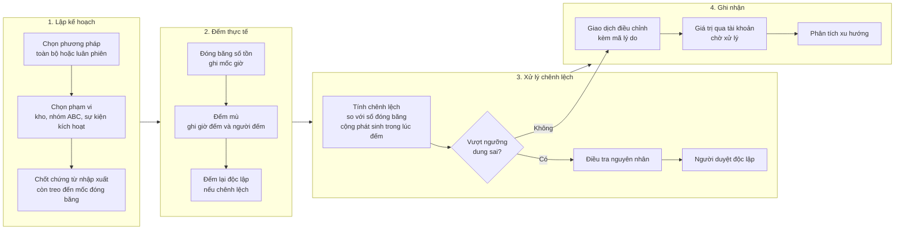

# 5000 Kiểm kê & điều chỉnh tồn kho

Mọi con số tồn kho chỉ là *giả định* cho đến khi có người đếm thực tế. Kiểm kê là hoạt động duy nhất xác nhận giả định đó còn đúng — và cũng là hoạt động dễ bị làm cho hình thức nhất, vì nếu người đếm nhìn sẵn số trên hệ thống rồi ghi lại, kết quả kiểm kê luôn khớp và không phát hiện được gì.

Bài này nói về cách thiết kế kiểm kê để nó thực sự phát hiện sai lệch, cách xử lý chênh lệch phát hiện được, và cách chặn âm kho trước khi nó làm hỏng sổ sách. Cách tổ chức cụ thể (phiếu giấy, máy quét mã, bảng tính, hay quy trình có sẵn của ERP) khác nhau giữa các doanh nghiệp; điều không đổi là các nguyên tắc kiểm soát ở dưới.

---

## 0. Nguyên lý (áp dụng mọi ERP)

1. **Kiểm kê không phải hoạt động tìm đường — mà là hoạt động xác nhận.** Nếu đếm xong rồi mới lấy số hệ thống so sánh, đó là kiểm tra chứ không phải kiểm kê. Đếm phải diễn ra **trước** khi người đếm thấy số hệ thống.
2. **Không có hệ thống nào sổ sách khớp thực tế 100%.** Luôn có hao hụt, nhặt nhầm, đếm nhầm, giao nhầm. Mục tiêu không phải là chênh lệch bằng 0, mà là **biết mình lệch bao nhiêu và lệch vì sao**.
3. **Có hai cách kiểm kê và chúng phục vụ mục đích khác nhau.** Kiểm kê toàn bộ (physical inventory) đóng băng kho và đếm mọi thứ — chính xác nhất nhưng đắt và gián đoạn. Kiểm kê định kỳ (cycle count) đếm xoay vòng một phần kho thường xuyên — rẻ, không gián đoạn, và phát hiện nguyên nhân sớm hơn. Doanh nghiệp vận hành tốt dùng cycle count làm chính, physical inventory chỉ để đối chiếu niên độ.
4. **Điều chỉnh là hậu quả, không phải mục đích.** Hệ thống tốt cho phép điều chỉnh — nhưng phải thống kê được điều chỉnh **đến từ đâu**: đếm sai, xuất nhầm, trộm cắp, hay nghiệp vụ chưa ghi nhận. Con số điều chỉnh không có mã lý do là bài toán không thể cải thiện.
5. **Người đếm không được là người duyệt.** Người phát hiện chênh lệch không được là người quyết định ghi nhận chênh lệch đó vào sổ. Thiếu nguyên tắc này, kiểm kê trở thành công cụ hợp thức hóa thất thoát.
6. **Âm kho là dấu hiệu bệnh, không phải sự cố.** Khi hệ thống cho phép tồn âm, nó đang che giấu một vấn đề thật: nghiệp vụ xuất trước nhập sau, nhập bị ghi sai, hoặc hàng không có thật. Cho phép âm kho nghĩa là từ bỏ việc kiểm soát; nếu chính sách có ngoại lệ thì ngoại lệ phải có giới hạn và hạn xử lý (xem mục 5E).
7. **So sánh với số đóng băng, không so với số đang chạy.** Người đếm bắt đầu lúc 8 giờ nhưng có thể nhập kết quả lúc 14 giờ; trong thời gian đó kho vẫn xuất nhập. Vì vậy trước khi phát phiếu đếm, hệ thống phải **chụp lại số tồn tại một mốc giờ xác định** (số đóng băng, *frozen quantity*). Chênh lệch luôn được tính từ số đóng băng này, cộng thêm các phát sinh có thật xảy ra giữa lúc đóng băng và lúc đếm; không so với số dư sống đang tiếp tục biến động.
8. **Số lượng và giá trị đi hai đường.** Số lượng được chỉnh khi điều chỉnh được duyệt để tồn kho phản ánh đúng thực tế. Giá trị chênh lệch đi qua tài khoản chờ xử lý cho đến khi có quyết định về nguyên nhân và cách xử lý (xem mục 3). Không đẩy thẳng chênh lệch vào chi phí ngay khi phát hiện.
9. **Đếm trên một nền chứng từ đã chốt.** Hàng đã nhận nhưng chưa nhập kho, phiếu xuất đã giao nhưng chưa ghi, chứng từ chuyển kho còn treo đều làm số hệ thống lệch với thực tế ngay từ đầu. Các chứng từ đó phải được ghi nhận, hoặc được liệt kê riêng, **trước mốc đóng băng**.

## 1. Luồng vận hành



Bốn điểm quan trọng trong sơ đồ:

- **Đếm mù** (blind count) là bước hay bị bỏ qua nhất. Nếu người đếm thấy số hệ thống, kết quả kiểm kê gần như chắc chắn khớp.
- **Đóng băng số tồn** diễn ra đúng lúc phát phiếu đếm, kèm mốc giờ. Có hai cách giữ cho số đóng băng đáng tin: khóa giao dịch ở khu vực đang đếm (chính xác nhưng gián đoạn), hoặc không khóa và tính thêm phát sinh trong lúc đếm (xem mục 5C).
- **Điều tra trước, điều chỉnh sau.** Điều chỉnh ngay khi phát hiện chênh lệch sẽ xóa mất dấu vết nguyên nhân.
- **Người duyệt độc lập** chỉ xuất hiện khi vượt ngưỡng — chênh lệch nhỏ chấp nhận duyệt tự động, nhưng phải ghi log.

**Chọn khu vực và mã hàng để đếm.** Ngoài lịch xoay vòng theo nhóm ABC, nên có các điều kiện **kích hoạt đếm theo sự kiện**: mã hàng vừa xuất hiện tồn âm, mã hàng có chênh lệch lặp lại, mã hàng vừa về tồn bằng 0 nhưng hệ thống vẫn thấy hàng, lô nhập lớn bất thường, hoặc vị trí vừa có giao dịch sửa sai. Các dấu hiệu này cho kết quả tốt hơn đếm theo lịch cứng.

## 2. Ai làm gì ở module nào

| Bước | Kho (INV) | Bán hàng (OM) | Sản xuất (MFG) | Mua hàng (PO) | Kế toán |
|---|---|---|---|---|---|
| Chọn phạm vi và tần suất | ✅ lập kế hoạch theo phân nhóm ABC và sự kiện kích hoạt | — | — | — | Đề xuất theo rủi ro trọng yếu |
| Chốt chứng từ còn treo trước đóng băng | ✅ chủ trì | Hoàn tất chứng từ xuất | Hoàn tất cấp liệu, nhập thành phẩm | Hoàn tất chứng từ nhận hàng | — |
| Đóng băng số tồn | ✅ chụp số tồn kèm mốc giờ | — | — | — | — |
| Đếm thực tế | ✅ nhân viên kiểm kê độc lập | — | — | — | — |
| Ghi nhận chênh lệch | ✅ nhập số đếm kèm giờ đếm, hệ thống tính chênh | — | — | — | — |
| Điều tra nguyên nhân | ✅ chủ trì phối hợp | Kiểm tra đơn giao nhầm | Kiểm tra cấp liệu chưa ghi | Kiểm tra nhập hàng chưa ghi | — |
| Phê duyệt điều chỉnh | ✅ trưởng kho đề xuất | — | — | — | ✅ người duyệt độc lập khi vượt ngưỡng |
| Ghi giao dịch điều chỉnh | ✅ ghi | — | — | — | Nhận bút toán chênh lệch |
| Xử lý giá trị trên tài khoản chờ | Cung cấp kết quả điều tra | — | — | — | ✅ quyết định theo chính sách đã duyệt |
| Phân tích xu hướng | ✅ báo cáo chênh lệch theo lý do | — | — | — | ✅ đánh giá ảnh hưởng P&L |

**Phân vai cốt lõi:** người **đếm** phải khác người **duyệt điều chỉnh**; và người **đếm lại** phải khác người đếm lần trước. Trong doanh nghiệp nhỏ không đủ người, ít nhất phải tách được vai trò "người đếm" và "người bấm ghi sổ" — hoặc dùng xác nhận hai lớp bằng chữ ký số.

## 3. Hạch toán

Điều chỉnh chênh lệch kiểm kê là nghiệp vụ tài chính thật, có ảnh hưởng lợi nhuận. Cách hạch toán được định nghĩa duy nhất tại [Hạch toán & tài khoản trung gian](../6-ke-toan-chung/1000-hach-toan-va-tai-khoan-trung-gian.md) (bút toán điều chỉnh kiểm kê) và [Đóng kỳ & đối soát sổ phụ](../6-ke-toan-chung/5000-dong-ky-va-doi-soat-so-phu.md) (xử lý khoản chờ). Tóm tắt từ góc nhìn của kho:

1. **Khi điều chỉnh được duyệt**, giao dịch điều chỉnh kho sinh bút toán: thiếu thì ghi giảm tồn kho đối ứng khoản **thiếu chờ xử lý**; thừa thì ghi tăng tồn kho đối ứng khoản **thừa chờ xử lý**. Số lượng tồn kho đúng ngay từ lúc này.
2. **Khoản chờ xử lý** được tất toán khi có kết luận điều tra: hao hụt trong định mức, do cá nhân hoặc đơn vị chịu trách nhiệm, hàng thừa chờ xác định chủ sở hữu, hay lỗi ghi nhận đã được sửa bằng chứng từ muộn. Việc chọn tài khoản chi phí, thu nhập hoặc phải thu, và cách xử lý thuế liên quan, theo chính sách đã được kế toán trưởng duyệt và quy định hiện hành; bài này không quy định cụ thể.
3. **Điều chỉnh đổi mã (item swap)** gồm hai điều chỉnh gắn cùng một mã nhóm: giảm mã này, tăng mã kia. Khoản thiếu và thừa chờ xử lý của hai mã bù nhau theo giá trị. Nếu hai mã **cùng giá vốn** thì chênh lệch tài chính bằng 0; nếu **khác giá vốn** thì phần chênh giá trị còn lại vẫn là một khoản chênh lệch và xử lý như bình thường.

Bốn điểm cần nhớ khi triển khai:

1. **Điều chỉnh phải có chứng từ nguồn.** Không cho phép ghi điều chỉnh từ màn hình tồn kho trực tiếp — phải luôn đi từ phiếu kiểm kê đã duyệt.
2. **Không điều chỉnh vào kỳ đã khóa.** Giao dịch điều chỉnh ghi vào kỳ đang mở với ngày hạch toán hiện tại, theo cơ chế giao dịch ở [Giao dịch nhập, xuất & chuyển](./3000-giao-dich-nhap-xuat-chuyen.md). Nếu phát hiện sai sau khi khóa kỳ, xử lý bằng bút toán kỳ hiện tại, không mở lại kỳ.
3. **Giá trị điều chỉnh lấy theo giá hiện hành của phương pháp tính giá đang áp dụng**, không lấy theo giá nhập gần nhất — nếu không sẽ làm sai giá vốn của cả lô. Giá chụp tại mốc đóng băng chỉ dùng để ước tính giá trị chênh lệch khi xét duyệt.
4. **Hàng ký gửi chỉ chỉnh số lượng.** Vị trí có `Ownership = VENDOR` vẫn phải đếm, nhưng điều chỉnh ở đó không sinh bút toán tài sản vì đó không phải hàng của mình. Chênh lệch được xử lý với nhà cung cấp theo hợp đồng ký gửi (xem [Cấu trúc kho & vị trí](./1000-cau-truc-kho-va-vi-tri.md)).

## 4. Điểm chạm & rủi ro

- **Điều chỉnh là giao dịch kho**: cơ chế ghi sổ, tính bất biến và giao dịch đảo ở [Giao dịch nhập, xuất & chuyển](./3000-giao-dich-nhap-xuat-chuyen.md)
- **Giữ hàng không ảnh hưởng số đếm vật lý**: đếm tồn vật lý và so với số đóng băng vật lý; lượng đã giữ chỉ dùng để xác định đơn nào bị ảnh hưởng khi có điều chỉnh giảm → [Giữ hàng, phân bổ & ATP](./4000-giu-hang-phan-bo-va-atp.md)
- **Chênh lệch kiểm kê ảnh hưởng giá vốn kỳ**: [Giá vốn & định giá tồn kho](../6-ke-toan-chung/2000-gia-von-va-dinh-gia-ton-kho.md)
- **Điều chỉnh phải hoàn tất trước khi khóa sổ**: [Đóng kỳ & đối soát sổ phụ](../6-ke-toan-chung/5000-dong-ky-va-doi-soat-so-phu.md)
- **Truy vết lô/serial khi đếm**: [Item Master & thuộc tính kho](./2000-item-master-va-thuoc-tinh-kho.md)
- **Vị trí và loại vị trí cần đếm** (kể cả khu chờ kiểm, khu biệt trữ, hàng ký gửi): [Cấu trúc kho & vị trí](./1000-cau-truc-kho-va-vi-tri.md)

**Rủi ro chính:**

- **Kiểm kê hình thức** — người đếm nhìn số hệ thống, mọi kỳ đều khớp, thực tế lệch không ai biết.
- **Chênh lệch giả do thời điểm** — không đóng băng số tồn nên số đếm so với số đã thay đổi, tạo chênh lệch không có thật hoặc che mất chênh lệch thật.
- **Điều chỉnh không có mã lý do** — sổ sách đúng nhưng không cải thiện được nguyên nhân gốc.
- **Âm kho bị chặn cứng nhưng không ai xử lý** — giao dịch bị treo, nhân viên chuyển sang làm ngoài hệ thống.
- **Dùng kiểm kê để che thất thoát** — người có quyền điều chỉnh điều chỉnh hàng ngày với số lượng nhỏ, không ai phát hiện.
- **Xử lý lệch theo cặp như hai sự cố độc lập** — thiếu mã này, thừa mã kia do nhầm hàng, nhưng ghi thành một khoản thiếu và một khoản thừa riêng rẽ.

## 5. Triển khai tham chiếu ERP

### A. Ánh xạ khái niệm

> **Lưu ý:** tên màn hình, bảng và mã giao dịch của các ERP bên dưới chỉ để định hướng; ô đánh dấu `*` cần được kiểm tra trên hệ thống thật. Phần Epicor áp dụng cho **Epicor ERP 10.2 (E10.2)**, đối chiếu với schema bản 10.2.400.6.

| Khái niệm | Oracle EBS R12 `*` | Epicor ERP 10.2 (E10.2) | SAP S/4HANA `*` | Odoo `*` |
|---|---|---|---|---|
| Kiểm kê toàn bộ | Physical Inventory (theo thẻ) | Đợt kiểm kê `Erp.CCHdr` với `FullPhysical = 1` | Physical Inventory (MI01 tạo chứng từ, MI04 nhập số đếm, MI07 ghi chênh lệch) | Inventory Adjustment ở chế độ kiểm kê |
| Kiểm kê luân phiên | Cycle Count và Cycle Count Scheduler | Đợt kiểm kê `Erp.CCHdr` với `FullPhysical = 0`, lịch theo kho/năm/tháng ở `Erp.CCWhsCtrl` và `Erp.CCPeriodDefn` | Cycle Counting theo chỉ báo ABC của mã hàng | Cần tùy biến hoặc module bổ sung |
| Thẻ hoặc phiếu đếm | Count Entry | Thẻ đếm `Erp.CCTag` (một thẻ một vị trí/lô/serial), nhóm thẻ thành tờ ở `Erp.CCSheet` | Chứng từ kiểm kê | Dòng kiểm kê |
| Đóng băng số tồn | Freeze definitions | Số tồn chụp lúc bắt đầu đợt (`CCHdr.SeqStartDate`, `TimeSeqStarted`), lưu ở `CCTag.FrozenQOH` | Cờ đóng băng trên chứng từ kiểm kê | Không có mặc định, phải chặn theo vị trí |
| Đếm mù | Cấu hình ẩn số lượng ở màn hình nhập số đếm | In thẻ trống, không hiện số hệ thống trên thẻ `*` | Không in số trong phiếu đếm | Không có mặc định |
| Đếm lại | Recount | Thẻ đếm lại được sinh từ thẻ cũ, đánh số `TagNum.lầnĐếm` | Recount | Cần tùy biến |
| Ngưỡng dung sai | Approval theo variance | Ngưỡng theo %, lượng, giá trị ở `Erp.PartWhse` | Tolerance trong chứng từ kiểm kê | Cần tùy biến |
| Điều chỉnh | Adjustment transaction | Giao dịch điều chỉnh sinh khi ghi kết quả đếm | Movement type 701 (thừa), 702 (thiếu) | Inventory Adjustment |
| Chặn âm kho | `Allow Negative Balances` ở mức tổ chức tồn kho (Inventory Organization Parameters), có thể bị ghi đè theo subinventory `*` | Cấu hình theo kho/part `*` | Không cho âm theo thiết kế (có thể cấu hình ngoại lệ) | Có thể bật, nên tắt |

**Cấu trúc kiểm kê trong schema E10.2** (chỉ nêu các cột liên quan đến nguyên tắc của bài):

- **`Erp.CCHdr`** (đợt kiểm kê, khóa gồm kho, năm, tháng, `FullPhysical`, `CycleSeq`): `CycleStatus` (0 lên lịch, 1 đã sinh thẻ, 2 bắt đầu đếm, 3 đã nhập số đếm, 4 đã sinh thẻ đếm lại, 6 hoàn tất, 7 hủy), `SeqStartDate` và `TimeSeqStarted` (mốc bắt đầu, cũng là lúc số tồn được đóng băng), `AdjustPosted` (đã ghi điều chỉnh vào tồn kho hay chưa), `IncludeNonNettable` (có gồm bin không bán được hay không).
- **`Erp.CCTag`** (thẻ đếm, khóa gồm kho, `TagNum`): `FrozenQOH` (số tồn lúc đóng băng, theo đơn vị `UOM` của thẻ), `CountedQty` (số đếm, không cho âm), `CountedBy`, `CountedDate`, `CountedTime`, `EntryPerson` (người nhập), `TagStatus` (0 mở, 1 đã ghi, 2 hủy, 3 đóng/đếm lại), `TagReturned`, `FrozenTranDate` và `FrozenTranTime` (mốc giao dịch cuối lúc đóng băng, dùng để xác định phát sinh sau đó), `ActivityBeforeCount` (số lượng phát sinh xảy ra **trước lúc đếm nhưng sau lúc đóng băng**, người dùng nhập tay để hiệu chỉnh khi xem báo cáo chênh lệch), `FrozenCost`.
- Bảng thẻ **không có cột mã lý do hay người duyệt**; hai thông tin này doanh nghiệp tự bổ sung bằng quy trình hoặc trường tùy biến.
- Ngưỡng dung sai và phân loại ABC nằm ở `Erp.PartWhse` (`PcntTolerance`/`CalcPcnt`, `QtyTolerance`/`CalcQty`, `ValueTolerance`/`CalcValue`, `QtyAdjTolerance`/`CalcQtyAdj`, `SystemAbc`, `MinAbc`, `ManualABC`, `CountFreq`, `OvrrideCountFreq`, `LastCCDate`).

Cơ chế `ActivityBeforeCount` của Epicor chính là nguyên lý 7 làm thủ công: 1 giờ chiều đóng băng 250 cái, 1 giờ 30 xuất 75 cái, 2 giờ 30 đếm được 175 cái; nếu không hiệu chỉnh, báo cáo sẽ báo lệch 75 cái. Thiết kế tự xây ở mục C làm bước này tự động.

### B. Phân nhóm ABC và ngưỡng dung sai

Phân nhóm ABC để quyết định **đếm bao lâu một lần**:

| Nhóm | Tiêu chí | Tần suất đếm |
|---|---|---|
| A | Giá trị cao — thường 20% mã, chiếm 80% giá trị tồn | Hàng tháng |
| B | Giá trị trung bình | Hàng quý |
| C | Giá trị thấp, số lượng lớn | 6 tháng một lần hoặc kiểm kê toàn bộ cuối năm |

Tần suất trên là gợi ý, mỗi doanh nghiệp tự chốt. Mã có lịch sử chênh lệch lặp lại hoặc rủi ro thất thoát cao có thể được nâng tần suất bất kể nhóm giá trị.

**Ngưỡng dung sai** quyết định chênh lệch nào tự duyệt, chênh lệch nào cần người duyệt ở cấp nào. Nên dùng **ba loại ngưỡng cùng lúc** (phần trăm, số lượng, giá trị) vì mỗi loại bắt một kiểu rủi ro khác nhau: phần trăm bắt mã hàng giá trị thấp lệch nhiều, giá trị bắt mã hàng đắt lệch ít. Chênh lệch **vượt bất kỳ ngưỡng nào** của cấp hiện tại thì phải lên cấp kế tiếp.

```sql
CREATE TABLE Inventory_Count_Tolerance (
    Tolerance_ID        INT IDENTITY PRIMARY KEY,
    Tier                VARCHAR(10)   NOT NULL,   -- A | B | C
    Approver_Level      INT           NOT NULL,   -- 0 = tự duyệt, 1 = trưởng kho, 2 = kế toán, 3 = giám đốc
    Max_Variance_Pct    DECIMAL(6,2)  NULL,       -- trần % chênh lệch mà cấp này được duyệt
    Max_Variance_Qty    DECIMAL(18,4) NULL,       -- trần số lượng
    Max_Variance_Amount DECIMAL(18,2) NULL,       -- trần giá trị tuyệt đối
    CONSTRAINT UQ_Tolerance UNIQUE (Tier, Approver_Level)
);
```

Cách dùng: lấy cấp thấp nhất mà chênh lệch **không vượt** mọi trần đã khai báo (trần NULL nghĩa là không áp dụng loại ngưỡng đó). Vượt trần của cấp cao nhất thì chuyển lên hội đồng xử lý do doanh nghiệp quy định. Cấp 0 (tự duyệt) vẫn **ghi điều chỉnh** và ghi log; chỉ bỏ qua bước người duyệt.

Có hệ thống cho phép đặt ngưỡng "chênh lệch trong ngưỡng thì **không ghi** điều chỉnh" (thường cho hàng đếm theo cân, dao động theo độ ẩm). Chỉ nên áp dụng cho nhóm hàng đó; áp cho mọi hàng thì sổ sách lệch tích lũy mà không ai thấy.

### C. Mô hình dữ liệu gợi ý cho hệ thống tự xây

Bốn bảng: **phiếu kiểm kê**, **phạm vi**, **dòng kiểm kê** (số đóng băng, số chốt, chênh lệch, duyệt) và **lần đếm** (mỗi lần đếm một dòng, để đếm lại độc lập). Các bảng này dùng chung `Inv_Location`, `Inventory_Transaction` và bảng số dư theo vị trí `Inventory_Balance` của [Giao dịch nhập, xuất & chuyển](./3000-giao-dich-nhap-xuat-chuyen.md).

```sql
CREATE TABLE Inventory_Count (
    Count_ID            BIGINT IDENTITY PRIMARY KEY,
    Count_No            VARCHAR(30)  NOT NULL UNIQUE,
    Count_Type          VARCHAR(10)  NOT NULL,   -- CYCLE | FULL
    Warehouse_ID        VARCHAR(20)  NOT NULL,
    Status              VARCHAR(20)  NOT NULL,   -- PLANNED | FROZEN | COUNTING | REVIEW | APPROVED | POSTED | CANCELLED
    Frozen_At           DATETIME     NULL,       -- mốc đóng băng số tồn
    Is_Location_Locked  BIT          NOT NULL DEFAULT 0,  -- 1 = đã khóa giao dịch ở khu vực đang đếm
    Created_By          VARCHAR(50)  NOT NULL,
    Created_At          DATETIME     NOT NULL DEFAULT GETDATE(),
    CONSTRAINT CK_Count_Type   CHECK (Count_Type IN ('CYCLE','FULL')),
    CONSTRAINT CK_Count_Status CHECK (Status IN ('PLANNED','FROZEN','COUNTING','REVIEW','APPROVED','POSTED','CANCELLED'))
);

CREATE TABLE Inventory_Count_Scope (          -- khai báo khi lập kế hoạch
    Count_ID     BIGINT       NOT NULL REFERENCES Inventory_Count(Count_ID),
    Item_ID      VARCHAR(50)  NOT NULL,
    Location_ID  VARCHAR(50)  NOT NULL REFERENCES Inv_Location(Location_ID),
    CONSTRAINT PK_Count_Scope PRIMARY KEY (Count_ID, Item_ID, Location_ID)
);

CREATE TABLE Inventory_Count_Line (
    Line_ID                BIGINT IDENTITY PRIMARY KEY,
    Count_ID               BIGINT        NOT NULL REFERENCES Inventory_Count(Count_ID),
    Item_ID                VARCHAR(50)   NOT NULL,
    Location_ID            VARCHAR(50)   NOT NULL REFERENCES Inv_Location(Location_ID),
    Lot_No                 VARCHAR(50)   NULL,
    Serial_No              VARCHAR(50)   NULL,
    Frozen_Qty             DECIMAL(18,4) NOT NULL,   -- số đóng băng, UOM gốc
    Frozen_Unit_Cost       DECIMAL(18,6) NULL,       -- giá tại mốc đóng băng, chỉ để ước tính giá trị khi duyệt
    Final_Qty              DECIMAL(18,4) NULL,       -- số đếm được chốt (sau đếm lại), UOM gốc
    Counted_At             DATETIME      NULL,       -- giờ đếm thực tế của số chốt (không phải giờ nhập liệu)
    Movement_Since_Freeze  DECIMAL(18,4) NULL,       -- phát sinh thật giữa đóng băng và giờ đếm, tính khi rà soát
    Reason_Code            VARCHAR(20)   NULL,
    Swap_Group_ID          VARCHAR(30)   NULL,       -- cùng mã nhóm = điều chỉnh đổi mã
    Proposed_By            VARCHAR(50)   NULL,
    Approved_By            VARCHAR(50)   NULL,
    Approved_At            DATETIME      NULL,
    Adjustment_Trx_ID      BIGINT        NULL REFERENCES Inventory_Transaction(Trx_ID),
    Line_Status            VARCHAR(20)   NOT NULL DEFAULT 'OPEN',  -- OPEN | COUNTED | RECOUNT | PENDING_APPROVAL | APPROVED | POSTED
    Is_Added_On_Count      BIT           NOT NULL DEFAULT 0,       -- 1 = người đếm thêm dòng mới vì thấy hàng mà hệ thống không có
    Qty_Variance  AS (Final_Qty - (Frozen_Qty + ISNULL(Movement_Since_Freeze, 0))),
    Value_Variance AS ((Final_Qty - (Frozen_Qty + ISNULL(Movement_Since_Freeze, 0))) * Frozen_Unit_Cost),
    CONSTRAINT UQ_Count_Line UNIQUE (Count_ID, Item_ID, Location_ID, Lot_No, Serial_No),
    CONSTRAINT CK_Line_Qty  CHECK (Final_Qty IS NULL OR Final_Qty >= 0),
    CONSTRAINT CK_Line_Serial CHECK (Serial_No IS NULL OR (Frozen_Qty IN (0,1) AND (Final_Qty IS NULL OR Final_Qty IN (0,1))))
);

CREATE TABLE Inventory_Count_Entry (           -- mỗi lần đếm một dòng; số đếm lại là dòng mới
    Entry_ID    BIGINT IDENTITY PRIMARY KEY,
    Line_ID     BIGINT        NOT NULL REFERENCES Inventory_Count_Line(Line_ID),
    Count_No    INT           NOT NULL,        -- 1 = lần đầu, 2 = đếm lại, ...
    Qty         DECIMAL(18,4) NOT NULL,        -- không âm
    Counted_At  DATETIME      NOT NULL,        -- giờ đếm thực tế
    Counter_ID  VARCHAR(50)   NOT NULL,
    Entered_At  DATETIME      NOT NULL DEFAULT GETDATE(),
    CONSTRAINT UQ_Count_Entry UNIQUE (Line_ID, Count_No),
    CONSTRAINT CK_Entry_Qty  CHECK (Qty >= 0)
);
```

**Quy tắc thiết kế:**

1. **Phiếu đếm không có cột nào hiển thị `Frozen_Qty` cho người đếm** (đếm mù). Chỉ màn hình rà soát của người có quyền mới thấy.
2. **Lưu giờ đếm thực tế tách khỏi giờ nhập liệu** (`Counted_At` và `Entered_At`). Giờ đếm là cơ sở tính phát sinh giữa đóng băng và lúc đếm.
3. **Đếm lại là một dòng `Inventory_Count_Entry` mới**, không ghi đè số cũ. Đếm lại phải do người khác đếm lần trước thực hiện, và người đếm lại không được xem kết quả lần trước.
4. **Người duyệt khác mọi người đã đếm dòng đó.** Ràng buộc nằm ở thủ tục duyệt, và được kiểm tra lại bằng truy vấn ở mục D.
5. **Điều chỉnh sinh ra từ dòng đã duyệt, với số lượng đúng bằng chênh lệch.** Thủ tục duyệt ghi một giao dịch `ADJUSTMENT` vào `Inventory_Transaction` (qua dịch vụ ghi sổ kho) có `Qty_Base = |Qty_Variance|`, không phải "đặt tồn bằng số đếm": sau giờ đếm kho vẫn có xuất nhập hợp lệ không được xóa. Chiều giao dịch: thiếu thì từ vị trí sang `ADJUSTMENT`, thừa thì từ `ADJUSTMENT` sang vị trí. Giao dịch kèm `Reason_Code`, `Source_Doc_No` là `Count_No`, rồi lưu `Adjustment_Trx_ID` vào dòng. Không có đường điều chỉnh nào khác ngoài phiếu kiểm kê đã duyệt.
6. **Phạm vi đếm theo tồn vật lý.** Phiếu đếm gồm cả vị trí không khả dụng (khu chờ kiểm, khu biệt trữ) và kho ký gửi, vì kiểm kê xác nhận hàng có thật chứ không xác nhận hàng bán được. Chỉ vị trí ảo nằm ngoài phạm vi.
7. **Khóa vị trí trong lúc đếm.** Khi phiếu có `Is_Location_Locked = 1` chuyển sang `FROZEN`, hệ thống đặt `Is_Blocked = 1` cho các vị trí trong phạm vi (xem [Cấu trúc kho & vị trí](./1000-cau-truc-kho-va-vi-tri.md)), và trả về 0 khi phiếu chuyển sang `POSTED` hoặc `CANCELLED`. Quên bước trả về sẽ làm vị trí bị khóa vĩnh viễn, hàng không xuất được.
8. **Cho phép đếm bổ sung.** Người đếm thấy hàng ở vị trí hoặc lô mà phiếu không có dòng thì được thêm dòng mới (`Frozen_Qty = 0`, `Is_Added_On_Count = 1`), ghi đúng lô và serial thực tế. Dòng thêm đi qua cùng quy trình duyệt như mọi dòng khác.

**Chụp số đóng băng.** Chụp trong một câu lệnh duy nhất, ghi mốc giờ cùng lúc. Nếu khu vực được khóa giao dịch thì số này chính xác tuyệt đối; nếu không khóa thì phần phát sinh sau đó được bù ở bước tính chênh lệch.

```sql
DECLARE @Count_ID BIGINT = 1;
DECLARE @Frozen_At DATETIME = GETDATE();

BEGIN TRANSACTION;

UPDATE Inventory_Count
SET Status = 'FROZEN', Frozen_At = @Frozen_At
WHERE Count_ID = @Count_ID AND Status = 'PLANNED';

IF @@ROWCOUNT = 0
    THROW 50010, 'Phiếu kiểm kê không ở trạng thái PLANNED', 1;

INSERT INTO Inventory_Count_Line
    (Count_ID, Item_ID, Location_ID, Lot_No, Serial_No, Frozen_Qty, Frozen_Unit_Cost)
SELECT s.Count_ID, s.Item_ID, s.Location_ID, b.Lot_No, b.Serial_No,
       ISNULL(b.Qty_Onhand, 0),
       NULL            -- giá tạm lấy từ dịch vụ tính giá, xem 6000 Định giá & báo cáo kho
FROM Inventory_Count_Scope s
LEFT JOIN Inventory_Balance b
  ON b.Item_ID = s.Item_ID AND b.Location_ID = s.Location_ID
WHERE s.Count_ID = @Count_ID;

COMMIT;
```

**Tính chênh lệch khi rà soát.** Phát sinh cần cộng thêm là các giao dịch vật lý **được ghi sổ sau mốc đóng băng nhưng đã xảy ra trước giờ đếm**. Tính vào lúc rà soát (không phải lúc nhập số đếm), vì chứng từ có thể về muộn.

```sql
-- Giả định: @Item, @Loc, @Lot, @Serial, @Frozen_At, @Counted_At lấy từ một dòng kiểm kê
SELECT ISNULL(SUM(CASE WHEN t.To_Location_ID = @Loc THEN t.Qty_Base ELSE -t.Qty_Base END), 0)
       AS Movement_Since_Freeze
FROM Inventory_Transaction t
WHERE t.Item_ID = @Item
  AND (t.To_Location_ID = @Loc OR t.From_Location_ID = @Loc)
  AND ISNULL(t.Lot_No, '')    = ISNULL(@Lot, '')
  AND ISNULL(t.Serial_No, '') = ISNULL(@Serial, '')
  AND t.Is_Logical = 0
  AND t.Created_At > @Frozen_At      -- ghi sổ sau khi đóng băng nên chưa nằm trong số đóng băng
  AND t.Trx_Date  <= @Counted_At;    -- đã xảy ra thực tế trước lúc đếm
```

Kết quả lưu vào `Movement_Since_Freeze`; cột `Qty_Variance` sẽ là `Final_Qty − (Frozen_Qty + Movement_Since_Freeze)`. Ví dụ: đóng băng 250, sau đó có phiếu xuất 75 (xảy ra lúc 13 giờ 30, ghi sổ lúc 15 giờ), đếm lúc 14 giờ 30 được 175. `Movement_Since_Freeze = −75`, chênh lệch `175 − (250 − 75) = 0`. Giao dịch xảy ra **sau** giờ đếm không được cộng vào.

**Chuyển lệch theo cặp thành điều chỉnh đổi mã.** Khi người rà soát xác định hai dòng lệch đối xứng là do nhầm mã, gán cùng `Swap_Group_ID` cho cả hai và `Reason_Code = 'ITEM_SWAP'`. Hai giao dịch điều chỉnh cùng ghi trong một lần duyệt, cùng chứng từ nguồn, để khoản thiếu và thừa chờ xử lý bù nhau theo giá trị (xem mục 3).

### D. Truy vấn kiểm soát

**Chênh lệch kiểm kê theo lý do — tìm nguyên nhân gốc:**

```sql
SELECT Reason_Code, COUNT(*) AS So_Dong,
       SUM(ABS(Qty_Variance))   AS Tong_Chenh_Lech,
       SUM(ABS(Value_Variance)) AS Gia_Tri_Chenh_Lech
FROM Inventory_Count_Line
WHERE Counted_At >= DATEADD(MONTH, -3, GETDATE())
  AND Qty_Variance <> 0
GROUP BY Reason_Code
ORDER BY Gia_Tri_Chenh_Lech DESC;
```

Dòng có `Reason_Code` NULL xuất hiện thành một nhóm riêng; nhóm này phải rỗng với dòng đã duyệt.

**Mặt hàng có chênh lệch lặp lại — dấu hiệu vấn đề hệ thống, không phải đếm sai:**

```sql
SELECT Item_ID, COUNT(*) AS So_Lan_Chenh,
       SUM(ABS(Qty_Variance)) AS Tong_Chenh
FROM Inventory_Count_Line
WHERE Counted_At >= DATEADD(MONTH, -6, GETDATE())
  AND Qty_Variance <> 0
GROUP BY Item_ID
HAVING COUNT(*) >= 3
ORDER BY So_Lan_Chenh DESC, Tong_Chenh DESC;
```

**Phát hiện tồn âm — cách 1, đọc thẳng từ bảng số dư theo vị trí (khuyên dùng, nhanh):**

```sql
SELECT b.Location_ID, b.Item_ID, b.Lot_No, b.Serial_No, b.Qty_Onhand
FROM Inventory_Balance b
JOIN Inv_Location l ON l.Location_ID = b.Location_ID
WHERE l.Location_Type = 'PHYSICAL'
  AND b.Qty_Onhand < 0;
```

**Phát hiện tồn âm — cách 2, tính từ bảng giao dịch.** Bảng giao dịch chỉ lưu `Qty_Base` dương, chiều nhập xuất do `From_Location_ID` và `To_Location_ID` quyết định, nên phải cộng chiều vào và trừ chiều ra theo từng vị trí. Truy vấn nặng, dùng để đối soát với cách 1 chứ không chạy thường xuyên.

```sql
WITH Moves AS (
    SELECT Item_ID, To_Location_ID   AS Location_ID, Lot_No, Serial_No,  Qty_Base AS Qty
    FROM Inventory_Transaction WHERE Is_Logical = 0
    UNION ALL
    SELECT Item_ID, From_Location_ID AS Location_ID, Lot_No, Serial_No, -Qty_Base AS Qty
    FROM Inventory_Transaction WHERE Is_Logical = 0
)
SELECT m.Location_ID, m.Item_ID, m.Lot_No, m.Serial_No, SUM(m.Qty) AS Qty_Calc
FROM Moves m
JOIN Inv_Location l ON l.Location_ID = m.Location_ID AND l.Location_Type = 'PHYSICAL'
GROUP BY m.Location_ID, m.Item_ID, m.Lot_No, m.Serial_No
HAVING SUM(m.Qty) < 0;
```

**Vi phạm tách vai: người duyệt cũng là người đã đếm dòng đó:**

```sql
SELECT l.Line_ID, l.Count_ID, l.Item_ID, l.Approved_By
FROM Inventory_Count_Line l
JOIN Inventory_Count_Entry e ON e.Line_ID = l.Line_ID AND e.Counter_ID = l.Approved_By;
```

**Vi phạm đếm lại độc lập: cùng một người đếm hai lần trên một dòng:**

```sql
SELECT e1.Line_ID, e1.Counter_ID, e1.Count_No AS Lan_Truoc, e2.Count_No AS Lan_Sau
FROM Inventory_Count_Entry e1
JOIN Inventory_Count_Entry e2
  ON e2.Line_ID = e1.Line_ID AND e2.Count_No > e1.Count_No AND e2.Counter_ID = e1.Counter_ID;
```

**Lệch đối xứng chưa được xử lý như đổi mã:** một mã thiếu, một mã thừa đúng bằng nhau trong cùng phiếu và cùng vị trí (nếu nghi lệch ở bin lân cận, mở rộng điều kiện vị trí theo sơ đồ kho):

```sql
SELECT a.Count_ID, a.Location_ID,
       a.Item_ID AS Ma_Thieu, b.Item_ID AS Ma_Thua, b.Qty_Variance AS So_Luong
FROM Inventory_Count_Line a
JOIN Inventory_Count_Line b
  ON b.Count_ID = a.Count_ID AND b.Location_ID = a.Location_ID
 AND b.Item_ID <> a.Item_ID
 AND a.Qty_Variance < 0 AND b.Qty_Variance = -a.Qty_Variance
WHERE a.Swap_Group_ID IS NULL AND b.Swap_Group_ID IS NULL;
```

**Epicor E10.2 — thẻ đếm đã nhập số đếm và có chênh lệch (đối chiếu số đóng băng, kèm phát sinh nhập tay):**

```sql
SELECT t.Company, t.Plant, t.WarehouseCode, t.CCYear, t.CCMonth, t.CycleSeq, t.TagNum,
       t.PartNum, t.BinNum, t.LotNum, t.UOM,
       t.FrozenQOH, t.ActivityBeforeCount, t.CountedQty,
       t.CountedQty - t.FrozenQOH AS Raw_Variance,
       t.CountedBy, t.CountedDate, t.EntryPerson, t.TagStatus
FROM Erp.CCTag t
WHERE t.Company      = 'YOUR_COMPANY_CODE'   -- thay mã công ty
  AND t.TagReturned  = 1                      -- đã nhập số đếm
  AND t.TagStatus   <> 2                      -- không lấy thẻ đã hủy
  AND t.CountedQty  <> t.FrozenQOH
  AND t.CountedDate >= DATEADD(MONTH, -1, GETDATE())   -- CountedDate cho phép NULL: thẻ NULL bị loại
ORDER BY ABS(t.CountedQty - t.FrozenQOH) DESC;
```

Số lượng trong `CCTag` theo đơn vị `UOM` của thẻ, có thể khác đơn vị tính gốc của part. Dấu của `ActivityBeforeCount` cần xác nhận trên hệ thống thật `*` trước khi dùng để tính chênh lệch đã hiệu chỉnh.

**Oracle EBS R12: truy vấn tham khảo cho kiểm kê và âm kho.** Tên bảng, cột và mã trạng thái dưới đây theo cấu trúc chuẩn của Oracle Inventory `*`; cần đối chiếu với môi trường thật trước khi dùng. `:org_id` là mã tổ chức tồn kho (Inventory Organization).

**1. Tồn âm theo subinventory, locator và lô** (tồn on-hand lưu theo từng dòng giao dịch nên phải cộng lại):

```sql
SELECT oqd.organization_id,
       oqd.subinventory_code,
       oqd.locator_id,
       oqd.inventory_item_id,
       oqd.lot_number,
       SUM(oqd.primary_transaction_quantity) AS onhand_qty
FROM   mtl_onhand_quantities_detail oqd
WHERE  oqd.organization_id = :org_id
GROUP BY oqd.organization_id, oqd.subinventory_code, oqd.locator_id,
         oqd.inventory_item_id, oqd.lot_number
HAVING SUM(oqd.primary_transaction_quantity) < 0
ORDER BY onhand_qty;
```

**2. Dòng cycle count có chênh lệch đang chờ duyệt:**

```sql
SELECT h.cycle_count_header_name,
       e.cycle_count_entry_id,
       e.inventory_item_id,
       e.subinventory,
       e.locator_id,
       e.lot_number,
       e.system_quantity_current,
       e.count_quantity_current,
       e.count_quantity_current - e.system_quantity_current AS variance_qty,
       e.adjustment_amount,
       e.count_date_current,
       e.counted_by_employee_id_current
FROM   mtl_cycle_count_entries  e
JOIN   mtl_cycle_count_headers  h ON h.cycle_count_header_id = e.cycle_count_header_id
WHERE  h.organization_id = :org_id
  AND  e.entry_status_code = 2        -- * giả định 2 = chờ duyệt (Pending Approval)
  AND  e.count_quantity_current IS NOT NULL
  AND  e.count_quantity_current <> e.system_quantity_current
ORDER BY ABS(e.adjustment_amount) DESC NULLS LAST;
```

**3. Vi phạm tách vai: người đếm cũng là người duyệt** (cycle count):

```sql
SELECT h.cycle_count_header_name,
       e.cycle_count_entry_id,
       e.inventory_item_id,
       e.counted_by_employee_id_current AS counter_id,
       e.approver_employee_id           AS approver_id,
       e.approval_date
FROM   mtl_cycle_count_entries  e
JOIN   mtl_cycle_count_headers  h ON h.cycle_count_header_id = e.cycle_count_header_id
WHERE  h.organization_id = :org_id
  AND  e.approver_employee_id IS NOT NULL
  AND  e.approver_employee_id = e.counted_by_employee_id_current;
```

**4. Giao dịch điều chỉnh kiểm kê trong 3 tháng gần nhất, gom theo loại giao dịch và mã lý do:**

```sql
SELECT tt.transaction_type_name,
       r.reason_name,
       COUNT(*)                              AS so_dong,
       SUM(ABS(mmt.primary_quantity))        AS tong_so_luong
FROM   mtl_material_transactions mmt
JOIN   mtl_transaction_types     tt ON tt.transaction_type_id = mmt.transaction_type_id
LEFT JOIN mtl_transaction_reasons r ON r.reason_id = mmt.reason_id
WHERE  mmt.organization_id = :org_id
  AND  mmt.transaction_date >= ADD_MONTHS(TRUNC(SYSDATE), -3)
  AND  tt.transaction_type_name IN ('Cycle Count Adjust', 'Physical Inv Adjust')  -- * kiểm tra tên thật ở mtl_transaction_types
GROUP BY tt.transaction_type_name, r.reason_name
ORDER BY tong_so_luong DESC;
```

Dòng có `reason_name` rỗng là điều chỉnh không có mã lý do, tương ứng truy vấn "chênh lệch theo lý do" ở trên.

**5. Kiểm kê toàn bộ: thẻ đếm có chênh lệch** (physical inventory):

```sql
SELECT t.tag_number,
       t.inventory_item_id,
       t.subinventory,
       t.locator_id,
       t.lot_number,
       a.system_quantity,
       a.count_quantity,
       a.adjustment_quantity,
       a.approval_status
FROM   mtl_physical_inventory_tags  t
JOIN   mtl_physical_adjustments     a ON a.adjustment_id = t.adjustment_id
WHERE  t.organization_id = :org_id
  AND  NVL(t.void_flag, 2) <> 1        -- * giả định 1 = thẻ đã hủy
  AND  a.adjustment_quantity <> 0
ORDER BY ABS(a.adjustment_quantity) DESC;
```

**6. Số lượng đã đếm nhưng lệch giữa dòng đếm đầu và dòng đếm chốt** (có đếm lại):

```sql
SELECT e.cycle_count_entry_id,
       e.inventory_item_id,
       e.subinventory,
       e.count_quantity_first,
       e.count_quantity_current,
       e.count_date_first,
       e.count_date_current
FROM   mtl_cycle_count_entries e
JOIN   mtl_cycle_count_headers h ON h.cycle_count_header_id = e.cycle_count_header_id
WHERE  h.organization_id = :org_id
  AND  e.count_quantity_first IS NOT NULL
  AND  e.count_quantity_first <> e.count_quantity_current;
```

Oracle không lưu sẵn "thời điểm số dư chuyển sang âm" như cột `Negative_Since` của thiết kế tự xây; muốn biết tuổi của số âm phải tìm giao dịch gần nhất làm số dư âm trong `mtl_material_transactions`, hoặc dùng báo cáo chuẩn.

### E. Chính sách âm kho

Đây là quyết định chính sách, không phải mặc định kỹ thuật. Có hai lựa chọn:

1. **Chặn tuyệt đối.** Giao dịch xuất không đủ tồn bị từ chối. An toàn nhất cho sổ sách, nhưng phải có quy trình để người kho xử lý ngay khi hàng đã rời kho trước khi chứng từ nhập kịp vào hệ thống; nếu không họ sẽ làm ngoài hệ thống.
2. **Cho phép âm tạm thời theo loại hàng hoặc vị trí.** Phù hợp sản xuất liên tục và bán lẻ, nơi hàng ra trước chứng từ vào. Điều kiện kèm theo:
   - Chỉ bật cho các loại hàng và vị trí đã được duyệt, không bật toàn kho.
   - Số âm phải hiện trên báo cáo cảnh báo hằng ngày, kèm tuổi của số âm.
   - Có **hạn xử lý** do doanh nghiệp quy định (ví dụ 24 hay 48 giờ), quá hạn thì chuyển người phụ trách.
   - Số âm được xóa bằng **chứng từ nhập đến muộn** (nhập hàng, chuyển kho, hoàn thành lệnh sản xuất), không bằng điều chỉnh tăng. Dùng điều chỉnh tăng để "đưa về 0" che mất nguyên nhân và biến lỗi quy trình thành lãi tồn kho.
   - Kiểm tra đủ tồn và ghi giao dịch xuất vẫn phải nằm trong cùng một giao dịch dữ liệu có khóa, như cơ chế ở [Giao dịch nhập, xuất & chuyển](./3000-giao-dich-nhap-xuat-chuyen.md).

Để dịch vụ ghi sổ kho biết loại hàng và vị trí nào được phép âm, lưu chính sách ở một bảng riêng:

```sql
CREATE TABLE Negative_Stock_Policy (
    Policy_ID             INT IDENTITY PRIMARY KEY,
    Item_Class            VARCHAR(20)   NULL,      -- NULL = mọi nhóm hàng (khai ở Item_Inventory_Attribute, bài 2000)
    Location_ID           VARCHAR(50)   NULL REFERENCES Inv_Location(Location_ID),  -- NULL = mọi vị trí
    Max_Negative_Qty      DECIMAL(18,4) NOT NULL,  -- trần số âm được phép, theo UOM gốc; 0 = chặn
    Resolve_Within_Hours  INT           NOT NULL,  -- hạn xử lý số âm
    Approved_By           VARCHAR(50)   NOT NULL,
    Approved_At           DATETIME      NOT NULL
);
```

Không có dòng chính sách nào khớp thì mặc định là chặn tuyệt đối. Nếu nhiều dòng cùng khớp, lấy dòng cụ thể nhất: có `Location_ID` trước, rồi tới `Item_Class`.

Tuổi của số âm lấy từ cột `Negative_Since` của bảng `Inventory_Balance` (xem [Giao dịch nhập, xuất & chuyển](./3000-giao-dich-nhap-xuat-chuyen.md)): dịch vụ ghi sổ kho đặt cột này khi số dư chuyển sang âm và xóa khi số dư về lại không âm.

Truy vấn số âm vượt chính sách hoặc không có chính sách:

```sql
SELECT b.Location_ID, b.Item_ID, b.Lot_No, b.Serial_No, b.Qty_Onhand, p.Max_Negative_Qty
FROM Inventory_Balance b
JOIN Inv_Location l ON l.Location_ID = b.Location_ID AND l.Location_Type = 'PHYSICAL'
JOIN Item_Inventory_Attribute i ON i.Item_ID = b.Item_ID
OUTER APPLY (
    SELECT TOP 1 p.*
    FROM Negative_Stock_Policy p
    WHERE (p.Item_Class  IS NULL OR p.Item_Class  = i.Item_Class)
      AND (p.Location_ID IS NULL OR p.Location_ID = b.Location_ID)
    ORDER BY CASE WHEN p.Location_ID IS NOT NULL THEN 0 ELSE 1 END,
             CASE WHEN p.Item_Class  IS NOT NULL THEN 0 ELSE 1 END
) p
WHERE b.Qty_Onhand < 0
  AND (p.Policy_ID IS NULL OR -b.Qty_Onhand > p.Max_Negative_Qty);
```

Truy vấn số âm đã quá hạn xử lý theo chính sách:

```sql
SELECT b.Location_ID, b.Item_ID, b.Lot_No, b.Serial_No, b.Qty_Onhand, b.Negative_Since,
       DATEDIFF(HOUR, b.Negative_Since, GETDATE()) AS Age_Hours,
       p.Resolve_Within_Hours
FROM Inventory_Balance b
JOIN Inv_Location l ON l.Location_ID = b.Location_ID AND l.Location_Type = 'PHYSICAL'
JOIN Item_Inventory_Attribute i ON i.Item_ID = b.Item_ID
OUTER APPLY (
    SELECT TOP 1 p.*
    FROM Negative_Stock_Policy p
    WHERE (p.Item_Class  IS NULL OR p.Item_Class  = i.Item_Class)
      AND (p.Location_ID IS NULL OR p.Location_ID = b.Location_ID)
    ORDER BY CASE WHEN p.Location_ID IS NOT NULL THEN 0 ELSE 1 END,
             CASE WHEN p.Item_Class  IS NOT NULL THEN 0 ELSE 1 END
) p
WHERE b.Qty_Onhand < 0
  AND (p.Policy_ID IS NULL
       OR DATEDIFF(HOUR, b.Negative_Since, GETDATE()) > p.Resolve_Within_Hours)
ORDER BY Age_Hours DESC;
```

## 6. Bẫy thực chiến & Checklist

| # | Bẫy | Triệu chứng | Cách phòng tránh |
|---|---|---|---|
| 1 | Kiểm kê không đếm mù | Mọi kỳ đều khớp hoàn hảo, nhưng cuối năm vẫn thiếu hàng lớn | Ẩn số hệ thống trên phiếu đếm, in phiếu trống theo vị trí |
| 2 | Điều chỉnh ngay khi phát hiện chênh | Mất dấu vết nguyên nhân, cùng một lỗi lặp lại tháng sau | Bắt buộc ghi mã lý do và điều tra trước khi ghi sổ |
| 3 | Người đếm là người duyệt điều chỉnh | Thất thoát được hợp thức hóa bằng phiếu kiểm kê | Tách vai trò: đếm → đề xuất → duyệt độc lập; kiểm tra bằng truy vấn ở mục D |
| 4 | Nhầm số đếm vật lý với số đã giữ | Điều chỉnh giảm hàng đang có đơn chờ mà không biết, hoặc chênh lệch tính sai | Đếm tồn vật lý và so với số đóng băng vật lý; đơn đã giữ chỉ dùng để thông báo cho bán hàng sau khi duyệt điều chỉnh giảm |
| 5 | Chặn âm kho nhưng không có quy trình xử lý | Giao dịch bị treo, nhân viên ghi ngoài hệ thống bằng Excel | Chốt chính sách âm kho (mục 5E): chặn kèm quy trình, hoặc cho âm tạm có hạn xử lý |
| 6 | Điều chỉnh vào kỳ đã khóa | Sổ cái đã chốt bị lệch, kiểm toán không chấp nhận | Chặn theo lịch kỳ; xử lý sai sót bằng bút toán kỳ hiện tại |
| 7 | Dùng giá nhập gần nhất để định giá điều chỉnh | Giá vốn cả lô bị đẩy lệch | Lấy theo giá hiện hành của phương pháp tính giá đang áp dụng |
| 8 | Kiểm kê toàn bộ quá thường xuyên | Kho đóng cửa nhiều ngày, chi phí lớn, nhân viên làm qua loa | Cycle count làm chính, physical inventory 1 lần/năm |
| 9 | Chênh lệch nhỏ không có ngưỡng tự duyệt | Mọi chênh lệch dù 1 cái cũng phải chờ duyệt, nghiệp vụ tắc | Ngưỡng dung sai theo nhóm ABC, ghi log tự động |
| 10 | So số đếm với số dư sống thay vì số đóng băng | Chênh lệch bằng đúng lượng xuất nhập trong lúc đếm; kho khớp "ảo" hoặc lệch "ảo" | Chụp số đóng băng kèm mốc giờ; ghi giờ đếm thực tế; cộng phát sinh giữa hai mốc khi rà soát |
| 11 | Chưa chốt chứng từ còn treo trước khi đếm | Chênh lệch hàng loạt do hàng đã nhận chưa nhập, phiếu xuất chưa ghi | Chốt hoặc liệt kê riêng chứng từ treo trước mốc đóng băng |
| 12 | Điều chỉnh tăng và giảm độc lập cho hai mã nhầm nhau | Một khoản thiếu và một khoản thừa riêng rẽ, làm méo số liệu tổn thất và thu nhập | Dùng điều chỉnh đổi mã (`Swap_Group_ID`), hai giao dịch cùng chứng từ; chạy truy vấn lệch đối xứng; lưu ý nếu hai mã khác giá vốn thì vẫn còn chênh lệch giá trị |
| 13 | Đếm lại do cùng người, hoặc người đếm lại xem số lần trước | Số đếm lại bị kéo theo số cũ, chênh lệch không được xác nhận độc lập | Đếm lại là dòng mới, người khác, không hiển thị kết quả lần trước |
| 14 | Xóa số âm bằng điều chỉnh tăng | Âm kho biến mất nhưng nguyên nhân (nhập thiếu, ghi sai) không được sửa | Xóa số âm bằng chứng từ nhập đến muộn; điều chỉnh tăng cần lý do và duyệt như mọi điều chỉnh khác |
| 15 | Áp ngưỡng "không ghi điều chỉnh" cho mọi hàng | Sổ lệch tích lũy từng chút, không ai thấy | Chỉ áp cho nhóm hàng đếm theo cân, ngưỡng nhỏ và có báo cáo tích lũy |
| 16 | Phiếu đếm chỉ gồm dòng hệ thống đang có số dư | Hàng thật nằm ở vị trí hệ thống ghi 0 không bao giờ được đếm, tồn lệch kéo dài nhiều kỳ | Chụp số đóng băng bằng `LEFT JOIN` từ phạm vi, cho phép đếm bổ sung dòng mới |
| 17 | Ghi điều chỉnh bằng cách đặt tồn bằng số đếm | Xuất nhập hợp lệ sau giờ đếm bị xóa, tồn lệch ngay sau khi duyệt | Điều chỉnh đúng bằng chênh lệch đã trừ phát sinh, không bằng số đếm |

**Checklist trước go-live:**

- [ ] Phiếu đếm không hiển thị số lượng hệ thống (đếm mù đã bật).
- [ ] Số tồn được đóng băng kèm mốc giờ trước khi phát phiếu đếm; giờ đếm thực tế được ghi tách khỏi giờ nhập liệu.
- [ ] Có bước chốt chứng từ nhập xuất còn treo trước mốc đóng băng.
- [ ] Đã phân nhóm ABC, gán tần suất đếm cho từng nhóm và có điều kiện kích hoạt đếm theo sự kiện.
- [ ] Ngưỡng dung sai (phần trăm, số lượng, giá trị) đã cấu hình theo nhóm và cấp duyệt.
- [ ] Mã lý do điều chỉnh đã được định nghĩa và bắt buộc khi ghi sổ.
- [ ] Vai trò người đếm / người đếm lại / người đề xuất / người duyệt đã tách biệt và có truy vấn kiểm tra.
- [ ] Điều chỉnh chỉ được ghi từ phiếu kiểm kê đã duyệt, không nhập tay.
- [ ] Có nghiệp vụ điều chỉnh đổi mã và báo cáo lệch đối xứng.
- [ ] Không ghi điều chỉnh vào kỳ đã khóa (đã test).
- [ ] Giá trị chênh lệch đi qua tài khoản thiếu/thừa chờ xử lý, có quy trình tất toán khoản chờ theo [Đóng kỳ & đối soát sổ phụ](../6-ke-toan-chung/5000-dong-ky-va-doi-soat-so-phu.md).
- [ ] Báo cáo "chênh lệch theo lý do" và "mặt hàng chênh lệch lặp lại" chạy được.
- [ ] Đã test luồng: đóng băng → đếm → đếm lại → điều tra → duyệt → ghi nhận → bút toán sổ cái.
- [ ] Đã test ca có xuất hàng trong lúc đếm: chênh lệch tính ra bằng 0 khi số đếm khớp thực tế.
- [ ] Đã xác định chính sách âm kho: chặn tuyệt đối, hay cho phép tạm kèm cảnh báo và hạn xử lý; số âm được xóa bằng chứng từ muộn.
- [ ] Đã test hàng thật ở vị trí hệ thống ghi 0: người đếm thêm được dòng và dòng đó đi qua quy trình duyệt.
- [ ] Đã test khóa vị trí khi phiếu sang `FROZEN` và trả về khi `POSTED` hoặc `CANCELLED`.
- [ ] Đã test điều chỉnh hàng ký gửi: chỉ đổi số lượng, không sinh bút toán tài sản.

## Xem thêm

- [Tổng quan Kho](./0000-tong-quan-kho.md)
- [Giao dịch nhập, xuất & chuyển](./3000-giao-dich-nhap-xuat-chuyen.md)
- [Giữ hàng, phân bổ & ATP](./4000-giu-hang-phan-bo-va-atp.md)
- [Định giá & báo cáo kho](./6000-dinh-gia-va-bao-cao-kho.md)
- [Đóng kỳ & đối soát sổ phụ](../6-ke-toan-chung/5000-dong-ky-va-doi-soat-so-phu.md)

<div align="center" style={{color: 'var(--ifm-color-primary)'}}>
  <strong>Chúc các bạn thành công và vui vẻ!</strong>
</div>