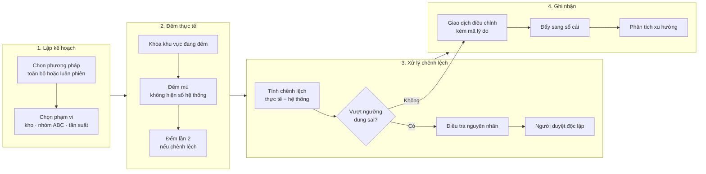

# 5000 Kiểm kê & điều chỉnh tồn kho

Mọi con số tồn kho chỉ là *giả định* cho đến khi có người đếm thực tế. Kiểm kê là hoạt động duy nhất xác nhận giả định đó còn đúng — và cũng là hoạt động dễ bị làm cho hình thức nhất, vì nếu người đếm nhìn sẵn số trên hệ thống rồi ghi lại, kết quả kiểm kê luôn khớp và không phát hiện được gì.

Bài này nói về cách thiết kế kiểm kê để nó thực sự phát hiện sai lệch, cách xử lý chênh lệch phát hiện được, và cách chặn âm kho trước khi nó làm hỏng sổ sách.

---

## 0. Nguyên lý (áp dụng mọi ERP)

1. **Kiểm kê không phải hoạt động tìm đường — mà là hoạt động xác nhận.** Nếu đếm xong rồi mới lấy số hệ thống so sánh, đó là kiểm tra chứ không phải kiểm kê. Đếm phải diễn ra **trước** khi người đếm thấy số hệ thống.
2. **Không có hệ thống nào sổ sách khớp thực tế 100%.** Luôn có hao hụt, nhặt nhầm, đếm nhầm, giao nhầm. Mục tiêu không phải là chênh lệch bằng 0, mà là **biết mình lệch bao nhiêu và lệch vì sao**.
3. **Có hai cách kiểm kê và chúng phục vụ mục đích khác nhau.** Kiểm kê toàn bộ (physical inventory) đóng băng kho và đếm mọi thứ — chính xác nhất nhưng đắt và gián đoạn. Kiểm kê định kỳ (cycle count) đếm xoay vòng một phần kho thường xuyên — rẻ, không gián đoạn, và phát hiện nguyên nhân sớm hơn. Doanh nghiệp vận hành tốt dùng cycle count làm chính, physical inventory chỉ để đối chiếu niên độ.
4. **Điều chỉnh là hậu quả, không phải mục đích.** Hệ thống tốt cho phép điều chỉnh — nhưng phải thống kê được điều chỉnh **đến từ đâu**: đếm sai, xuất nhầm, trộm cắp, hay nghiệp vụ chưa ghi nhận. Con số điều chỉnh không có mã lý do là bài toán không thể cải thiện.
5. **Người đếm không được là người duyệt.** Người phát hiện chênh lệch không được là người quyết định ghi nhận chênh lệch đó vào sổ. Thiếu nguyên tắc này, kiểm kê trở thành công cụ hợp thức hóa thất thoát.
6. **Âm kho là dấu hiệu bệnh, không phải sự cố.** Khi hệ thống cho phép tồn âm, nó đang che giấu một vấn đề thật: nghiệp vụ xuất trước nhập sau, nhập bị ghi sai, hoặc hàng không có thật. Cho phép âm kho nghĩa là từ bỏ việc kiểm soát.

## 1. Luồng vận hành



Ba điểm quan trọng trong sơ đồ:

- **Đếm mù** (blind count) là bước hay bị bỏ qua nhất. Nếu người đếm thấy số hệ thống, kết quả kiểm kê gần như chắc chắn khớp.
- **Điều tra trước, điều chỉnh sau.** Điều chỉnh ngay khi phát hiện chênh lệch sẽ xóa mất dấu vết nguyên nhân.
- **Người duyệt độc lập** chỉ xuất hiện khi vượt ngưỡng — chênh lệch nhỏ chấp nhận duyệt tự động, nhưng phải ghi log.

## 2. Ai làm gì ở module nào

| Bước | Kho (INV) | Bán hàng (OM) | Sản xuất (MFG) | Mua hàng (PO) | Kế toán |
|---|---|---|---|---|---|
| Chọn phạm vi và tần suất | ✅ lập kế hoạch theo phân nhóm ABC | — | — | — | Đề xuất theo rủi ro trọng yếu |
| Đếm thực tế | ✅ nhân viên kiểm kê độc lập | — | — | — | — |
| Ghi nhận chênh lệch | ✅ nhập số đếm, hệ thống tính chênh | — | — | — | — |
| Điều tra nguyên nhân | ✅ chủ trì phối hợp | Kiểm tra đơn giao nhầm | Kiểm tra cấp liệu chưa ghi | Kiểm tra nhập hàng chưa ghi | — |
| Phê duyệt điều chỉnh | ✅ trưởng kho đề xuất | — | — | — | ✅ người duyệt độc lập khi vượt ngưỡng |
| Ghi giao dịch điều chỉnh | ✅ ghi | — | — | — | Nhận bút toán chênh lệch |
| Phân tích xu hướng | ✅ báo cáo chênh lệch theo lý do | — | — | — | ✅ đánh giá ảnh hưởng P&L |

**Phân vai cốt lõi:** người **đếm** phải khác người **duyệt điều chỉnh**. Trong doanh nghiệp nhỏ không đủ người, ít nhất phải tách được vai trò "người đếm" và "người bấm ghi sổ" — hoặc dùng xác nhận hai lớp bằng chữ ký số.

## 3. Hạch toán

Điều chỉnh chênh lệch kiểm kê là nghiệp vụ tài chính thật, có ảnh hưởng lợi nhuận. Chênh lệch làm tăng hoặc giảm giá trị hàng tồn, và phần đối ứng vào chi phí.

Toàn bộ bút toán và tài khoản được định nghĩa tại [Hạch toán & tài khoản trung gian](../6-ke-toan-chung/1000-hach-toan-va-tai-khoan-trung-gian.md) và [Đóng kỳ & đối soát sổ phụ](../6-ke-toan-chung/5000-dong-ky-va-doi-soat-so-phu.md).

Ba điểm cần nhớ khi triển khai:

1. **Điều chỉnh phải có chứng từ nguồn.** Không cho phép ghi điều chỉnh từ màn hình tồn kho trực tiếp — phải luôn đi từ phiếu kiểm kê đã duyệt.
2. **Không điều chỉnh vào kỳ đã khóa.** Nếu phát hiện sai sau khi khóa kỳ, xử lý bằng bút toán kỳ hiện tại, không mở lại kỳ.
3. **Giá trị điều chỉnh lấy theo giá hiện hành của đơn vị tồn kho**, không lấy theo giá nhập gần nhất — nếu không sẽ làm sai giá vốn của cả lô.

## 4. Điểm chạm & rủi ro

- **Điều chỉnh là giao dịch kho**: cơ chế ghi sổ, tính bất biến và giao dịch đảo ở [Giao dịch nhập, xuất & chuyển](./3000-giao-dich-nhap-xuat-chuyen.md)
- **Giữ hàng phải được xử lý trước khi đếm**: nếu bỏ qua phần đã giữ, chênh lệch tính ra sai → [Giữ hàng, phân bổ & ATP](./4000-giu-hang-phan-bo-va-atp.md)
- **Chênh lệch kiểm kê ảnh hưởng giá vốn kỳ**: [Giá vốn & định giá tồn kho](../6-ke-toan-chung/2000-gia-von-va-dinh-gia-ton-kho.md)
- **Điều chỉnh phải hoàn tất trước khi khóa sổ**: [Đóng kỳ & đối soát sổ phụ](../6-ke-toan-chung/5000-dong-ky-va-doi-soat-so-phu.md)
- **Truy vết lô/serial khi đếm**: [Item Master & thuộc tính kho](./2000-item-master-va-thuoc-tinh-kho.md)

**Rủi ro chính:**

- **Kiểm kê hình thức** — người đếm nhìn số hệ thống, mọi kỳ đều khớp, thực tế lệch không ai biết.
- **Điều chỉnh không có mã lý do** — sổ sách đúng nhưng không cải thiện được nguyên nhân gốc.
- **Âm kho bị chặn cứng nhưng không ai xử lý** — giao dịch bị treo, nhân viên chuyển sang làm ngoài hệ thống.
- **Dùng kiểm kê để che thất thoát** — người có quyền điều chỉnh điều chỉnh hàng ngày với số lượng nhỏ, không ai phát hiện.

## 5. Triển khai tham chiếu ERP

### A. Ánh xạ khái niệm

| Khái niệm | Oracle EBS R12 | Epicor ERP | SAP S/4HANA | Odoo |
|---|---|---|---|---|
| Kiểm kê toàn bộ | `Physical Inventory` (tag-based) | `Physical Inventory Count` | `Physical Inventory` (MI01/MI07/MI31) | `Inventory Adjustment` với `inventory` mode |
| Kiểm kê luân phiên | `Cycle Count` + `Cycle Count Scheduler` | `Cycle Count` theo Part Class | `Cycle Counting` (theo ABC indicator) | Cần tùy biến / module bổ sung |
| Khóa giao dịch khi đếm | `Freeze` definitions | `Count Cycle` freeze date | Physical Inventory freeze | Không có mặc định — phải chặn theo location |
| Đếm mù | Cấu hình ẩn Qty trong Count Entry | `Hide Expected Qty` | Không hiện số trong phiếu đếm giấy | Không có mặc định |
| Ngưỡng dung sai duyệt | Approval theo `Variance` amount | `Count Variance %` trên Part Class | Tolerance trong Physical Inventory doc | Cần tùy biến |
| Điều chỉnh | `Adjustment` transaction | `Inventory Adjustment` (ADJ-QTY) | `Adjustment` (701/702) | `Inventory Adjustment` |
| Chặn âm kho | `Allow Negative Balances` = No (mặc định) | `Allow Negative Inventory` (mặc định tắt) | Không cho âm theo thiết kế | Có thể bật, nên tắt |

### B. Ngưỡng dung sai và phân nhóm ABC

Phân nhóm ABC để quyết định **đếm bao lâu một lần**:

| Nhóm | Tiêu chí | Tần suất đếm |
|---|---|---|
| A | Giá trị cao — thường 20% mã, chiếm 80% giá trị tồn | Hàng tháng |
| B | Giá trị trung bình | Hàng quý |
| C | Giá trị thấp, số lượng lớn | 6 tháng một lần hoặc kiểm kê toàn bộ cuối năm |

Cấu hình ngưỡng dung sai duyệt (gợi ý):

```sql
CREATE TABLE Inventory_Count_Tolerance (
    Tolerance_ID    INT IDENTITY PRIMARY KEY,
    Tier            VARCHAR(10) NOT NULL,   -- A | B | C
    Variance_Pct    DECIMAL(6,2) NULL,      -- % chênh lệch cho phép tự duyệt
    Variance_Amount DECIMAL(18,2) NULL,     -- hoặc giá trị tuyệt đối
    Approver_Level  INT NOT NULL            -- 1 = trưởng kho, 2 = kế toán, 3 = giám đốc
);
```

### C. Truy vấn kiểm soát

**Chênh lệch kiểm kê theo lý do — tìm nguyên nhân gốc:**

```sql
SELECT Reason_Code, COUNT(*) AS So_Phieu,
       SUM(ABS(Qty_Variance)) AS Tong_Chenh_Lech,
       SUM(ABS(Value_Variance)) AS Gia_Tri_Chenh_Lech
FROM Inventory_Count_Adjustment
WHERE Count_Date >= DATEADD(MONTH, -3, GETDATE())
GROUP BY Reason_Code
ORDER BY Gia_Tri_Chenh_Lech DESC;
```

**Mặt hàng có chênh lệch lặp lại — dấu hiệu vấn đề hệ thống, không phải đếm sai:**

```sql
SELECT Item_ID, COUNT(*) AS So_Lan_Chenh,
       SUM(ABS(Qty_Variance)) AS Tong_Chenh
FROM Inventory_Count_Adjustment
WHERE Count_Date >= DATEADD(MONTH, -6, GETDATE())
GROUP BY Item_ID
HAVING COUNT(*) >= 3
ORDER BY So_Lan_Chenh DESC, Tong_Chenh DESC;
```

**Phát hiện mặt hàng có tồn âm — trước khi nó lan sang báo cáo tài chính:**

```sql
SELECT t.Item_ID, SUM(t.Qty) AS Qty_OnHand
FROM Inventory_Transaction t
GROUP BY t.Item_ID
HAVING SUM(t.Qty) < 0;
```

**Epicor — chênh lệch kiểm kê trong kỳ, đối chiếu với phê duyệt:**

```sql
SELECT c.Company, c.PartNum, c.WarehouseCode, c.CountDate,
       c.SystemQty, c.CountedQty, (c.CountedQty - c.SystemQty) AS Variance,
       c.ApprovedBy, c.ReasonCode
FROM Erp.PartCount c
WHERE c.Company = 'YOUR_COMPANY_CODE'
  AND c.CountDate >= DATEADD(MONTH, -1, GETDATE())
  AND c.CountedQty <> c.SystemQty
ORDER BY ABS(c.CountedQty - c.SystemQty) DESC;
```

## 6. Bẫy thực chiến & Checklist

| # | Bẫy | Triệu chứng | Cách phòng tránh |
|---|---|---|---|
| 1 | Kiểm kê không đếm mù | Mọi kỳ đều khớp hoàn hảo, nhưng cuối năm vẫn thiếu hàng lớn | Ẩn số hệ thống trên phiếu đếm, in phiếu trống theo vị trí bin |
| 2 | Điều chỉnh ngay khi phát hiện chênh | Mất dấu vết nguyên nhân, cùng một lỗi lặp lại tháng sau | Bắt buộc ghi mã lý do và điều tra trước khi ghi sổ |
| 3 | Người đếm là người duyệt điều chỉnh | Thất thoát được hợp thức hóa bằng phiếu kiểm kê | Tách vai trò: đếm → đề xuất → duyệt độc lập |
| 4 | Không xử lý phần giữ hàng khi đếm | Chênh lệch tính sai, điều chỉnh giảm hàng đang có đơn chờ | Đếm tồn vật lý và so với `On-hand`, tách khỏi `Reserved` |
| 5 | Chặn âm kho nhưng không có quy trình xử lý | Giao dịch bị treo, nhân viên ghi ngoài hệ thống bằng Excel | Cho phép âm **trong vùng tạm** kèm cảnh báo, bắt buộc xử lý trong 48 giờ |
| 6 | Điều chỉnh vào kỳ đã khóa | Sổ cái đã chốt bị lệch, kiểm toán không chấp nhận | Chặn theo lịch kỳ; xử lý sai sót bằng bút toán kỳ hiện tại |
| 7 | Dùng giá nhập gần nhất để định giá điều chỉnh | Giá vốn cả lô bị đẩy lệch | Lấy theo giá hiện hành của phương pháp tính giá đang áp dụng |
| 8 | Kiểm kê toàn bộ quá thường xuyên | Kho đóng cửa nhiều ngày, chi phí lớn, nhân viên làm qua loa | Cycle count làm chính, physical inventory 1 lần/năm |
| 9 | Chênh lệch nhỏ không có ngưỡng tự duyệt | Mọi chênh lệch dù 1 cái cũng phải chờ duyệt, nghiệp vụ tắc | Ngưỡng dung sai theo nhóm ABC, ghi log tự động |

**Checklist trước go-live:**

- [ ] Phiếu đếm không hiển thị số lượng hệ thống (đếm mù đã bật).
- [ ] Đã phân nhóm ABC và gán tần suất đếm cho từng nhóm.
- [ ] Ngưỡng dung sai duyệt đã cấu hình theo giá trị chênh lệch.
- [ ] Mã lý do điều chỉnh đã được định nghĩa và bắt buộc khi ghi sổ.
- [ ] Vai trò người đếm / người đề xuất / người duyệt đã tách biệt.
- [ ] Điều chỉnh chỉ được ghi từ phiếu kiểm kê đã duyệt, không nhập tay.
- [ ] Không ghi điều chỉnh vào kỳ đã khóa (đã test).
- [ ] Báo cáo "chênh lệch theo lý do" và "mặt hàng chênh lệch lặp lại" chạy được.
- [ ] Đã test luồng: phát hiện chênh → điều tra → duyệt → ghi nhận → bút toán sổ cái.
- [ ] Đã xác định chính sách âm kho: chặn tuyệt đối, hay cho phép tạm kèm cảnh báo và hạn xử lý.

## Xem thêm

- [Tổng quan Kho](./0000-tong-quan-kho.md)
- [Giao dịch nhập, xuất & chuyển](./3000-giao-dich-nhap-xuat-chuyen.md)
- [Giữ hàng, phân bổ & ATP](./4000-giu-hang-phan-bo-va-atp.md)
- [Định giá & báo cáo kho](./6000-dinh-gia-va-bao-cao-kho.md)
- [Đóng kỳ & đối soát sổ phụ](../6-ke-toan-chung/5000-dong-ky-va-doi-soat-so-phu.md)

<div align="center" style={{color: 'var(--ifm-color-primary)'}}>
  <strong>Chúc các bạn thành công và vui vẻ!</strong>
</div>
