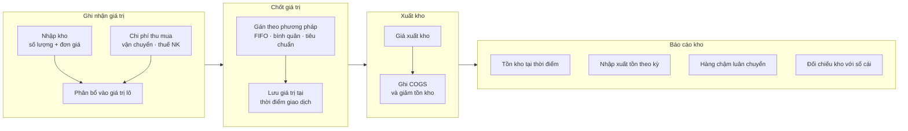

# 6000 Định giá & báo cáo kho

Kho lưu hai loại dữ liệu song song: **số lượng** và **giá trị**. Sai số lượng thì thấy ngay khi kiểm kê; sai giá trị thì im lặng, chỉ lộ ra khi đối chiếu sổ cái hoặc khi kiểm toán hỏi. Bài này nói về cách giá trị được gắn vào hàng tồn, cách ba báo cáo kho cốt lõi được dựng từ giao dịch, và chỗ nào hay làm lệch giữa kho và kế toán.

---

## 0. Nguyên lý (áp dụng mọi ERP)

1. **Số lượng và giá trị là hai bài toán, không thể sửa bằng một chỗ.** Báo cáo tồn kho đúng số lượng vẫn có thể sai giá trị, và ngược lại. Khi lệch, phải xác định lệch ở đâu trước khi sửa.
2. **Mỗi giao dịch phải mang giá trị tại thời điểm phát sinh.** Giá trị không được tính lại về sau theo giá hiện tại — nếu không, mọi báo cáo lịch sử sẽ thay đổi mỗi lần giá nhập thay đổi.
3. **Phương pháp tính giá là một lựa chọn, không phải đúng/sai.** FIFO, bình quân, giá tiêu chuẩn — mỗi cách có hệ quả khác nhau lên giá vốn và lợi nhuận. Điều quan trọng không phải chọn cách "đúng nhất" mà là chọn **một** cách và áp dụng nhất quán, có đối chiếu.
4. **Tổng giá trị hàng tồn trên sổ kho phải bằng số dư tài khoản tồn kho trên sổ cái.** Con số này là **giới hạn vật lý** của tính chính xác: kho là sổ phụ, GL là sổ cái, và hai bên phải khớp tuyệt đối vào cuối kỳ.
5. **Báo cáo tồn kho không thể dựng bằng cách cộng trừ số dư hiện tại.** Phải dựng từ giao dịch, theo khoảng thời gian, để có thể đối chiếu ngược và tái hiện số liệu bất kỳ thời điểm nào.
6. **Tồn kho chậm luân chuyển là tiền bị chôn, không phải tài sản trung tính.** Báo cáo này quan trọng ngang báo cáo tồn kho — nó là đầu vào cho quyết định mua tiếp hay xả hàng.

## 1. Luồng vận hành



Điểm quan trọng: **giá trị được chốt tại bước ghi nhận và không tính lại**. Báo cáo chỉ đọc lại dữ liệu đã chốt, không tự suy diễn bằng giá hiện hành.

## 2. Ai làm gì ở module nào

| Công việc | Kho (INV) | Mua hàng (PO) | Sản xuất (MFG) | Bán hàng (OM) | Kế toán |
|---|---|---|---|---|---|
| Chọn phương pháp tính giá | ✅ áp dụng theo nhóm hàng | — | Đề xuất khi giá thành sản xuất thay đổi | — | ✅ quyết định và chịu trách nhiệm |
| Ghi nhận đơn giá nhập hàng | ✅ lưu giá trị giao dịch | ✅ cung cấp đơn giá PO | Cung cấp giá thành TP | — | — |
| Phân bổ chi phí thu mua vào giá trị | ✅ thực hiện phân bổ | Cung cấp chi phí vận chuyển, thuế nhập khẩu | — | — | Duyệt phương pháp phân bổ |
| Tính giá xuất kho | ✅ chạy theo phương pháp | — | Ghi nhận giá thành WIP | — | Nhận COGS |
| Báo cáo tồn kho & nhập xuất tồn | ✅ sở hữu | — | — | — | Đối chiếu tháng |
| Báo cáo hàng chậm luân chuyển | ✅ sở hữu | Đọc để quyết định ngừng mua | — | Đọc để xúc tiến bán | Đánh giá rủi ro dự phòng |
| Đối chiếu kho với sổ cái | Cung cấp số dư nội bộ | — | — | — | ✅ đối chiếu và xử lý lệch |

**Ranh giới cốt lõi:** kho **giữ** phương pháp và chạy tính giá; kế toán **quyết định** phương pháp và **đối chiếu**. Đây là chỗ hay xảy ra mâu thuẫn — kho muốn đổi phương pháp vì "chạy cho nhanh", kế toán không đồng ý vì ảnh hưởng lợi nhuận.

## 3. Hạch toán

Giá trị hàng tồn của kho là **nguồn** cho tài khoản tồn kho trên sổ cái. Toàn bộ bút toán và nguyên tắc đối chiếu được định nghĩa tại:

- [Giá vốn & định giá tồn kho](../6-ke-toan-chung/2000-gia-von-va-dinh-gia-ton-kho.md) — cách tính COGS, xử lý chênh lệch giá, dự phòng giảm giá hàng tồn
- [Hạch toán & tài khoản trung gian](../6-ke-toan-chung/1000-hach-toan-va-tai-khoan-trung-gian.md) — tài khoản tài sản, chênh lệch giá mua
- [Đóng kỳ & đối soát sổ phụ](../6-ke-toan-chung/5000-dong-ky-va-doi-soat-so-phu.md) — quy trình đối chiếu kho và sổ cái cuối kỳ

Ba điểm cần nhớ ở tầng kho:

1. **Giá trị giao dịch là bất biến.** Đã ghi thì không sửa; muốn sửa thì ghi giao dịch đảo hoặc điều chỉnh.
2. **Chi phí thu mua phải phân bổ vào giá trị lô**, không ghi nhận riêng như chi phí kỳ. Nếu không, hàng tồn bị định giá thấp và giá vốn bị đẩy cao.
3. **Đối chiếu kho-sổ cái phải làm theo từng nhóm hàng**, không gộp tổng — gộp tổng sẽ che giấu lệch bù trừ giữa các nhóm.

## 4. Điểm chạm & rủi ro

- **Ghi giá trị giao dịch**: [Giao dịch nhập, xuất & chuyển](./3000-giao-dich-nhap-xuat-chuyen.md)
- **Điều chỉnh kiểm kê ảnh hưởng giá trị tồn**: [Kiểm kê & điều chỉnh](./5000-kiem-ke-va-dieu-chinh.md)
- **Giá nhập mua và chi phí thu mua**: [Đơn mua hàng](../2-mua-hang/3000-don-mua-hang.md)
- **Giá thành sản xuất nhập kho thành phẩm**: [Giá thành sản xuất](../3-san-xuat/thuc-thi/8000-gia-thanh-san-xuat.md)
- **Giá vốn hàng bán khi xuất kho**: [Giao hàng & xuất kho](../4-ban-hang/3000-giao-hang-va-xuat-kho.md)
- **Giá trị nhập hàng chưa có hóa đơn**: [Hạch toán & tài khoản trung gian](../6-ke-toan-chung/1000-hach-toan-va-tai-khoan-trung-gian.md)

**Rủi ro chính:**

- **Tính lại giá trị theo giá hiện tại** — báo cáo lịch sử tự thay đổi mỗi lần giá thay đổi.
- **Không phân bổ chi phí thu mua** — hàng tồn định giá thấp, giá vốn cao, lợi nhuận sai.
- **Dựng báo cáo tồn kho bằng tổng số dư** — không tái hiện được số liệu tại một thời điểm trong quá khứ.
- **Đối chiếu kho-sổ cái gộp tổng** — lệch bù trừ giữa các nhóm hàng làm sổ "trông khớp" mà thực tế sai.

## 5. Triển khai tham chiếu ERP

### A. Ánh xạ khái niệm

| Khái niệm | Oracle EBS R12 | Epicor ERP | SAP S/4HANA | Odoo |
|---|---|---|---|---|
| Phương pháp tính giá | `Costing Method` trên Item (FIFO/Standard/Average) | `Cost Method` trên Part (FIFO/Avg/Std/LIFO) | `Price Control` (S = Standard, V = Moving Average) + Actual Costing | `Costing Method` trên Product Category |
| Giá trị giao dịch | `MTL_TRANSACTION_ACCOUNTS` | `Erp.PartTran` (cột `MtlUnitCost`, `ExtCost`) | `MSEG` + `MLCD` (Material Ledger) | `stock.move.value` |
| Phân bổ chi phí thu mua | Landed Cost Management | Landed Cost | Condition Type (FRB/FRC) | `landed_costs` module |
| Báo cáo tồn kho tại thời điểm | `Stock On-Hand` report | `Stock Status Report` | `Stock Overview` + Material Ledger | `Inventory Report` |
| Báo cáo nhập xuất tồn | `Inventory Movement` | `Inventory Movement Report` | `MB5B` | `Stock Moves Analysis` |
| Hàng chậm luân chuyển | `Slow Moving Inventory` (custom) | `Stock Aged Report` | `Slow/Fast Moving` (theo động học) | `Stock Aging` |
| Đối chiếu kho-GL | `Inventory to GL Reconciliation` | `Inventory to CM/GL Reconciliation` | Material Ledger balance vs FI | Custom report |

### B. Công thức ba báo cáo cốt lõi

**Tồn kho tại thời điểm T** — tổng hợp từ giao dịch, không đọc số dư hiện tại:

```text
Tồn(T) = SUM(Qty) với mọi giao dịch có Trx_Date <= T
        theo To_Location (+) và From_Location (−)
```

**Nhập xuất tồn trong kỳ** — tách theo loại giao dịch nguồn:

```text
Nhập(X) = SUM(Qty) các giao dịch From = NULL, Trx_Date ∈ kỳ
Xuất(X) = SUM(Qty) các giao dịch To   = NULL, Trx_Date ∈ kỳ
Chuyển = SUM(Qty) các giao dịch From ≠ NULL và To ≠ NULL  (không ảnh hưởng tổng)
Tồn cuối = Tồn đầu + Nhập − Xuất
```

**Hàng chậm luân chuyển** — ngày xuất gần nhất so với hôm nay, có cân nhắc giá trị:

```text
Số ngày không xuất = Hôm nay − MAX(Trx_Date) với các giao dịch To = NULL
Phân loại: <= 90 ngày · 91–180 · 181–365 · > 365
```

### C. Truy vấn kiểm soát

**Tồn kho tại một thời điểm bất kỳ (dựng từ giao dịch):**

```sql
SELECT t.Item_ID,
       SUM(CASE WHEN t.To_Location IS NOT NULL THEN t.Qty ELSE 0 END) -
       SUM(CASE WHEN t.From_Location IS NOT NULL THEN t.Qty ELSE 0 END) AS Qty_At_Date
FROM Inventory_Transaction t
WHERE t.Trx_Date <= @AsOfDate
  AND t.Is_Logical = 0
GROUP BY t.Item_ID
HAVING SUM(CASE WHEN t.To_Location IS NOT NULL THEN t.Qty ELSE 0 END) -
       SUM(CASE WHEN t.From_Location IS NOT NULL THEN t.Qty ELSE 0 END) <> 0;
```

**Hàng chậm luân chuyển theo ngưỡng ngày:**

```sql
SELECT Item_ID, SUM(Qty) AS Qty_OnHand,
       DATEDIFF(DAY, MAX(Last_Issue_Date), GETDATE()) AS Days_Since_Issue
FROM (
    SELECT Item_ID,
           SUM(CASE WHEN To_Location IS NOT NULL THEN Qty ELSE 0 END) -
           SUM(CASE WHEN From_Location IS NOT NULL THEN Qty ELSE 0 END) AS Qty,
           MAX(CASE WHEN To_Location IS NULL AND Is_Logical = 0 THEN Trx_Date END) AS Last_Issue_Date
    FROM Inventory_Transaction
    GROUP BY Item_ID
) s
GROUP BY Item_ID
HAVING DATEDIFF(DAY, MAX(Last_Issue_Date), GETDATE()) > 180
ORDER BY Qty_OnHand DESC;
```

**Đối chiếu kho với sổ cái — theo từng nhóm hàng, phải bằng 0:**

```sql
SELECT t.Item_Group,
       SUM(CASE WHEN t.To_Location IS NOT NULL THEN t.Qty * t.Unit_Cost ELSE 0 END) -
       SUM(CASE WHEN t.From_Location IS NOT NULL THEN t.Qty * t.Unit_Cost ELSE 0 END) AS Inventory_Value_From_Kho,
       g.GL_Balance AS Inventory_Value_From_GL,
       (SUM(CASE WHEN t.To_Location IS NOT NULL THEN t.Qty * t.Unit_Cost ELSE 0 END) -
        SUM(CASE WHEN t.From_Location IS NOT NULL THEN t.Qty * t.Unit_Cost ELSE 0 END)) - g.GL_Balance AS Diff
FROM Inventory_Transaction t
JOIN GL_Account_Balance g ON g.Account_Code = t.Inventory_Account
WHERE t.Is_Logical = 0
GROUP BY t.Item_Group, g.GL_Balance
HAVING ABS((SUM(CASE WHEN t.To_Location IS NOT NULL THEN t.Qty * t.Unit_Cost ELSE 0 END) -
            SUM(CASE WHEN t.From_Location IS NOT NULL THEN t.Qty * t.Unit_Cost ELSE 0 END)) - g.GL_Balance) > 0.01;
```

**Epicor — giá trị tồn kho theo Part Class, đối chiếu với GL:**

```sql
SELECT pc.ClassID, pc.Description,
       SUM(pb.OnhandQty * p.StdCost) AS Inventory_Value_From_Kho
FROM Erp.PartBin pb
JOIN Erp.Part p ON p.Company = pb.Company AND p.PartNum = pb.PartNum
JOIN Erp.PartClass pc ON pc.Company = p.Company AND pc.ClassID = p.ClassID
WHERE pb.Company = 'YOUR_COMPANY_CODE'
  AND pb.OnhandQty > 0
GROUP BY pc.ClassID, pc.Description
ORDER BY Inventory_Value_From_Kho DESC;
```

## 6. Bẫy thực chiến & Checklist

| # | Bẫy | Triệu chứng | Cách phòng tránh |
|---|---|---|---|
| 1 | Dựng báo cáo tồn kho bằng số dư hiện tại | Không tái hiện được số liệu tháng trước, kiểm toán không chấp nhận | Báo cáo phải dựng từ giao dịch, có điều kiện `Trx_Date <= AsOfDate` |
| 2 | Tính lại giá trị theo giá hiện hành | Báo cáo lịch sử tự thay đổi mỗi lần giá thay đổi | Lưu `Unit_Cost` tại thời điểm giao dịch, không tính lại |
| 3 | Không phân bổ chi phí thu mua | Hàng tồn thấp hơn thực, giá vốn cao hơn thực | Phân bổ vào giá trị lô ngay khi nhập |
| 4 | Đối chiếu kho-sổ cái gộp tổng | Lệch bù trừ giữa các nhóm che giấu sai số thực | Đối chiếu theo từng nhóm hàng / theo kho |
| 5 | Đổi phương pháp tính giá giữa kỳ | Giá vốn hai nửa kỳ không so sánh được | Đổi chỉ vào đầu niên độ, có phê duyệt và công bố |
| 6 | Báo cáo nhập xuất tồn cộng cả giao dịch chuyển | Nhập và xuất phình lên không có thật | Loại trừ giao dịch `From ≠ NULL AND To ≠ NULL` khỏi cột nhập/xuất |
| 7 | Không loại trừ giao dịch ảo | Drop-ship làm giá trị tồn kho phình lên | Lọc `Is_Logical = 0` |
| 8 | Bỏ qua dự phòng giảm giá hàng tồn | Báo cáo tồn kho đẹp nhưng giá trị thực thấp hơn nhiều | Ngưỡng dự phòng theo báo cáo chậm luân chuyển |

**Checklist trước go-live:**

- [ ] Phương pháp tính giá đã chốt và ghi thành văn bản, có kế toán trưởng ký.
- [ ] Mọi giao dịch có `Unit_Cost` và không cho phép sửa sau khi ghi.
- [ ] Chi phí thu mua có quy trình phân bổ vào giá trị lô.
- [ ] Ba báo cáo cốt lõi (tồn kho tại thời điểm, nhập xuất tồn, chậm luân chuyển) đều dựng từ giao dịch.
- [ ] Báo cáo nhập xuất tồn loại trừ giao dịch chuyển kho khỏi cột nhập/xuất.
- [ ] Báo cáo đối chiếu kho-sổ cái chạy theo từng nhóm hàng, định kỳ hàng tháng.
- [ ] Đã test: dựng lại tồn kho tại một ngày bất kỳ trong quá khứ và khớp với số đã chốt.
- [ ] Đã xác định ngưỡng phân loại hàng chậm luân chuyển và cách xử lý dự phòng.

## Xem thêm

- [Tổng quan Kho](./0000-tong-quan-kho.md)
- [Giao dịch nhập, xuất & chuyển](./3000-giao-dich-nhap-xuat-chuyen.md)
- [Kiểm kê & điều chỉnh](./5000-kiem-ke-va-dieu-chinh.md)
- [Giá vốn & định giá tồn kho](../6-ke-toan-chung/2000-gia-von-va-dinh-gia-ton-kho.md)
- [Đóng kỳ & đối soát sổ phụ](../6-ke-toan-chung/5000-dong-ky-va-doi-soat-so-phu.md)

<div align="center" style={{color: 'var(--ifm-color-primary)'}}>
  <strong>Chúc các bạn thành công và vui vẻ!</strong>
</div>
