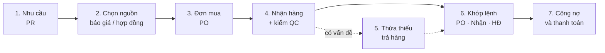

# Tổng quan Mua hàng (Procure-to-Pay)

Mua hàng không phải "việc của phòng mua". Một đơn mua đi qua bốn bộ phận khác nhau — người có nhu cầu, người mua, người nhận hàng, người trả tiền — và hỏng ở bất kỳ khâu nào cũng dẫn tới cùng một kết quả: **doanh nghiệp trả tiền cho thứ mình không có, hoặc không có thứ mình đã trả tiền**.

Bài này mô tả toàn cảnh quy trình và ranh giới trách nhiệm giữa các bên. Chi tiết từng bước nằm ở các bài riêng trong cùng khối.

## Quy trình gồm bảy bước

Điểm mấu chốt: **bước 4 và 6 thuộc hai chuỗi kiểm soát khác nhau**. Bước 4 chứng minh *hàng có thật*; bước 6 chứng minh *giá và số lượng trên hóa đơn hợp lệ*. Một doanh nghiệp có thể nhận đúng hàng mà vẫn bị xuất hóa đơn sai giá — và ngược lại.

## Mỗi bước trả lời một câu hỏi

| Bước | Câu hỏi cần trả lời | Bài chi tiết |
|---|---|---|
| Nhu cầu | Mua gì, bao nhiêu, cho ai, ai duyệt? | [Nhu cầu & lựa chọn nhà cung cấp](./1000-nhu-cau-va-lua-chon-ncc.md) |
| Chọn nguồn cung | Mua của ai, giá nào, điều kiện gì? | [Danh mục & hợp đồng mua](./2000-danh-muc-va-hop-dong-mua.md) |
| Đơn mua | Đặt chính thức những gì, khi nào? | [Đơn mua hàng](./3000-don-mua-hang.md) |
| Nhận hàng | Thực tế nhận được gì, có đạt chất lượng không? | [Nhận hàng & kiểm tra chất lượng](./4000-nhan-hang-va-kiem-qc.md) |
| Đối soát | Hóa đơn có khớp với điều đã đặt và đã nhận? | [Đối soát hóa đơn & 3-Way Match](./5000-doi-soat-hoa-don-va-3-way-match.md) |
| Công nợ | Trả bao nhiêu, khi nào, cho ai? | [Công nợ phải trả](../5-cong-no/ap/1000-ap-nguyen-ly-va-tai-khoan.md) |

## Ranh giới trách nhiệm

| Việc | Mua hàng quyết định | Kho quyết định | Kế toán quyết định |
|---|---|---|---|
| Mua bao nhiêu, của ai, giá nào | ✅ | — | — |
| Ghi nhận số lượng thực nhận | — | ✅ | — |
| Chất lượng hàng có đạt | Đàm phán với NCC khi lỗi | ✅ ghi nhận kết quả | — |
| Giá trị ghi sổ và công nợ | — | Cung cấp số lượng và giá trị nhập | ✅ |
| Được phép trả tiền hay chưa | ✅ duyệt sai lệch | — | ✅ khớp lệnh và giải ngân |

Nguyên tắc: **không ai được làm hai vai trò trên cùng một chứng từ** — người tạo đơn không duyệt chi, người nhận hàng không tự khớp hóa đơn.

## Mua hàng liên quan gì tới các phần khác

- **Kho** ghi nhận số lượng thực nhận và giữ hàng: [Nhận hàng & kiểm tra chất lượng](./4000-nhan-hang-va-kiem-qc.md), [Giao dịch nhập, xuất & chuyển](../1-kho/3000-giao-dich-nhap-xuat-chuyen.md)
- **Công nợ** nhận hóa đơn đã khớp và thực hiện trả tiền: [AP - Nguyên lý & tài khoản](../5-cong-no/ap/1000-ap-nguyen-ly-va-tai-khoan.md)
- **Kế toán chung** nhận bút toán tăng tài sản và tài khoản trung gian: [Hạch toán & tài khoản trung gian](../6-ke-toan-chung/1000-hach-toan-va-tai-khoan-trung-gian.md)
- **Sản xuất** tạo nhu cầu mua từ MRP và nhận nguyên liệu qua kho: [Lệnh sản xuất & WIP](../3-san-xuat/thuc-thi/6000-lenh-san-xuat-va-wip.md)

## Bắt đầu đọc từ đâu

Nếu triển khai từ đầu, đọc theo thứ tự 1000 → 9000. Nếu đang xử lý sự cố, đi thẳng tới bài tương ứng:

- Hóa đơn lệch giá hoặc lệch số lượng → [Đối soát hóa đơn & 3-Way Match](./5000-doi-soat-hoa-don-va-3-way-match.md)
- Hàng về kho mà chưa có hóa đơn → [Hạch toán & tài khoản trung gian](../6-ke-toan-chung/1000-hach-toan-va-tai-khoan-trung-gian.md)
- Hàng giao thẳng cho khách, không qua kho → [Mô hình mua đặc thù](./6000-mo-hinh-mua-dac-thu.md)
- Đơn mua treo hàng tháng không ai xử lý → [Bẫy thực chiến mua hàng](./9000-bay-mua-hang.md)

  <strong>Chúc các bạn thành công và vui vẻ!</strong>

