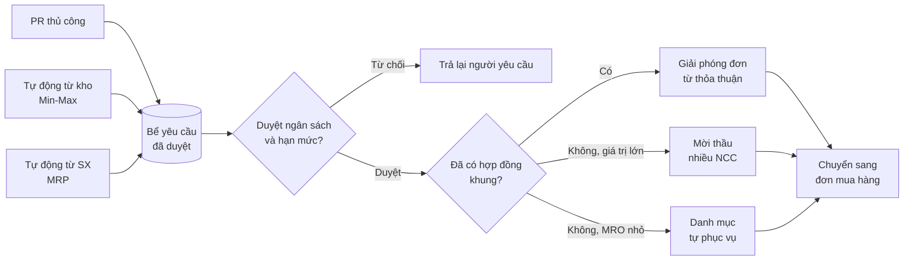

---
id: nhu-cau-va-lua-chon-ncc
title: "1000 Nhu cầu mua hàng & lựa chọn nhà cung cấp"
slug: /erp-nghiep-vu/mua-hang/nhu-cau-va-lua-chon-ncc
sidebar_position: 1000
description: "Yêu cầu mua hàng (PR), gom nhu cầu, phê duyệt theo hạn mức, mời thầu RFQ, phân tích báo giá, bảo mật thầu kín và mua sắm tự phục vụ qua danh mục điện tử."
date: 2026-08-02
last_update:
  date: 2026-11-19
tags: [erp, procurement, pr, rfq, sourcing, bidding]
---

# 1000 Nhu cầu mua hàng & lựa chọn nhà cung cấp

Mọi đồng tiền mua hàng đều bắt đầu từ một yêu cầu. Nếu khâu này lỏng, phía sau có kiểm soát tốt đến đâu cũng vô nghĩa: hệ thống chỉ có thể kiểm tra *"có đúng thứ đã yêu cầu không"*, không thể kiểm tra *"thứ đó có nên được yêu cầu không"*.

Bài này nói về ba việc: **ai được yêu cầu**, **gom các yêu cầu nhỏ thành một đơn lớn**, và **chọn nhà cung cấp minh bạch**.

## 0. Nguyên lý (áp dụng mọi ERP)

1. **Yêu cầu mua hàng (PR) không phải chứng từ tài chính.** PR không sinh bút toán, không tạo nghĩa vụ phải trả — nó chỉ là ý định có kiểm soát. Nhưng chính vì thế nó là nơi duy nhất kiểm soát được ngân sách *trước khi* tiền được cam kết.
2. **PR phải gắn với trung tâm chi phí hoặc dự án.** Một yêu cầu không quy được về ai chịu chi phí thì không thể kiểm tra ngân sách, và cũng không thể quy trách nhiệm khi chi tiêu vượt.
3. **Gom nhu cầu là đòn bẩy giá lớn nhất.** Mười phòng ban mỗi nơi đặt 100 đơn vị cùng một mã hàng sẽ nhận giá cao hơn một lần đặt 1.000 đơn vị. Gom nhu cầu không phải thao tác cho gọn màn hình — đó là nghiệp vụ tạo giá trị.
4. **Đấu thầu chỉ công bằng khi giá được niêm phong.** Nếu nhà cung cấp B biết giá của A trước ngày mở thầu, kết quả thầu không còn ý nghĩa và doanh nghiệp thường mất tiền mà không biết.
5. **Báo giá có hạn sử dụng.** Giá chào gắn với thời điểm và điều kiện thị trường. Dùng báo giá hết hạn để tạo đơn hàng là tạo tranh chấp với nhà cung cấp ngay từ ngày ký.
6. **Mua sắm tự phục vụ chỉ an toàn khi danh mục được kiểm soát.** Nhân viên tự đặt hàng từ danh mục điện tử giúp giảm tải cho phòng mua, nhưng chỉ khi danh mục có sẵn item, giá thỏa thuận và nhà cung cấp đã được duyệt.

## 1. Luồng vận hành



**Đọc sơ đồ:** điểm rẽ quan trọng nhất không phải "có RFQ hay không", mà là **đã có nguồn cung được thỏa thuận hay chưa**. Nhảy vào RFQ khi đã có hợp đồng khung là làm lại việc đã làm, và thường nhận giá tệ hơn.

## 2. Ai làm gì ở module nào

| Bước | Người yêu cầu | Mua hàng (PO) | Kế toán | Kho | Sản xuất |
|---|---|---|---|---|---|
| Tạo yêu cầu | ✅ nêu nhu cầu, gán cost center | — | Kiểm tra ngân sách khả dụng | — | ✅ tạo nhu cầu từ MRP |
| Phê duyệt yêu cầu | Trưởng bộ phận duyệt | — | ✅ duyệt theo hạn mức ngân sách | — | — |
| Gom nhu cầu | — | ✅ gộp các dòng cùng mã / cùng nhà cung cấp | — | — | — |
| Phát hành RFQ | — | ✅ sở hữu | — | — | Cung cấp thông số kỹ thuật |
| Nhập báo giá | — | ✅ hoặc nhà cung cấp tự nhập qua cổng | — | — | — |
| Phân tích và chọn nhà cung cấp | Có mặt khi chấm kỹ thuật | ✅ chủ trì | Tham gia khi giá trị lớn | — | Tham gia chấm kỹ thuật |
| Chuyển thành đơn mua | — | ✅ | — | — | — |
| Cập nhật giá trị cam kết ngân sách | — | Báo sang kế toán | ✅ ghi nhận cam kết chi | — | — |

**Ranh giới cốt lõi:** người **yêu cầu** không được là người **duyệt** yêu cầu đó; người **chọn nhà cung cấp** không được là người **nhận hàng**. Hai nguyên tắc này chặn phần lớn gian lận mua sắm.

## 3. Hạch toán

PR và RFQ **không sinh bút toán**. Đây là điểm cần nhớ khi thiết kế báo cáo: cam kết chi (commitment) chưa phải nợ phải trả, nhưng vẫn phải theo dõi để kiểm soát ngân sách.

Ba điều cần biết khi triển khai:

1. **Cam kết chi (encumbrance) là chỉ tiêu quản trị, không phải số dư kế toán** — trừ khi doanh nghiệp chủ động bật kế toán cam kết chi. Không theo dõi thì ngân sách bị vượt mà kế toán không biết cho tới khi hóa đơn về.
2. **PR không có giá trị cam kết cho tới khi quy ra giá ước tính hoặc giá báo giá thắng thầu.** Báo cáo ngân sách dựa trên PR chưa có giá chỉ là đếm số lượng.
3. **Chuyển PR thành PO là thời điểm cam kết chi chính thức** — từ đây mới có nghĩa vụ tiềm tàng với nhà cung cấp.

Bản đồ tài khoản và nguyên tắc tất toán ở [Hạch toán & tài khoản trung gian](../6-ke-toan-chung/1000-hach-toan-va-tai-khoan-trung-gian.md).

## 4. Điểm chạm & rủi ro

- **Chuyển yêu cầu thành đơn mua**: [Đơn mua hàng](./3000-don-mua-hang.md)
- **Giá và nhà cung cấp đã thỏa thuận** — nguồn để giải phóng thay vì mời thầu lại: [Danh mục & hợp đồng mua](./2000-danh-muc-va-hop-dong-mua.md)
- **Nhu cầu tự động từ tồn kho**: [Item Master & thuộc tính kho](../1-kho/2000-item-master-va-thuoc-tinh-kho.md)
- **Nhu cầu tự động từ sản xuất**: [Lệnh sản xuất & WIP](../3-san-xuat/thuc-thi/6000-lenh-san-xuat-va-wip.md)
- **Kiểm soát ngân sách và phê duyệt**: [Kiểm soát nội bộ & phân tách nhiệm vụ](../0-nen-tang/5000-kiem-soat-noi-bo-va-phan-tach-nhiem-vu.md)

**Rủi ro chính:**

- **Yêu cầu không gắn cost center** — không kiểm tra được ngân sách, không quy được chi phí.
- **Gom nhu cầu quá tay** — gộp cả hàng gấp với hàng thường, đơn gấp bị trễ vì chờ đủ số lượng.
- **Rò rỉ giá thầu** — mất tính cạnh tranh, doanh nghiệp trả giá cao hơn thị trường.
- **Dùng báo giá hết hạn** — tranh chấp với nhà cung cấp ngay khi ký đơn.
- **Chia nhỏ yêu cầu để né hạn mức duyệt** — ba PR 90 triệu thay vì một PR 270 triệu, lách ngưỡng phê duyệt.

## 5. Triển khai tham chiếu ERP

### A. Ánh xạ khái niệm

| Khái niệm | Oracle EBS R12 | Epicor ERP | SAP S/4HANA | Odoo |
|---|---|---|---|---|
| Yêu cầu mua hàng | Requisition (`PO_REQUISITION_HEADERS_ALL`) | `Requisition Entry` / PO Suggestions | Purchase Requisition (`EBAN`) | `purchase.order` (RFQ state) |
| Gom nhu cầu | `Autocreate Documents` | `Generate PO Suggestions` | `ME21N` với `ME57` (assign & process) | `purchase.order.line` gộp tay |
| Phê duyệt theo hạn mức | AME (Approval Management Engine) | Requisition Approval / Task Set | Release Strategy | Multi-level Approval Rules |
| Mời thầu | RFQ (`PO_HEADERS_ALL` type RFQ) | `Request for Quote Entry` | RFQ (`ME41`) → Quotation (`ME47`) | `purchase.order` state `sent` |
| Bảo mật thầu kín | `Sealed RFQ` | `Sealed Quote` | `Sealed RFQ` trong Sourcing | Không có mặc định |
| Hạn hiệu lực báo giá | `Quote Expiration Date` | `Expiration Date` trên Quote | `Quotation validity` (`ME47`) | `validity_date` |
| Danh mục điện tử tự phục vụ | iProcurement Punch-out | Buyer Workbench / e-Catalog | SAP Ariba Catalog / `OCI` | Không có mặc định |

### B. Hệ thống tự xây — thiết kế tối thiểu

```sql
CREATE TABLE Purchase_Requisition (
    PR_ID           BIGINT IDENTITY PRIMARY KEY,
    PR_No           VARCHAR(30) NOT NULL UNIQUE,
    Requester_ID    VARCHAR(50) NOT NULL,
    Cost_Center     VARCHAR(20) NOT NULL,   -- bắt buộc
    Project_Code    VARCHAR(30) NULL,
    Status          VARCHAR(20) NOT NULL,   -- DRAFT | SUBMITTED | APPROVED | REJECTED | CONVERTED
    Estimated_Value DECIMAL(18,2) NULL,
    Need_By_Date    DATE NOT NULL,
    Source_Type     VARCHAR(20) NOT NULL,   -- MANUAL | MINMAX | MRP | CATALOG
    Created_At      DATETIME NOT NULL DEFAULT GETDATE()
);

CREATE TABLE RFQ_Quote (
    Quote_ID        BIGINT IDENTITY PRIMARY KEY,
    RFQ_No          VARCHAR(30) NOT NULL,
    Vendor_ID       VARCHAR(50) NOT NULL,
    Item_ID         VARCHAR(50) NOT NULL,
    Unit_Price      DECIMAL(18,4) NOT NULL,
    Lead_Time_Days  INT            NOT NULL,
    Valid_Until     DATE           NOT NULL,
    Sealed_Until    DATETIME       NULL,     -- không xem được trước mốc này
    Status          VARCHAR(20) NOT NULL     -- RECEIVED | EXPIRED | SELECTED | LOST
);
```

Bốn ràng buộc bắt buộc:

1. **`Cost_Center` NOT NULL** — không có ngoại lệ, kể cả mua sắm nội bộ.
2. **`Valid_Until` bắt buộc** trên mọi báo giá; job hằng đêm chuyển sang `EXPIRED`.
3. **`Sealed_Until` chặn đọc dữ liệu ở tầng ứng dụng**, không chỉ ẩn trên giao diện.
4. **Chặn chuyển PR thành PO nếu tổng giá trị vượt hạn mức duyệt đã có** — kiểm tra ở tầng dịch vụ, không ở giao diện.

### C. Truy vấn kiểm soát

**Yêu cầu không có trung tâm chi phí — không thể kiểm tra ngân sách:**

```sql
SELECT PR_ID, PR_No, Requester_ID, Status, Created_At
FROM Purchase_Requisition
WHERE Cost_Center IS NULL OR Cost_Center = '';
```

**Nghi vấn chia nhỏ yêu cầu để né hạn mức duyệt (cùng người, cùng mã hàng, trong 30 ngày):**

```sql
SELECT Requester_ID, Item_ID, COUNT(*) AS So_PR,
       SUM(Estimated_Value) AS Tong_Gia_Tri
FROM Purchase_Requisition r
JOIN Purchase_Requisition_Line l ON l.PR_ID = r.PR_ID
WHERE r.Created_At >= DATEADD(DAY, -30, GETDATE())
  AND r.Status IN ('APPROVED', 'CONVERTED')
GROUP BY Requester_ID, Item_ID
HAVING COUNT(*) >= 3
ORDER BY Tong_Gia_Tri DESC;
```

**Báo giá đã hết hạn nhưng vẫn được dùng để tạo đơn:**

```sql
SELECT q.RFQ_No, q.Vendor_ID, q.Item_ID, q.Valid_Until, po.PO_No
FROM RFQ_Quote q
JOIN Purchase_Order_Line pol ON pol.Quote_ID = q.Quote_ID
JOIN Purchase_Order po      ON po.PO_ID = pol.PO_ID
WHERE q.Valid_Until < po.PO_Date;
```

**Epicor — yêu cầu chờ duyệt quá lâu, chặn tiến độ mua:**

```sql
SELECT rh.ReqNum, rh.RequestedBy, rh.ReqDate,
       DATEDIFF(DAY, rh.ReqDate, GETDATE()) AS Days_Pending
FROM Erp.ReqHead rh
WHERE rh.Company = 'YOUR_COMPANY_CODE'
  AND rh.ApprovalStatus = 'P'
ORDER BY Days_Pending DESC;
```

## 6. Bẫy thực chiến & Checklist

| # | Bẫy | Triệu chứng | Cách phòng tránh |
|---|---|---|---|
| 1 | Yêu cầu không gắn cost center | Không kiểm được ngân sách, chi phí không quy được về bộ phận | `Cost_Center` NOT NULL, chặn submit nếu trống |
| 2 | Chia nhỏ yêu cầu né hạn mức | Ba PR nhỏ thay vì một PR lớn, không ai duyệt cấp cao | Báo cáo phát hiện theo người + mã hàng + 30 ngày |
| 3 | Gom nhu cầu cả hàng gấp | Đơn gấp trễ vì chờ gộp đủ số lượng | Tách luồng ưu tiên (urgent) khỏi luồng gom định kỳ |
| 4 | Rò rỉ giá thầu | Nhà cung cấp sau biết giá nhà cung cấp trước, giá thầu sát nhau bất thường | `Sealed_Until` chặn ở tầng dữ liệu, không chỉ ẩn UI |
| 5 | Không nhập hạn hiệu lực báo giá | Dùng giá 6 tháng trước tạo đơn hôm nay, tranh chấp khi giao | `Valid_Until` bắt buộc + job chuyển `EXPIRED` |
| 6 | Mời thầu lại khi đã có hợp đồng khung | Mất thời gian, thường nhận giá tệ hơn giá đã thỏa thuận | Bước quyết định đầu tiên: kiểm tra hợp đồng khung trước |
| 7 | Nhập tay báo giá vào ERP | Sai số, mất thời gian, không có dấu vết ai nhập | Cho nhà cung cấp tự nhập qua cổng thầu |
| 8 | So sánh báo giá chỉ theo đơn giá | Chọn nhà cung cấp rẻ nhưng lead time dài gây đứt sản xuất | Ma trận so sánh đa tiêu chí: giá, lead time, điều khoản |
| 9 | Danh mục tự phục vụ không có giá thỏa thuận | Nhân viên tự đặt với giá thị trường, mất đòn bẩy mua | Chỉ cho đặt từ danh mục có giá hợp đồng |

**Checklist trước go-live:**

- [ ] 100% PR bắt buộc có cost center (đã test chặn submit).
- [ ] Hạn mức duyệt đã khai theo giá trị và theo vai trò, không hard-code.
- [ ] Đã có báo cáo phát hiện chia nhỏ yêu cầu.
- [ ] RFQ có `Sealed_Until` và đã test: người không có quyền không xem được trước hạn.
- [ ] `Valid_Until` bắt buộc trên báo giá + job chuyển `EXPIRED` chạy hằng đêm.
- [ ] Quy trình bắt buộc: kiểm tra hợp đồng khung trước khi phát hành RFQ.
- [ ] Ma trận so sánh báo giá có ít nhất 3 tiêu chí: giá, lead time, điều khoản thanh toán.
- [ ] Danh mục tự phục vụ chỉ chứa item có giá thỏa thuận và nhà cung cấp đã duyệt.
- [ ] Đã test luồng: PR → duyệt → RFQ → nhận báo giá → chọn → tạo PO.

## Xem thêm

- [Tổng quan Mua hàng](./0000-tong-quan-p2p.md)
- [Danh mục & hợp đồng mua](./2000-danh-muc-va-hop-dong-mua.md)
- [Đơn mua hàng](./3000-don-mua-hang.md)
- [Kiểm soát nội bộ & phân tách nhiệm vụ](../0-nen-tang/5000-kiem-soat-noi-bo-va-phan-tach-nhiem-vu.md)
- [Bẫy thực chiến mua hàng](./9000-bay-mua-hang.md)

<div align="center" style={{color: 'var(--ifm-color-primary)'}}>
  <strong>Chúc các bạn thành công và vui vẻ!</strong>
</div>
