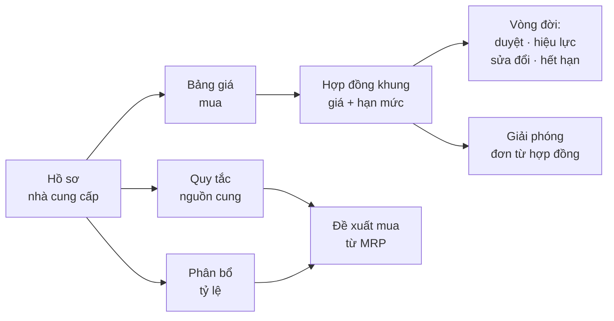

# 2000 Danh mục & hợp đồng mua

Trước khi có thể đặt hàng, hệ thống phải biết ba thứ: **mua của ai**, **giá bao nhiêu**, và **được mua tối đa bao nhiêu**. Ba câu trả lời này nằm ở ba nơi khác nhau — hồ sơ nhà cung cấp, bảng giá/hợp đồng, và quy tắc nguồn cung — và cả ba đều phải thống nhất thì đơn mua mới đúng ngay từ lần đầu.

Bài này gom toàn bộ "dữ liệu nền của việc mua" vào một chỗ.

## 0. Nguyên lý (áp dụng mọi ERP)

1. **Nhà cung cấp là một thực thể pháp lý, không phải một cái tên.** Một mã nhà cung cấp gắn với mã số thuế, địa chỉ xuất hóa đơn, tài khoản ngân hàng và điều khoản thanh toán. Tạo trùng hai mã cho cùng một công ty dẫn tới công nợ bị xé làm hai nơi.
2. **Giá phải có nguồn gốc, không phải gõ tay mỗi lần.** Giá trong hệ thống đến từ ba nguồn theo thứ tự ưu tiên: hợp đồng khung → bảng giá thỏa thuận → báo giá gần nhất. Giá nhập tay là ngoại lệ có phê duyệt, không phải mặc định.
3. **Hợp đồng khung không phải "PO dài hạn" — nó là hạn mức có điều kiện.** Hợp đồng khung định nghĩa giá và tổng hạn mức; từng lần mua là một *lần giải phóng (release)* tiêu vào hạn mức đó. Kiểm soát hạn mức là kiểm soát tiền thật, không phải thủ tục.
4. **Sửa đổi hợp đồng phải tạo phiên bản mới, không ghi đè.** Khi giá thay đổi giữa kỳ, phiên bản cũ vẫn phải tra được — nếu không, các đơn đã đặt trước đó mất căn cứ giá.
5. **Quy tắc nguồn cung quyết định MRP mua hay tự sản xuất.** Cùng một nhu cầu, hệ thống có thể tạo đơn mua, lệnh sản xuất, hoặc yêu cầu chuyển kho nội bộ — tùy quy tắc nguồn cung đã cấu hình.
6. **Phân bổ tỷ lệ (quota) là công cụ quản trị rủi ro, không chỉ là chia số lượng.** Chia 60/40 giữa hai nhà cung cấp để không bị phụ thuộc một bên khi một bên gặp sự cố.

## 1. Luồng vận hành



## 2. Ai làm gì ở module nào

| Việc | Mua hàng (PO) | Kế toán | Kho | Pháp chế / Ban điều hành | Nhà cung cấp |
|---|---|---|---|---|---|
| Tạo và cập nhật hồ sơ nhà cung cấp | ✅ đề xuất | ✅ duyệt mã số thuế, tài khoản thanh toán | — | — | Cung cấp giấy tờ |
| Khai bảng giá mua | ✅ sở hữu | — | — | — | Báo giá, ký xác nhận |
| Soạn và đàm phán hợp đồng khung | ✅ chủ trì | Tham gia điều khoản thanh toán | — | ✅ duyệt điều khoản pháp lý | Ký |
| Duyệt hợp đồng và hạn mức | — | Kiểm tra ngân sách | — | ✅ phê duyệt cuối | — |
| Theo dõi hạn mức tiêu dùng | ✅ cảnh báo | ✅ đối chiếu cam kết chi | — | — | — |
| Cấu hình quy tắc nguồn cung | ✅ sở hữu | — | Đề xuất theo khả năng cung ứng | — | — |
| Cấu hình phân bổ tỷ lệ | ✅ sở hữu | — | — | ✅ duyệt chiến lược đa nguồn | — |
| Khai quy tắc thuế đầu vào | — | ✅ sở hữu | — | — | Cung cấp thông tin thuế |
| Tạm khóa nhà cung cấp | ✅ thực thi | ✅ thực thi khi có tranh chấp | — | ✅ quyết định | — |

**Ranh giới cốt lõi:** người **tạo** nhà cung cấp không được là người **duyệt** tài khoản ngân hàng của nhà cung cấp đó. Đây là khe hở gian lận phổ biến nhất trong dữ liệu nền mua hàng.

## 3. Hạch toán

Dữ liệu nền mua hàng không sinh bút toán, nhưng quyết định bút toán:

- **Hồ sơ nhà cung cấp** quyết định tài khoản công nợ phải trả và điều khoản thanh toán.
- **Quy tắc thuế đầu vào** quyết định thuế suất và tài khoản thuế GTGT được khấu trừ.
- **Hợp đồng khung** với hạn mức là cơ sở cho kế toán cam kết chi (nếu doanh nghiệp dùng).
- **Nguồn cung `Transfer From`** không sinh bút toán công nợ — đó là chuyển kho nội bộ, chỉ sinh bút toán khi vượt pháp nhân.

Bản đồ tài khoản ở [Hạch toán & tài khoản trung gian](../6-ke-toan-chung/1000-hach-toan-va-tai-khoan-trung-gian.md); thuế ở [Thuế & tài sản cố định](../6-ke-toan-chung/3000-thue-va-tai-san-co-dinh.md).

## 4. Điểm chạm & rủi ro

- **Dùng giá và hạn mức khi tạo đơn**: [Đơn mua hàng](./3000-don-mua-hang.md)
- **Nguồn cung tự động từ MRP**: [Lệnh sản xuất & WIP](../3-san-xuat/thuc-thi/6000-lenh-san-xuat-va-wip.md)
- **Nhu cầu tự động từ tồn kho**: [Item Master & thuộc tính kho](../1-kho/2000-item-master-va-thuoc-tinh-kho.md)
- **Chuyển kho nội bộ thay vì mua**: [Giao dịch nhập, xuất & chuyển](../1-kho/3000-giao-dich-nhap-xuat-chuyen.md)
- **Kiểm soát phân quyền dữ liệu nền**: [Kiểm soát nội bộ & phân tách nhiệm vụ](../0-nen-tang/4000-kiem-soat-noi-bo-va-phan-tach-nhiem-vu.md)

**Rủi ro chính:**

- **Trùng mã nhà cung cấp** — công nợ xé làm hai, không đàm phán được giá tốt, không thấy được tổng dư nợ thật.
- **Giá nhập tay không kiểm soát** — mua cao hơn giá hợp đồng mà không ai biết.
- **Hợp đồng hết hạn nhưng vẫn giải phóng đơn** — mất căn cứ pháp lý khi tranh chấp.
- **Ghi đè giá trong hợp đồng** — đơn cũ mất căn cứ giá, kiểm toán không đối chiếu được.
- **Quota không cập nhật** — vẫn chia hàng cho nhà cung cấp đã ngừng hợp tác.
- **Nhà cung cấp bị khóa nhưng đơn cũ vẫn chạy** — hàng về nhưng không thanh toán được.

## 5. Triển khai tham chiếu ERP

### A. Ánh xạ khái niệm

| Khái niệm | Oracle EBS R12 | Epicor ERP | SAP S/4HANA | Odoo |
|---|---|---|---|---|
| Hồ sơ nhà cung cấp | TCA: `HZ_PARTIES` + `AP_SUPPLIERS` + site | `Vendor` + `VendPart` | Business Partner (`BP`) + Supplier role | `res.partner` + `supplier_rank` |
| Bảng giá mua | Purchasing Info Record / `PO_AGREEMENTS` | `VendorPrice` | Info Record (`EINA`/`EINE`) | `product.supplierinfo` |
| Hợp đồng khung | Blanket Purchase Agreement (`PO_AGREEMENTS`) | Purchase Contract / Blanket PO | Contract (`ME31K`) + Scheduling Agreement | `purchase.requisition` / `purchase.order` blanket |
| Giải phóng từ hợp đồng | Release (`PO_RELEASES_ALL`) | Release against Contract | Release Order (`ME21N` ref. contract) | `purchase.order` ref. agreement |
| Kiểm soát hạn mức | `Amount Agreed` / `Amount Released` | `ContractQty` vs `ReleasedQty` | Target Quantity/Value trên Contract | `qty_ordered` vs `product_qty` |
| Quy tắc nguồn cung | Sourcing Rules (`MRP_SRC_ASSIGNMENT`) | `PartPlant` Source / `PartWhse` | Source List (`EORD`) + Quota | `route` / `procurement.group` |
| Phân bổ tỷ lệ | Quota Arrangement | Vendor Allocation % | Quota Arrangement (`MEQ1`) | Không có mặc định |
| Quy tắc thuế đầu vào | E-Business Tax (`EBTax`) | Tax Connect | Tax Procedure | `account.tax` |

### B. Hệ thống tự xây — thiết kế tối thiểu

```sql
CREATE TABLE Vendor (
    Vendor_ID        VARCHAR(50) PRIMARY KEY,
    Tax_Code         VARCHAR(30) NOT NULL UNIQUE,  -- chống trùng NCC
    Legal_Name       NVARCHAR(200) NOT NULL,
    Status           VARCHAR(20) NOT NULL DEFAULT 'ACTIVE', -- ACTIVE | ON_HOLD | BLOCKED
    Payment_Terms    VARCHAR(20) NOT NULL,
    Tax_Rule_ID      VARCHAR(20) NULL
);

CREATE TABLE Purchase_Contract (
    Contract_ID      BIGINT IDENTITY PRIMARY KEY,
    Contract_No      VARCHAR(30) NOT NULL,
    Revision         INT NOT NULL DEFAULT 1,       -- sửa đổi = tăng revision
    Vendor_ID        VARCHAR(50) NOT NULL,
    Start_Date       DATE NOT NULL,
    End_Date         DATE NOT NULL,
    Max_Value        DECIMAL(18,2) NOT NULL,       -- hạn mức tổng
    Status           VARCHAR(20) NOT NULL,         -- DRAFT | PENDING | ACTIVE | ON_HOLD | EXPIRED | CLOSED
    UNIQUE (Contract_No, Revision)
);

CREATE TABLE Contract_Release (
    Release_ID       BIGINT IDENTITY PRIMARY KEY,
    Contract_ID      BIGINT NOT NULL,
    PO_ID            BIGINT NOT NULL,
    Release_Value    DECIMAL(18,2) NOT NULL,
    Release_Date     DATE NOT NULL
);
```

Bốn ràng buộc bắt buộc:

1. **`Tax_Code` UNIQUE** trên bảng nhà cung cấp — chặn trùng ngay ở tầng dữ liệu.
2. **Tổng `Release_Value` không được vượt `Max_Value`** — kiểm tra trong transaction khi tạo release.
3. **Chỉ giải phóng được từ hợp đồng `ACTIVE` và trong khoảng `Start_Date..End_Date`**.
4. **Sửa đổi hợp đồng = tạo dòng mới với `Revision + 1`**, không `UPDATE` giá của revision cũ.

### C. Truy vấn kiểm soát

**Hợp đồng sắp hết hạn trong 30 ngày — cần gia hạn hoặc chuẩn bị mời thầu lại:**

```sql
SELECT Contract_No, Revision, Vendor_ID, End_Date,
       DATEDIFF(DAY, GETDATE(), End_Date) AS Days_Left
FROM Purchase_Contract
WHERE Status = 'ACTIVE'
  AND End_Date BETWEEN GETDATE() AND DATEADD(DAY, 30, GETDATE())
ORDER BY Days_Left;
```

**Hợp đồng đã vượt hạn mức nhưng vẫn còn đơn giải phóng:**

```sql
SELECT c.Contract_No, c.Max_Value,
       SUM(r.Release_Value) AS Total_Released,
       SUM(r.Release_Value) - c.Max_Value AS Over_By
FROM Purchase_Contract c
JOIN Contract_Release r ON r.Contract_ID = c.Contract_ID
WHERE c.Status IN ('ACTIVE', 'CLOSED')
GROUP BY c.Contract_No, c.Max_Value
HAVING SUM(r.Release_Value) > c.Max_Value;
```

**Nhà cung cấp bị khóa nhưng còn đơn mua mở:**

```sql
SELECT po.PO_No, po.Vendor_ID, v.Legal_Name, v.Status, po.Status AS PO_Status
FROM Purchase_Order po
JOIN Vendor v ON v.Vendor_ID = po.Vendor_ID
WHERE v.Status IN ('ON_HOLD', 'BLOCKED')
  AND po.Status NOT IN ('CLOSED', 'CANCELLED');
```

**Epicor — kiểm tra hạn mức hợp đồng đã tiêu so với hạn mức cam kết:**

```sql
SELECT ch.ContractNum, ch.VendorNum, ch.ContractQty,
       ISNULL(SUM(rl.ReleasedQty), 0) AS ReleasedQty,
       ch.ContractQty - ISNULL(SUM(rl.ReleasedQty), 0) AS Remaining
FROM Erp.ContractHed ch
LEFT JOIN Erp.ContractDtl cd ON cd.Company = ch.Company AND cd.ContractNum = ch.ContractNum
LEFT JOIN Erp.PORel rl      ON rl.Company = cd.Company AND rl.ContractNum = cd.ContractNum
                           AND rl.ContractLine = cd.ContractLine
WHERE ch.Company = 'YOUR_COMPANY_CODE'
  AND ch.ContractType = 'B'
GROUP BY ch.ContractNum, ch.VendorNum, ch.ContractQty
ORDER BY Remaining;
```

## 6. Bẫy thực chiến & Checklist

| # | Bẫy | Triệu chứng | Cách phòng tránh |
|---|---|---|---|
| 1 | Trùng mã nhà cung cấp | Cùng một công ty có hai mã, công nợ và thanh toán tách đôi | `Tax_Code` UNIQUE, tìm kiếm mờ trước khi tạo mới |
| 2 | Giá nhập tay không so với hợp đồng | Mua cao hơn giá đã thỏa thuận, chênh lệch không ai phát hiện | Cảnh báo/chặn khi giá PO lệch giá hợp đồng quá dung sai |
| 3 | Ghi đè giá trên hợp đồng đang hiệu lực | Đơn đã đặt trước đó mất căn cứ giá | Sửa đổi = revision mới, revision cũ bất biến |
| 4 | Giải phóng đơn từ hợp đồng đã hết hạn | Không có căn cứ pháp lý khi tranh chấp | Chặn release khi `End_Date < ngày release` |
| 5 | Không theo dõi hạn mức hợp đồng | Vượt hạn mức hàng loạt, chỉ phát hiện khi kiểm toán | Báo cáo hạn mức chạy hằng ngày, cảnh báo ở 80% |
| 6 | Quota chia cho nhà cung cấp đã ngừng hợp tác | Hệ thống vẫn đề xuất mua từ NCC bị khóa | Quota phải lọc theo `Vendor.Status = ACTIVE` |
| 7 | Nguồn cung `Transfer From` nhưng kho nguồn không có hàng | MRP tạo yêu cầu chuyển kho, kho kia lại thiếu | Kiểm tra tồn kho nguồn trước khi chọn Transfer From |
| 8 | Sửa tài khoản ngân hàng nhà cung cấp không kiểm soát | Gian lận chuyển tiền sang tài khoản khác | Tách quyền: người sửa ≠ người duyệt ≠ người trả tiền |
| 9 | Quy tắc thuế không gắn với nhà cung cấp | Hóa đơn nhập thuế suất sai, khấu trừ bị bác | `Tax_Rule_ID` bắt buộc trên hồ sơ NCC |

**Checklist trước go-live:**

- [ ] `Tax_Code` UNIQUE trên nhà cung cấp (đã test tạo trùng bị chặn).
- [ ] Đã có kiểm tra trước khi tạo NCC mới: tìm theo tên, mã số thuế, tên viết tắt.
- [ ] Tài khoản ngân hàng: người sửa khác người duyệt khác người thanh toán.
- [ ] Quy tắc thuế đã gán cho 100% nhà cung cấp còn hoạt động.
- [ ] Hợp đồng khung có `Max_Value`, có chặn release khi vượt.
- [ ] Chặn release ngoài khoảng hiệu lực (đã test).
- [ ] Sửa đổi hợp đồng tạo revision mới, khóa sửa revision cũ.
- [ ] Quota chỉ xét nhà cung cấp `ACTIVE`.
- [ ] Có báo cáo cảnh báo hợp đồng sắp hết hạn và hạn mức đã dùng.
- [ ] Đã test luồng: tạo hợp đồng → duyệt → giải phóng 2 đơn → vượt hạn mức bị chặn.

## Xem thêm

- [Tổng quan Mua hàng](./0000-tong-quan-p2p.md)
- [Nhu cầu mua hàng & lựa chọn nhà cung cấp](./1000-nhu-cau-va-lua-chon-ncc.md)
- [Đơn mua hàng](./3000-don-mua-hang.md)
- [Thuế & tài sản cố định](../6-ke-toan-chung/3000-thue-va-tai-san-co-dinh.md)
- [Kiểm soát nội bộ & phân tách nhiệm vụ](../0-nen-tang/4000-kiem-soat-noi-bo-va-phan-tach-nhiem-vu.md)

<div align="center" style={{color: 'var(--ifm-color-primary)'}}>
  <strong>Chúc các bạn thành công và vui vẻ!</strong>
</div>
