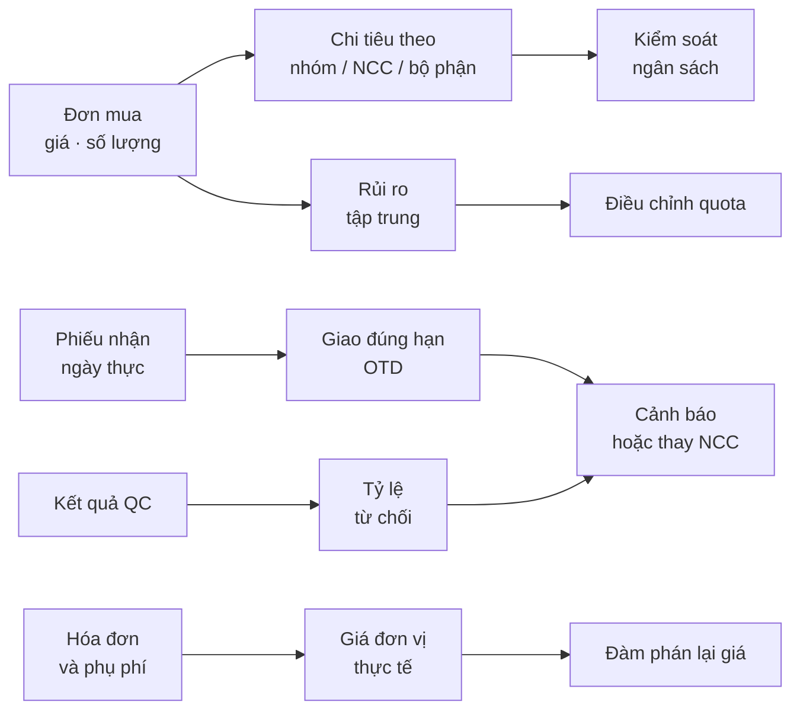

# 3000 Báo cáo mua hàng

Dữ liệu mua hàng là nguồn thông tin quản trị bị bỏ phí nhiều nhất trong ERP. Hầu hết doanh nghiệp chỉ dùng để tra "đơn này đặt chưa" và "hóa đơn này trả chưa", trong khi cùng dữ liệu đó trả lời được những câu hỏi đáng giá hàng tỷ đồng: mua của ai nhiều nhất, nhà cung cấp nào giao trễ, giá đang tăng ở nhóm nào.

## 0. Nguyên lý (áp dụng mọi ERP)

1. **Chi tiêu phải nhìn theo ba chiều: nhóm hàng, nhà cung cấp, bộ phận.** Cùng một con số tổng nhưng ba cách chia cho ba quyết định khác nhau — mua gì để đàm phán giá, mua của ai để giảm rủi ro, bộ phận nào tiêu nhiều để kiểm soát ngân sách.
2. **Giá mua không phải giá hóa đơn.** Giá thực tế phải gồm chi phí vận chuyển, thuế nhập khẩu, phụ phí — nếu không, nhà cung cấp báo giá rẻ nhưng tổng chi phí cao sẽ thắng thầu sai.
3. **Giao đúng hạn phải đo trên ngày cam kết, không phải ngày đặt.** Đo từ ngày PO sẽ cho điểm cao giả khi nhà cung cấp tự kéo dài lead time.
4. **Chất lượng phải đo bằng dữ liệu QC, không bằng cảm nhận.** Tỷ lệ lô bị từ chối và số lần phải trả hàng là bằng chứng cứng.
5. **Chỉ số phải dẫn tới hành động.** Một scorecard không dẫn tới quyết định (giảm quota, đàm phán lại, thay nhà cung cấp) chỉ là báo cáo cho đẹp.
6. **Rủi ro tập trung là chỉ số bắt buộc.** Nhà cung cấp chiếm quá 50% một nhóm hàng thiết yếu là rủi ro đứt chuỗi, không phải thành tích đàm phán giỏi.

## 1. Luồng vận hành



## 2. Ai làm gì ở module nào

| Chỉ số | Mua hàng (PO) | Kho | Kế toán | Chất lượng (QC) | Ban điều hành |
|---|---|---|---|---|---|
| Cơ cấu chi tiêu | ✅ chủ trì phân tích | — | Cung cấp số thực chi | — | Duyệt chiến lược mua |
| Giá đơn vị thực tế | ✅ đề xuất, đàm phán | — | ✅ cung cấp landed cost | — | — |
| Giao đúng hạn (OTD) | ✅ sở hữu | ✅ cung cấp ngày nhận thực | — | — | — |
| Tỷ lệ lô bị từ chối | Làm việc với NCC | Ghi nhận xuất trả | — | ✅ sở hữu kết quả | — |
| Rủi ro tập trung | ✅ phân tích | — | — | ✅ duyệt giới hạn | ✅ quyết định đa nguồn |
| Scorecard nhà cung cấp | ✅ lập | Cung cấp dữ liệu nhận | Cung cấp dữ liệu thanh toán | ✅ cung cấp điểm chất lượng | ✅ xem định kỳ |

**Ranh giới:** mua hàng **lập** scorecard nhưng không tự quyết định thay nhà cung cấp — quyết định đó thuộc ban điều hành để tránh xung đột lợi ích với người đang đàm phán.

## 3. Hạch toán

Báo cáo mua hàng **không sinh bút toán**, nhưng có một nguyên tắc phải thống nhất với kế toán: **chi tiêu phân tích phải khớp tổng phát sinh trên sổ cái**. Nếu báo cáo phân tích dựa trên giá PO nhưng sổ cái ghi nhận giá hóa đơn + landed cost, hai con số sẽ lệch nhau và không ai tin báo cáo.

Cách làm đúng: phân tích theo **giá trị đã hạch toán thực tế** (hóa đơn + phân bổ chi phí), không theo giá ghi trên đơn. Bản đồ tài khoản và landed cost ở [Hạch toán & tài khoản trung gian](../5-ke-toan/ke-toan-tong-hop/1000-hach-toan-va-tai-khoan-trung-gian.md) và [Giá vốn & định giá tồn kho](../5-ke-toan/ke-toan-tong-hop/1010-gia-von-va-dinh-gia-ton-kho.md).

## 4. Điểm chạm & rủi ro

- **Nguồn dữ liệu đơn và giá**: [Đơn mua hàng](./2000-don-mua-hang.md)
- **Nguồn dữ liệu nhận và QC**: [Nhận hàng & kiểm tra chất lượng](./2010-nhan-hang-va-kiem-qc.md)
- **Giá hợp đồng làm gốc so sánh**: [Danh mục & hợp đồng mua](./1010-danh-muc-va-hop-dong-mua.md)
- **Quota và đa nguồn**: [Danh mục & hợp đồng mua](./1010-danh-muc-va-hop-dong-mua.md)
- **Landed cost và chi phí thu mua**: [Giá vốn & định giá tồn kho](../5-ke-toan/ke-toan-tong-hop/1010-gia-von-va-dinh-gia-ton-kho.md)

**Rủi ro chính:**

- **Phân tích trên giá PO thay vì giá thực** — nhà cung cấp giá rẻ nhưng phụ phí cao luôn thắng thầu.
- **OTD đo từ ngày đặt** — điểm cao giả khi NCC tự kéo lead time.
- **Scorecard không ai dùng** — báo cáo đẹp nhưng quota không đổi.
- **Bỏ qua rủi ro tập trung** — 70% chi tiêu một nhà cung cấp, đứt là dừng sản xuất.
- **Số liệu phân tích không khớp sổ cái** — không ai tin báo cáo, quay lại dùng Excel.

## 5. Triển khai tham chiếu ERP

### A. Nguồn dữ liệu và bảng chính

| Chỉ số | Oracle EBS R12 | Epicor ERP | SAP S/4HANA | Odoo |
|---|---|---|---|---|
| Cơ cấu chi tiêu | `PO_HEADERS_ALL` + GL | `POHeader` + `GLJrnDtl` | `EKKO`/`EKPO` + `ACDOCA` | `purchase.order` + `account.move.line` |
| Giá thực tế | `PO_LINE_LOCATIONS_ALL` + Landed Cost | `PODetail` + `LandedCost` | Landed cost condition (`Z`) | `stock.valuation.layer` |
| OTD | `RCV_TRANSACTIONS` vs `PO_LINE_LOCATIONS_ALL.promised_date` | `RcvDtl` vs `PORel.DueDate` | `EKES` (confirmations) vs `EKBE` | `stock.picking.date_done` vs `date_planned` |
| Tỷ lệ từ chối | Inspection results | `Inspection Processing` | `QALS` / `QM` | QC point result |
| Rủi ro tập trung | Tổng hợp theo `vendor_id` + `category` | `Vendor` + `ProdGrup` | `LIFNR` + `MATKL` | `partner_id` + `categ_id` |

### B. Công thức các chỉ số

$$\text{OTD \%} = \frac{\text{Số dòng giao đúng hạn}}{\text{Tổng số dòng đã giao}} \times 100$$

Điều kiện "đúng hạn": `Ngày nhận thực <= Ngày cam kết` (không dùng ngày đặt).

$$\text{Tỷ lệ từ chối \%} = \frac{\text{Số lượng bị QC từ chối}}{\text{Tổng số lượng đã nhận}} \times 100$$

$$\text{Rủi ro tập trung} = \frac{\text{Chi tiêu nhóm hàng X cho NCC lớn nhất}}{\text{Tổng chi tiêu nhóm hàng X}} \times 100$$

Ngưỡng cảnh báo phổ biến: **> 50% với hàng thiết yếu** là rủi ro cần xử lý.

### C. Truy vấn kiểm soát

**Cơ cấu chi tiêu theo nhà cung cấp — phát hiện tập trung quá mức:**

```sql
SELECT ph.Vendor_ID, v.Legal_Name,
       SUM(pl.Amount) AS Spend,
       SUM(pl.Amount) * 100.0 / SUM(SUM(pl.Amount)) OVER () AS Spend_Pct
FROM PO_Header ph
JOIN PO_Line pl ON pl.PO_ID = ph.PO_ID
JOIN Vendor v   ON v.Vendor_ID = ph.Vendor_ID
WHERE ph.Status = 'CLOSED'
  AND ph.PO_Date >= DATEADD(MONTH, -12, GETDATE())
GROUP BY ph.Vendor_ID, v.Legal_Name
ORDER BY Spend DESC;
```

**Nhà cung cấp giao trễ — xếp hạng theo mức độ và số lần:**

```sql
SELECT ph.Vendor_ID, v.Legal_Name,
       COUNT(*) AS Late_Lines,
       AVG(DATEDIFF(DAY, s.Promised_Date, r.Received_Date)) AS Avg_Days_Late
FROM PO_Shipment s
JOIN PO_Header ph    ON ph.PO_ID = s.PO_ID
JOIN Vendor v        ON v.Vendor_ID = ph.Vendor_ID
JOIN Receipt_Line r  ON r.PO_ID = s.PO_ID AND r.Line_No = s.Line_No
                    AND r.Shipment_No = s.Shipment_No
WHERE r.Received_Date > s.Promised_Date
  AND r.Received_Date >= DATEADD(MONTH, -6, GETDATE())
GROUP BY ph.Vendor_ID, v.Legal_Name
HAVING COUNT(*) >= 3
ORDER BY Avg_Days_Late DESC;
```

**So sánh giá mua thực tế giữa các nhà cung cấp cùng một mã hàng — phát hiện mua đắt:**

```sql
SELECT l.Item_ID, h.Vendor_ID, v.Legal_Name,
       AVG(l.Unit_Price) AS Avg_Price,
       MIN(l.Unit_Price) AS Min_Price,
       MAX(l.Unit_Price) AS Max_Price,
       COUNT(*) AS Lines
FROM PO_Line l
JOIN PO_Header h ON h.PO_ID = l.PO_ID
JOIN Vendor v    ON v.Vendor_ID = h.Vendor_ID
WHERE h.PO_Date >= DATEADD(MONTH, -12, GETDATE())
GROUP BY l.Item_ID, h.Vendor_ID, v.Legal_Name
ORDER BY l.Item_ID, Avg_Price DESC;
```

**Epicor — nhà cung cấp có tỷ lệ lô bị từ chối cao:**

```sql
SELECT v.VendorID, v.Name,
       COUNT(*) AS Inspections,
       SUM(CASE WHEN ip.PassQty < ip.InspQty THEN 1 ELSE 0 END) AS Rejected_Lots,
       SUM(CASE WHEN ip.PassQty < ip.InspQty THEN 1 ELSE 0 END) * 100.0 / COUNT(*) AS Reject_Pct
FROM Erp.InspProcessing ip
JOIN Erp.Vendor v ON v.Company = ip.Company AND v.VendorNum = ip.VendorNum
WHERE ip.Company = 'YOUR_COMPANY_CODE'
  AND ip.InspDate >= DATEADD(MONTH, -6, GETDATE())
GROUP BY v.VendorID, v.Name
HAVING SUM(CASE WHEN ip.PassQty < ip.InspQty THEN 1 ELSE 0 END) > 0
ORDER BY Reject_Pct DESC;
```

## 6. Bẫy thực chiến & Checklist

| # | Bẫy | Triệu chứng | Cách phòng tránh |
|---|---|---|---|
| 1 | Phân tích trên giá PO | Nhà cung cấp phụ phí cao vẫn được đánh giá là rẻ | Dùng giá trị đã hạch toán: hóa đơn + landed cost |
| 2 | OTD đo từ ngày đặt | Điểm cao giả khi NCC tự kéo ngày cam kết | Luôn so `ngày nhận thực` với `ngày cam kết` |
| 3 | Không đo rủi ro tập trung | 70% chi tiêu một NCC, đứt là dừng sản xuất | Báo cáo % theo NCC và nhóm hàng, ngưỡng 50% |
| 4 | Scorecard không gắn hành động | Báo cáo đẹp mỗi quý nhưng quota không đổi | Gắn ngưỡng: dưới X điểm → giảm quota/đàm phán lại |
| 5 | So sánh giá theo thời điểm khác nhau | Kết luận NCC A đắt hơn trong khi thị trường đã tăng giá | So sánh cùng kỳ hoặc cùng lô thời gian |
| 6 | Bỏ qua chất lượng trong scorecard | Chọn NCC rẻ nhưng tỷ lệ từ chối 15% | Điểm tổng hợp phải gồm giá, OTD và chất lượng |
| 7 | Số liệu không khớp sổ cái | Báo cáo nói 10 tỷ, sổ cái 10,4 tỷ | Đối chiếu định kỳ, dùng cùng nguồn dữ liệu hạch toán |
| 8 | Không tách hàng trực tiếp và gián tiếp | Chi tiêu MRO lẫn với nguyên vật liệu, không thấy bức tranh thật | Tách theo nhóm hàng trên từng báo cáo |

**Checklist trước go-live:**

- [ ] Đã tách nhóm hàng trực tiếp (nguyên vật liệu) và gián tiếp (MRO/dịch vụ).
- [ ] Báo cáo cơ cấu chi tiêu có phân tích % theo nhà cung cấp và nhóm hàng.
- [ ] OTD tính trên ngày cam kết, không trên ngày đặt (đã đối chiếu tay 1 tháng).
- [ ] Tỷ lệ từ chối lấy từ dữ liệu QC, không nhập tay.
- [ ] Giá thực tế đã gồm landed cost và phụ phí.
- [ ] Scorecard gắn với ngưỡng hành động cụ thể.
- [ ] Đã đối chiếu tổng chi tiêu báo cáo với tổng phát sinh sổ cái.
- [ ] Rủi ro tập trung có cảnh báo tự động khi vượt ngưỡng.

## Xem thêm

- [Tổng quan Mua hàng](./0000-tong-quan-p2p.md)
- [Đơn mua hàng](./2000-don-mua-hang.md)
- [Nhận hàng & kiểm tra chất lượng](./2010-nhan-hang-va-kiem-qc.md)
- [Danh mục & hợp đồng mua](./1010-danh-muc-va-hop-dong-mua.md)
- [Giá vốn & định giá tồn kho](../5-ke-toan/ke-toan-tong-hop/1010-gia-von-va-dinh-gia-ton-kho.md)

<div align="center" style={{color: 'var(--ifm-color-primary)'}}>
  <strong>Chúc các bạn thành công và vui vẻ!</strong>
</div>
