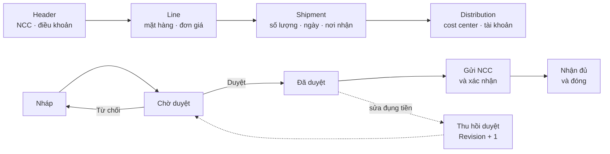

---
id: don-mua-hang
title: "3000 Đơn mua hàng"
slug: /erp-nghiep-vu/mua-hang/don-mua-hang
sidebar_position: 3000
description: "Cấu trúc bốn tầng của đơn mua hàng (header, line, shipment, distribution), phê duyệt theo hạn mức, quản lý thay đổi và phiên bản PO, theo dõi tiến độ giao hàng và cổng nhà cung cấp."
date: 2026-08-04
last_update:
  date: 2026-11-19
tags: [erp, procurement, purchase-order, approval, revision]
---

# 3000 Đơn mua hàng

Đơn mua hàng là **chứng từ cam kết pháp lý đầu tiên** trong chuỗi mua. Sau khi ký phát hành, nó ràng buộc cả hai bên: nhà cung cấp phải giao đúng thứ đã ghi, doanh nghiệp phải nhận và trả tiền. Vì vậy đơn mua không được phép "sửa qua loa" — mọi thay đổi đều phải để lại dấu vết.

## 0. Nguyên lý (áp dụng mọi ERP)

1. **Đơn mua có bốn tầng, không phải hai.** Header (nhà cung cấp, điều khoản), Line (mặt hàng, đơn giá), Shipment/Release (giao bao nhiêu, khi nào, về đâu), Distribution (hạch toán vào chi phí nào). Thiếu tầng 3 thì không đặt được nhiều đợt giao; thiếu tầng 4 thì không phân bổ được chi phí cho nhiều bộ phận.
2. **Một dòng đơn giá sỉ có thể giao nhiều đợt về nhiều địa điểm.** Đây là lý do tầng Shipment tồn tại: đặt 10.000 cái để hưởng giá sỉ, nhưng giao 3.000 về nhà máy A tuần này và 7.000 về nhà máy B tháng sau.
3. **Phê duyệt phải theo hạn mức giá trị, không theo chức danh cố định.** Giám đốc không nên duyệt đơn 5 triệu; trưởng phòng mua không nên tự duyệt đơn 5 tỷ. Hạn mức thay đổi theo chính sách, phải cấu hình được, không viết cứng.
4. **Đơn đã phát hành là văn bản pháp lý — sửa phải có phiên bản.** Thay đổi giá, số lượng, địa điểm giao, điều khoản thanh toán đều phải thu hồi trạng thái duyệt và chạy lại luồng phê duyệt. Chỉ thay đổi ghi chú và ngày giao trong dung sai mới được tự động duyệt.
5. **Dung sai thay đổi là công cụ chống tắc nghẽn.** Nếu mọi thay đổi nhỏ đều phải duyệt lại từ đầu, người dùng sẽ tìm cách sửa ngoài hệ thống. Cần phân biệt rõ thay đổi nào đụng tiền, thay đổi nào không.
6. **Trạng thái đơn phải phản ánh thực tế, không phải ý định.** "Đã duyệt" khác "đã gửi NCC", khác "đã xác nhận", khác "đã nhận một phần". Trộn các trạng thái này làm mất khả năng theo dõi tiến độ.

## 1. Luồng vận hành



**Đọc sơ đồ:** vòng quay quan trọng nhất là `A → CHG → R → P`. Nếu hệ thống cho sửa trực tiếp từ `A` mà không quay lại `P`, đơn đã duyệt có thể bị đổi giá mà không ai duyệt lại.

## 2. Ai làm gì ở module nào

| Bước | Mua hàng (PO) | Kho | Kế toán | Sản xuất | Nhà cung cấp |
|---|---|---|---|---|---|
| Tạo đơn từ yêu cầu đã duyệt | ✅ buyer | — | — | — | — |
| Áp giá theo hợp đồng / bảng giá | ✅ tự động hoặc nhập có lý do | — | — | — | — |
| Gán tài khoản hạch toán (distribution) | ✅ nhập, đề xuất | — | ✅ duyệt tài khoản | Cung cấp cost center | — |
| Duyệt đơn theo hạn mức | ✅ trình duyệt | — | ✅ duyệt theo hạn mức | Trưởng bộ phận duyệt nhu cầu | — |
| Gửi đơn và theo dõi xác nhận | ✅ sở hữu | — | — | — | ✅ xác nhận qua cổng |
| Nhận hàng theo Shipment | Đọc tiến độ | ✅ ghi nhận thực nhận | — | — | Giao hàng |
| Sửa đổi đơn sau phát hành | ✅ trình duyệt lại | — | ✅ duyệt lại nếu đụng tiền | — | Đề nghị thay đổi |
| Đóng đơn còn dư | ✅ quyết định | Xác nhận số đã nhận | — | — | — |
| Đối chiếu hóa đơn | ✅ hỗ trợ | — | ✅ thực hiện khớp lệnh | — | Xuất hóa đơn |

**Ranh giới cốt lõi:** người **tạo** đơn và người **duyệt** đơn phải khác nhau; người **sửa** đơn đã duyệt không được tự **duyệt lại**.

## 3. Hạch toán

Đơn mua **chưa sinh bút toán** — nhưng tầng Distribution chính là nơi quyết định bút toán sẽ ghi vào đâu:

- **Distribution gán cost center và tài khoản** cho từng dòng. Khi hàng về hoặc hóa đơn về, hệ thống dùng đúng phân bổ này để hạch toán.
- **Đơn dịch vụ** (không qua kho) dùng Distribution để ghi thẳng chi phí — khác hoàn toàn đơn hàng hóa.
- **Đơn có nhiều Distribution trên một dòng** cho phép chia chi phí cho nhiều bộ phận, nhưng tổng distribution phải bằng số lượng trên dòng.

Bản đồ tài khoản ở [Hạch toán & tài khoản trung gian](../6-ke-toan-chung/1000-hach-toan-va-tai-khoan-trung-gian.md); trường hợp đơn dịch vụ ở [Mô hình mua đặc thù](./6000-mo-hinh-mua-dac-thu.md).

## 4. Điểm chạm & rủi ro

- **Nguồn giá và hạn mức hợp đồng**: [Danh mục & hợp đồng mua](./2000-danh-muc-va-hop-dong-mua.md)
- **Nhận hàng theo shipment**: [Nhận hàng & kiểm tra chất lượng](./4000-nhan-hang-va-kiem-qc.md)
- **Khớp lệnh hóa đơn**: [Đối soát hóa đơn & 3-Way Match](./5000-doi-soat-hoa-don-va-3-way-match.md)
- **Ghi giao dịch nhận vào kho**: [Giao dịch nhập, xuất & chuyển](../1-kho/3000-giao-dich-nhap-xuat-chuyen.md)
- **Ma trận phê duyệt và SoD**: [Kiểm soát nội bộ & phân tách nhiệm vụ](../0-nen-tang/5000-kiem-soat-noi-bo-va-phan-tach-nhiem-vu.md)

**Rủi ro chính:**

- **Sửa đơn đã duyệt mà không duyệt lại** — giá bị đổi sau khi qua hạn mức phê duyệt.
- **Không có tầng shipment** — không đặt được giao nhiều đợt, phải tách nhiều đơn lẻ với giá tệ hơn.
- **Distribution không khớp số lượng dòng** — chi phí hạch toán thiếu hoặc thừa so với thực nhận.
- **Đơn treo không đóng** — `On-Order` ảo làm hệ thống không đề xuất mua, gây đứt vật tư.
- **Trạng thái đơn không chuẩn** — không phân biệt "đã duyệt" và "NCC đã xác nhận", báo cáo tiến độ sai.

## 5. Triển khai tham chiếu ERP

### A. Ánh xạ bốn tầng

| Tầng | Oracle EBS R12 | Epicor ERP | SAP S/4HANA | Odoo |
|---|---|---|---|---|
| Header | `PO_HEADERS_ALL` | `Erp.POHeader` | `EKKO` / CDS `I_PurchaseOrder` | `purchase.order` |
| Line | `PO_LINES_ALL` | `Erp.PODetail` | `EKPO` / CDS `I_PurchaseOrderItem` | `purchase.order.line` |
| Shipment / Release | `PO_LINE_LOCATIONS_ALL` | `Erp.PORel` | `EKET` (Schedule Lines) | Không tách — xử lý qua `stock.picking` |
| Distribution | `PO_DISTRIBUTIONS_ALL` | Trường GL Account ngay trong `PORel` | `EKKN` (Account Assignment) | `analytic_distribution` trên line |
| Lịch sử thay đổi | `PO_HEADERS_ARCHIVE_ALL` | `ChgLog` / Audit Log | `CDHDR` / `CDPOS` | Mail thread / audit rule |
| Kích hoạt duyệt lại | Trạng thái `Requires Reapproval` | `Pending` khi đổi giá/lượng | Re-trigger Release Strategy | Reset draft |

**Lưu ý SAP:** bảng cổ điển vẫn tồn tại vật lý trên HANA, nhưng khi phát triển mới nên đọc qua CDS View để không vỡ khi SAP nâng cấp.

**Lưu ý Odoo:** không có tầng Shipment ở cấp PO — giao nhiều đợt được xử lý ở tầng kho. Đây là khác biệt kiến trúc cần biết khi đối chiếu với Oracle/Epicor/SAP.

### B. Hệ thống tự xây — thiết kế tối thiểu

```sql
CREATE TABLE PO_Header (
    PO_ID          BIGINT IDENTITY PRIMARY KEY,
    PO_No          VARCHAR(30) NOT NULL,
    Revision       INT NOT NULL DEFAULT 0,
    Vendor_ID      VARCHAR(50) NOT NULL,
    Contract_ID    BIGINT NULL,
    Currency       VARCHAR(3) NOT NULL,
    Payment_Terms  VARCHAR(20) NOT NULL,
    Status         VARCHAR(20) NOT NULL,  -- DRAFT|PENDING|APPROVED|SENT|CONFIRMED|PARTIAL|CLOSED|CANCELLED
    Approved_By    VARCHAR(50) NULL,
    Total_Value    DECIMAL(18,2) NOT NULL,
    UNIQUE (PO_No, Revision)
);

CREATE TABLE PO_Line (
    PO_ID        BIGINT NOT NULL,
    Line_No      INT NOT NULL,
    Item_ID      VARCHAR(50) NOT NULL,
    UOM          VARCHAR(10) NOT NULL,
    Unit_Price   DECIMAL(18,4) NOT NULL,
    PRIMARY KEY (PO_ID, Line_No)
);

CREATE TABLE PO_Shipment (
    PO_ID          BIGINT NOT NULL,
    Line_No        INT NOT NULL,
    Shipment_No    INT NOT NULL,
    Qty            DECIMAL(18,4) NOT NULL,
    Promised_Date  DATE NOT NULL,
    Ship_To        VARCHAR(50) NOT NULL,
    PRIMARY KEY (PO_ID, Line_No, Shipment_No)
);

CREATE TABLE PO_Distribution (
    PO_ID        BIGINT NOT NULL,
    Line_No      INT NOT NULL,
    Shipment_No  INT NOT NULL,
    Dist_No      INT NOT NULL,
    Qty          DECIMAL(18,4) NOT NULL,
    Cost_Center  VARCHAR(20) NOT NULL,
    Project_Code VARCHAR(30) NULL,
    GL_Account   VARCHAR(20) NOT NULL,
    PRIMARY KEY (PO_ID, Line_No, Shipment_No, Dist_No)
);
```

Bốn ràng buộc bắt buộc:

1. **Tổng `PO_Shipment.Qty` của một line = số lượng line** — kiểm tra trước khi duyệt.
2. **Tổng `PO_Distribution.Qty` của một shipment = số lượng shipment** — tương tự.
3. **Đổi giá/số lượng/điều khoản trên PO đã `APPROVED` phải set `Status = 'PENDING'` và `Revision + 1`**.
4. **Không `UPDATE` dòng của revision cũ** — lịch sử phải tra được.

### C. Truy vấn kiểm soát

**Đơn mà tổng số lượng shipment không khớp số lượng đặt:**

```sql
SELECT l.PO_ID, l.Line_No, l.Item_ID,
       l.Qty_Ordered,
       ISNULL(SUM(s.Qty), 0) AS Qty_Shipped_Plan
FROM PO_Line l
LEFT JOIN PO_Shipment s ON s.PO_ID = l.PO_ID AND s.Line_No = l.Line_No
GROUP BY l.PO_ID, l.Line_No, l.Item_ID, l.Qty_Ordered
HAVING l.Qty_Ordered <> ISNULL(SUM(s.Qty), 0);
```

**Đơn đã duyệt nhưng không có distribution — sẽ không hạch toán được:**

```sql
SELECT h.PO_No, h.Vendor_ID, h.Total_Value
FROM PO_Header h
WHERE h.Status IN ('APPROVED', 'SENT')
  AND NOT EXISTS (
      SELECT 1 FROM PO_Distribution d
      JOIN PO_Line l ON l.PO_ID = d.PO_ID AND l.Line_No = d.Line_No
      WHERE l.PO_ID = h.PO_ID);
```

**Đơn đã nhận đủ nhưng chưa đóng — `On-Order` ảo chặn đề xuất mua:**

```sql
SELECT h.PO_No, h.Vendor_ID, h.Status,
       DATEDIFF(DAY, h.Promised_Max_Date, GETDATE()) AS Days_Overdue
FROM PO_Header h
WHERE h.Status IN ('SENT', 'CONFIRMED', 'PARTIAL')
  AND NOT EXISTS (
      SELECT 1 FROM PO_Shipment s
      WHERE s.PO_ID = h.PO_ID AND s.Qty_Open > 0);
```

**Epicor — đơn mua còn mở quá 90 ngày, cần rà soát đóng:**

```sql
SELECT ph.PONum, ph.VendorNum, ph.OrderDate, ph.OpenOrder,
       DATEDIFF(DAY, ph.OrderDate, GETDATE()) AS Days_Open
FROM Erp.POHeader ph
WHERE ph.Company = 'YOUR_COMPANY_CODE'
  AND ph.OpenOrder = 1
  AND DATEDIFF(DAY, ph.OrderDate, GETDATE()) > 90
ORDER BY Days_Open DESC;
```

## 6. Bẫy thực chiến & Checklist

| # | Bẫy | Triệu chứng | Cách phòng tránh |
|---|---|---|---|
| 1 | Sửa giá trên đơn đã duyệt không duyệt lại | Đơn vượt hạn mức được tạo với giá khác sau khi duyệt | Đổi trường ảnh hưởng tiền → `PENDING`, `Revision + 1` |
| 2 | Ghi đè revision cũ | Không tra được đơn đặt trước đó với giá nào | Dòng revision cũ bất biến, chỉ thêm revision mới |
| 3 | Thiếu tầng Shipment | Phải tách nhiều đơn lẻ, mất giá sỉ, khó theo dõi | Thiết kế bảng shipment ngay từ đầu |
| 4 | Distribution không khớp số lượng | Chi phí vào sổ thiếu so với số nhận thực tế | Ràng buộc tổng dist = qty shipment trước khi duyệt |
| 5 | Đơn không có distribution | Hàng về nhưng không biết hạch toán vào đâu | Chặn duyệt nếu thiếu distribution |
| 6 | Đơn còn dư không đóng | `On-Order` ảo, hệ thống ngừng đề xuất mua, đứt vật tư | Job đóng đơn quá hạn, báo cáo PO treo |
| 7 | Trạng thái đơn không chuẩn | Báo cáo "đã duyệt" nhưng NCC chưa xác nhận, tiến độ sai | Phân biệt rõ 5 trạng thái: duyệt → gửi → xác nhận → nhận → đóng |
| 8 | Không có dung sai thay đổi | Mọi sửa nhỏ đều phải duyệt lại, người dùng sửa ngoài hệ thống | Dung sai theo trường: ghi chú, ngày giao ± N ngày |
| 9 | Cho phép nhập giá tay tùy ý | Mua cao hơn hợp đồng, chênh lệch không bị chặn | Bắt buộc lý do nếu giá lệch quá dung sai so với hợp đồng |
| 10 | Một người vừa tạo vừa duyệt | Gian lận mua hàng không ai phát hiện | SoD: người tạo ≠ người duyệt ≠ người nhận |

**Checklist trước go-live:**

- [ ] Bốn bảng PO (header, line, shipment, distribution) đã có, không gộp tầng.
- [ ] Ràng buộc tổng shipment = qty line (đã test chặn khi lệch).
- [ ] Ràng buộc tổng distribution = qty shipment.
- [ ] Chặn duyệt đơn thiếu distribution.
- [ ] Đổi trường ảnh hưởng tiền → thu hồi duyệt + tăng revision (đã test).
- [ ] Dung sai thay đổi đã cấu hình được qua tham số, không hard-code.
- [ ] Hạn mức duyệt theo giá trị và vai trò.
- [ ] SoD: tạo / duyệt / nhận / thanh toán là bốn vai trò khác nhau.
- [ ] Có báo cáo đơn quá hạn và job đóng đơn.
- [ ] Đã test luồng: PR → PO → duyệt → gửi → sửa giá → duyệt lại → nhận hai đợt → đóng.

## Xem thêm

- [Tổng quan Mua hàng](./0000-tong-quan-p2p.md)
- [Danh mục & hợp đồng mua](./2000-danh-muc-va-hop-dong-mua.md)
- [Nhận hàng & kiểm tra chất lượng](./4000-nhan-hang-va-kiem-qc.md)
- [Đối soát hóa đơn & 3-Way Match](./5000-doi-soat-hoa-don-va-3-way-match.md)
- [Giao dịch nhập, xuất & chuyển](../1-kho/3000-giao-dich-nhap-xuat-chuyen.md)

<div align="center" style={{color: 'var(--ifm-color-primary)'}}>
  <strong>Chúc các bạn thành công và vui vẻ!</strong>
</div>
