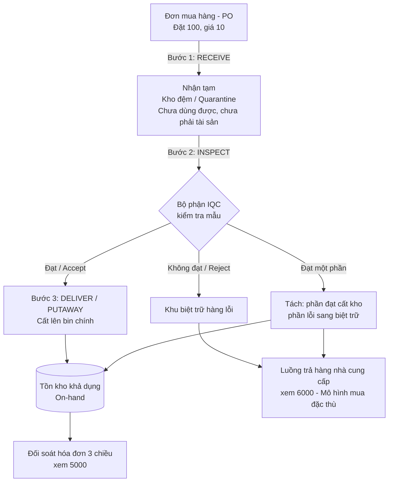

# 4000 Nhận hàng & kiểm tra chất lượng

Nhận hàng là điểm giao nhau giữa **giấy tờ (PO)** và **hàng thật**. Đây cũng là nơi phát sinh phần lớn sai lệch tồn kho và sai lệch công nợ về sau, vì con số ghi nhận tại bước này là căn cứ để kế toán đối soát hóa đơn (xem [5000 - Đối soát hóa đơn & 3-Way Match](./5000-doi-soat-hoa-don-va-3-way-match.md)).

---

## 0. Nguyên lý (áp dụng mọi ERP)

1. **Hàng nhận về chưa phải hàng sử dụng được.** Giữa "xe hàng đã tới cổng" và "hàng đã được phép cấp cho sản xuất/bán" có một bước trung gian bắt buộc: kiểm tra chất lượng. Hệ thống nào chưa tách được hai trạng thái này (nhận được / dùng được) sẽ luôn có tồn kho ảo.
2. **Số lượng nhận phải độc lập với số lượng đặt.** PO nói ý định mua; phiếu nhận nói thực tế giao. Hệ thống bắt buộc lưu cả hai con số và cho phép chênh lệch **có kiểm soát** (dung sai nhận thừa/thiếu), không bao giờ ép nhận đúng bằng PO.
3. **Chỉ hàng đạt chất lượng mới được tính vào giá trị tài sản.** Hàng chờ kiểm và hàng bị loại không phải là tài sản sẵn sàng sử dụng, kể cả khi đã nằm trong kho vật lý của doanh nghiệp.
4. **Nhận hàng là sự kiện kế toán, không chỉ sự kiện kho.** Ngay khi hàng đạt được nhập kho chính thức, doanh nghiệp phát sinh nghĩa vụ phải trả — dù hóa đơn chưa về. Nguyên lý tài khoản trung gian được định nghĩa duy nhất tại [1000 - Hạch toán & tài khoản trung gian](../6-ke-toan-chung/1000-hach-toan-va-tai-khoan-trung-gian.md).
5. **Không có nhận hàng thì không có đối soát.** Hóa đơn đến trước khi hàng về là bình thường trong thực tế; hệ thống phải cho phép "treo" hóa đơn chờ nhận hàng, chứ không được từ chối hẳn.

## 1. Luồng vận hành



## 2. Ai làm gì ở module nào

| Bước | Mua hàng (PO) | Kho (INV) | Sản xuất (MFG) | Bán hàng (OM) | Kế toán (AP/GL) |
|---|---|---|---|---|---|
| Lập PO, xác định dung sai nhận | ✅ tạo PO, khai báo over-receipt tolerance | — | — | — | — |
| Bước 1 — Receive | Xem tiến độ nhận trên dòng PO | ✅ tạo phiếu nhận, ghi số lượng thực giao | — | — | Ghi nhận hàng đang đi đường (nếu bật) |
| Bước 2 — Inspect | Xem kết quả, không sửa số lượng | ✅ cập nhật trạng thái bin | ✅ tiêu thụ quy tắc kiểm tra theo vật tư | — | — |
| Bước 3 — Deliver | Dòng PO chuyển "đã nhận đủ / nhận một phần" | ✅ tăng On-hand, ghi giao dịch kho | ✅ vật tư mới hiện trong danh sách khả dụng | — | ✅ sinh bút toán tăng tài sản + công nợ trung gian |
| Hàng lỗi | Buyer làm việc với NCC | ✅ xuất sang khu biệt trữ | — | — | Chưa ghi nhận công nợ cho phần lỗi |
| Đối soát hóa đơn | ✅ duyệt sai lệch | Cung cấp số lượng đã nhận | — | — | ✅ chạy 3-way match |

**Nguyên tắc chia việc:** chỉ **Kho** được ghi số lượng thực nhận; chỉ **Mua hàng** được sửa PO; chỉ **Kế toán** được ghi công nợ. Ba vai trò không chồng lấn — xem [5000 - Kiểm soát nội bộ & phân tách nhiệm vụ](../0-nen-tang/4000-kiem-soat-noi-bo-va-phan-tach-nhiem-vu.md).

## 3. Hạch toán

Bài này **không định nghĩa lại tài khoản**. Toàn bộ bút toán nhận hàng (tăng tồn kho, ghi công nợ trung gian, chênh lệch giá mua khi dùng giá tiêu chuẩn) được định nghĩa duy nhất tại:

- [1000 - Hạch toán & tài khoản trung gian](../6-ke-toan-chung/1000-hach-toan-va-tai-khoan-trung-gian.md) — bản đồ tài khoản và nguyên tắc tất toán.
- [2000 - Giá vốn & định giá tồn kho](../6-ke-toan-chung/2000-gia-von-va-dinh-gia-ton-kho.md) — trường hợp nhận hàng theo giá tiêu chuẩn (Standard Cost).

Điểm cần nhớ khi triển khai: bút toán chỉ phát sinh ở **bước 3 (Deliver)** cho phần hàng **đạt**, không phát sinh ở bước 1 và không phát sinh cho phần bị loại.

## 4. Điểm chạm & rủi ro

- **Sang đối soát hóa đơn:** số lượng đối soát 3 chiều là số lượng **đã Deliver**, không phải số lượng nhận tạm → [5000](./5000-doi-soat-hoa-don-va-3-way-match.md).
- **Sang AP:** phần hàng đã nhận nhưng chưa có hóa đơn nằm ở tài khoản trung gian → [AP 1000](../5-cong-no/ap/1000-ap-nguyen-ly-va-tai-khoan.md).
- **Sang sản xuất:** vật tư chỉ khả dụng sau Deliver → bước cấp phát [SX 6000](../3-san-xuat/thuc-thi/6000-lenh-san-xuat-va-wip.md).
- **Rủi ro chính:** (1) nhận 1 bước làm hàng lỗi lọt vào sản xuất; (2) over-receipt không kiểm soát làm hóa đơn không khớp PO; (3) hàng kẹt ở kho đệm quá lâu làm tồn kho khả dụng thấp hơn thực tế.

## 5. Triển khai tham chiếu ERP

### A. Bảng ánh xạ khái niệm

| Khái niệm nghiệp vụ | Oracle EBS R12 | Epicor ERP | SAP S/4HANA | Odoo |
|---|---|---|---|---|
| Quy trình nhận 3 bước | Receiving Routing = `Inspection Required` | `Inspection Required` trên Part/Vendor | Movement Type 103 → 105 | 3-Step Receipt (Input → Quality → Stock) |
| Kho đệm | Receiving Subinventory | Inspection Warehouse / Quarantine | Blocked Stock (non-valuated) | Input / Quality Location |
| Kiểm tra chất lượng | `Receiving > Inspections` | `Inspection Processing` | Quality Usage Decision | Quality Control Point |
| Cất hàng (Deliver) | `Receiving Transactions` | `Inspection Processing` → Putaway | Movement Type 105 | Chuyển Input → Stock |
| Dung sai nhận thừa | `Purchasing Options > Qty Received Tolerance` | `PO Receipt Tolerance` | `Overdelivery Tolerance` trên PO/Info Record | Cần tùy biến |

### B. Oracle EBS R12 — luồng thao tác

1. **Bật yêu cầu kiểm tra theo vật tư:** `Inventory > Items > Master Items > tab Receiving` → `Receiving Routing = Inspection Required`.
2. **Nhận tạm:** `Purchasing > Receiving > Receipts` → chọn PO, nhập số lượng thực giao. Hàng nằm ở `Receiving Subinventory`.
3. **Nhập kết quả kiểm:** `Purchasing > Receiving > Inspections` → `Accept` / `Reject` theo số lượng.
4. **Cất kho:** `Purchasing > Receiving > Receiving Transactions` → chọn dòng `Accept`, chỉ định Subinventory + Locator.

> Lưu ý: bút toán và cập nhật On-hand chỉ xảy ra sau bước 4 (`DELIVER`), không phải bước 2 (`RECEIVE`).

### C. Epicor ERP — luồng thao tác

1. `Part Maintenance` / `Vendor Maintenance` → bật `Inspection Required`.
2. `Material Management > Purchase Management > General Operations > Purchase Order Receipt Entry` → tạo `PackSlip`; dòng yêu cầu kiểm sẽ có `Inspection Pending = 1`.
3. `Inspection Processing` → nhập `Pass` / `Fail`; phần `Pass` được cất vào Warehouse/Bin chính.

### D. Truy vấn kiểm soát (SQL)

**Epicor — hàng kẹt ở khu kiểm quá 5 ngày:**

```sql
SELECT rd.PONum, rd.PartNum, rd.OurQty, rd.ReceiptDate,
       DATEDIFF(DAY, rd.ReceiptDate, GETDATE()) AS DaysWaitingQc,
       pb.WarehouseCode, pb.BinNum
FROM Erp.RcvDtl rd
JOIN Erp.PartBin pb ON rd.Company = pb.Company AND rd.PartNum = pb.PartNum
WHERE rd.InspectionReq = 1
  AND pb.BinNum LIKE 'INSP%'
  AND DATEDIFF(DAY, rd.ReceiptDate, GETDATE()) > 5
ORDER BY DaysWaitingQc DESC;
```

**Oracle EBS — dòng nhận hàng chưa được Accept/Reject/Deliver:**

```sql
SELECT pha.segment1 AS po_number, msi.segment1 AS item_code,
       rt.quantity AS received_qty, rt.transaction_date,
       ROUND(SYSDATE - rt.transaction_date) AS days_waiting_qc,
       rt.subinventory AS warehouse
FROM rcv_transactions rt
JOIN rcv_shipment_lines rsl ON rt.shipment_line_id = rsl.shipment_line_id
JOIN po_headers_all pha ON rsl.po_header_id = pha.po_header_id
JOIN mtl_system_items_b msi ON rsl.item_id = msi.inventory_item_id
                            AND rsl.to_organization_id = msi.organization_id
WHERE rt.transaction_type = 'RECEIVE'
  AND NOT EXISTS (
      SELECT 1 FROM rcv_transactions rt2
      WHERE rt2.parent_transaction_id = rt.transaction_id
        AND rt2.transaction_type IN ('ACCEPT', 'REJECT', 'DELIVER')
  )
  AND (SYSDATE - rt.transaction_date) > 5
ORDER BY days_waiting_qc DESC;
```

## 6. Bẫy thực chiến & Checklist

| # | Bẫy | Triệu chứng | Cách phòng tránh |
|---|---|---|---|
| 1 | Gộp nhận hàng 1 bước | QC phát hiện lỗi sau khi sản xuất đã dùng → phải lập phiếu xuất trả ngược, sổ kho rối | Tách 3 bước, kho đệm **không** tính vào On-hand |
| 2 | Cộng On-hand ngay khi Receive | Báo cáo tồn kho cao hơn hàng thực dùng được | Chỉ cộng On-hand ở bước Deliver |
| 3 | Nhận thừa không chặn | Hóa đơn 105 cái không khớp PO 100 cái → khóa thanh toán hàng loạt | Bật dung sai nhận thừa + người duyệt vượt dung sai |
| 4 | Hàng lỗi vẫn ghi tăng tài sản | Giá trị tồn kho bị thổi phồng, công nợ phải trả sai | Chỉ ghi tài sản cho phần Accept |
| 5 | Hóa đơn về trước hàng | Kế toán không nhập được hóa đơn, dồn việc cuối kỳ | Cho phép trạng thái "chờ nhận hàng" cho hóa đơn |
| 6 | Sửa số lượng nhận trực tiếp trên PO | Mất dấu vết số lượng thực giao | PO chỉ đọc; điều chỉnh bằng phiếu nhận/giao dịch kho |

**Checklist trước khi go-live:**

- [ ] Đã xác định danh sách mặt hàng bắt buộc IQC (không phải 100% mặt hàng).
- [ ] Kho đệm/quarantine đã được loại khỏi báo cáo On-hand và MRP.
- [ ] Đã khai báo dung sai nhận thừa/thiếu và người có quyền duyệt vượt.
- [ ] Đã chạy thử 1 PO với kịch bản: nhận thiếu → nhận bù → 1 dòng bị reject → xác nhận hóa đơn chỉ khớp phần Accept.
- [ ] Đã kiểm tra bút toán chỉ phát sinh ở bước Deliver (không phát sinh ở Receive).

## Xem thêm

- [1000 - Hạch toán & tài khoản trung gian](../6-ke-toan-chung/1000-hach-toan-va-tai-khoan-trung-gian.md)
- [3000 - Đơn mua hàng](./3000-don-mua-hang.md)
- [5000 - Đối soát hóa đơn & 3-Way Match](./5000-doi-soat-hoa-don-va-3-way-match.md)
- [6000 - Mô hình mua đặc thù (trả hàng NCC)](./6000-mo-hinh-mua-dac-thu.md)
- [AP 1000 - Nguyên lý & tài khoản](../5-cong-no/ap/1000-ap-nguyen-ly-va-tai-khoan.md)

<div align="center" style={{color: 'var(--ifm-color-primary)'}}>
  <strong>Chúc các bạn thành công và vui vẻ!</strong>
</div>
