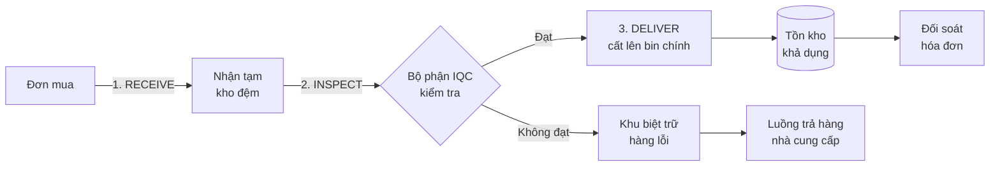

# 4000 Nhận hàng & kiểm tra chất lượng

Nhận hàng là điểm giao nhau giữa **giấy tờ (PO)** và **hàng thật**. Đây cũng là nơi phát sinh phần lớn sai lệch tồn kho và sai lệch công nợ về sau, vì con số ghi nhận tại bước này là căn cứ để kế toán đối soát hóa đơn (xem [5000 - Đối soát hóa đơn & 3-Way Match](./5000-doi-soat-hoa-don-va-3-way-match.md)).

Đây là **bài gốc** của quy trình nhận hàng 3 bước. Cơ chế ghi sổ kho nằm ở [Kho 3000](../1-kho/3000-giao-dich-nhap-xuat-chuyen.md); bản đồ tài khoản nằm ở [Kế toán 1000](../6-ke-toan-chung/1000-hach-toan-va-tai-khoan-trung-gian.md). Bài này chỉ mô tả sự kiện nghiệp vụ, vai trò và quy tắc kiểm soát.

**Thuật ngữ dùng trong bài:** quy trình gồm **Nhận → Kiểm → Nhập kho (cất)**. Oracle EBS gọi lần lượt là Receive / Inspect / Deliver; thuật ngữ này xuất hiện trong phần tham chiếu ERP.

---

## 0. Nguyên lý (áp dụng mọi ERP)

1. **Hàng nhận về chưa phải hàng dùng được.** Giữa "xe hàng đã tới cổng" và "hàng đã được phép cấp cho sản xuất hoặc bán" có một bước trung gian bắt buộc với những mặt hàng cần kiểm: kiểm tra chất lượng. Hệ thống phải tách được hai trạng thái *đã nhận* và *khả dụng*; nếu không sẽ luôn có tồn kho ảo.
2. **Khả dụng và giá trị là hai câu hỏi khác nhau.**
   - **Khả dụng:** hàng chờ kiểm và hàng bị loại **không** được tính vào tồn khả dụng, không được MRP, sản xuất hay bán hàng sử dụng.
   - **Giá trị:** hàng chờ kiểm vẫn là tài sản của doanh nghiệp (đã sở hữu, đã nằm trong kho). Nó được ghi nhận từ lúc nhận hay từ lúc nhập kho là **chọn lựa cấu hình**, xem mục 3. Chỉ phần **bị loại** mới không được coi là tài sản sẵn sàng sử dụng.
3. **Số lượng nhận phải độc lập với số lượng đặt.** PO nói ý định mua; phiếu nhận nói thực tế giao. Hệ thống lưu cả hai và cho phép chênh lệch **có kiểm soát** (dung sai nhận thừa/thiếu), không bao giờ ép nhận đúng bằng PO.
4. **Nhận hàng là sự kiện kế toán, không chỉ sự kiện kho.** Khi hàng được ghi nhận, doanh nghiệp phát sinh nghĩa vụ phải trả dù hóa đơn chưa về. Nguyên lý tài khoản trung gian định nghĩa duy nhất tại [Kế toán 1000](../6-ke-toan-chung/1000-hach-toan-va-tai-khoan-trung-gian.md).
5. **Không phải mặt hàng nào cũng cần 3 bước.** Chỉ những mặt hàng có yêu cầu kiểm (theo vật tư, nhà cung cấp hoặc rủi ro) mới đi qua khu chờ kiểm. Các mặt hàng còn lại nhận thẳng vào kho. Ép 100% mặt hàng đi 3 bước làm kẹt khu chờ kiểm và nhân đôi thao tác vô ích.
6. **Không có nhận hàng thì không có đối soát,** nhưng hóa đơn đến trước hàng là chuyện bình thường. Hệ thống phải cho phép "treo" hóa đơn chờ nhận hàng, không được từ chối hẳn.
7. **Phiếu nhận sai không được sửa trực tiếp.** Sửa bằng giao dịch đảo hoặc điều chỉnh có chứng từ, theo nguyên tắc append-only ở [Kho 3000](../1-kho/3000-giao-dich-nhap-xuat-chuyen.md).

## 1. Luồng vận hành



### 1.1 Xử lý hàng không đạt

Hàng không đạt không chỉ có một đường "trả nhà cung cấp":

| Phương án | Khi nào dùng | Điểm kiểm soát |
|---|---|---|
| **Trả nhà cung cấp (RTV)** | Lỗi nặng, nhà cung cấp chấp nhận nhận lại | Lập phiếu trả, giao dịch kho xuất `khu biệt trữ → SUPPLIER`; xem [6000](./6000-mo-hinh-mua-dac-thu.md) |
| **Đặc cách sử dụng (use-as-is / waiver)** | Lỗi nhẹ, vẫn dùng được cho mục đích cụ thể | QC, mua hàng (hoặc kỹ thuật) cùng phê duyệt; ghi lý do và gắn lô để truy vết |
| **Chọn lọc / tái gia công** | Lô có tỷ lệ lỗi cục bộ | Xác định ai chịu chi phí (nội bộ hay đòi NCC); kiểm lại sau khi xử lý |
| **Huỷ / phế** | Không dùng được, không trả được | Có chứng từ huỷ, phê duyệt, và xác định có đòi bồi thường không |

### 1.2 Các tình huống nhận đặc biệt

- **Nhận không có PO (blind receipt):** chỉ cho phép với nhóm hàng và người có quyền; phiếu nhận phải được gắn PO sau đó, nếu không sẽ không đối soát được.
- **Nhận theo thông báo giao hàng (ASN):** ASN giúp điền sẵn phiếu nhận, nhưng số lượng ghi sổ vẫn là số thực đếm.
- **Nhận thiếu và đóng dòng PO:** nhận thiếu có thể chờ giao bù hoặc đóng dòng. Đóng dòng là quyết định của Mua hàng, không phải của Kho.
- **Lô, hạn dùng, serial, chứng nhận chất lượng (COA):** thu thập ngay tại bước Nhận để không phải đoán lại về sau. Thiết lập theo vật tư xem [Kho 2000](../1-kho/2000-item-master-va-thuoc-tinh-kho.md).
- **Khác đơn vị tính:** đơn vị mua khác đơn vị kho thì quy đổi ngay khi nhận theo [Nền tảng 5000](../0-nen-tang/5000-nguyen-ly-quy-doi-uom.md); không tự quy đổi bằng tay ở phiếu nhận.
- **Sửa phiếu nhận sai:** dùng giao dịch đảo hoặc trả hàng (return/correct), không sửa trực tiếp số lượng.
- **Cắt kỳ (cut-off):** cuối kỳ luôn có hàng đã nhận nhưng chưa kiểm hoặc chưa có hóa đơn. Danh sách này phải được chốt và chuyển cho kế toán, xem [Kế toán 5000](../6-ke-toan-chung/5000-dong-ky-va-doi-soat-so-phu.md).

## 2. Ai làm gì ở module nào

| Bước | Mua hàng (PO) | Kho | QC | Kế toán (AP/GL) |
|---|---|---|---|---|
| Lập PO, xác định dung sai nhận | ✅ tạo PO, khai báo dung sai nhận thừa/thiếu | — | — | — |
| **Bước 1 - Nhận** | Xem tiến độ nhận trên dòng PO | ✅ lập phiếu nhận, ghi số lượng thực giao, lô, hạn | — | Nhận bút toán ghi nhận hàng và công nợ trung gian, **nếu** cấu hình ghi nhận khi nhận |
| **Bước 2 - Kiểm** | Xem kết quả, không sửa số lượng | ✅ di chuyển hàng theo quyết định của QC | ✅ kiểm và ra quyết định (đạt / không đạt / đặc cách) | — |
| **Bước 3 - Nhập kho** | Dòng PO chuyển "đã nhận đủ / một phần" (do hệ thống cập nhật) | ✅ cất lên bin chính, tăng tồn khả dụng | — | ✅ nhận bút toán chuyển từ hàng chờ kiểm sang tồn kho (hoặc bút toán đầy đủ nếu ghi nhận khi nhập kho) |
| **Hàng lỗi** | ✅ làm việc với NCC, duyệt phương án xử lý | ✅ di chuyển sang biệt trữ, thực hiện trả hàng | ✅ quyết định mức độ lỗi và phương án | Đảo hoặc điều chỉnh công nợ cho phần trả / huỷ |
| **Đối soát hóa đơn** | ✅ duyệt sai lệch | Cung cấp số lượng đã nhận | — | ✅ chạy 3-way match |

**Nguyên tắc chia việc:**

- **Kho** ghi số lượng thực nhận và thực hiện di chuyển; **QC** quyết định chất lượng; **Mua hàng** quyết định nội dung đơn đặt và xử lý nhà cung cấp; **Kế toán** ghi công nợ và duyệt hạch toán.
- Trên PO, số lượng đã nhận là trường **do hệ thống cập nhật** từ phiếu nhận; không ai nhập tay vào đó.
- Một người không được vừa lập PO, vừa nhận hàng, vừa duyệt hóa đơn. Chi tiết tại [Nền tảng 4000](../0-nen-tang/4000-kiem-soat-noi-bo-va-phan-tach-nhiem-vu.md).

Sản xuất và bán hàng không có vai trò trong bài này; họ chỉ **tiêu thụ kết quả**: vật tư chỉ khả dụng sau khi qua bước Nhập kho.

## 3. Hạch toán

Bài này **không định nghĩa lại tài khoản**. Bản đồ tài khoản, nguyên tắc tất toán và chênh lệch giá mua nằm tại:

- [Kế toán 1000 - Hạch toán & tài khoản trung gian](../6-ke-toan-chung/1000-hach-toan-va-tai-khoan-trung-gian.md)
- [Kế toán 2000 - Giá vốn & định giá tồn kho](../6-ke-toan-chung/2000-gia-von-va-dinh-gia-ton-kho.md) (nhận hàng theo giá tiêu chuẩn)

**Điểm cần chốt khi triển khai: ghi nhận khi nhận hay khi nhập kho.** Hai cấu hình phổ biến:

| | Cấu hình A: ghi nhận khi nhận | Cấu hình B: ghi nhận khi nhập kho |
|---|---|---|
| **Bước 1 - Nhận** | Có bút toán: ghi nhận hàng (ở tài khoản hàng chờ kiểm) và công nợ trung gian | Không có bút toán |
| **Bước 3 - Nhập kho** | Bút toán chuyển từ tài khoản hàng chờ kiểm sang tồn kho | Bút toán tồn kho + công nợ trung gian |
| **Hàng bị loại / trả NCC** | Đảo phần đã ghi nhận ở bước 1 | Không có gì để đảo cho phần chưa nhập kho |
| **Phù hợp khi** | Thời gian chờ kiểm dài, giá trị lớn, cần phản ánh nghĩa vụ phải trả sớm | Thời gian chờ kiểm ngắn, muốn giữ sổ đơn giản |
| **Rủi ro** | Phải quản lý tài khoản hàng chờ kiểm và đối soát nó cuối kỳ | Hàng đã nhận chưa nhập kho cuối kỳ không có trong sổ, cần bút toán cắt kỳ |

Quy tắc chung cho cả hai cấu hình:

- Cấu hình phải được **chọn một lần, thống nhất với kế toán** và ghi vào tài liệu thiết kế; không cho mỗi kho tự chọn.
- Hàng chờ kiểm và hàng bị loại **không khả dụng** dù có được ghi nhận về giá trị hay không.
- Bút toán **tồn kho** (tài khoản tồn kho khả dụng) chỉ phát sinh ở bước Nhập kho; bút toán công nợ trung gian có thể phát sinh sớm hơn tùy cấu hình.
- Hàng đặc cách được nhập kho như hàng đạt nhưng phải ghi lý do và lô để truy vết.

## 4. Điểm chạm & rủi ro

- **Sang giao dịch kho:** bước Nhận là giao dịch nhập `SUPPLIER → khu chờ kiểm`; bước Nhập kho là giao dịch chuyển `khu chờ kiểm → bin chính`. Với mặt hàng không cần kiểm, hai bước gộp thành một giao dịch `SUPPLIER → bin`. Cơ chế ghi sổ xem [Kho 3000](../1-kho/3000-giao-dich-nhap-xuat-chuyen.md); cấu trúc khu vực và bin xem [Kho 1000](../1-kho/1000-cau-truc-kho-va-vi-tri.md).
- **Sang lô / serial:** thông tin lô, hạn dùng, serial thu thập ở bước Nhận → [Kho 2000](../1-kho/2000-item-master-va-thuoc-tinh-kho.md).
- **Sang đối soát hóa đơn:** số lượng dùng để đối soát 3 chiều là số lượng đã **nhập kho** (hoặc đã nhận, tùy cấu hình ở mục 3) và phải thống nhất với bài [5000](./5000-doi-soat-hoa-don-va-3-way-match.md).
- **Sang AP:** phần hàng đã nhận nhưng chưa có hóa đơn nằm ở tài khoản trung gian → [AP 1000](../5-cong-no/ap/1000-ap-nguyen-ly-va-tai-khoan.md).
- **Sang sản xuất:** vật tư chỉ khả dụng sau bước Nhập kho → [SX 6000](../3-san-xuat/thuc-thi/6000-lenh-san-xuat-va-wip.md).
- **Sang đóng kỳ:** danh sách hàng nhận chưa kiểm, chưa nhập kho, chưa hóa đơn → [Kế toán 5000](../6-ke-toan-chung/5000-dong-ky-va-doi-soat-so-phu.md).

**Rủi ro chính:** (1) hàng cần kiểm mà nhận 1 bước, hàng lỗi lọt vào sản xuất; (2) ép mọi mặt hàng qua 3 bước làm kẹt khu chờ kiểm; (3) nhận thừa không kiểm soát làm hóa đơn không khớp PO; (4) hàng kẹt ở khu chờ kiểm hoặc đã đạt nhưng chưa nhập kho quá lâu làm tồn khả dụng thấp hơn thực tế; (5) cấu hình ghi nhận không thống nhất với kế toán, dẫn tới lệch khi đối soát cuối kỳ.

## 5. Triển khai tham chiếu ERP

> **Lưu ý:** tên màn hình, đường dẫn menu và mã loại giao dịch thay đổi theo phiên bản và cấu hình. Các ô đánh dấu `*` là chỗ cần xác nhận trên hệ thống thật trước khi đưa vào thiết kế.

### A. Bảng ánh xạ khái niệm

| Khái niệm nghiệp vụ | Oracle EBS R12 | Epicor ERP | SAP S/4HANA | Odoo |
|---|---|---|---|---|
| Quy trình nhận 3 bước | Receiving Routing: Standard / **Inspection Required** / Direct Delivery. Giao dịch Receive → Accept/Reject → Deliver | Cờ `Inspection Required` trên Part / Vendor `*` | **Cơ chế 1 (nhập hàng chờ giải phóng):** movement `103` rồi `105`. **Cơ chế 2 (QM):** nhập `101` kèm lô kiểm tra, quyết định sử dụng rồi chuyển bằng `321` | Receipt 3 bước: Input → Quality → Stock |
| Khu chờ kiểm | Receiving Inspection (khu nhận, ngoài subinventory thường) `*` | Kho/bin kiểm tra riêng `*` | Cơ chế 1: GR blocked stock (**không định giá**). Cơ chế 2: stock in quality inspection (**có định giá**) | Vị trí Input / Quality |
| Kiểm tra chất lượng | `Receiving > Inspections` | `Inspection Processing` | Quality Management: inspection lot và usage decision | Quality Control Point (module Quality) `*` |
| Nhập kho (cất) | Deliver trong `Receiving Transactions` | Chuyển từ khu kiểm sang bin chính trong `Inspection Processing` `*` | `105` (cơ chế 1) hoặc `321` (cơ chế 2) | Chuyển Input/Quality → Stock |
| Dung sai nhận thừa | Receipt tolerance trên PO / tùy chọn nhận hàng `*` | Tolerance trên PO Release/Receipt `*` | Overdelivery tolerance trên dòng PO / info record | Không có dung sai chuẩn, cần tùy biến |
| Hàng chờ kiểm có định giá không | Có, ghi ở tài khoản kiểm nhập khi cấu hình ghi nhận khi nhận | Tùy cấu hình `*` | Khác nhau theo cơ chế (xem dòng trên) | Theo chế độ định giá của vị trí |

Điểm cần lưu ý ở SAP: hai cơ chế trên **không thay thế nhau**. Cơ chế 1 chỉ dùng "chặn" hàng cho tới khi giải phóng, hàng chưa được định giá. Cơ chế 2 dùng module QM, hàng đã được định giá nhưng bị khóa khả dụng.

### B. Oracle EBS R12 — luồng thao tác tham khảo

1. **Bật yêu cầu kiểm:** Receiving Routing có thể đặt ở nhiều cấp (tổ chức, nhà cung cấp, vật tư, dòng PO). Cần xác định cấp nào thắng khi các cấp mâu thuẫn và đặt cùng một chính sách cho toàn dự án `*`.
2. **Nhận:** `Receiving > Receipts` → chọn PO, nhập số lượng thực giao. Hàng ở khu nhận, chưa vào subinventory.
3. **Kiểm:** `Receiving > Inspections` → `Accept` / `Reject` theo số lượng.
4. **Nhập kho:** `Receiving > Receiving Transactions` → chọn dòng đã `Accept`, chỉ định Subinventory và Locator (Deliver).

> Tồn khả dụng chỉ tăng sau bước Deliver. Bút toán tài khoản kiểm nhập có thể phát sinh từ bước Receive nếu bật ghi nhận khi nhận.

### C. Epicor ERP — luồng thao tác tham khảo

1. `Part Maintenance` / `Vendor Maintenance` → bật yêu cầu kiểm `*`.
2. `Purchase Order Receipt Entry` → tạo phiếu nhận (`PackSlip`); dòng yêu cầu kiểm được đánh dấu chờ kiểm `*`.
3. `Inspection Processing` → nhập `Pass` / `Fail`; phần `Pass` cất vào kho và bin chính.

### D. Truy vấn kiểm soát

Các truy vấn dưới đây dùng **lược đồ giả định** của hệ thống tự xây, để minh họa logic theo **số lượng** (không theo sự tồn tại của dòng). Với Oracle, SAP, Epicor hãy ưu tiên báo cáo chuẩn của hệ thống (báo cáo hàng chờ nhận, hàng đã nhận chưa hóa đơn), hoặc áp cùng logic trừ số lượng trên bảng giao dịch của chính hệ thống đó.

```sql
/* Lược đồ giả định:
   Receipt_Line(Receipt_Line_ID, PO_Num, PO_Line, Item_ID, Qty_Received, Receipt_Date, Needs_QC)
   QC_Result(Receipt_Line_ID, Qty_Accepted, Qty_Rejected, Decision_Date)
   Putaway(Receipt_Line_ID, Qty_Putaway, Putaway_Date)
   Invoice_Match(Receipt_Line_ID, Qty_Invoiced) */
```

**1. Hàng chờ kiểm quá 5 ngày (chưa có đủ quyết định QC):**

```sql
SELECT r.Receipt_Line_ID, r.PO_Num, r.PO_Line, r.Item_ID,
       r.Qty_Received - ISNULL(SUM(q.Qty_Accepted + q.Qty_Rejected), 0) AS Qty_Pending_QC,
       DATEDIFF(DAY, r.Receipt_Date, GETDATE()) AS Days_Waiting
FROM Receipt_Line r
LEFT JOIN QC_Result q ON q.Receipt_Line_ID = r.Receipt_Line_ID
WHERE r.Needs_QC = 1
GROUP BY r.Receipt_Line_ID, r.PO_Num, r.PO_Line, r.Item_ID, r.Qty_Received, r.Receipt_Date
HAVING r.Qty_Received - ISNULL(SUM(q.Qty_Accepted + q.Qty_Rejected), 0) > 0
   AND DATEDIFF(DAY, r.Receipt_Date, GETDATE()) > 5
ORDER BY Days_Waiting DESC;
```

**2. Hàng đã đạt nhưng chưa nhập kho (kẹt sau kiểm):**

```sql
SELECT r.Receipt_Line_ID, r.PO_Num, r.Item_ID,
       q.Accepted_Total - ISNULL(p.Putaway_Total, 0) AS Qty_Accepted_Not_Putaway
FROM Receipt_Line r
JOIN (SELECT Receipt_Line_ID, SUM(Qty_Accepted) AS Accepted_Total, MAX(Decision_Date) AS Last_Decision
      FROM QC_Result GROUP BY Receipt_Line_ID) q ON q.Receipt_Line_ID = r.Receipt_Line_ID
LEFT JOIN (SELECT Receipt_Line_ID, SUM(Qty_Putaway) AS Putaway_Total
           FROM Putaway GROUP BY Receipt_Line_ID) p ON p.Receipt_Line_ID = r.Receipt_Line_ID
WHERE q.Accepted_Total - ISNULL(p.Putaway_Total, 0) > 0
  AND DATEDIFF(DAY, q.Last_Decision, GETDATE()) > 2;
```

**3. Cắt kỳ: hàng đã nhận chưa có hóa đơn tại ngày cuối kỳ:**

```sql
DECLARE @CutOff DATE = '2026-10-31';  -- ngày cuối kỳ
SELECT r.Receipt_Line_ID, r.PO_Num, r.Item_ID,
       r.Qty_Received - ISNULL(SUM(i.Qty_Invoiced), 0) AS Qty_Received_Not_Invoiced
FROM Receipt_Line r
LEFT JOIN Invoice_Match i ON i.Receipt_Line_ID = r.Receipt_Line_ID
WHERE r.Receipt_Date <= @CutOff
GROUP BY r.Receipt_Line_ID, r.PO_Num, r.Item_ID, r.Qty_Received
HAVING r.Qty_Received - ISNULL(SUM(i.Qty_Invoiced), 0) > 0;
```

> Với truy vấn số 3 trên hệ thống thật, cần lọc theo ngày hóa đơn (không chỉ tổng hóa đơn đến hôm nay) để tái hiện đúng trạng thái tại ngày cắt kỳ.

## 6. Bẫy thực chiến & Checklist

| # | Bẫy | Triệu chứng | Cách phòng tránh |
|---|---|---|---|
| 1 | Hàng cần IQC mà nhận 1 bước | QC phát hiện lỗi sau khi sản xuất đã dùng → phải lập phiếu xuất trả ngược, sổ kho rối | Gắn yêu cầu kiểm theo vật tư / nhà cung cấp; khu chờ kiểm **không** vào tồn khả dụng |
| 2 | Ép mọi mặt hàng qua 3 bước | Khu chờ kiểm đầy hàng, thao tác thừa, sản xuất thiếu vật tư dù hàng đã về | Chỉ nhóm hàng có rủi ro mới cần kiểm; nhóm còn lại nhận thẳng |
| 3 | Cộng vào tồn khả dụng ngay khi Nhận | Báo cáo tồn khả dụng cao hơn hàng thực dùng được; MRP không đặt thêm | Hàng chờ kiểm chỉ hiện ở báo cáo riêng, không tính vào tồn khả dụng |
| 4 | Nhận thừa không chặn | Hóa đơn 105 cái không khớp PO 100 cái → khóa thanh toán hàng loạt | Bật dung sai nhận thừa + người duyệt vượt dung sai |
| 5 | Hàng bị loại vẫn tính là tồn kho dùng được | Giá trị tồn kho phồng, công nợ phải trả sai | Hàng loại ở khu biệt trữ, xử lý theo mục 1.1, không vào tồn khả dụng |
| 6 | Cấu hình ghi nhận khi nhận / khi nhập kho không thống nhất với kế toán | Lệch tài khoản trung gian và tài khoản hàng chờ kiểm cuối kỳ | Chọn một cấu hình, ghi vào tài liệu thiết kế, kế toán ký duyệt |
| 7 | Hóa đơn về trước hàng | Kế toán không nhập được hóa đơn, dồn việc cuối kỳ | Cho phép trạng thái "chờ nhận hàng" cho hóa đơn |
| 8 | Cho nhập tay số lượng đã nhận trên PO | Mất dấu vết số lượng thực giao | Số lượng đã nhận chỉ do hệ thống cập nhật từ phiếu nhận |
| 9 | Hàng đặc cách không ghi lý do và lô | Không truy vết được khi lỗi tái diễn | Bắt buộc lý do, người duyệt và lô cho hàng đặc cách |
| 10 | Nhận không PO không được gắn lại | Hàng nằm trong kho nhưng không đối soát được | Blind receipt phải được gắn PO trong thời hạn quy định, có báo cáo tồn đọng |
| 11 | Sửa phiếu nhận sai bằng cách ghi đè | Mất audit trail | Dùng giao dịch đảo hoặc trả hàng theo [Kho 3000](../1-kho/3000-giao-dich-nhap-xuat-chuyen.md) |

**Checklist trước khi go-live:**

- [ ] Đã xác định danh sách mặt hàng / nhà cung cấp bắt buộc IQC (không phải 100% mặt hàng) và quy tắc ưu tiên khi các cấp cấu hình mâu thuẫn.
- [ ] Khu chờ kiểm và khu biệt trữ đã được loại khỏi tồn khả dụng và MRP, nhưng vẫn xuất hiện ở báo cáo hàng chờ kiểm.
- [ ] Đã chốt cấu hình ghi nhận (khi nhận hay khi nhập kho) và được kế toán duyệt, khớp với [Kế toán 1000](../6-ke-toan-chung/1000-hach-toan-va-tai-khoan-trung-gian.md).
- [ ] Đã khai báo dung sai nhận thừa/thiếu và người có quyền duyệt vượt.
- [ ] Đã khai báo các phương án xử lý hàng lỗi (trả, đặc cách, chọn lọc, huỷ) và người có quyền duyệt từng phương án.
- [ ] Lô, hạn dùng, serial được thu thập ở bước Nhận cho các mặt hàng có quản lý lô / serial.
- [ ] Có báo cáo hàng chờ kiểm quá hạn, hàng đã đạt chưa nhập kho, hàng đã nhận chưa hóa đơn.
- [ ] Đã chạy thử 1 PO theo kịch bản: nhận thiếu → nhận bù → 1 dòng đạt một phần (một phần reject) → nhập kho phần đạt → xác nhận hóa đơn chỉ khớp phần đạt.
- [ ] Đã kiểm tra bút toán phát sinh đúng thời điểm theo cấu hình đã chọn, và hàng bị loại không làm tăng tồn kho khả dụng.

## Xem thêm

- [Kho 3000 - Giao dịch nhập, xuất & chuyển kho](../1-kho/3000-giao-dich-nhap-xuat-chuyen.md)
- [Kho 1000 - Cấu trúc kho & vị trí](../1-kho/1000-cau-truc-kho-va-vi-tri.md)
- [Kho 2000 - Item Master & thuộc tính kho](../1-kho/2000-item-master-va-thuoc-tinh-kho.md)
- [Kế toán 1000 - Hạch toán & tài khoản trung gian](../6-ke-toan-chung/1000-hach-toan-va-tai-khoan-trung-gian.md)
- [3000 - Đơn mua hàng](./3000-don-mua-hang.md)
- [5000 - Đối soát hóa đơn & 3-Way Match](./5000-doi-soat-hoa-don-va-3-way-match.md)
- [6000 - Mô hình mua đặc thù (trả hàng NCC)](./6000-mo-hinh-mua-dac-thu.md)
- [AP 1000 - Nguyên lý & tài khoản](../5-cong-no/ap/1000-ap-nguyen-ly-va-tai-khoan.md)

<div align="center" style={{color: 'var(--ifm-color-primary)'}}>
  <strong>Chúc các bạn thành công và vui vẻ!</strong>
</div>