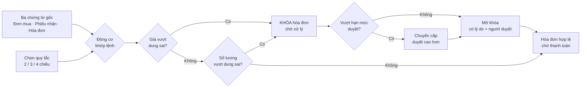

# 5000 Đối soát hóa đơn & 3-Way Match

Đây là **chốt chặn cuối cùng của dòng tiền ra**. Phía trước, doanh nghiệp đã kiểm soát *mình muốn mua gì* (yêu cầu), *mình đặt mua gì* (đơn mua) và *mình nhận được gì* (phiếu nhận). Bước này kiểm tra *nhà cung cấp đang yêu cầu thanh toán cho cái gì* — và đó là câu hỏi khác với cả ba câu trước.

Khớp lệnh trả lời một câu duy nhất: **hóa đơn này có trả cho đúng thứ ta đặt và đúng lượng ta nhận không?**

## 0. Nguyên lý (áp dụng mọi ERP)

1. **Có bốn cách khớp, chọn theo bản chất hàng hóa.** Hàng lưu kho cần khớp 3 chiều (đặt – nhận – hóa đơn). Dịch vụ không qua kho chỉ khớp 2 chiều (đặt – hóa đơn). Hàng yêu cầu kiểm định nghiêm ngặt cần khớp 4 chiều (thêm kết quả QC). Chọn sai cách khớp là hoặc trả tiền cho hàng không có, hoặc chặn tiền oan.
2. **So khớp trên giá trị trước thuế.** Thuế GTGT tách riêng khỏi phép so khớp số lượng/đơn giá, vì thuế suất có thể khác nhau giữa các dòng và thay đổi theo thời điểm.
3. **Không so khớp tuyệt đối 100% — phải có dung sai.** Luôn tồn tại sai số làm tròn, phụ phí nhỏ, chênh lệch vận chuyển. Dung sai biến "khóa hóa đơn" từ tắc nghẽn thành công cụ kiểm soát.
4. **Dung sai dương và dung sai âm không cùng bản chất.** Hóa đơn **cao hơn** PO/phiếu nhận là rủi ro thất thoát — phải kiểm soát chặt. Hóa đơn **thấp hơn** thường có lợi cho doanh nghiệp, hệ thống có thể tự cho qua.
5. **Điều kiện khóa là "HOẶC", không phải "VÀ".** Chỉ cần một loại sai lệch vượt ngưỡng riêng của nó là đủ khóa. Chờ tất cả cùng vượt là mở cửa cho rủi ro.
6. **Sai lệch tỷ giá không phải sai lệch giá mua.** Biến động tỷ giá là khách quan, ngoài tầm kiểm soát nhà cung cấp — hạch toán vào lãi/lỗ tỷ giá, không khóa hóa đơn, không gộp chung với chênh lệch giá mua.

## 1. Luồng vận hành



## 2. Ai làm gì ở module nào

| Bước | Mua hàng (PO) | Kho | Kế toán (AP) | Tài chính / Ban điều hành | Nhà cung cấp |
|---|---|---|---|---|---|
| Cấu hình quy tắc khớp theo nhà cung cấp / loại hàng | ✅ duyệt | Đề xuất theo yêu cầu QC | ✅ sở hữu tham số dung sai | ✅ duyệt chính sách dung sai | — |
| Nhập hóa đơn và chạy khớp lệnh | Hỗ trợ tra cứu PO | Cung cấp số lượng thực nhận | ✅ thực hiện | — | Xuất hóa đơn |
| Xác định sai lệch thuộc bên nào | ✅ làm việc với NCC | Xác nhận lại số lượng/QC | ✅ tính sai lệch | — | Giải trình |
| Duyệt mở khóa trong hạn mức | ✅ đồng duyệt khi sai lệch lớn | — | ✅ kế toán trưởng AP | ✅ CFO khi vượt hạn mức | — |
| Xuất hóa đơn điều chỉnh | ✅ yêu cầu NCC | — | ✅ đối trừ | — | ✅ phát hành credit memo |
| Chuyển sang thanh toán | — | — | ✅ | Duyệt chi | Nhận tiền |

**Ranh giới cốt lõi:** người **nhập hóa đơn** không được là người **mở khóa** hóa đơn đó; người **tạo PO** không được tự duyệt chênh lệch so với PO mình tạo.

## 3. Hạch toán

Bài này **không định nghĩa lại tài khoản**. Bút toán nhận hàng, tài khoản trung gian, chênh lệch giá mua (PPV/IPV) được định nghĩa duy nhất tại [Hạch toán & tài khoản trung gian](../6-ke-toan-chung/1000-hach-toan-va-tai-khoan-trung-gian.md).

Ba công thức cần thuộc (dùng khi giải thích sai lệch cho kế toán trưởng):

$$\text{IPV} = (\text{Đơn giá hóa đơn} - \text{Đơn giá PO}) \times \text{Số lượng hóa đơn}$$

$$\text{QV} = (\text{Số lượng hóa đơn} - \text{Số lượng thực nhận}) \times \text{Đơn giá PO}$$

$$\text{ERV} = (\text{Tỷ giá ngày hóa đơn} - \text{Tỷ giá ngày nhận}) \times \text{Giá trị ngoại tệ}$$

Ba điều kho cần nhớ:

1. **IPV ghi vào tài khoản chênh lệch giá mua**, không gộp vào giá trị kho — nếu gộp, giá vốn của lô sau sẽ sai.
2. **ERV ghi vào lãi/lỗ tỷ giá (TK 515/635)**, không gộp với IPV.
3. **Khớp lệnh luôn trên giá trị trước thuế** — thuế ghi riêng vào tài khoản thuế GTGT đầu vào.

## 4. Điểm chạm & rủi ro

- **Số lượng thực nhận để khớp**: [Nhận hàng & kiểm tra chất lượng](./4000-nhan-hang-va-kiem-qc.md)
- **Đơn giá gốc trên PO**: [Đơn mua hàng](./3000-don-mua-hang.md)
- **Giá theo hợp đồng khung** — đơn vị so khớp là từng release: [Danh mục & hợp đồng mua](./2000-danh-muc-va-hop-dong-mua.md)
- **Ghi nhận hóa đơn và trả tiền**: [AP - Nguyên lý & tài khoản](../5-cong-no/ap/1000-ap-nguyen-ly-va-tai-khoan.md)
- **Chênh lệch tỷ giá**: [Đối trừ công nợ, netting & đa tiền tệ](../5-cong-no/8000-cong-no-doi-tru-netting-va-tien-te.md)
- **Thuế GTGT đầu vào**: [Thuế & tài sản cố định](../6-ke-toan-chung/3000-thue-va-tai-san-co-dinh.md)

**Rủi ro chính:**

- **Khớp trùng một lô nhận cho hai hóa đơn** — trả tiền hai lần cho cùng một lô hàng.
- **Dung sai quá rộng** — hóa đơn lệch 5% tự động qua, thất thoát tích lũy không ai thấy.
- **Dung sai quá hẹp** — mọi hóa đơn bị khóa, AP tắc nghẽn, nhà cung cấp ngừng giao hàng.
- **Gộp chênh lệch tỷ giá vào chênh lệch giá** — báo cáo giá vốn sai, sai bản chất chi phí.
- **Mở khóa không có lý do và không lưu vết** — khe hở gian lận lớn nhất trong chuỗi AP.

## 5. Triển khai tham chiếu ERP

### A. Ánh xạ khái niệm

| Khái niệm | Oracle EBS R12 | Epicor ERP | SAP S/4HANA | Odoo |
|---|---|---|---|---|
| Quy tắc khớp theo NCC | `Invoice Match Option` trên Supplier Site | `AP Configuration > Tolerances` | Invoice Verification tolerance keys | `3-way matching` policy trên product/vendor |
| Khớp 3 chiều | `Match to Receipt` (`rcv_transaction_id`) | `AP Invoice Entry` dòng `Receipt Lines` (PackSlip) | MIRO với GR-based IV | `purchase.order` ↔ `stock.picking` ↔ `account.move` |
| Khớp 2 chiều | `Match to PO` | Dòng `PO Lines` | MIRO với PO-based IV | Tắt `receipt` control |
| Khớp 4 chiều | Inspection + Receipt | Inspection Processing trước khi nhận | Quality Usage Decision trước MIRO | QC point trên `stock.picking` |
| Dung sai | `Payables > Setup > Invoice > Tolerances` | `AP Configuration > Tolerances` | Tolerance keys (`DCP`/`DPO`/`DQ`) | Cần tùy biến |
| Khóa hóa đơn | System Hold (`PRICE`, `QTY REC`) | `InvoiceOnHold = 1` + `HoldReasonCode` | Blocked for Payment | Cần tùy biến |
| Mở khóa | Manual Release + `Release Code` | Bỏ `InvoiceOnHold` theo Role Security | Release Blocked Invoice | Cần tùy biến |

### B. Hệ thống tự xây — thiết kế tối thiểu

```sql
CREATE TABLE Invoice_Match_Tolerance (
    Tolerance_ID     INT IDENTITY PRIMARY KEY,
    Vendor_Class     VARCHAR(20) NULL,     -- NULL = mặc định
    Item_Class       VARCHAR(20) NULL,
    Qty_Ordered_Pct  DECIMAL(6,2) NULL,    -- % vượt số lượng đặt
    Qty_Received_Pct DECIMAL(6,2) NULL,    -- % vượt số lượng nhận
    Price_Pct        DECIMAL(6,2) NULL,    -- % vượt đơn giá PO
    Amount_Abs       DECIMAL(18,2) NULL,   -- dung sai số tiền tuyệt đối
    Is_Positive_Only BIT NOT NULL DEFAULT 1 -- 1 = chỉ áp dụng khi hóa đơn cao hơn
);

CREATE TABLE Invoice_Match_Result (
    Invoice_ID       BIGINT NOT NULL,
    Line_No          INT NOT NULL,
    PO_Line_ID       BIGINT NULL,
    Receipt_Line_ID  BIGINT NULL,
    Qty_Invoiced     DECIMAL(18,4) NOT NULL,
    Qty_Matched_Used DECIMAL(18,4) NOT NULL,  -- lũy kế đã khớp cho dòng nhận này
    Price_Variance   DECIMAL(18,4) NOT NULL,
    Qty_Variance     DECIMAL(18,4) NOT NULL,
    Hold_Code        VARCHAR(20) NULL,        -- NULL = khớp thành công
    PRIMARY KEY (Invoice_ID, Line_No)
);
```

Bốn ràng buộc bắt buộc:

1. **Cột `Qty_Matched_Used` phải lưu lũy kế trên dòng nhận**, và điều kiện `Qty_Invoiced + Qty_Matched_Used <= Qty_Received` phải kiểm tra trong transaction có khóa dòng.
2. **Khóa hóa đơn theo `Hold_Code`**, không dùng một cờ boolean duy nhất — cần biết khóa vì giá hay vì lượng.
3. **Mở khóa bắt buộc có `Release_Code` + `Release_Reason` + người duyệt + thời điểm.**
4. **Không cho sửa kết quả khớp đã ghi** — sửa bằng cách đảo và chạy lại, giữ lịch sử.

### C. Truy vấn kiểm soát

**Hóa đơn khớp vượt số lượng thực nhận — dấu hiệu trả tiền cho hàng không có:**

```sql
SELECT r.Invoice_ID, r.Line_No, r.Receipt_Line_ID,
       r.Qty_Invoiced, r.Qty_Matched_Used, rc.Qty_Received
FROM Invoice_Match_Result r
JOIN Receipt_Line rc ON rc.Receipt_Line_ID = r.Receipt_Line_ID
WHERE r.Qty_Invoiced + r.Qty_Matched_Used > rc.Qty_Received;
```

**Hóa đơn đang bị khóa quá 30 ngày — AP tắc nghẽn:**

```sql
SELECT Invoice_ID, Hold_Code, Hold_Date,
       DATEDIFF(DAY, Hold_Date, GETDATE()) AS Days_Held
FROM Invoice_Hold
WHERE Released_At IS NULL
  AND DATEDIFF(DAY, Hold_Date, GETDATE()) > 30
ORDER BY Days_Held DESC;
```

**Mở khóa không có lý do — khe hở kiểm soát:**

```sql
SELECT Invoice_ID, Released_By, Released_At, Release_Code, Release_Reason
FROM Invoice_Hold
WHERE Released_At IS NOT NULL
  AND (Release_Reason IS NULL OR LTRIM(RTRIM(Release_Reason)) = '');
```

**Oracle EBS — hóa đơn AP đang bị khóa do sai lệch giá hoặc lượng:**

```sql
SELECT hou.name AS operating_unit, aia.invoice_num, aia.invoice_date,
       aps.vendor_name, pha.segment1 AS po_number,
       ah.hold_lookup_code AS hold_reason, ah.hold_date,
       aia.invoice_amount
FROM ap_invoices_all aia
JOIN ap_holds_all ah      ON aia.invoice_id = ah.invoice_id
JOIN ap_suppliers aps     ON aia.vendor_id = aps.vendor_id
JOIN hr_operating_units hou ON aia.org_id = hou.organization_id
LEFT JOIN po_headers_all pha ON aia.po_header_id = pha.po_header_id
WHERE ah.release_lookup_code IS NULL
ORDER BY ah.hold_date DESC;
```

**Epicor — hóa đơn đang giữ thanh toán kèm lý do:**

```sql
SELECT ah.InvoiceNum, ah.InvoiceDate, v.VendorID, v.Name,
       ah.DocInvoiceAmt, ah.HoldReasonCode, hr.Description AS Hold_Reason
FROM Erp.APInvHed ah
JOIN Erp.Vendor v ON ah.Company = v.Company AND ah.VendorNum = v.VendorNum
LEFT JOIN Erp.HoldReason hr ON ah.Company = hr.Company AND ah.HoldReasonCode = hr.HoldReasonCode
WHERE ah.Company = 'YOUR_COMPANY_CODE'
  AND ah.InvoiceOnHold = 1
ORDER BY ah.InvoiceDate DESC;
```

## 6. Bẫy thực chiến & Checklist

| # | Bẫy | Triệu chứng | Cách phòng tránh |
|---|---|---|---|
| 1 | Không chốt số lượng đã khớp | Cùng một lô nhận bị khớp cho hai hóa đơn, trả tiền hai lần | Cột `Qty_Matched_Used` + kiểm tra lũy kế trong transaction có khóa |
| 2 | Dung sai quá rộng | Hóa đơn lệch 5% tự động qua, thất thoát tích lũy | Dung sai theo nhóm hàng/NCC, rà soát định kỳ |
| 3 | Dung sai âm bị chặn như dương | Hóa đơn thấp hơn PO cũng bị khóa, AP tắc vô lý | `Is_Positive_Only = 1` cho phần lớn trường hợp |
| 4 | Điều kiện khóa dùng "VÀ" | Hóa đơn lệch cả giá lẫn lượng nhưng không khóa vì mỗi cái dưới ngưỡng | Dùng "HOẶC": một cái vượt là khóa |
| 5 | Gộp chênh lệch tỷ giá vào IPV | Báo cáo giá vốn sai, sai bản chất chi phí | Tách `ERV` ghi vào lãi/lỗ tỷ giá |
| 6 | Mở khóa nhanh không lưu vết | Không biết ai mở khóa, vì sao, khi nào | `Release_Code` + `Release_Reason` bắt buộc, ghi User + Timestamp |
| 7 | Cùng người nhập hóa đơn và mở khóa | Gian lận tự duyệt hóa đơn sai của mình | SoD: người nhập ≠ người mở khóa ≠ người tạo PO |
| 8 | Không xử lý hóa đơn trước khi hàng về | AP từ chối nhập, dồn việc cuối kỳ | Trạng thái "chờ khớp lệnh", tự ghép khi hàng về |
| 9 | Hóa đơn điều chỉnh không liên kết hóa đơn gốc | Hóa đơn gốc giữ khóa vĩnh viễn, công nợ treo | Credit/Debit memo phải tham chiếu hóa đơn và dòng nhận gốc |
| 10 | Không khớp ở cấp dòng | Khóa cả hóa đơn vì một dòng lệch, dù các dòng khác đúng | Khớp và khóa ở cấp line-level |

**Checklist trước go-live:**

- [ ] Đã chọn đúng quy tắc khớp (2/3/4 chiều) cho từng nhóm hàng.
- [ ] Dung sai đã cấu hình được qua tham số, có phân biệt dương/âm.
- [ ] `Qty_Matched_Used` có kiểm tra lũy kế + khóa dòng (đã test hai hóa đơn song song).
- [ ] Điều kiện khóa là OR, không phải AND (đã test).
- [ ] ERV ghi tách khỏi IPV (đã test với PO ngoại tệ).
- [ ] Mở khóa bắt buộc lý do + lưu vết người/thời điểm (đã test không cho lưu trống).
- [ ] SoD: nhập hóa đơn / duyệt mở khóa / tạo PO là ba vai trò khác nhau.
- [ ] Có trạng thái "chờ khớp lệnh" cho hóa đơn về trước hàng.
- [ ] Có báo cáo hóa đơn bị khóa quá 30 ngày.
- [ ] Đã test luồng: PO 100 → nhận 90 → hóa đơn 95 → khóa lệch lượng → NCC credit memo → mở khóa.

## Xem thêm

- [Tổng quan Mua hàng](./0000-tong-quan-p2p.md)
- [Đơn mua hàng](./3000-don-mua-hang.md)
- [Nhận hàng & kiểm tra chất lượng](./4000-nhan-hang-va-kiem-qc.md)
- [Hạch toán & tài khoản trung gian](../6-ke-toan-chung/1000-hach-toan-va-tai-khoan-trung-gian.md)
- [AP - Nguyên lý & tài khoản](../5-cong-no/ap/1000-ap-nguyen-ly-va-tai-khoan.md)

<div align="center" style={{color: 'var(--ifm-color-primary)'}}>
  <strong>Chúc các bạn thành công và vui vẻ!</strong>
</div>
