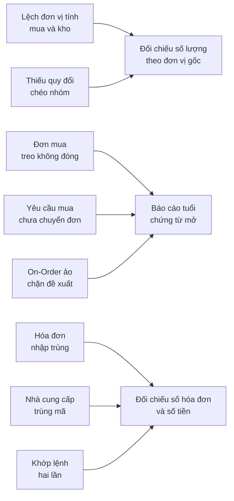

# 9000 Bẫy thực chiến mua hàng

Bài này gom các lỗi xuất hiện ở **nhiều doanh nghiệp khác nhau, nhiều hệ thống khác nhau**. Điểm chung: chúng không gây lỗi ngay khi xảy ra — hệ thống vẫn chạy, vẫn lưu, không báo gì. Chỉ khi đối chiếu hoặc kiểm toán mới phát hiện, và lúc đó thường đã tích lũy nhiều kỳ.

## 0. Nguyên lý (áp dụng mọi ERP)

1. **Lỗi nguy hiểm nhất là lỗi không báo lỗi.** Hệ thống chấp nhận dữ liệu sai và chạy tiếp. Vì vậy cần truy vấn kiểm soát định kỳ, không chỉ dựa vào validation.
2. **Mọi bẫy trong mua hàng đều quy về một trong ba gốc:** đơn vị tính không đồng nhất, chứng từ bị bỏ dở không đóng, hoặc dữ liệu nhập trùng.
3. **Phòng tránh rẻ hơn sửa.** Một ràng buộc ở tầng dữ liệu chặn được hàng trăm giờ dọn dẹp về sau.
4. **Bẫy phải có cách phát hiện, không chỉ có cách mô tả.** Mỗi bẫy trong bài này đều kèm truy vấn tìm ra các trường hợp đang tồn tại trong dữ liệu thực tế.

## 1. Luồng vận hành



## 2. Ai làm gì ở module nào

| Bẫy | Mua hàng (PO) | Kho | Kế toán | Người phát hiện sớm nhất |
|---|---|---|---|---|
| Lệch đơn vị tính | ✅ sửa đơn vị, làm việc NCC | ✅ phát hiện khi nhập | Đối chiếu giá trị | Kho, khi nhập hàng |
| Thiếu quy đổi chéo nhóm | ✅ bổ sung cấu hình | ✅ báo lỗi | — | Kho |
| Đơn mua treo | ✅ chủ trì đóng | Xác nhận số đã nhận | — | Mua hàng |
| Yêu cầu mua treo | ✅ chủ trì | — | Kiểm tra ngân sách | Người yêu cầu |
| On-Order ảo | ✅ đóng dòng dư | — | — | Sản xuất khi thiếu vật tư |
| Hóa đơn trùng | ✅ duyệt sai lệch | — | ✅ phát hiện khi khớp | Kế toán |
| Nhà cung cấp trùng | ✅ gộp | — | ✅ phát hiện khi đối chiếu | Kế toán |
| Khớp lệnh hai lần | ✅ duyệt | — | ✅ sở hữu kiểm soát | Kế toán |

## 3. Hạch toán

Các bẫy trong bài **không sinh bút toán sai ngay**, mà gây **hệ quả kế toán gián tiếp**:

- Lệch đơn vị tính → giá trị tồn kho lệch theo hệ số quy đổi.
- On-Order ảo → không đề xuất mua → đứt sản xuất → chi phí mua gấp phát sinh.
- Hóa đơn trùng → trả tiền hai lần cho một lô hàng.
- Nhà cung cấp trùng → dư nợ bị chia, có thể trả cả hai bên.

Nguyên tắc tài khoản và tất toán ở [Hạch toán & tài khoản trung gian](../5-ke-toan/ke-toan-tong-hop/1000-hach-toan-va-tai-khoan-trung-gian.md).

## 4. Điểm chạm & rủi ro

- **Nguyên lý quy đổi đơn vị tính** — định nghĩa duy nhất về UOM: [Nguyên lý quy đổi UOM](../0-nen-tang/3020-nguyen-ly-quy-doi-uom.md)
- **Thuộc tính đơn vị tính gốc của mã hàng**: [Item Master & thuộc tính kho](../1-kho/1010-item-master-va-thuoc-tinh-kho.md)
- **Số lượng thực nhận để đối chiếu**: [Nhận hàng & kiểm tra chất lượng](./2010-nhan-hang-va-kiem-qc.md)
- **Khớp lệnh và chống trùng hóa đơn**: [Đối soát hóa đơn & 3-Way Match](./2020-doi-soat-hoa-don-va-3-way-match.md)
- **Chống trùng nhà cung cấp**: [Danh mục & hợp đồng mua](./1010-danh-muc-va-hop-dong-mua.md)

## 5. Triển khai tham chiếu ERP

### A. Bốn bẫy lớn và cách phát hiện

**Bẫy 1 — Lệch đơn vị tính mua và kho**

Mua 10 BOX (1 BOX = 100 PCS), kho nhận 1.000 PCS. Báo cáo đối chiếu lấy số thô từ hai bảng khác đơn vị → chênh 990.

```sql
-- Luôn quy về đơn vị gốc trước khi so sánh
SELECT l.PO_No, l.Item_ID, l.UOM AS Order_UOM,
       l.Qty_Ordered, l.Qty_In_Base_UOM,
       ISNULL(SUM(r.Qty_Received), 0) AS Qty_Received_Base,
       l.Qty_In_Base_UOM - ISNULL(SUM(r.Qty_Received), 0) AS Diff
FROM PO_Line l
LEFT JOIN Receipt_Line r ON r.PO_ID = l.PO_ID AND r.Line_No = l.Line_No
GROUP BY l.PO_No, l.Item_ID, l.UOM, l.Qty_Ordered, l.Qty_In_Base_UOM
HAVING l.Qty_In_Base_UOM <> ISNULL(SUM(r.Qty_Received), 0);
```

**Nguyên tắc vàng:** mọi phép so sánh, cộng dồn phải quy về **đơn vị tồn kho (đơn vị nhỏ nhất)**. Chi tiết ở [Nguyên lý quy đổi UOM](../0-nen-tang/3020-nguyen-ly-quy-doi-uom.md).

**Bẫy 2 — Đơn mua và yêu cầu treo lâu ngày**

Đơn mở quá lâu làm `On-Order` luôn lớn, hệ thống không đề xuất mua, vật tư đứt mà không có cảnh báo.

```sql
-- Đơn mua mở quá 90 ngày, chưa nhận đủ
SELECT ph.PO_No, ph.Vendor_ID, ph.PO_Date, ph.Status,
       DATEDIFF(DAY, ph.PO_Date, GETDATE()) AS Days_Open,
       SUM(s.Qty) - ISNULL(SUM(r.Qty_Received), 0) AS Qty_Open
FROM PO_Header ph
JOIN PO_Shipment s      ON s.PO_ID = ph.PO_ID
LEFT JOIN Receipt_Line r ON r.PO_ID = s.PO_ID AND r.Line_No = s.Line_No
                        AND r.Shipment_No = s.Shipment_No
WHERE ph.Status NOT IN ('CLOSED', 'CANCELLED')
GROUP BY ph.PO_No, ph.Vendor_ID, ph.PO_Date, ph.Status
HAVING DATEDIFF(DAY, ph.PO_Date, GETDATE()) > 90
ORDER BY Days_Open DESC;
```

```sql
-- Yêu cầu mua đã duyệt nhưng chưa chuyển thành đơn quá 30 ngày
SELECT PR_No, Requester_ID, Cost_Center, Approved_At,
       DATEDIFF(DAY, Approved_At, GETDATE()) AS Days_Pending
FROM Purchase_Requisition
WHERE Status = 'APPROVED'
  AND DATEDIFF(DAY, Approved_At, GETDATE()) > 30
ORDER BY Days_Pending DESC;
```

**Bẫy 3 — Hóa đơn nhập trùng**

Hai hóa đơn cùng số, cùng nhà cung cấp, cùng số tiền. Không chặn ở tầng dữ liệu thì hệ thống sẽ trả hai lần.

```sql
SELECT Vendor_ID, Invoice_No, Invoice_Date, COUNT(*) AS So_Lan,
       SUM(Invoice_Amount) AS Tong_Tien
FROM AP_Invoice
WHERE Status NOT IN ('CANCELLED', 'VOID')
GROUP BY Vendor_ID, Invoice_No, Invoice_Date
HAVING COUNT(*) > 1
ORDER BY Tong_Tien DESC;
```

```sql
-- Hai hóa đơn khác số nhưng cùng tham chiếu một dòng nhận và cùng số tiền
SELECT r.Receipt_Line_ID, COUNT(DISTINCT i.Invoice_ID) AS So_Hoa_Don,
       SUM(m.Qty_Invoiced) AS Tong_Qty_Xuat_Hoa_Don, rc.Qty_Received
FROM Invoice_Match_Result m
JOIN AP_Invoice i        ON i.Invoice_ID = m.Invoice_ID
JOIN Receipt_Line rc     ON rc.Receipt_Line_ID = m.Receipt_Line_ID
JOIN Invoice_Match_Result r ON r.Receipt_Line_ID = m.Receipt_Line_ID
GROUP BY r.Receipt_Line_ID, rc.Qty_Received
HAVING SUM(m.Qty_Invoiced) > rc.Qty_Received;
```

**Bẫy 4 — Nhà cung cấp trùng mã**

Cùng một pháp nhân có hai mã, công nợ và thanh toán bị tách đôi.

```sql
SELECT Tax_Code, COUNT(*) AS So_Ma, STRING_AGG(Vendor_ID, ', ') AS Cac_Ma
FROM Vendor
WHERE Status = 'ACTIVE'
GROUP BY Tax_Code
HAVING COUNT(*) > 1;
```

**Epicor — đơn mua mở quá lâu:**

```sql
SELECT ph.PONum, ph.VendorNum, ph.OrderDate,
       DATEDIFF(DAY, ph.OrderDate, GETDATE()) AS Days_Open
FROM Erp.POHeader ph
WHERE ph.Company = 'YOUR_COMPANY_CODE'
  AND ph.OpenOrder = 1
  AND DATEDIFF(DAY, ph.OrderDate, GETDATE()) > 90
ORDER BY Days_Open DESC;
```

### B. Nhịp chạy kiểm soát

| Truy vấn | Tần suất | Người chịu trách nhiệm |
|---|---|---|
| Đơn mua mở quá 90 ngày | Hằng tuần | Mua hàng |
| Yêu cầu duyệt chưa chuyển đơn quá 30 ngày | Hằng tuần | Mua hàng |
| Hóa đơn trùng số / trùng tham chiếu | Hằng ngày | Kế toán AP |
| Nhà cung cấp trùng mã số thuế | Hằng tháng | Kế toán + Mua hàng |
| Đối chiếu số lượng theo đơn vị gốc | Trước mỗi kỳ khóa sổ | Kho |

## 6. Bẫy thực chiến & Checklist

| # | Bẫy | Triệu chứng | Cách phòng tránh |
|---|---|---|---|
| 1 | So sánh số lượng khác đơn vị tính | Báo cáo chênh hàng trăm đơn vị, hai phòng tranh cãi cả tuần | Luôn quy về đơn vị gốc trước khi so sánh |
| 2 | Test báo cáo chỉ với hàng hệ số quy đổi = 1 | Báo cáo "đúng" khi test, sai khi lên production | Test riêng với mã hàng có hệ số khác 1 |
| 3 | Lưu hệ số quy đổi dạng chia | Sai số làm tròn tích lũy, dư số lẻ không xóa được | Luôn lưu hệ số nhân từ đơn vị nhỏ |
| 4 | Đơn mua treo không đóng | `On-Order` ảo, không đề xuất mua, đứt vật tư | Job đóng đơn quá hạn + báo cáo hằng tuần |
| 5 | Yêu cầu mua đã duyệt chưa chuyển đơn | Người yêu cầu tưởng đã đặt hàng, thực tế chưa ai mua | Báo cáo tuổi chứng từ, nhắc người phụ trách |
| 6 | Hóa đơn trùng số | Trả tiền hai lần cho một lô hàng | Unique constraint `(Vendor_ID, Invoice_No)` |
| 7 | Khớp một dòng nhận cho nhiều hóa đơn | Cùng một lô bị hóa đơn nhiều lần | Cột `Qty_Matched_Used` + kiểm tra lũy kế |
| 8 | Nhà cung cấp trùng mã số thuế | Dư nợ chia đôi, có nguy cơ trả cả hai | `Tax_Code` UNIQUE + tìm trước khi tạo |
| 9 | Chỉ tin báo cáo "trông hợp lý" | Lỗi tồn tại nhiều tháng, phát hiện khi kiểm toán | Truy vấn kiểm soát định kỳ, đối chiếu với chứng từ gốc |
| 10 | Không có test với dữ liệu biên | Hệ thống chạy tốt với 10 dòng, sai với 10.000 dòng | Test với dữ liệu thật, có ca biên |

**Checklist trước go-live:**

- [ ] Mọi báo cáo so sánh số lượng đã quy về đơn vị gốc (đã test với mã hệ số ≠ 1).
- [ ] Không có phép chia nào lưu trong cấu hình quy đổi (đã rà).
- [ ] Có job đóng đơn mua quá hạn + báo cáo tuần.
- [ ] Có báo cáo tuổi yêu cầu mua đã duyệt chưa chuyển đơn.
- [ ] Unique constraint `(Vendor_ID, Invoice_No)` đã bật (đã test nhập trùng).
- [ ] Cột `Qty_Matched_Used` có kiểm tra lũy kế trong transaction.
- [ ] `Tax_Code` UNIQUE trên nhà cung cấp.
- [ ] Có quy trình tìm trước khi tạo nhà cung cấp mới (3 tiêu chí: tên, MST, tên viết tắt).
- [ ] 5 truy vấn ở §5.A có lịch chạy và người chịu trách nhiệm.
- [ ] Đã đối chiếu tay 1 tháng dữ liệu thật giữa báo cáo và chứng từ gốc.

## Xem thêm

- [Tổng quan Mua hàng](./0000-tong-quan-p2p.md)
- [Nguyên lý quy đổi UOM](../0-nen-tang/3020-nguyen-ly-quy-doi-uom.md)
- [Đối soát hóa đơn & 3-Way Match](./2020-doi-soat-hoa-don-va-3-way-match.md)
- [Nhận hàng & kiểm tra chất lượng](./2010-nhan-hang-va-kiem-qc.md)
- [Item Master & thuộc tính kho](../1-kho/1010-item-master-va-thuoc-tinh-kho.md)

<div align="center" style={{color: 'var(--ifm-color-primary)'}}>
  <strong>Chúc các bạn thành công và vui vẻ!</strong>
</div>
