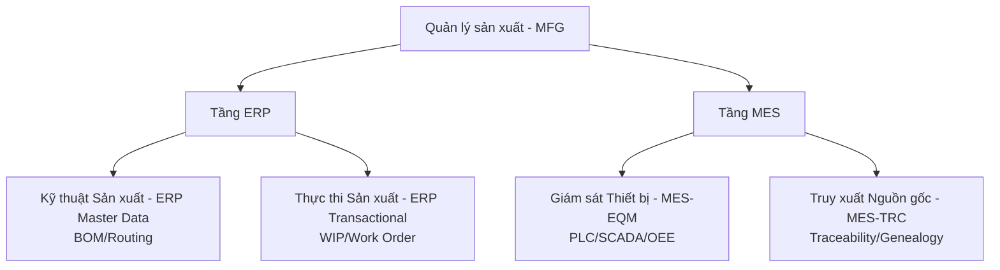

import DocCardList from '@theme/DocCardList';

# Quản lý sản xuất (MFG)

Nghiệp vụ Quản lý Sản xuất trong tài liệu này chia thành 2 tầng khác nhau về bản chất:

- **Tầng ERP (Master Data & Transactional)**: dữ liệu nền và nghiệp vụ phát sinh trong hệ thống hoạch định — Kỹ thuật sản xuất (BOM, Routing) và Thực thi sản xuất (Work Order, WIP).
- **Tầng MES (thời gian thực)**: hệ thống điều hành sản xuất tại xưởng — Giám sát thiết bị (PLC/SCADA/OEE) và Truy xuất nguồn gốc (Traceability/Genealogy).

## Sơ đồ 2 tầng

## Danh mục tài liệu

<DocCardList />