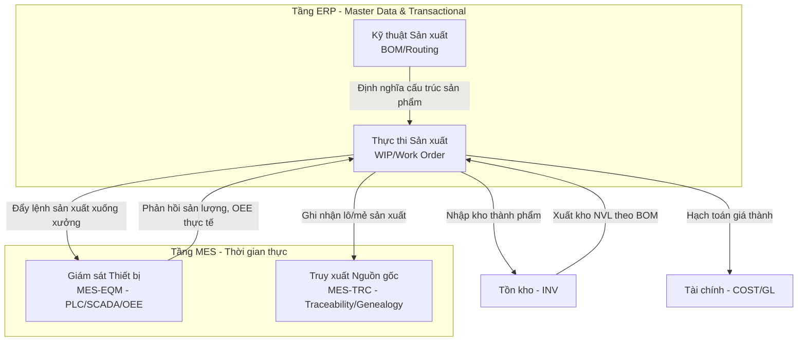

import DocCardList from '@theme/DocCardList';

# Quản lý sản xuất (MFG)

Nghiệp vụ Quản lý Sản xuất trong tài liệu này chia thành 2 tầng khác nhau về bản chất:

- **Tầng ERP (Master Data & Transactional)**: dữ liệu nền và nghiệp vụ phát sinh trong hệ thống hoạch định — Kỹ thuật sản xuất (BOM, Routing) và Thực thi sản xuất (Work Order, WIP).
- **Tầng MES (thời gian thực)**: hệ thống điều hành sản xuất tại xưởng — Giám sát thiết bị (PLC/SCADA/OEE) và Truy xuất nguồn gốc (Traceability/Genealogy).

Tầng ERP tiêu thụ nguyên vật liệu từ Chuỗi cung ứng (SCM), giao tiếp hai chiều với Tầng MES để đẩy lệnh sản xuất xuống xưởng và nhận lại dữ liệu thực thi, sau đó trả kết quả là thành phẩm cùng dữ liệu giá thành cho Tài chính kế toán (FIN).

## Tương quan phân hệ con với các ERP phổ biến

| Tầng | Phân hệ con trong tài liệu | SAP | Oracle EBS | Epicor |
|---|---|---|---|---|
| ERP | **Kỹ thuật Sản xuất** *(BOM/Routing - Master Data)* | PP (Production Planning) - Bills of Material, Routing | Bills of Material (BOM), Engineering | Engineering (Part, BOM, Method of Manufacturing) |
| ERP | **Thực thi Sản xuất** *(WIP/Work Order - Transactional)* | PP-SFC (Shop Floor Control) | Work in Process (WIP) | Production Management (Job Management) |
| MES | **Giám sát Thiết bị** *(MES-EQM - PLC/SCADA/OEE)* | SAP ME / MII (Manufacturing Integration & Intelligence) | Oracle MES for Discrete Manufacturing | Epicor MES / Advanced MES |
| MES | **Truy xuất Nguồn gốc** *(MES-TRC - Traceability/Genealogy)* | Batch Management + QM (Quality Management) | Genealogy (WIP/Lot & Serial) | Epicor Traceability (Lot/Serial Genealogy) |

## Sơ đồ 2 tầng & luồng dữ liệu

## Danh mục tài liệu

<DocCardList />

  <strong>Chúc các bạn thành công và vui vẻ!</strong>

