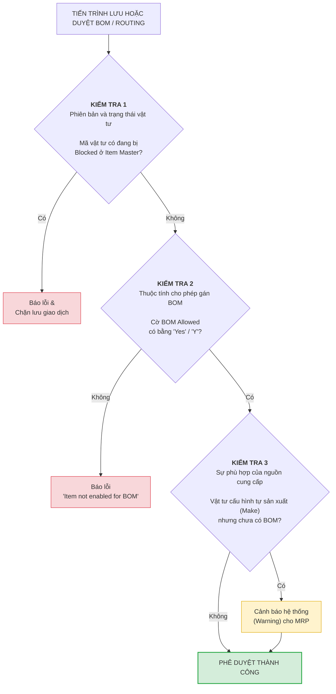

# 6020 - Đồng bộ Item Master & BOM/Routing

> **Lưu ý ranh giới nghiệp vụ:** Bài viết này tập trung vào khía cạnh **Kỹ thuật & Thiết lập dữ liệu gốc (Master Data Setup & Alignment)** - cách cấu hình thuộc tính trên Danh mục vật tư (Item Master) ảnh hưởng trực tiếp đến hành vi của BOM/Routing, ngăn ngừa xung đột dữ liệu giữa phân hệ Kho (Inventory) và Sản xuất (MFG) [2]. Đối với các nghiệp vụ giao dịch kho thực tế cấp phát vật tư hoặc bàn giao thành phẩm, vui lòng tham khảo các bài viết thuộc phân hệ Tồn kho (INV).

---

Định mức vật tư (BOM) và Quy trình công nghệ (Routing) không hoạt động trong một không gian tách biệt. Bản chất hành vi của chúng được quyết định trực tiếp bởi các cờ thuộc tính gán trên **Danh mục vật tư (Item Master)** thuộc phân hệ Kho (Inventory) [2]. 

Nếu một sản phẩm được cấu hình ở Item Master là sản phẩm mua ngoài (`Buy`) nhưng kế sư lại tạo BOM cho nó, hoặc một linh kiện con được cấu hình là không cho phép đưa vào BOM nhưng lại xuất hiện trong định mức, hệ thống ERP sẽ lập tức phát sinh lỗi xung đột dữ liệu chéo khi chạy MRP hoặc khi dập Lệnh sản xuất dở dang (WIP). Bài viết này phân tích sâu kiến trúc dữ liệu ràng buộc, thuật toán kiểm tra chéo và cách cấu hình đồng bộ trên **Oracle EBS, Epicor, SAP S/4HANA và Odoo** [2].

---

## 1. Bản đồ Kiến trúc dữ liệu đồng bộ (Synchronization Database Schema)

Để kiểm soát sự đồng bộ, các hệ thống ERP sử dụng các trường cờ hiệu (Boolean Flags) lưu trữ tại bảng thuộc tính hàng hóa để làm điều kiện lọc trước khi nạp dữ liệu vào phân hệ sản xuất:

| Thuộc tính đồng bộ | Oracle EBS | Epicor ERP | SAP S/4HANA | Odoo ERP |
| :--- | :--- | :--- | :--- | :--- |
| **Cho phép gán BOM (BOM Allowed)** | `BOM_ENABLED_FLAG` (Nếu đặt bằng 'N', hệ thống chặn không cho tạo BOM cho mã hàng này). | Không quản lý bằng cờ riêng. Hệ thống cho phép mở màn hình thiết kế MoM cho mọi mã Part. | `MARA.MSTAE` (Material Status - Nếu đặt trạng thái Block, hệ thống chặn tạo BOM/Routing). | Không có cờ riêng. Odoo cho phép tạo BoM cho bất kỳ sản phẩm nào hoạt động. |
| **Nguồn cung cấp (Make-or-Buy)** | `planning_make_buy_code` (`1` = Make - Tự sản xuất, `2` = Buy - Thu mua ngoài). | `Part.TypeCode` (`M` = Manufactured - Tự sản xuất, `P` = Purchased - Mua ngoài). | `MARC.BESKZ` (Procurement Type: `E` = In-house production, `F` = External procurement). | Cấu hình qua các Tuyến đường (**Routes** - Chọn cờ `Manufacture` hoặc chọn cờ `Buy`). |
| **Phương thức cấp phát (Supply Type)** | `wip_supply_type` (Cấu hình mặc định: Push, Pull, Bulk, Phantom gán chéo sang dòng BOM). | Không gán ở Item Master (Được quản lý thông qua thuộc tính dòng vật tư của MoM). | `MARC.SOBSL` (Special Procurement: ví dụ gán `50` cho Phantom, `30` cho Subcontracting). | Không gán ở Product Master (Quản lý trực tiếp bằng loại BoM Type trên BoM Header). |
| **Theo dõi Lô/Serial (Lot/Serial Track)** | `lot_control_code` và `serial_number_control_code` điều khiển hạch toán WIP. | `Part.TrackLots` và `Part.TrackSerial` (Bắt buộc khai báo khi nhập kho hoàn thành). | `MARC.XCHPF` (Batch management indicator - Cờ bắt buộc quản lý số lô sản xuất). | `product.template.tracking` (Cấu hình theo dõi theo Lô `lot` hoặc số `serial`). |

---

## 2. So sánh luồng thiết lập thuộc tính đồng bộ (UI Flows Comparison)

### a. Hệ thống Oracle EBS (Item Attribute Flags — Bảng: `MTL_SYSTEM_ITEMS_B`)
Oracle EBS quản lý tính đồng bộ thông qua các tab thuộc tính rất chi tiết tại màn hình Master Item:
1. **Bước 1 (Cho phép tạo BOM):** Vào `Inventory > Items > Master Items`, chọn tab `BOM`. Người dùng bắt buộc phải tích chọn cờ **`BOM Allowed`** (field DB: `bom_enabled_flag = 'Y'`). Nếu bỏ tích cờ này, khi kỹ sư vào phân hệ BOM thiết kế định mức, hệ thống sẽ báo lỗi không tìm thấy sản phẩm.
2. **Bước 2 (Cấu hình luồng MRP):** Chuyển sang tab `Planning`. Tại trường **`Make or Buy`** (field DB: `planning_make_buy_code`), người dùng chọn:
   - `Make`: MRP hiểu đây là thành phẩm tự sản xuất, tự động quét tìm BOM/Routing để dập Lệnh sản xuất.
   - `Buy`: MRP hiểu đây là nguyên liệu mua ngoài, chỉ sinh đề xuất mua hàng (Purchase Requisition), không phân rã BOM.
3. **Bước 3 (Gán phương thức cấp phát mặc định):** Chuyển sang tab `WIP`, chọn trường **`WIP Supply Type`** (field DB: `wip_supply_type` - ví dụ: chọn `Assembly Pull` để làm mặc định tự động trừ kho cho linh kiện này khi lắp ráp xong).

### b. Hệ thống Epicor ERP (Part Plant Settings — Bảng: `Erp.Part` / `Erp.PartPlant`)
Epicor kiểm soát đồng bộ dữ liệu gắn liền với thuộc tính Part Type và phương thức lưu kho:
1. **Bước 1 (Định nghĩa nguồn gốc Part):** Vào `Part Maintenance`, tại trường **`Type`** (field DB: `TypeCode`), người dùng chọn:
   - `Manufactured` (M): Tự chế tạo. Hệ thống bắt buộc phải thiết lập phiên bản MoM để MRP hoạt động.
   - `Purchased` (P): Mua ngoài. Hệ thống mặc định không yêu cầu MoM kỹ thuật.
2. **Bước 2 (Cấu hình Non-Stock):** Tại tab `Sites > Detail`, trường **`Non-Stock Item`** (field DB: `NonStock`):
   - Nếu tích chọn `True`: Hệ thống hiểu đây là hàng không lưu kho. Khi có đơn bán hàng SO, MRP sẽ tự động bỏ qua kiểm tra tồn kho và tạo thẳng Job sản xuất theo đơn đặt hàng (Make-to-Order).
   - Nếu bỏ tích `False`: Hệ thống hiểu đây là hàng lưu trữ kho (Make-to-Stock), MRP chỉ tạo đề xuất sản xuất khi tồn kho khả dụng bị thiếu hụt.

### c. Hệ thống SAP S/4HANA (Procurement & Status Keys — Bảng: `saphanadb.MARA` / `saphanadb.MARC`)
SAP quản lý đồng bộ rất chặt chẽ thông qua việc đối chiếu thuộc tính Procurement Type tại Material Master:
1. **Bước 1 (Cấu hình nguồn cung cấp):** Dùng T-Code `MM02` (MRP 2 view), tại trường **`Procurement Type`** (field DB: `BESKZ`), người dùng chọn:
   - Chọn `E` (In-house production): Tự sản xuất. Bắt buộc phải cấu hình Production Version gán kèm [2.1].
   - Chọn `F` (External procurement): Mua sắm ngoài.
   - Chọn `X` (Both): Vừa mua ngoài vừa tự sản xuất tùy thời điểm.
2. **Bước 2 (Khóa trạng thái vòng đời):** Tại view `Basic Data 1` của Material Master, trường **`X-plant matl status`** (field DB: `MARA-MSTAE`), nếu kỹ sư chọn mã trạng thái khóa (ví dụ: `01` - Blocked for Production), SAP sẽ chặn đứng không cho phép tạo BOM, Routing hay Lệnh sản xuất cho vật tư này.

### d. Hệ thống Odoo ERP (Product Routes & Tracking — Bảng: `product.template`)
Odoo tối giản hóa việc liên kết thông qua cấu hình Tuyến đường (Routes) và cơ chế theo dõi hàng hóa:
1. **Bước 1 (Thiết lập Tuyến đường cung ứng):** Trên form sản phẩm, tại tab `Inventory`, tại mục **`Routes`** (field DB: `route_ids`), người dùng chọn:
   - Tích chọn `Manufacture`: Odoo hiểu đây là hàng sản xuất và kích hoạt nút liên kết BoM.
   - Tích chọn `Buy`: Cung ứng theo luồng mua hàng ngoài.
2. **Bước 2 (Cấu hình quản lý Lô/Serial):** Tại mục `Tracking` (field DB: `tracking`), chọn loại theo dõi:
   - `By Lots` hoặc `By Unique Serial Number`: Khi cấu hình thuộc tính này, khi công nhân báo cáo hoàn thành sản xuất (MO) hoặc xuất kho dở dang, Odoo bắt buộc người dùng phải gán số lô/serial hợp lệ mới cho phép hoàn tất giao dịch.

---

## 3. Thuật toán Kiểm tra chéo Tính đồng bộ dữ liệu (Master Validation Logic)

Khi kỹ sư nhấn nút lưu BOM/Routing hoặc chạy tiến trình tính giá thành Standard Cost Rollup [2.1], hệ thống ERP sẽ tự động chạy thuật toán kiểm tra chéo (Cross-Validation Logic) để ngăn ngừa xung đột dữ liệu:


---

## 4. Giải quyết các bài toán sản xuất thực tế liên quan đến Đồng bộ dữ liệu

### Bài toán 1: Lỗi treo kế hoạch MRP khi cấu hình sai thuộc tính Make-or-Buy (Mâu thuẫn giữa Kho và Sản xuất)
*   **Thực tế:** Phòng R&D thiết kế ra một cụm bán thành phẩm mới là hộp tủ điện đã mạ kẽm (`SUB_CABINET`). Kỹ sư R&D thiết kế BOM và Routing đầy đủ cho mã này. Tuy nhiên, khi khai báo mã hàng `SUB_CABINET` tại Item Master, nhân viên phòng Kho lại cấu hình nhầm trường **`Make or Buy = Buy`** (Mua ngoài). Khi chạy MRP, hệ thống liên tục gặp lỗi treo hoặc đưa ra đề xuất mua hàng (Purchase Suggestion) gửi cho nhà cung cấp thay vì tạo Lệnh sản xuất con cho xưởng.
*   **Giải pháp thực tế:**
    - Hệ thống ERP sẽ chạy chương trình quét lỗi Master Data tự động hàng tuần (nhập sẵn các kịch bản kiểm tra bất thường).
    - Câu lệnh SQL kiểm tra chéo (quét các mã hàng cấu hình là BUY nhưng lại có phát sinh BOM/Routing dở dang) phát hiện ra mã `SUB_CABINET` đang bị cấu hình lệch thuộc tính chéo giữa phân hệ INV và MFG.
    - Hệ thống gửi cảnh báo yêu cầu phòng dữ liệu gốc chỉnh sửa trường `Make or Buy` từ `Buy` sang `Make` để đồng bộ đúng luồng vận hành sản xuất.

### Bài toán 2: Chặn rủi ro không đóng được Lệnh sản xuất do sai lệch thuộc tính quản lý Lô/Serial
*   **Thách thức:** Ban đầu, ốc vít loại đặc biệt `SCREW_SPECIAL` được khai báo là không quản lý theo Lô (No Lot-Tracking). Tuy nhiên, để đáp ứng tiêu chuẩn kiểm soát chất lượng mới của khách hàng ô tô, phòng Kho cập nhật lại thuộc tính của mã này trên Item Master thành **`Lot-Controlled`** (Bắt buộc theo dõi theo Lô). Khi đóng Lệnh sản xuất dở dang (WIP Job) đang dùng dở mã ốc này, hệ thống báo lỗi đỏ toàn bộ không cho đóng lệnh (Job Close Error) do các giao dịch trừ kho trước đó của ốc vít không hề có số lô kèm theo.
*   **Giải pháp thực tế:**
    - ERP lớn kiểm soát tính đồng bộ thời gian thực: Hệ thống chặn không cho phép đổi thuộc tính `Lot/Serial Control` trên Item Master nếu sản phẩm đó đang có các giao dịch dở dang chưa đóng hoàn toàn (Open Transactions / Open WIP Jobs).
    - Để sửa đổi, người dùng bắt buộc phải đóng toàn bộ các Job hiện hành đang dùng vật tư đó, hoặc làm thủ tục xuất trả tạm thời lượng vật tư cũ về kho, sau đó hệ thống mới cho phép mở quyền cập nhật thuộc tính Lô mới trên Item Master để đảm bảo tính toàn vẹn của dữ liệu dở dang (WIP Data Integrity).

---

## 5. Các câu lệnh SQL truy vấn kiểm tra chéo dữ liệu đồng bộ (Validation Queries)

### a. Trên hệ thống Oracle EBS (PL/SQL)
Truy vấn phát hiện các bất thường dữ liệu: tìm kiếm các mã hàng đang cấu hình thuộc tính tự chế tạo (`planning_make_buy_code = 1`) nhưng lại bị thiếu BOM hoặc thiếu Routing dập máy trên hệ thống:

```sql
SELECT 
    ood.organization_code AS "Org Code",
    msib.segment1 AS "Item Code",
    msib.description AS "Item Description",
    -- 1: Make (Tự sản xuất), 2: Buy (Mua sắm ngoài)
    DECODE(msib.planning_make_buy_code, 1, 'Make (Manufactured)', 2, 'Buy') AS "Make/Buy Status",
    msib.bom_enabled_flag AS "BOM Allowed? (Y/N)",
    -- Kiểm tra sự tồn tại thực tế của BOM
    CASE WHEN (SELECT COUNT(*) FROM apps.bom_bill_of_materials bbm WHERE bbm.assembly_item_id = msib.inventory_item_id AND bbm.organization_id = msib.organization_id) > 0 THEN 'Yes' ELSE 'No' END AS "BOM Exists?",
    -- Kiểm tra sự tồn tại thực tế của Routing
    CASE WHEN (SELECT COUNT(*) FROM apps.bom_operational_routings bor WHERE bor.assembly_item_id = msib.inventory_item_id AND bor.organization_id = msib.organization_id) > 0 THEN 'Yes' ELSE 'No' END AS "Routing Exists?"
FROM 
    apps.mtl_system_items_b msib
INNER JOIN apps.org_organization_definitions ood ON msib.organization_id = ood.organization_id
WHERE 
    ood.organization_code = 'V1'
    AND msib.planning_make_buy_code = 1 -- Chỉ lọc các mã cấu hình là Tự sản xuất (MAKE)
    -- Tìm kiếm bất thường dữ liệu chéo: cấu hình MAKE nhưng thiếu BOM hoặc thiếu Routing
    AND ((SELECT COUNT(*) FROM apps.bom_bill_of_materials bbm WHERE bbm.assembly_item_id = msib.inventory_item_id AND bbm.organization_id = msib.organization_id) = 0
         OR (SELECT COUNT(*) FROM apps.bom_operational_routings bor WHERE bor.assembly_item_id = msib.inventory_item_id AND bor.organization_id = msib.organization_id) = 0)
ORDER BY 
    msib.segment1;
```

### b. Trên hệ thống Epicor ERP (SQL Server)
Truy vấn phát hiện các sản phẩm tự chế tạo (`TypeCode = 'M'`) nhưng chưa hề được thiết kế và phê duyệt MoM (BOM/Routing) trên hệ thống Epicor:

```sql
SELECT 
    p.Company,
    p.PartNum AS [Part Number],
    p.Description AS [Part Description],
    p.TypeCode AS [Part Type Code], -- 'M' = Manufactured
    -- Đếm số lượng cấu hình MoM được Approved
    CASE WHEN (SELECT COUNT(*) FROM Erp.PartRev pr WHERE pr.Company = p.Company AND pr.PartNum = p.PartNum AND pr.Approved = 1) > 0 THEN 'Yes' ELSE 'No' END AS [Has Approved MoM?]
FROM 
    Erp.Part p
WHERE 
    p.Company = 'EP01'
    AND p.TypeCode = 'M' -- Lọc các sản phẩm tự sản xuất
    -- Tìm bất thường: sản phẩm Manufactured nhưng chưa có bất kỳ Revision nào được Approve hoạt động
    AND (SELECT COUNT(*) FROM Erp.PartRev pr WHERE pr.Company = p.Company AND pr.PartNum = p.PartNum AND pr.Approved = 1) = 0
ORDER BY 
    p.PartNum;
```

### c. Trên hệ thống SAP S/4HANA (HANA SQL)
Truy vấn phát hiện lỗi lệch dữ liệu của SAP S/4HANA: tìm kiếm các vật tư cấu hình tự sản xuất tại nhà máy (`BESKZ = 'E'`) nhưng lại bị thiếu cấu hình Phiên bản sản xuất (`MKAL`) gán kèm [2.1]:

```sql
SELECT 
    marc.WERKS AS "Plant",
    marc.MATNR AS "Material Code",
    marc.BESKZ AS "Procurement Type", -- E đại diện cho tự sản xuất
    -- Kiểm tra xem có tồn tại ít nhất 1 dòng Production Version trong bảng mkal [2.1]
    CASE WHEN (SELECT COUNT(*) FROM saphanadb.MKAL mkal WHERE mkal.MATNR = marc.MATNR AND mkal.WERKS = marc.WERKS) > 0 THEN 'Yes' ELSE 'No' END AS "Has Production Version?"
FROM 
    saphanadb.MARC marc
WHERE 
    marc.WERKS = '1000'
    AND marc.BESKZ = 'E' -- Lọc các sản phẩm tự sản xuất
    -- Tìm bất thường: sản phẩm In-house production nhưng thiếu hoàn toàn Production Version [2.1]
    AND (SELECT COUNT(*) FROM saphanadb.MKAL mkal WHERE mkal.MATNR = marc.MATNR AND mkal.WERKS = marc.WERKS) = 0
ORDER BY 
    marc.MATNR;
```

### d. Trên hệ thống Odoo ERP (PostgreSQL)
Truy vấn phát hiện lỗi đồng bộ của Odoo: lọc ra các sản phẩm đã cấu hình Tuyến đường sản xuất (Manufacture) nhưng lại bị thiếu định mức BoM dập lệnh hoạt động [2.1]:

```sql
SELECT 
    pt.name AS "Product Name Template",
    pt.type AS "Product Type",
    -- Kiểm tra sự tồn tại của BoM đang hoạt động [2.1]
    CASE WHEN (SELECT COUNT(*) FROM mrp_bom bom WHERE bom.product_tmpl_id = pt.id AND bom.active = true) > 0 THEN 'Yes' ELSE 'No' END AS "Has Active BoM?"
FROM 
    product_template pt
WHERE 
    pt.active = true 
    -- Tìm kiếm bất thường: cấu hình sản xuất nhưng thiếu BoM [2.1]
    AND (SELECT COUNT(*) FROM mrp_bom bom WHERE bom.product_tmpl_id = pt.id AND bom.active = true) = 0
    -- Lọc các sản phẩm có gán tuyến đường (Route) là sản xuất trong bảng quan hệ Many-to-Many
    AND EXISTS (
        SELECT 1 FROM product_route_product_template_rel rel
        INNER JOIN stock_route route ON rel.route_id = route.id
        WHERE rel.product_template_id = pt.id AND route.name ILIKE '%manufacture%'
    )
ORDER BY 
