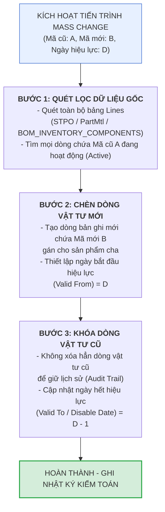

# 7010 - Thay đổi hàng loạt BOM/Routing

> **Lưu ý ranh giới nghiệp vụ:** Bài viết này tập trung vào khía cạnh **Kỹ thuật & Thiết lập hệ thống (Master Data Setup & Batch Maintenance)** - cách cấu hình bộ lọc, thiết lập quy tắc hoán đổi và chạy tiến trình thay đổi hàng loạt (Mass Change) cấu trúc BOM/Routing dưới nền hệ thống [2]. Đối với quy trình thực tế sửa đổi nóng (WIP Routing Bypass) hoặc hoán đổi vật tư trực tiếp ngoài hiện trường trên các Lệnh sản xuất đang bận, vui lòng tham khảo các bài viết thuộc phân hệ Thực thi sản xuất (WIP).

---

Khi nhà máy vận hành với hàng ngàn mã hàng, việc thay đổi một chi tiết chung xuất hiện trên diện rộng (ví dụ: thay thế loại Thùng carton đóng gói cũ bằng loại Thùng carton phân hủy sinh học thân thiện với môi trường trên 350 cấu trúc BOM; hoặc chuyển đổi 150 quy trình sơn từ dây chuyền hỏng sang dây chuyền dự phòng) là một gách nặng hành chính khổng lồ. Nếu thực hiện sửa thủ công từng BOM/Routing, phòng dữ liệu gốc sẽ mất hàng tuần làm việc và đối mặt với rủi ro sai sót sót thông tin cực kỳ lớn.

Để giải quyết bài toán này, các hệ thống ERP cung cấp công cụ **Thay đổi hàng loạt (Mass Change / Mass Maintenance)**. Bài viết này phân tích sâu kiến trúc dữ liệu chạy lô dưới nền, luồng vận hành và thuật toán quét-thế hàng loạt trên **Oracle EBS, Epicor, SAP S/4HANA và Odoo** [2].

---

## 1. Bản đồ Kiến trúc dữ liệu thay đổi hàng loạt (Mass Change Architecture)

Về mặt dữ liệu, công cụ Mass Change hoạt động như một thuật toán tự động quét qua toàn bộ cơ sở dữ liệu BOM/Routing, tìm kiếm các bản ghi thỏa mãn điều kiện lọc và thực hiện giao dịch cập nhật hàng loạt (Bulk Update) dưới nền cơ sở dữ liệu:

| Thành phần logic | Oracle EBS | Epicor ERP | SAP S/4HANA | Odoo ERP |
| :--- | :--- | :--- | :--- | :--- |
| **Bản chất kiến trúc** | Tích hợp tính năng Mass Changes trực tiếp bên trong phân hệ **Engineering (ENG)** thông qua ECO [2]. | Sử dụng các công cụ thay thế toàn cục chuyên dụng: **Mass Replace Part** và **Mass Replace Op** [2]. | Cung cấp hai công cụ Wizard chuẩn độc lập của phân hệ PP: **CS20** (BOM) và **CA85** (Routing/Work Center) [2]. | Sử dụng tính năng Export/Import Excel tiêu chuẩn của Odoo để cập nhật Bulk Update các dòng BoM Line [2]. |
| **Công cụ vận hành** | Giao diện **Mass Changes** của phân hệ Engineering [2]. | Trình thuật toán **Global Part Replacement** thuộc Engineering module [2]. | T-Code Chuẩn **`CS20`** (BOM Mass Change) và **`CA85`** (Replace Work Center in Task Lists) [2]. | Tính năng **Batch Export / Import** tại danh sách `mrp.bom.line` [2]. |
| **Bảng dữ liệu tác động** | `ENG_ENGINEERING_CHANGES` và các bảng sửa đổi `ENG_REVISED_ITEMS` [2]. | `Erp.PartMtl` (Materials) và `Erp.PartOpr` (Operations) [2]. | `saphanadb.STPO` (BOM Component) và `saphanadb.PLPO` (Routing Operation) [2]. | Bảng dòng nguyên vật liệu định mức **`mrp.bom.line`** [2]. |

---

## 2. So sánh luồng vận hành của trình thuật toán Mass Change (UI Flows)

### a. Hệ thống Oracle EBS (Cơ chế ECO Mass Changes — Bảng: `ENG_ENGINEERING_CHANGES` / `ENG_REVISED_ITEMS`)
Oracle EBS thực hiện thay đổi hàng loạt rất an toàn bằng cách bắt buộc phải thông qua một phiếu ECO để lưu vết lịch sử:
1. **Bước 1 (Tạo ECO gốc):** Người dùng tạo một phiếu ECO mới đại diện cho đợt thay đổi hàng loạt (ví dụ: `ECO_MASS_REPLACE_01`).
2. **Bước 2 (Thiết lập bộ lọc & quy tắc):** Truy cập màn hình `ENG > ECOs > Mass Changes`. Tại đây thiết lập:
   - `Action`: Chọn `Replace` (Thay thế).
   - `Old Component`: Chọn mã vật tư cũ cần loại bỏ (ví dụ: `BOX_OLD`).
   - `New Component`: Chọn mã vật tư mới thay thế (ví dụ: `BOX_NEW`).
3. **Bước 3 (Chạy tiến trình tự động):** Bấm nút `Create ECO`. Hệ thống Oracle EBS tự động quét toàn bộ cơ sở dữ liệu, tìm mọi BOM chứa `BOX_OLD`, tự động điền danh sách các sản phẩm cha bị tác động vào phiếu `ECO_MASS_REPLACE_01`. Khi ECO được Approved, hệ thống tự động cập nhật hàng loạt BOM.

### b. Hệ thống Epicor ERP (Global Part/Op Replacement — Bảng: `Erp.PartMtl` / `Erp.PartOpr` [2])
Epicor cung cấp hai chương trình thay thế trực tiếp độc lập cho cả Vật tư và Công đoạn [2]:
1. **Thay thế hàng loạt vật tư (Global Part Replacement):** Người dùng vào `Production Management > Engineering > Utilities > Mass Replace Part` [2]. Nhập mã vật tư cũ `MtlPartNum` cần thay thế, mã vật tư mới gán vào, và chọn cờ `Only Active Revisions` (Chỉ thay thế trên các Revision đang hoạt động). Bấm nút `Process` để hệ thống tự động cập nhật hàng loạt bảng `PartMtl` [2].
2. **Thay thế hàng loạt công đoạn (Mass Replace Op):** Truy cập `Mass Replace Op`, nhập mã công đoạn cũ cần thay thế và mã công đoạn mới (ví dụ: đổi toàn bộ bước sơn tay `PAINT_MANUAL` sang bước sơn máy tự động `PAINT_AUTO` trên 150 sản phẩm).

### c. Hệ thống SAP S/4HANA (CS20 & CA85 Mass Wizards — Bảng: `saphanadb.STPO` / `saphanadb.PLPO` [2])
SAP cung cấp hai T-Code chuyên sâu hoạt động dạng trình thuật toán Wizard từng bước:
1. **Thay thế hàng loạt vật tư (T-Code CS20):** Kế toán hoặc kỹ sư truy cập **`CS20`** (Mass Change BOM). Nhập mã vật tư cũ (field DB: `IDNRK`), chọn nhà máy (`Plant`) và nhập quy tắc thay thế: chọn `Replace Component`, nhập mã vật tư mới và ngày hiệu lực mới. SAP tự động quét chéo và thực hiện cập nhật hàng loạt bảng `STPO` [2].
2. **Thay thế hàng loạt Work Center (T-Code CA85):** Khi một máy chính bị hỏng dài ngày, điều độ viên dùng T-Code **`CA85`** (Replace Work Center in Task Lists). Nhập mã Work Center cũ và mã Work Center mới dự phòng. SAP tự động quét toàn bộ Routing (`PLPO`) và hoán đổi máy đồng loạt [2].

### d. Hệ thống Odoo ERP (Triết lý Batch Export/Import Excel — Bảng: `mrp.bom.line` [2])
Odoo không có sẵn giao diện Wizard để thay thế hàng loạt dưới dạng bấm nút trên màn hình BoM. Tuy nhiên, Odoo giải quyết cực kỳ linh hoạt thông qua sức mạnh của công cụ nhập xuất Excel [2]:
1. **Bước 1 (Quét lọc dữ liệu):** Vào màn hình danh sách `BoM Lines` (Dòng vật tư), lọc toàn bộ các dòng có chứa vật tư cũ cần thay thế (ví dụ lọc `BOX_OLD`).
2. **Bước 2 (Xuất file kiểm toán):** Chọn toàn bộ kết quả lọc, bấm nút `Export` sang file Excel [2]. File Excel xuất ra bắt buộc phải chứa cột `ID` (External ID của dòng BoM) và cột `Product` (Mã vật tư con).
3. **Bước 3 (Sửa đổi và Nhập lại):** Trên file Excel, người dùng sử dụng tính năng Replace của Excel để đổi toàn bộ `BOX_OLD` thành `BOX_NEW` chỉ trong 1 giây. Lưu file và thực hiện `Import` ngược lại vào Odoo [2]. Odoo sẽ tự đối chiếu External ID của dòng BoM và cập nhật ghi đè hàng loạt dữ liệu [2].

---

## 3. Thuật toán Quét & Thế hàng loạt dưới nền hệ thống (Scan & Replace Algorithm)

Khi một chương trình Mass Change được kích hoạt (ví dụ: T-Code `CS20` của SAP hoặc tiến trình chạy lô của Epicor/Oracle) [2], động cơ hệ thống sẽ thực thi thuật toán chạy ngầm qua 4 bước kiểm soát:


---

## 4. Giải quyết các bài toán sản xuất thực tế liên quan đến Mass Change

### Bài toán 1: Thay thế hàng loạt bao bì đóng gói thân thiện môi trường trên 350 thành phẩm
*   **Thách thức:** Nhà máy dệt may có 350 loại áo quần khác nhau đang cùng sử dụng túi nilon đóng gói cũ (`BAG_PLASTIC`). Để đạt chứng chỉ xanh, nhà máy quyết định kể từ ngày **25/11/2026** sẽ thay thế đồng loạt sang túi giấy tự phân hủy (`BAG_PAPER`) trên tất cả các BOM. Việc sửa thủ công 350 BOM là không khả thi.
*   **Giải pháp thực tế:**
    - Sử dụng công cụ **`CS20`** trên SAP S/4HANA (hoặc `Mass Replace Part` trên Epicor) [2].
    - Thiết lập điều kiện: Tìm vật tư `BAG_PLASTIC` tại nhà máy `1000` [2].
    - Thiết lập hành động: Thay thế bằng `BAG_PAPER` với ngày hiệu lực là `25/11/2026`.
    - Nhấn chạy chương trình. Chỉ trong chưa đầy 30 giây, hệ thống tự động cập nhật dải ngày hiệu lực: Khóa ngày sử dụng của túi nilon đến ngày 24/11 và kích hoạt túi giấy từ ngày 25/11 trên toàn bộ 350 BOM, loại bỏ hoàn toàn gánh nặng nhập liệu.

### Bài toán 2: Chuyển đổi hàng loạt quy trình sang Tổ máy dự phòng khi máy dập chính bảo trì dài ngày
*   **Thách thức:** Tổ máy dập tự động tốc độ cao `STAMP_AUTO` gặp sự cố nghiêm trọng, dự kiến phải dừng máy bảo trì lớn trong vòng 1 tháng. Có 120 sản phẩm cơ khí đang có quy trình công nghệ Routing gán chạy qua tổ máy này. Điều độ viên muốn chuyển hướng đồng loạt 120 quy trình này sang tổ máy dập tay thủ công `STAMP_MANUAL` dự phòng để kịp xếp lịch sản xuất trong tháng tới.
*   **Giải pháp thực tế:**
    - Sử dụng công cụ **`CA85`** (Replace Work Center in Task Lists) của SAP S/4HANA [2].
    - Nhập mã Work Center cũ cần thay thế: `STAMP_AUTO`.
    - Nhập mã Work Center mới thay thế: `STAMP_MANUAL`.
    - Tiến trình chạy ngầm của SAP tự động quét qua bảng `PLPO`, cập nhật hoán đổi trường mã thiết bị trên toàn bộ 120 quy trình công nghệ chỉ trong một mẻ xử lý duy nhất. Sau khi máy chính sửa xong, điều độ viên chỉ cần chạy lại `CA85` để chuyển hướng ngược lại cực kỳ nhanh chóng.

---

## 5. Các câu lệnh SQL truy vấn kiểm tra dữ liệu thay đổi hàng loạt

### a. Trên hệ thống Oracle EBS (PL/SQL - Kiểm tra lịch sử ECO Mass Change)
Truy vấn danh sách tất cả các dòng linh kiện của BOM đã được cập nhật thay thế hàng loạt thông qua một mã số hiệu ECO cụ thể:

```sql
SELECT 
    ood.organization_code AS "Org Code",
    eec.change_notice AS "ECO Number",
    eec.description AS "ECO Description",
    msib_p.segment1 AS "Affected Parent Item",
    msib_c1.segment1 AS "Old Component (Removed)",
    msib_c2.segment1 AS "New Component (Added)",
    erc.component_quantity AS "New Qty Per Assembly",
    erc.effectivity_date AS "Effective From Date"
FROM 
    apps.eng_engineering_changes eec
INNER JOIN apps.eng_revised_items eri ON eec.change_id = eri.change_id
INNER JOIN apps.eng_revised_components erc ON eri.revised_item_sequence_id = erc.revised_item_sequence_id
INNER JOIN apps.mtl_system_items_b msib_p ON eri.revised_item_id = msib_p.inventory_item_id AND eec.organization_id = msib_p.organization_id
INNER JOIN apps.mtl_system_items_b msib_c1 ON erc.old_component_item_id = msib_c1.inventory_item_id AND eec.organization_id = msib_c1.organization_id
LEFT JOIN apps.mtl_system_items_b msib_c2 ON erc.component_item_id = msib_c2.inventory_item_id AND eec.organization_id = msib_c2.organization_id
INNER JOIN apps.org_organization_definitions ood ON eec.organization_id = ood.organization_id
WHERE 
    eec.change_notice = 'ECO_MASS_REPLACE_01' -- Thay bằng mã ECO chạy hàng loạt của bạn
ORDER BY 
    msib_p.segment1;
```

### b. Trên hệ thống Epicor ERP (SQL Server - Kiểm tra các thay đổi hàng loạt của ECO Group)
Truy vấn kiểm tra các thay đổi vật tư dở dang đang nằm trong hàng đợi của nhóm thiết kế kỹ thuật ECO Group trước khi được duyệt ghi đè chính thức vào Epicor:

```sql
SELECT 
    em.Company,
    em.GroupID AS [ECO Group ID],
    em.PartNum AS [Parent Part Code],
    em.RevisionNum AS [Target Revision],
    em.MtlSeq AS [Material Sequence],
    em.MtlPartNum AS [Checked-out Component],
    em.QtyPer AS [Pending Qty Per],
    -- Ghi vết hành động thay đổi vật tư (A: Added, M: Modified, D: Deleted)
    CASE em.RowAction 
        WHEN 'A' THEN 'Added New Material'
        WHEN 'M' THEN 'Modified Quantity'
        WHEN 'D' THEN 'Deleted Material'
        ELSE em.RowAction 
    END AS [Bulk Action Code],
    em.ChangedBy AS [Operator]
FROM 
    Erp.EcoMtl em
WHERE 
    em.Company = 'EP01'
    AND em.GroupID = 'MASS_REPLACE_GRP' -- Thay bằng mã Group chạy thay thế hàng loạt của bạn
ORDER BY 
    em.PartNum, em.MtlSeq;
```

### c. Trên hệ thống SAP S/4HANA (HANA SQL - Kiểm tra các dòng BOM thay đổi bởi CS20)
Truy vấn kiểm tra toàn bộ các dòng vật tư BOM thuộc bảng `STPO` đã được tạo ra hàng loạt bằng công cụ `CS20` thông qua liên kết với mã số hiệu thay thế kế hoạch `AENNR`:

```sql
SELECT 
    m.WERKS AS "Plant",
    m.MATNR AS "Parent Material Code",
    i.POSNR AS "BOM Item Number",
    i.IDNRK AS "Component Material",
    i.MENGE AS "Quantity Standard",
    i.MEINS AS "UOM",
    i.DATUV AS "Valid From Date",
    i.AENNR AS "Created by Change Number (CS20)" -- Mã số hiệu khi chạy thay thế hàng loạt
FROM 
    saphanadb.MAST m
INNER JOIN saphanadb.STKO h ON m.STLNUM = h.STLNUM
INNER JOIN saphanadb.STPO i ON h.STLNUM = i.STLNUM
WHERE 
    m.WERKS = '1000'
    AND i.AENNR = 'CN_MASS_REP_01' -- Thay bằng mã Change Number chạy CS20 của bạn
    AND i.LKENZ = ' ' -- Chỉ lấy dòng đang hoạt động
ORDER BY 
    m.MATNR, i.POSNR;
```

### d. Trên hệ thống Odoo ERP (PostgreSQL - Kiểm tra dữ liệu cập nhật theo ngày chạy Import)
Do Odoo cập nhật thông qua luồng Import Excel, câu lệnh dưới đây giúp rà soát toàn bộ các dòng BoM Line được cập nhật/thay thế hàng loạt bởi người dùng vào ngày chạy tiến trình:

```sql
SELECT 
    pt_p.name AS "Parent Product Template Name",
    pt_c.name AS "Component Product Name",
    bl.product_qty AS "Standard Quantity",
    bl.write_date AS "Batch Modified Date",
    res_partner.name AS "Modified By (Admin/User)"
FROM 
    mrp_bom_line bl
INNER JOIN mrp_bom bom ON bl.bom_id = bom.id
INNER JOIN product_template pt_p ON bom.product_tmpl_id = pt_p.id
INNER JOIN product_product pp_c ON bl.product_id = pp_c.id
INNER JOIN product_template pt_c ON pp_c.product_tmpl_id = pt_c.id
LEFT JOIN res_users ON bl.write_uid = res_users.id
LEFT JOIN res_partner ON res_users.partner_id = res_partner.id
WHERE 
    -- Kiểm tra các dòng BoM bị thay đổi hàng loạt theo ngày chạy Import
    bl.write_date::date = '2026-11-25'::date -- Thay bằng ngày bạn chạy Import Excel thực tế
ORDER BY 
    pt_p.name;