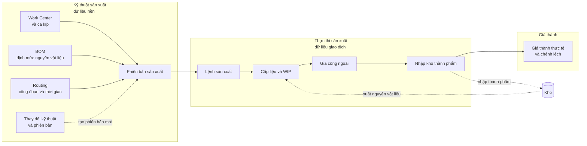

# Tổng quan Sản xuất (Plan-to-Produce)

Sản xuất là **khúc giữa** của dòng chảy: nhận nguyên vật liệu từ mua hàng, tạo ra thành phẩm cho bán hàng. Nó cũng là phân hệ duy nhất **tạo ra giá trị** — mua hàng chỉ chuyển quyền sở hữu, bán hàng chỉ chuyển hàng đi; chỉ sản xuất mới biến nguyên liệu thành thứ đáng giá hơn.

Nhưng chính vì đứng giữa, sản xuất chịu ảnh hưởng từ cả hai phía: mua trễ thì thiếu nguyên liệu, bán đổi đơn thì lệnh sản xuất phải sửa. Bài này mô tả toàn cảnh và ranh giới trách nhiệm.

## Sản xuất gồm hai tầng

**Đọc sơ đồ:** khối kỹ thuật là *dữ liệu nền, ít thay đổi*; khối thực thi là *giao dịch hằng ngày*; giá thành là *kết quả tổng hợp cuối cùng*. Sai ở tầng kỹ thuật sẽ làm sai hàng nghìn lệnh sản xuất về sau — đây là lý do tầng này phải được chốt trước khi go-live.

## Mỗi tầng trả lời một câu hỏi

| Câu hỏi | Bài chi tiết |
|---|---|
| Nhà máy có bao nhiêu năng lực, chạy mấy ca? | [Work Center & năng lực](./ky-thuat/1000-work-center-va-nang-luc.md) |
| Sản phẩm cần những gì? | [BOM & định mức](./ky-thuat/2000-bom-va-dinh-muc.md) |
| Làm qua những công đoạn nào, mất bao lâu? | [Routing & công đoạn](./ky-thuat/3000-routing-va-cong-doan.md) |
| Với sản phẩm này thì dùng BOM và Routing nào? | [Phiên bản sản xuất & quy mô lô](./ky-thuat/4000-phien-ban-san-xuat-va-lo.md) |
| Ai duyệt thay đổi kỹ thuật, có hiệu lực khi nào? | [Thay đổi kỹ thuật & ECO](./ky-thuat/5000-thay-doi-ky-thuat-va-eco.md) |
| Lệnh sản xuất đang ở đâu, đã tiêu bao nhiêu? | [Lệnh sản xuất & WIP](./thuc-thi/6000-lenh-san-xuat-va-wip.md) |
| Gửi nguyên liệu ra ngoài gia công thế nào? | [Gia công ngoài](./thuc-thi/7000-gia-cong-ngoai.md) |
| Chi phí thực tế chênh định mức bao nhiêu, vì sao? | [Giá thành sản xuất](./thuc-thi/8000-gia-thanh-san-xuat.md) |
| Cách triển khai đếm tuổi thọ khuôn trên Epicor? | [Triển khai Epicor: đếm số shot của khuôn](./thuc-thi/9100-trien-khai-epicor-shot-count-khuon.md) |

## Ranh giới trách nhiệm

| Việc | Sản xuất quyết định | Kho quyết định | Mua hàng quyết định | Kế toán quyết định |
|---|---|---|---|---|
| BOM, Routing, phiên bản | ✅ | — | — | — |
| Có đủ nguyên liệu để chạy lệnh | Đọc tồn khả dụng | ✅ giữ và cấp liệu | ✅ cung cấp theo tiến độ | — |
| Số lượng thực nhập thành phẩm | ✅ báo cáo sản lượng | ✅ ghi giao dịch | — | — |
| Ghi nhận chi phí WIP | ✅ cung cấp số thực tế | Ghi giá trị xuất kho | Ghi giá nhập | ✅ hạch toán |
| Đánh giá chênh lệch giá thành | Phân tích nguyên nhân | — | — | ✅ hạch toán và quyết định phân bổ |
| Mua nguyên vật liệu gì | Đề xuất từ MRP | Đề xuất từ tồn | ✅ quyết định và đặt | — |

Nguyên tắc: **kỹ thuật sản xuất chỉ được sửa qua quy trình thay đổi kỹ thuật**, không sửa trực tiếp BOM/Routing đang chạy. Sửa trực tiếp làm lệnh đang sản xuất dở bị đổi định mức giữa chừng.

## Sản xuất liên quan gì tới các phần khác

- **Kho** cấp nguyên vật liệu và nhận thành phẩm: [Giao dịch nhập, xuất & chuyển](../1-kho/3000-giao-dich-nhap-xuat-chuyen.md)
- **Mua hàng** cung cấp nguyên vật liệu theo nhu cầu MRP: [Đơn mua hàng](../2-mua-hang/3000-don-mua-hang.md)
- **Bán hàng** tạo nhu cầu sản xuất theo đơn và đọc ngày hoàn thành: [Tiếp nhận đơn & ATP](../4-ban-hang/2000-tiep-nhan-don-va-atp.md)
- **Kế toán** nhận chi phí WIP và hạch toán giá vốn: [Giá vốn & định giá tồn kho](../6-ke-toan-chung/2000-gia-von-va-dinh-gia-ton-kho.md)

## Bắt đầu đọc từ đâu

Nếu triển khai từ đầu, đọc theo thứ tự 1000 → 9000. Nếu đang xử lý sự cố, đi thẳng tới bài tương ứng:

- Lệnh sản xuất không chạy được vì thiếu nguyên liệu → [Lệnh sản xuất & WIP](./thuc-thi/6000-lenh-san-xuat-va-wip.md)
- Giá thành thực tế lệch định mức lớn → [Giá thành sản xuất](./thuc-thi/8000-gia-thanh-san-xuat.md)
- Thay đổi thiết kế nhưng hàng cũ vẫn sản xuất theo bản mới → [Thay đổi kỹ thuật & ECO](./ky-thuat/5000-thay-doi-ky-thuat-va-eco.md)
- BOM không khớp với hàng thực tế nhập kho → [BOM & định mức](./ky-thuat/2000-bom-va-dinh-muc.md)

  <strong>Chúc các bạn thành công và vui vẻ!</strong>

