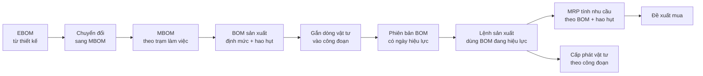

# 1010 BOM & định mức

BOM là **danh sách nguyên liệu** của sản phẩm. Nó quyết định ba việc lớn: MRP mua bao nhiêu, kho cấp phát bao nhiêu, và kế toán tính giá thành bao nhiêu. Sai một dòng định mức, cả ba đều sai.

Bài này gộp toàn bộ chủ đề BOM — từ cấu trúc đa cấp đến phân biệt EBOM/MBOM — vì chúng là các mặt khác nhau của cùng một dữ liệu nền.

## 0. Nguyên lý (áp dụng mọi ERP)

1. **BOM là dữ liệu nền, không phải dữ liệu giao dịch.** Một mã hàng có đúng **một** BOM đang hiệu lực tại một thời điểm. Muốn thay đổi, tạo phiên bản mới có ngày hiệu lực — không sửa đè.
2. **Mỗi dòng vật tư nên gắn với một công đoạn.** Khung xe tiêu hao ở công đoạn lắp khung, sơn tiêu hao ở công đoạn sơn. Gắn đúng công đoạn giúp cấp vật tư đúng lúc và trừ kho tự động (backflush) chính xác.
3. **Hao hụt là một tham số, không phải chuyện phải bù bằng tay.** Mỗi dòng cần `Scrap %` hoặc `Yield %`. Thiếu tham số này, MRP mua thiếu và thủ kho phải xin cấp bổ sung ngoài kế hoạch.
4. **EBOM và MBOM là hai tài liệu khác nhau cho hai người đọc khác nhau.** EBOM nói *sản phẩm được thiết kế thế nào* (theo cụm chức năng); MBOM nói *sản phẩm được chế tạo thế nào* (theo trạm làm việc, có thêm bao bì, keo, dung môi). Dùng EBOM để chạy MRP là thiếu vật tư tiêu hao.
5. **Phantom BOM không phải một cấp trong kho.** Nó là cụm lắp ghép trung gian không bao giờ tồn kho — nổ thẳng xuống vật tư con. Dùng sai làm MRP đặt mua những mã không bao giờ được lưu kho.
6. **BOM cấu hình (super BOM) sinh ra BOM cụ thể, không thay thế nó.** Super BOM chứa mọi lựa chọn; khi khách chọn cấu hình, hệ thống sinh BOM cụ thể cho lệnh sản xuất đó.

## 1. Luồng vận hành



## 2. Ai làm gì ở module nào

| Việc | Kỹ thuật (R&D) | Kỹ thuật sản xuất | Kho | Kế toán | Mua hàng |
|---|---|---|---|---|---|
| Tạo EBOM từ thiết kế | ✅ sở hữu | — | — |
| Chuyển EBOM sang MBOM | Cung cấp bản vẽ | ✅ sở hữu | Tham gia xác nhận UOM kho | — | — |
| Khai định mức và hao hụt | — | ✅ sở hữu | Cung cấp dữ liệu hao hụt thực tế | — | — |
| Gắn vật tư vào công đoạn | — | ✅ sở hữu | — | — | — |
| Duyệt và phát hành phiên bản BOM | ✅ duyệt kỹ thuật | ✅ phát hành | — | — | — |
| Chạy MRP từ BOM | — | ✅ chủ trì | — | — | ✅ nhận đề xuất |
| Cấp phát theo công đoạn | — | Báo cáo tiêu hao | ✅ ghi giao dịch | — | — |
| Đánh giá hao hụt thực tế so định mức | — | ✅ phân tích | Cung cấp số liệu | Nhận chênh lệch vào giá thành | — |

**Ranh giới cốt lõi:** **R&D sở hữu EBOM, sản xuất sở hữu MBOM.** Gộp hai vai trò này hoặc để R&D sửa trực tiếp MBOM đang chạy là nguồn gốc của mọi lệch định mức.

## 3. Hạch toán

BOM không sinh bút toán, nhưng nó là **công thức tính giá thành định mức**:

- Định mức × đơn giá vật tư = **chi phí nguyên vật liệu định mức** của sản phẩm.
- Hao hụt trong BOM làm tăng chi phí định mức — nếu không khai, giá thành định mức thấp hơn thực tế và luôn có chênh lệch bất lợi.
- Chênh lệch giữa vật tư **thực tế xuất** và **định mức BOM** là chênh lệch lượng (material usage variance) — phải được phân tích, không được gộp vào chi phí chung.
- Phantom BOM không sinh bút toán trung gian vì không có cấp tồn kho nào cho nó.

Bản đồ tài khoản ở [Hạch toán & tài khoản trung gian](../5-ke-toan/ke-toan-tong-hop/1000-hach-toan-va-tai-khoan-trung-gian.md); phân tích chênh lệch ở [Giá thành sản xuất](./2020-gia-thanh-san-xuat.md).

## 4. Điểm chạm & rủi ro

- **Dùng BOM khi tạo lệnh sản xuất**: [Lệnh sản xuất & WIP](./2000-lenh-san-xuat-va-wip.md)
- **Cấp phát và trừ kho theo công đoạn**: [Giao dịch nhập, xuất & chuyển](../1-kho/2000-giao-dich-nhap-xuat-chuyen.md)
- **Đơn vị tính gốc của mã hàng**: [Item Master & thuộc tính kho](../1-kho/1010-item-master-va-thuoc-tinh-kho.md)
- **Thay đổi BOM theo quy trình ECO**: [Thay đổi kỹ thuật & ECO](./1040-thay-doi-ky-thuat-va-eco.md)
- **Phiên bản BOM dùng cho sản xuất**: [Phiên bản sản xuất & quy mô lô](./1030-phien-ban-san-xuat-va-lo.md)

**Rủi ro chính:**

- **Dùng EBOM để chạy MRP** — thiếu vật tư tiêu hao, đóng gói, sản xuất dừng giữa chừng.
- **Không khai hao hụt** — MRP mua thiếu, luôn phải mua bổ sung gấp với giá cao.
- **Sửa BOM đang chạy** — lệnh sản xuất dở bị đổi định mức giữa đường, không truy được lô nào sản xuất theo BOM nào.
- **Phantom BOM khai thành BOM thường** — hệ thống đặt mua và giữ tồn những cụm không bao giờ lưu kho.
- **BOM vòng lặp** — A chứa B, B chứa A; MRP nổ BOM vô hạn hoặc treo.
- **Lệch đơn vị tính giữa BOM và Item Master** — định mức tính theo cái nhưng kho theo hộp, sai hệ số quy đổi.

## 5. Triển khai tham chiếu ERP

### A. Ánh xạ khái niệm

| Khái niệm | Oracle EBS | Epicor ERP | SAP S/4HANA | Odoo |
|---|---|---|---|---|
| BOM header | `BOM_BILL_OF_MATERIALS` | `Erp.Part` / `Erp.PartRev` | `STKO` + `MAST` | `mrp.bom` |
| BOM line | `BOM_INVENTORY_COMPONENTS` | `Erp.PartMtl` (khoá theo `PartNum + RevisionNum`) | `STPO` | `mrp.bom.line` |
| Ngày hiệu lực | `effectivity_date`, `disable_date` trên dòng | `PartRev.EffectiveDate` + `PartRev.Approved` | `DATUV` (Valid From) + ECN | Version hoặc tùy biến |
| Liên kết công đoạn | `operation_seq_num` | `PartMtl.RelatedOperation` → `PartOpr.OprSeq` | `PLMZ` (nối `STPO` ↔ `PLPO`) | `mrp.bom.line.operation_id` |
| Work center của công đoạn | `BOM_OPERATION_SEQUENCES.DEPARTMENT_ID` | `PartOpr.ResourceGrpID` | `PLPO.ARBID` → `CRHD.OBJID` | `mrp.routing.workcenter.workcenter_id` |
| EBOM / MBOM | Cùng bảng, phân biệt `assembly_type` | Không tách bảng — dùng `PartRev.Approved` | `MAST.STLAN` (BOM Usage) | PLM (`mrp.eco`) ghi đè khi duyệt |
| BOM tiêu hao (scrap) | `component_yield_factor` | `PartMtl.ScrapPercent` | `STPO.AUSCH` (Assembly scrap) | Trường scrap trên line |
| Phantom BOM | Assembly type tương ứng | `Part.MtlType = 'P'` | Special Procurement `50` (Phantom) | `bom.type = 'phantom'` |
| BOM cấu hình | Model / Option Class Item | Configurator (MoM) | Variant Configuration (Super BOM) | Variant + BOM per variant |

### B. Hệ thống tự xây — thiết kế tối thiểu

```sql
CREATE TABLE BOM_Header (
    BOM_ID           BIGINT IDENTITY PRIMARY KEY,
    Parent_Item      VARCHAR(50) NOT NULL,
    Version          INT NOT NULL DEFAULT 1,
    BOM_Type         VARCHAR(20) NOT NULL,  -- EBOM | MBOM | PHANTOM | CONFIG
    Base_Qty         DECIMAL(18,4) NOT NULL DEFAULT 1,  -- định mức tính cho bao nhiêu thành phẩm
    Effective_From   DATE NOT NULL,
    Effective_To     DATE NULL,
    Status           VARCHAR(20) NOT NULL,  -- DRAFT | APPROVED | SUPERSEDED
    UNIQUE (Parent_Item, Version)
);

CREATE TABLE BOM_Line (
    BOM_ID           BIGINT NOT NULL,
    Line_No          INT NOT NULL,
    Component_Item   VARCHAR(50) NOT NULL,
    Qty_Per          DECIMAL(18,4) NOT NULL,
    UOM              VARCHAR(10) NOT NULL,
    Scrap_Pct        DECIMAL(6,2) NOT NULL DEFAULT 0,
    Operation_Seq    INT NULL,
    Supply_Type      VARCHAR(20) NOT NULL DEFAULT 'PUSH', -- PUSH | PULL | BACKFLUSH
    Substitute_Group VARCHAR(20) NULL,
    PRIMARY KEY (BOM_ID, Line_No)
);
```

Sáu ràng buộc bắt buộc:

1. **Chỉ một BOM `APPROVED` cho một `Parent_Item` tại một thời điểm** — ràng buộc ở tầng dịch vụ khi duyệt.
2. **Không sửa dòng của BOM đã `APPROVED`**; thay đổi = tạo `Version + 1`.
3. **`Component_Item` không được là `Parent_Item`** và không tạo vòng lặp qua nhiều cấp — kiểm tra đệ quy khi lưu.
4. **`UOM` của dòng phải quy đổi được về UOM gốc của `Component_Item`** — nếu không, mọi báo cáo sẽ lệch.
5. **`Scrap_Pct` bắt buộc khai**, kể cả khi bằng 0 — để phân biệt "không hao hụt" với "chưa khai".
6. **`Operation_Seq` bắt buộc với `BOM_Type = 'MBOM'`** — vật tư phải gắn được vào công đoạn tiêu hao.

### C. Truy vấn kiểm soát

**BOM có vòng lặp — MRP sẽ treo hoặc nổ vô hạn:**

```sql
WITH RECURSIVE bom_tree AS (
    SELECT Parent_Item AS Root, Component_Item AS Node, 1 AS Lvl,
           CAST(Parent_Item + '>' + Component_Item AS VARCHAR(1000)) AS Path
    FROM BOM_Header h JOIN BOM_Line l ON l.BOM_ID = h.BOM_ID
    WHERE h.Status = 'APPROVED'
    UNION ALL
    SELECT t.Root, l2.Component_Item, t.Lvl + 1,
           CAST(t.Path + '>' + l2.Component_Item AS VARCHAR(1000))
    FROM bom_tree t
    JOIN BOM_Header h2 ON h2.Parent_Item = t.Node AND h2.Status = 'APPROVED'
    JOIN BOM_Line l2   ON l2.BOM_ID = h2.BOM_ID
    WHERE t.Lvl < 20
)
SELECT Root, Node AS Circular_Item, Path
FROM bom_tree
WHERE Node = Root;
```

**Vật tư trong BOM nhưng không có UOM quy đổi về UOM gốc — báo cáo sẽ sai hệ số:**

```sql
SELECT h.Parent_Item, l.Component_Item, l.UOM AS Bom_UOM, i.Base_UOM
FROM BOM_Header h
JOIN BOM_Line l   ON l.BOM_ID = h.BOM_ID
JOIN Item_Inventory_Attribute i ON i.Item_ID = l.Component_Item
WHERE h.Status = 'APPROVED'
  AND l.UOM <> i.Base_UOM
  AND NOT EXISTS (
      SELECT 1 FROM UOM_Conversion u
      WHERE u.Item_ID = l.Component_Item AND u.From_UOM = l.UOM);
```

**Dòng MBOM không gắn công đoạn — không backflush được:**

```sql
SELECT h.Parent_Item, h.Version, l.Line_No, l.Component_Item
FROM BOM_Header h
JOIN BOM_Line l ON l.BOM_ID = h.BOM_ID
WHERE h.Status = 'APPROVED'
  AND h.BOM_Type = 'MBOM'
  AND l.Operation_Seq IS NULL;
```

**Nhiều BOM đang hiệu lực cho cùng một thành phẩm:**

```sql
SELECT Parent_Item, COUNT(*) AS So_BOM
FROM BOM_Header
WHERE Status = 'APPROVED'
  AND Effective_From <= GETDATE()
  AND (Effective_To IS NULL OR Effective_To >= GETDATE())
GROUP BY Parent_Item
HAVING COUNT(*) > 1;
```

**Epicor — phiên bản BOM chưa duyệt nhưng vẫn được lệnh sản xuất dùng:**

```sql
SELECT j.JobNum, j.PartNum, j.RevisionNum, pr.Approved, pr.EffectiveDate
FROM Erp.JobHead j
JOIN Erp.PartRev pr
  ON pr.Company = j.Company AND pr.PartNum = j.PartNum
 AND pr.RevisionNum = j.RevisionNum
WHERE j.Company = 'YOUR_COMPANY_CODE'
  AND j.JobReleased = 1
  AND pr.Approved = 0;
```

## 6. Bẫy thực chiến & Checklist

| # | Bẫy | Triệu chứng | Cách phòng tránh |
|---|---|---|---|
| 1 | Dùng EBOM chạy MRP | Thiếu vật tư tiêu hao và bao bì, sản xuất dừng giữa chừng | Tách EBOM/MBOM, chỉ MBOM dùng cho MRP |
| 2 | Không khai hao hụt | MRP mua thiếu, luôn phải mua gấp giá cao | `Scrap_Pct` bắt buộc, kể cả bằng 0 |
| 3 | Sửa BOM đang hiệu lực | Lệnh dở bị đổi định mức, không truy được lô nào theo BOM nào | Version mới có ngày hiệu lực |
| 4 | Nhiều BOM cùng hiệu lực | MRP chọn ngẫu nhiên, kết quả thay đổi mỗi lần chạy | Ràng buộc một BOM APPROVED mỗi thời điểm |
| 5 | Phantom BOM khai thành BOM thường | Đặt mua và giữ tồn cụm không bao giờ lưu kho | `BOM_Type = 'PHANTOM'`, nổ thẳng xuống vật tư con |
| 6 | BOM vòng lặp | MRP treo hoặc nổ vô hạn | Kiểm tra đệ quy khi lưu, `Lvl < 20` khi truy vấn |
| 7 | Lệch UOM giữa BOM và Item Master | Định mức tính theo cái, kho theo hộp, sai hệ số | Kiểm tra quy đổi khi lưu dòng BOM |
| 8 | Dòng MBOM không gắn công đoạn | Không backflush được, phải cấp tay từng lần | `Operation_Seq` bắt buộc với MBOM |
| 9 | Dùng BOM chưa duyệt cho lệnh đã phát hành | Sản xuất theo thiết kế nháp | Chặn phát hành lệnh nếu BOM chưa APPROVED |
| 10 | Không có vật tư thay thế | Hết mã chính là dừng sản xuất | `Substitute_Group` cho các mã tương đương |

**Checklist trước go-live:**

- [ ] Chỉ MBOM được dùng cho MRP và cấp phát (đã test).
- [ ] `Scrap_Pct` có giá trị trên 100% dòng BOM.
- [ ] Đã test sửa BOM đang hiệu lực → hệ thống buộc tạo version mới.
- [ ] Chặn nhiều BOM APPROVED cùng thời điểm (đã test).
- [ ] Phantom BOM nổ thẳng, không sinh cấp tồn kho.
- [ ] Kiểm tra vòng lặp BOM (đã test với chuỗi A→B→A).
- [ ] 100% dòng BOM có UOM quy đổi được về UOM gốc.
- [ ] 100% dòng MBOM có `Operation_Seq`.
- [ ] Chặn phát hành lệnh sản xuất khi BOM chưa duyệt.
- [ ] Đã khai nhóm vật tư thay thế cho các mã có thể thay.

## Xem thêm

- [Tổng quan Sản xuất](./0000-tong-quan-san-xuat.md)
- [Work Center & năng lực](./1000-work-center-va-nang-luc.md)
- [Routing & công đoạn](./1020-routing-va-cong-doan.md)
- [Phiên bản sản xuất & quy mô lô](./1030-phien-ban-san-xuat-va-lo.md)
- [Thay đổi kỹ thuật & ECO](./1040-thay-doi-ky-thuat-va-eco.md)

<div align="center" style={{color: 'var(--ifm-color-primary)'}}>
  <strong>Chúc các bạn thành công và vui vẻ!</strong>
</div>
